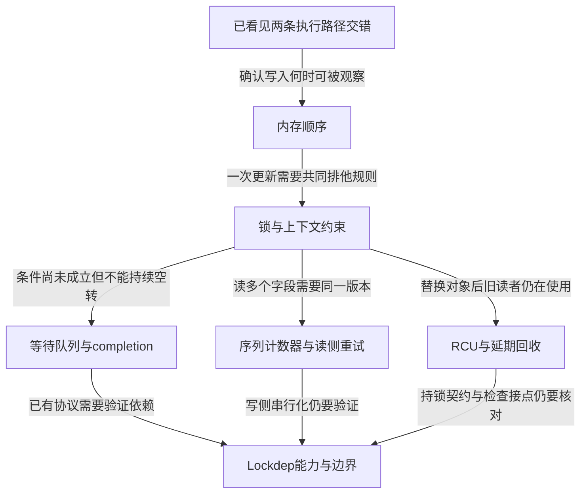

# 第1章\_Linux\_同步机制大纲

## 1.1\_从具体交错选择需要的保证

[执行路径先修](../P01_同一对象的多条执行路径.md#1.1_先把一次加一拆开) 已经展示同一个对象怎样被不同路径交错访问。接下来不急着背锁的名称：先确定共享的是哪份状态，错误发生在同时修改、观察顺序、读取快照、等待条件还是对象回收。不同机制补的是不同缺口，不能仅凭“并发场景”就认定它们互相替代。

默认先读内存顺序与锁，再根据对象的问题进入等待、快照或回收路线。图中的分支表达待证明的保证，不是所有应用必须依次装上的组件。

## 1.2\_带着前置结论进入各专题

每个专题都有自己的连续章节。下面只给出选择理由和交接问题，不在导航页重新讲一遍实现，也不要求先背后续实现家族。

| 现有认识与新问题 | 阅读入口 | 本专题能够建立 | 仍要交给谁解决 |
| --- | --- | --- | --- |
| 源码中先写后读，不等于其他参与者按同样顺序观察 | [Linux内存顺序](memory_ordering/大纲.md) | 编译器、CPU与Linux内存模型下的访问、排序及发布协议 | 互斥、等待和对象持有仍须自己的协议 |
| 更新需要一个共同临界区，但参与者能否睡眠不同 | [锁](locks/大纲.md) | 锁的取得、释放、本地重入和读写约束 | 业务条件何时成立不由锁自动决定 |
| 条件暂时不满足，等待者怎样睡下并避免错过变化 | [等待队列与完成量](waiting_notification/大纲.md) | 条件检查、入队、唤醒重检与完成交接 | 数据有效期和退出仍要与生产者配对 |
| 读多个字段时，需要判断是否跨过了一次写入 | [序列计数器](sequence_counters/大纲.md) | 写侧串行化与读侧重试形成快照 | 不能靠重试挽回已经释放的指针对象 |
| 高频读者仍持有旧对象，更新者不能立即回收 | [RCU](rcu/大纲.md) | 从锁方案缺口推导发布、旧读者边界和回收，先完成公共API，再进入实现比较 | 需要更长持有或可睡眠读取时，继续核对引用与保护域合同 |
| 已有同步协议，怎样检查使用顺序与上下文依赖 | [Lockdep](lockdep/大纲.md#1.1_专题定位) | 锁类依赖、IRQ状态和持锁契约的动态证据 | 未执行路径、未接入检查点或停检不能由“无告警”证明 |

RCU 的分类在其正文第四章出现：先知道要完成哪些职责，再区分保护域、实现和策略。普通 Tree 主线之后才引入可睡眠读者、任务轨迹和单 CPU 的变化，不把所有名称提前当作初读前提。Lockdep 则检查协议，不能替代锁的真实互斥语义；固定 Linux 6.12.20 的状态与调用链从 [源码总索引](../../../../research/source_reading/lockdep/navigation/P01_Linux_6.12_Lockdep源码导读.md#1.6_建议阅读顺序) 深入。

## 1.3\_把保证带到异步执行和退出路径

选出同步机制后，还要知道谁会继续执行工作。例如中断把状态交给工作项，不只是“稍后调用函数”：生产者写入哪份记录、消费者何时读取、停止时谁先退出，都需要带着上述保证一起设计。需要选择执行载体时进入 [异步机制大纲](../asynchrony/大纲.md)。

这两条路线应反复交叉：异步路径暴露新的参与者，同步协议为它们建立交接；同步等待若迟迟不完成，又要回到执行路径查明谁负责推进。对象何时可以最终释放，则继续核对 [对象生命周期](../../object_lifetime/kref/大纲.md)，不能只用“持有一把锁”代替引用和退出责任。
