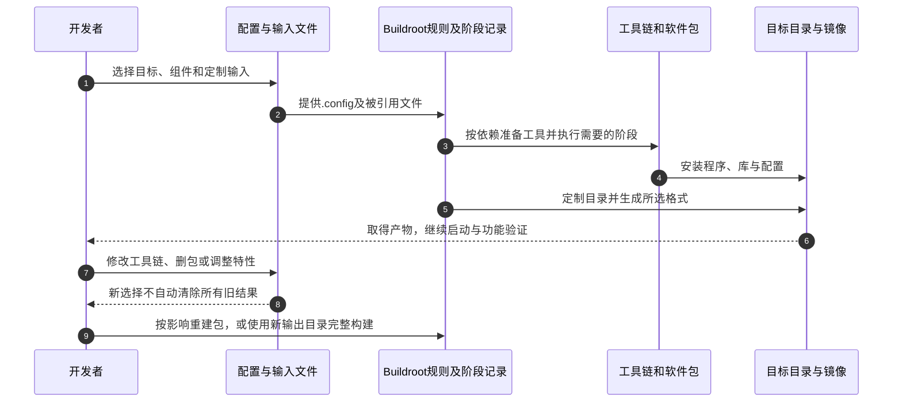

# 第1章\_从手工拼系统到可重复的构建输入

一块板已经能启动Linux，应用也已经在开发机上编译通过，为什么把程序复制过去仍然不能运行？可能是编译出的指令不是目标处理器能执行的，也可能是动态库、程序解释器或配置文件缺失。即使把这一次的问题逐个修好，下次换一台开发机、升级一个库，又怎样重建出相同设计的系统？

本专题从这个交付问题出发。先建立系统由哪些产物组成、这些产物怎样共同产生的模型，再进入工具链、包、根文件系统与镜像。本章只要求读者能在Linux终端中读写文件并执行命令；交叉编译、配置文件和构建目录的作用都在这里逐步建立。

## 1.1\_手工拼装能跑通一次却还缺一份完整记录

设我们要做一台ARM数据采集设备。它启动后运行一个C程序，定期读取传感器，将结果写入日志。先不讨论传感器驱动，设备至少需要能启动的内核、供程序使用的库、启动程序所需的用户空间文件，以及读取这些文件的存储布局。

手工方式完全可以实现这个目标：准备交叉编译器，编译Linux和BusyBox，把所需库与应用放到一个目录，再打包。BusyBox是一个项目专名，它把许多常见命令的实现放在同一个可执行程序中，通过不同入口提供shell、文件操作等功能；它不是内核，也不包含设备所需的全部软件。

手工方法的价值是过程直接，适合验证一个驱动、学习一次链接或排查一个库。但是当我们把应用链接到新版库后，交付目录可能还留着旧版库；另一个开发者重建时又可能漏掉曾经手工改过的启动脚本。编译命令成功只说明各自这次处理的输入通过了检查，没有哪个步骤自动记录“最终系统应当包含哪一组文件”。

问题于是从“能否编译”变成“怎样把共同构成一个系统的输入和顺序保存下来”：版本与补丁从哪里来，谁先提供头文件和库，哪些文件装入目标目录，怎样生成最终镜像。手工脚本也能承担这些责任；当组件越来越多，团队便需要维护依赖、下载、配置、安装和打包的一整套规则。

**Buildroot** 是将这些规则组织起来的嵌入式Linux构建系统。它在构建机上读取配置，取得组件源码或外部工具链，按依赖构建并安装，最后生成所选择的镜像。它通常用于构建功能明确的设备系统；既可以负责工具链、内核、引导程序和用户空间，也可以只负责其中一部分，例如沿用已有工具链和内核，只生成根文件系统。

自动化改变的是操作如何被记录和重放。它不会替团队决定传感器是否匹配板卡，也不会凭一次成功的make证明软件没有缺陷。我们仍需固定输入、审查修改并在目标环境验证输出。

## 1.2\_先分清构建机上的工具与目标机上的系统

**构建机** 是执行下载、编译和打包的Linux环境，Buildroot手册常称它为host。**目标机** 是最终运行所生成系统的设备或模拟机器，称为target。两者可以采用不同处理器架构，也可以采用相同架构；即使指令架构相同，目标库、启动方式和系统配置仍可能不同。

**交叉编译工具链（Cross-compilation toolchain）** 是在构建机上运行、为目标环境生成程序的一组工具。编译器、汇编器和链接器自己是构建机程序；它们输出的应用和运行库面向目标机。后面阅读第三方构建系统的build/host/target选项时，还要按那个系统的定义核对，不能仅按相同单词机械代入。

**根文件系统（Root filesystem，rootfs）** 在本专题中首先表示目标系统从根目录开始使用的一组文件与目录，例如程序、库和配置。把它制成ext4等格式后，得到相应的文件系统镜像。**镜像（Image）** 是按某种布局保存的内容文件；一个rootfs镜像并不天然包含分区表、内核或引导程序。

**引导程序（Bootloader）** 负责平台启动阶段的装载与交接，U-Boot是常见实现之一。Linux内核初始化相应硬件和机制，准备根文件系统并启动第一个用户空间程序；通常由init程序继续组织服务和登录入口。init可以有多种实现，不应把某个固定路径不存在当作所有启动失败的唯一原因。


图中箭头是构建和交付关系，不是说每次启动都要在板上运行Buildroot。也不是所有目标都经由U-Boot：本章稍后的QEMU实验直接装载内核，用来观察系统构建，暂不验证真实板卡的启动ROM、DDR初始化或存储偏移。

| 对象 | 承担的事情 | 单独存在还不能证明什么 |
| --- | --- | --- |
| 交叉工具链 | 生成符合目标环境的程序及库 | 不能证明板卡已具有正确驱动 |
| Linux内核镜像 | 提供内核执行代码和所选功能 | 不能代替用户空间程序及配置 |
| rootfs镜像 | 保存所选用户空间内容及文件系统元数据 | 不一定包含可启动整盘布局 |
| 板级引导产物 | 按平台要求参与装载与交接 | 不能仅凭文件名判断烧写位置 |
| 项目构建配置 | 记录本版本构建系统识别的选择 | 不包含所有外部文件内容和宿主环境 |

## 1.3\_配置选择组件而依赖决定谁先提供什么

Buildroot使用 **Kconfig配置系统** 表达可选项、条件和选择结果。`make menuconfig`打开终端配置界面，保存后得到`.config`；它是当前构建的完整配置记录。终端界面要先编译自己的配置工具，因此宿主编译器和界面开发库缺失时，失败还没有进入目标系统构建。

**defconfig** 是相对于某个Buildroot版本默认值保存的精简配置。加载它会恢复该版本下的完整选择；`savedefconfig`负责保存，不是退出menuconfig时自动生成所有项目交付文件。省略的选项依赖默认值，因此同一个defconfig换到另一版本，并不能保证恢复完全相同的系统。

以采集程序依赖一个目标库为例，库必须先把目标头文件和可链接文件装到开发环境，程序才可配置和链接；而镜像制作工具必须能在构建机运行。Buildroot用包规则区分这些动作。配置系统回答“这个包是否可选、选择了什么”，Make规则回答“有哪些构建前提、怎样下载和执行阶段”，两者一起维护，不能只加一个菜单选项就认为包已集成。

一次普通包处理通常经历获取、解包、补丁、配置、构建、安装。构建结果和阶段记录保存在输出目录，后续make可以利用已有结果。这是增量处理，不是每次从零重建；但它也不意味着Buildroot会自动推导所有配置变化的影响。



例如，取消一个包的选择，旧输出目录里已经安装的文件不会因此全部自动卸载；新增一个可选库，也不会自动让所有已构建程序重新探测并启用它。目标架构、C库等基础变化通常要求完整重建。我们先记住“配置与已有输出可能不一致”这个问题，后面的包生命周期和调试章再说明具体重建入口。

## 1.4\_从输出位置判断文件承担的职责

默认输出目录名为`output`，使用`O=`可以指定另一目录。下面描述这些目录的实际用途；命令中的`br_out`表示本次指定的输出目录，而不是Buildroot新增的配置选项。

| 位置 | 谁写入、谁消费 | 正确观察方式 |
| --- | --- | --- |
| `dl/`或配置的下载目录 | 下载基础设施缓存源码归档，后续解包使用 | 核对源码身份与哈希；缓存存在不等于已编译 |
| `output/build/` | 各组件的源码、配置、构建结果与阶段记录 | 定位具体失败阶段；不把临时修改当项目输入保存 |
| `output/host/` | 安装供构建机执行的工具，并包含目标工具链的开发环境 | 工具自身在构建机运行，不意味着其中所有内容都是宿主库 |
| `output/staging/` | 指向host内部目标sysroot的符号链接 | 查目标头文件、库与开发文件，供其他目标包构建 |
| `output/target/` | 包安装与定制步骤汇集近似目标目录树 | 可查文件内容，但设备节点、属主和权限等尚不能按部署结果理解 |
| `output/images/` | 镜像步骤写入所选内核、rootfs等产物 | 按该板或模拟机的装载规则使用，不能一律当整盘镜像 |

这里的 **sysroot** 是供工具链查找目标头文件和库的目录根。它包含编译开发需要的内容；目标运行目录通常只需要所选程序和运行库，两者不能互相替代。第二章再解释它怎样参与编译器建立过程。

打包时还要把目标权限、属主和必要节点写入最终格式。Buildroot可在普通用户构建中借助fakeroot等工具完成相应元数据处理；这不等于把构建机当前目录的真实权限永久变成目标权限。整盘布局则可能再由genimage等工具组合多个产物，但并非每个配置都使用它或生成`sdcard.img`。

因此不要直接把target目录复制到板上当最终交付物，也不要用“可以chroot进去”检验它是否正确。chroot只改变进程看到的根目录，不会把ARM程序转换成x86程序；跨架构执行与最终文件系统元数据都是额外条件。先看目录帮助定位问题，部署则使用经过正确制作和验证的产物。

## 1.5\_用固定QEMU配置观察第一次构建

本专题的具体规则核对固定在 **Buildroot 2025.02** 官方发布包；它是解释用历史基线，不是“当前最新版本”的推荐。其发布、归档摘要、原始手册和配置见 [Buildroot资料基线](../../../research/source_reading/buildroot/SOURCE_BASELINE.md#1.1_解释版本与归档身份)。本章QEMU配置中的Linux为6.12.9，不能与本仓库另一个NXP Linux源码研究基线混用。

以下命令在Linux构建环境中执行，当前Windows终端不能直接替代。需要普通用户权限、可用网络、足够的磁盘与内存，以及宿主C/C++编译器、GNU Make、binutils、Bash、下载和解包工具、patch、rsync、cpio、file等。使用menuconfig还需ncurses开发库。本版本手册的必需工具按用途列在下表，选入额外包可能增加宿主需求。本次没有执行实际构建，以下输出均是应核对的预期。

| 宿主能力 | 2025.02手册要求 |
| --- | --- |
| 编译与链接 | GNU Make至少3.81，GCC/G++至少4.8，binutils；Debian系列常由build-essential提供一组基础编译工具 |
| shell与文本处理 | Bash、which、sed、diffutils、findutils、bc，Perl至少5.8.7 |
| 下载与文件操作 | wget、patch、gzip、bzip2、tar、cpio、unzip、rsync；file须可在`/usr/bin/file`找到 |
| 终端配置界面 | 使用menuconfig时提供ncurses运行库及开发文件；预置defconfig流程不需要先打开该界面 |

这些是版本化的工具要求，不是建议安装古老编译器。发行版包名和额外目标包依赖要按实际构建机核对。Windows用户可准备Linux虚拟机等构建环境，不能把PowerShell命令行当成这些Linux工具的等价组合。

先从官方归档取得2025.02并按所列摘要核对，在Linux中解压进入`buildroot-2025.02`目录。所有命令都保持在该源码根目录执行；选用一个此前未使用、路径不含空格的独立输出目录：

```sh
br_out="$PWD/../br_out_qemu_aarch64_2025_02"
make O="$br_out" qemu_aarch64_virt_defconfig
```

`O=`把构建结果隔离到给定目录；`qemu_aarch64_virt_defconfig`加载这份发布包已有的模拟机配置。QEMU是机器模拟器，此处模拟AArch64 virt平台。默认配置已经选择目标架构、内核、ext4根文件系统以及宿主QEMU，读者先保持配置不变，以减少第一次观察的变量。

```sh
make O="$br_out"
```

这个make按配置处理依赖和产物。构建耗时受下载、宿主资源和组件选择影响，不承诺分钟级完成。若失败，先记录首个具体失败阶段及错误；不要把未完成的images目录当成功结果，也不要用反复更换全局环境变量掩盖错误。

成功后检查：

```sh
test -s "$br_out/images/Image"
test -s "$br_out/images/rootfs.ext4"
test -x "$br_out/images/start-qemu.sh"
ls -l "$br_out/staging"
```

前三条分别要求内核、rootfs非空及启动脚本可执行；任一失败都要先处理，不能继续宣称构建闭环。第四条观察staging的链接目标。此配置的post-image步骤根据板目录中的启动说明生成脚本，默认会把本次host工具路径放到PATH中，因此不必猜本机另装的QEMU版本。

```sh
"$br_out/images/start-qemu.sh" serial-only
```

`serial-only`把串口交互放在当前终端。预期先出现内核启动信息，随后出现用户空间的登录提示。出现内核输出仅证明内核已经执行到相应位置；出现登录提示还证明根文件系统、init和登录进程至少沿该路径运行。它们都不证明真实采集硬件可用，也不证明全部网络和存储功能通过测试。终端模式可用Ctrl-a再按x退出模拟器，按键含义见 [QEMU终端复用说明](https://www.qemu.org/docs/master/system/mux-chardev.html)；这不是目标系统的完整关机验证。

最后把配置保存到输出目录中的明确位置，避免覆盖发布包自带的板配置：

```sh
make O="$br_out" savedefconfig BR2_DEFCONFIG="$br_out/lesson_defconfig"
```

这里的BR2_DEFCONFIG指定保存目的文件。迁移给另一开发者时，还要带上固定Buildroot版本及配置引用的内核配置、补丁和项目文件；一份defconfig并不是完整工程归档。

| 观察到的现象 | 可以确认 | 仍需核对 |
| --- | --- | --- |
| 配置加载成功 | 当前版本接受这份选择 | 包源码下载与构建尚未完成 |
| make成功且所需产物存在 | 本轮构建规则完成相应输出 | 目标能否装载及执行 |
| QEMU出现内核输出 | 模拟环境中内核已开始运行 | 根文件系统及init是否成功 |
| 出现登录提示 | 本条启动路径到达用户空间服务 | 应用功能、真实硬件与发布质量 |

## 1.6\_自动化的收益与仍需承担的维护责任

Buildroot把配置、包规则和镜像步骤放入统一流程，减少重复拼装。代价是团队要遵守它的输入组织和重建规则，理解哪些更改会使已有输出失效，并维护自己加入的包、补丁和板级文件。程序能运行之后，版本升级、安全修复、许可证材料和部署回退仍然是项目工作。

相同`.config`也不能单独保证逐字节相同的镜像。配置会引用外部目录和文件，源码来源可能变化，宿主环境和时间相关内容也可能进入结果。**可重复操作** 是能按保存的输入重新执行；**可复现构建** 若要求逐字节一致，还需控制这些输入并实际比较输出。Buildroot的相关选项能参与控制，但一次开启选项不是证明。工程章再建立完整记录与验证方法。

选择工具应从交付方式出发。固定功能设备、以整套经过验证的镜像交付，且团队愿意管理整系统重建时，Buildroot的组织方式直接适用。需要在运行设备上持续维护大量独立二进制包时，应先核对所选系统的包管理和更新模型；不能把Buildroot包构建规则误当成发行版的在线软件仓库。手工流程若已被明确脚本化且范围很小，也可以继续使用。Yocto/OpenEmbedded等其他构建方案的配方、分层和包输出模型在后面的比较章按相同需求讨论，不用企业规模或估计构建时长替代选择依据。

版本名称通常采用年份和月份，补丁版在其后增加编号；实际发布日期和维护终止时间以对应公告为准。旧稿中固定写成“每两年一个LTS”会随政策失效。LTS表示长期支持系列，具体支持多久、包含哪些修复，应查该系列公告。当前状态可从 [官方下载页](https://buildroot.org/download.html) 追踪，解释某个实现时仍保留本专题的固定版本身份。

## 1.7\_练习把构建证据拆成不同结论

先不运行命令，判断下面三句话分别缺少什么证据，再与答案核对。

1. “同事给了我defconfig，所以我拥有全部项目输入。”还缺什么？
2. “取消了一个包再make，所以镜像里已经没有它。”哪里不能直接成立？
3. “QEMU已出现登录提示，所以这块ARM板可以烧写同一个文件启动。”跨过了哪些未验证条件？

第一题还缺Buildroot版本、被引用的内核/BusyBox等配置、补丁、外部树或覆盖目录，以及需要控制的宿主环境和源码身份。第二题混淆配置选择与已安装输出，取消选择不会自动卸载旧文件，应依据完整重建规则取得干净结果。第三题把模拟机与真实板的启动平台混同；板卡的引导链、硬件描述、驱动、存储布局和烧写位置都需要各自证据，QEMU内核和rootfs也不是通用整盘镜像。

再实际执行本章实验时，分别保存配置加载、构建结果检查、内核启动和登录提示四层记录。若止于其中一层，就把结果写到这一层，不补写尚未发生的成功。

现在我们可以解释Buildroot管理哪些输入，以及一个目录或一段日志能证明什么。仍未解决的是：目标C库还不存在时，怎样先得到能构建它的交叉编译器？下一章进入 [工具链建立过程](P02_从最小编译器到完整目标工具链.md)。
