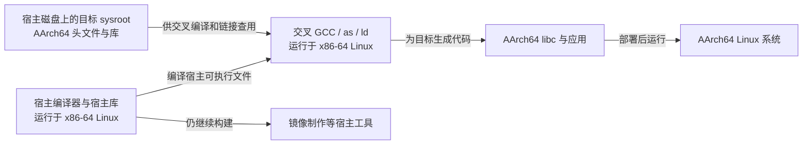
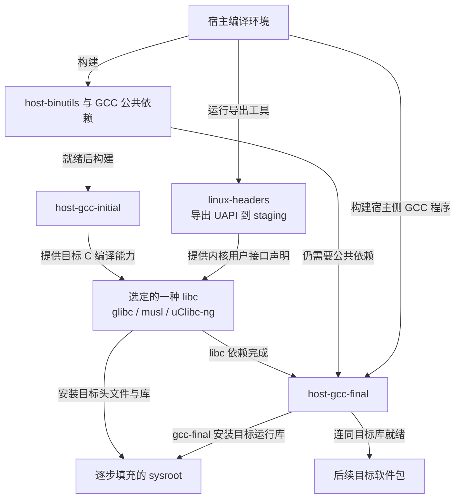
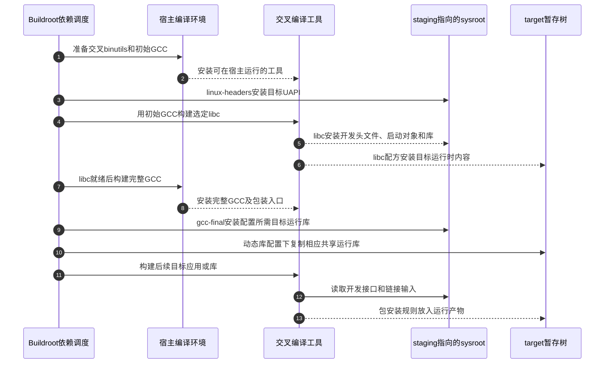
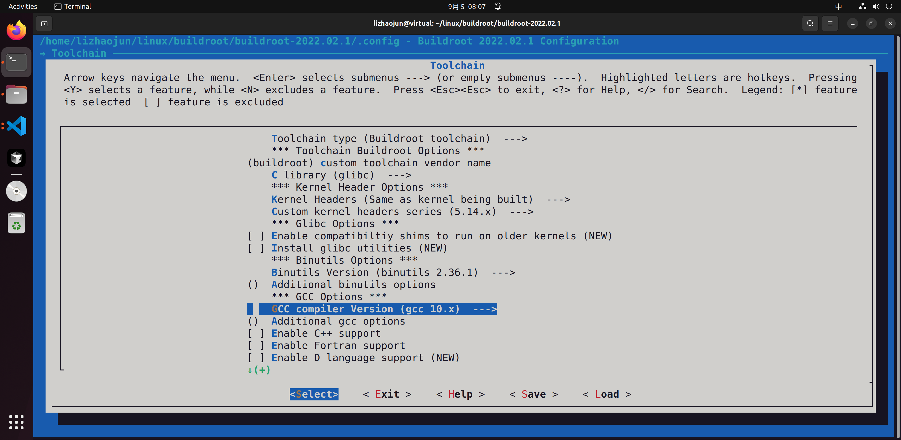
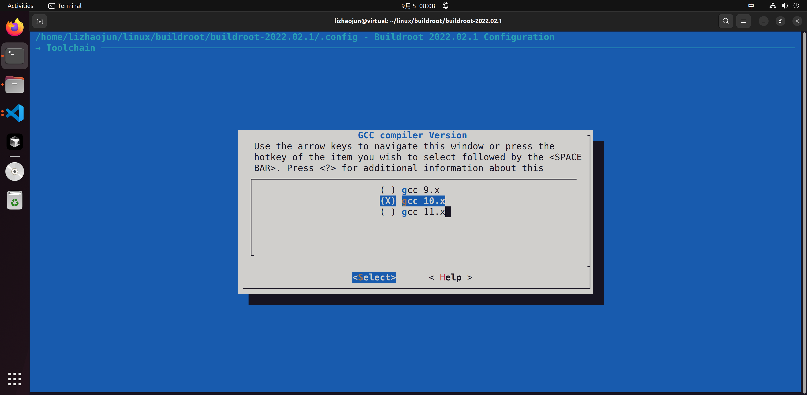
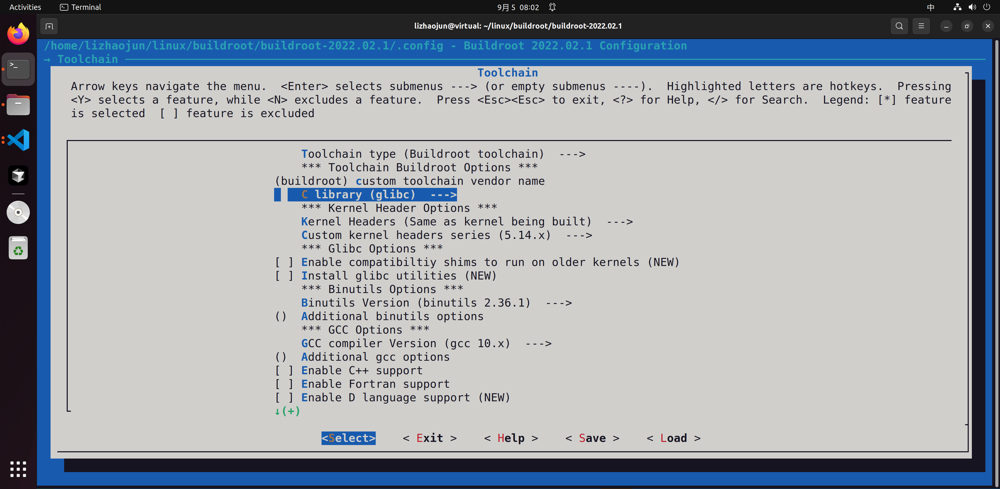
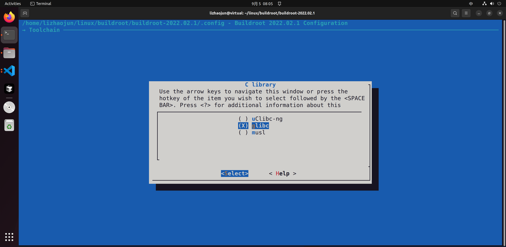

# 第2章\_从最小编译器到完整目标工具链

[上一章](P01_从手工拼系统到可重复的构建输入.md) 已经把系统构建分成宿主工具、目标软件与镜像生成几个角色。现在回到第一个难点：新板的用户程序还没有 C 库，怎样先造出编译这个 C 库的编译器？如果编译器也要等待 C 库，构建岂不是永远不能开始？

这个疑问把两件事混在了一起：**运行编译器需要的宿主环境**，以及 **编译器为目标程序寻找的头文件和库**。本章先拆开它们，再沿 Buildroot 内部工具链的真实依赖走一遍。例子继续使用上一章的 AArch64 QEMU 配置；具体实现固定为 Buildroot 2025.02，原件身份见 [固定资料与验证边界](../../../research/source_reading/buildroot/SOURCE_BASELINE.md#1.1_解释版本与归档身份)。

## 2.1\_同一台电脑上有两种编译任务

假设开发机是 x86-64 Linux，目标系统是 AArch64 Linux。在开发机上输入 `gcc hello.c`，通常调用的是发行版的本机编译器。它自己运行于 x86-64，产生的程序也面向 x86-64。把这个程序复制到 AArch64 系统，目标处理器不会因为文件名叫 hello 就自动理解另一种指令集。

因此需要 **交叉编译器**：它仍是在开发机上运行的程序，但输出面向另一种目标的机器代码。交叉 GCC 的可执行文件由宿主编译器构建；交叉 GCC 工作时，又会调用面向目标的汇编器和链接器。后两者来自 **binutils**，分别把汇编文本转换成目标文件、把目标文件和库组合成可执行文件等产物。

这里还需要区分两份 C 库。宿主编译器及宿主工具运行时使用宿主环境中的库；正在构建的目标 libc 则供 AArch64 用户程序使用。libc 是 C 标准库实现的常用简称，提供 `printf`、`malloc` 等接口；面向 Linux 的 libc 通常还提供 POSIX 接口，例如 `pthread_create`，它属于 POSIX 线程接口，不能因此被称为 ISO C 标准函数。



图中“存放在宿主磁盘”不是“在宿主执行”的同义词。AArch64 的库也存放在开发机磁盘上，只是交叉链接的输入。反过来，名字带 `aarch64` 的交叉编译器自己仍是宿主程序。判断一个文件的身份，要看它由谁执行、生成或服务谁，不能只看目录名和前缀。

| 对象 | 在哪里执行或使用 | 本章中的职责 |
| --- | --- | --- |
| 发行版 GCC/G++ 与宿主库 | 开发机执行 | 构建交叉编译器和其他宿主工具；不会在工具链完成后退出整个构建 |
| 交叉 GCC、as、ld | 开发机执行，处理目标代码 | 完成目标语言翻译、汇编和链接 |
| 目标头文件、启动对象和库 | 交叉编译、链接时读取 | 提供目标接口声明、启动支持及实现；不是宿主库的副本 |
| 目标动态加载器与共享库 | 目标系统运行时使用 | 装载和支持动态链接程序；路径、架构和版本必须匹配 |

官方手册把开发机构建工具称为 host toolchain；GNU configure 的 build/host/target 则有其自身语义，不能把本章“宿主机”一词直接替换每个包的 `--host`。这一点在下一章接入现成工具链时继续用到。依据是随包手册 [Cross-compilation toolchain](../../../research/source_reading/buildroot/2025.02/docs/manual/configure.adoc)。

## 2.2\_先把生成机器代码与生成可运行程序分开

一个只做整数运算的 C 函数，可以先变成目标文件，而不立即组成完整 Linux 用户程序。目标文件允许保留尚未解析的外部符号；生成它不等于已经准备好程序入口、C 库、动态加载器及运行环境。这就是打破表面循环的入口：先取得有限的目标代码生成能力，用它构建目标 C 库，然后补齐完整工具链。

**初始 GCC** 是这套构建中的中间工具，常被称为 bootstrap compiler。它的“最小”指当前构建范围和依赖被收窄，不是只能翻译简单语法、不能优化，或硬件能力被削掉。Buildroot 2025.02 的初始 GCC 只启用 C，关闭共享库和线程支持，不依赖已经装好的目标 libc 头文件，并构建 GCC 和目标 libgcc。libgcc 是 GCC 为某些生成代码提供的低层支持库，与实现 `printf` 等接口的 libc 不是同一个库。

为何还要有 **完整 GCC**？目标 libc 安装之后，构建才有条件配置依赖目标系统环境的运行库和可选语言支持。例如启用 C++ 后，工具链需要 C++ 编译支持和对应目标 libstdc++，不能只把 gcc 改名为 g++。完整 GCC 的宿主可执行文件仍由宿主编译环境构建；“先有初始 GCC，后有完整 GCC”表示依赖顺序，并不表示初始交叉 GCC 要输出一份 x86-64 的完整 GCC 程序。

下表给出初始构建规则中真正决定范围的设置。它用于解释 Buildroot 的内部实现，不是让读者手工运行一套通用 GCC 安装脚本。

| 2025.02 初始 GCC 设置 | 改变哪项构建条件 | 不能据此推出什么 |
| --- | --- | --- |
| `--enable-languages=c` | 先构建 C 前端 | 完整工具链一定启用 C++ |
| `--without-headers` | 不要求预先提供完整的目标 C 库头文件 | 所有后续包都不再需要头文件 |
| `--disable-shared`、`--disable-threads` | 限定这个引导阶段的库与线程配置 | 最终目标系统没有共享库或线程 |
| `all-gcc all-target-libgcc` | 构建 GCC 与目标 libgcc | 已经具备所有应用所需的运行库 |
| `--with-newlib` | 此引导配方采用的 GCC 配置选项 | 最终 Linux 系统使用 newlib；目标 libc 仍由 Buildroot 配置决定 |

这些设置来自 [gcc-initial.mk](../../../research/source_reading/buildroot/2025.02/package/gcc/gcc-initial/gcc-initial.mk)。没有把初始 GCC 列为依赖的普通包，不应绕过完整工具链依赖而私自使用这个中间状态。

## 2.3\_为什么内核头文件和目标C库要在这里汇合

现在已经有了编译目标代码的初始工具，但 libc 还要知道怎样与目标 Linux 内核交互。需要的是内核向用户空间公开的接口声明，通常称为 **UAPI**，例如系统调用相关常量和数据布局。Buildroot 的 linux-headers 包通过内核的 `headers_install` 导出这类头文件，再安装到目标开发环境中。

这些头文件不是正在运行的内核，也不是一份能用于构建任意内核驱动的完整内核构建树。libc 自己还提供 `stdio.h`、`stdlib.h` 等用户接口，并负责在适当位置对接内核接口。应用看到的 libc 类型和布局也不能一律当成内核内部结构体的原样暴露。

于是两条准备路径在 libc 构建处汇合：一条提供初始交叉编译器，另一条提供导出的内核头文件。2025.02 的 glibc、musl 和 uClibc-ng 配方均声明依赖 `host-gcc-initial` 与 `linux-headers`，各自还可能需要其他宿主工具或兼容头文件。初始 GCC 的公共依赖是交叉 binutils、GMP/MPC/MPFR 等宿主数学库及条件性工具；不能把 linux-headers 硬画成初始 GCC 必须等待的前置节点。



图中的箭头表示依赖和产物交接，不承诺所有构建都按一条串行时间线执行；还省略了下载、打补丁和各 libc 的额外宿主依赖。源码对应 [gcc.mk](../../../research/source_reading/buildroot/2025.02/package/gcc/gcc.mk)、[linux-headers.mk](../../../research/source_reading/buildroot/2025.02/package/linux-headers/linux-headers.mk) 以及 [glibc](../../../research/source_reading/buildroot/2025.02/package/glibc/glibc.mk)、[musl](../../../research/source_reading/buildroot/2025.02/package/musl/musl.mk)、[uClibc-ng](../../../research/source_reading/buildroot/2025.02/package/uclibc/uclibc.mk) 配方。

这里存在一个真正的版本边界。使用较新的头文件编译成功，只能说明编译阶段看到了声明，不能证明设备上较旧的内核实现了接口。2025.02 手册给出的选择原则是：工具链内核头文件版本应不晚于实际运行内核版本，不要求二者完全相等；libc 和应用自身的最低内核要求也必须满足。即使头文件版本合适，具体驱动、内核配置、设备能力或运行权限仍可能令某个功能不可用。

因此，内核头文件版本、板上运行内核版本和 libc 的支持条件要分别登记。需要自定义板级内核来源时，选择 “Same as kernel being built” 可以把头文件来源与选定内核关联起来；它不代替驱动编译所需的内核构建配置，也不自动证明整套系统已经启动。

## 2.4\_sysroot为什么从一开始就参与构建

编译器有了目标身份，还需要知道去哪里寻找目标 `stdio.h` 和 libc。如果不区分搜索路径，它可能读到开发机的头文件，再把不匹配的接口和库带进目标构建。**sysroot** 就是交叉工具链使用的一棵目标开发目录树：把它视作目标头文件和库的查找根，而不是开发机自身的 `/`。

Buildroot 的公共 GCC 配置已经传入 `--with-sysroot=$(STAGING_DIR)`，初始和完整 GCC 都使用这个共同约定。目录存在与内容完整是两个不同状态：linux-headers 安装 UAPI，libc 安装自身头文件、启动对象和库，GCC 的目标运行库再补入相应位置。后续开发库还会继续扩展它。因此不存在“完整 GCC 全部完成以后，才一次性建立 sysroot”的独立末尾阶段。



这是一条说明产物交接的简化顺序：步骤1～3准备工具与内核接口，4～6构建并安装libc，7～10补齐完整GCC与目标运行库，11～13才使用这套环境构建后续软件。图中向两个目录的安装动作由各包规则执行，不表示程序运行时把 sysroot 同步到设备。下面再把上一章的目录区分落到具体文件上。

| 目录或入口 | 工具链构建中逐步加入什么 | 后续由谁读取 |
| --- | --- | --- |
| `host/bin/` | 交叉 GCC/binutils、包装入口及其他宿主工具 | Buildroot 和开发者在宿主调用 |
| `host/<目标元组>/sysroot/` | 目标头文件、启动对象、链接所需库等；实际路径用编译器查询 | 交叉编译器、链接器及包构建系统 |
| `staging` | 通向上述 sysroot 的符号链接 | 包规则通过统一路径安装或查询开发文件 |
| `target/` | 目标程序、按配置需要的运行库和系统配置 | 后续 rootfs 制作阶段读取，不能直接当成最终可部署镜像 |
| `images/` | 后续生成的内核、文件系统或整盘镜像 | 模拟器、启动介质制作或板级部署流程 |

开发文件与运行文件的分离由安装和最终整理规则完成，不是 `target` 这个名字天然禁止头文件进入。错误的包规则或人工复制仍会把不需要的内容带进去。添加厂商开发库时，应让对应包明确安装到 staging，并按实际需求安装运行部分到 target；只把头文件扔进 rootfs，不能补齐交叉编译环境。

sysroot 也不是阻止宿主污染的安全沙箱。错误的 `-I/usr/include`、`-L/usr/lib` 或包探测设置仍可能引入宿主路径。编译器默认路径正确，是正确交叉构建的一部分，还要检查实际编译命令及依赖探测结果。

依据是 [GCC 公共配置](../../../research/source_reading/buildroot/2025.02/package/gcc/gcc.mk)、[完整 GCC 及目标运行库安装规则](../../../research/source_reading/buildroot/2025.02/package/gcc/gcc-final/gcc-final.mk) 和 [输出目录说明](../../../research/source_reading/buildroot/2025.02/docs/manual/quickstart.adoc)。

## 2.5\_配置选择改变的是哪一份构建契约

已经知道 C 库和编译器怎样配合，才有条件选择它们。如果应用依赖某种 libc 专有接口或交付了绑定特定动态加载器的二进制库，换一种 libc 不是单纯调整镜像大小；原程序可能需要修改、重新编译，甚至无法复用。若软件均可从源代码构建，才可以通过编译与运行验证，比较不同 libc 的目标支持、功能需求和实际体积。这里不给 glibc、musl、uClibc-ng 排一张脱离应用的“最好”榜单。

2025.02 内部工具链提供这三种 libc 选择，是否可选受目标配置限制。uClibc-ng 还可以进一步裁剪若干特性，但越偏离随包默认配置，越要检查应用所需的线程、宽字符和本地化能力。Kconfig 约束会隐藏或限制部分不兼容组合；一个选项在菜单里可选，并不等于所有软件和所有真实板卡组合都已经验证通过。

| 要做的选择 | 本版本配置入口或符号 | 对依赖的影响 |
| --- | --- | --- |
| 由 Buildroot 构建工具链 | Toolchain type；`BR2_TOOLCHAIN_BUILDROOT` | 走本章内部构建路径；外部后端在下一章处理 |
| libc 家族 | `BR2_TOOLCHAIN_BUILDROOT_GLIBC`、`BR2_TOOLCHAIN_BUILDROOT_MUSL`、`BR2_TOOLCHAIN_BUILDROOT_UCLIBC` | 改变目标接口、库、加载器和软件兼容条件 |
| GCC 版本 | GCC compiler Version；`BR2_GCC_VERSION_12_X/13_X/14_X` 等 | 通用版本选择受架构约束；不是宿主发行版 GCC 版本 |
| binutils 版本 | Binutils Version | 改变目标汇编器、链接器等工具版本 |
| 内核头文件来源 | Kernel Headers；同源选项 `BR2_KERNEL_HEADERS_AS_KERNEL` | 改变 libc 构建时可见的内核用户接口 |
| C++ 支持 | `BR2_TOOLCHAIN_BUILDROOT_CXX`，它选择 `BR2_INSTALL_LIBSTDCPP` | 启用 C++ 并安排相关目标运行库；不是完整 GCC 的无条件默认能力 |
| Fortran、D 支持 | `BR2_TOOLCHAIN_BUILDROOT_FORTRAN`、`BR2_TOOLCHAIN_BUILDROOT_DLANG` | 按支持条件增加语言和目标运行库；本配方没有因此启用 Ada 或 Go |

初次实验沿用上一章 defconfig，不同时改动所有选项。确实需要更换工具链架构、libc、版本或重要特性时，用保存好的配置在新的输出目录重建整个系统；只重编一个应用会保留旧 ABI 产物。**ABI** 是二进制接口约定，涉及调用约定、数据布局和链接运行条件，比“源码能编译”多了一层要求。

下面保留原笔记的四张菜单截图。画面标题明确为 **Buildroot 2022.02.1**：第一组用于认识 GCC 版本入口和选择窗口，第二组用于认识 C 库入口和家族选择。它们不是 2025.02 的版本列表，截图中的 GCC 9/10/11 不能替代上表的固定版本配置依据。









2025.02 的实际选择依据见 [内部工具链配置](../../../research/source_reading/buildroot/2025.02/toolchain/toolchain-buildroot/Config.in)、[GCC 配置](../../../research/source_reading/buildroot/2025.02/package/gcc/Config.in.host)、[binutils 配置](../../../research/source_reading/buildroot/2025.02/package/binutils/Config.in.host) 与 [内核头文件配置](../../../research/source_reading/buildroot/2025.02/package/linux-headers/Config.in.host)。重建边界见随包手册 [Understanding when a full rebuild is necessary](../../../research/source_reading/buildroot/2025.02/docs/manual/rebuilding-packages.adoc)。

## 2.6\_用一个C程序分别观察编译与链接

现在用上一章成功构建后的输出目录观察工具链。实验在 Linux 宿主的 Bash 中进行，使用完整 Buildroot 2025.02 源码和上一章的 AArch64 配置；下面的 C 文件只用于宿主上的交叉编译观察，不会自动进入 rootfs。本文已核对规则与命令语法，尚未实际执行该 Linux 构建和目标运行，以下是预期观察。

先在 Buildroot 源码根目录设置输出位置并查询工具。`br_out` 必须与上一章实际使用的一致，不能指向另一套板子的产物。

```sh
# Linux Bash；当前目录是 Buildroot 2025.02 源码根目录。
br_out="$PWD/../br_out_qemu_aarch64_2025_02"
br_cc="$br_out/host/bin/aarch64-linux-gcc"
br_readelf="$br_out/host/bin/aarch64-linux-readelf"
br_nm="$br_out/host/bin/aarch64-linux-nm"
# 三条检查都成功后再继续；缺少文件先回到上一章排查构建。
test -x "$br_cc"
test -x "$br_readelf"
test -x "$br_nm"
"$br_cc" -dumpmachine
"$br_cc" -print-sysroot
```

`aarch64-linux-` 是这个配置下的简短工具入口；完整目标元组由 `-dumpmachine` 返回。`-print-sysroot` 返回实际目标开发目录，不需要靠猜测 libc 名称拼路径。它们证明的是正在调用哪份工具及其配置，尚未证明能编译程序。

接下来在输出目录下建立实验子目录，生成一个完整小程序。它用 `printf` 输出整数；使用 `-fno-builtin` 是为了让本次观察保留对库函数的调用，减少优化替换带来的干扰。

```sh
# 继续使用上面的 Bash 变量；实验材料放在输出目录中。
br_probe="$br_out/toolchain_probe"
mkdir -p "$br_probe"
cat > "$br_probe/hello.c" <<'EOF'
#include <stdio.h>

int main(void)
{
    /* 参数由程序自己产生，本实验只观察目标库调用。 */
    printf("answer=%d\n", 42);
    return 0;
}
EOF
"$br_cc" -std=c11 -Wall -Wextra -O0 -fno-builtin \
    -c "$br_probe/hello.c" -o "$br_probe/hello.o"
"$br_readelf" -h "$br_probe/hello.o"
"$br_nm" -u "$br_probe/hello.o"
```

这里的 `-c` 在生成目标文件后停止。ELF 是本例目标文件和程序采用的文件格式；`readelf -h` 应显示 AArch64 机器类型及可重定位文件类型，`nm -u` 应能看到尚未解析的 `printf`。这不是失败，而是链接尚未发生：C 声明允许编译器检查调用并生成引用，实现要到链接时处理。

保留同一份目标文件，去掉 `-c`，让 GCC 驱动链接过程：

```sh
"$br_cc" "$br_probe/hello.o" -o "$br_probe/hello"
"$br_readelf" -h "$br_probe/hello"
"$br_readelf" -l "$br_probe/hello"
"$br_readelf" -d "$br_probe/hello"
```

链接阶段会引入必要的启动支持和目标库。最后两条命令分别查看程序装载信息和动态信息：在上一章默认的动态链接配置下，关注解释器路径以及 `NEEDED` 库条目；启用位置无关可执行文件时，ELF 类型可能是 `DYN`，不能据此判定它只是普通共享库。若你主动改成静态链接，则不应强求出现同样的动态加载器和依赖条目。

不要在 x86-64 宿主上直接用 `./hello` 验证 AArch64 原生执行能力。它需要匹配的目标运行环境；即使宿主配置了透明模拟，也要把这项条件记录下来。后续 rootfs 定制章节会把程序作为受管理的输入加入镜像，再在 QEMU 内观察输出。当前实验闭合的是“目标文件允许未解析引用 → 链接生成程序并留下运行依赖”，不是已经证明目标系统运行成功。

## 2.7\_发生失败时先判断断在哪个边界

假设 `hello.o` 已生成，而第二次命令提示找不到启动对象或 libc。此时重新选择 CPU 型号通常没有针对性：架构代码生成已走过，先查链接输入和 sysroot 是否完整。若链接成功，到了设备上才提示加载器不存在，则要转向 rootfs 与程序运行依赖是否配套。把这两个现场都简称“GCC 不行”，会失去最有价值的阶段信息。

| 现象 | 当前可得的有限结论 | 下一步针对性检查 |
| --- | --- | --- |
| 交叉 GCC 自身无法启动，报告宿主库或装载错误 | 宿主工具运行条件未满足 | 工具本身的宿主架构、发行环境和宿主库；不要改目标 libc 试图修宿主程序 |
| `stdio.h` 找不到 | 目标开发接口或搜索路径不完整 | 实际编译命令、`-print-sysroot`、该 sysroot 的 libc 头文件；确认没有停在初始构建失败处 |
| 目标文件成功，链接找不到启动对象或 `-lc` | 链接所需目标文件未找到 | libc 安装状态、目标路径及编译器选择 |
| `file in wrong format` 等架构错误 | 某个链接输入可能属于错误目标 | 用 readelf 检查报错对象，追查错误库搜索路径 |
| 目标上程序文件存在，却提示无法执行或缺少文件 | 不能只凭文件存在证明运行环境完整 | ELF 机器类型、解释器路径、共享库与目标文件权限 |
| 运行提示符号或符号版本缺失 | 编译所用库与运行所用库可能不一致 | 比较工具链 sysroot 与 rootfs 的库来源，不凭同名文件判断兼容 |

后续 Linux 内核和 U-Boot 也会使用目标编译器生成代码，但它们不是普通 Linux 用户程序，不会像这里的 hello 一样链接目标用户态 libc。它们的构建还可能生成在宿主执行的小工具，因此宿主编译器仍有工作。镜像制作工具同样在宿主执行。内部工具链完成的是一组必要基础，并不等于内核、根文件系统或可烧写整盘镜像已经完成；`genimage` 等镜像工具是否参与由板级配置决定。

## 2.8\_用依赖关系检验自己的判断

先尝试回答，再对照下面的解释。

1. 初始 GCC 已经能生成 AArch64 目标文件，为什么不能据此宣布工具链完成？
2. 工具链内核头文件来自 Linux 6.12，目标实际运行 5.10，编译成功能证明兼容吗？
3. 更换 libc 后，保留原来的 target，只重新链接 hello，是否足够？
4. 在宿主磁盘的 `host` 子目录里看到 AArch64 libc，它是不是宿主程序使用的库？

第一题的关键是编译与链接、运行的证明范围不同：目标文件可以留有外部符号，完整系统还需要匹配的目标接口、启动对象、运行库与目标运行环境。第二题不能推出兼容，应按运行内核与 libc 支持边界重新选择和验证，编译器看见声明不等于旧内核提供了实现。第三题不够，其他目标程序和库仍可能携带旧 ABI 依赖，必须按工具链变更要求重建系统。第四题也不是：存储地点不决定执行身份，sysroot 本就存放在宿主机器上，供交叉工具读取。

现在可以解释内部工具链为何分阶段：先缩小构建需求取得目标代码生成能力，再让目标 libc 与内核用户接口汇合，最后补齐完整编译器和配置所需运行库；安装动作贯穿过程。还没有回答的是：如果厂商已经给了工具链，怎样确认它满足同一套接口、ABI 和运行库要求？[下一章](P03_把现成工具链接入受控构建.md) 从这条边界接入外部工具链。
