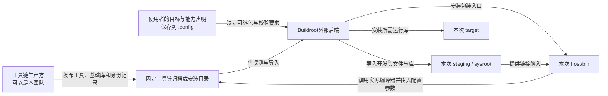
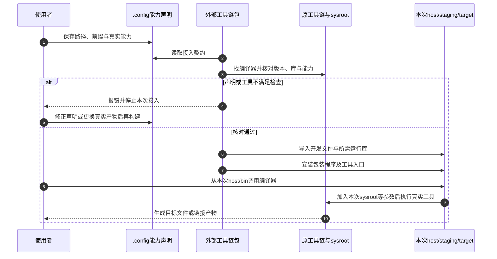
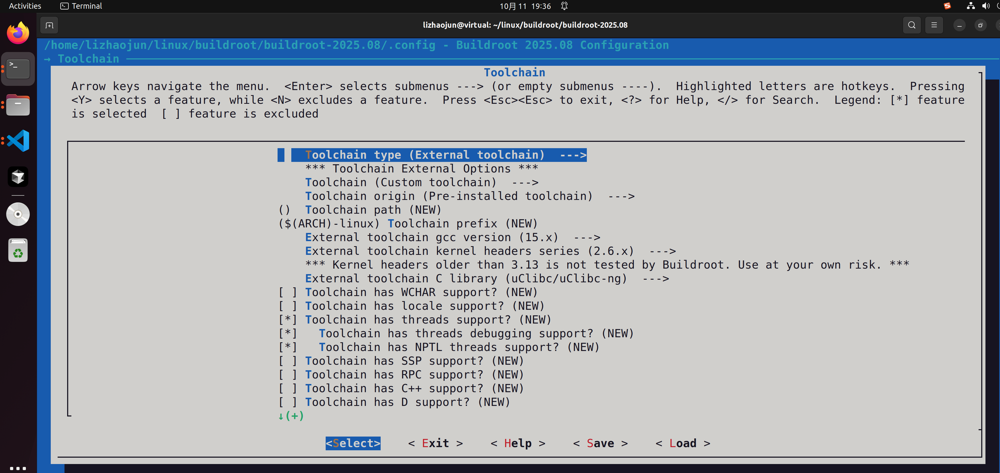
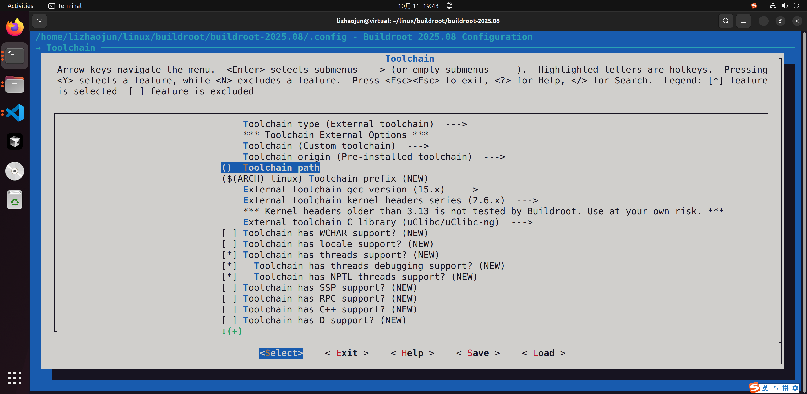
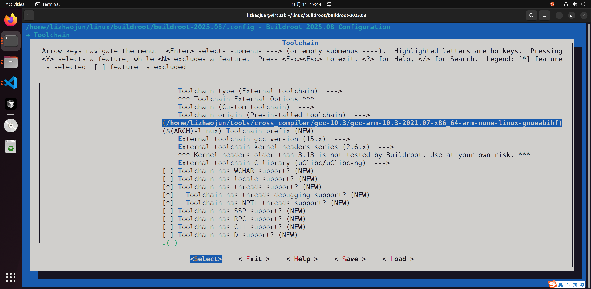
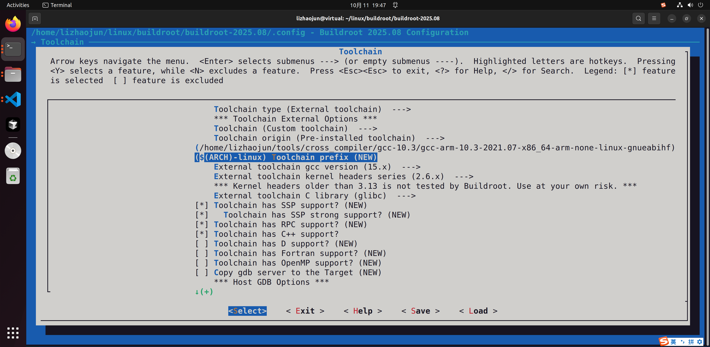
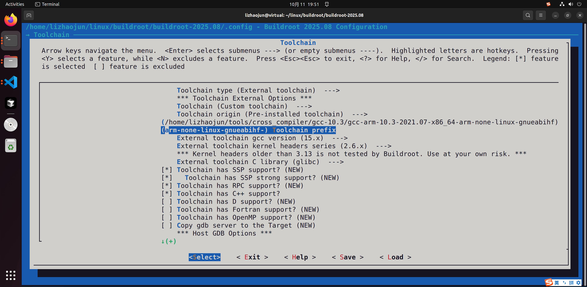
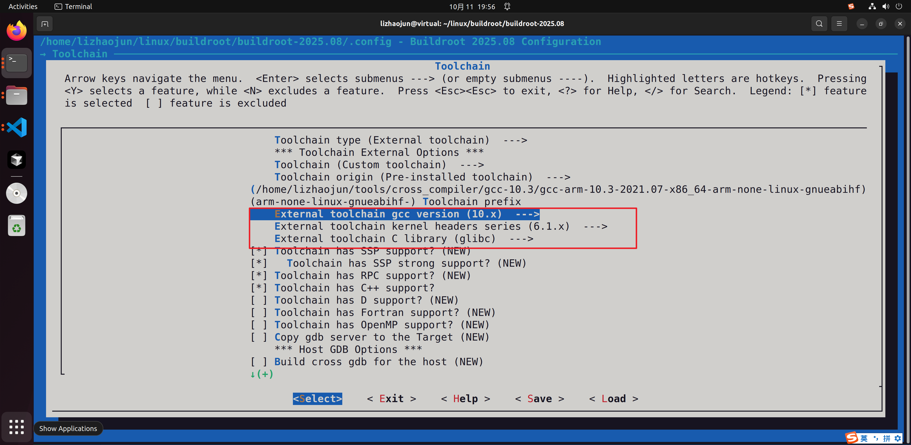

# 第3章\_把现成工具链接入受控构建

[上一章](P02_从最小编译器到完整目标工具链.md) 已经解释：内部工具链通过初始 GCC、目标 libc 和完整 GCC 的依赖交接，逐步建立目标开发环境。现在假设团队每天新建输出目录验证应用改动，而 CPU、GCC 和 libc 都没有改变。每次重新生产同一套工具链，会重复付出编译成本；能不能只生产一次，把这份产物交给后续构建复用？

**外部工具链后端** 正是这个交接入口。“外部”表示本次系统构建导入已经生产好的工具链，不规定它必须由第三方生产。团队自己用 Buildroot 或 crosstool-NG 生成，也可以成为另一轮 Buildroot 构建的外部工具链。省下的是重复生产编译器和基础库的工作；取得文件、校验能力、导入开发文件和运行库、验证目标程序仍然要做。

本章沿 Buildroot 2025.02 的规则讲清这条接入过程，并用“自己生成、换目录接入”的实验固定工具链来源。它不要求读者先购买开发板或寻找某个厂商 SDK。版本与原件身份仍见 [固定资料](../../../research/source_reading/buildroot/SOURCE_BASELINE.md#1.1_解释版本与归档身份)。

## 3.1\_复用的单位为什么不能只有一个gcc文件

接过一份名叫 `aarch64-linux-gcc` 的文件，只解决了调用入口的一小部分。编译器还要找到内部程序、目标汇编器和链接器、头文件、启动对象、libc 与相关运行库。若只复制 gcc，内部路径可能失效；若让它继续读取别的系统的库，编译结果又可能和将要生成的 rootfs 不一致。

因此接入单位是一套 **自洽的工具链及其目标开发环境**。后续构建既要知道它在哪里，还要知道它已经具有哪些能力。比如某个包需要 C++，Buildroot 在菜单阶段就要据此决定能否选它；此时工具链压缩包可能还没有下载，不能等到实际运行 g++ 才生成菜单依赖。预定义工具链配置描述已知能力，自定义工具链则要求用户如实声明，构建开始后再检查声明与实物是否一致。



图中同时存在原始工具链目录和本次 Buildroot 的 sysroot。二者不能混成同一个可任意修改的目录：原件用于稳定复用，本次 sysroot 还会安装当前系统选择的软件包开发文件。后续构建应使用本次 `host/bin` 的入口，才能带上本次的 sysroot 和目标参数。

这一交接模型来自 [外部后端配方](../../../research/source_reading/buildroot/2025.02/toolchain/toolchain-external/pkg-toolchain-external.mk)。它也解释了为什么接入配置不只是把工具链目录加入 PATH。

## 3.2\_先判断这份工具链属于可接入的哪一种

工具链来源有两条互相独立的分类轴：一条是 **谁生产、谁维护**，另一条是 **产物包含什么、怎样取得**。厂商提供并不自动代表与当前板级软件已经验证，团队自建也不意味着每次都要重新编译。需要保留生产配置、补丁、归档摘要和验证范围，才能判断某份具体产物是否可复用。

Buildroot 2025.02 支持预定义配置，也支持 Custom toolchain。预定义配置可以自动下载，或指向同一工具链的预安装位置；自定义配置可以填写归档 URL，也可以填写本地安装路径。这是“描述已知工具链”和“取得文件方式”的组合，不是四种不同的编译器架构。

| 接入方式 | 谁提供能力描述 | 本次构建怎样取得实物 |
| --- | --- | --- |
| 预定义配置＋下载 | 随版本保存的工具链配置 | 由 Buildroot 下载和展开对应归档 |
| 预定义配置＋预安装 | 同上，必须与所选配置实际匹配 | 使用指定安装目录 |
| Custom＋下载 | 使用者填写已有工具链的真实能力 | 使用配置中的归档 URL |
| Custom＋预安装 | 使用者填写真实能力 | 使用指定根目录；通常在其 bin 子目录找工具 |

这里有一个容易忽略的限制：该版本手册明确不支持把 OpenEmbedded/Yocto 生成的工具链或 SDK 直接当作其外部工具链，也不支持把宿主发行版整套本机 gcc/binutils/libc 直接导入。原因是它们可能带有大量预编译目标库和程序，导入 sysroot 会把本应由本次 Buildroot 管理的包混进来。即使宿主与目标同为 x86-64，这个管理边界仍然存在。不能用“架构相同”绕过它。

同理，Buildroot 给完整系统导出的 **SDK（Software Development Kit，软件开发工具包）** 可以包含所有已选包的开发文件，适合开发配套应用；要把它作为另一套 Buildroot 的纯工具链输入，则应按官方方法建立专门的工具链生产配置，而不是随意打包一棵已有大量软件的 host 目录。厂商 GPU/NPU 等附加库应作为当前系统的包集成，分别安排 staging 和 target 安装，并核对其 ABI。

固定版本内含 Bootlin 工具链配置，其帮助说明这些工具链由 Buildroot 生成；这不等于所有预编译工具链都由“Buildroot 官方”统一维护，更不意味着所有目标组合已经通过测试。来源依据见 [Bootlin 配置原件](../../../research/source_reading/buildroot/2025.02/toolchain/toolchain-external/toolchain-external-bootlin/Config.in)。支持和限制见手册 [External toolchain backend / Build an external toolchain with Buildroot](../../../research/source_reading/buildroot/2025.02/docs/manual/configure.adoc)。

## 3.3\_配置是在描述已有能力

假设工具文件实际叫 `aarch64-buildroot-linux-gnu-gcc`。在菜单的 **Toolchain prefix** 中填写的是 `aarch64-buildroot-linux-gnu`，不含末尾连字符；Buildroot 会自行拼出 `前缀-gcc`。这与某些内核构建命令中的 `CROSS_COMPILE=...-` 习惯不同，不能把两种输入契约混用。本章实验采用 Buildroot 工具链提供的短别名 `aarch64-linux`。

工具链路径填写安装根目录，通常应能在 `根目录/bin/前缀-gcc` 找到编译器。预安装路径留空时，配置帮助允许从 PATH 查找，但团队实验宜明确路径，避免同名工具随 shell 环境变化。自定义下载归档另有相对二进制目录选项，默认是 `bin`；它与预安装根路径不是同一个字段。

接着声明 GCC、内核头文件、libc 和语言能力。这里的 “External toolchain kernel headers series” 描述的是 **工具链已经携带的头文件系列**，不是要求 Buildroot 替它换一份新头文件。实际为 6.6.x 就声明相应系列；某版本菜单最高档可能表示“该系列或更新”，要按帮助解释。2025.02 的普通系列核对主、次版本，不核对补丁级；最高档的自定义工具链允许更高系列。这种检查不能证明 libc 能在任意旧内核运行。

| 配置输入 | 2025.02 对应符号或格式 | 要描述的事实 |
| --- | --- | --- |
| External toolchain、Custom toolchain | `BR2_TOOLCHAIN_EXTERNAL`、`BR2_TOOLCHAIN_EXTERNAL_CUSTOM` | 本次导入自定义现成工具链 |
| Pre-installed toolchain | `BR2_TOOLCHAIN_EXTERNAL_PREINSTALLED` | 工具已经安装，不由当前后端下载 |
| Toolchain path | `BR2_TOOLCHAIN_EXTERNAL_PATH` | 安装根目录，不是 gcc 文件本身 |
| Toolchain prefix | `BR2_TOOLCHAIN_EXTERNAL_CUSTOM_PREFIX` | 例如 `aarch64-linux`，不带末尾 `-` |
| GCC version | 例如 `BR2_TOOLCHAIN_EXTERNAL_GCC_13` | 现有 GCC 的版本系列 |
| Kernel headers series | 例如 `BR2_TOOLCHAIN_EXTERNAL_HEADERS_6_6` | 现有目标 UAPI 头文件系列，不是运行内核版本开关 |
| External toolchain C library | 例如 `BR2_TOOLCHAIN_EXTERNAL_CUSTOM_GLIBC` | 现有 libc 家族；勾选不会重建或转换库 |
| Toolchain has C++ support? | `BR2_TOOLCHAIN_EXTERNAL_CXX` | 现有 g++ 与对应库能力；不是请求自动增加 C++ |
| Toolchain has RPC support? | `BR2_TOOLCHAIN_EXTERNAL_INET_RPC` | libc 是否内建这里所指的 RPC 接口，不能由“选择了 glibc”直接猜出 |

RPC 是远程过程调用；此处只关心工具链是否自带相应接口，不展开网络协议。其他可见能力，例如宽字符、本地化、线程或栈破坏保护（SSP），同样要依据实物和生产配置填写。uClibc-ng 有些能力可裁剪，不能因另一个发行包有线程就照抄选项。

还要独立核对目标指令集、位数、字节序、ABI 和运行内核。一个 Cortex 名称不够指定整套用户空间 ABI；ARM 的硬浮点调用约定也不能只从“有浮点硬件”推出。指令不支持可能导致非法指令，ABI 不匹配也可能在链接时被拒绝或在调用时出错，不能把某一种错误信息当成唯一诊断。`gcc -v` 能帮助定位构建选项，却不是完整 libc 身份与运行兼容性的万能查询器。

上述字段见 [外部后端配置](../../../research/source_reading/buildroot/2025.02/toolchain/toolchain-external/Config.in)、[Custom 配置](../../../research/source_reading/buildroot/2025.02/toolchain/toolchain-external/toolchain-external-custom/Config.in.options)。头文件比较的具体范围见 [check-kernel-headers.sh](../../../research/source_reading/buildroot/2025.02/support/scripts/check-kernel-headers.sh)。

## 3.4\_导入如何变成一次受检查的交接

完成菜单选择后，`.config` 保存的是声明。构建外部工具链包时，后端找到实际编译器，检查可用性与版本，定位其 sysroot，并核对相关能力。若声明使用 glibc，实物却是另一种 libc，或者声明支持 C++ 而 g++ 不可用，应处理配置与产物的矛盾，不能继续伪造选项以放开软件包。

检查通过后，后端把目标开发文件导入本次 staging，按配置把必要运行库放入 target，再提供统一工具入口。多库工具链可能按目标参数提供不同库变体，导入时要选取对应变体及公共头文件；不能随手取第一个名为 libc 的目录。包装程序负责向真实编译器传入本次的 sysroot、架构和其他选定参数。它不重写目标程序的语义，也不把缺少的语言或 libc 能力凭空补出来。



步骤1～3建立并核对声明；失败分支回到输入，成功分支才形成新的开发和运行目录。图是职责顺序，具体安装分为包的 staging、target 等动作。完整验证不止“进程能启动”：例如此版本的 C++ 能力检查调用 g++ 的 `-v` 来检查声明是否匹配，这并未运行一个目标 C++ 程序。接入通过以后仍要编译、链接并在目标上验证应用。

`make toolchain-external-show-info` 中的 `*-show-info` 是2025.02包基础设施提供的元数据输出，不能代替实际配置检查。需要触发自定义工具链接入时，本章使用 `make toolchain-external`；需要查看实际包装参数时，使用 `BR2_DEBUG_WRAPPER=1` 或 `2`，分别按一行或逐参数输出。具体检查见 [外部包规则](../../../research/source_reading/buildroot/2025.02/toolchain/toolchain-external/pkg-toolchain-external.mk)、[校验辅助规则](../../../research/source_reading/buildroot/2025.02/toolchain/helpers.mk)、[包信息目标](../../../research/source_reading/buildroot/2025.02/package/pkg-generic.mk) 和 [包装程序](../../../research/source_reading/buildroot/2025.02/toolchain/toolchain-wrapper.c)。

## 3.5\_自己生产一份纯工具链再换目录接入

为了让来源可追踪，实验先用当前固定版本生产一份 AArch64/glibc 工具链，再在另一个输出目录按外部工具链接入。生产配置不选目标应用、init、shell 或文件系统镜像，这样导出的 SDK 承担工具链职责。保留 C++ 是为了观察能力声明，内核头文件选择 6.6.x，后续仍使用上一章 QEMU 配置中的 Linux 6.12.9。

本节在 Linux 宿主 Bash、Buildroot 2025.02 完整源码根目录执行，需要第一章的构建依赖以及下载条件。实际编译可能占用较多时间和磁盘；下列流程已按固定规则静态核对，当前尚无本次 Linux 构建、SDK 接入或 QEMU 运行日志。

### 3.5.1\_先创建独立生产配置

实验采用新的工作目录，避免覆盖前两章产物。下面先检查它尚不存在；失败时换一个新目录名，不删除旧实验来继续。

```sh
# Linux Bash；Buildroot 2025.02源码根目录。
br_lesson="$PWD/../br_toolchain_lesson_2025_02"
(
    set -eu
    test ! -e "$br_lesson"
    mkdir -p "$br_lesson"
    cat > "$br_lesson/toolchain_defconfig" <<'EOF'
BR2_aarch64=y
BR2_TOOLCHAIN_BUILDROOT=y
BR2_TOOLCHAIN_BUILDROOT_GLIBC=y
BR2_KERNEL_HEADERS_6_6=y
BR2_GCC_VERSION_13_X=y
BR2_TOOLCHAIN_BUILDROOT_CXX=y
BR2_INIT_NONE=y
BR2_SYSTEM_BIN_SH_NONE=y
# BR2_PACKAGE_BUSYBOX is not set
# BR2_TARGET_ROOTFS_TAR is not set
EOF
)
```

子 shell 中的 `set -e` 让目录检查失败就停止这一组创建动作。配置的前六项固定目标及工具链，后四项关闭本实验不需要的目标运行系统。这份文件是实验作者命名的 defconfig，不是 Buildroot 自动附带的板级配置。

```sh
br_sdk_out="$br_lesson/producer"
make O="$br_sdk_out" BR2_DEFCONFIG="$br_lesson/toolchain_defconfig" defconfig
make O="$br_sdk_out" BR2_SDK_PREFIX=lesson_aarch64_sdk sdk
```

第一条 make 展开精简配置，第二条按配置完成构建并打包 SDK。每步成功后才继续；这里 `sdk` 依赖当前配置的系统构建，并不是无条件只编译 GCC。正因为生产配置没有加入其他目标包，才适合用于本实验的工具链复用。

### 3.5.2\_固定归档并完成位置迁移

成功后取得指定名称的归档，计算摘要，并解到新的安装位置。摘要记录的是这次产物字节；相同输入不自动保证每次摘要相同，仍需检查可复现构建条件。

```sh
br_sdk_archive="$br_sdk_out/images/lesson_aarch64_sdk.tar.gz"
(
    set -eu
    test -s "$br_sdk_archive"
    sha256sum "$br_sdk_archive" > "$br_lesson/sdk.sha256"
    mkdir "$br_lesson/install"
    tar -xzf "$br_sdk_archive" -C "$br_lesson/install"
)
br_sdk_root="$br_lesson/install/lesson_aarch64_sdk"
"$br_sdk_root/relocate-sdk.sh"
"$br_sdk_root/bin/aarch64-linux-gcc" -dumpmachine
"$br_sdk_root/bin/aarch64-linux-gcc" -dumpfullversion
"$br_sdk_root/bin/aarch64-linux-gcc" -print-sysroot
```

`relocate-sdk.sh` 是导出包自带的位置迁移脚本，修正文本文件中的原安装路径并更新位置记录；不能只改 PATH 就把这一步当成完成。后三条输出分别核对目标元组、GCC 版本和当前 sysroot。保存生产 defconfig、展开后的 `.config`、Buildroot 归档身份、补丁和 SDK 摘要，别只保存这三行输出。

这一流程依据 [Buildroot 的 sdk 目标](../../../research/source_reading/buildroot/2025.02/Makefile) 与 [Using the generated toolchain outside Buildroot](../../../research/source_reading/buildroot/2025.02/docs/manual/using-buildroot-toolchain.adoc)。

### 3.5.3\_在新的系统配置中声明同一份能力

现在建立消费方输出目录，回到第一章的 QEMU 系统配置，再只改变工具链来源。生产方和消费方输出目录独立，导出的 SDK 安装目录也不与二者重合。

```sh
br_ext_out="$br_lesson/consumer"
make O="$br_ext_out" qemu_aarch64_virt_defconfig
make O="$br_ext_out" menuconfig
```

在 Toolchain 菜单按下表选择。路径一栏填写 `br_sdk_root` 变量实际展开后的完整路径，不把字符串 `$br_sdk_root` 原样填进去。界面可以搜索选项；本章采用预安装方式，所以不需要填写 URL。

| 消费方菜单 | 本实验值 | 值的来源 |
| --- | --- | --- |
| Toolchain type | External toolchain | 本次导入已生成产物 |
| Toolchain | Custom toolchain | 本实验自己的生产配置 |
| Toolchain origin | Pre-installed toolchain | 已解压并迁移的位置 |
| Toolchain path | `br_sdk_root` 的实际值 | 安装根目录下有 bin |
| Toolchain prefix | `aarch64-linux` | 生产方安装的短别名，不带末尾连字符 |
| External toolchain gcc version | 13.x | 本实验固定 GCC 13 系列 |
| External toolchain kernel headers series | 6.6.x | 本实验生产时选定的头文件系列 |
| External toolchain C library | glibc | 本实验生产时的 libc |
| Toolchain has C++ support? | 启用 | 生产配置已启用 C++ |
| Toolchain has RPC support? | 关闭 | 本实验现代 glibc 不提供这里检测的内建 rpc/rpc.h；不能沿用该项默认选中 |
| SSP / SSP strong | 启用 | 此 GCC/glibc 工具链的栈保护能力；与是否给应用启用保护不是同一件事 |
| D / Fortran / OpenMP | 关闭 | 生产配置没有启用这些可选能力 |

保存后触发实际接入，再保存消费方精简配置：

```sh
make O="$br_ext_out" toolchain-external
make O="$br_ext_out" savedefconfig BR2_DEFCONFIG="$br_lesson/consumer_defconfig"
```

接入命令失败时先保存第一处明确错误。若生产方配置被你改过，就应按实际产物更新表中的声明；不能照抄本表再把报错关掉。接入成功后，本次 `host/bin` 和 staging 应当已经可用，但消费方 rootfs 尚未因此完整构建。

### 3.5.4\_从包装入口观察本次sysroot

用一个完整 C 程序检查消费方入口。它与上一章的编译观察使用同一个简单输出任务，本次增加的观察是包装程序实际传入的参数。

```sh
cat > "$br_lesson/hello.c" <<'EOF'
#include <stdio.h>

int main(void)
{
    /* 只观察工具链的目标编译与链接，不访问板级硬件。 */
    printf("answer=%d\n", 42);
    return 0;
}
EOF
BR2_DEBUG_WRAPPER=2 "$br_ext_out/host/bin/aarch64-linux-gcc" \
    -std=c11 -Wall -Wextra -O0 -fno-builtin \
    "$br_lesson/hello.c" -o "$br_lesson/hello"
"$br_ext_out/host/bin/aarch64-linux-readelf" -h -l -d "$br_lesson/hello"
```

观察包装调试输出中的真实工具路径、目标参数及消费方 sysroot，再检查 ELF 的机器类型、解释器和动态依赖。若仍手动调用安装目录里原始 gcc，就绕过了本次 Buildroot 包装入口，这时不能拿它的参数证明消费方配置已经生效。

这个 hello 尚未安装进消费方 rootfs，因此不要声称已经在 QEMU 运行过。要继续生成消费方系统，可在接入成功后运行 `make O="$br_ext_out"`；应用入包、rootfs 定制与镜像中的运行检查由后面的对应章节继续处理。当前实验的终点是“固定产物成功导入，包装入口可以编译并链接目标程序”，保留目标运行这一独立验证层。

## 3.6\_保留原菜单图并识别其中的错误输入

原笔记有六张菜单截图，窗口标题都是 **Buildroot 2025.08**，与本章固定的 2025.02 源码不同。它们保留为界面定位和排错材料，不作为本实验的配置清单。截图中处于修改中途的 GCC、头文件与库选择，也不是已经通过工具链检查的证据。

第一张用于定位 External toolchain 和 Custom toolchain；第二、三张展示路径入口及填入位置。







第四张显示前缀默认值，第五张则保留了一个 **不应照抄的输入**：`arm-none-linux-gnueabihf-` 末尾多了连字符。若实际文件名是 `arm-none-linux-gnueabihf-gcc`，本章规则要求前缀填 `arm-none-linux-gnueabihf`。输入末尾 `-` 会使后端再拼一个 `-gcc`，得到错误名称。





第六张标出 GCC、头文件与 libc 三项。它只证明当时界面选择了这些值；没有归档和检测日志，不能从截图证明该 GCC 10.3 工具链真的携带 6.1.x 头文件。填写值与实物是否一致，必须按前面接入过程核对。



## 3.7\_切换工具链时怎样保住可解释的结果

设想消费方已经用工具链 A 构建一部分应用，现在把路径改成工具链 B。未重建的包仍保留 A 的目标文件、库或配置探测结果；新包却使用 B。即使两套工具都叫 AArch64 GCC，最终 rootfs 也可能混合两种 libc 或符号版本需求。此时一次成功的 hello 测试只覆盖 hello，无法替其他包证明兼容。

因此工具链更换后，应按第二章的重建边界使用独立输出目录，并保存工具链归档、配置、补丁与构建日志。要回退则使用上一份完整输入和对应输出，不只把 PATH 改回去。共享同一工具链能减少输入差异，但不保证所有开发者的其他源码、配置、环境和镜像字节完全一致。

| 现场 | 先区分什么 | 合理的处理方向 |
| --- | --- | --- |
| 找不到 gcc | 路径根目录、bin位置、前缀及宿主执行条件 | 对照实际文件名，删除前缀末尾多余连字符；确认工具能在当前宿主启动 |
| GCC或头文件系列检查不一致 | 是声明写错，还是拿错归档 | 核对实物；不得调低声明掩盖 libc 对旧内核的要求 |
| 声明的 libc 与检测不同 | 当前输入是否真的是预期工具链 | 使用正确产物和声明；菜单选择不会把 glibc 转成 musl |
| 目标提示加载器或 GLIBC 符号版本缺失 | 程序链接所用库与目标 rootfs 是否同源 | 对照 ELF 和库身份；仅修改 menuconfig 不会修补已部署的文件 |
| 缺少 zlib 等开发头文件 | 是否选择了相应包，依赖与安装是否正确 | 在当前 Buildroot 包管理中加入依赖，不能任意借用 SDK 中另一份库 |
| 调试器没有源码或符号 | 应用与库是否有匹配的未剥离文件或独立调试文件 | 查相同构建的调试材料；仅编译应用时加 `-g` 不会给现成 libc 补回符号 |
| 参数出现宿主路径或错误 sysroot | 调用的是包装入口还是另一份 gcc | 记录实际命令与包装输出，继续检查包的探测和路径设置 |

上表用于按现场缩小检查范围，不按未经统计的概率猜原因。工具链自身必须具备后端要求的sysroot等能力，菜单声明不能把缺失能力自动补齐。若运行内核不满足现有 libc 的最低要求，应换用兼容工具链或重新生产它；**修改能力声明不能改变已经编译好的 libc**。

回到最初的选择：固定工具链被多个构建复用时，外部后端减少重复生产成本；需要改变 GCC、libc 或补丁时，回到可维护的生产过程，再发布新的固定产物。生产过程可以由本团队控制，也可以由能提供所需支持的供应方控制。内部和外部描述的是当前构建的职责边界，不是“长期维护”和“临时原型”的天然分界。

## 3.8\_根据证据判断接入是否完成

试着判断下面四个现场，并说明缺少哪一层证据。

1. 工具链归档里有 `aarch64-linux-gcc`，能否保证厂商二进制库也能使用？
2. 真实头文件为 6.6.x，把菜单改成 5.10.x，能否让已有 libc 适配 5.10 内核？
3. `toolchain-external-show-info` 输出了 JSON，能否认为工具链能力检查已经完成？
4. 团队自己生成一次纯工具链 SDK，在多个项目中作为外部工具链使用，是否失去了对源码和补丁的控制？

第一题不能：还需要目标 ABI、库和加载器版本、厂商库约束以及实际编译运行证据。第二题不能：普通系列检查本就会拒绝这类声明不符，而改声明更不可能重编 libc。第三题不能：那是包元数据；本章通过真正的包配置与安装路径触发接入检查，随后还要验证目标应用。第四题也不必然：生产与消费分离完全可以由同一团队管理，关键是保留并验证生产输入。

现在已经能区分“声明一份能力”“检查实物”“形成受控编译入口”“目标运行成功”这四层证据。下一章 [沿编译链接与运行边界定位失败](P04_沿编译链接与运行边界定位失败.md) 将继续从具体失败现场追踪编译器、链接器和目标加载器，避免让一个笼统的“编译失败”遮住真正的边界。
