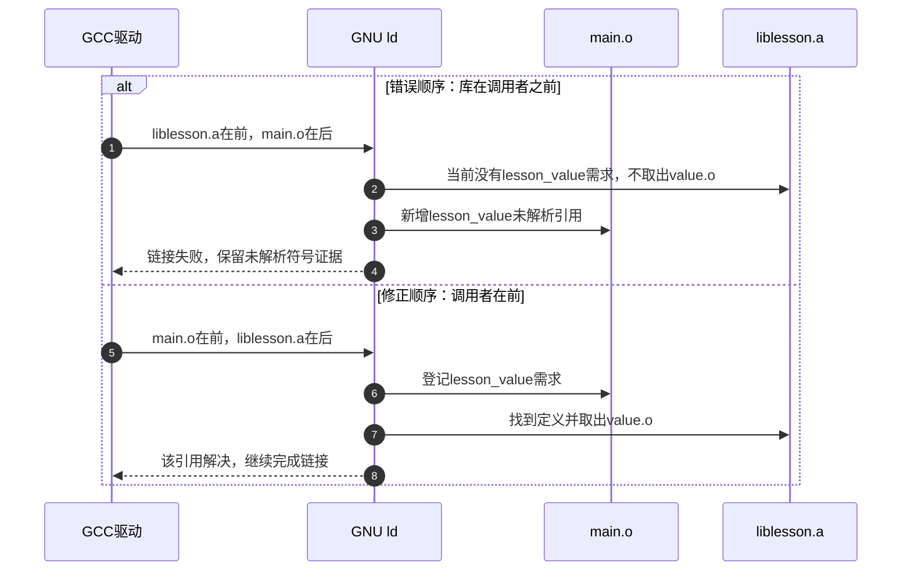

# 第4章\_沿编译链接与运行边界定位失败

[上一章](P03_把现成工具链接入受控构建.md) 已经形成一套受控工具入口：工具链实物与配置声明经过检查，目标开发文件进入本次 sysroot。可是一份应用仍可能构建失败，或者生成程序后无法运行。此时“工具链坏了”还只是猜测：失败也可能来自源码、参数、依赖、安装内容，甚至运行时输入。

本章沿同一个程序的去向定位：它停在读取头文件、生成目标代码、链接、装载，还是已经进入应用执行？先确定最后成功的一步，再收集下一步的输入。我们会故意制造一个头文件搜索错误和一个静态库链接错误，观察修复改变了哪一项条件；随后把方法扩展到 Buildroot 包和目标运行现场。

Buildroot 配方继续固定为2025.02，归档身份见 [固定资料](../../../research/source_reading/buildroot/SOURCE_BASELINE.md#1.1_解释版本与归档身份)。GCC命令说明以13.3.0手册为主要对照；错误文字可能随工具和版本变化，正文描述的是预期现象，不伪装成目标板实测日志。

## 4.1\_先确定失败发生在哪一次交接

GCC命令通常驱动预处理、编译、汇编和链接。源代码中的头文件要先找到，外部函数引用则可以留到链接时解决；程序链接成功后，还要由目标内核和动态加载器装载，之后才开始执行应用逻辑。若把这些阶段统一叫“编译”，看到一条错误时就很容易修改无关配置。


每个边界都有自己的证据。例如 D2 成功说明当前源码和参数能够生成目标文件，不说明所需库已经齐全；D3 成功说明这次链接通过，不证明部署的 rootfs 恰好提供同一套运行库。一个空 `main` 运行成功，覆盖的功能又比线程、网络或硬件访问少得多。

| 阶段 | 首先保存什么 | 不宜提前得出的结论 |
| --- | --- | --- |
| D0 | 实际工具完整路径、版本、目标元组、包装参数 | 名称带arm就一定适配当前用户空间 |
| D1 | 源码、头文件搜索路径、宏和预处理结果 | 所有头文件错误都是libc缺失 |
| D2 | 编译/汇编命令、诊断位置、目标文件 | 语言前端通过就等于程序可执行 |
| D3 | 目标文件、库顺序、搜索路径、链接记录 | ELF中的库名字证明链接时来自哪个目录 |
| D4 | 实际程序、解释器路径、rootfs、装载错误 | 文件存在就一定能被装载 |
| D5 | 输入、输出、信号、系统调用、故障位置 | 崩溃一定是工具链缺陷 |

GCC的 `-E`、`-S`、`-c` 分别提供不同停止点；`-v` 显示实际执行的阶段命令，`-###` 只显示将要调用的命令而不执行它们。它们适合分开“命令怎样组成”和“运行哪个阶段失败”。依据见 [GCC 13.3.0 Overall Options](https://gcc.gnu.org/onlinedocs/gcc-13.3.0/gcc/Overall-Options.html)。

## 4.2\_先保存原现场再缩小问题

继续使用第二章已构建完成的内部工具链。下面在Linux Bash中设置观察目录，当前目录仍为Buildroot 2025.02源码根目录。若使用第三章的消费方工具链，则把 `br_out` 改为其实际输出目录，后续都使用同一个入口，不能在一组对照里悄悄更换工具。

```sh
br_out="$PWD/../br_out_qemu_aarch64_2025_02"
br_diag="$br_out/toolchain_diagnosis"
br_cc="$br_out/host/bin/aarch64-linux-gcc"
br_ar="$br_out/host/bin/aarch64-linux-ar"
br_nm="$br_out/host/bin/aarch64-linux-nm"
br_readelf="$br_out/host/bin/aarch64-linux-readelf"
mkdir -p "$br_diag/include"
"$br_cc" -v > "$br_diag/compiler_identity.log" 2>&1
"$br_cc" -dumpmachine
"$br_cc" -print-sysroot
```

`-v` 的输出保存到文件，便于之后对照。若连这一步都不能运行，先查宿主能否执行该工具及其依赖，不急着更改目标 libc。版本号、目标元组和sysroot都是身份信息，还不是功能验收结果。

在复现实际Buildroot构建错误时，可以打开详细命令并保存退出状态：

```sh
# 仅在需要复现当前构建失败时执行；已完成的包可能不会重跑。
if make O="$br_out" V=1 > "$br_diag/build.log" 2>&1; then
    br_build_status=0
else
    br_build_status=$?
fi
printf '%s\n' "$br_build_status" > "$br_diag/build.status"
```

不要只保存末尾的 `make: Error`。应回看发生失败的包、阶段及其完整命令，配置探测失败还要保存该包的 `config.log` 或相应CMake配置日志。旧构建状态会影响是否重跑，先留住现场再按需要重建；直接清空输出目录会丢掉第一条失败证据。`V=1` 是Buildroot提供的详细输出入口，见 [make tips](../../../research/source_reading/buildroot/2025.02/docs/manual/make-tips.adoc)。

## 4.3\_让同一个小程序分别在头文件和链接处失败

下面创建三个文件：头文件声明 `lesson_value`，一个C文件实现它，另一个C文件调用它并打印结果。声明让编译器知道函数类型，定义提供可执行实现。把声明和定义分开，才能观察“编译知道该怎样调用”和“链接找到被调用者”的差别。

三份C材料已用Windows上的MinGW GCC 14.2.0做过本机对照：缺头文件与错误归档顺序均失败，修正后程序输出 `value=42`。这只核对示例逻辑与该GNU链接器的归档行为；下面的AArch64交叉构建、ELF观察和Linux目标运行仍未实测。

### 4.3.1\_建立声明与实现

在上面的观察目录创建材料：

```sh
cat > "$br_diag/include/lesson_value.h" <<'EOF'
#ifndef LESSON_VALUE_H
#define LESSON_VALUE_H

/* 声明调用接口，具体实现放在另一个C文件中。 */
int lesson_value(void);

#endif
EOF
cat > "$br_diag/value.c" <<'EOF'
#include "lesson_value.h"

int lesson_value(void)
{
    /* 固定返回值，避免把运行输入混入本次链接观察。 */
    return 42;
}
EOF
cat > "$br_diag/main.c" <<'EOF'
#include <stdio.h>
#include "lesson_value.h"

int main(void)
{
    printf("value=%d\n", lesson_value());
    return 0;
}
EOF
```

这里的 `include` 是我们创建的实验目录，不是工具链的系统头文件目录。先故意不告诉编译器这条搜索路径：

```sh
if "$br_cc" -std=c11 -Wall -Wextra -c "$br_diag/main.c" \
    -o "$br_diag/missing_header.o" > "$br_diag/missing_header.log" 2>&1; then
    printf '%s\n' '未出现预期失败，请检查环境是否额外加入了头文件路径。'
else
    cat "$br_diag/missing_header.log"
fi
```

预期失败对象是 `lesson_value.h`。它存在于磁盘，并不意味着编译器会搜索所有目录。若先报 `stdio.h` 缺失，说明更早的目标开发环境问题尚未排除，本次对照还没有成立。不要用安装宿主发行版开发包来掩盖这个差别。

### 4.3.2\_只修正搜索路径并观察D1与D2

给出实验头文件目录，先产生预处理结果，再生成两个目标文件：

```sh
"$br_cc" -std=c11 -I"$br_diag/include" -H -E "$br_diag/main.c" \
    -o "$br_diag/main.i" 2> "$br_diag/headers.log"
"$br_cc" -std=c11 -Wall -Wextra -O0 -I"$br_diag/include" \
    -c "$br_diag/main.c" -o "$br_diag/main.o"
"$br_cc" -std=c11 -Wall -Wextra -O0 -I"$br_diag/include" \
    -c "$br_diag/value.c" -o "$br_diag/value.o"
"$br_nm" -u "$br_diag/main.o"
"$br_nm" --defined-only "$br_diag/value.o"
```

`-I` 添加搜索位置，`-H` 报告实际包含的头文件，`main.i` 保存预处理输出。目标文件的符号观察应显示：main.o仍引用 `lesson_value`，value.o已经定义它。这证明D1、D2成立，同时把下一步未解决的问题保留下来。`-H` 的行为见 [GCC预处理选项](https://gcc.gnu.org/onlinedocs/gcc-13.3.0/gcc/Preprocessor-Options.html)。

### 4.3.3\_为什么库文件存在仍然链接失败

把value.o放进静态归档库，再故意采用错误顺序。`ar rcs` 创建或更新归档并建立索引；本实验只使用这一份成员。

```sh
"$br_ar" rcs "$br_diag/liblesson.a" "$br_diag/value.o"
if "$br_cc" -L"$br_diag" -llesson "$br_diag/main.o" \
    -o "$br_diag/wrong_order" > "$br_diag/wrong_order.log" 2>&1; then
    printf '%s\n' '未出现预期失败，请记录实际链接器与参数后再分析。'
else
    cat "$br_diag/wrong_order.log"
fi
```

这里 `-L` 指定库搜索目录，`-llesson` 对应库名。采用GNU ld的普通静态归档搜索规则时，链接器到达liblesson.a的位置还没有见到main.o对 `lesson_value` 的需求，因此没有因该需求取出value.o；后来读到main.o才出现这个未解析引用，又不会自动回头重新搜索前面的归档。



图中只放大实验归档的处理，省略了GCC自动加入的启动文件和系统库。错误分支的步骤2、3与正确分支的步骤6、7使用同一份对象，改变的是输入顺序。修正命令如下：

```sh
"$br_cc" "$br_diag/main.o" -L"$br_diag" -llesson \
    -Wl,-t -Wl,-Map,"$br_diag/link.map" -o "$br_diag/lesson" \
    > "$br_diag/link_inputs.log" 2>&1
"$br_readelf" -h -l -d "$br_diag/lesson"
```

`-Wl,` 把后续逗号分隔的参数传给链接器，`-t` 记录处理的输入，映射文件用于查看布局和归档成员的参与。这次修复无需更换GCC或libc。不同链接器及归档分组规则可能改变处理方式，本例以GNU ld普通归档顺序为边界，见 [GNU ld Options](https://sourceware.org/binutils/docs/ld/Options.html) 和 [GCC Link Options](https://gcc.gnu.org/onlinedocs/gcc-13.3.0/gcc/Link-Options.html)。

成功链接不等于目标运行成功；若部署到匹配的AArch64运行环境，预期输出为 `value=42`。当前章节没有把这一预期写成QEMU实测。这个小实验同时提醒我们：hello成功不能排除只在某类优化、C++、线程或大程序里暴露的工具链问题，hello失败也不能直接证明编译器本身有缺陷。

## 4.4\_从链接产物看什么以及看不到什么

D3以后，先在宿主静态检查目标ELF，不必尝试执行它。下面沿用刚生成的lesson文件：

```sh
"$br_readelf" -h "$br_diag/lesson"
"$br_readelf" -l "$br_diag/lesson"
"$br_readelf" -d "$br_diag/lesson"
"$br_readelf" -V "$br_diag/lesson"
```

第一条看机器类型和位数；第二条中的 `PT_INTERP` 若存在，给出动态程序使用的解释器路径；第三条看动态依赖等信息；第四条看符号版本需求。静态程序或没有相应信息的文件不会出现全部这些条目，不能因此一概判坏。

| 观察工具与信息 | 可以回答 | 仍需要其他证据回答 |
| --- | --- | --- |
| `file`、`readelf -h` | 文件的大类、架构、位数等 | 每条指令是否都被实际CPU支持 |
| `readelf -l` 的解释器项 | 程序要求哪个加载器路径 | 目标rootfs里是否存在兼容实现 |
| `readelf -d` 的 `NEEDED` | 动态依赖的库名称 | 构建时来自哪个完整目录、运行时最终选中哪份文件 |
| `readelf -V` | 已记录的符号版本要求 | 目标实际库是否满足这些要求 |
| 链接追踪与映射文件 | 这次链接处理了哪些输入 | 部署时是否仍使用匹配文件 |
| 匹配运行环境中的 `ldd` | 当前环境怎样解析动态依赖 | 另一台板、另一rootfs或另一个命名空间中的解析结果 |

因此 `NEEDED: libc.so.6` 不是“肯定使用了sysroot里的那份libc”的证明。要追构建来源，保留链接命令、搜索路径和输入记录；要追运行来源，检查实际运行环境。`ldd` 也不是通用的跨架构静态分析器，应只在匹配环境中对自己构建的程序使用。这里不要求在x86-64宿主上对AArch64程序运行ldd。ELF查询选项见 [GNU readelf说明](https://sourceware.org/binutils/docs/binutils/readelf.html)。

## 4.5\_发现宿主路径时先问它服务谁

交叉编译器自己运行在宿主，因此它读取宿主动态库是正常的；包构建过程也可能编译一个宿主代码生成器。真正要排查的是：**目标编译和链接步骤是否误用了宿主的开发接口或库**。把日志里所有 `/usr/lib` 都判成污染，会把正常宿主工具依赖也一起误删。

先查看实际命令中的编译器、`-I`、`-L` 和sysroot，再用头文件追踪、链接映射补证。若还不清楚，可在安装了strace的Linux宿主上观察编译器及其子进程：

```sh
# Linux宿主执行；strace须已安装。
strace -f -e trace=%file,%process -o "$br_diag/compiler.trace" \
    "$br_cc" -I"$br_diag/include" "$br_diag/main.c" \
    "$br_diag/value.c" -o "$br_diag/traced_lesson"
```

`-f` 跟随子进程，才能把驱动调用的编译、汇编和链接过程一起看见。日志中某次打开失败可能只是正常搜索尝试，应结合后续是否找到目标文件判断。跟踪选项依据见 [strace手册](https://man7.org/linux/man-pages/man1/strace.1.html)。把x86-64目标库误交给AArch64链接器，常常在链接阶段就被拒绝，不应编造“总能链接，之后才非法指令”的固定故事。

依赖发现也会引入错误路径。**pkg-config** 根据软件包的 `.pc` 描述给出头文件和库参数；如果查了宿主的描述，即使用对交叉gcc，也可能得到错误输入。Buildroot提供面向目标的包装入口，默认把查询和sysroot指向本次staging，宿主包则使用另外的环境。环境变量可以覆盖默认值，所以包里擅自设置这些变量仍须检查。

| 边界 | 当前需要检查的配置 | 它解决哪一步 |
| --- | --- | --- |
| 编译工具 | 目标 `CC/CXX` 与宿主 `CC_FOR_BUILD` 等 | 把目标产物和构建时工具分开 |
| pkg-config | `PKG_CONFIG`、`PKG_CONFIG_LIBDIR`、`PKG_CONFIG_SYSROOT_DIR`，以及额外搜索路径 | 控制查哪份包描述、怎样解释目标路径 |
| Autotools包 | Buildroot传入的目标/宿主元组、编译变量与包专用配置 | 让configure知道是在交叉构建 |
| CMake包 | Buildroot生成的toolchainfile及查找根模式 | 区分宿主可执行工具与目标头文件、库 |

若configure要求运行一个目标测试程序，先分析测试想证明的性质，再依据该包支持的交叉编译方式设置缓存答案或修补检测。不存在通用的 `--disable-run` 参数，也不能在包Config.in里编造一个 `BR2_TOOLCHAIN_SYSROOT` 就解决问题。基础设施提供的是共同环境，包自身错误的探测仍要修复。

相关固定实现见 [目标与宿主变量](../../../research/source_reading/buildroot/2025.02/package/Makefile.in)、[pkg-config包装](../../../research/source_reading/buildroot/2025.02/package/pkgconf/pkg-config.in)、[Autotools配方](../../../research/source_reading/buildroot/2025.02/package/pkg-autotools.mk)、[CMake配方](../../../research/source_reading/buildroot/2025.02/package/pkg-cmake.mk) 及 [toolchainfile模板](../../../research/source_reading/buildroot/2025.02/support/misc/toolchainfile.cmake.in)。

## 4.6\_程序已经存在为何仍不能运行

现在进入D4。对一个动态ELF，目标内核需要找到它声明的解释器；加载器还要找到并装载依赖库。因此“shell能列出这个文件”只是路径存在证据。缺少脚本解释器或ELF解释器都可能导致execve返回ENOENT；也要区分权限、挂载限制和格式错误。接口边界见 [Linux execve(2)](https://man7.org/linux/man-pages/man2/execve.2.html)。

若加载器报告 `GLIBC_x.y not found`，应比较程序及相关共享库要求的符号版本与目标实际提供的版本。不要把它等同于“调试符号被剥离”，也不要仅凭libc文件名相同判断匹配。通常应重新构建匹配目标的程序，或部署经验证的完整运行环境；随手覆盖正在使用的单个libc文件不是一个完整的系统更新方案。

D5的问题又不同。非法指令信号可能来自CPU不支持的指令，也可能来自错误跳转等程序问题；段错误并不证明发生了“不支持的新系统调用”。应收集信号、故障地址、反汇编、输入和系统调用轨迹，再决定查指令生成、程序内存访问还是运行环境。

对于系统调用，返回ENOSYS与进程收到SIGSYS也不能混为一谈。内核未提供接口可能返回ENOSYS；seccomp这类系统调用过滤机制还可能返回指定错误或产生SIGSYS。需要同时检查具体调用、内核能力与过滤策略，而不是看到“bad system call”就调低头文件菜单。过滤动作的区别见 [Linux seccomp(2)](https://man7.org/linux/man-pages/man2/seccomp.2.html)。

| 现场 | 下一份需要取得的证据 | 避免的误操作 |
| --- | --- | --- |
| 文件存在但不能exec | ELF或脚本解释器、权限、格式及目标路径 | 只复制同名加载器便宣称兼容 |
| 动态库找不到 | 实际库搜索环境与rootfs安装内容 | 把宿主库直接复制到目标 |
| 符号版本缺失 | 程序需求与目标库版本定义 | 把剥离调试信息当成根因 |
| SIGILL | 故障PC、指令、CPU能力和程序控制流 | 未分析指令就全局切换浮点ABI |
| SIGSEGV | 故障访问地址、调用栈、输入及对象状态 | 一律归咎于内核头文件太新 |
| ENOSYS或SIGSYS | 具体系统调用、返回或信号、内核与过滤条件 | 只改外部工具链的能力声明 |

在具备工具的目标系统上，strace观察应用的系统调用，GDB/gdbserver观察指令和程序状态；二者解决的问题不同。GDB在宿主运行时，需要匹配的未剥离程序和目标库调试材料，不能把target中已剥离的文件当成完整源码调试证据。Buildroot可以构建宿主GDB与目标gdbserver，也可以按能力复制外部工具链的gdbserver，配置入口和gdbinit用途见 [Using gdb in Buildroot](../../../research/source_reading/buildroot/2025.02/docs/manual/using-buildroot-debugger.adoc)。本章尚未部署这些工具，不把它们列为已经执行的检查。

## 4.7\_什么时候才有理由怀疑工具链实现

如果某个包失败而hello成功，只能说错误没有在hello覆盖的路径出现。下一步应逐渐缩小失败源码，同时保留触发它的类型、优化选项、依赖和输入。假如问题只在某个优化级别出现，也要检查未定义行为、越界、未初始化数据和并发访问，不能用“关优化能跑”直接证明编译器错误。

报告一个可复现工具链问题，应保留完整版本与目标、命令、预处理后源码或最小源文件、期望结果、实际诊断和必要运行条件。GCC缺陷材料的具体要求见 [上游问题报告说明](https://gcc.gnu.org/bugs/)。链接问题还要保留相关对象与库身份；运行问题还要固定rootfs、内核、CPU和输入。BusyBox或内核构建可以扩大覆盖范围，但它们失败也可能来自源码、配置和宿主依赖，不能当成编译器缺陷的直接判决。

团队和持续集成应共享这些可追踪输入。固定工具链归档、补丁、Buildroot版本、配置和容器摘要，可以减少漂移；同一份defconfig或同一个容器名称仍不自动保证所有输入和结果字节一致。缓存应以实际生产身份和配置划分，更换工具链后使用干净的系统输出，避免旧目标文件掩盖变化。

| 对照实验 | 固定哪些条件 | 改变什么才有解释力 |
| --- | --- | --- |
| 本章缺头文件 | 同一源码、编译器、sysroot | 只增加实验头文件的搜索目录 |
| 本章归档顺序 | 同一对象与同一静态库 | 只改变调用者和库的顺序 |
| 包的交叉探测失败 | 同一目标工具和依赖 | 对照包实际支持的交叉检测路径 |
| 疑似优化问题 | 同一输入、语言与目标条件 | 缩小源码并记录优化差异，同时排查源码未定义行为 |
| 更换工具链复验 | 保存两套完整生产身份 | 在独立输出中重建并比较相同功能，不混用旧对象 |

## 4.8\_用失败证据决定下一步

试着回答下面的问题，再对照推理。

1. main.o已生成，链接报 `lesson_value` 未定义，是否应该先重新构建glibc？
2. `readelf -d` 显示libc.so.6，是否证明没有使用错误的搜索目录？
3. `strace`看到交叉gcc打开宿主动态库，是否已经证明目标程序被污染？
4. hello可以运行，是否排除了只在某个C++模板或优化路径出现的工具链问题？

第一题应先找本实验定义所在的对象、归档和顺序；glibc并不负责定义这个函数。第二题不能，库名称缺少构建时路径证据，应看链接命令和输入记录。第三题不能，gcc本身就是宿主程序，要区分宿主执行依赖与目标编译输入。第四题也不能，成功结果只覆盖已经执行的功能和条件。

现在可以沿D0～D5说明一条错误究竟卡在哪里，并用单一条件的变化验证判断。接下来的问题是：即使程序链接正确，怎样保证它和运行库、配置、权限一起进入正确的目标系统？[下一章](P05_从安装目录到可验证的根文件系统.md) 从rootfs的输入与安装过程继续这条交接。
