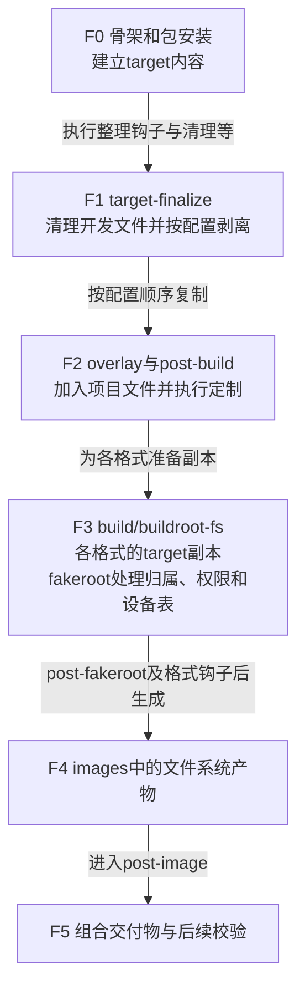
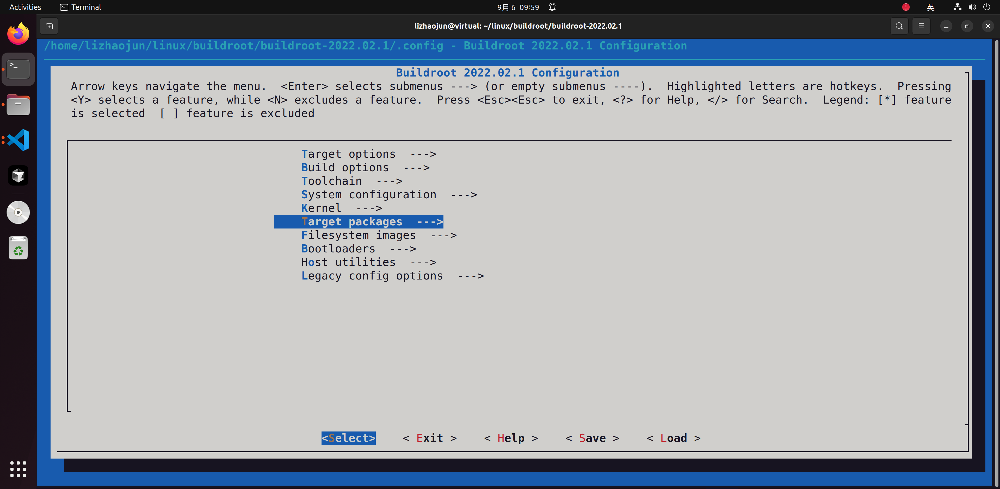
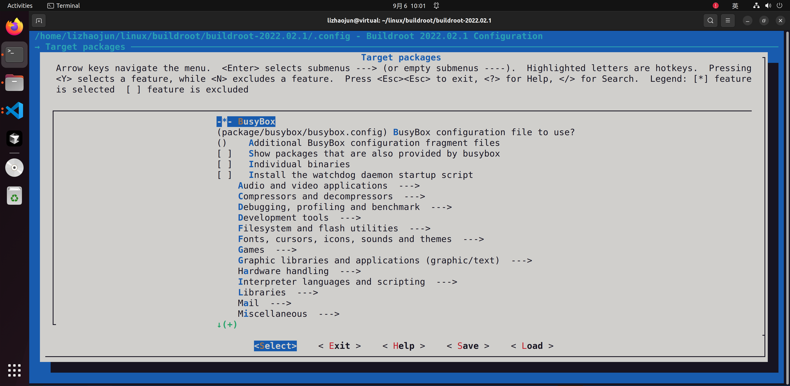
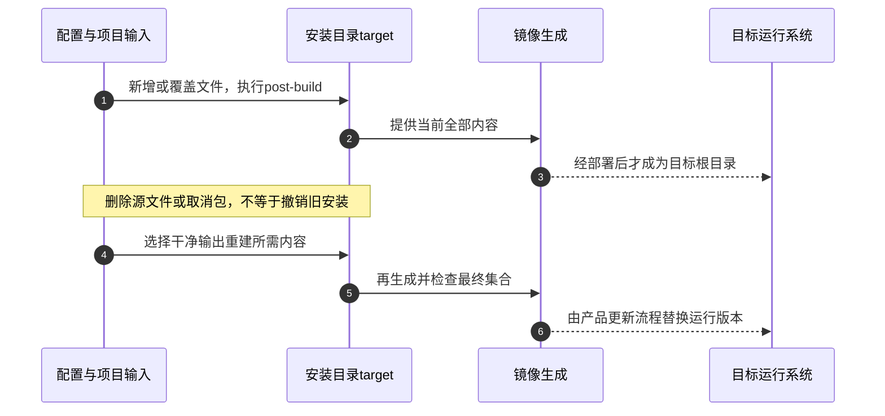

# 第5章\_从安装目录到可验证的根文件系统

[上一章](P04_沿编译链接与运行边界定位失败.md) 已经能区分程序在编译、链接、装载还是运行时失败。但一个单独的可执行文件仍不是可交付系统：它需要加载器和库，服务需要配置，内核还需要能挂载根目录并启动第一个用户进程。本章从这些相互依赖的文件出发，把它们放入同一次可重复生成的安装过程。

继续固定Buildroot 2025.02，来源见 [资料基线](../../../research/source_reading/buildroot/SOURCE_BASELINE.md#1.1_解释版本与归档身份)。贯穿实验是在QEMU系统中加入一份配置和一份版本记录，随后分别检查安装目录、归档和运行系统。所有目标构建与启动结果均为待执行的观察要求；本轮没有执行Linux Buildroot或QEMU，不把示意输出当成实测。

## 5.1\_为什么复制一个程序还不足以构成系统

假设程序在开发目录里能够链接。把它复制到板子的根目录后，内核执行它时还可能找不到ELF解释器；即使依赖库齐全，程序也可能因为没有配置文件而退出。另一方面，内核成功挂载根文件系统，只能说明它能解释该存储格式，不能证明里面的用户空间能够启动。

这里把承载最终用户空间根目录的文件集合简称 **rootfs**。它包含程序、运行库、配置及必要目录。Linux内部还把早期的特殊内存文件系统称为rootfs，讨论initramfs时要区分这个内核对象与本章较宽泛的工程用语。

在本专题的QEMU实例中，虚拟机直接加载内核，内核通过virtio块设备挂载ext4，再进入初始化程序；没有U-Boot参与。实体板可能由固件或U-Boot加载内核、设备树和可选initramfs，根分区则由内核读取，不能统一说成“U-Boot把整个根分区加载进内存”。


图中最后两条路径决定了裁剪边界：只读配置可以进入固件，运行日志必须有明确的写入位置。根目录只读时，写入位置可以是独立数据分区、内存中的tmpfs，或后文介绍的叠加挂载；不能只把根改为只读，便默认所有程序继续正常工作。

## 5.2\_先决定内核怎样取得文件再选镜像格式

本例已经有一个虚拟块设备，因此沿用ext4，先把文件内容和安装过程讲清。换到实体产品时，先问存储向内核暴露什么接口：SD卡、eMMC通常提供块设备；原始闪存通过MTD接口暴露擦除块等约束。即使底层都使用闪存，也不能把原始NAND的布局参数直接用于eMMC分区。

对块设备，ext2/3/4提供可挂载的磁盘文件系统。ext2没有日志；ext3/4的日志机制服务于崩溃恢复，但不等于应用最后一次写入必然持久化，实际还受挂载方式、同步协议和存储设备影响。不要用“可靠性高”三个字替代这些条件。日志边界参见 [Linux 6.12 Journal说明](https://www.kernel.org/doc/html/v6.12/filesystems/ext4/globals.html#journal-jbd2)。

如果内容应固化且需要压缩，SquashFS提供只读压缩格式；运行时不能直接改其中的文件。需要可写视图时，OverlayFS可以把上层与下层合成一次挂载：读取时查找可见对象，对下层对象的修改通常先复制到上层，之后写上层。它本身也是文件系统实现，但不是一个脱离上下层即可独立保存所有数据的磁盘镜像格式。上层还要满足内核约束，持久上层也需要自己的升级与恢复策略。

原始闪存路径则要继续分层：JFFS2直接面向MTD；UBIFS运行在UBI卷上，由UBI承担其与底层擦除块之间的管理。制作UBIFS文件系统与制作可放入闪存的UBI布局不是同一个动作；最小I/O单元、擦除块和卷布局必须来自实际平台。JFFS2也不是仅适用于NAND的格式，不能把它写成一个由容量阈值自动替换成UBIFS的规则。

initramfs采用另一条启动路径：内核将cpio归档展开到内存文件系统，通常执行其中的 `/init`，再由它继续启动或切换到其他根。展开后的文件可以修改，但修改通常不会保存到原归档，断电后也不会自动持久化。因此“归档是输入文件”不等于“运行中的initramfs只读”。体积、解压、内存占用和后续初始化共同影响启动时间，没有格式名称本身带来的固定速度保证。

| 产物或机制 | 交给谁使用 | 当前选择要回答的问题 |
| --- | --- | --- |
| ext2/3/4镜像 | 支持相应特性的块设备文件系统驱动 | 内核特性、分区容量、写入与恢复需求是否匹配 |
| SquashFS镜像 | SquashFS驱动 | 固件内容是否只读，写入放在哪里 |
| JFFS2镜像 | MTD上的JFFS2 | 原始闪存与镜像参数是否匹配 |
| UBIFS及UBI镜像 | UBI卷和UBIFS驱动 | 文件系统、卷布局、物理闪存参数是否分别匹配 |
| cpio/initramfs | 内核早期解包与启动路径 | 是否提供可执行的init及依赖，RAM是否足够 |
| tar归档 | 解包工具或后续镜像流程 | 怎样恢复所有者、权限和特殊文件；它不是可直接挂载的磁盘文件系统 |
| OverlayFS挂载 | 运行时内核 | 上下层的存储、写入及升级语义是什么 |

这些是选择条件，不是可靠性排行榜。格式机制对照：[Linux 6.12 SquashFS](https://www.kernel.org/doc/html/v6.12/filesystems/squashfs.html)、[UBIFS与MTD/UBI](https://www.kernel.org/doc/html/v6.12/filesystems/ubifs.html)、[initramfs](https://www.kernel.org/doc/html/v6.12/filesystems/ramfs-rootfs-initramfs.html)、[OverlayFS](https://www.kernel.org/doc/html/v6.12/filesystems/overlayfs.html)。

## 5.3\_同一份文件怎样经过安装与镜像生成

决定ext4后，还不能直接把工作目录当成最终文件系统。开发者通常以普通用户构建，而目标文件需要目标用户编号、权限，有时还需要设备节点。Buildroot把“内容安装”和“生成镜像时的元数据处理”分开，使日常构建不必获得宿主root权限。

第一章已经区分了 `host/`、`staging`、`target/` 和 `images/`。这里再追一次文件：目标包按配方把运行文件安装到target；需要提供给其他包编译使用的头文件和库，另按配方安装到staging。不是所有包都先装进staging，然后将整个staging复制成target。启用每包目录等构建模式时还存在汇聚步骤，但开发接口与运行内容的职责仍不同。

把本章相关过程记为F0～F5。它是构建产物的处理顺序，不是内核运行时状态机。



F0的 **skeleton（骨架）** 提供初始布局，包在其上安装。它先于后面的overlay；如果只是改一个配置文件，替换整套骨架反而会承担维护全部基础布局的成本。

F1整理target，清理开发头文件、静态归档、文档等，并按配置处理符号。F2才复制项目overlay，随后执行post-build。这也意味着overlay加入的文件不会自动获得前面每项清理或剥离处理；把任意大文件塞入overlay，再指望Buildroot替它选择运行内容，是错误的职责分配。

F3为每种格式准备target副本，生成fakeroot脚本，在同一fakeroot环境中处理用户、权限和设备信息，最后调用镜像生成器。**fakeroot维护的是供这些工具观察的元数据视图，不会把普通构建用户变成真正的root。** 因此宿主 `ls -l target` 显示的所有者，不能代替镜像内的所有者检查。设备节点也要区分静态设备表和目标启动后由devtmpfs等机制建立的内容。

F4产物已经生成，F5的post-image适合组合内核、文件系统与分区布局，或生成校验记录。此时只改target并不会回头修改已有镜像；脚本若要修改镜像，必须显式完成相应操作。只创建空磁盘文件和分区表，也不代表已经把rootfs与启动文件写入了对应分区。

| 输入入口 | 作用于哪一步 | 应放什么 |
| --- | --- | --- |
| `BR2_ROOTFS_SKELETON_CUSTOM` 与 `_CUSTOM_PATH` | F0 | 确实需要全面替代默认布局时的基础树 |
| `BR2_ROOTFS_OVERLAY` | F2 | 可直接按目标路径复制的项目文件树；多目录按顺序应用 |
| `BR2_ROOTFS_POST_BUILD_SCRIPT` | F2 | 需要逻辑处理的内容定制；首参数是target目录 |
| `BR2_ROOTFS_DEVICE_TABLE` | F3 | 文件权限与归属表；保留项目仍需要的默认表 |
| `BR2_ROOTFS_POST_FAKEROOT_SCRIPT` | F3 | 现有表机制不足时的特殊处理；在fakeroot上下文运行 |
| `BR2_ROOTFS_POST_IMAGE_SCRIPT` | F5 | 镜像之后的组合处理；首参数是images目录 |

这些选项的相对路径以Buildroot源码根目录为基准，不随 `O=` 输出位置改变。脚本必须可执行；post-build与post-image按普通构建用户运行，不能假设它们拥有真实root权限。若启用合并 `/usr` 的布局，overlay不要另建 `/bin`、`/sbin`、`/lib` 实体目录去冲撞系统链接，应在相应 `/usr` 路径安装。

顺序和副本边界来自固定版本 [顶层Makefile](../../../research/source_reading/buildroot/2025.02/Makefile)、[fs/common.mk](../../../research/source_reading/buildroot/2025.02/fs/common.mk)；定制契约见 [rootfs手册](../../../research/source_reading/buildroot/2025.02/docs/manual/customize-rootfs.adoc) 与 [post-image手册](../../../research/source_reading/buildroot/2025.02/docs/manual/customize-post-image.adoc)。

## 5.4\_让配置内容与权限一起进入镜像

现在用一个完整实验兑现F2～F4。配置文件说明一个采样周期，版本文件标识材料修订。它们都不包含密钥，权限0600只是便于观察镜像元数据。这里不新增应用，避免把下一章的包集成同时混进来。

### 5.4.1\_把可维护输入放在输出目录之外

在Linux宿主、Buildroot 2025.02源码根目录执行，使用新的练习板目录和独立输出目录，避免覆盖前几章的结果。先准备overlay和版本输入：

```sh
br_board="$PWD/board/lesson/qemu_aarch64_rootfs"
br_out="$PWD/../br_out_rootfs_lesson_2025_02"
mkdir -p "$br_board/rootfs_overlay/etc"
printf '%s\n' 'sample_interval_ms=1000' \
    > "$br_board/rootfs_overlay/etc/lesson.conf"
printf '%s\n' 'lesson-v1' > "$br_board/release.txt"
```

接着创建post-build脚本。它从受版本控制的材料读取版本，不取当前时钟；每次覆盖同一文件，重复执行不会不断追加重复行。

```sh
cat > "$br_board/post_build.sh" <<'EOF'
#!/bin/sh
set -eu

# 首参数由Buildroot传入，必须已经具有根目录的基本结构。
br_target=${1:?缺少目标目录参数}
test -d "$br_target/etc"
# release.txt与脚本一起维护，重复执行得到同一内容。
install -m 0644 "$(dirname "$0")/release.txt" \
    "$br_target/etc/lesson_release"
EOF
chmod +x "$br_board/post_build.sh"
cat > "$br_board/permissions.txt" <<'EOF'
/etc/lesson.conf f 600 0 0 - - - - -
EOF
```

权限行中的十列依次是路径、类型、模式、UID、GID、主设备号、次设备号、起始编号、增量、数量。`f` 要求普通文件已经存在，`600` 表示只有所有者可读写，`0 0` 指目标root用户与组，其余设备相关列不适用所以填 `-`。权限表不会替我们创建缺失的配置内容。表语法依据见 [makedev说明](../../../research/source_reading/buildroot/2025.02/docs/manual/makedev-syntax.adoc)。

### 5.4.2\_将三个输入接入同一配置

先装入第一章使用过的QEMU AArch64默认配置，再打开菜单：

```sh
make O="$br_out" qemu_aarch64_virt_defconfig
make O="$br_out" menuconfig
```

在 `System configuration` 设置以下值；表内字符串是菜单输入值，不需要把两端引号输入菜单。文件系统菜单另外启用无压缩tar归档用于观察，并保留原配置的ext4与QEMU启动脚本。

| 配置符号 | 本实验的值 |
| --- | --- |
| `BR2_ROOTFS_OVERLAY` | `board/lesson/qemu_aarch64_rootfs/rootfs_overlay` |
| `BR2_ROOTFS_POST_BUILD_SCRIPT` | `board/lesson/qemu_aarch64_rootfs/post_build.sh` |
| `BR2_ROOTFS_DEVICE_TABLE` | `system/device_table.txt board/lesson/qemu_aarch64_rootfs/permissions.txt` |
| `BR2_TARGET_ROOTFS_TAR` | `y` |
| `BR2_TARGET_ROOTFS_TAR_NONE` | `y` |

前三项对应F2复制、F2脚本和F3权限，后二项增加一种F4观察产物。不要覆盖默认配置已有的post-image脚本；它负责本例的QEMU启动入口。菜单保存后构建，并将最小配置保存到材料目录：

```sh
make O="$br_out"
make O="$br_out" savedefconfig BR2_DEFCONFIG="$br_board/lesson_defconfig"
```

这是独立输出的首次完整构建，会构建工具链、内核及所选软件；所需依赖和资源沿用第一章，不承诺固定耗时。`lesson_defconfig` 还需要上述材料树和固定Buildroot版本共同解释，单独一份配置不包含overlay文件本身。

### 5.4.3\_分开验证内容与镜像元数据

构建成功后，先看F2是否交出了预期内容：

```sh
cat "$br_out/target/etc/lesson.conf"
cat "$br_out/target/etc/lesson_release"
tar --numeric-owner -tvf "$br_out/images/rootfs.tar" \
    ./etc/lesson.conf ./etc/lesson_release
```

前两条应分别显示采样周期和 `lesson-v1`。第三条读取归档目录，不执行目标代码；应看到lesson.conf的所有者/组为0/0、权限为0600，版本文件为0644。不能以target上的宿主所有者否定归档结果，也不能仅凭两次cat成功便宣布权限表有效。

还要检查本次ext4，而不只检查同一target生成的tar。Linux宿主安装e2fsprogs后，可用其debugfs只读查询：

```sh
debugfs -R 'cat /etc/lesson.conf' "$br_out/images/rootfs.ext4"
debugfs -R 'stat /etc/lesson.conf' "$br_out/images/rootfs.ext4"
```

这里的debugfs是e2fsprogs工具，不是内核debugfs伪文件系统；未加 `-w`，不会以写模式打开镜像。`cat`检查数据，`stat`检查inode模式与所有者。2025.02的ext2/3/4共同使用ext2生成配方，选择ext4时 `rootfs.ext4` 可以是指向 `rootfs.ext2` 的链接，文件名本身不能证明磁盘格式。依据见 [ext2配方](../../../research/source_reading/buildroot/2025.02/fs/ext2/ext2.mk) 与 [debugfs手册](https://man7.org/linux/man-pages/man8/debugfs.8.html)。

### 5.4.4\_最后让目标读取这一份产物

使用该输出目录生成的启动脚本，登录后在目标终端读取文件：

```sh
# Linux宿主执行，启动本次输出的QEMU实例。
"$br_out/images/start-qemu.sh"
```

```sh
# 以下命令在QEMU目标系统登录后执行。
cat /etc/lesson.conf
cat /etc/lesson_release
ls -ln /etc/lesson.conf
```

应仍看到相同内容及0600权限。成功只能证明这一组启动与读取路径；不能代替网络、设备、掉电恢复或实体板验收。结束QEMU沿用第一章的终端退出方式 `Ctrl-a` 后按 `x`。

现在把材料中的 `release.txt` 改为 `lesson-v2`，重新执行 `make O="$br_out"`，再按上述顺序检查。预期版本文件变化，权限配置不变。本轮仅在Windows Git Bash中验证脚本重复执行、版本变更及缺参失败；没有执行fakeroot或镜像构建。这个单变量练习说明：版本来自受控输入，经F2写入，再由F4打包；不是目标启动时凭空生成的值。若tar已更新而目标仍显示v1，应先核对实际启动的镜像，不立即怀疑脚本没有执行。

## 5.5\_减少体积时先确认谁仍依赖这些文件

精简从运行需求出发。BusyBox把许多常用命令合进同一个程序，并按调用名称提供不同功能，这些功能通常称为applet。移除一个不使用的服务可以减少代码；但若启动脚本仍调用被移除的命令，系统可能在应用启动前就失败。因此先列出启动、业务和恢复路径使用的命令，再调整BusyBox配置，不能按“调试工具都无用”统一删除。

下面两图是仓库保留的 **Buildroot 2022.02.1历史截图**，展示Target packages与BusyBox配置文件入口；不是本章2025.02配置的实测截图。第二图只是选择BusyBox配置文件，不是已经展示所有applet开关。





对已选BusyBox的输出，可进入它自己的配置菜单：

```sh
make O="$br_out" busybox-menuconfig
```

修改结果首先位于构建输出中。长期维护要用 `BR2_PACKAGE_BUSYBOX_CONFIG` 指向项目保存的配置文件，并按Buildroot的配置保存流程更新它，不能把临时build目录当作唯一源材料。本章实验不修改applet集合；下一章再把包配置、重建与服务关系放在一起操作。

其他裁剪也应先区分作用：符号剥离去掉调试等信息，不应破坏动态装载所需信息；locale清理与生成不是同一个开关；静态链接会把需要的库代码并入程序，多个程序可能重复携带相同代码，所以并不必然比共享库更小。更新静态链接库后通常需要重新链接相关程序，动态库更新也仍要验证ABI和行为，不能用固定固件容量阈值代替比较。

| 已建立的需求 | 2025.02中的入口或行为 | 代价与检查 |
| --- | --- | --- |
| 精简BusyBox功能 | `BR2_PACKAGE_BUSYBOX_CONFIG`，`busybox-menuconfig` | 核对脚本调用及恢复工具 |
| 控制目标调试信息 | `BR2_STRIP_strip`，`BR2_STRIP_EXCLUDE_FILES/DIRS` | 为宿主调试另存匹配的未剥离材料；本版本由是否剥离及排除项控制 |
| 清理不需要的语言资源 | `BR2_ENABLE_LOCALE_PURGE` 与 `BR2_ENABLE_LOCALE_WHITELIST` | 白名单只保留已有资源，不保证生成缺失语言 |
| 生成所需locale数据 | `BR2_GENERATE_LOCALE`，受libc能力约束 | 与资源清理分开检查，默认不是生成所有语言 |
| 移除开发文件和文档 | F1的target整理规则 | 它服务于该构建模型，不证明所有产品都不需要这类文件 |
| 固化根目录 | 只读格式或挂载设计 | 安排临时与持久写入；只读不等于具备完整升级容错 |

开关来自固定 [Build options](../../../research/source_reading/buildroot/2025.02/Config.in)、[System configuration](../../../research/source_reading/buildroot/2025.02/system/Config.in) 和 [BusyBox配置](../../../research/source_reading/buildroot/2025.02/package/busybox/Config.in)。比较大小应同时记录内容集合、调试策略、压缩方式和镜像预留容量；一个固定容量的ext4镜像，删除文件后总文件长度可能不变，不能据此判断裁剪无效。没有测量就不写“减少30%”或“必定小于几MB”。

## 5.6\_重新生成镜像不等于自动撤销旧安装

本章只新增overlay文件，普通make能够重新复制并生成镜像。但当你取消一个软件包，情况不同：旧包已经把文件装入target和开发环境，取消配置不等于执行卸载；其他已构建包还可能保留对它的可选依赖。于是菜单看起来变小，产物却仍带旧文件，甚至在手工删库后失去依赖。

因此移除包、改变工具链或骨架等情况，应按固定版本的重建规则使用干净输出重新生成。overlay也不是“目标目录与源目录完全同步”的删除协议：从overlay源中删掉一个文件，不能假定旧target中对应文件就被自动撤销。对这种变化，要明确清理策略或重新从干净输出构建，再查镜像，而不只查输入目录。



图中步骤1～3处理新增或覆盖，步骤4～6从干净输出重建最终集合；两条路径的部署都需要独立流程。Buildroot的构建期overlay只是文件复制输入，**不是运行中的OverlayFS，也不是远程升级协议**。post-build在宿主构建时运行，不能替目标完成断电容错、版本回滚和用户数据迁移。

Buildroot不生成一整套面向目标安装与卸载的二进制包仓库。仅移植opkg、dpkg或rpm可执行工具，还缺少包产出、依赖元数据、软件源以及更新策略。Yocto具备配置不同包格式和运行时包管理的机制，但是否启用、如何维护仍由产品配置决定；不能以设备大小或“长期维护”四个字直接选择工具。比较的是交付和更新模型，不是两种工具是否允许大型软件。

重建边界见 [固定版本重建规则](../../../research/source_reading/buildroot/2025.02/docs/manual/rebuilding-packages.adoc)；包管理设计见 [Buildroot FAQ](../../../research/source_reading/buildroot/2025.02/docs/manual/faq-troubleshooting.adoc)，另一种机制参见 [Yocto 5.0.7包管理](https://docs.yoctoproject.org/5.0.7/dev-manual/packages.html)。

## 5.7\_把结构检查与真正启动分开

本章实验已经分别检查安装内容、镜像元数据和目标读取。进一步诊断时，仍沿这个顺序逐层缩小：镜像结构正常不证明内核能找到根设备；内核挂载成功不证明初始化程序能执行；进入shell不证明所有业务功能正常。

如果需要检查ext4结构，应使用停止写入且未挂载的镜像，先执行不修改的检查：

```sh
# Linux宿主已安装e2fsprogs，且QEMU已退出、镜像未挂载。
e2fsck -fn "$br_out/images/rootfs.ext4"
```

`-f` 请求完整检查，`-n` 只读打开并对修复回答否；保存输出和退出状态，不要把发现问题后的自动修复混入原始取证。活跃挂载或运行中的虚拟机可能改变镜像，所得检查不再是稳定现场。依据见 [e2fsck手册](https://man7.org/linux/man-pages/man8/e2fsck.8.html)。需要浏览目录时也可在Linux上只读挂载匹配格式的镜像并用后卸载；本章优先用debugfs避免引入挂载权限与日志回放条件。

| 最后成功的边界 | 尚需检查的内容 |
| --- | --- |
| F2文件内容已生成 | F3权限表、镜像生成及后续是否覆盖 |
| 镜像内文件正确 | 实际部署路径、内核root参数、块设备与文件系统驱动 |
| 根已挂载但init失败 | init选择、执行权限、解释器/加载器及库；不能仅检查 `/sbin/init` 是否存在 |
| 启动无串口输出 | 内核控制台、目标串口驱动、所选init的终端配置，分清是内核前还是用户空间阶段 |
| shell正常但服务失败 | 服务启动方式、配置、依赖及实际应用日志 |
| 某次系统调用失败或崩溃 | 回到第四章的运行现场分析，不凭ENOSYS或信号名称直接判定根因 |

BusyBox init与systemd等初始化机制使用不同配置。`/etc/inittab`、`/etc/network/interfaces` 只在相应程序读取它们时生效；把文件放进去并不等于启用了对应服务。initramfs的 `/init` 与磁盘根上的init选择也不同，不能在任意rootfs加入 `/init` 就宣称替换了PID 1。网络和服务的具体集成留给下一章，动态库诊断沿用第四章的readelf与匹配目标环境检查，不假设每套工具链都有可跨架构运行的ldd。

## 5.8\_用文件的去向检验理解

1. target中lesson.conf属于宿主用户，但tar中是0/0，是否说明权限失败？
2. post-image脚本只改target里的版本文件，已有ext4会自动更新吗？
3. 从overlay删除配置并取消一个包后，直接make能否证明镜像里已没有它们？
4. initramfs中修改文件后能读到新值，是否证明重启还会保留？

第一题不能这样判断：目标所有者在F3的fakeroot上下文中交给归档或镜像工具，应该检查产物。第二题不会自动回头更新，必须在正确阶段修改输入并重新生成。第三题不能，输入删除与旧安装撤销是不同动作，需干净重建或明确处理后检查最终集合。第四题只能证明当前内存文件发生了改变，持久化需要另外的存储与写回流程。

现在可以追踪一个文件的内容、权限和版本怎样进入最终系统，也能说明每种检查究竟证明哪一层。下一章继续解决本章刻意保留的问题：[应用怎样成为可维护的软件包，并由目标初始化系统启动](P06_把应用接入构建并交给初始化系统.md)。
