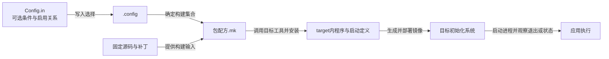
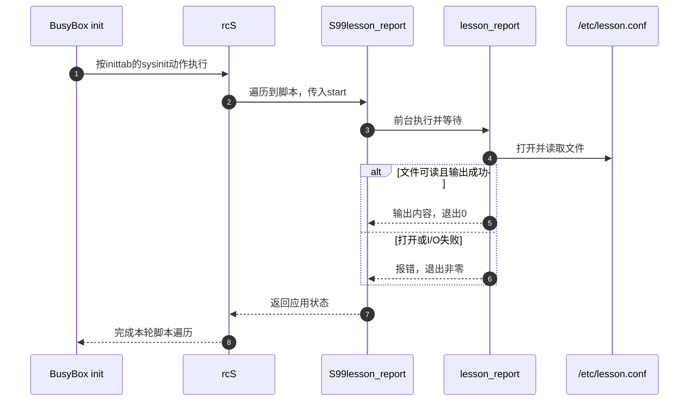

# 第6章\_把应用接入构建并交给初始化系统

[上一章](P05_从安装目录到可验证的根文件系统.md) 已把配置、版本记录和权限接入rootfs。本章让一个C程序读取其中的 `/etc/lesson.conf`。先手工编译当然可行，但每次换工具链、改源文件或清理输出后，谁负责重新编译、安装并让目标启动它？这需要分别建立构建期的包配方和运行期的初始化入口。

来源继续使用 [固定归档基线](../../../research/source_reading/buildroot/SOURCE_BASELINE.md#1.1_解释版本与归档身份)。主线仍为Buildroot 2025.02与QEMU AArch64，使用第五章已建立的独立输出和配置文件。先让程序按需执行，再让启动流程调用同一程序；它执行一次后退出，不伪装成长期驻留的守护进程。最后对照systemd的相同任务，说明自动启动、执行成功、持续存活为什么是不同证据。

## 6.1\_两次交接需要两种规则

把程序文件复制进overlay，只记录了一个现成二进制。换成另一个目标架构后，文件仍会原样复制；修改C源码也不会因此触发编译。因此对于需要从源码构建的应用，应该记录源码身份、工具、依赖、构建命令与安装动作。Buildroot把这样的构建单元组织为 **package（包）**，它不是第五章所说的目标运行时二进制安装包。

包安装完成后又出现第二个缺口：文件位于 `/usr/bin`，不会因为路径正确就自动执行。初始化系统还要知道何时启动、如何判断完成，以及失败之后怎么办。这些规则属于目标运行期，与宿主上的Make依赖顺序不同。



图中两个箭头都可能涉及“依赖”，但对象不同。编译时要先有头文件和库，运行时要先有可读配置或可用设备；把包构建顺序写对，不会自动证明设备已经就绪。下面始终用同一个应用追踪这两次交接。

## 6.2\_先明确源码身份与构建阶段

一个目标包通常有 `Config.in` 和 `.mk`：前者让用户选择并约束条件，后者告诉构建系统怎样做。下载包还常有摘要文件、补丁、启动定义及许可证材料；有些宿主依赖包没有独立菜单，所以“所有包必须有两个文件”不是通用定义。

发布归档会先进入下载缓存，再展开到构建目录。默认缓存通常在源码树的 `dl/`，可由 `BR2_DL_DIR` 等配置改变；`output/build/包名-版本` 承担构建工作，不是统一下载仓库。Git等来源也需要固定身份，不能用一个持续移动的 `master` 名称作为可重复输入的充分证据。

一般归档流程可以记为B0取得与校验、B1展开及补丁、B2配置、B3编译、B4安装。每阶段的完成标记存在包构建目录的 `.stamp_*` 文件中；它们帮助跳过已完成步骤，却不等于对所有源码和配置变化都有自动失效分析。

| 输入来源 | 如何形成构建输入 | 需要固定什么 |
| --- | --- | --- |
| HTTP/FTP等发布归档 | 下载缓存、摘要核对、展开 | 版本、地址、归档摘要和许可证材料 |
| Git、SVN等版本库 | 按指定修订取得并缓存源码 | 可追溯修订；分支名可能继续移动 |
| 本地目录 `SITE_METHOD = local` | 同步本地树到包构建目录 | 项目源码本身的版本；版本字符串不会冻结目录内容 |
| 已有构建系统 | 配合对应基础设施完成配置与编译 | 上游构建选项和交叉编译支持，而不只是一个宏名称 |

本章采用本地源码，便于完整展示材料。2025.02的local路径使用源码同步机制，不走普通归档解压和常规补丁流程；如需同步后处理，要按对应hook契约实施，不能把补丁文件放旁边便假设一定应用。`generic-package` 让我们写当前小程序的构建动作；上游已有Autotools、CMake或Meson时，对应基础设施可复用其配置和安装协议，不必重新手写全部动作。

依据见 [包目录与摘要规范](../../../research/source_reading/buildroot/2025.02/docs/manual/adding-packages-directory.adoc)、[generic-package契约](../../../research/source_reading/buildroot/2025.02/docs/manual/adding-packages-generic.adoc) 和 [阶段实现](../../../research/source_reading/buildroot/2025.02/package/pkg-generic.mk)。

## 6.3\_菜单允许选择不等于依赖已经构建

假设应用新增了一个库调用。若只把库加入菜单，构建系统仍需知道应用配置前应准备哪一份开发接口；若只写Make依赖，用户配置又可能没有启用对应目标库。两层规则要表达同一个真实需求，不能彼此替代。

Kconfig的 `depends on` 限制选项在什么条件下可用；`select` 让一个选项启用另一个符号。后者不会自动替被选对象检查所有前提，因此不能随意用select强开线程、架构或复杂工具链能力。Buildroot通常用depends on表达这类限制，并为需要的库选择相应包，同时传播必要条件。

`.mk` 中的 `FOO_DEPENDENCIES` 则给出构建依赖：框架在foo进入配置前准备这些包。目标库写其包名，构建时需要在宿主运行的生成工具通常写 `host-包名`。它不是“只要列出库就会自动找到所有运行插件和配置”的万能声明。

| 层次 | 控制的状态 | 本章需要记住的边界 |
| --- | --- | --- |
| `bool`、`choice` | 可选开关及互斥选择 | 控制配置值，不执行编译 |
| `depends on` | 可选条件 | 条件不满足时选项可能不可见，不能总说成灰色 |
| `select` | 启用其他符号 | 不自动解决对方所有条件，也不是运行依赖的专属语法 |
| `*_DEPENDENCIES` | 构建前置集合 | 要与配置选择一致，区分宿主工具与目标产物 |
| `*_INSTALL_STAGING*` | 开发文件的安装 | 库供其他包编译使用时才按需要开启 |
| `*_INSTALL_TARGET*` | 目标运行文件的安装 | 安装后仍需生成镜像，配置和数据可能另有来源 |

本章程序只使用标准C文件接口，不额外引入图形或网络库。工具链等基础依赖由框架建立，示例不为了展示变量而杜撰一个必需库。后续添加第三方库时，再依据它实际启用的功能写两层声明，避免把“OpenSSL总依赖zlib”这类不成立的固定链当作模板。

上述区分来自固定 [依赖声明规范](../../../research/source_reading/buildroot/2025.02/docs/manual/adding-packages-directory.adoc)。对于网络、设备等运行就绪条件，要在服务启动处另行讨论。

## 6.4\_建立能够读配置并报告失败的完整包

先实现一次性任务：读取配置文件并原样输出，失败时返回非零。它只检验“程序取得配置”的交接，不解析采样参数，也不创建采样线程。为便于宿主验证，允许用一个命令行参数替换默认路径。

### 6.4.1\_准备源码与许可材料

当前目录仍是Linux宿主的Buildroot 2025.02根目录；第五章的overlay和输出保留。创建项目教学包目录：

```sh
br_out="$PWD/../br_out_rootfs_lesson_2025_02"
br_pkg="$PWD/package/lesson_report"
mkdir -p "$br_pkg/src"
```

将下面完整程序保存为 `package/lesson_report/src/lesson_report.c`：

```c
/* SPDX-License-Identifier: GPL-2.0-only */
#include <stdio.h>

int main(int argc, char **argv)
{
    const char *config_path;
    FILE *config_file;
    unsigned char buffer[256];
    size_t count;
    int result = 0;

    if (argc > 2) {
        fputs("usage: lesson_report [config_path]\n", stderr);
        return 2;
    }
    config_path = argc == 2 ? argv[1] : "/etc/lesson.conf";
    config_file = fopen(config_path, "rb");
    if (config_file == NULL) {
        perror(config_path);
        return 1;
    }

    /* 文件按块传输，不要求一行必须短于缓冲区。 */
    if (puts("lesson_report: configuration") == EOF)
        result = 1;
    while (result == 0 &&
           (count = fread(buffer, 1, sizeof(buffer), config_file)) != 0) {
        if (fwrite(buffer, 1, count, stdout) != count)
            result = 1;
    }
    if (ferror(config_file))
        result = 1;
    if (fclose(config_file) == EOF)
        result = 1;
    /* 缓冲输出也可能失败，不能只凭fwrite已经返回便报告成功。 */
    if (fflush(stdout) == EOF)
        result = 1;
    if (result != 0)
        fputs("lesson_report: input/output failure\n", stderr);
    return result;
}
```

程序成功时输出标题与配置内容；路径打不开、读取或输出失败时返回1，参数过多返回2。零状态不证明配置语义正确，只证明这次传输完成。代码沿用本仓库GPLv2许可；将完整许可文本放入包源码，避免配方引用不存在的文件：

```sh
cp COPYING "$br_pkg/src/COPYING"
```

本轮用MinGW GCC 14.2.0完成严格警告与O2构建，普通配置、超过缓冲区长度的输入、空文件、缺失路径和多余参数五项对照符合预期。这不包含AArch64构建、目标启动、输出设备失败或systemd验证。

这是为本章自有教学代码提供许可材料，不是给未知第三方源码随意指定许可证。集成其他项目时必须记录其实际声明。

### 6.4.2\_让菜单和构建配方发现同一个包

保存 `package/lesson_report/Config.in`，各属性用Tab缩进，help正文再缩进两个空格：

```kconfig
config BR2_PACKAGE_LESSON_REPORT
	bool "lesson_report"
	help
	  读取配置并输出一次，用于观察包安装与启动交接。
```

在 `package/Config.in` 的 `Target packages` 菜单范围内加入一条source，而不是只把文件留在目录里：

```kconfig
source "package/lesson_report/Config.in"
```

随后保存 `package/lesson_report/lesson_report.mk`；define中的命令行同样使用Tab：

```make
LESSON_REPORT_VERSION = 1.0
LESSON_REPORT_SITE = $(TOPDIR)/package/lesson_report/src
LESSON_REPORT_SITE_METHOD = local
LESSON_REPORT_LICENSE = GPL-2.0-only
LESSON_REPORT_LICENSE_FILES = COPYING

define LESSON_REPORT_BUILD_CMDS
	$(TARGET_CC) $(TARGET_CPPFLAGS) $(TARGET_CFLAGS) -std=c11 -Wall -Wextra \
		-o $(@D)/lesson_report $(@D)/lesson_report.c $(TARGET_LDFLAGS)
endef

define LESSON_REPORT_INSTALL_TARGET_CMDS
	$(INSTALL) -D -m 0755 $(@D)/lesson_report \
		$(TARGET_DIR)/usr/bin/lesson_report
endef

$(eval $(generic-package))
```

`$(@D)` 在这些动作中指包的构建目录，不能用源码目录冒充临时输出。`TARGET_CC` 和各类目标参数来自当前配置；链接参数也必须传递。`INSTALL -D` 创建必要父目录，0755让目标程序可执行。本例不向其他包提供头文件和库，所以没有开启staging安装。

顶层Makefile自动包含 `package/*/*.mk`，因此 `.mk` 和Config.in的发现方式不同；前者被包含不等于包已启用，后者也必须接入菜单。`generic-package` 展开必须放在变量和命令定义之后。树外组织 `BR2_EXTERNAL` 可避免长期修改上游树，后续高级定制章节再迁移这些相同角色；这里先建立最直接的一套实现。

### 6.4.3\_先证明程序安装再证明镜像更新

启用菜单中的lesson_report，然后只构建该包：

```sh
make O="$br_out" menuconfig
make O="$br_out" savedefconfig \
    BR2_DEFCONFIG="$PWD/board/lesson/qemu_aarch64_rootfs/lesson_defconfig"
make O="$br_out" lesson_report
"$br_out/host/bin/aarch64-linux-readelf" -h -d \
    "$br_out/target/usr/bin/lesson_report"
```

savedefconfig将这次新增选择写回第五章的项目配置；源码和包配方也要一起保存。确认 `.config` 中 `BR2_PACKAGE_LESSON_REPORT=y`。包目标成功后应有target内的AArch64程序；此时第五章生成的旧镜像还没有因此自动更新。接着生成镜像并检查归档：

```sh
make O="$br_out"
tar -tf "$br_out/images/rootfs.tar" ./usr/bin/lesson_report
"$br_out/images/start-qemu.sh"
```

在QEMU目标登录后执行：

```sh
/usr/bin/lesson_report
printf 'exit=%s\n' "$?"
/usr/bin/lesson_report /etc/lesson_missing_for_test.conf
printf 'exit=%s\n' "$?"
```

第一组预期显示标题、第五章的 `sample_interval_ms=1000` 和状态0。第二组使用本实验未创建的路径，应显示打开失败并返回1；若该路径实际存在，先选一个确认不存在的测试路径。把状态紧跟程序打印，避免后续命令覆盖它。退出QEMU沿用 `Ctrl-a` 后 `x`。

这里只证明按需运行。下一节再让相同文件进入启动路径，避免同时改程序和初始化机制而无法定位差异。

## 6.5\_从PID1沿实际脚本找到一次性任务

第五章默认配置选择BusyBox init。固定版本的inittab通过 `::sysinit:/etc/init.d/rcS` 执行启动脚本；rcS遍历 `/etc/init.d/S??*`，按名字的顺序调用每个匹配文件的 `start` 动作。对于非 `.sh` 后缀的文件，它直接执行子进程；因此本例采用 `S99lesson_report` 并安装执行权限。

保存以下完整脚本为 `package/lesson_report/S99lesson_report`：

```sh
#!/bin/sh
# 本任务执行后退出，没有需要stop回收的常驻进程。
case "${1:-}" in
    start)
        /usr/bin/lesson_report
        ;;
    stop)
        :
        ;;
    restart)
        "$0" start
        ;;
    *)
        printf 'usage: %s {start|stop|restart}\n' "$0" >&2
        exit 2
        ;;
esac
```

`start` 的最后一条命令就是应用，其状态由脚本返回；`stop` 没有常驻对象需要终止；`restart` 在这个一次性任务中表示再执行一次。它不在后台启动进程，也不按模糊名称杀死其他实例。若后来把应用改成守护进程，必须重新设计实例身份、停止等待、失败与重复启动规则，不能直接套用这个空stop。

为了让启动文件与应用由同一个包维护，在 `lesson_report.mk` 最后的 `$(eval $(generic-package))` **之前** 加入：

```make
define LESSON_REPORT_INSTALL_INIT_SYSV
	$(INSTALL) -D -m 0755 $(LESSON_REPORT_PKGDIR)/S99lesson_report \
		$(TARGET_DIR)/etc/init.d/S99lesson_report
endef
```

这个hook名称中的SYSV也覆盖Buildroot所选的BusyBox init；它不是仅对另一种PID1实现有效。框架在目标安装阶段根据初始化配置调用对应hook。重新安装并生成镜像：

```sh
make O="$br_out" lesson_report-reinstall
make O="$br_out"
```

本次只加安装材料，reinstall足够；若同时改了C程序，用下一节的rebuild。启动后的关键交接如下：



步骤5和6是互斥分支。当前rcS不会因本脚本返回非零就建立一个持续失败登记或自动重试循环；它继续自己的脚本遍历。因此看到后面的登录终端，不证明这项任务已经成功。可以在目标上直接执行 `/etc/init.d/S99lesson_report start` 并立即检查状态，分别核对文件存在、程序能运行和自动启动入口是否到达。

固定来源是 [BusyBox inittab](../../../research/source_reading/buildroot/2025.02/package/busybox/inittab)、[rcS](../../../research/source_reading/buildroot/2025.02/package/initscripts/init.d/rcS)、[rcK](../../../research/source_reading/buildroot/2025.02/package/initscripts/init.d/rcK) 与 [安装hook实现](../../../research/source_reading/buildroot/2025.02/package/pkg-generic.mk)。Buildroot的sysvinit样板也调用rcS/rcK，不能把其他发行版的rcN.d链接布局直接当作此版本的默认实现。

## 6.6\_出现监督需求后再比较初始化方案

本例只要求启动时输出一次。若应用要长期服务请求，新的问题是“它是否退出、是否就绪、要不要重启、怎样停止”。BusyBox init的inittab支持respawn等动作，可以重新启动所管理的进程，但rcS启动的任意后台子进程并不因此自动成为独立受监督服务。对一次性程序误用respawn，则可能反复执行，而不是更可靠地完成一次任务。

SysV init支持运行级别，BusyBox init忽略inittab的运行级别字段；但是在本版Buildroot的默认脚本布局下，S编号主要提供脚本顺序，不是自动推导依赖关系的引擎。关机用的rcK按反向顺序遍历同一组S脚本并传入stop。脚本先启动网络配置程序，也不等于地址已取得或远端服务器可用。

当需要显式记录单元状态、依赖、重启策略等，可以采用systemd；也存在OpenRC等选择。选择依据是生命周期与依赖要求及工具链成本，不是把小、中、大设备机械映射到三个名字。2025.02的systemd包固定为256.7，选择它还有glibc、动态链接、线程等配置要求，切换应在独立的干净输出中完成，不在本章BusyBox产物上混装两个PID1方案。

用同一个一次性任务对照，保存 `package/lesson_report/lesson_report.service`：

```ini
[Unit]
Description=Report lesson configuration once

[Service]
Type=oneshot
ExecStart=/usr/bin/lesson_report
RemainAfterExit=yes

[Install]
WantedBy=multi-user.target
```

`Type=oneshot` 让管理器等待该次命令退出；`RemainAfterExit=yes` 在成功退出后保留活跃状态，所以显示 `active (exited)` 并不表示进程仍在运行。`WantedBy` 描述启用时建立的关系，不等于现在已经执行；本例不需要网络，也不添加一个无实际用途的 `After=network.target`。一般而言After只表达先后，不自行拉入被依赖单元，也不证明网络业务就绪。

同样在generic-package展开前增加systemd安装hook：

```make
define LESSON_REPORT_INSTALL_INIT_SYSTEMD
	$(INSTALL) -D -m 0644 $(LESSON_REPORT_PKGDIR)/lesson_report.service \
		$(TARGET_DIR)/usr/lib/systemd/system/lesson_report.service
endef
```

在选择systemd的构建中，框架使用这个hook。该版本的镜像准备流程还执行离线 `systemctl --root=... preset-all`，按preset策略建立启用关系；不是在构建宿主启动目标服务。产品preset可以改变默认结果，所以应检查生成镜像里的实际启用关系。依据见 [systemd配方](../../../research/source_reading/buildroot/2025.02/package/systemd/systemd.mk)、[systemd 256 service契约](https://www.freedesktop.org/software/systemd/man/256/systemd.service.html) 和 [unit契约](https://www.freedesktop.org/software/systemd/man/256/systemd.unit.html)；在线256系列手册可能随维护版本更新，Buildroot包版本仍以256.7配方为准。

在已构建并启动的systemd变体中，以下查询分别观察启用关系、当前状态和本次启动日志：

```sh
# 仅在systemd目标系统中执行，不在本章BusyBox实例中执行。
systemctl is-enabled lesson_report.service
systemctl status lesson_report.service
journalctl -b -u lesson_report.service
```

按需重新执行用 `systemctl restart lesson_report.service`。enable、start和restart承担不同动作：enable安排启用关系，start请求当前启动，restart要求停止再启动。对已保留活跃状态的一次性任务，再次start不应被当作必然重跑的测试方法。

| 现场需求 | 应核对的能力或成本 |
| --- | --- |
| 一次性初始化 | 命令完成状态、输出与失败影响；不需要凭空引入常驻进程 |
| 长期进程退出后重启 | 谁保存实例身份、怎样观察退出、重启频率与退出策略 |
| 多服务先后或就绪依赖 | 顺序、拉入关系与业务就绪分别怎样建立 |
| 退出后的资源清理 | 谁发送停止请求、谁等待退出、超时后如何处理 |
| 采用更完整管理器 | 工具链、内核、存储及维护成本是否满足，不仅比较二进制大小 |

## 6.7\_修改源码后沿同一条链验证

本地源码同步并不代表每次普通make都无条件重编译。改变 `lesson_report.c` 后，可要求包重新构建，然后再生成镜像：

```sh
make O="$br_out" lesson_report-rebuild
make O="$br_out"
```

在本版local包路径中，rebuild清理相应完成标记并重新同步源码，然后重编译和安装。若改变了包的配置步骤，需要reconfigure；要从包构建目录重新开始可用dirclean，但它不负责清除整个target里所有历史安装残留，也不自动重建全部反向依赖。取消包或改变工具链时继续遵守第五章的干净重建边界。

可以直接查询本例真实目标：

```sh
make O="$br_out" lesson_report-show-depends
make O="$br_out" lesson_report-show-rdepends
make O="$br_out" lesson_report-show-build-order
```

三条分别输出当前框架识别的直接构建依赖、直接反向依赖及构建顺序。需要图时有 `lesson_report-graph-depends` 和 `lesson_report-graph-rdepends`，需满足相应绘图依赖；应使用当前版本提供的精确目标名称。查询结果解释的是已声明的构建关系，不会扫描出进程的全部运行时数据需求。

调试时从最早缺证据的位置进入：先查target和镜像中的程序、配置与启动文件，再手工运行程序及失败路径，再核对init入口。上一章的权限0600要求本例读取者具有相应权限；如果后来改用普通服务用户，必须同步设计文件归属和访问权限。

| 现象 | 本例中下一步检查 |
| --- | --- |
| 菜单找不到包 | Config.in是否接入，条件是否满足 |
| 包成功而镜像里没更新 | 是否在包目标后执行了make并检查正确产物 |
| 程序成功但开机没输出 | 使用哪一种init，安装hook与入口是否匹配 |
| 输出失败但系统继续启动 | rcS是否传播失败为启动策略，不能只看登录成功 |
| systemd显示active但ps里找不到 | 本例是oneshot且RemainAfterExit，不是常驻进程 |
| C源码已改而目标还是旧行为 | 是否重新同步与编译、生成镜像并部署到实际启动位置 |

日志也必须按来源读取：dmesg主要面向内核消息，不会自动收集应用stdout；BusyBox系统是否有 `/var/log/messages` 取决于日志服务和配置。strace跟踪系统调用，宿主GDB配合目标gdbserver检查程序状态，工具和未剥离材料需事先准备；这些路径沿用第四章，不能把日志文件存在或某条命令未报错当作整个服务已验收。

## 6.8\_从构建完成走到启动完成

1. 只有Config.in里的select，没有Make依赖，能否保证库先于应用配置？
2. `make lesson_report` 成功后，旧rootfs是否已经包含新程序？
3. S99脚本在后台启动一个进程后返回，是否意味着rcS会继续监督它？
4. systemd一次性任务显示active (exited)，能否据此证明有一个进程持续读配置？

第一题不能，两层规则必须分别表达配置关系和构建顺序。第二题不能，还要生成并部署镜像。第三题不能，后台启动与独立生命周期监督不同。第四题不能，本例进程已经结束，活跃状态是管理器按RemainAfterExit保存的结果。

至此可以把“材料已固定、包已构建、文件已安装、镜像已更新、进程已执行”分别取证，而不是用一个make成功代替整条链。[下一章](P07_把构建产物整理为可核对的交付包.md) 继续处理这些产物如何组合为交付布局。
