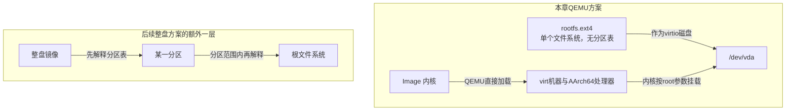
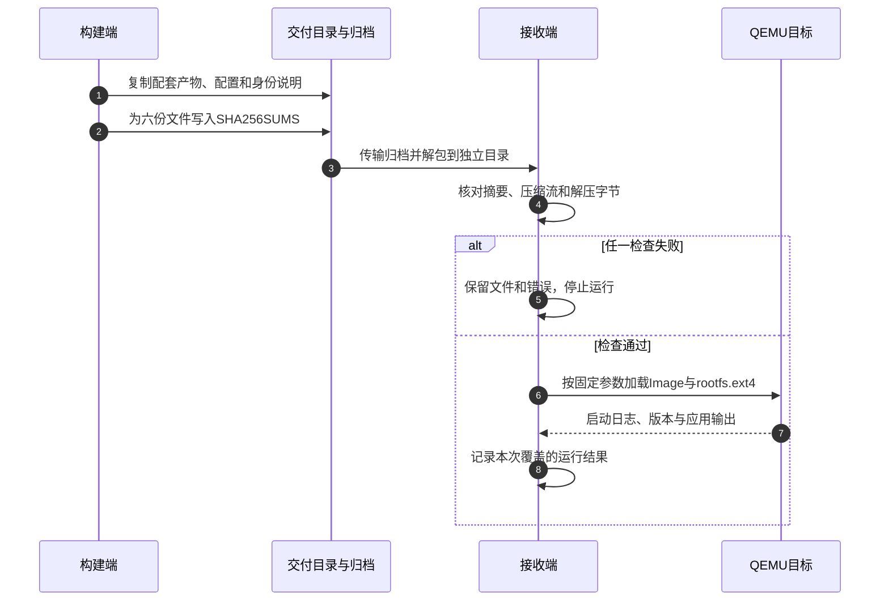

# 第7章\_把构建产物整理为可核对的交付包

[上一章](P06_把应用接入构建并交给初始化系统.md) 已把程序接入安装和启动流程。但同事拿到一个名为rootfs.ext4的文件时，仍然不知道它配哪份内核、根设备怎样指定、是否包含分区表，以及收到的文件是否与构建端相同。本章从这些交接问题出发，整理一个有明确身份和消费方式的QEMU交付目录。

第五章已经建立文件内容、权限和镜像生成阶段，本章不重新排列文件系统名词；重点是产物之间的配套关系、压缩和摘要、post-image组合，以及接收端验证。实体介质写入和原始闪存布局继续在 [第十章](P10_镜像生成与部署.md) 展开。所有命令固定于前几章的Buildroot 2025.02案例；没有执行实体烧写或声称QEMU已经启动成功。

## 7.1\_文件名不能代替消费契约

第五章生成的rootfs.ext4是一份文件系统镜像。它的字节从文件系统本身开始，本例没有额外的分区表；把它作为QEMU的整个virtio磁盘时，内核用 `root=/dev/vda` 挂载。若后来把同一文件系统放入整盘镜像的第一个分区，内核就要找到分区入口，常见名称变为vda1，布局和启动参数必须一起变化。

因此“同样叫img”不足以证明两个文件可以互换。整盘镜像可能含分区表、多个文件系统以及裸放的引导组件；一个tar包则是解包输入，不能当成一个已经排好扇区的磁盘。即使工具成功写完字节，也不证明BootROM、固件或内核会从正确位置解释它们。



图中“后续整盘方案”只说明多了一层定位，不宣称任何实体板都按同一种顺序启动。本章的QEMU直接加载内核，不需要在磁盘里伪造U-Boot；实体板还要满足实际启动固件的格式、偏移和加载条件。

| 产物 | 接收者需要知道什么 | 不能仅凭什么推断 |
| --- | --- | --- |
| 内核Image、zImage或封装镜像 | 架构、启动入口和加载方式、配套设备描述 | 不能只改后缀就转换格式 |
| 单文件系统镜像 | 格式、内核支持、挂载设备及容量 | 不自动包含分区表和启动固件 |
| 带分区表的整盘镜像 | 分区起点、大小、类型及引导组件位置 | 不等于所有目标介质都能直接接受 |
| UBI与UBIFS产物 | 卷布局与文件系统分别由谁处理、闪存参数 | 文件系统镜像不等于完整UBI布局 |
| tar或cpio归档 | 解包者、元数据恢复方式及启动用途 | 不能当成可直接挂载的块设备镜像 |
| 压缩包或更新容器 | 谁解压、谁验证、谁安装、失败如何恢复 | 文件扩展名不证明消费者支持 |

ext4、SquashFS、JFFS2、UBIFS、initramfs等选择条件沿用第五章。额外遇到cramfs时，应把它识别为另一种只读文件系统格式，再核对内核与产物支持；不要因为“旧”就猜测它必然适配当前板。FAT常被用于某些启动分区，但是否需要这个分区取决于启动方案，而不是Buildroot所有板共同的要求。

## 7.2\_从已经生成的产物追到实际加载参数

固定的 `qemu_aarch64_virt_defconfig` 选择AArch64内核与ext4根文件系统，内核版本为6.12.9。这里的内核身份来自该配置，与仓库研究Linux通用实现所用的NXP 6.12.20基线是不同对象，不能混写成一次实测。

先沿用第五、六章的输出，在Linux宿主Buildroot源码根目录观察：

```sh
br_out="$PWD/../br_out_rootfs_lesson_2025_02"
ls -l "$br_out/images/Image" "$br_out/images/rootfs.ext4"
sed -n '1,100p' "$br_out/images/start-qemu.sh"
```

第一条检查实际文件及链接，第二条查看构建端生成的启动脚本。第五章已经说明rootfs.ext4可以链接到rootfs.ext2：应追踪内容和生成选项，不以扩展名推断内部格式。该启动脚本也可能写入构建宿主的工具目录，不能原样复制给另一台机器便保证可移植。

本案例中，关键参数分别承担如下职责。它们来自官方板说明，下一节会把它们固定在交付脚本里。

| 参数 | 本例含义 |
| --- | --- |
| `-M virt`、`-cpu cortex-a53` | 选择QEMU机器与处理器模型，不代表某一实体开发板 |
| `-kernel Image` | 由QEMU直接加载配套内核 |
| `-drive ... if=none,id=hd0` | 声明原始磁盘后端，尚未独自决定总线连接 |
| `-device virtio-blk-device,drive=hd0` | 把后端连接为virtio块设备 |
| `root=/dev/vda` | 在整个虚拟磁盘上寻找本例文件系统 |
| `rootwait` | 等待根设备出现，不会修复错误的设备名或格式 |
| `console=ttyAMA0`、`-nographic` | 配对内核控制台和QEMU终端显示 |

上游post-image还根据传入的defconfig名称查询板说明中的启动命令。第五章已经把 `BR2_ROOTFS_POST_SCRIPT_ARGS` 固定为 `configs/qemu_aarch64_virt_defconfig`；保存并从自定义lesson_defconfig恢复后，查询身份仍保持不变。这个选择是脚本入口契约，不是要求项目配置文件必须继续叫上游名字。

来源：[固定QEMU配置](../../../research/source_reading/buildroot/2025.02/configs/qemu_aarch64_virt_defconfig)、[板说明](../../../research/source_reading/buildroot/2025.02/board/qemu/aarch64-virt/readme.txt)、[post-image实现](../../../research/source_reading/buildroot/2025.02/board/qemu/post-image.sh) 与 [启动模板](../../../research/source_reading/buildroot/2025.02/board/qemu/start-qemu.sh.in)。

## 7.3\_先保留可用输入再生成分发形式

现在要同时保留未压缩镜像用于QEMU，并提供压缩版本用于传输。如果直接对唯一的rootfs.ext4运行默认gzip，工具可能用压缩文件替换原文件，原启动路径就断了。本章使用 `gzip -c` 将压缩字节写到新文件，原输入保持可用；`-n` 不把原文件名与时间戳写入gzip头部。

压缩率与耗时依赖数据和参数。gzip、xz、LZ4都可以成为工程选择，但必须对同一输入比较传输大小、压缩/解压时间、内存和消费者支持。磁盘文件在分发时压缩，与SquashFS在文件系统内部压缩是不同层次；更不能假设所有内核、固件或写入工具都会自动解压任意外层格式。

**SHA-256摘要** 用来比较约定的字节。如果接收方拿到可信的摘要记录，就能发现文件变化；如果文件与摘要一起被替换，单独的摘要检查仍可能全部通过。因此摘要不自动建立发布者身份。本章先完成字节一致性，后面再划清签名的边界。

归档也不自动保证可重复构建。`gzip -n` 只约束gzip头里的部分字段；内核、文件系统UUID、时间戳、源码和宿主工具仍可能影响最终字节。要讨论跨机器的可重复结果，必须继续固定并核对这些输入。工具行为依据见 [GNU gzip说明](https://www.gnu.org/software/gzip/manual/html_node/Sample.html) 与 [SHA-2工具说明](https://www.gnu.org/s/coreutils/manual/html_node/sha2-utilities.html)。

## 7.4\_用完整post-image脚本建立交付目录

这次交付目录包含内核、原始rootfs、压缩rootfs、完整构建配置、身份说明、便携启动脚本和摘要文件。它服务于本例的接收验证，不声称已经包含构建全部源码、许可交付材料或生产升级策略。源码与包材料仍按前几章单独保存。

### 7.4.1\_写明身份和启动方式

材料继续放在第五章的板目录，当前工作目录为Buildroot源码根目录：

```sh
br_board="$PWD/board/lesson/qemu_aarch64_rootfs"
br_out="$PWD/../br_out_rootfs_lesson_2025_02"
cat > "$br_board/manifest.txt" <<'EOF'
buildroot_release=2025.02
profile=qemu_aarch64_virt
kernel_release=6.12.9
layout=raw_ext4_without_partition_table
root_device=/dev/vda
purpose=lesson_delivery
EOF
```

这些内容是本次方案的声明，要与实际配置、文件检查及启动日志核对。若修改内核或布局，必须一起修改声明，不能用清单上的文字代替检查。

保存一个只依赖本目录文件的启动脚本：

```sh
cat > "$br_board/run_qemu.sh" <<'EOF'
#!/bin/sh
set -eu

# 接收环境须提供支持本机型的qemu-system-aarch64。
cd "$(dirname "$0")"
exec qemu-system-aarch64 -M virt -cpu cortex-a53 -nographic -smp 1 \
    -kernel Image -append 'rootwait root=/dev/vda console=ttyAMA0' \
    -netdev user,id=eth0 -device virtio-net-device,netdev=eth0 \
    -drive file=rootfs.ext4,if=none,format=raw,id=hd0 \
    -device virtio-blk-device,drive=hd0 -snapshot
EOF
chmod +x "$br_board/run_qemu.sh"
```

相对文件名通过脚本先切到自身目录解释，不依赖构建端绝对路径。这里额外使用QEMU的 `-snapshot`，让本轮虚拟磁盘写入进入临时层，便于重复检查交付镜像；退出后不能把这些临时写入当成持久化结果。它不是实体产品的A/B更新机制。

### 7.4.2\_复制明确集合并生成摘要

保存 `board/lesson/qemu_aarch64_rootfs/post_image.sh`：

```sh
#!/bin/sh
set -eu

br_images=${1:?缺少镜像目录参数}
: "${BR2_CONFIG:?缺少Buildroot配置路径}"
br_material=$(dirname "$0")
br_delivery="$br_images/lesson_delivery"
test -s "$br_images/Image"
test -s "$br_images/rootfs.ext4"
mkdir -p "$br_delivery"

# 只复制本次约定的产物；跟随ext4输入链接，避免交付悬空链接。
install -m 0644 "$br_images/Image" "$br_delivery/Image"
cp -L "$br_images/rootfs.ext4" "$br_delivery/rootfs.ext4"
install -m 0644 "$BR2_CONFIG" "$br_delivery/buildroot.config"
install -m 0644 "$br_material/manifest.txt" "$br_delivery/manifest.txt"
install -m 0755 "$br_material/run_qemu.sh" "$br_delivery/run_qemu.sh"
gzip -n -9 -c "$br_delivery/rootfs.ext4" > "$br_delivery/rootfs.ext4.gz"

# 摘要记录相对名称，接收端移动目录后仍可核对。
(
    cd "$br_delivery"
    sha256sum Image rootfs.ext4 rootfs.ext4.gz buildroot.config \
        manifest.txt run_qemu.sh > SHA256SUMS
    sha256sum -c SHA256SUMS
)
```

这里首参数由Buildroot传入images目录，`BR2_CONFIG` 是本次完整配置路径。`cp -L` 特意读取链接目标的字节；否则单独复制一个rootfs.ext4链接却不带rootfs.ext2，可能得到无法使用的交付物。明确列出的六份文件进入摘要，目录中未列出的其他文件不属于这份清单的证明范围。

`set -e` 使复制、压缩或校验的非零状态中止这个脚本；但本版本顶层foreach执行多个post-image脚本时，不应额外假设它构成一个覆盖所有前序脚本的失败事务。因此发布前仍须检查完整构建日志和接收验证，不能只凭最后一条成功消息。当前脚本作为最后一项，其失败也应使该构建步骤失败。

### 7.4.3\_保留原钩子并接入新脚本

在Linux宿主赋予脚本执行权限，随后打开菜单：

```sh
chmod +x "$br_board/post_image.sh"
make O="$br_out" menuconfig
```

把 `BR2_ROOTFS_POST_IMAGE_SCRIPT` 设置为两个空格分隔的路径，顺序如下：

```text
board/qemu/post-image.sh board/lesson/qemu_aarch64_rootfs/post_image.sh
```

公共参数仍保持第五章指定的原QEMU配置名称；新脚本只使用首参数，允许后面带上这个公共参数。然后生成并保存配置：

```sh
make O="$br_out"
make O="$br_out" savedefconfig BR2_DEFCONFIG="$br_board/lesson_defconfig"
```

输出应出现 `images/lesson_delivery/` 及上述文件。生成本章目录只用普通宿主文件操作，不需要对实体磁盘写入，也不需要额外调用sudo。post-image发生在镜像生成之后，修改输入target不会自动改回已经复制的产物；继续沿第五章F0～F5定位变化应发生的位置。

## 7.5\_接收端先核对字节再运行

交付时只打包明确列出的文件，避免把output目录中其他历史产物混进来。Linux宿主执行：

```sh
tar -cf "$br_out/images/lesson_delivery.tar" \
    -C "$br_out/images/lesson_delivery" \
    Image rootfs.ext4 rootfs.ext4.gz buildroot.config \
    manifest.txt run_qemu.sh SHA256SUMS
```

这份tar是传输容器，不是可直接写到磁盘扇区的整盘镜像。接收者应解到专用空目录；以下先在构建端创建独立的接收演练目录：

```sh
br_receive=$(mktemp -d)
tar -xf "$br_out/images/lesson_delivery.tar" -C "$br_receive"
(
    set -e
    cd "$br_receive"
    sha256sum -c SHA256SUMS
    gzip -t rootfs.ext4.gz
    gzip -dc rootfs.ext4.gz > rootfs_unpacked.ext4
    cmp rootfs.ext4 rootfs_unpacked.ext4
)
```

摘要检查比较收到的六份文件，`gzip -t` 检查压缩流，最后两条检查解压字节与原始镜像一致。三种检查回答不同问题，均不能证明内核和用户空间能启动。接收目录路径保存在br_receive；本章不将它混入Buildroot输出，也不自动删除其中的取证文件。

子 shell 内的 `set -e` 保证任一检查失败就停止后续检查，并返回失败；不能在摘要失败后继续运行镜像。实际接收流程如下，传输只移动文件，接收者必须重新读取字节并作出是否继续的决定。



第1～3步建立并传递字节集合，第4～5步决定它是否满足接收条件；第6～8步才检验运行效果。文件检查与运行结果分别留存，避免把两层证据混成一句“部署成功”。

在已安装相应QEMU的Linux接收环境中，先记录 `qemu-system-aarch64 -version`，再运行：

```sh
"$br_receive/run_qemu.sh"
```

登录目标后检查 `/etc/lesson_release`、执行 `/usr/bin/lesson_report`，观察第六章的一次性启动输出。预期内容与前章一致；如果运行的不是本次交付物，单独一份“启动成功”日志没有足够的版本归属。结束仍为 `Ctrl-a` 后 `x`。`-snapshot` 的临时层边界见 [QEMU系统调用说明](https://www.qemu.org/docs/master/system/invocation.html)。

还可以做一个不涉及硬件的反例：复制一份接收目录，在复制品的manifest.txt末尾追加一行，再运行摘要检查，应看到该文件不匹配。若修改后重新生成全部摘要，又可能全部通过；这正好引出下一节的身份问题。

本次在宿主侧用普通测试字节验证了复制、重复压缩、摘要、解压比较和篡改失败分支，也核对了上游QEMU脚本的配置名称查询。测试输入不是真实内核或文件系统，未执行Linux Buildroot构建及QEMU启动；这些结果仅证明脚本处理字节与错误的行为，不能替代目标运行验证。

## 7.6\_摘要签名和可恢复更新各证明什么

摘要比较字节，数字签名进一步把指定字节与某个密钥联系起来。接收者仍需从可信渠道确认允许的发布密钥，并拒绝不符合策略的签名；只看到工具显示签名数学验证通过，不自动证明这是产品授权的发布者。

OpenPGP分离签名可以用于分发文件或摘要清单，其验证应明确指定签名和被签数据。相关契约见 [GnuPG验证说明](https://www.gnupg.org/documentation/manuals/gnupg/GPG-Examples.html)。本章不创建发布密钥、不执行签名，也不把任意gpg签名等同于芯片BootROM认可的安全启动格式。

**安全启动** 要求启动链实际验证下一阶段，并有正确配置的信任根；签了一个文件却没有消费者检查它，不能阻止未授权镜像执行。加密又主要处理内容保密，与发布者认证、执行许可、版本回退策略是不同问题。厂商工具、密钥位置和具体格式必须依据实际SoC启动方案，不能用一个虚构的通用sign_tool补齐。

远程更新还多一个问题：新镜像即使可信，写到一半掉电怎么办？A/B方案保留当前可用槽，先写另一槽、校验，再改变启动选择，并在实际启动通过后确认；失败路径需要明确回退条件和状态记录。只有两个分区，还没有完成这个协议。差分更新还依赖正确的旧基线、补丁应用与最终摘要，不等于一个更小的压缩包。可对照 [RAUC基本概念中的槽位和启动确认](https://rauc.readthedocs.io/en/latest/basic.html)，辨认安装、启动选择和运行确认各自的职责。

| 当前证据 | 能支持的判断 | 仍未解决 |
| --- | --- | --- |
| 接收端摘要匹配 | 与这份清单约定的字节一致 | 清单是否来自授权发布者 |
| 授权密钥的有效签名 | 指定内容通过发布身份策略 | 目标是否可运行、是否允许回退 |
| 启动链验证生效 | 被验证阶段符合启动授权条件 | 更新中断及用户数据迁移 |
| 备用槽写入并校验 | 新内容已准备好 | 启动选择、健康确认与失败回退 |
| 一次启动健康检查通过 | 覆盖的功能与场景通过 | 全部负载、掉电点和长期运行 |

这些是交付方案的后续约束。本章只实现清单与摘要演练；生产更新协议继续在第十章按存储和启动条件展开。SWUpdate或RAUC等框架能承担部分更新职责，但安装一个包或把文件改成 `.swu` 后缀，都不自动形成可恢复产品。

## 7.7\_按接收边界选择部署路径

到这里，交付目录有明确消费者。换到实体环境时，要先确定谁接收哪一层产物，再选择传输和写入方式；不把一条带假设备名的dd命令当作适用于所有板的验收步骤。

SD和eMMC的用户区通常作为块设备处理，但整个设备与某个分区是不同写入范围，eMMC的硬件boot区域也不是普通FAT“boot分区”的同义词。原始NAND则涉及坏块、擦除、ECC与UBI等约束，不能把块设备写法或NOR工具原样套入。第十章再按具体布局检查写入与回读。

网络开发路径也要分开：TFTP可向启动固件传输内核或设备树，NFS则由配置了相应支持的内核挂载远程根目录。内核、DTB加载地址、导出目录、网络驱动和root参数必须匹配具体环境；把压缩rootfs复制到TFTP目录，不等于目标就会将它解包并作为NFS根使用。

USB或串口下载工具还依赖SoC支持的协议、启动模式和目标存储操作。NXP的 [uuu](https://github.com/nxp-imx/mfgtools)、Rockchip的 [rkdeveloptool](https://github.com/rockchip-linux/rkdeveloptool) 等属于各自平台工具入口，不是同一镜像在任意SoC之间互换的证明。量产流程除了传输，还需把板身份、产物身份、实际写入范围、结果和回读证据关联起来。

| 本次失败停在哪里 | 优先回到哪份证据 |
| --- | --- |
| 接收摘要不匹配 | 传输来源、清单及实际文件，尚不进入启动排错 |
| 解压成功但根不能挂载 | 镜像布局、root参数、内核块设备与文件系统支持 |
| 根已挂载而init失败 | 第四、五章的程序装载、init选择与依赖检查 |
| 程序手动成功但自动启动失败 | 第六章的初始化入口与生命周期 |
| QEMU通过而实体板失败 | 板级启动链、设备描述、存储、驱动及硬件条件 |

QEMU验证只覆盖所选虚拟模型，实体板验证也只覆盖已运行条件。需要把各层结果和版本留在记录中，才能在下一次更新失败时找到差异。

## 7.8\_让下一位接收者能够独立核对

1. rootfs.ext4可以直接用于本例的 `/dev/vda`，是否意味着把它换成带分区表的sdcard.img后无需修改root参数？
2. gzip测试通过是否证明它解压后的内容就是原来那份文件系统？
3. SHA256SUMS全部通过是否已经建立发布者身份？
4. 新槽位已经写完且摘要正确，是否等于A/B更新闭环完成？

第一题不能，整盘方案多了分区定位。第二题不能，压缩流内部有效与约定输入一致是两个检查，本章额外用cmp核对。第三题不能，还缺少可信清单或授权签名等身份依据。第四题也不能，还需启动选择、运行健康确认与失败回退。

现在交付物的内容、布局、消费命令和证明边界可以一起传递。下一章把这些散布在Buildroot源码树中的板配置、包和脚本收拢为 [可独立维护的项目输入](P08_高级定制与集成.md)，继续解决多板复用与升级维护的问题。
