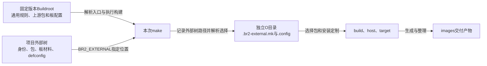
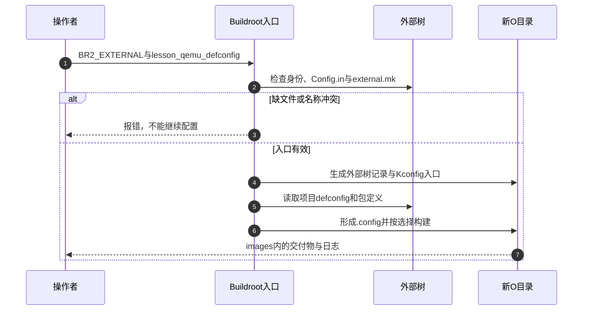

# 第8章\_把项目输入迁到外部树并隔离构建

[上一章](P07_把构建产物整理为可核对的交付包.md) 已经能交接一套内核、根文件系统和启动命令。不过，要重新构建它，仍需收集上游源码树里改过的包、菜单、板目录和配置。如果另一个产品也修改这些位置，或者换用新的Buildroot发布包，哪些文件来自上游、哪些属于项目，就容易混在一起。

前面的树内做法有价值：配置入口和包目录都能直接看见，适合建立第一套模型。现在增加的约束是 **项目输入要独立维护，并能明确接到某一份Buildroot上**。本章迁移同一个lesson_report案例，保留其源代码、运行行为和交付流程；随后用两个配置说明复用的边界，再把同一入口交给自动构建。规则仍固定于 [Buildroot 2025.02资料基线](../../../research/source_reading/buildroot/SOURCE_BASELINE.md)。

## 8.1\_分开保存项目并不等于构建系统会发现它

先设想直接把package和board目录搬到旁边。文件虽然更整齐，原来的菜单source路径却失效，Make也不会自动到任意邻居目录寻找配方。真正缺少的是一份双方都理解的发现契约：项目声明身份，Buildroot接入菜单和Make规则，配置再引用项目材料的位置。

**br2-external外部树** 就是按这个契约组织的项目目录。它不是目标根文件系统，也不是第三章的“外部工具链”；前者管理项目输入，后者选择谁提供编译器和目标运行库，两者可以独立使用。



图中的外部树是输入所有者，O目录是这次构建的工作状态。外部树不替代Buildroot；输出也不应倒过来成为唯一源码。团队可以分别记录“Buildroot版本”和“项目版本”，但升级后接口与配置仍要重新验证，目录分离不会消除兼容性问题。

外部树最少需要三份约定文件。先知道它们为何存在，再看具体名称：

| 文件 | 承接的职责 | 漏掉后会怎样 |
| --- | --- | --- |
| `external.desc` | 给外部树一个名称，生成其路径变量 | 2025.02入口检查拒绝这棵树 |
| `Config.in` | 把项目选项接到Kconfig菜单 | 文件必须存在；为空时没有自定义菜单内容 |
| `external.mk` | 把项目配方接到Make规则 | 文件必须存在；为空时没有新增构建规则 |
| `configs/*_defconfig` | 提供可选的项目配置入口 | 不影响树的有效性，但没有这些命名配置可加载 |
| `package/`、`board/` | 保存本例实际配方与板材料 | 是本例布局；内容靠前面入口与配置引用生效 |

名称为 `LESSON` 时，Buildroot生成 `BR2_EXTERNAL_LESSON_PATH`，值为这棵树的绝对路径。Kconfig、Make和后处理脚本都能使用它。名称只允许ASCII字母、数字和下划线，多个外部树的名称必须不同；不是把目录名随手拼进某个不存在的变量。

依据：[Keeping customizations outside of Buildroot](../../../research/source_reading/buildroot/2025.02/docs/manual/customize-outside-br.adoc) 的Layout与external.desc小节，以及 [入口检查和生成脚本](../../../research/source_reading/buildroot/2025.02/support/scripts/br2-external)。

## 8.2\_迁移同一应用时先保持输入与行为可比较

下面的操作在Linux宿主完成，从前几章已修改的Buildroot源码根目录开始。先前的程序源码、COPYING、Config.in、S99lesson_report和板材料应已存在；本章沿用BusyBox init分支。我们把项目复制到新目录，再接到一份干净的同版本Buildroot，避免树内和树外同时定义同名包。

### 8.2.1\_收拢已有材料而不复制构建输出

```sh
br_old="$PWD"
br_ext="$br_old/../lesson_external"
# 新目录已存在时停止，先确认其中是不是另一个实验。
test ! -e "$br_ext" && mkdir -p "$br_ext/package" "$br_ext/board" "$br_ext/configs"
```

若检查失败，不继续后面的复制。只收拢自己维护的输入，不带上旧的host、build和target：

```sh
cp -a "$br_old/package/lesson_report" "$br_ext/package/"
cp -a "$br_old/board/lesson/qemu_aarch64_rootfs" "$br_ext/board/qemu_aarch64"
test -f "$br_ext/package/lesson_report/src/lesson_report.c"
test -f "$br_ext/package/lesson_report/S99lesson_report"
test -f "$br_ext/board/qemu_aarch64/lesson_defconfig"
```

三个检查分别确认程序、启动接入和第七章保存的配置。C程序及错误返回语义仍见 [第六章完整实例](P06_把应用接入构建并交给初始化系统.md#6.4.1_准备源码与许可材料)；本章改变发现路径，不再引入第二个功能相似的新程序。复制的板目录仍包含rootfs_overlay、权限表、post_build.sh、post_image.sh、manifest.txt与run_qemu.sh。

### 8.2.2\_建立身份与两条发现入口

在外部树根创建三份文件：

```sh
cat > "$br_ext/external.desc" <<'EOF'
name: LESSON
desc: Lesson project inputs
EOF
cat > "$br_ext/Config.in" <<'EOF'
source "$BR2_EXTERNAL_LESSON_PATH/package/lesson_report/Config.in"
EOF
cat > "$br_ext/external.mk" <<'EOF'
include $(sort $(wildcard $(BR2_EXTERNAL_LESSON_PATH)/package/*/*.mk))
EOF
```

带引号的heredoc结束标记让shell保留 `$`，把变量留给后续Kconfig或Make解释。Config.in中的source接入包的选项；external.mk用wildcard找到包配方，再排序并include。项目包会出现在顶层的 **External options** 菜单，不需要再修改上游package/Config.in。

包自己的Config.in保持第六章内容。覆盖外部树中的 `package/lesson_report/lesson_report.mk` 为下面的完整版本，命令行使用Tab：

```make
LESSON_REPORT_VERSION = 1.0
LESSON_REPORT_SITE = $(BR2_EXTERNAL_LESSON_PATH)/package/lesson_report/src
LESSON_REPORT_SITE_METHOD = local
LESSON_REPORT_LICENSE = GPL-2.0-only
LESSON_REPORT_LICENSE_FILES = COPYING

define LESSON_REPORT_BUILD_CMDS
	$(TARGET_CC) $(TARGET_CPPFLAGS) $(TARGET_CFLAGS) -std=c11 -Wall -Wextra \
		-o $(@D)/lesson_report $(@D)/lesson_report.c $(TARGET_LDFLAGS)
endef

define LESSON_REPORT_INSTALL_TARGET_CMDS
	$(INSTALL) -D -m 0755 $(@D)/lesson_report \
		$(TARGET_DIR)/usr/bin/lesson_report
endef

define LESSON_REPORT_INSTALL_INIT_SYSV
	$(INSTALL) -D -m 0755 $(LESSON_REPORT_PKGDIR)/S99lesson_report \
		$(TARGET_DIR)/etc/init.d/S99lesson_report
endef

$(eval $(generic-package))
```

关键变化是SITE从上游TOPDIR改为外部树路径变量；PKGDIR仍由包基础设施定位当前配方目录，所以启动脚本随包迁移。构建目录、目标编译器、安装目的地和启动行为没有因此改变。若选用第六章systemd变体，还应移入对应单元与INSTALL_INIT_SYSTEMD钩子，本例不同时切换初始化系统。

### 8.2.3\_把板路径改为外部树引用

旧配置已经保存了overlay、权限表和后处理脚本路径。只替换本例板目录前缀，并把结果放到外部树configs：

```sh
sed 's@board/lesson/qemu_aarch64_rootfs@$(BR2_EXTERNAL_LESSON_PATH)/board/qemu_aarch64@g' \
    "$br_ext/board/qemu_aarch64/lesson_defconfig" \
    > "$br_ext/configs/lesson_qemu_defconfig"
```

单引号再次保留Make变量文本。打开生成文件核对下面这些选择；表中是配置字符串的内容，未列出的架构、内核和包选项继续来自原配置。

| 选项 | 当前应使用的值 |
| --- | --- |
| `BR2_ROOTFS_OVERLAY` | `$(BR2_EXTERNAL_LESSON_PATH)/board/qemu_aarch64/rootfs_overlay` |
| `BR2_ROOTFS_POST_BUILD_SCRIPT` | `$(BR2_EXTERNAL_LESSON_PATH)/board/qemu_aarch64/post_build.sh` |
| `BR2_ROOTFS_DEVICE_TABLE` | `system/device_table.txt $(BR2_EXTERNAL_LESSON_PATH)/board/qemu_aarch64/permissions.txt` |
| `BR2_ROOTFS_POST_IMAGE_SCRIPT` | `board/qemu/post-image.sh $(BR2_EXTERNAL_LESSON_PATH)/board/qemu_aarch64/post_image.sh` |
| `BR2_ROOTFS_POST_SCRIPT_ARGS` | `configs/qemu_aarch64_virt_defconfig` |
| `BR2_PACKAGE_LESSON_REPORT` | `y` |

上游QEMU钩子和默认设备权限表仍由固定Buildroot提供，所以保留其上游路径。公共脚本参数继续使用原QEMU配置名来查找官方启动命令；本例的新配置名lesson_qemu_defconfig不承担这个查询角色。post脚本用自身位置找到相邻材料，迁移后仍能工作。

现在 `configs/lesson_qemu_defconfig` 是后续维护入口。复制进来的旧lesson_defconfig只保留本次迁移对照意义，核对完成后应从正式项目输入中移除，不把两份配置长期同时维护。

## 8.3\_用干净源码验证外部树真的独立

如果仍在改过的源码树中测试，即使遗漏外部树文件，也可能从旧位置碰巧找到它。这种成功无法证明迁移完整。把第一章固定摘要的 `buildroot-2025.02.tar.xz` 放在旧源码目录的父目录，然后解到新的空目录：

```sh
br_archive="$br_old/../buildroot-2025.02.tar.xz"
br_clean="$br_old/../buildroot_2025_02_external"
sha256sum "$br_archive"
# 核对第一章资料基线的摘要后再执行，已有目录时停止。
test ! -e "$br_clean" && mkdir "$br_clean" && \
    tar -xJf "$br_archive" --strip-components=1 -C "$br_clean"
```

摘要必须是 `889249bdc79b0a32f2911c3f7c0049c60eb90b9c9ad75aab367022fb3e216e41`。这里的解压对象是官方源码归档，不是第七章的交付包。随后在新源码树指定外部树和全新的输出目录：

```sh
cd "$br_clean"
br_out="$br_clean/../br_out_external_lesson_2025_02"
make O="$br_out" BR2_EXTERNAL="$br_ext" list-defconfigs
make O="$br_out" BR2_EXTERNAL="$br_ext" lesson_qemu_defconfig
make O="$br_out" menuconfig
```

list-defconfigs应列出lesson_qemu_defconfig；菜单的External options中应能看到已启用的lesson_report。外部树位置会记录在O目录的 `.br2-external.mk`，因此后面的make可省略BR2_EXTERNAL；自动构建仍宜显式传入，以免依赖旧目录记忆。相对外部树路径按Buildroot源码根解释，不按O目录解释。

检查并构建，再把精简配置保存回唯一项目入口：

```sh
grep '^BR2_PACKAGE_LESSON_REPORT=y$' "$br_out/.config"
make O="$br_out"
make O="$br_out" savedefconfig \
    BR2_DEFCONFIG="$br_ext/configs/lesson_qemu_defconfig"
```

接着执行第七章的交付目录摘要、解压对比和QEMU运行检查。应用仍应读取同一配置，自动启动仍走同一S99脚本；若内容变化，先比较外部树中的release.txt与overlay，不能把迁移本身当成改变产品行为的理由。



第1～2步验证发现契约，第3步是失败分支；第4～7步才把项目输入变成这次构建状态和产物。`.br2-external.mk`保存的是路径等入口信息，不是项目源码快照。移动或更换外部树后，应重新显式传入正确位置；不能把旧O目录当作足以恢复项目的备份。

本次运行了固定版本的外部树入口脚本：有效树生成了路径和菜单记录，缺少external.desc、非法名称和重复名称均被拒绝。没有执行Linux全量构建或AArch64启动；完整运行验收仍需在上述Linux环境完成。

## 8.4\_共享项目输入时为什么仍要分开输出

现在增加第二种实验配置：同一个虚拟板不在启动时运行lesson_report。无需复制整套应用源码，只需保存另一份配置选择。先把基础配置载入另一个O目录，在menuconfig中取消lesson_report，再另存为lesson_qemu_min_defconfig：

```sh
br_out_min="$br_clean/../br_out_external_min_2025_02"
make O="$br_out_min" BR2_EXTERNAL="$br_ext" lesson_qemu_defconfig
make O="$br_out_min" menuconfig
make O="$br_out_min" savedefconfig \
    BR2_DEFCONFIG="$br_ext/configs/lesson_qemu_min_defconfig"
make O="$br_out_min"
```

取消包只在第二个输出中生效；它从空目录构建，不会遗留第一套安装过的程序。两套配置共享源码与板材料，各自拥有.config、stamp、host、target和images。若两个make同时写同一个O目录，一方改变配置或安装文件，另一方可能据旧stamp跳过动作，最后得到混合输入的产物。把共享输入与共享可变工作状态分开，才有可比较的结果。

defconfig是相对默认值精简后的选择集合，不是包含所有选项的完整.config，也没有“写一条BR2_DEFCONFIG就继承另一个文件”的机制。BR2_DEFCONFIG关联配置入口和保存位置；冒号拼接两个配置路径也不会自动形成父子配置。上面的两个配置是两个明确入口，今后共同修改须检查两者。

如果确实需要生成配置组合，可以在项目侧建立明确的生成规则，随后交给Kconfig解析并核对最终.config；不能把文本拼接顺序当作依赖条件已经满足。Linux内核自己的配置片段又是另一层输入，不能拿内核支持fragment来推断Buildroot顶层也采用同一接口。

多个外部树可通过冒号分隔路径接入。不同树必须有不同name，但这还不足以避免包符号冲突；同名defconfig在2025.02按外部树列表中靠后的定义选择，因此改变顺序可能改变实际入口。本例保持一棵树，确有公共平台与产品分工时再拆，避免为了层次整齐先制造隐式覆盖。

依据：[外部树的configs目录规则](../../../research/source_reading/buildroot/2025.02/docs/manual/customize-outside-br.adoc) 与 [Makefile的%_defconfig和savedefconfig目标](../../../research/source_reading/buildroot/2025.02/Makefile)。

## 8.5\_让项目补丁进入确定的构建阶段

目录独立以后，还会遇到上游包需要修复的问题。把补丁放在任意叫patches的文件夹里并不够；构建系统必须知道对哪个包、哪个版本、在什么阶段应用。否则文件虽然随Git保存，实际二进制仍可能完全没有包含修改。

本例local方式的lesson_report源码由我们直接维护，第六章已经说明它不走普通下载解包补丁流程。对于走常规补丁阶段的第三方包，可以将 `BR2_GLOBAL_PATCH_DIR` 指向 `$(BR2_EXTERNAL_LESSON_PATH)/patches`。例如给某个实际使用的Linux版本保存补丁时，布局为 `patches/linux/<准确版本>/0001-说明.patch`；尖括号是布局说明，必须替换为当前配方的准确版本，不是可照抄的路径。

该版本先查全局目录下的包名/版本子目录，若不存在才查包名目录；多个全局目录按配置顺序处理。无series文件时按补丁文件名排序，因此数字前缀表达顺序。包自身目录也可放补丁，但任意建立 `mylib-patches/` 子目录不会自动被发现。已有series的行为与推荐新补丁直接编号要分别理解。

| 变化 | 必须一起核对的内容 |
| --- | --- |
| 修改补丁内容 | 当前构建是否重新进入解包与补丁阶段，旧stamp是否跳过它 |
| 提升包版本 | 补丁适用上下文、是否已被上游合入、版本目录是否仍被选中 |
| 从local改为下载源码 | 源码身份、哈希、补丁阶段与许可文件是否一起建立 |
| 修改Buildroot自身规则 | 这是上游树的差量，不能假设外部树能覆盖任意核心行为 |

必要时对相应包清除构建目录后重建；工具链或系统性变动按前章使用干净O目录。补丁“能应用”只说明文本上下文匹配，还要验证它解决的问题和未破坏的行为。依据：[Adding project-specific patches and hashes](../../../research/source_reading/buildroot/2025.02/docs/manual/customize-patches.adoc)。第九章继续建立第三方包的源码、哈希和补丁闭环。

## 8.6\_把同一个入口交给持续集成而不共享工作状态

手工流程已经有明确输入，持续集成（CI）便可以在项目提交后重复执行它。CI的新增职责是准备环境、固定输入、保存日志和判断失败；把命令放入GitLab、Jenkins或其他任务系统，不会自动赋予它正确的目标机和验收标准。

下面是平台无关的Linux Bash构建脚本，保存为外部树的 `build_ci.sh`。调用者传入干净Buildroot、外部树和本次全新输出目录的绝对路径；脚本拒绝复用已存在的输出。

```bash
#!/usr/bin/env bash
set -euo pipefail

br_source=${1:?缺少Buildroot源码目录}
br_external=${2:?缺少项目外部树目录}
br_output=${3:?缺少本次输出目录}
case "$br_output" in
    /*) ;;
    *) printf '%s\n' '输出目录必须是绝对路径' >&2; exit 2 ;;
esac
if [ -e "$br_output" ]; then
    printf '%s\n' '本次任务要求新的输出目录' >&2
    exit 2
fi
mkdir -p "$br_output"
make -C "$br_source" O="$br_output" BR2_EXTERNAL="$br_external" \
    lesson_qemu_defconfig 2>&1 | tee "$br_output/configure.log"
make -C "$br_source" O="$br_output" BR2_EXTERNAL="$br_external" \
    2>&1 | tee "$br_output/build.log"
(
    cd "$br_output/images/lesson_delivery"
    sha256sum -c SHA256SUMS
) 2>&1 | tee "$br_output/delivery_check.log"
```

这里选择Bash是为了使用pipefail：若make失败而tee成功，管道仍返回失败，后续交付检查不会继续。脚本成功返回时只表示配置、构建和摘要步骤完成，没有据此宣布启动通过。接入CI平台时再声明这些日志和交付目录为任务制品；跨任务默认不能假设前一任务的工作目录仍存在。

宿主测试用受控的make替身分别返回配置失败、构建失败和成功，确认前两种停止后续操作，成功路径进入摘要检查，已有输出目录被拒绝。替身不进行编译，这项测试验证脚本的失败传播，不能作为真实CI构建结果。

QEMU自动验收还需定义超时、识别本次版本、应用输出断言及退出协议。把交互式QEMU放到任务中一直等待，或者退出后无条件echo成功，均没有形成测试。实体板验收还需要板身份与实际运行条件。发布到制品库和推送设备升级是后续独立动作，不能由“编译成功”隐式代替发布策略。

构建慢时，先按缓存保存的对象区分收益：

| 可复用对象 | 减少什么工作 | 仍须核对什么 |
| --- | --- | --- |
| 下载目录或源码镜像 | 重复网络下载 | 来源版本和哈希，不能把同名文件当相同内容 |
| `BR2_CCACHE`编译缓存 | 满足缓存条件的重复编译 | 编译参数、工具链及缓存策略，不能替代干净输出 |
| 固定工具链SDK | 重复准备符合契约的编译工具 | 第三章的架构、libc、头文件和语言能力 |
| 同一个O目录 | 保留该构建的增量状态 | 不适合由不同配置或并发任务共同写入 |

Buildroot没有把Yocto的sstate协议等价实现为“共享output”；预构建目录归档也必须自己解决路径、身份和失效条件。分布式编译同样需另行配置可用工具和执行环境，不是一个对所有包自动生效的加速承诺。容器可以约束宿主工具集合，但仍要固定镜像身份、源码和外部树版本，并核对实际结果。

## 8.7\_SDK交接和版本维护如何接在同一项目上

当应用开发者只需要编译环境时，不必把CI的整个O目录交给他。第三章已讲清SDK的导出与重定位；本例完成构建后，`make O="$br_out" sdk` 导出host及所选包开发文件，默认产物名为 `<TARGET-TUPLE>_sdk-buildroot.tar.gz`。解压后执行relocate-sdk.sh；需要环境辅助脚本时，先选择 `BR2_PACKAGE_HOST_ENVIRONMENT_SETUP`，再使用生成的environment-setup。

这些步骤不等于自动产生host.tar.xz，也不意味着解压即能在任意宿主运行。SDK中的头文件和库服务于编译，目标rootfs还必须包含实际运行依赖。`pkg-config`的工具名称与sysroot设置应以生成SDK为准，不编造一个所有SDK都有的架构前缀命令。

要增加SDK版本说明，可在项目交付流程中先执行prepare-sdk、整理说明材料，再自行归档并保存摘要；不要假设2025.02存在名为post-sdk的通用配置钩子。实现入口见 [Makefile的prepare-sdk与sdk目标](../../../research/source_reading/buildroot/2025.02/Makefile)，完整使用契约见 [Using the generated toolchain outside Buildroot](../../../research/source_reading/buildroot/2025.02/docs/manual/using-buildroot-toolchain.adoc)。Yocto还区分标准SDK与可扩展SDK，选择应按应用开发、配方修改和工作流需求比较，而不是按团队大小或未经测量的体积判定；参见 [Yocto 5.0.7 SDK概述](https://docs.yoctoproject.org/5.0.7/sdk-manual/intro.html)。

维护时保存Buildroot版本、项目版本、完整.config、精简defconfig、源码与补丁身份、宿主环境和交付摘要。精简配置便于审查选择，完整配置记录当次解析结果，二者不是互相替代的材料。更新Buildroot时在新的源码和O目录中恢复项目，先检查选项迁移，再构建、比较交付内容并执行运行验收。

长期支持分支只覆盖其公开承诺，不自动覆盖设备十年的生命周期；补丁版本也可能改变行为。发布维护状态应从 [官方发布入口](https://buildroot.org/download.html) 核对，不把“所有版本维护一年”或“每两年一次LTS”写成固定规则。树内分支与外部树均是可用组织方式；必须修改核心规则时可维护明确的核心差量，但要记录原因与升级成本，不能藏在一个无人知道的工作树里。

## 8.8\_检查项目能否脱离旧工作树恢复

1. 外部树只有package目录和external.mk，为什么还没有满足发现契约？
2. 两种配置共用同一个O目录，却在不同时间执行make，是否就不会残留旧包？
3. 将两个defconfig路径用冒号写入BR2_DEFCONFIG，能否得到配置继承？
4. CI中的make返回失败，为什么 `make ... | tee log` 仍可能让任务继续？

第一题还缺external.desc与Config.in，前者提供身份，后者提供菜单入口。第二题不能这样保证，取消包不自动卸载，独立且干净的输出才能排除这种残留。第三题不能，冒号分隔外部树路径和配置继承是两个不同问题。第四题是管道默认状态可能来自最后的tee，本章用Bash的pipefail保留前序失败。

现在项目输入有了独立身份和恢复入口，构建状态与交付物也各有位置。下一章进入 [第三方包的开发与维护](P09_包开发与维护.md)：当源码不再由我们直接保存，而是来自归档或版本库时，怎样让版本、哈希、依赖和补丁共同指向这次构建的真实输入。
