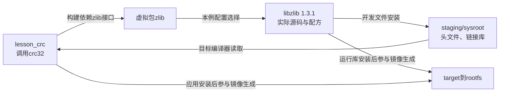
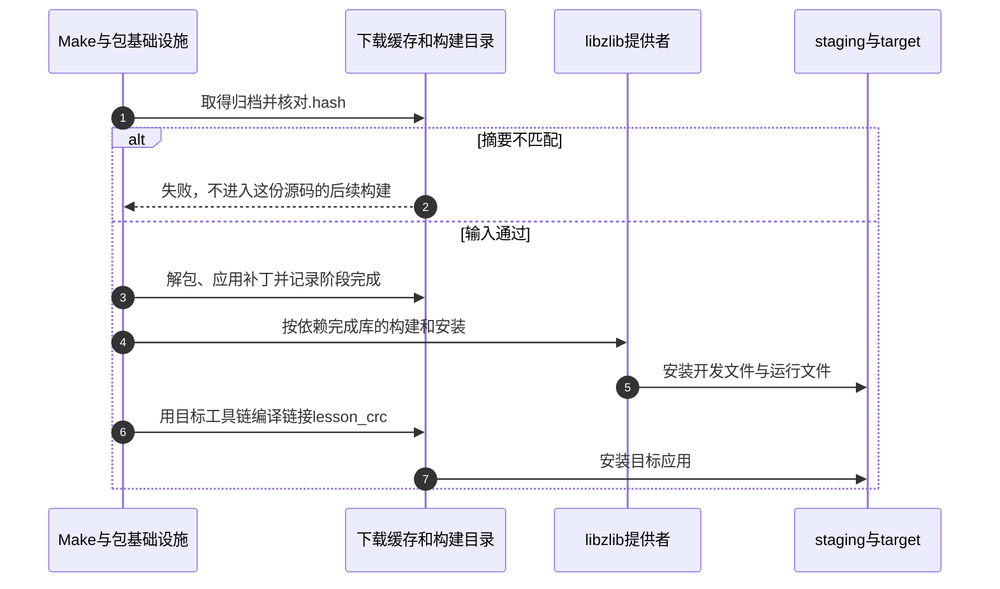

# 第9章\_把源码身份依赖和补丁接成包维护闭环

[第八章](P08_把项目输入迁到外部树并隔离构建.md) 已把应用与板材料移入独立外部树。之前的lesson_report直接读取我们维护的本地源码，因此“版本1.0”主要是配方中的名称；本地文件改了，名称可以完全不变。若换成团队分发的源码归档，再引入第三方库，就需要回答另外三个问题：拿到的字节是否相同、库是否在正确阶段可用、补丁是否真的进入了本次程序。

本章仍使用Buildroot 2025.02和LESSON外部树，新增一个调用zlib的C程序。它把依赖从配方中的名词变成编译、链接和运行时都能观察的对象，再用一次补丁与重建完成维护闭环。第六章的包安装与初始化模型继续有效，这里不重新讲一遍启动服务。

## 9.1\_先确定我们依赖的是哪一个对象

现在希望计算一段输入文本的CRC-32。**CRC（循环冗余校验）** 用于发现某些数据变化，本例只借它观察库调用，不把它当成第七章的密码学摘要或发布者认证。zlib提供crc32函数，我们不再自行实现这段算法。

于是应用至少需要三份东西：编译时的zlib.h声明、链接时提供crc32的库、动态链接方案下目标运行时加载的库。如果只在作者机器上碰巧装有zlib，程序可能在本机构建成功，而干净交叉构建失败。依赖必须进入项目输入，不能依赖宿主偶然留下的文件。

还要先数清名称。Buildroot 2025.02的 `zlib` 是 **虚拟包入口**：应用表达“需要zlib接口”，实际实现由配置选择。默认提供者是 `libzlib`，它对应zlib 1.3.1；另一选择是zlib-ng。本例固定默认libzlib，不能把虚拟入口当作另一份同时编译的压缩库。



箭头分别表示依赖选择与文件流。staging给构建工具消费，target是镜像生成前的安装汇集目录；最终目标使用经过第五章生成阶段的rootfs。库配方必须实现相应安装动作，写入DEPENDENCIES不会凭空生成头文件、库或.pc文件。

| 本例对象 | 固定来源与职责 |
| --- | --- |
| `BR2_PACKAGE_ZLIB` | 启用zlib接口选择 |
| `BR2_PACKAGE_LIBZLIB` | 本例选中的实际提供者 |
| `package/zlib/zlib.mk` | 展开virtual-package并连接提供者依赖 |
| `package/libzlib/libzlib.mk` | 版本1.3.1，安装staging与target，使用generic-package |
| `package/libzlib/libzlib.hash` | 固定源码归档及LICENSE的摘要 |

依据：[zlib选择定义](../../../research/source_reading/buildroot/2025.02/package/zlib/Config.in)、[虚拟入口](../../../research/source_reading/buildroot/2025.02/package/zlib/zlib.mk)、[实际配方](../../../research/source_reading/buildroot/2025.02/package/libzlib/libzlib.mk) 和 [摘要](../../../research/source_reading/buildroot/2025.02/package/libzlib/libzlib.hash)。本版本的zlib有configure脚本，但实际配方是通用基础设施；看到同名脚本不能直接推断它属于GNU Autotools。

## 9.2\_把源码目录冻结成可核对的输入

本例自己的程序也改为归档输入，目的是观察正常的校验、解包与补丁流程。它不是冒充第三方上游项目，而是我们能够控制并制造反例的教学源码；第三方依赖使用真实zlib。Linux宿主当前目录为第八章的干净Buildroot源码树：

```sh
br_ext="$PWD/../lesson_external"
br_work="$br_ext/work/lesson_crc-1.0"
br_release="$br_ext/sources"
br_pkg="$br_ext/package/lesson_crc"
mkdir -p "$br_work" "$br_release" "$br_pkg"
```

work是编辑与打包的工作目录，sources保存被配方消费的归档，package保存集成规则。更改work中的文件不会自动改写已发布归档；这正是从“活动目录”变成“固定输入”后新增的边界。

### 9.2.1\_准备能观察库调用的完整C程序

保存 `$br_work/lesson_crc.c`：

```c
/* SPDX-License-Identifier: GPL-2.0-only */
#include <limits.h>
#include <stdio.h>
#include <string.h>
#include <zlib.h>

int main(int argc, char **argv)
{
    size_t text_length;
    uLong checksum;

    if (argc != 2) {
        fputs("usage: lesson_crc text\n", stderr);
        return 2;
    }
    text_length = strlen(argv[1]);
    /* crc32的长度参数是uInt，转换前检查范围。 */
    if (text_length > UINT_MAX) {
        fputs("lesson_crc: input too long\n", stderr);
        return 2;
    }
    checksum = crc32(0L, Z_NULL, 0);
    checksum = crc32(checksum, (const Bytef *)argv[1], (uInt)text_length);
    if (printf("crc32=%08lx\n", (unsigned long)checksum) < 0)
        return 1;
    /* 输出缓冲提交失败也不能报告成功。 */
    if (fflush(stdout) == EOF)
        return 1;
    return 0;
}
```

程序接受一个文本参数，计算其字节的CRC并打印。初始crc32调用取得规范要求的初值；第二次才处理输入。空字符串是合法输入，缺少参数返回2，输出失败返回1。它不支持参数中嵌入NUL字节，也没有把文本校验推广为任意文件工具。接口依据见 [zlib 1.3.1的Checksum Functions](https://zlib.net/manual.html#Checksum)。

将本仓库教学代码所采用的完整GPLv2文本一并放入源码，然后打包：

```sh
cp COPYING "$br_work/COPYING"
tar -czf "$br_release/lesson_crc-1.0.tar.gz" \
    -C "$br_ext/work" lesson_crc-1.0
```

归档包含一个顶层目录，Buildroot常规解包会去掉这一层。这里只给自己的程序提供许可文本；zlib继续保留它自己的许可与摘要。若重新打包，时间戳等因素可能改变归档字节，必须重新核对身份；正式发布后不能悄悄替换同名归档并沿用旧记录。

### 9.2.2\_把归档与许可摘要一起记录

生成 `lesson_crc.hash`，第一列是算法，第二列是摘要，第三列是确切文件名：

```sh
{
    printf '%s\n' '# 本教学归档与许可文本的本地计算值'
    sha256sum "$br_release/lesson_crc-1.0.tar.gz" | \
        awk '{print "sha256  " $1 "  lesson_crc-1.0.tar.gz"}'
    sha256sum "$br_work/COPYING" | \
        awk '{print "sha256  " $1 "  COPYING"}'
} > "$br_pkg/lesson_crc.hash"
cat "$br_pkg/lesson_crc.hash"
```

本地计算摘要绑定这次归档；它不证明一个未知第三方文件可信。对于真实第三方源码，应结合官方发布入口、发布签名或可信摘要核对来源，并记录自行计算值的来源。许可文件摘要在legal-info阶段用于发现许可文本变化，也不自动得出法律结论。

有.hash时，下载文件应匹配其对应条目；内容不匹配会失败，存在.hash却缺少相应文件条目通常也会失败。没有.hash不等于已经校验：本版本检查脚本可以警告后返回成功，项目若要求更严格策略应检查 `BR2_DOWNLOAD_FORCE_CHECK_HASHES` 及具体下载路径。不能把“make没有报错”当作所有输入均经过哈希的证据。

依据：[包目录说明的.hash小节](../../../research/source_reading/buildroot/2025.02/docs/manual/adding-packages-directory.adoc) 与 [check-hash实现](../../../research/source_reading/buildroot/2025.02/support/download/check-hash)。

## 9.3\_菜单选择和构建顺序为什么要声明两次

先考虑只加一条Make依赖。它可以建立构建先后关系，却未必把库的配置开关选上。反过来，只在菜单中选上库，也没有告诉并行构建何时才允许应用开始配置。两处声明回答不同问题，不能互相替代。

保存 `$br_pkg/Config.in`，属性用Tab，help正文再缩进两个空格：

```kconfig
config BR2_PACKAGE_LESSON_CRC
	bool "lesson_crc"
	select BR2_PACKAGE_ZLIB
	help
	  调用zlib计算文本CRC，用于观察库依赖与归档补丁流程。
```

select使应用启用时带上库接口。depends on则约束选项何时可用，不是“选应用后自动选库”的另一种拼写。工具链能力、架构限制等通常应通过depends on限制；select不会自动递归满足被选项的所有前置条件，因此还要传播真实能力要求。本例不凭空增加无关能力条件。

保存 `$br_pkg/lesson_crc.mk`：

```make
LESSON_CRC_VERSION = 1.0
LESSON_CRC_SOURCE = lesson_crc-$(LESSON_CRC_VERSION).tar.gz
LESSON_CRC_SITE = file://$(BR2_EXTERNAL_LESSON_PATH)/sources
LESSON_CRC_SITE_METHOD = file
LESSON_CRC_LICENSE = GPL-2.0-only
LESSON_CRC_LICENSE_FILES = COPYING
LESSON_CRC_DEPENDENCIES = zlib

define LESSON_CRC_BUILD_CMDS
	$(TARGET_CC) $(TARGET_CPPFLAGS) $(TARGET_CFLAGS) -std=c11 -Wall -Wextra \
		-o $(@D)/lesson_crc $(@D)/lesson_crc.c $(TARGET_LDFLAGS) -lz
endef

define LESSON_CRC_INSTALL_TARGET_CMDS
	$(INSTALL) -D -m 0755 $(@D)/lesson_crc $(TARGET_DIR)/usr/bin/lesson_crc
endef

$(eval $(generic-package))
```

file方式从本地位置取得一个归档，仍进入下载缓存、校验、解包与补丁流程；它与第六章local方式同步活动源码目录不同。SOURCE确定文件名，SITE确定所在目录，DEPENDENCIES让zlib提供者先满足构建需要。`-lz`告诉链接器解析程序的库符号，放在引用它的源码/对象之后；DEPENDENCIES本身不会替编译命令添加这个选项。

在外部树顶层Config.in追加这一行。external.mk沿用第八章的通配包含规则，无须为本包另造一套入口：

```kconfig
source "$BR2_EXTERNAL_LESSON_PATH/package/lesson_crc/Config.in"
```

这是无运行服务的按需命令，不添加S99脚本。host工具包是在构建机执行的另一类参与者，使用host-generic-package等入口；工具链包又有引导和sysroot等额外约束，不应把所有包压成完全相同的安装流程。

## 9.4\_沿依赖完成点检查编译与运行

本章采用新的输出，避免借用前章遗留库。先载入现有项目配置，再在External options启用lesson_crc，确认zlib variant仍为默认libzlib：

```sh
br_out="$PWD/../br_out_crc_lesson_2025_02"
make O="$br_out" BR2_EXTERNAL="$br_ext" lesson_qemu_defconfig
make O="$br_out" menuconfig
make O="$br_out" savedefconfig \
    BR2_DEFCONFIG="$br_ext/configs/lesson_crc_defconfig"
make O="$br_out" lesson_crc
```

配置结果应含 `BR2_PACKAGE_LESSON_CRC=y`、`BR2_PACKAGE_ZLIB=y` 和 `BR2_PACKAGE_LIBZLIB=y`。构建先完成实际库提供者，再编译应用；不是同时编译两个不同的zlib实现。



第1～3步说明应用源码的身份与准备，第4～5步建立依赖完成条件，第6～7步才消费库并安装应用。下载等前序工作可以与其他依赖准备交错，图不规定全系统唯一调度顺序；关键保证是应用的配置/构建不能越过所需依赖的完成点。stamp属于O目录中的阶段记录，不是对源码目录所有变化的实时监视器。

在构建机检查开发文件与目标程序身份：

```sh
ls "$br_out/staging/usr/include/zlib.h"
"$br_out/host/bin/aarch64-linux-readelf" -h -d \
    "$br_out/target/usr/bin/lesson_crc"
make O="$br_out"
tar -tf "$br_out/images/rootfs.tar" ./usr/bin/lesson_crc
"$br_out/images/start-qemu.sh"
```

readelf不执行目标程序。共享库方案下动态段应体现对libz的依赖，静态链接方案则不能要求出现同样的NEEDED；实际加载还取决于镜像中的库与加载器。目标系统登录后执行：

```sh
/usr/bin/lesson_crc 123456789
/usr/bin/lesson_crc ''
/usr/bin/lesson_crc
printf 'exit=%s\n' "$?"
```

前两次预期为 `crc32=cbf43926` 和 `crc32=00000000`；第三次显示用法，状态为2。先证明一次正常库调用，再讨论升级。本轮用MinGW GCC 14.2.0、O2和严格警告，将此程序与固定zlib 1.3.1的CRC原件一起编译，正常、空串、缺少参数和多余参数四例通过。这是宿主逻辑验证，没有执行Buildroot包构建或QEMU目标运行。

## 9.5\_补丁必须进入源码准备而不是只出现在目录里

现在增加一个小改动：输出库的实际版本，帮助接收者把结果与运行库联系起来。不要直接修改output/build里的C文件，因为下次解包会丢失这项改动。把下面完整补丁保存为 `$br_pkg/0001-report-library-version.patch`：

```diff
显示实际运行的zlib版本，便于教学检查。
Upstream: N/A，本仓库教学程序的输出调整。

--- a/lesson_crc.c
+++ b/lesson_crc.c
@@ -21,7 +21,7 @@
     }
     checksum = crc32(0L, Z_NULL, 0);
     checksum = crc32(checksum, (const Bytef *)argv[1], (uInt)text_length);
-    if (printf("crc32=%08lx\n", (unsigned long)checksum) < 0)
+    if (printf("zlib=%s crc32=%08lx\n", zlibVersion(), (unsigned long)checksum) < 0)
         return 1;
     /* 输出缓冲提交失败也不能报告成功。 */
     if (fflush(stdout) == EOF)
```

补丁直接位于包配方目录；它不是名为lesson_crc-patches的任意子目录。Buildroot会按规定阶段应用它。第八章的全局补丁目录适合集中保存项目差量，两种位置都要防止同一补丁重复应用。上游修复还应保留来源、适用版本与必要的提交说明；本例明确标为自己的教学修改。

已经构建成功的包可能因stamp而跳过补丁阶段。对本例重新准备源码，再构建完整镜像：

```sh
make O="$br_out" lesson_crc-dirclean
make O="$br_out" lesson_crc
make O="$br_out"
```

dirclean删除该包的构建目录，让它重新解包与打补丁，不等于卸载target中此前安装的所有文件。本例安装路径不变；若新版本删除或改名文件，应使用干净输出核对残留。下面列出2025.02与当前问题有关的清理范围，避免把三个目标混为一种操作。

| 目标 | 本版本主要影响 | 不应据此推断 |
| --- | --- | --- |
| `lesson_crc-dirclean` | 删除这个包的构建目录 | 不自动卸载已安装文件，也不重建全部消费者 |
| `clean` | 删除target、images、host、build、staging等构建产物与相关报告 | 不等于删除项目输入和当前.config |
| `distclean` | 在clean基础上删除.config、外部树记录及源码树默认dl目录等；默认output目录也被移除 | 自定义下载目录不一定在相同删除范围内 |

这些是 [顶层Makefile](../../../research/source_reading/buildroot/2025.02/Makefile) 的实际目标边界，不在本实验执行整树清理。尤其是使用独立O目录，也不能据此认为distclean一定不会碰源码树默认dl目录。

再次启动目标后，预期输出变为 `zlib=1.3.1 crc32=cbf43926`。这次调用zlibVersion读取实际链接库提供的字符串，而不是仅打印头文件宏；但版本字符串仍不是整个库文件的摘要，也不证明所有API均兼容。本轮已在宿主副本上应用此补丁并重新编译运行，输出符合上述结果，仍未执行目标机验证。补丁查找和动作次序依据：[Patching a package](../../../research/source_reading/buildroot/2025.02/docs/manual/patch-policy.adoc) 与 [通用包实现](../../../research/source_reading/buildroot/2025.02/package/pkg-generic.mk)。

## 9.6\_基础设施与钩子怎样减少重复工作

lesson_crc只有一份C文件，所以通用基础设施加两段命令已经足够。若上游使用CMake，我们仍手写它的所有配置、交叉编译和安装参数，便要重复维护Buildroot已经提供的适配。此时选择cmake-package，让公共实现处理标准步骤，再只写该包差量。

| 上游实际构建方式 | 可用基础设施 | 仍由包作者核对的内容 |
| --- | --- | --- |
| 自定义脚本或简单命令 | generic-package | 编译、配置、安装命令及参数传递 |
| GNU Autotools | autotools-package | 交叉检测、选项、是否需要autoreconf |
| CMake | cmake-package | 工具链配置、选项、安装目标与依赖 |
| Meson | meson-package | cross配置、选项及目标可执行文件探测 |
| Python项目 | python-package | 实际构建后端与目标运行依赖，不等于直接pip安装 |
| 树外内核模块 | kernel-module配合包基础设施 | 内核配置、模块目录、构建与安装兼容性 |

kernel-module不是把驱动源码自动合入内核树；内核自带工具又是另一类选定内核源码的构建任务。应先核对上游构建方式，再决定基础设施，不按项目名字猜测。

`*_BUILD_CMDS` 是该阶段的主要动作。`*_POST_BUILD_HOOKS` 等则是附加动作名称列表，允许在标准步骤后追加工作。例如实际libzlib配方在仅共享库配置下，通过POST_INSTALL_STAGING_HOOKS清理不需要的静态归档；这与完全覆盖INSTALL_STAGING_CMDS不同。定义一个函数体还不够，必须把名称登记到相应HOOKS列表，并放在基础设施eval之前。参见 [Hooks available in the various build steps](../../../research/source_reading/buildroot/2025.02/docs/manual/adding-packages-hooks.adoc)。

依赖较多时，pkg-config读取库提供的.pc元数据来返回编译与链接参数。host-pkgconf是构建机运行的工具，但为目标应用查询时应指向目标sysroot。Buildroot的 `PKG_CONFIG_HOST_BINARY` 指向host/bin/pkg-config包装入口，其默认目录面向staging；宿主包构建又会覆盖相关环境以查询宿主库。变量名里的HOST说明工具在哪里执行，不直接说明查询哪一套库。它也不会生成缺失的.pc文件，更不会代替TARGET_CC。依据：[pkgconf配方](../../../research/source_reading/buildroot/2025.02/package/pkgconf/pkgconf.mk)、[包装脚本](../../../research/source_reading/buildroot/2025.02/package/pkgconf/pkg-config.in) 与 [Makefile.in的目标/宿主环境](../../../research/source_reading/buildroot/2025.02/package/Makefile.in)。

可选功能需要同时控制配置选择、Make依赖和上游开关。若只在库“碰巧已安装”时让configure自动探测，干净构建与增量构建可能得到不同功能。直接使用某库API的包应声明直接依赖，不依赖另一包暂时带来的间接安装；宿主工具依赖与目标库依赖也不能只按“构建期/运行期”简单二分。

## 9.7\_升级时验证改变了哪一段契约

把VERSION从1.0改为1.1只是改变输入声明。还要取得对应源码、更新并复核哈希、检查许可文本、确认补丁是否已被合入，以及配置和构建方式有没有变化。失效补丁不能仅为了让patch通过就删除，先判断它原来解决的问题是否仍存在。

API变化影响源代码能否按新声明编译；ABI变化影响已有程序能否与二进制库协作。SONAME从libfoo.so.1变为libfoo.so.2是一个显著信号，但SONAME不变也不是ABI永远不变的证明。库更新后只重建库，未必会自动重建全部反向依赖；用第六章的依赖查询找使用方，并在发布候选中以干净输出构建完整系统和SDK。

| 观察层 | 要保留的证据 | 不能替代的下一层 |
| --- | --- | --- |
| 输入 | 版本、归档或提交身份、哈希、补丁及许可文本 | 不证明可交叉编译 |
| 构建 | 配置日志、编译链接命令与成功状态 | 不证明目标可加载 |
| 安装 | staging开发文件、target运行文件及最终镜像内容 | 不证明真实调用成功 |
| 运行 | 目标版本、正常与失败输入、库调用结果 | 不覆盖全部负载与功能 |
| 发布候选 | 全系统、SDK和交付物的配套关系 | 不自动覆盖部署中断与回退 |

同一产品确需同时存在两个库版本时，独立包名还不够：头文件、库文件名、SONAME、可执行命令和配置路径都可能冲突。优先让不同产品配置各自选择一套版本；确有并存需求时明确命名空间与消费者，不能用两个目录便声称冲突解决。

源码镜像与下载缓存减少网络依赖，ccache减少符合条件的重复编译，它们都不替代版本审查。本次zlib 1.3.1原下载地址返回404，改从Buildroot官方源码镜像取得后，摘要仍与固定配方的 `38ef96b8dfe510d42707d9c781877914792541133e1870841463bfa73f883e32` 一致。这证明取得了该记录约定的归档字节，不能据此宣称历史版本没有安全问题；维护时继续核对上游公告与实际受影响配置。

## 9.8\_用反例检查维护流程是否真正闭合

1. lesson_crc的Config.in已经select了zlib，还能删掉Make依赖吗？
2. 文件放进任意名为lesson_crc-patches的目录，会自动进入本次构建吗？
3. 只修改work目录后运行make，为什么归档包可能完全没变化？
4. 新库编译通过，旧应用也仍能链接，是否已经证明运行兼容？

第一题不能，配置选择和构建先后是两条契约。第二题不能，必须放入实际被查找的位置，而且要重新进入补丁阶段。第三题因为配方消费的是sources中的归档，不是work活动目录；应形成新输入身份并核对缓存。第四题不能，还需检查运行库、加载器、ABI和目标调用行为。

还可以在独立临时副本上追加字节，保留原.hash，用固定版本内部的check-hash辅助脚本观察拒绝。在本章的Linux宿主Buildroot根目录执行：

```sh
br_hash_probe=$(mktemp)
cp "$br_release/lesson_crc-1.0.tar.gz" "$br_hash_probe"
printf 'changed' >> "$br_hash_probe"
if bash support/download/check-hash "$br_hash_probe" \
    lesson_crc-1.0.tar.gz "$br_pkg/lesson_crc.hash"; then
    printf '%s\n' '意外通过：检查是否用了正确的原摘要'
else
    br_hash_status=$?
    printf '校验退出状态=%s，预期为摘要不匹配的2\n' "$br_hash_status"
fi
```

原归档和原.hash保持不动，临时副本保留用于观察。辅助脚本的参数在本版本固定，不作为跨版本稳定公共API。不要通过改正确摘要来“修好”未知来源的损坏。这个实验与第七章接收校验呼应：输入验证失败时，首先定位字节身份，而不是绕过检查继续构建。

现在能够从来源追到依赖、补丁、程序及镜像中的结果。下一章讨论 [镜像布局与部署](P10_从文件系统镜像到存储布局与部署验证.md)：内容正确的根文件系统，怎样与分区、引导组件和真实存储介质的约束一起组成可加载、可核对的系统。
