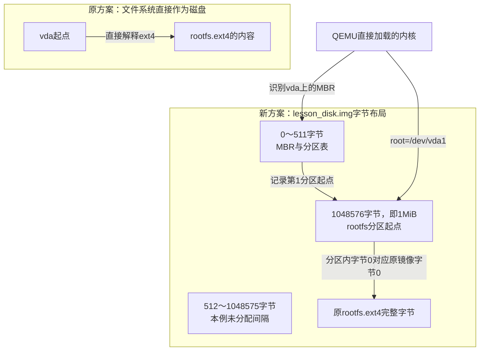
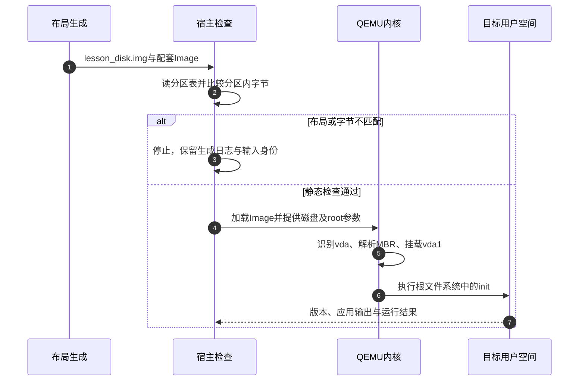
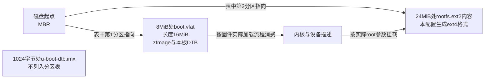

# 第10章\_从文件系统镜像到存储布局与部署验证

[第九章](P09_把源码身份依赖和补丁接成包维护闭环.md) 已能追踪程序的来源、依赖和补丁。[第七章](P07_把构建产物整理为可核对的交付包.md) 则建立了交付目录及其校验。现在还差一个问题：内核知道根文件系统放在哪里吗？同一份rootfs.ext4，直接作为整块虚拟磁盘和放进某个分区以后，内容可以不变，定位方式却已经改变。

本章先给QEMU磁盘增加分区表，完成不触碰实体介质的布局练习；再对照固定i.MX6ULL板配置，理解为什么实体启动还需要引导组件位置。最后区分SD/eMMC用户区与原始闪存，并建立写入、回读、启动和恢复的验证顺序。Buildroot固定为2025.02，配套genimage为18；这里不把一份教学布局称作任意开发板的可烧写方案。

## 10.1\_根文件系统没有变化为什么root参数却要改

原来QEMU把rootfs.ext4当作整个virtio磁盘，内核从 `/dev/vda` 这个设备的起点解释文件系统。现在在磁盘前部加入分区表，把原文件系统整体搬到1MiB处。设备vda的起点已经是磁盘布局信息，内核必须先解析分区表，才知道 `/dev/vda1` 对应的字节范围。

**MBR（Master Boot Record，主引导记录）** 在本例承担传统分区表的载体。我们没有让QEMU从MBR中的启动代码引导；内核仍由 `-kernel Image` 直接加载。MBR名称中有“引导”，不代表本例已经建立实体板BootROM到U-Boot的启动链。



图中是文件字节范围与内核设备视图，不是芯片内部电路。1MiB是本练习选定的对齐位置；512字节是这里分区表计算使用的扇区单位，不代表所有设备的物理写入或擦除粒度。

由此可以预测一个反例：只把磁盘文件换成lesson_disk.img，却保留root=/dev/vda，内核仍会从错误的层次寻找文件系统。反过来，旧的无分区镜像也不能仅改成vda1就获得一个不存在的分区。

## 10.2\_用genimage把定位关系写成可检查的配置

手工在指定偏移复制字节，还需要同步写分区起点、长度、类型并检查重叠。**genimage** 把这些布局关系作为输入，生成磁盘或闪存相关镜像；它不会替我们决定某颗SoC要求的启动位置，也不会凭一个文件名生成缺失的内核或DTB。

本章使用 [Buildroot固定配方](../../../research/source_reading/buildroot/2025.02/package/genimage/genimage.mk) 选择的genimage 18，语法按 [该版本README](../../../research/source_reading/buildroot/tools/genimage-18/README.rst) 的image、partition和hdimage小节核对。工具原件另有 [摘要记录](../../../research/source_reading/buildroot/tools/genimage-18/source_manifest.json)，不能把它的18误写成Buildroot版本。

在Linux宿主的干净Buildroot源码根目录，继续使用LESSON外部树：

```sh
br_ext="$PWD/../lesson_external"
br_board="$br_ext/board/qemu_aarch64"
br_out="$PWD/../br_out_disk_lesson_2025_02"
make O="$br_out" BR2_EXTERNAL="$br_ext" lesson_crc_defconfig
make O="$br_out" menuconfig
```

启用Host utilities中的host genimage，即 `BR2_PACKAGE_HOST_GENIMAGE=y`。当前选择让Buildroot构建宿主工具，而不是假设PATH里已经有任意版本的genimage。

保存 `$br_board/genimage.cfg`：

```text
image lesson_disk.img {
    hdimage {
        partition-table-type = "mbr"
        disk-signature = 0x4c45534e
        fill = true
    }
    partition rootfs {
        partition-type = 0x83
        offset = 1M
        image = "rootfs.ext4"
    }
}
```

这里只有一个已存在的文件系统输入。未指定分区size时，genimage按输入镜像长度及对齐确定分区大小；不是把文件系统自动扩展到整张SD卡。disk-signature固定本例磁盘标识，不能据此保证整个文件系统逐字节可复现；实际产品克隆标识还需考虑同时连接多个同标识磁盘的影响。

| 配置项 | 本例作用 | 容易混淆的另一件事 |
| --- | --- | --- |
| `partition-table-type = "mbr"` | 使用MBR分区表 | 旧的partition-table是布尔项，不能填入msdos字符串来冒充此项 |
| `partition-type = 0x83` | 在MBR条目中记录Linux分区类型 | 不会把任意输入转换成ext4 |
| `offset = 1M` | 分区从1048576字节处开始 | 不是文件系统内部偏移，也不是所有板的启动偏移 |
| `image = "rootfs.ext4"` | 从inputpath取得已有镜像 | 不会仅凭名称建立缺失文件 |
| `fill = true` | 将磁盘镜像扩展填充到布局末端 | 不代表实际介质的全部容量都属于此镜像 |

GPT是另一种分区表格式，有主、备表及分区GUID等额外结构；是否采用取决于启动软件、容量和布局要求。切换为GPT后必须重新检查表占用范围与引导组件，不能只替换一个字符串就宣称同一物理布局仍成立。

## 10.3\_让生成和交付在同一失败路径里执行

第七章的post-image已经能整理原始rootfs交付物。现在还要生成磁盘镜像、配套启动脚本和布局说明。它们有顺序依赖：genimage失败时，不能继续把上次留下的磁盘文件当作新结果打包。因此这里使用一个带 `set -e` 的总入口顺序调用各步骤。

先保存 `$br_board/run_qemu_disk.sh`，内容完整如下：

```sh
#!/bin/sh
set -eu
cd "$(dirname "$0")"
# 本脚本消费带MBR分区表的磁盘，根设备必须与布局一致。
exec qemu-system-aarch64 -M virt -cpu cortex-a53 -nographic -smp 1 \
    -kernel Image -append 'rootwait root=/dev/vda1 console=ttyAMA0' \
    -netdev user,id=eth0 -device virtio-net-device,netdev=eth0 \
    -drive file=lesson_disk.img,if=none,format=raw,id=hd0 \
    -device virtio-blk-device,drive=hd0 -snapshot
```

同一交付目录里，原run_qemu.sh仍消费无分区的rootfs.ext4，新脚本消费lesson_disk.img。文件和参数一一配对，不能只说“运行那个QEMU脚本”。snapshot仍是本轮临时写入层，不是产品掉电恢复方案。

再保存 `$br_board/post_disk.sh`：

```sh
#!/bin/sh
set -eu
br_images=${1:?缺少镜像目录}
: "${BR2_EXTERNAL_LESSON_PATH:?缺少外部树路径}"
br_board="$BR2_EXTERNAL_LESSON_PATH/board/qemu_aarch64"

# 保留原QEMU启动入口；其余公共参数原样传递。
board/qemu/post-image.sh "$@"
support/scripts/genimage.sh -c "$br_board/genimage.cfg"
"$br_board/post_image.sh" "$@"

# 前一步重建原六文件摘要；随后加入本次磁盘及其消费说明。
br_delivery="$br_images/lesson_delivery"
install -m 0644 "$br_images/lesson_disk.img" "$br_delivery/lesson_disk.img"
install -m 0755 "$br_board/run_qemu_disk.sh" "$br_delivery/run_qemu_disk.sh"
cat > "$br_delivery/disk_layout.txt" <<'EOF'
image=lesson_disk.img
partition_table=mbr
rootfs_partition=1
rootfs_offset_bytes=1048576
root_device=/dev/vda1
kernel_loading=qemu_direct_kernel
EOF
(
    cd "$br_delivery"
    sha256sum lesson_disk.img run_qemu_disk.sh disk_layout.txt >> SHA256SUMS
    sha256sum -c SHA256SUMS
)
```

上游genimage.sh使用BUILD_DIR下的临时工作目录、BINARIES_DIR作为输入输出，并传入临时空rootpath。本例只嵌入已经由Buildroot正确生成的rootfs镜像，不需要重新从target复制文件系统；如果改为让genimage直接制作文件系统，就必须重新核对属主、设备节点和fakeroot条件。参数依据见 [固定辅助脚本](../../../research/source_reading/buildroot/2025.02/support/scripts/genimage.sh)。

```sh
chmod +x "$br_board/post_disk.sh" "$br_board/run_qemu_disk.sh"
make O="$br_out" menuconfig
```

把 `BR2_ROOTFS_POST_IMAGE_SCRIPT` 改成唯一入口 `$(BR2_EXTERNAL_LESSON_PATH)/board/qemu_aarch64/post_disk.sh`；公共参数仍为 `configs/qemu_aarch64_virt_defconfig`，不要改为本章新配置名。然后保存并构建：

```sh
make O="$br_out" savedefconfig \
    BR2_DEFCONFIG="$br_ext/configs/lesson_disk_defconfig"
make O="$br_out"
```

总入口保证后续步骤不越过当前调用的失败返回；它不把所有下级脚本内部错误自动变成非零状态，也不是原子发布事务。第七章原交付摘要被重建后再追加三项，不重复累积旧条目。本轮用命令替身验证了前序失败停止后续步骤、成功后九项摘要完整以及重复执行不累积条目；替身没有运行genimage，不作为镜像生成证据。

交付磁盘方案时明确打包十份文件，其中九份进入摘要：

```sh
tar -cf "$br_out/images/lesson_disk_delivery.tar" \
    -C "$br_out/images/lesson_delivery" \
    Image rootfs.ext4 rootfs.ext4.gz buildroot.config \
    manifest.txt run_qemu.sh lesson_disk.img run_qemu_disk.sh \
    disk_layout.txt SHA256SUMS
```

接收检查沿用第七章，随后按disk_layout.txt选择磁盘启动脚本。这样不会出现摘要里引用了新文件、传输包却仍只有旧文件的交接缺口。

## 10.4\_先证明布局和字节再证明启动

先在Linux宿主用只读工具检查普通镜像文件，不挂载实体磁盘：

```sh
fdisk -l "$br_out/images/lesson_disk.img"
sfdisk --dump "$br_out/images/lesson_disk.img"
```

这里的fdisk和sfdisk来自宿主util-linux。应看到DOS/MBR表，第一个分区起点为2048个512字节扇区，即1MiB，类型83。若原rootfs仍为默认60MiB，则分区长度应为122880个扇区，磁盘到末端共61MiB；实际修改过rootfs大小时，应按实际字节数重新计算，不硬套这个数字。

分区表正确还不足以证明嵌入了正确的rootfs。按已核对的起点取回同样长度的字节再比较：

```sh
br_root_size=$(stat -c %s "$br_out/images/rootfs.ext4")
br_verify=$(mktemp -d)
if [ $((br_root_size % 512)) -ne 0 ]; then
    printf '%s\n' '本例要求文件系统镜像长度为512的倍数' >&2
    false
else
    dd if="$br_out/images/lesson_disk.img" \
        of="$br_verify/rootfs_extracted.ext4" bs=512 skip=2048 \
        count=$((br_root_size / 512)) status=none && \
    cmp "$br_out/images/rootfs.ext4" "$br_verify/rootfs_extracted.ext4"
fi
```

dd的输出是刚创建的普通临时文件。cmp无输出且返回0，才说明所取范围与输入相同；起点或长度错误时，应先修正布局，不进入启动测试。这个比较不检查ext4内部一致性，也不证明内核支持该格式。

安装了适用QEMU的Linux环境再运行 `"$br_out/images/lesson_delivery/run_qemu_disk.sh"`。内核必须支持virtio块设备、所选分区表和ext4，随后按root=/dev/vda1挂载，进入已有init和应用。目标中检查 `/proc/cmdline`、挂载结果并执行 `/usr/bin/lesson_crc 123456789`；预期为上一章补丁后的输出。失败时分别定位“看不到磁盘”“看不到分区”“不能挂载文件系统”“不能执行init”，不要将它们合成一个rootfs坏了。



第1～3步只处理产物及失败，第4～7步才触及运行环境。编译成功、文件相同、启动成功分别提供不同证据；它们都需要关联本次配置和镜像身份。本次未运行Linux genimage、真实文件系统检查或QEMU启动，不能把上述预期写成已观测结果。

## 10.5\_实体板为什么还要核对引导组件的位置

QEMU的-kernel替我们完成了内核装载。实体板上通常先执行SoC内部启动代码，再按启动介质和格式找到后续引导组件；引导组件又负责装载内核、设备描述和启动参数。磁盘里的分区表只能表达其中一部分位置关系，不能替代启动ROM的格式与偏移要求。

这里用Buildroot 2025.02自带的 **NXP i.MX6ULL EVK配置** 作资料对照，不声称它就是读者手中的所有i.MX6ULL板。该配置选择Cortex-A7、Linux 6.6.4、U-Boot 2023.10及mx6ull_14x14_evk板配置；它也不同于本仓库通用Linux研究的NXP 6.12.20基线。

其实际post-image根据配置选择公共模板，产生如下关系：



图表示模板中的文件布局。U-Boot区域不列入分区表，仍占用实际字节范围；工具必须检查它与boot分区不重叠。boot.vfat并不是一个没有来历的名字：模板先定义16MiB FAT镜像，再将配置选定的内核与DTB放进去，整盘布局随后引用它。rootfs.ext2文件名沿用Buildroot输出惯例，内部格式由EXT2_4选项确定。

| 对照项 | 固定配置或模板给出的事实 |
| --- | --- |
| 引导输入 | u-boot-dtb.imx，裸放偏移1024字节，不在分区表内 |
| 第一个表内分区 | 类型0xC，起点8MiB，boot.vfat为16MiB |
| 第二个表内分区 | 类型0x83，紧接boot分区，引用rootfs.ext2 |
| FAT内容 | post-image从配置取得内核格式与DTB文件列表 |
| 宿主工具 | genimage、dosfstools和mtools等相应配置 |

依据：[imx6ullevk_defconfig](../../../research/source_reading/buildroot/2025.02/configs/imx6ullevk_defconfig)、[公共模板](../../../research/source_reading/buildroot/2025.02/board/freescale/common/imx/genimage.cfg.template) 与 [模板选择和替换脚本](../../../research/source_reading/buildroot/2025.02/board/freescale/common/imx/post-image.sh)。这些资料证明该Buildroot板方案的选择；要部署到具体板，仍需核对该板启动模式、实际引导文件和存储连接，不能把1024字节推广到其他SoC。

本轮运行这个上游脚本来核对模板替换时，还用genimage命令替身注入失败：替身返回9，脚本仍因后续清理返回0。固定脚本没有在该失败点立即退出，因此其成功退出码不能独自证明镜像生成成功。这里保留原件以追溯实际版本行为，教学总入口使用前面已说明的失败传播方式；实际板项目还需修正对应脚本并检查新产物，不能把上游示例直接当作完整发布验收。

## 10.6\_块设备布局不能直接替代原始闪存布局

SD和eMMC通常向软件提供逻辑块地址，控制器在后面处理部分闪存管理。MBR或GPT分区位于这个逻辑地址空间。eMMC另外还可能暴露boot0、boot1等硬件区域；它们不是用户区分区表中一个名叫boot的FAT分区，往用户区写整盘镜像也不会自动写入这些硬件区域。Linux对这类区域的接口说明见 [MMC设备分区文档](https://cdn.kernel.org/doc/html/latest/driver-api/mmc/mmc-dev-parts.html)。

原始NAND的擦除块、页写入、坏块和ECC条件则必须被实际控制器与软件方案处理。**MTD** 提供闪存设备访问，**UBI** 在其上管理逻辑卷与物理擦除块映射，**UBIFS** 再使用UBI卷保存文件。三者职责不能压成“一个nand.img”。


这张图区分制作与运行方向，不表示UBIFS直接承担全部坏块处理。JFFS2可以直接使用MTD，是另一种方案；UBIFS的索引与UBI映射带来不同成本，不能按一个没有依据的256MB门槛宣布谁必然适用。NOR是否可执行原地代码还取决于映射和总线支持，不能把所有SPI NOR都当作CPU可直接取指的内存。

Buildroot有现成的UBIFS与UBI生成入口。本版本选择UBI会带上UBIFS；UBIFS由mkfs.ubifs制作，UBI由ubinize结合配置封装。必须从实际闪存、控制器支持和UBI信息取得这些参数：

| 参数 | 作用位置 | 错配会影响什么 |
| --- | --- | --- |
| PEB大小 | 物理擦除块，传给ubinize的-p | 物理布局与擦除边界 |
| LEB大小 | 卷可用的逻辑擦除块，传给mkfs.ubifs的-e | 文件系统对每块可用空间的理解 |
| 最小I/O单位 | 两类工具的-m | 写入与头部对齐约束 |
| sub-page与VID头位置 | UBI头部布局相关 | 可用数据起点及控制器是否支持 |
| 最大LEB数量 | mkfs.ubifs的-c | 文件系统可扩展的逻辑块范围 |

LEB通常小于PEB，因为UBI头等占用空间；差值取决于具体头位置与对齐，不能一律从PEB减去固定两个页。默认配置值只是默认值，必须核对板上实际条件。

默认单卷配置在正文中可直接读懂：

```ini
[ubifs]
mode=ubi
vol_id=0
vol_type=dynamic
vol_name=rootfs
vol_alignment=1
vol_flags=autoresize
image=BR2_ROOTFS_UBIFS_PATH
```

这里是ubinize配置，不是genimage的嵌套语法。Buildroot把最后一项的占位符替换成已生成UBIFS镜像路径；卷0名为rootfs，dynamic表示UBI卷类型，autoresize是卷容量策略，并不证明任意UBIFS最大块数都与之匹配。自定义多卷时应明确各卷大小、类型、输入与恢复策略。

依据：[UBIFS配置](../../../research/source_reading/buildroot/2025.02/fs/ubifs/Config.in)、[生成命令](../../../research/source_reading/buildroot/2025.02/fs/ubifs/ubifs.mk)、[UBI配置](../../../research/source_reading/buildroot/2025.02/fs/ubi/Config.in)、[UBI生成命令](../../../research/source_reading/buildroot/2025.02/fs/ubi/ubi.mk) 及 [默认卷配置](../../../research/source_reading/buildroot/2025.02/fs/ubi/ubinize.cfg)。运行层次另见 [Linux 6.12 UBIFS说明](https://www.kernel.org/doc/html/v6.12/filesystems/ubifs.html)。

第五章的文件系统选择仍适用：只读SquashFS不强制要求再加写层，只有业务需要可变数据时才安排独立数据区或OverlayFS；cpio是归档，解包后的initramfs可以写入内存，只是不能因此获得掉电持久性；tar也不是一个具有“可写挂载”属性的磁盘文件系统。这些性质与分区表属于不同维度。

## 10.7\_实体部署必须把写入范围和恢复结果一起记录

本章没有指定可覆盖的实体设备，因此不把 `/dev/sdX`、`/dev/mtd0` 或一个虚构RAM地址写成可照抄的烧写目标。真正部署时先确认板身份、启动模式、存储类型、容量及被写范围，再使用该方案对应的操作。这里缺少的是具体目标的事实，不是genimage语法还能补出的信息。

| 消费者 | 接受的内容与写入范围 | 应核对的结果 |
| --- | --- | --- |
| SD/eMMC用户区块写入 | 整盘镜像写整个逻辑设备，单分区镜像写明确分区 | 容量、分区表、指定范围回读及启动 |
| eMMC boot硬件区域 | 该启动方案规定的引导组件和区域 | 区域选择、写保护、内容与启动选择 |
| UBI整布局部署 | 匹配几何参数的UBI镜像，经适用的MTD/UBI流程写入 | 附着、卷列表、文件系统挂载及数据 |
| 已有UBI卷更新 | 向选定卷写入它应承载的内容 | 卷更新状态、挂载及失败恢复 |
| NOR原始范围 | 对齐擦除和写入的引导或文件系统内容 | 未误擦相邻区域、回读与实际加载 |

块设备写入工具的“完成”只表示该工具所承诺的写入/同步阶段完成，不能直接写成“所有掉电场景都安全”。回读需比较镜像实际覆盖的长度，不拿更大介质尾部的无关字节造成假差异。若设备还被挂载或有其他写入者，回读结果也可能在比较时变化；先建立独占的部署过程。

NAND不能把“擦整片，再把一个文件从偏移0写入”当成通用流程。UBI整布局与已有卷更新是不同层次的操作；ECC、坏块、擦除计数、保留区域与BootROM格式都可能改变工具选择。原始NOR同样需要明确擦除范围，不能因为通常没有NAND式坏块管理便省略边界核对。

网络或USB只说明传输路径。TFTP把文件送到固件指定RAM位置后，还要分别加载内核、设备树与可选initramfs；没有加载DTB，就不能凭一个常见地址假设那里有有效设备描述。NFS根则需要目标内核的网络和NFS支持，以及真实导出目录。uuu、rkdeveloptool等厂商工具的命令和介质操作必须随具体SoC方案确定，不能用一个通用文件后缀代替协议。

量产记录至少关联板序列标识、输入摘要、工具与配置版本、实际写入范围、回读结果和启动检查。SD也可以进入量产流程，eMMC也不必然只能用某一种厂商工具；应按产线连接、吞吐、失败定位和可恢复性选择。

第七章引出的A/B更新在这里多了真实存储约束：备用槽必须足够容纳新内容，写入不能破坏当前可启动槽；验证后再改变启动选择，启动失败时由既定状态与次数策略回退，健康确认后才提交新状态。共享引导组件和用户数据如果仍被原地覆盖，双rootfs并不能保护它们。掉电测试应覆盖写入中、选择状态更新中和首次启动确认前后，而不是只验证一次正常重启。

## 10.8\_从布局推导下一步该看什么

1. 将rootfs.ext4放到1MiB处后，文件系统内容不变，为什么要把vda改成vda1？
2. 分区表类型0x83是否证明分区内部是一个正确ext4？
3. eMMC用户区有boot分区，是否意味着硬件boot0内容也已经写好？
4. 只有PEB大小相同，是否足以互换两份UBI镜像？

第一题因为设备起点与文件系统起点之间增加了分区定位。第二题不能，类型只是表项，仍要核对内容、格式和内核支持。第三题不能，它们属于不同地址区域。第四题也不能，还要核对最小I/O、头位置、LEB、卷布局与控制器条件。

现在可以分别检查产物字节、存储布局、启动消费和恢复边界。下一章沿这些交接点进入 [调试与问题排查](P11_调试与问题排查.md)，把构建日志、串口阶段和目标错误串成能够缩小范围的诊断过程。
