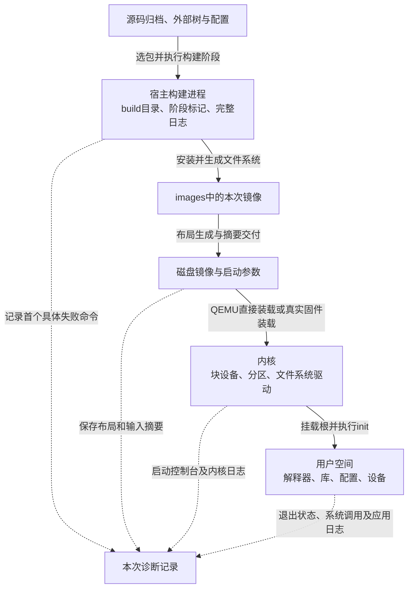
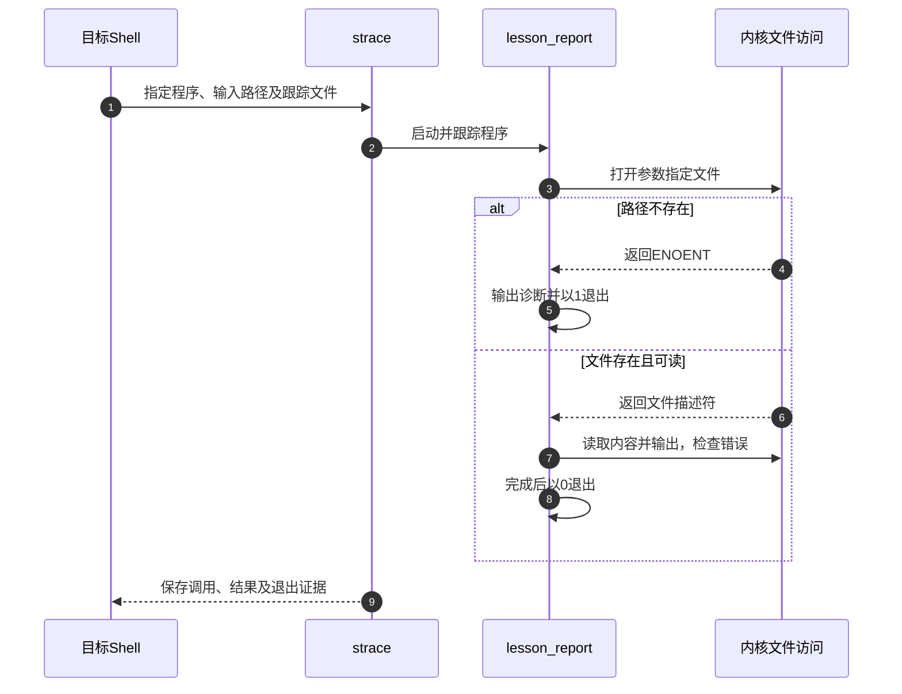

# 第11章\_沿失败交接点定位构建与运行问题

[上一章](P10_从文件系统镜像到存储布局与部署验证.md) 把同一份rootfs从整块虚拟磁盘移进分区，说明了为什么文件内容正确仍可能挂载失败。现在把问题再往前、往后各追一段：构建命令为什么没生成预期文件？内核已经挂载根文件系统，应用为什么仍打不开配置？

本章继续使用Buildroot 2025.02、LESSON外部树和QEMU AArch64示例。诊断的目标是找出 **哪一次交接没有满足下一方的条件**，再选择能区分候选原因的观察；不是看到最后一行Error就先清空整个输出目录。实际板启动另作分支说明，不把模拟机日志当作板上硬件证据。

## 11.1\_最后一个成功动作把问题缩小到哪里

假设屏幕上出现“找不到文件”。下载器找不到归档、genimage找不到rootfs、内核找不到init、应用找不到配置，都可能被人概括成这句话，但它们查找的地址空间和下一步完全不同。先写清 **谁发出错误、它要消费什么、最后一次已证实的成功是什么**，才能决定检查对象。



实线表示产物或控制权交接，虚线表示另行保存的观察。图中build目录里的阶段标记只记录构建系统已完成哪些步骤；它们不证明目标应用已经运行。日志也有产生者：post-image能记录打包过程，只有真正启动并采集控制台，才能取得启动日志。

例如，串口已出现内核输出，只能证明执行走到产生该输出的路径。若后来停止，候选可能包括驱动初始化、控制台切换、等待根设备、挂载或init执行，不能直接跳到“rootfs坏了”。同样，进入Shell不代表第六章的应用已经成功读取配置。

先保留上一份可工作的输入和结果，再给本次失败分配独立记录目录。下面在Linux宿主、Buildroot源码根目录执行；br_out指向第十章已经使用的输出目录：

```bash
br_out="$PWD/../br_out_disk_lesson_2025_02"
br_diag=$(mktemp -d "$PWD/../lesson_diag.XXXXXX")
cp "$br_out/.config" "$br_diag/buildroot.config"
date -u '+%Y-%m-%dT%H:%M:%SZ' > "$br_diag/started_at.txt"
(
    set -o pipefail
    make O="$br_out" V=1 2>&1 | tee "$br_diag/build.log"
)
br_status=$?
printf '%s\n' "$br_status" > "$br_diag/build.exit"
```

这是Bash片段。子Shell中的pipefail避免tee正常退出掩盖make失败；外层马上保存该状态，不用后续printf的成功代替构建结果。记录还应关联固定Buildroot归档、外部树提交或归档摘要、宿主工具版本和本次命令。并行日志可能交错，要把首个具体诊断与相应包的命令对齐，最后一行make返回错误通常只是传播结果。

## 11.2\_先确认失败阶段再决定是否重建

假设lesson_crc构建失败。它要先取得归档、展开、应用补丁、准备依赖、编译、安装，然后完整构建才重新产生rootfs。若错误发生在下载，切换链接顺序毫无作用；若在链接，重新下载同一归档通常也不改变结果。

已有日志没有足够命令细节时，保留它，再用 `make O="$br_out" V=1 lesson_crc` 缩小到这个包。已经完成的阶段可能被标记跳过，所以这不是“无条件重放所有步骤”。查看编译器实际路径、参数和包目录，不要脱离Buildroot环境直接在目录里运行一个没有同样变量的configure，再把两个结果混作同一次构建。

| 失败发生处 | 先看哪一份输入或输出 | 下一步如何缩小范围 |
| --- | --- | --- |
| 下载或校验 | 实际URL、下载后端、归档名及.hash | 区分DNS/连接、HTTP不存在、代理响应和摘要不符 |
| 解包或补丁 | 固定归档、补丁顺序、失败hunk及.rej | 确认补丁针对该版本，保留现场后从干净展开目录重试 |
| 配置 | 完整configure/CMake命令及它们生成的日志 | 区分目标能力缺失、宿主程序缺失和错误sysroot |
| 编译 | 第一个编译诊断、头文件来源、宏与工具链 | 回到第四章的预处理和对象文件边界 |
| 链接 | 对象、库、库顺序、实际符号与ABI | 确认构建依赖与链接命令，不只确认库文件存在 |
| 安装或镜像 | 安装路径、权限、可用空间和格式参数 | 区分target内容、fakeroot元数据、文件系统与分区容器 |

### 11.2.1\_网络代理和源码镜像不是同一项配置

`BR2_PRIMARY_SITE` 指定优先查找归档的源码镜像站，不是HTTP代理地址。固定版的 `BR2_WGET` 默认调用wget，下载辅助脚本把参数交给它；wget自身可以使用http_proxy、https_proxy、no_proxy及其配置文件。其他后端例如git有自己的连接设置，不能由“浏览器能下载”推出构建进程采用相同路径。

如果错误是HTTP 404，先确认配方对应的固定版本是否仍由该URL提供；如果拿到的是代理登录页，文件可能存在但摘要不符。第九章的固定zlib归档核对就使用了Buildroot源码镜像，并检查它与配方摘要相同。不要通过删除.hash或关闭TLS校验把“身份不匹配”改成“下载成功”。缓存也必须匹配包的实际下载目录、文件名和摘要，不是任意放进dl根目录便自动可信。

依据：[固定wget调用](../../../research/source_reading/buildroot/2025.02/support/download/wget)、[Buildroot下载配置](../../../research/source_reading/buildroot/2025.02/Config.in) 和 [GNU Wget代理规则](https://www.gnu.org/software/wget/manual/wget.html#Proxies)。这些资料解释连接与镜像职责，不规定读者网络中的代理地址。

### 11.2.2\_缺少宿主工具和缺少目标依赖要分别处理

“找不到autoconf”可能发生在宿主预检查、某个host包构建或目标包的生成步骤。先看失败命令本来应该从哪里获得这个工具：Buildroot负责构建的host工具缺失，应核对包依赖与生成顺序；系统前置工具缺失，才按宿主发行版安装相应包。不能一律安装系统最新版，悄悄绕过配方约定。

固定手册的路径是 [docs/manual/prerequisite.adoc](../../../research/source_reading/buildroot/2025.02/docs/manual/prerequisite.adoc)。它区分基础Linux工具、菜单界面开发库和可选下载工具，各发行版包名不同。内部工具链仍要由宿主工具编出来，不意味着选择它以后宿主环境就无关。

同类库也不必然冲突。例如程序可能通过不同依赖同时使用OpenSSL和mbedTLS；真正要查的是具体包的选择约束、提供者和符号/文件冲突，不是按功能相近就关闭其中之一。

### 11.2.3\_清理会丢掉什么证据

第九章已经说明rebuild、reconfigure和dirclean的范围。这里只增加诊断顺序：先保存失败日志、有效配置、补丁和相关临时结果，再按修改发生的阶段选择重建。版本或补丁改变时，重新展开较稳妥；工具链、ABI或删除包等影响全系统的变化，用新的O目录做干净对照，避免旧安装文件混入结果。局部包完成后仍需完整make更新镜像。

固定版补丁辅助脚本维护 `.applied_patches_list`，但它在调用patch **之前** 就把路径写入列表。因此列表有某项不等于该补丁成功；还要看返回状态、失败hunk、.rej和最终源码。它也没有承诺每个包都生成一个叫patch.log的文件。依据：[apply-patches.sh](../../../research/source_reading/buildroot/2025.02/support/scripts/apply-patches.sh)。

`make -n`可以帮助观察计划执行的配方，但不是无副作用沙箱：GNU make对带 `+` 的配方行、递归MAKE调用及重建包含Makefile等情况有执行例外。对不熟悉的构建树，应在副本中使用，不能靠-n承诺不会写文件。规则见 [GNU make的Instead of Execution](https://www.gnu.org/software/make/manual/make.html#Instead-of-Execution)。

## 11.3\_镜像存在为什么仍不能直接进入启动排查

第十章的故障注入已展示：下级脚本失败后若被后续成功命令掩盖，顶层可能正常退出。images里还可能保留上次成功文件。因此要关联本次生成日志、输入摘要和交付摘要，而不是只检查一个文件名存在。

假设genimage说空间不足，先问是哪一层：ext4自身装不下安装目录、FAT启动镜像装不下内核与DTB、分区长度小于文件系统镜像，或宿主磁盘空间不足。这四种情况修改不同参数。把分区扩大不会自动扩大ext4；把ext4扩大也可能进一步超出固定分区或介质容量。`df -h`检查宿主字节空间，`df -i`检查inode资源，随后分别核对文件系统和布局配置。

对本章的lesson_disk.img，按上一章只读检查分区表并比较1MiB处开始的rootfs字节。若这一步失败，先修复输入或布局；若通过，才将同一交付目录的Image、lesson_disk.img和root=/dev/vda1一起交给QEMU。原rootfs.ext4则配root=/dev/vda，两种路径不能交叉。

原始NAND还要核对UBI卷、几何参数和控制器条件，不能套用块设备的字节偏移模型。实体写入则回读 **镜像覆盖的范围**，并确认目标在检查期间没有其他写入者。镜像小于介质时，直接比较整个介质会把尾部无关内容算进来；这里不提供一个未经确认的实体设备名称供覆盖。

观察文件前几个字节可以发现某些明显错误，却不能证明位于后面固定偏移的引导组件正确，更不能证明完整镜像。若需要文件系统工具检查，优先在普通镜像副本上只读执行；普通挂载可能触发日志恢复等写入，不能把“挂载看看”默认视为只读取证。

## 11.4\_控制台上的阶段线索怎样形成候选原因

QEMU示例没有执行板上BootROM或U-Boot。实体板可能经历内部启动代码、可选的前级加载器、固件、内核与用户空间；SPL/TPL是否存在取决于具体方案，不能画成所有平台必经的固定链。

先把采集设备、端口、波特率、数据格式、接地和电平条件与板方案对应，再从复位前开始保存日志。BootROM不一定输出UART日志，固件和内核也可能使用不同控制台。没有输出既可能是执行没到，也可能是观察路径不通；乱码也可能来自时钟、电气或数据格式，而不只波特率。

| 已观察到的事实 | 能缩小到哪里 | 还不能排除什么 |
| --- | --- | --- |
| 从复位起没有可读输出 | 当前采集路径没有得到可读信息 | 接线、控制台选择、供电/复位、时钟与启动介质等 |
| 已进入U-Boot命令行 | 此次执行已到相应固件路径 | 后续文件加载、设备树、内存范围和内核交接 |
| 出现内核版本及早期日志 | 内核至少执行到该日志点 | 控制台切换、后续初始化与根设备等待 |
| 已识别磁盘和分区 | 相应存储路径及表解析已有证据 | 文件系统支持、内容、root选择与init执行 |
| 已有用户Shell | 至少一个用户程序能运行 | 服务状态、配置、设备权限和业务正确性 |

### 11.4.1\_固件要消费的格式和地址必须同时成立

在真实U-Boot命令行中，`printenv bootcmd`、`printenv bootargs`用于观察实际启动脚本与参数，不会因为打印了变量就完成文件加载。再核对本次加载命令的返回状态、字节数、内存范围以及后续启动命令使用的地址；DTB地址只有在相应数据已加载且内容正确时才有意义。

以第十章对照的U-Boot 2023.10说明接口类别：

| 命令 | 消费的主要内核形式 | 另外要核对什么 |
| --- | --- | --- |
| bootm | FIT，或启用了对应支持的legacy uImage | 配置/子镜像选择、关联DTB与initrd |
| bootz | zImage | 实际加载位置、DTB与可选initrd |
| booti | Image及已配置支持的压缩形式 | 解压条件、内存范围与DTB等 |

表中不意味着三个命令都被当前固件编入。依据分别为 [bootm](https://docs.u-boot.org/en/v2023.10/usage/cmd/bootm.html)、[bootz](https://docs.u-boot.org/en/v2023.10/usage/cmd/bootz.html)、[booti](https://docs.u-boot.org/en/v2023.10/usage/cmd/booti.html)。bootm不只接受uImage；同样，不能把任意loadaddr强行改成一个所谓统一CONFIG_LOADADDR。存放压缩文件的位置、解压目标、内核入口、DTB和固件保留区有各自约束，必须按架构启动协议及本板内存图避免重叠。

### 11.4.2\_找到根设备和执行init是两次不同交接

如果内核报告无法挂载根文件系统，依次寻找设备是否出现、分区是否存在、root指向哪一项、文件系统驱动是否可用。没有initramfs提前加载模块的路径时，挂载根所需的总线、存储和文件系统支持必须在此前可用，通常需要编入内核；不能把唯一副本作为模块放在尚未挂载的根里。rootwait只解决等待设备出现这一类时序，不修复错误分区号、损坏内容或缺失驱动。

对于UBIFS，还需要MTD、UBI附着及卷定位，不能只启用CONFIG_UBIFS_FS便认为整条链建立。unknown-block等末尾信息应连同前面的设备识别与错误日志阅读，不按一条字符串推导唯一根因。

挂载成功后，内核还要执行init。文件存在仍可能因错误架构、脚本解释器、ELF解释器或权限而失败。`init=/bin/sh`可以在受控调试启动中绕过常规初始化，但要求这个Shell及其依赖能执行，也会跳过挂载、网络和服务配置；它不是修好正式启动的证明。Shell作为PID 1时也不应随意退出后期待常规服务继续运行。

## 11.5\_应用报告找不到文件时到底在找谁

现在目标已经有Shell，执行 `/usr/bin/lesson_crc` 却失败。先区分Shell搜索PATH失败与exec执行失败：使用完整路径，确认文件、符号链接、执行权限和所在挂载点。即使文件就在眼前，内核还可能找不到它在ELF中指定的动态解释器；脚本则可能指向一个不存在的#!解释器。

在宿主用同一工具链的readelf观察第九章构建文件，不执行目标程序：

```sh
br_readelf="$br_out/host/bin/aarch64-buildroot-linux-gnu-readelf"
br_program="$br_out/build/lesson_crc-1.0/lesson_crc"
"$br_readelf" -h "$br_program"
"$br_readelf" -l "$br_program"
"$br_readelf" -d "$br_program"
```

- `-h`核对ELF类别、架构等身份。
- `-l`查看程序头，动态程序的INTERP段给出解释器路径。
- `-d`查看动态信息，NEEDED说明直接依赖的库名，RUNPATH/RPATH等会影响搜索。

静态程序可能没有INTERP或NEEDED；readelf也不会替我们验证目标文件系统中的所有间接依赖。要把读到的路径与 **实际启动的镜像或目标** 对应，而不是仅看尚未发布的output/target。Linux对ENOENT的定义也包含脚本或ELF解释器不存在，见 [execve接口说明](https://man7.org/linux/man-pages/man2/execve.2.html)。

如果动态解释器已经开始运行，报错却指向libz.so，则继续核对实际SONAME、符号链接、库的架构与ABI以及搜索路径。glibc、musl等装载器的配置并不完全相同，不能统一手工编辑一个二进制的ld.so.cache。LD_LIBRARY_PATH可以在支持它的环境下作临时对照，但它改变搜索结果，不应掩盖镜像缺失或错误ABI。

ldd只在适合该目标架构和C库的环境下，对可信程序作辅助观察；不要拿宿主ldd直接判断另一架构目标，也不要假定它只是静态读取文件。相关边界见 [ldd手册](https://man7.org/linux/man-pages/man1/ldd.1.html)。libm等运行库归属工具链/C库方案，通常不是在菜单里任意启用一个同名包就能补齐。

若缺少的是 `ls`、`hostname` 或网络命令，要核对实际提供者。BusyBox可提供多个applet，其他独立工具也可能提供同名命令；PATH、applet编译开关、安装链接与完整工具的安装策略都参与结果。可以在目标运行 `/bin/busybox --list` 查询当前二进制实际包含什么，而不是由一个包名猜测。

resolv.conf也不能仅凭名字归给BusyBox：它可能是静态输入、指向运行目录的链接或由网络配置程序生成。设备节点同样要沿“内核识别设备→设备管理→节点/权限→应用打开”检查。`/dev/ttyS0`不存在不等于只差mknod；本例串口是ttyAMA0，错误设备名、驱动未注册和节点管理缺失是不同原因。节点存在也不证明背后的设备已可用。

## 11.6\_用一次可控失败学习读取系统调用

继续使用第六章的lesson_report。它可从参数指定路径读取文本，因此不必破坏正式/etc/lesson.conf，就能制造一次缺文件的对照。先为诊断建立独立输出：

```sh
br_ext="$PWD/../lesson_external"
br_debug_out="$PWD/../br_out_debug_lesson_2025_02"
make O="$br_debug_out" BR2_EXTERNAL="$br_ext" lesson_disk_defconfig
make O="$br_debug_out" menuconfig
```

在Target packages的调试工具中启用 `BR2_PACKAGE_STRACE=y`，保持已有lesson_report和lesson_crc。菜单依赖不满足时应查看具体条件，不通过手工塞入一个y绕过Kconfig。保存新的lesson_debug_defconfig，然后完整构建：

```sh
make O="$br_debug_out" savedefconfig \
    BR2_DEFCONFIG="$br_ext/configs/lesson_debug_defconfig"
make O="$br_debug_out"
"$br_debug_out/images/lesson_delivery/run_qemu_disk.sh"
```

在 **目标Shell** 中执行下面的两组命令，先确保这个练习路径确实不存在；-f跟踪派生进程，-o把跟踪写入与程序输出分开的文件：

```sh
test ! -e /tmp/lesson_missing_input && \
    strace -f -o /tmp/lesson_missing.trace \
        /usr/bin/lesson_report /tmp/lesson_missing_input
printf '退出状态=%s\n' "$?"
cat /tmp/lesson_missing.trace

strace -f -o /tmp/lesson_present.trace \
    /usr/bin/lesson_report /etc/lesson.conf
printf '退出状态=%s\n' "$?"
cat /tmp/lesson_present.trace
```

第一组预期程序因打开指定路径失败返回1；若test就失败，则本次没有执行strace，先换一个确认不存在的练习路径。第二组应输出既有配置内容并返回0。目标AArch64环境下可能看到openat，其他版本或架构的调用细节可不同，不把下列 **预期形态** 冒充本次实测逐字日志：

```text
openat(..., "/tmp/lesson_missing_input", O_RDONLY, ...) = -1 ENOENT
write(..., "...No such file or directory...", ...)
exit_group(1)
```

只看到一条ENOENT还不够：动态装载器或应用可能按多个候选路径搜索，前一个失败后仍成功。这里之所以能将错误归到指定配置，是因为路径与参数一致、随后出现应用错误输出，并以失败退出；对照组则用相同程序和环境读取已知文件。



第1～3步建立被观察对象与请求；第4～5步或第6～8步给出不同结果；第9步将它们保存到同一次诊断中。strace观察的是系统调用等事件，不显示每个C函数内部变量，也会改变执行时序；不能据一次跟踪未复现就排除竞态。包入口见 [固定strace配置](../../../research/source_reading/buildroot/2025.02/package/strace/Config.in)，选项见 [strace手册](https://man7.org/linux/man-pages/man1/strace.1.html)。

本轮没有运行Linux Buildroot或目标strace，以上是可执行的目标实验及预期。本次已在宿主验证lesson_report的正常、缺文件和参数边界；这些C行为不代替Linux系统调用或目标启动证据。

## 11.7\_修复要回到构建输入并验证没有丢失

假设刚发现BusyBox没有所需applet。`busybox-menuconfig`修改的是构建目录中的配置；如果随后直接busybox-dirclean，这份修改会被删掉，下次仍从原输入恢复。正确的长期落点是外部树中的配置文件。

继续使用诊断输出，在源码根目录先复制固定默认配置作为项目输入：

```sh
cp package/busybox/busybox.config \
    "$br_ext/board/qemu_aarch64/busybox.config"
make O="$br_debug_out" menuconfig
```

将 `BR2_PACKAGE_BUSYBOX_CONFIG` 设为 `$(BR2_EXTERNAL_LESSON_PATH)/board/qemu_aarch64/busybox.config`，然后修改并导出BusyBox配置：

```sh
make O="$br_debug_out" busybox-menuconfig
make O="$br_debug_out" busybox-update-config
make O="$br_debug_out" savedefconfig \
    BR2_DEFCONFIG="$br_ext/configs/lesson_debug_defconfig"
make O="$br_debug_out"
```

复制默认配置只用于首次建立项目文件；项目已有定制时从它继续，不能每次覆盖。busybox-update-config把当前完整配置写回所选输入路径。此版本在退出包配置编辑器后使相关构建/安装标记失效，随后完整make重建并产生镜像；具体规则见 [pkg-kconfig.mk](../../../research/source_reading/buildroot/2025.02/package/pkg-kconfig.mk) 与 [BusyBox配方](../../../research/source_reading/buildroot/2025.02/package/busybox/busybox.mk)。若使用配置片段，更新目标还有额外限制，不能把本例无片段流程直接套上。

再用另一个全新O目录加载lesson_debug_defconfig，验证配置可以从版本化输入恢复，并在新镜像中检查applet和原业务。只在target手改一个链接、复制一个库或chmod，可以帮助验证假设，但这些动作不会自动进入下一次镜像；最终要落回包配方、overlay、权限表或初始化输入。

系统调用证据不足时才进一步选择工具：内核消息由dmesg或控制台取得，用户服务日志取决于实际syslog/journal服务和存储配置，不能默认存在/var/log/messages。发生早期panic而无法登录时，事后dmesg也不是可用的首选观察路径。

需要查看C变量和调用栈时，可使用宿主交叉GDB与目标gdbserver。此时目标运行程序，宿主读取 **同一次构建** 的未剥离程序、调试符号和目标库，网络连接仅传递调试控制与状态；把另一轮编译的符号文件拿来会错配地址和源码。Buildroot的调试符号选项与目标剥离策略是两件事，优化也可能改变变量可见性。固定版 [GDB使用说明](../../../research/source_reading/buildroot/2025.02/docs/manual/using-buildroot-debugger.adoc) 以及 [目标配置](../../../research/source_reading/buildroot/2025.02/package/gdb/Config.in)、[宿主配置](../../../research/source_reading/buildroot/2025.02/package/gdb/Config.in.host) 给出两端依赖；选定工具链后再建立独立调试配置，不把开放调试端口加入默认发布镜像。

如果问题是“哪个包阶段耗时或没有结束”，Buildroot还有BR2_INSTRUMENTATION_SCRIPTS。它在规定阶段前后调用脚本，参数是start/end、阶段名和包名，可将时间记录与阶段对应；阶段中途失败时不能期待一定得到end。这与目标运行性能分析是两种任务，接口见 [构建阶段记录](../../../research/source_reading/buildroot/2025.02/docs/manual/debugging-buildroot.adoc)。

## 11.8\_让反例检验诊断是否跳了步骤

1. `.applied_patches_list`已经记录某补丁，但patch退出非零，能否宣布补丁阶段成功？
2. 启动日志出现内核版本后停止，能否直接认定rootfs损坏？
3. strace出现ENOENT，但程序后来返回0，是否一定有业务失败？
4. busybox-menuconfig后直接dirclean，为什么新镜像可能仍没有新增applet？

第一题不能，固定辅助脚本在调用patch前登记路径。第二题不能，必须继续区分观察路径、驱动初始化和根设备等交接。第三题不能，可能只是候选路径搜索，需关联后续结果。第四题因为编辑结果尚未保存回构建输入，清理删掉了临时配置。

还可以做一个不涉及Buildroot树的GNU make小实验。在空的临时目录里建立以下Makefile，命令行前是Tab：

```makefile
.PHONY: all
all:
	+echo recipe_executed > observed.txt
```

执行 `make -n` 后检查observed.txt，其中的recipe_executed表示“配方已执行”。带加号的配方仍执行，正好反驳“dry-run绝不写文件”的假设。本轮用Windows宿主的GNU make 4.4.1在普通临时目录验证了这个行为；没有在真实Buildroot源码树上用它做无副作用承诺。

现在能够把构建、产物、启动和应用错误分别归到具体消费者，并用正反对照修正假设。下一章将这些可保存的配置、日志与交付结果纳入 [项目长期维护](P12_让多套配置和版本升级保持可追溯.md)，解决多个产品配置与版本升级怎样持续保持一致的问题。
