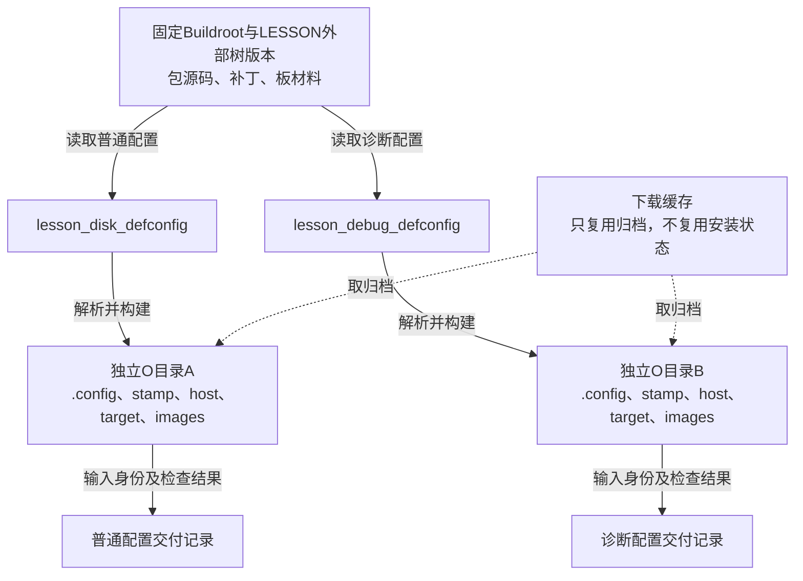
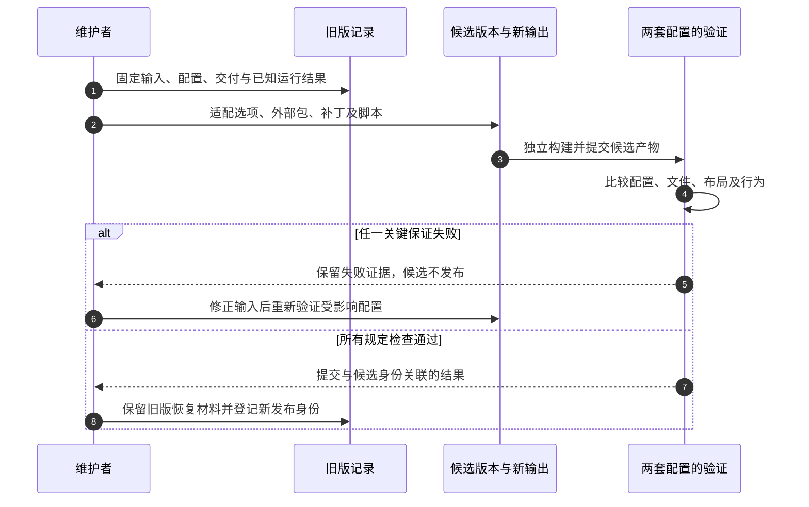

# 第12章\_让多套配置和版本升级保持可追溯

[第十一章](P11_沿失败交接点定位构建与运行问题.md) 已能将一次失败归到具体交接，并把修复保存回输入。现在项目同时保留普通磁盘配置和带strace的诊断配置：共同升级一个库时，两套系统是否都经过验证？半年后重建客户使用的版本，能否找到当时的外部树、归档和配置，而不只是一个已经被覆盖的output目录？

本章把前面已经成立的外部树、包、布局和日志组合成长期维护流程。重点是 **输入如何固定、可变构建状态如何隔离、结论如何随产品配置保存**。Buildroot仍固定为2025.02；谈到工具选择时用Yocto Project 5.0.7作机制对照，不用团队人数或企业标签替代技术条件。

## 12.1\_两套配置为什么不能共用一次构建结果

第十章的lesson_disk_defconfig保留CRC应用与带分区磁盘；第十一章的lesson_debug_defconfig在此基础上增加诊断工具。它们可以引用同一份C源码、补丁和板目录，但最终选包、BusyBox配置及镜像内容可能不同。

若开发者先在一个O目录启用strace并构建，再取消选项生成普通版本，旧安装文件未必被删除。另一种混乱是两个任务同时使用该目录：一个改变.config，另一个根据已有stamp跳过阶段，最后images混合了不同时间的选择。第八章已经解释这个局部状态问题，现在要让每次维护动作都遵守同一边界。



实线是配置到结果的归属，虚线只表示原始归档可供两次构建读取。相同包被两套配置引用，不意味着两套系统的结果可以合并证明。共享配置文件或补丁一旦改变，两套入口都属于影响范围；只构建正在编辑的那一套，会漏掉另一套的条件分支。

## 12.2\_把可恢复输入与生成状态分开放置

外部树不是新工具链，也不是SDK。它保存“怎样构建项目”的输入；SDK保存已经准备好的宿主交叉工具与目标开发环境，给应用开发者使用；images保存待部署的结果。这三种交付对象的消费者不同。

LESSON外部树已经按第八章建立，这里保留与维护直接相关的关系：

```text
lesson_external/
├── external.desc              # name: LESSON，标识外部树
├── Config.in                  # 引入项目包菜单
├── external.mk                # 引入项目包配方
├── configs/
│   ├── lesson_disk_defconfig
│   └── lesson_debug_defconfig
├── board/qemu_aarch64/
│   ├── rootfs_overlay/
│   ├── permissions.txt
│   ├── busybox.config         # 诊断配置选择的项目输入
│   ├── genimage.cfg
│   ├── post_build.sh
│   ├── post_image.sh
│   └── post_disk.sh
├── package/
│   ├── lesson_report/
│   └── lesson_crc/
└── sources/                   # lesson_crc的固定教学归档
```

目录图只省略前章已经建立的其他文件，例如启动脚本和工作源码目录，不改变它们的用途。包的下载、编译与安装仍由配方负责；overlay提供静态文件，权限表提供最终元数据，post-build修改安装内容，post-image消费已生成镜像。把同一应用既放overlay又让包安装，会产生覆盖顺序问题，应选清实际所有者。

外部树的三个入口文件是发现契约，不是可省略的装饰。2025.02的 `utils/brmake` 只是给make包一层时间与日志输出，并没有 `external create` 子命令；手工建立外部树的完整过程见 [第八章](P08_把项目输入迁到外部树并隔离构建.md)，实际包装脚本见 [utils/brmake原件](../../../research/source_reading/buildroot/2025.02/utils/brmake)。

维护时可以把外部树作为独立Git仓库，与固定Buildroot发布归档配对。选择子模块、归档清单或独立仓库引用，目的都是记录准确输入；一个分支名仍可能前进，单写“使用主分支”不足以恢复当时内容。若必须修改Buildroot核心规则，要保存其独立差量及基线，不能为了保持目录外观而把无对应扩展点的修改藏入外部树。

| 对象 | 日常维护落点 | 一次交付还应保存什么 |
| --- | --- | --- |
| Buildroot本体 | 固定发布归档或固定提交 | 摘要、来源及项目差量 |
| 项目配置和板材料 | 外部树版本控制 | 该次外部树准确身份，包括未提交差量的处理 |
| 第三方源码与补丁 | 配方、.hash、补丁集及受控归档 | 实际取得的内容、许可材料和补丁顺序 |
| Kconfig生成结果 | 各自O目录中的.config | 构建时完整.config及相关子组件配置 |
| SDK和镜像 | 对应构建的交付目录 | 摘要、消费说明、测试结果及输入关联 |
| 临时stamp和安装目录 | 独立O目录 | 失败调查所需现场，不充当唯一项目备份 |

精简defconfig适合评审长期选择，完整.config适合保存这次解析结果。它们的职责不同，不能用“不要提交临时.config”推导“交付时也不用保留它”。

## 12.3\_共同选项很多时仍要核对最终配置

两份defconfig相似，是因为它们共享同一虚拟板和基础软件。但defconfig相对 **当前版本默认值** 保存选择；换Buildroot版本后，同一文本可能解析成不同结果。因此比较文本差异只是第一步，还要比较解析后的.config和实际产物。

本例采用两个明确入口。共同修改时分别加载到干净输出、确认意图、运行savedefconfig，再一同评审；不要用同一个O目录在两份配置之间来回切换来代替独立构建。对新增硬件，应用源码可以复用，但设备树、启动链、存储布局和驱动依赖仍要重新建立，不能把改一个defconfig名字当作移植完成。

`BR2_DEFCONFIG`不是“父配置列表”。将两个路径用冒号拼在一起不会形成顶层配置继承；冒号分隔多棵BR2_EXTERNAL也不等于合并多个产品配置。多个外部树中同名defconfig的选择还有顺序规则，实际入口应具有无歧义名称。

如果项目确实需要“公共片段+产品差异”，应把它当作 **项目自行维护的配置生成过程**：声明片段顺序与冲突处理，生成一个输入，交给该版Kconfig求值，再断言最终必需选项。依赖条件不满足时，文本里的y可能无法成为有效选择；发现某个符号不存在或被降级，应让任务失败，而不是悄悄继续。Linux、BusyBox等子组件自己的配置片段接口属于另一层，不能用它们证明顶层也接受相同语法。

本章不为了减少几行配置引入新的生成器。两份独立入口的重复目前可直接评审；只有变体数量和共同变更成本已经形成具体问题，才值得承担生成器、冲突检测与版本迁移的维护成本。保存规则仍按 [配置定制说明](../../../research/source_reading/buildroot/2025.02/docs/manual/customize-configuration.adoc) 与 [外部树说明](../../../research/source_reading/buildroot/2025.02/docs/manual/customize-outside-br.adoc)。

## 12.4\_让一次共同修改经过两套独立构建

第八章的CI脚本只有一个固定配置入口。现在需要对两种已有配置做同一组构建与交付检查，并让配置丢失关键功能时尽早失败。下面保存为外部树的 `build_matrix.sh`，在Linux宿主用Bash执行。三个参数分别为Buildroot源码、外部树、本次全新任务根目录的绝对路径：

```bash
#!/usr/bin/env bash
set -euo pipefail

br_source=${1:?缺少Buildroot源码目录}
br_external=${2:?缺少外部树目录}
br_run_root=${3:?缺少本次任务根目录}
for br_path in "$br_source" "$br_external" "$br_run_root"; do
    case "$br_path" in
        /*) ;;
        *) printf '%s\n' '三个路径都必须是绝对路径' >&2; exit 2 ;;
    esac
done
if [ ! -d "$br_source" ] || [ ! -d "$br_external" ] || \
        [ -e "$br_run_root" ]; then
    printf '%s\n' '检查输入目录，并为本次任务使用新的根目录' >&2
    exit 2
fi
mkdir -p "$br_run_root"
printf 'configuration\tresult\n' > "$br_run_root/results.tsv"

for br_config in lesson_disk_defconfig lesson_debug_defconfig; do
    br_output="$br_run_root/${br_config%_defconfig}"
    mkdir "$br_output"
    make -C "$br_source" O="$br_output" BR2_EXTERNAL="$br_external" \
        "$br_config" 2>&1 | tee "$br_output/configure.log"

    # 检查解析后的结果，不把配置文件名当作功能已启用的证明。
    grep -qx 'BR2_PACKAGE_LESSON_CRC=y' "$br_output/.config"
    grep -qx 'BR2_PACKAGE_HOST_GENIMAGE=y' "$br_output/.config"
    if [ "$br_config" = lesson_debug_defconfig ]; then
        grep -qx 'BR2_PACKAGE_STRACE=y' "$br_output/.config"
    fi

    make -C "$br_source" O="$br_output" BR2_EXTERNAL="$br_external" \
        2>&1 | tee "$br_output/build.log"
    make -s --no-print-directory -C "$br_source" O="$br_output" \
        BR2_EXTERNAL="$br_external" show-info > "$br_output/packages.json"
    (
        cd "$br_output/images/lesson_delivery"
        sha256sum -c SHA256SUMS
        test -s lesson_disk.img
        test -x run_qemu_disk.sh
    ) 2>&1 | tee "$br_output/delivery_check.log"

    # 只登记已完成的构建和静态交付检查，目标启动需要另行验收。
    printf '%s\tbuilt_and_checked_not_booted\n' "$br_config" \
        >> "$br_run_root/results.tsv"
done
```

脚本顺序执行两套配置，每套拥有独立输出；共享库修改会经过两个入口。grep失败、make失败或摘要失败均停止后续动作。results.tsv只在该套检查完成后追加一行，所以第一套成功、第二套失败时，不会伪装成整个矩阵通过；调用者还必须检查脚本退出状态，不能只看结果文件存在。

在Buildroot源码根目录运行：

```sh
br_ext="$PWD/../lesson_external"
chmod +x "$br_ext/build_matrix.sh"
br_matrix_parent=$(mktemp -d "$PWD/../lesson_matrix.XXXXXX")
"$br_ext/build_matrix.sh" "$PWD" "$br_ext" "$br_matrix_parent/run"
```

mktemp创建外层目录，脚本创建尚不存在的run及两个O目录。每次任务另取新根目录，不用删除旧失败现场腾位置。真实CI平台还需要把日志、完整配置、packages.json、交付目录和退出状态作为制品保存，下一任务显式获取；本地目录恰好仍在，不是制品传输协议。

show-info来自固定Makefile，输出所选包及相关依赖的信息；它是构建元数据，不是对每个已安装文件的独立扫描证明。脚本也没有检查CPU是否已执行镜像，后续仍要按第十、十一章完成布局和运行验证。本轮只用make替身检查配置失败、构建失败、关键选项缺失、摘要不符和正常两套流程，不把替身当成真实构建。

## 12.5\_版本固定以后怎样证明可复现

版本固定解决“希望使用哪份输入”，可复现还要问“在声明的环境变化下是否得到相同字节”。源码时间戳、绝对路径、随机标识、文件排序、宿主工具和项目脚本，都可能让两次构建不同。第七章用gzip的确定性选项消除了一个来源，但没有因此证明整盘镜像可复现。

固定2025.02提供 `BR2_REPRODUCIBLE`，并明确标为experimental。它会设置时区/语言环境并为支持它的环节提供SOURCE_DATE_EPOCH等条件；原配置帮助还指出输出路径可能泄漏，不能直接承诺不同O路径也相同。项目自己的post-image如果写入当前时间，构建框架不会自动替它改写。

因此要先声明比较范围，例如“同一版本与配置、相同容器内路径、两次全新工作状态生成的Image和rootfs”。两次产物保存在不同归档位置以后，分别计算摘要并用cmp比较对应文件；若不同，逐层定位是文件内容、元数据、容器布局还是外层压缩。不能为了让摘要相同删掉业务需要的字段，也不能比较普通与诊断两种本来就不同的配置。

缓存只改变哪些工作被重复执行。下载缓存、编译缓存和完整O目录不同；从旧O目录再次打包得到相同文件，也可能只是没有重新执行相关阶段。至少进行一次从受控原始输入重新构建的对照，再讨论时间戳和路径等变化。固定实现见 [Config.in的BR2_REPRODUCIBLE](../../../research/source_reading/buildroot/2025.02/Config.in) 与 [Makefile环境设置](../../../research/source_reading/buildroot/2025.02/Makefile)。本轮没有完成两次Linux系统构建，不能登记整套系统逐字节可复现。

## 12.6\_升级要逐步恢复旧系统已经提供的保证

外部树使项目差量容易定位，但上游仍可能改变包版本、选项、安装路径和基础设施。升级后“目录仍能被发现”只通过入口检查，不证明旧补丁还有效，也不证明overlay覆盖的上游配置仍然正确。

先保存旧版可恢复输入、各配置解析结果、文件与包信息及运行结果，再在旁边建立候选版本与新输出。阅读候选版本迁移说明，对被移除或改变的选项作明确决定，尤其检查Legacy菜单；不要只运行olddefconfig接受默认值便宣称迁移完成。工具链、C库或ABI变化时，旧对象和旧sysroot不应成为候选构建的基础。



第1步建立对照，第2～4步产生并检查候选；第5～6步失败回到输入修复，第7～8步才形成新的发布记录。这里是项目验收顺序，不是Buildroot自动替项目执行的发布状态机。

具体比较包括：关键包是否仍选中，ABI相关依赖是否一起重建，启动文件与磁盘布局是否变化，镜像容量是否仍满足限制，overlay是否掩盖了上游修复，旧版本用户数据能否按产品策略继续使用。对已有A/B更新，仍需测失败回退和健康确认；仅新镜像启动一次不足以证明升级路径。

固定版 [迁移说明](../../../research/source_reading/buildroot/2025.02/docs/manual/migrating.adoc) 提供旧版本迁入时的检查思路，但不能预言尚未选定的新版本规则。维护期也应按具体发布分支确认：2026-10-18查阅 [官方下载页](https://buildroot.org/download.html)，2025.02.x列为长期支持系列，终止日期为2028年3月；这不等于本教材使用的初始2025.02归档已经包含后来所有修复。不要把旧的“两年”表述当作永久规则，也不要把教学固定版本直接当作当前产品安全基线。

组件清单和漏洞报告能帮助定位待查对象，但版本号命中、补丁回移、实际配置和可达路径还需分别确认。维护记录应写明问题影响、所选修复、验证范围与发布时间；“每月拉取一次上游”本身没有说明哪些已交付系统得到了修复。

许可材料同样随准确版本和补丁保存。例如给刚才矩阵中的普通配置收集材料，在Buildroot源码根目录执行：

```sh
br_output="$br_matrix_parent/run/lesson_disk"
make O="$br_output" legal-info
```

它在该输出的legal-info目录整理清单、源码和许可相关材料，并在README中记录未能收集的项目；结果来自配方声明，可能不完整。它是资料收集工具，不能把命令成功当作发布义务已全部履行。工具边界见 [固定legal-info说明](../../../research/source_reading/buildroot/2025.02/docs/manual/legal-notice.adoc)。

## 12.7\_什么新增要求才值得换一种构建体系

LESSON项目现在能为两套配置构建完整镜像。若更新单位始终是受控整机镜像，外部树、独立输出和既定验证已满足维护需求，产品开始量产并不会自动要求换工具。若接下来需要维护发行版策略、多个机器层的组合，以及可选的目标端二进制包源，工程对象才发生了变化。

Yocto Project提供围绕嵌入式系统构建的工具与协作生态；常用的OpenEmbedded构建系统用BitBake解析配方、类和配置并执行任务。layer组织元数据，machine配置描述机器选择，distro配置表达发行策略；它们与Buildroot外部树有共同的“组织输入”目的，但不能逐文件机械互换。依据：[Yocto 5.0.7组件与工作流](https://docs.yoctoproject.org/5.0.7/overview-manual/concepts.html)、[layer组织规则](https://docs.yoctoproject.org/5.0.7/dev-manual/layers.html)。

仍用同一场景比较：两台构建机分别构建普通与诊断产品，后来共同升级库。Buildroot已有包阶段标记，会增量执行，不是每次从零开始；但它不全面追踪配置变化后的所有重建需求，项目要决定局部重建还是新O目录。OpenEmbedded的任务签名用于判断相关输入是否变化，sstate保存并恢复适用任务输出；它在可复用条件满足时减少重复工作，也要求正确声明任务输入和管理缓存，不是任意旧产物都可复用。机制见 [Shared State Cache](https://docs.yoctoproject.org/5.0.7/overview-manual/concepts.html#shared-state-cache)。

| 项目要管理的对象 | Buildroot路线 | Yocto/OpenEmbedded路线及新增成本 |
| --- | --- | --- |
| 完整系统镜像和应用SDK | 可以生成，按固定配置整体交付 | 也可以生成；需要维护相应元数据与工作流 |
| 共同平台与多产品差异 | 外部树、独立defconfig及项目验证矩阵 | layer、machine/distro等组合；需管理覆盖和依赖规则 |
| 跨构建任务输出复用 | 下载缓存、可选ccache及本地阶段状态各司其职 | 任务签名和sstate；需维护缓存来源与有效性条件 |
| 目标端二进制包源 | Buildroot不以生成通用包管理发行版为目标 | 可生成包并配置包源；目标运行时包管理需显式启用和维护 |
| 长期支持、追溯和发布 | 项目仍承担版本选择、补丁及验证 | 同样需要项目维护，框架功能不替代实际验收 |

包源能力见 [Yocto包工作流](https://docs.yoctoproject.org/5.0.7/dev-manual/packages.html)。即便使用包源，内核、引导与数据迁移仍有系统一致性问题；不能把包安装成功直接当作整机升级成功。反过来，选择Buildroot也不妨碍产品长期维护和量产，SDK并非Yocto独有功能。

实际选择应做一套代表性试验：相同应用、同一目标与更新要求，分别统计冷构建、受控改动后的重建、缓存命中条件、维护差量和交付验证成本。包数量、团队人数、未经测量的“快/慢”，以及“原型用Buildroot、量产必换Yocto”都不能替代这些结果。

## 12.8\_把维护要求落成能复查的结果

1. 普通配置构建通过，诊断配置因为少了strace停止，能否发布“整个矩阵通过”？
2. 两份相同defconfig在不同Buildroot版本中，是否必然产生相同.config？
3. 外部树能被候选版本加载，是否证明它的补丁与overlay无需检查？
4. 启用BR2_REPRODUCIBLE后，是否可以跳过两次真实构建比较？

第一题不能，要结合退出状态及逐配置结果。第二题不能，默认值和依赖规则可能变化。第三题不能，入口有效与内容适配是不同层次。第四题不能，固定版本仍标为实验性，项目脚本及路径等条件还要进入实际比较。

现在一套系统的说明不再只是一条make命令，而是固定输入、独立构建、准确交付和有边界的验证记录。下一篇 [查询入口与常见问题](P13_附录.md) 保留命令、目录、错误线索和资料定位，供已经理解流程后快速查找。
