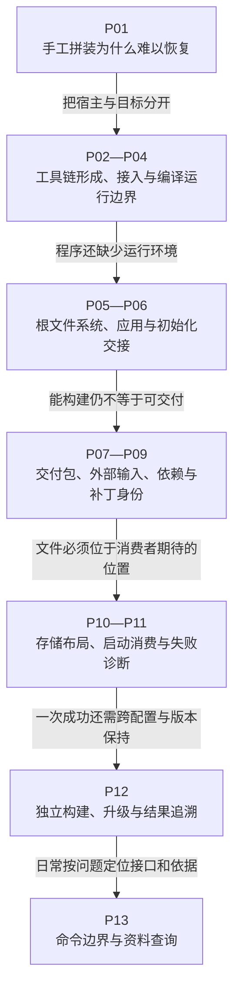

# 第1章\_Buildroot从构建输入到系统交付的阅读大纲

手工编译一个程序成功以后，还需要工具链、运行库、内核、初始化程序和文件系统共同配合，才能交付可恢复的系统。这个专题沿“谁产生什么、下一方如何消费、失败时缺少哪项条件”展开，最后把一次构建变成多配置和版本升级都能追溯的工程流程。

正文以 **Buildroot 2025.02的QEMU AArch64 virt配置** 为贯穿载体：先建立最小系统，再加入读取配置的lesson_report和调用zlib的lesson_crc，把无分区rootfs组织成磁盘布局，并增加诊断与维护记录。模拟机流程不能直接证明实体板的BootROM、引脚、存储或驱动已经适配。第十章的i.MX6ULL EVK布局只承担固定方案对照。

## 1.1\_从系统拼装问题进入学习主线

开始前需要能在Linux终端定位目录、读写文件、执行命令并理解退出状态，也应能阅读基础C程序。交叉工具链、ELF、文件系统镜像和构建配方会在使用处逐步建立；不要求先记住所有菜单和包接口。

图中的每个箭头都是前一阶段尚未解决的问题。默认按P01到P12阅读，P13供随后查询；不要按原有“高级主题”标签跳过构建状态和输入归属，因为后面的维护判断依赖这些结论。

## 1.2\_逐章问题与前后依赖

| 章节 | 从哪项结论出发 | 本章解决什么 | 留给后面的具体问题 |
| --- | --- | --- | --- |
| [P01 从手工拼系统到可重复的构建输入](P01_从手工拼系统到可重复的构建输入.md) | 已知单个程序可以编译 | 用固定输入和最小模拟机配置组织系统构建 | 工具链自己怎样产生，宿主与目标如何区分 |
| [P02 从最小编译器到完整目标工具链](P02_从最小编译器到完整目标工具链.md) | 已分清构建者与运行者 | 从编译器、头文件和C库依赖推导工具链形成 | 已有工具链如何接入而不混用环境 |
| [P03 把现成工具链接入受控构建](P03_把现成工具链接入受控构建.md) | 知道工具链的组成与目标契约 | 核对外部工具链、sysroot及SDK使用条件 | 编译成功到实际运行之间还有哪些边界 |
| [P04 沿编译链接与运行边界定位失败](P04_沿编译链接与运行边界定位失败.md) | 工具链身份已明确 | 用完整C示例追踪预处理、对象、链接与加载 | 可执行文件怎样进入完整用户空间 |
| [P05 从安装目录到可验证的根文件系统](P05_从安装目录到可验证的根文件系统.md) | 程序依赖的环境已经可描述 | 区分安装内容、元数据处理、格式生成及定制阶段 | 应用怎样随构建安装并在启动后执行 |
| [P06 把应用接入构建并交给初始化系统](P06_把应用接入构建并交给初始化系统.md) | 根文件系统有明确生成流程 | 将lesson_report的源码、安装和初始化职责接起来 | 哪些文件及说明要一起交给接收者 |
| [P07 把构建产物整理为可核对的交付包](P07_把构建产物整理为可核对的交付包.md) | 已能构建应用和rootfs | 固定打包、启动入口、摘要与接收校验 | 项目输入怎样从Buildroot本体分离 |
| [P08 把项目输入迁到外部树并隔离构建](P08_把项目输入迁到外部树并隔离构建.md) | 交付脚本和项目文件已有真实内容 | 建立外部树发现契约、独立输出与CI入口 | 第三方依赖、源码和补丁怎样准确固定 |
| [P09 把源码身份依赖和补丁接成包维护闭环](P09_把源码身份依赖和补丁接成包维护闭环.md) | 项目包已位于受控外部树 | 用lesson_crc与真实zlib提供者连接归档、哈希、双层依赖和补丁 | 文件系统放进存储布局后由谁定位 |
| [P10 从文件系统镜像到存储布局与部署验证](P10_从文件系统镜像到存储布局与部署验证.md) | 输入和交付物身份可追踪 | 从vda到vda1推导分区定位，区分块设备、闪存和实体部署 | 构建或启动失败时怎样缩小范围 |
| [P11 沿失败交接点定位构建与运行问题](P11_沿失败交接点定位构建与运行问题.md) | 知道各层消费者期待什么 | 用日志、状态、文件及目标跟踪逐项检验候选原因 | 修复怎样同时覆盖多套配置及未来版本 |
| [P12 让多套配置和版本升级保持可追溯](P12_让多套配置和版本升级保持可追溯.md) | 修复已能回到版本化输入 | 形成配置矩阵、升级对照、可复现验证及工具选择条件 | 日常需要怎样快速查询命令而不丢边界 |
| [P13 命令边界与资料查询](P13_命令边界与资料查询.md) | 已理解前面的过程 | 按作用范围查询命令、目录、症状和资料 | 返回相应正文执行完整流程，不从速查表猜新接口 |

这些章节共享一个实例，不分别复制成多套“从头创建项目”的教程。前章已经保存的脚本、源码或配置被后章引用时，仍是同一份项目输入；出现新输出目录是为了隔离构建状态，而不是丢弃前面的有效材料。

## 1.3\_动手记录怎样与正文结论对应

前几章的编译器检查可以先观察目标身份与文件格式；进入第五章以后，再在Linux宿主实际生成并启动系统。后续练习每次只改变当前讨论的环节，例如配置文件、应用依赖、分区定位或目标输入路径，并比较预期与结果。没有执行的实验保留为待执行，不用“命令看起来正确”填写成功日志。

| 实践阶段 | 应取得的观察 | 不能用它代替的证明 |
| --- | --- | --- |
| 工具链和C程序 | 工具身份、编译诊断、ELF及程序结果 | 全系统启动或板级兼容 |
| rootfs与应用安装 | 文件内容、权限、init交接与应用输出 | 仅靠target目录证明最终镜像 |
| 交付与外部树恢复 | 摘要、接收校验、从固定输入重新配置 | 摘要本身证明发布者身份或启动成功 |
| 依赖和补丁 | 固定归档、有效选择、实际源码与新程序行为 | 仅凭补丁列表证明应用成功 |
| 布局与诊断 | 分区和字节、实际root参数、日志及退出状态 | 模拟机成功代表任意实体板成功 |
| 多配置与升级 | 各套独立结果、候选差异与规定回归 | 一套通过代表全部变体通过 |

本轮正文已核对固定原件，并完成其中明确列出的宿主C示例、脚本控制流、普通文件反例和图表检查；没有实际运行Linux全量Buildroot、目标QEMU或实体板。各章已经把这些限制放在对应实验附近，不把本大纲当作目标验收报告。

## 1.4\_版本来源与相邻专题

[固定资料基线](../../../research/source_reading/buildroot/SOURCE_BASELINE.md) 记录2025.02官方归档、摘要、源码相对位置及genimage 18身份。贯穿示例随该版配置使用Linux 6.12.9；它与仓库通用源码研究使用的NXP Linux 6.12.20基线分别管理，不拼接成同一运行证据。

读者如果从 [Linux驱动学习路线](../../../atlas/tracks/linux_driver_track.md) 进入这里，可以用本专题把应用、驱动和系统交付重新连接起来；回到 [i.MX6ULL的U-Boot与内核移植](../../../platforms/arm/nxp/imx6ull/porting/大纲.md) 时，必须重新采用该文自己的板级与版本条件。本专题不承担任意板完整BSP适配。

需要原始接口或进一步阅读时使用P13的资料入口。根文件系统组织、外部树组织和源码证据各有自己的目的，不把在线手册目录复制成本文尚未实现的章节列表。
