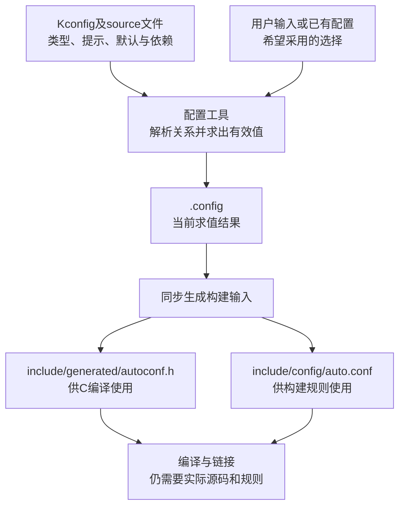

# 第1章\_基础语法

同一份驱动源码可能用于不同产品：一块板没有对应总线，另一块板希望驱动编进内核，还有一块板需要把驱动做成模块。只在 C 文件里不断添加 `#ifdef`，还不能阻止用户选出“驱动需要的总线完全没有启用”这种组合。需要先描述有哪些选择、哪些组合有意义，再把求出的结果交给构建系统。

**Kconfig** 是描述这些配置项及其约束的语言，也常用来指配套配置工具体系。它负责产生配置结果，Kbuild、其他 Makefile 或项目脚本才负责根据结果组织编译。菜单里选中一个名字，不会凭空生成对应实现。

本篇用一个总线与驱动配置建立语法、取值和输出之间的关系，随后运行固定版本的解析工具。语言和工具基线为 NXP Linux 6.12.20 的提交 `dfaf2136deb2af2e60b994421281ba42f1c087e0`；其他项目可以复用或修改 Kconfig，不能将 Linux 的所有前端功能、输出文件和模块规则直接当作 U-Boot、Buildroot、Zephyr 的共同接口。

## 1.1\_先分清规则名字与生成结果

**讲解层次：概念层。** `config DRIVER` 定义名为 `DRIVER` 的符号。在 Kconfig 表达式中使用 `DRIVER`；Linux 配置文件与生成头通常使用 `CONFIG_DRIVER` 前缀。这是规则名与输出形式的区别，不是两套需要同时声明的变量。

```kconfig
config BUS
    tristate "示例总线支持"
    default m

config DRIVER
    tristate "示例驱动"
    depends on BUS
```

这里 `tristate` 指三态类型，允许的候选值为 `n`、`m`、`y`。在采用 Linux 模块构建语义时，它们分别对应不启用、模块、内建。能否使用中间状态，还受专门的模块开关控制；稍后完整例子会声明它。`"示例驱动"` 是用户界面中的提示文本，`depends on BUS` 是取值约束，`default m` 则是在条件允许且没有相应用户选择时的默认候选。

不能把这些行当成从上到下执行的赋值程序。工具先读取定义和关系，再综合依赖、用户输入、默认值与反向依赖求值。某项的值还会影响其他项，需要得到一致的配置结果，而不是抄下最后一行赋值就结束。



图中的文件名属于本篇 Linux 工具链。`defconfig` 是可以重新生成配置的种子，不是完整运行状态；`menuconfig` 则是一种交互前端，不是 Kconfig 文件本身。批处理前端 `conf` 与交互前端可以处理同一套规则，是否需要菜单界面取决于当前任务。

## 1.2\_提示默认与依赖怎样共同限制取值

先看类型。`bool` 适合只有开关的功能，`tristate` 表达可模块化的功能，数值与字符串类型用于容量、标签等参数。地址示例只是一个整数，不代表工具确认了真实芯片地址布局。

| 类型 | 候选值 | 本篇中的用途 |
| --- | --- | --- |
| `bool` | `n`、`y` | 是否允许模块状态、是否显示高级菜单 |
| `tristate` | `n`、`m`、`y`，受模块与依赖条件限制 | 总线和驱动的构建方式 |
| `int` | 十进制整数，可用 `range` 限制 | 缓冲区大小 |
| `hex` | 十六进制数值，可用 `range` 限制 | 教学用地址数值 |
| `string` | 字符串 | 设备标签 |

`bool "显示名称"` 相当于分成 `bool` 和 `prompt "显示名称"` 两行。没有 prompt 的符号没有直接用户输入入口，应由默认值、选择关系等规则得到值；直接在 `.config` 中给隐藏符号写一个值，不保证下次求值会保留它。

默认值也不是强制赋值。同一个符号可以有多个带条件的 `default`，按顺序取第一个条件成立的候选；可见提示允许用户覆盖默认。条件不成立、依赖受限或符号不再可见时，还要重新按当前规则判断，不能把旧配置当作不受规则约束的永久命令。

```kconfig
config DEFAULT_ORDER
    int
    default 10 if BUS
    default 20

config COPIED_DEFAULT
    int
    default DEFAULT_ORDER
```

当 `BUS=m` 或 `BUS=y` 时，第一项默认条件成立，结果是 10；`BUS=n` 时用 20。后一个符号引用前一个符号的值，名称仍是 `DEFAULT_ORDER`，没有 `CONFIG_`。这是求值关系，不是面向对象意义的“继承”。

对三态表达式，可按 `n < m < y` 理解：`&&` 取较小值，`||` 取较大值，`!n=y`、`!y=n`、`!m=m`。例如 `BUS=m` 时，一个依赖 `BUS` 的三态驱动不能靠用户输入变成内建 `y`。布尔项、提示可见性和反向依赖还各有处理规则，不能把所有类型都压成一句“只有依赖等于 y 才出现”。

| 表达式 | 当前含义 | 例子 |
| --- | --- | --- |
| `A && B` | 同时满足；三态取较小值 | `depends on BUS && FEATURE` |
| `A \|\| B` | 满足其一；三态取较大值 | `depends on USB \|\| PCI` |
| `!A` | 三态取反 | `depends on !EXPERIMENTAL` |
| `A = B`、`A != B` | 比较取值 | `depends on BUS = y` 明确要求内建 |
| `<`、`>`、`<=`、`>=` | 比较相应符号值 | 数值约束应同时注意符号类型 |
| `( ... )` | 明确组合顺序 | `depends on BUS && (FAST \|\| SAFE)` |

表达式中的 `USB`、`PCI` 等只是语法示意，要在实际项目中存在对应定义。本篇完整实验只使用自己定义的符号，不借用一个未说明的目标板配置库。

## 1.3\_为什么select不能代替直接依赖

驱动需要总线支持，这是“允许驱动取到什么值”的约束，适合用 `depends on BUS`。驱动还可能需要一个内部校验辅助实现：用户没有必要单独选择它，而任何使用者开启时都必须带上它，这才适合考虑 `select CHECKSUM`。

`select` 给目标布尔或三态符号施加反向下限，**不会替目标遍历并满足它自己的依赖**。如果 CHECKSUM 又依赖一个没有开启的功能，select 仍可能把它选上，产生不满足直接依赖的配置和警告。于是“驱动一开就 select 所有外部子系统”可能隐藏设计错误。通常把 select 用于无用户提示、没有额外依赖的内部辅助项，并在使用者处建立真正的前提。

`imply TRACE` 适用于“这个驱动通常希望带上跟踪，但允许用户关闭”。它会影响 TRACE 的求值与默认选择，不是只在菜单上画一个“推荐”标记；目标的直接依赖或用户明确关闭可使它保持 n。若关闭 TRACE 后代码就不能链接，必须修正代码调用条件或表达真正的强依赖，不能只改一句提示文字。

| 关系 | 谁约束谁 | 本篇观察 |
| --- | --- | --- |
| DRIVER `depends on BUS` | BUS 限制 DRIVER 的可用状态 | BUS=m，DRIVER 请求 y，最终为 m |
| DRIVER `select CHECKSUM` | DRIVER 对 CHECKSUM 施加下限 | DRIVER 启用后，隐藏的布尔 CHECKSUM 为 y |
| DRIVER `imply TRACE` | DRIVER 为 TRACE 提供可被允许条件覆盖的建议值 | 没有用户关闭时可得到 y；用户明确关闭时仍可为 n |

现在可以在脑中做一次反例：给 CHECKSUM 增加 `depends on NEVER`，且 NEVER 未开启，再启用驱动。正确预期不是工具自动开启 NEVER，而是 select 可能绕过这个直接依赖。后面的实验会把这一点作为负例检查。

## 1.4\_菜单组织为什么不等于条件编译

选项多了，需要分组。但“显示在哪里”“能取什么值”“文件是否解析”仍是三个问题。

`menu ... endmenu` 建立菜单组，菜单上的 `depends on` 会传给里面的条目；`visible if` 则只控制菜单显示，不阻止内部符号的默认值或其他选择关系求值。`menuconfig` 类似 config，但提示前端把关联子项组织为子菜单；它不是自动罩住后面所有条目的大括号，通常还要用 `if SYMBOL ... endif` 或显式依赖关联子项。

`if DRIVER ... endif` 给包围的条目增加依赖，不像 C 预处理器那样在 DRIVER=n 时删除并跳过解析一段输入。里面有语法错误仍然会报错，里面的 `source` 引用不存在的文件也仍会失败。`source` 的作用是读入另一份规则文件，不是 Makefile 中把目标文件加入链接的 `obj-y`。

本篇把 `srctree` 指向教学材料目录，`source "extra/Kconfig"` 就可以从这个规则根目录定位。不要默认 source 的相对路径总是相对于“包含它的那份文件所在目录”；具体解析器、根路径变量和项目调用方式必须一起确认。

还需要互斥选项时，使用 `choice ... endchoice`。本固定版本的 choice 是单选组，块内写提示与默认成员，成员分别声明 bool；不要在此版本的 choice 属性中补写旧式的 `bool`、`tristate`、`optional` 或名字，需以所用解析器版本支持为准。隐藏或依赖不满足的组不能强求仍有一个可用成员。

```kconfig
choice
    prompt "完成通知方式"
    default MODE_POLL

config MODE_POLL
    bool "轮询"

config MODE_IRQ
    bool "中断"

endchoice
```

默认成员写在 choice 的 `default MODE_POLL` 中。不要在组外重新声明 MODE_POLL 并塞一个 `default y`，把“组默认选哪个成员”写成另一套含混的定义。`comment` 可以显示说明而不建立配置符号；普通 `#` 注释不形成菜单条目。`help` 的正文由更深缩进界定，缩进退回后才结束帮助文本，因此帮助段的缩进具有实际语法意义。

## 1.5\_把规则和求值工具放进独立实验目录

**讲解层次：实现层，固定 Linux 6.12.20 conf。** 下面只构建宿主配置工具，不构建内核、不修改共享 Linux 工作树，也不需要目标交叉编译器。需要 Bash、Git、tar、宿主 C 编译器、Bison 和 Flex。Linux 可以使用系统工具；本次实际验证在 MSYS2 完成，不能将它外推为整套 Linux 内核支持在 MSYS2 构建。

创建新的实验目录，将以下文件放进去。`Kconfig` 是顶层规则，`extra/Kconfig` 保存被引入的规则，`build_conf.sh` 构建固定解析器，`show_config.c` 在后面读取生成头。配套文件位于 [实验材料目录](../../../labs/system_software/kconfig/materials)，这里给出全部教学内容。

顶层 `Kconfig`：

```kconfig
mainmenu "Kconfig 状态与构建输入实验"

config MODULES
    bool "允许模块状态"
    modules
    default y

config BUS
    tristate "示例总线支持"
    default m

menuconfig DRIVER
    tristate "示例驱动"
    depends on BUS
    select CHECKSUM
    imply TRACE
    help
      本实验只观察配置结果，不编译或加载真实驱动。
      驱动取值受到总线依赖限制。

if DRIVER

config BUFFER_SIZE
    int "缓冲区字节数"
    range 64 4096
    default 256

config DEVICE_LABEL
    string "设备标签"
    default "lesson"

config REGISTER_BASE
    hex "示例地址数值"
    range 0x1000 0xffff
    default 0x1000

choice
    prompt "完成通知方式"
    default MODE_POLL

config MODE_POLL
    bool "轮询"

config MODE_IRQ
    bool "中断"

endchoice

endif

config CHECKSUM
    bool

config TRACE
    bool "额外跟踪输出"

config SHOW_ADVANCED
    bool "显示高级菜单"

menu "高级菜单"
    visible if SHOW_ADVANCED

config ADVANCED_DEFAULT
    bool "菜单隐藏时仍可求值"
    default y

endmenu

source "extra/Kconfig"
```

这里 MODULES 的 `modules` 属性将该符号指定为允许中间模块状态的总开关。它的名字不是魔法的全部，关键还在属性及相关构建系统如何解释 m。REGISTER_BASE 的范围和默认值仅用于观察 hex 与 range，没有对应某个真实外设地址。

新建 `extra` 子目录，再保存 `extra/Kconfig`：

```kconfig
comment "默认值按声明顺序选择"

config DEFAULT_ORDER
    int
    default 10 if BUS
    default 20

config COPIED_DEFAULT
    int
    default DEFAULT_ORDER
```

然后保存 `build_conf.sh`。脚本从固定 Git 对象导出所需工具源文件，在新目录生成词法和语法分析代码，再编译 conf。它拒绝覆盖已存在的工具目录；失败后保留现场，需要重新尝试时使用新的路径或先检查旧目录中的失败原因。

```bash
#!/usr/bin/env bash
set -euo pipefail

if [[ $# != 2 ]]; then
    printf '用法：build_conf.sh Linux源码仓库绝对路径 新工具目录绝对路径\n' >&2
    exit 2
fi
linux_src=$1
tool_root=$2
revision=dfaf2136deb2af2e60b994421281ba42f1c087e0
case "$linux_src:$tool_root" in
    /*:/*) ;;
    *) printf '两个路径都必须是当前Bash环境中的绝对路径。\n' >&2; exit 2 ;;
esac
if [[ -e "$tool_root" ]]; then
    printf '工具目录已经存在，请选择新的空路径。\n' >&2
    exit 2
fi

# 从固定对象导出工具源文件；不切换或修改用户的Linux工作树。
git -C "$linux_src" cat-file -e "$revision^{commit}"
mkdir -p "$tool_root/source"
git -C "$linux_src" archive "$revision" scripts/kconfig scripts/include |
    tar -x -C "$tool_root/source"

# 构建的是宿主配置解析器，不是目标内核，不需要交叉编译器。
cd "$tool_root/source/scripts/kconfig"
bison -o parser.tab.c --defines=parser.tab.h -t -l parser.y
flex -o lexer.lex.c lexer.l
cc -D_GNU_SOURCE -O2 -I. -I../include \
    conf.c confdata.c expr.c lexer.lex.c menu.c parser.tab.c \
    preprocess.c symbol.c util.c -o "$tool_root/conf"
printf '配置工具已生成：%s/conf\n' "$tool_root"
```

运行前把 `linux_src` 改成实际 NXP linux-imx Git 仓库路径，并确认其中存在本篇固定提交。源码身份的来源与核对入口见 [配置工具源码索引](../../../research/source_reading/kconfig/navigation/P01_Linux_6.12_配置求值工具阅读索引.md#1.1_固定版本和工具边界)。

```bash
# Bash，刚创建的实验目录：先核对自己提供的源码位置。
linux_src=/实际路径/linux-imx
lesson_dir=$(pwd)
tool_root="$lesson_dir/kconfig_tool"
git -C "$linux_src" remote get-url origin
git -C "$linux_src" rev-parse dfaf2136deb2af2e60b994421281ba42f1c087e0
bash ./build_conf.sh "$linux_src" "$tool_root"
conf="$tool_root/conf"
```

`linux_src`、`lesson_dir`、`tool_root` 和 `conf` 是本实验的 shell 变量。第一项必须替换为真实路径，其余从当前目录推导。编译的是宿主可执行程序，后续命令在同一个 shell 中使用这些变量。Bison 的调试生成选项 `-t` 也是这套固定源码需要的生成条件，不要只复制 conf.c 然后猜一个编译命令。

新建一个尚不存在的输出目录，把规则根目录与产物目录分开：

```bash
# 同一个Bash：output必须是新目录，避免覆盖已有配置。
work_dir="$lesson_dir/output"
mkdir "$work_dir"
cd "$work_dir"
export srctree="$lesson_dir"
printf 'CONFIG_BUS=m\nCONFIG_DRIVER=y\n' > .config
"$conf" --olddefconfig "$lesson_dir/Kconfig"
cat .config
```

输入希望总线为 m、驱动为 y。`--olddefconfig` 读取已有配置并用默认规则补全、调整结果，不通过交互逐项提问。它会改写这份 `.config`，结果应包含 `CONFIG_BUS=m`、`CONFIG_DRIVER=m`、`CONFIG_CHECKSUM=y`、`CONFIG_TRACE=y`、`CONFIG_BUFFER_SIZE=256` 和 `CONFIG_MODE_POLL=y`。驱动从请求的 y 变成 m，正好兑现前面的依赖上限。

同时，SHOW_ADVANCED 未开启，ADVANCED_DEFAULT 仍为 y；DEFAULT_ORDER 和 COPIED_DEFAULT 都为 10。观察到的只是配置结果，不能据此声称驱动已经编译、模块已经加载或芯片地址已经验证。

## 1.6\_改变一个输入预测哪些结果会变

保留主 `.config`，在同一个输出目录中用别的配置文件比较。`KCONFIG_CONFIG` 是配置工具识别的环境变量，用来替换默认 `.config` 文件名；命令前的赋值仅影响这次命令。

```bash
# 总线关闭：驱动的y请求不能越过依赖。
printf '# CONFIG_BUS is not set\nCONFIG_DRIVER=y\n' > bus_off.config
KCONFIG_CONFIG=bus_off.config "$conf" --olddefconfig "$lesson_dir/Kconfig"
cat bus_off.config
```

此时 DRIVER 为 n，输出可能直接省略不可见的 DRIVER 行，而不是必须生成一条 not set 注释；DEFAULT_ORDER 与 COPIED_DEFAULT 变为 20。不同符号的输出形式不能替代实际求值判断。

```bash
# 总线和驱动都内建，但用户明确拒绝跟踪功能。
printf 'CONFIG_BUS=y\nCONFIG_DRIVER=y\n# CONFIG_TRACE is not set\n' > trace_off.config
KCONFIG_CONFIG=trace_off.config "$conf" --olddefconfig "$lesson_dir/Kconfig"
cat trace_off.config
```

CHECKSUM 仍为 y，TRACE 为 n。这把 select 与 imply 放在同一个配置场景中比较：一个用于内部必需辅助项，另一个允许用户关闭。程序若无条件调用被关闭的跟踪实现，配置求值本身不会替它修复链接错误。

继续做下面四项修改，每项使用单独配置文件并重新执行同一命令，不在原 Linux Kconfig 上试错：

| 输入变化 | 本固定解析器观察结果 | 原因 |
| --- | --- | --- |
| 只写 `CONFIG_CHECKSUM=y`，没有启用驱动 | CHECKSUM 不因此保持 y | 隐藏符号没有直接用户输入入口 |
| BUS=y、DRIVER=y、BUFFER_SIZE=12 | BUFFER_SIZE 调整为 64 | 12 低于 range 下界；不是直接使用 default 256 |
| MODULES=n，却请求 BUS=m、DRIVER=m | 两者最终为 y | 关闭模块状态后，工具不再保留这两个 m 结果 |
| 只关闭 SHOW_ADVANCED | ADVANCED_DEFAULT 仍为 y | visible if 隐藏菜单，不取消内部默认求值 |

最后检查两个规则负例。第一，把实验副本中 CHECKSUM 增加 `depends on NEVER`，再打开 BUS 和 DRIVER：工具会报告 CHECKSUM 直接依赖未满足，仍可能输出 CHECKSUM=y，说明 select 不是自动修好依赖的魔法。第二，在 `if NEVER ... endif` 内写一个不存在的语法关键字，或者 source 一个缺失文件：工具会失败，说明 if 没有阻止解析。负例做完恢复材料原件，不拿带警告的配置继续当作有效构建输入。

## 1.7\_配置结果怎样变成C与Makefile的输入

现在回到原来的主 `.config`，它仍保存 BUS=m、DRIVER=m。运行同步模式，将当前配置变为后续构建使用的派生文件：

```bash
# output目录：使用默认主.config，生成头文件与Make变量文件。
"$conf" --syncconfig "$lesson_dir/Kconfig"
cat include/generated/autoconf.h
cat include/config/auto.conf
```

本例生成头中，DRIVER=m 表达为 `#define CONFIG_DRIVER_MODULE 1`，并没有 `#define CONFIG_DRIVER 1`；y 才使用后者。n 通常不定义这两个宏。由此可以推导：只写 `#ifdef CONFIG_DRIVER` 会漏掉模块状态，不能用它代表“功能以任意方式启用”。Linux 代码还会按调用场景使用 `IS_ENABLED`、`IS_REACHABLE` 等辅助判断，是否允许从内建代码调用模块实现仍需要链接与可达性约束。

将下面完整程序保存为实验根目录下的 `show_config.c`：

```c
/* 本程序展示生成头，不把 m 配置假装成实际可加载模块。 */
#include <stdio.h>
#include "include/generated/autoconf.h"

int main(void)
{
#if defined(CONFIG_DRIVER)
    puts("DRIVER=y");
#elif defined(CONFIG_DRIVER_MODULE)
    puts("DRIVER=m");
#else
    puts("DRIVER=n");
#endif

#ifdef CONFIG_BUFFER_SIZE
    printf("BUFFER_SIZE=%d\n", CONFIG_BUFFER_SIZE);
#endif
    printf("DEFAULT_ORDER=%d COPIED_DEFAULT=%d\n",
           CONFIG_DEFAULT_ORDER, CONFIG_COPIED_DEFAULT);
    return 0;
}
```

程序分别检查两个宏，只报告配置，不尝试调用一个并不存在的驱动。它还展示整数配置怎样进入 C 表达式。

```bash
# 仍在output目录：把生成头所在目录加入搜索路径。
cc -std=c11 -Wall -Wextra -Werror -I "$work_dir" \
    "$lesson_dir/show_config.c" -o show_config
./show_config
```

本轮预期输出为：

```text
DRIVER=m
BUFFER_SIZE=256
DEFAULT_ORDER=10 COPIED_DEFAULT=10
```

构建规则消费的是另一种形式。Linux Kbuild 中可以写 `obj-$(CONFIG_DRIVER) += lesson_driver.o`，由 y/m/n 分别参与相应的内建、模块或不构建选择；这需要真实的 lesson_driver.c 及所在目录的构建关系。本实验没有该驱动文件，所以不会谎称已经产出 `.ko`。U-Boot、Buildroot 的构建流程需要各自的规则衔接，不把 `auto.conf`、历史 `config.mk` 和任何项目自定义变量文件当作同一个固定接口。

若要保存以后恢复配置的输入，可以让工具裁剪默认项：

```bash
# output目录：保留主.config，并导出最小种子。
"$conf" --savedefconfig=lesson_defconfig "$lesson_dir/Kconfig"
cat lesson_defconfig
```

对当前规则与主配置，本实验得到的一行是 `CONFIG_DRIVER=m`。BUS=m、默认容量及被推导的辅助项无需重复保存，但这份种子只有与 **相同规则版本** 一起解释才有确定含义。以后默认值或依赖变化，即使种子文本完全没变，也可能得到不同配置。不要直接维护 autoconf.h 来“固定结果”，下一次同步会重新生成它。

## 1.8\_从错误结果回到哪一层检查

配置看起来“不听话”时，先找结果在哪一层变化，而不是反复改 `.config` 直到暂时显示想要的值。

| 现象 | 先查什么 |
| --- | --- |
| 选项在界面消失 | prompt、父菜单、依赖和 visible if；消失不等于文件未解析 |
| 用户输入y，输出m或n | 类型、模块状态和直接依赖；比较请求值与有效值 |
| 隐藏项输入被改掉 | 查 default、select 等规则，不把隐藏项当用户可写变量 |
| 输出了不满足依赖的y并警告 | 查反向select，修正使用者前提或辅助项设计 |
| `.config`正确，C宏不对 | 是否同步生成了当前输出目录的头；是否用了过期或其他目录的产物 |
| 宏正确，目标文件没有参与链接 | 查实际Makefile/Kbuild规则，配置工具不负责创造源码 |
| 换版本后同一defconfig结果变化 | 对比规则、默认、依赖以及实际工具版本，而非只比较种子文件 |

Linux 中 `oldconfig` 会对需要用户决定的新选项提问，`olddefconfig` 使用默认值处理，`defconfig` 读取指定种子，`savedefconfig` 输出最小种子；`allnoconfig` 也不能简单理解成“所有隐藏默认和强制关系都变为n”。交互式 `menuconfig` 还需要终端界面依赖。本篇使用 conf 把语义验证与菜单安装问题分开，实验不要求读者先跳到外部视频才能完成。

原笔记附带的 [Kconfig 操作视频](https://www.bilibili.com/video/BV1Cc411x7PC) 可以作为界面操作补充。语言规则以固定源码和 [Linux 6.12 Kconfig 语言说明](https://www.kernel.org/doc/html/v6.12/kbuild/kconfig-language.html)、[配置目标说明](https://www.kernel.org/doc/html/v6.12/kbuild/kconfig.html) 为追溯依据；[源码阅读索引](../../../research/source_reading/kconfig/navigation/P01_Linux_6.12_配置求值工具阅读索引.md) 对应本次实际工具。

读完应能解释：输入配置只是请求，Kconfig 规则决定可接受的结果，生成文件向构建系统交付结果，而真正的实现仍由源码与构建规则提供。用这条链继续阅读 U-Boot 或 Buildroot 时，先确认哪一层复用了规则语言、哪一层采用了自己的输出与构建契约。
