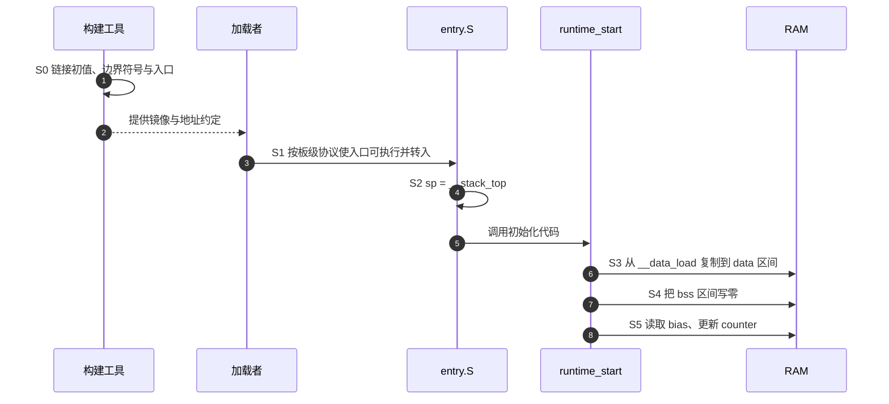

# 第1章\_从目标文件到运行布局的链接脚本

一个 C 文件里有函数、初值为 17 的全局变量和没有显式初值的计数器。编译器可以把它们变成机器码与数据，却还不知道这块板有多少 RAM、程序从哪种存储启动，以及几个目标文件最终排在哪些地址。如果这些选择散落在每个 C 文件里，改一次内存布局就可能让启动代码、驱动和镜像打包各说各话。

**链接脚本（linker script）** 把这类布局选择交给链接器：哪些输入放在一起、运行时使用什么地址、镜像保存哪些初值、哪些边界应提供给启动代码。它描述的是构建结果；搬运数据、清零内存、建立栈和执行入口仍要由运行时参与者完成。本章用同一个 ARM32 小镜像建立这条分工，先能观察 ELF，再修改布局。实验只在主机上编译和检查产物，不要求开发板，也不把主机链接成功当作上板启动成功。

## 1.1\_编译器留下哪些碎片\_链接器怎样把它们组成程序

编译 `image.c` 得到的 `.o` 是 **可重定位目标文件**。它保存机器码、数据、符号和待修补的引用。编译器通常把不同用途的字节放进不同的 **节（section）**：函数放 `.text`，只读数据放 `.rodata`，带非零初值的可写数据放 `.data`，需要初始为零的静态存储对象常放 `.bss`。这些是工具链惯例；C 标准没有要求必须使用这些节名，编译选项和目标 ABI 也会改变结果。

例如 `entry.o` 有 `.text.entry`，`image.o` 有 `.text.runtime_start`。链接器可以把两者合进最终 ELF 的一个 `.text`。前两者叫 **输入节**，后者叫 **输出节**。`-ffunction-sections`、`-fdata-sections` 让每个函数或数据对象更容易拥有单独输入节，从而可以按对象保留或清理；它们本身不执行清理。


图中的 map 是链接器生成的布局报告，能追到“哪个 `.o` 的哪个输入节落到了哪里”。ELF 的 **程序头（program header）** 则可以用 segment 描述加载范围，一个 segment 可以覆盖多个 section。不要把节表、加载段、硬件内存块都叫“段”后当成同一个对象。裸二进制没有 ELF 入口、节表和符号表；加载者必须另有地址与长度约定。

我们还需要区分三种数值。**VMA（Virtual Memory Address）** 是链接时为节指定的运行地址，**LMA（Load Memory Address）** 是链接器给节指定的装载地址，文件偏移则是字节在 ELF 文件中的位置。在没有地址转换的裸机场景中，VMA 可以对应直接访问的地址；名称里有 Virtual 不代表链接器替你建立了页表。LMA 也不自动等于 Flash 芯片内部偏移。烧录器、启动介质格式和地址映射仍要另行约定。

## 1.2\_先把一个带初值的变量安排到\_RAM

假定教学系统有一块可读取程序的 FLASH 区和一块可写 RAM。代码与常量可以留在 FLASH 中，`bias` 在运行中却必须可写，因此它的 **初值** 要随镜像保存，**对象本身** 要安排在 RAM。计数器 `counter` 初值为零，不必在镜像里存放一长串零，但启动时 RAM 中对应字节必须变成零。这就自然需要分别描述装载内容、运行地址和初始化动作。

本实验的 `0x08000000` 与 `0x20000000` 是人为选择的地址，没有声称对应 Cortex-A9 的统一物理地址图，更不能直接拿去烧写某块板。完整材料位于 [linker/materials](../../../labs/system_software/linker/materials/)。在仓库根目录用 Linux Bash 或 MSYS2 Bash 建立副本，安装并把 `arm-none-eabi-gcc` 及同套 Binutils 加入 PATH；下面不会使用主机默认的 `gcc`、`ld`。

```bash
# 仓库根目录；mktemp 创建新的实验目录，避免覆盖旧产物。
lab_dir=$(mktemp -d "${TMPDIR:-/tmp}/linker-lab.XXXXXX")
cp labs/system_software/linker/materials/* "$lab_dir/"
cd "$lab_dir"
arm-none-eabi-gcc --version
arm-none-eabi-ld --version
```

正文的数值来自 GNU Arm Embedded GCC 10.3.1、GNU ld 2.36.1.20210621。其他版本的机器码大小可能变化，地址关系和后面的对照应仍可验证。先看副本中的 `image.c`；`uintptr_t` 是能表示指针数值的无符号整数类型，这里用于目标启动环境中的区间遍历。

```c
#include <stdint.h>

/* 这些声明只引用链接符号，没有在 C 文件里分配数组。 */
extern unsigned char __data_load[], __data_start[], __data_end[];
extern unsigned char __bss_start[], __bss_end[];

volatile uint32_t bias = 17;
volatile uint32_t counter;
const uint32_t scale[2] = {3, 5};

/* 故意按 20、10 的顺序声明，让链接排序的作用可见。 */
const uint32_t reg_b __attribute__((section(".registry.20"), used)) = 0x22222222;
const uint32_t reg_a __attribute__((section(".registry.10"), used)) = 0x11111111;

/* 此函数无调用者，供 --gc-sections 对照实验使用。 */
uint32_t unused_helper(void)
{
    return 99;
}

void runtime_start(void)
{
    uintptr_t src = (uintptr_t)__data_load;
    uintptr_t dst = (uintptr_t)__data_start;
    uintptr_t end = (uintptr_t)__data_end;
    /* 启动环境按 GCC/目标 ABI 的地址模型访问链接定义的区间。 */
    while (dst < end)
        *(unsigned char *)dst++ = *(const unsigned char *)src++;

    dst = (uintptr_t)__bss_start;
    end = (uintptr_t)__bss_end;
    while (dst < end)
        *(unsigned char *)dst++ = 0;

    /* 此时才使用已经初始化的可写全局对象。 */
    counter = bias + scale[counter & 1u];
    for (;;) { }
}
```

两个 `.registry.*` 对象暂时只用于后面的保留与排序实验。`used` 要求编译器生成它们，但并没有要求链接器永远保留它们。`unused_helper()` 故意没有调用者。

在进入这个 C 函数前，汇编入口先设置栈。`entry.S` 如下；这是布局实验的最小入口，省略了真实板所需的异常向量、CPU 模式、缓存和内存控制器初始化。

```asm
.syntax unified
.cpu cortex-a9
.arm
.section .text.entry, "ax", %progbits
.global _start
.type _start, %function
_start:
    ldr sp, =__stack_top /* 在调用 C 代码前建立教学栈。 */
    bl runtime_start
1:  b 1b
.size _start, . - _start
```

脚本 `image.lds` 承担把上述对象放到约定区域的职责。`.lds` 是常见扩展名，链接器也能用 `-T` 读取其他名字的脚本。这里给出完整脚本，随后沿执行需要解释它。

```ld
OUTPUT_FORMAT("elf32-littlearm")
OUTPUT_ARCH(arm)
ENTRY(_start)

MEMORY
{
    FLASH (rx) : ORIGIN = 0x08000000, LENGTH = 64K
    RAM (rw)   : ORIGIN = 0x20000000, LENGTH = 16K
}

SECTIONS
{
    .text : {
        KEEP(*(.text.entry))
        *(.text .text.*)
    } > FLASH
    .rodata : { *(.rodata .rodata.*) } > FLASH
    .registry : {
        . = ALIGN(4);
        __registry_start = .;
        KEEP(*(SORT_BY_NAME(.registry.*)))
        __registry_end = .;
    } > FLASH

    .data : {
        . = ALIGN(4);
        __data_start = .;
        *(.data .data.*)
        __data_end = .;
    } > RAM AT> FLASH
    __data_load = LOADADDR(.data);

    .bss (NOLOAD) : {
        . = ALIGN(4);
        __bss_start = .;
        *(.bss .bss.*)
        *(COMMON)
        . = ALIGN(4);
        __bss_end = .;
    } > RAM
    .stack (NOLOAD) : {
        . = ALIGN(8);
        __stack_bottom = .;
        . += 0x400;
        __stack_top = .;
    } > RAM
    /DISCARD/ : { *(.comment) *(.note.GNU-stack) }
}
ASSERT(__stack_top <= ORIGIN(RAM) + LENGTH(RAM), "RAM layout overflow")
```

`MEMORY` 声明两个可供链接分配的区域，`ORIGIN` 是起点，`LENGTH` 是字节数，`K` 表示 1024 倍。`FLASH` 与 `RAM` 都是本脚本选的区域名，不是链接器内置的芯片名称。`> RAM` 指定输出节的 VMA 所属区域，`AT> FLASH` 把其初值的 LMA 安排在 FLASH 下一个可用位置。`(rx)`、`(rw)` 是链接器选择区域的属性，**不会写 MPU/MMU 寄存器，也不会让实际硬件自动只读或可执行**。

`.text : { ... }` 创建输出节；内部 `*(.text .text.*)` 从参与本次链接的输入文件中收集两个模式匹配的输入节。外面的 `*` 代表输入文件，括号里的名字代表输入节。通配符只匹配已经作为输入的文件，不会替你遍历磁盘寻找所有 `.o`。`.text.entry` 先被前面的规则接收，后面的宽泛匹配不会再复制它一次。

`.` 是 **当前位置计数器**。普通输出节内容消耗地址时它随之推进；`. = ALIGN(4)` 明确把它推进到 4 字节边界。仅计算 `ALIGN(4)` 不等于已经修改 `.`。输出节内部的赋值还受节相对位置语义约束，不能把每一次给 `.` 赋值都理解成随意跳到物理地址；本例使用区域分配与向前对齐，避免混用两套起点。

`.bss (NOLOAD)` 与 `.stack (NOLOAD)` 留出运行空间，没有要求把同样长度的初值字节放入本实验二进制。`NOLOAD` 不是清零指令，`.stack` 也不会自动设置处理器栈指针。前者由 `runtime_start()` 清零 BSS 区间，后者由 `entry.S` 的 `ldr sp` 兑现。实际 ELF 的节类型、标志和加载段仍应从工具输出核对，不能推断“没有内容的节在节表里就没有 offset 字段”。

> 依据：[GNU ld 的 MEMORY](https://sourceware.org/binutils/docs/ld/MEMORY.html) 说明区域分配与溢出；[Output Section LMA](https://sourceware.org/binutils/docs/ld/Output-Section-LMA.html) 区分 `AT(address)` 与 `AT>region`。本例显式分离 `.data` 的两个地址，避免依赖默认 LMA 推导。

## 1.3\_让\_ELF\_map\_和二进制分别回答一个问题

布局写完还只是设想。下面按 **编译 → 链接 → 核对地址 → 导出字节** 的顺序检验，同一工作目录保留所有中间产物，出现错误时不需要猜测旧文件来自哪次构建。

```bash
# 上节创建的实验目录。
arm-none-eabi-gcc -mcpu=cortex-a9 -marm -c entry.S -o entry.o
arm-none-eabi-gcc -mcpu=cortex-a9 -marm -std=c11 -O1 \
  -Wall -Wextra -Werror -ffreestanding -fno-builtin -fno-common \
  -ffunction-sections -fdata-sections \
  -fno-unwind-tables -fno-asynchronous-unwind-tables \
  -c image.c -o image.o
```

第一条产生入口目标文件。第二条声明独立运行环境，禁止隐式使用普通库函数，并把函数和数据拆成细粒度节；本实验不使用异常展开，所以关闭相应表生成。`-c` 到目标文件就停止，还没有安排最终地址。

```bash
arm-none-eabi-ld -T image.lds --gc-sections -Map=image.map \
  entry.o image.o -o image.elf
arm-none-eabi-objdump -h image.elf
arm-none-eabi-nm -n image.elf
```

`-T` 指定脚本，`--gc-sections` 开启未使用输入节的回收，`-Map` 保存归属报告。`objdump -h` 同时给出节的 VMA、LMA 和 ELF 文件偏移；`nm -n` 按地址排列符号。上述版本的关键结果如下，省略非装载属性节：

| 输出节 | 大小 | VMA | LMA | ELF 文件偏移 | 本次作用 |
| --- | --- | --- | --- | --- | --- |
| `.text` | `0x9c` | `0x08000000` | `0x08000000` | `0x10000` | 入口与初始化代码 |
| `.rodata` | `0x8` | `0x0800009c` | `0x0800009c` | `0x1009c` | `scale` |
| `.registry` | `0x8` | `0x080000a4` | `0x080000a4` | `0x100a4` | 两个保留的表项 |
| `.data` | `0x4` | `0x20000000` | `0x080000ac` | `0x20000` | `bias` 的 RAM 地址与镜像初值 |
| `.bss` | `0x4` | `0x20000004` | 工具显示 `0x080000b0` | `0x20004` | 只有 ALLOC，无 CONTENTS/LOAD |
| `.stack` | `0x400` | `0x20000008` | 工具显示 `0x080000b0` | `0x20008` | 只有 ALLOC，无 CONTENTS/LOAD |

最后两行工具显示的 LMA 不表示镜像里真的保存了 BSS 和栈的内容。必须连同 CONTENTS、LOAD 等标志判断。`.data` 在 ELF 内的偏移是 `0x20000`，在目标地址图中的 LMA 却是 `0x080000ac`；两个数描述不同坐标。

```bash
arm-none-eabi-readelf -h -S -l image.elf
arm-none-eabi-objcopy -O binary image.elf image.bin
wc -c image.bin
arm-none-eabi-objdump -s -j .registry image.elf
```

`readelf -h` 看入口，`-S` 看节表，`-l` 看加载段及节到段的对应；单独 `-S` 不能替代 LMA 检查。`objcopy` 去掉 ELF 管理结构，按可导出节的装载布局生成原始字节。本例 `image.bin` 是 **176 字节，即 `0xb0`**，不是 ELF 的文件长度，也不包含 RAM 的 1 KiB 栈。最后一条看到先 `11111111`、后 `22222222`，稍后会解释为什么顺序与声明顺序相反。

若代码大小变化，重新从 `LOADADDR(.data)` 与 `SIZEOF(.data)` 计算镜像末端，不照抄 `0xac`。从裸文件开头到 `.data` 初值的位置，在本实验是 `LMA(.data) - 0x08000000`；换成有引导头、签名或多组件封装的文件时，这个公式未必还能直接用于存储偏移。

## 1.4\_链接符号怎样把布局交给启动代码

刚才 `nm` 显示 `__data_start = 0x20000000`、`__data_end = 0x20000004`、`__data_load = 0x080000ac`。这些赋值创建了符号信息，**没有额外分配三个存放地址的 C 变量**。如果误写 `extern unsigned int __data_start;` 后读取 `__data_start`，CPU 会去读这个地址里的字，而不是取得边界地址数值。

本例声明 `extern unsigned char __data_start[]`，表达式 `__data_start` 取得该地址。也可以声明单个字符后取 `&symbol`。这是编译器、链接器和目标 ABI 的契约；不能据此声称 ISO C 可以独立定义任意绝对地址对象。这里把地址转成 `uintptr_t` 遍历，还避免把两个不同的链接符号伪装成由 C 定义的同一个数组再相减。

启动代码只需要这些边界，不需要在 C 文件里重复写 `0x20000000`。当脚本调整区域时，重新链接会把引用修补为新符号地址。一次完整交接如下：



图中第 3 步是本实验没有在硬件上执行的边界。第 6、7 步才改变 RAM 内容；构建阶段无论怎样修改脚本都不会提前执行这些写入。若满足教学硬件前提，S5 的 `counter` 应为 `17 + 3 = 20`，但目前的验证只证明机器码、布局和符号一致，没有实际读到目标 RAM 中的 20。

`ENTRY(_start)` 设置 ELF 入口元数据；芯片复位先去哪，由架构、SoC 启动机制或上一级固件决定。加载者若读取裸 `image.bin`，根本看不到 ELF 的 `e_entry`。同样，`SECTIONS` 是组织映射的主要命令，但不是每个补充脚本都必须包含它；GNU ld 也有默认脚本以及只补充符号、输入文件等内容的脚本。

> 依据：[GNU ld，Source Code Reference](https://sourceware.org/binutils/docs/ld/Source-Code-Reference.html) 专门解释链接符号与高级语言变量的差别。这里的地址表和复制过程来自本章实际构建，不是用变量名推测出来的。

## 1.5\_没有直接调用者的表项为什么还需要保留

`unused_helper()` 没有调用者，删除它可以减小镜像。链接器却不能只看“有没有 C 函数直接引用这个名字”：有些程序把驱动描述符、命令描述符或构造函数指针排成表，运行时按边界遍历。链接器不知道你的遍历协议，就可能把单个表项视为不可达。

这里要分清两个关口。编译器先决定是否生成对象，链接器再决定是否保留输入节。本例的 `used` 解决第一个关口，`KEEP(*(SORT_BY_NAME(.registry.*)))` 解决启用 GC 后的第二个关口。`KEEP` 本身不会调用表中函数；本实验甚至没有遍历 registry，它只展示保留和布局。

### 1.5.1\_只改变\_KEEP\_观察表项消失

先保留原脚本，再生成一个只拿掉 registry 的 `KEEP` 包装的副本：

```bash
# 仍在实验目录；原 image.lds 保持不变。
sed 's/KEEP(\*(SORT_BY_NAME(.registry.\*)))/\*(SORT_BY_NAME(.registry.*))/' \
  image.lds > no_keep.lds
arm-none-eabi-ld -T no_keep.lds --gc-sections \
  entry.o image.o -o no_keep.elf
arm-none-eabi-nm no_keep.elf
```

此时不应再看到 `reg_a`、`reg_b`。恢复同样的脚本，但不启用 GC：

```bash
arm-none-eabi-ld -T no_keep.lds entry.o image.o -o no_gc.elf
arm-none-eabi-nm no_gc.elf
```

这次两个表项与 `unused_helper` 都出现。因此“链接器默认删除一切未使用节”不是本例事实；具体驱动程序可能自动传入 GC 选项，要看最终链接命令，而不是猜默认值。恢复正常产物只需重新执行 1.3 节使用 `image.lds --gc-sections` 的链接命令。

### 1.5.2\_KEEP\_不能保住根本没进入链接的归档成员

再增加一个独立文件 `plugin.c`：

```c
/* 表项被编译进目标文件，但没有普通 C 引用。 */
const unsigned plugin __attribute__((section(".registry.30"), used)) = 0x33333333;
```

把它放进静态归档后链接：

```bash
arm-none-eabi-gcc -c plugin.c -o plugin.o
arm-none-eabi-ar rcs libplugin.a plugin.o
arm-none-eabi-ld -T image.lds --gc-sections \
  entry.o image.o libplugin.a -o archive.elf
arm-none-eabi-nm archive.elf
```

没有未解析引用需要 `plugin` 时，归档成员可能根本不会被抽取；本例确实没有 `plugin` 符号。脚本中的 `KEEP` 不能把尚未成为输入的节隔空保留下来。明确把该归档整体加入后再观察：

```bash
arm-none-eabi-ld -T image.lds --gc-sections entry.o image.o \
  --whole-archive libplugin.a --no-whole-archive -o whole.elf
arm-none-eabi-nm whole.elf
```

`plugin` 此时出现。`--no-whole-archive` 及时结束作用域，避免把后面的无关库也整体抽入。代价是更多成员进入链接，可能增加体积或暴露重复定义；如果只需要一个锚点，可以按项目协议通过未定义符号、直接目标文件等方式触发抽取，不能把 whole-archive 变成万能默认选项。

### 1.5.3\_匹配顺序和排序各自决定什么

原脚本先按名称排序 `.registry.10`、`.registry.20`，再放进输出节，所以节内容先为 `0x11111111`。数字是我们编码进节名的协议；普通按名称排序是字典序，`.registry.10` 不会自动被解释成比 `.registry.2` 更大的数。使用固定宽度编号可以避免这种意外。

已经理解了输入、匹配和保留后，下面的写法才适合并列查询：

| 写法 | 作用与边界 |
| --- | --- |
| `main.o(.text .text.*)` | 只匹配该输入文件；不是 `*(main.o(.text))` |
| `*(.text)` / `*(.text*)` | 前者只匹配确切名，后者连 `.textXYZ` 也匹配；常用 `.text .text.*` 更明确 |
| `*(EXCLUDE_FILE(foo.o) .text)` | 本条匹配排除 `foo.o`，不代表永久删除该文件；后续规则仍可接收 |
| `*(SORT_BY_NAME(.rodata.*))` | 按节名升序；`SORT` 是其别名 |
| `*(SORT_BY_ALIGNMENT(.rodata.*))` | 按对齐要求降序，可减少填充，不能据此推断运行速度 |
| `*(SORT_BY_ALIGNMENT(SORT_BY_NAME(.rodata*)))` | 先按对齐分组，同对齐再按名称；最多支持规定的一层嵌套 |
| `KEEP(*(.init_array))` | 已进入链接的匹配节不被 GC 删除；不执行构造函数 |
| `/DISCARD/ : { *(.comment) }` | 明确丢弃指定节；与“没写接收规则”不同 |

没有被脚本显式接收的 **孤儿节（orphan section）** 通常由链接器按规则安置，并非自动丢掉。本实验的 `.ARM.attributes` 就仍可在 ELF 中存在。生产脚本需要检查 map 和节表，按工具版本选择孤儿节告警策略；不要用 `/DISCARD/ : { *(.gnu*) }` 一扫而空，因为名字以 `.gnu` 开头不能证明内容无用。

> 依据：[GNU ld，Input Section Wildcard Patterns](https://sourceware.org/binutils/docs/ld/Input-Section-Wildcards.html) 与 [Input Section and Garbage Collection](https://sourceware.org/binutils/docs/ld/Input-Section-Keep.html)。归档反例、排序字节和 GC 差异均已用本章工具版本验证。

## 1.6\_当布局开始增长\_怎样表达边界而不藏起责任

现在假设 RAM 变小。仅有“链接通过”不够，还应让超出容量成为构建错误，而不是等上板覆盖栈。`MEMORY` 限制区域，`ASSERT` 则可表达更具体的约束。把实验副本里的 RAM 长度改为 16 字节即可观察：

```bash
sed 's/LENGTH = 16K/LENGTH = 16/' image.lds > tiny.lds
arm-none-eabi-ld -T tiny.lds --gc-sections entry.o image.o -o tiny.elf
```

预期链接失败，报告 RAM 区域容不下栈或 `RAM layout overflow`。后续不要使用失败构建可能留下的文件；回到原 `image.lds` 重新链接正常 `image.elf`。容量错误说明脚本发现了布局不成立，不代表工具会自动把对象挪到另一块 RAM。

除了容量，脚本常需要计算边界、保留空间、生成固定头或拆成多个文件。这些需求都围绕已建立的输出布局，常见工具如下：

| 表达式或命令 | 当前用途 | 不会替你做的事 |
| --- | --- | --- |
| `ADDR(.data)` / `LOADADDR(.data)` | 取输出节 VMA / LMA | 不搬运字节 |
| `SIZEOF(.data)` | 取输出节字节数，包含该节内部填充 | 不统计所有镜像封装开销 |
| `ORIGIN(RAM)` / `LENGTH(RAM)` | 引用区域约束 | 不探测真实内存容量 |
| `ALIGN(8)` / `BLOCK(8)` | 计算对齐值；`BLOCK` 是兼容名称 | 不访问 CPU 缓存，也不代表“当前块” |
| `ABSOLUTE(.)` | 在需要时生成绝对符号值，区别节相对符号 | 不分配一个整数对象 |
| `PROVIDE(symbol = expression)` | 在符号被引用且没有其他定义时提供缺省定义 | 不保证未引用符号仍出现在符号表 |
| `DEFINED(symbol) ? a : b` | 根据符号是否已定义选择表达式 | 不是 C 预处理条件 |
| `BYTE/SHORT/LONG/QUAD(value)` | 输出 1/2/4/8 字节数据并推进位置；按目标端序 | `LONG` 不跟宿主 C 的 `sizeof(long)` 改变 |
| `FILL(pattern)` | 设置本输出节后续空洞的填充模式 | 不把所有节间间隙或 Flash 擦除状态都改掉 |
| `INCLUDE fragment.lds` | ld 在当前位置读取另一份脚本 | 不执行 `#include` 宏预处理 |
| `INPUT(file.o)` / `GROUP(lib_a.a lib_b.a)` | 加入输入 / 反复搜索归档解决引用 | `GROUP` 不是把若干输出节包在大括号里的语法 |

例如在一个输出节内写 `BYTE(1) FILL(0xff) . += 3; LONG(0x12345678)`，本实验小端 ARM ELF 的对应字节为 `01 ff ff ff 78 56 34 12`。纯十六进制填充字面量 `0xff` 与一般算术表达式的扩展规则不同，不应把所有 `FILL` 都简化成“重复一个低字节”。`FILL` 只作用于它之后的节内空洞；二进制导出时跨节间隙的处理还要查看 objcopy 选项。

C 预处理器能先把宏和 `#if` 展开，再把结果交给 ld；U-Boot 就有这种流程。但 GNU ld 自己的 `INCLUDE` 不等于 C 的 `#include`。判断变量由谁展开，要看真实构建命令：Make 展开、C 预处理、链接表达式求值是三个不同阶段。`> TEXT_BASE` 只有在 `TEXT_BASE` 是已声明的内存区域名时才符合这种语法，不能把一个数值宏直接当区域名使用。

> 依据：[GNU ld，Builtin Functions](https://sourceware.org/binutils/docs/ld/Builtin-Functions.html)、[Output Section Data](https://sourceware.org/binutils/docs/ld/Output-Section-Data.html)、[Commands Dealing with Files](https://sourceware.org/binutils/docs/ld/File-Commands.html)。本章只使用 2.36.1 已验证的语法，在线手册中新增的指令不自动成为旧工具能力。

## 1.7\_节名有用途\_运行协议才使它生效

理解脚本之后，再看 `.vectors`、`.init_array` 或 `.heap` 就不必把名字当魔法。项目约定把一类对象放入某个输入节，脚本收集并提供边界，运行时还有一个明确消费者。缺少任何一环，名称再像标准机制也不会自动运转。

| 组织对象 | 脚本通常提供什么 | 运行时还需要谁兑现 |
| --- | --- | --- |
| 异常向量 `.vectors` | 顺序、地址、对齐、必要保留 | 目标启动代码按架构设置入口或向量位置 |
| 构造表 `.init_array`，旧式 `.ctors` | 表项与顺序；必要时使用按初始化优先级排序 | C/C++ 运行时按 ABI 遍历调用；只 KEEP 不会执行 |
| 设备树数据 `.dtb*` | 打包位置与首尾边界，若项目这样组织 | 使用者得到正确 DTB 地址并解析；也可以是独立文件 |
| 栈、堆预留区 | 地址范围、对齐、容量检查 | 设置 SP；初始化分配器和并发保护 |
| `.rel.dyn` / `.rela.dyn` | 项目所需的重定位记录及边界 | 与目标 ABI 匹配的重定位代码；REL 与 RELA 加数来源不同 |
| `.ARM.exidx` 等展开信息 | 按目标工具链与运行时需求保留或放置 | 异常展开、回溯等消费者；不能仅以“裸机”断言一定无用 |
| `.dynamic`、`.dynsym` 等 | ELF 动态链接或特定构建流程的元数据 | 具体加载者或构建工具，不能看到名字就断言最终裸镜像使用它 |

当两个阶段的工作区生命周期不重叠，还可以设计地址复用。GNU ld 的 `OVERLAY` 命令能够描述同 VMA、不同 LMA 的若干输出节，运行时必须负责切换内容；它不会自动生成搬运管理器。某些工程还用特定输出节类型表达不装载的覆盖布局，不能仅看到 `OVERLAY` 单词就套用同一种执行流程。

地址复用成立的关键是 **前一个使用者已经退出，后一个才覆盖该范围**。这与同时存活的两个对象地址冲突完全不同。U-Boot 的 BSS 与重定位阶段关系需要结合具体脚本和启动代码判断，下一篇 [从链接布局到启动阶段的交接](../uboot/P01_从链接布局到启动阶段的交接.md) 会沿这一问题进入固定版本的 ARM32 实现。

## 1.8\_把观察结果迁移到自己的工程

现在可以按“输入是否生成 → 是否进入链接 → 是否被清理 → 放在哪个地址 → 谁在运行时使用”的顺序排错。找不到一个注册对象时，直接增大 RAM 并不能解决没有从归档抽取的问题；全局变量值错时，修改 `ENTRY` 也不能代替 `.data` 搬运。下面几题分别检验这几个边界。

1. 保留 `NOLOAD`，删掉 `runtime_start()` 的 BSS 清零循环，计数器仍能保证初值为零吗？先指出谁会写入零，再判断。
2. 把 `.registry.10` 改成 `.registry.2`，仍与 `.registry.20` 按名称排序，如何预测结果？如果希望表达数值优先级，应怎样命名？
3. 工具报告 `.data` 的 VMA 与 LMA 不同，能否据此证明板上已经完成复制？还缺少哪些运行证据？
4. 一个固件有 `u-boot`、`u-boot.bin`、`u-boot.dtb`、`u-boot.itb`，能否据文件数断言有四个独立执行阶段？

**解答：** 第一题不能保证。本实验零值来自启动代码对 RAM 的写入，`NOLOAD` 只影响装载描述。第二题 `.registry.2` 是 `.registry.20` 的前缀，因此排在前面；更能暴露问题的是 `.registry.10` 与 `.registry.2`，字典序的 10 会先于 2，应使用 `.02`、`.10` 等固定宽度编码或定义专门协议。第三题只能证明构建意图；还需加载地址、可访问性、初始化路径实际执行及目标内存观察。第四题不能，同一程序可有 ELF、裸二进制和封装形式，DTB 本身是数据；阶段要由独立构建与实际控制权交接共同确认。

本章已经能解释链接器产物，却还不能只凭脚本判断某块板能否启动。板级内存、加载协议以及下一阶段入口必须接上同一条证据链；继续阅读 U-Boot 时，也沿这条链检查，而不把示例地址、节名和工具输出升级为所有平台的保证。
