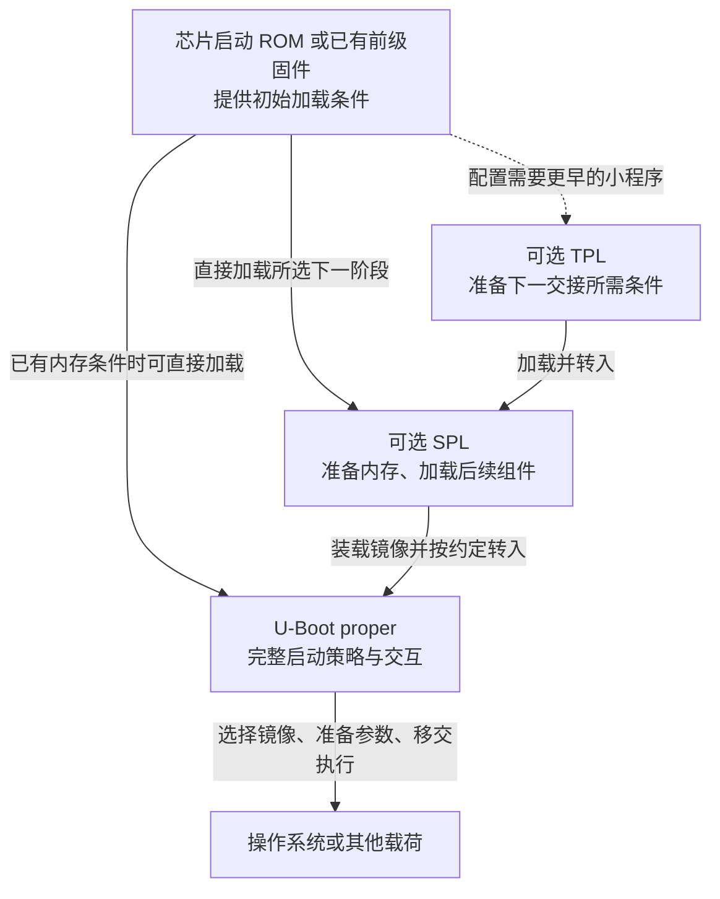
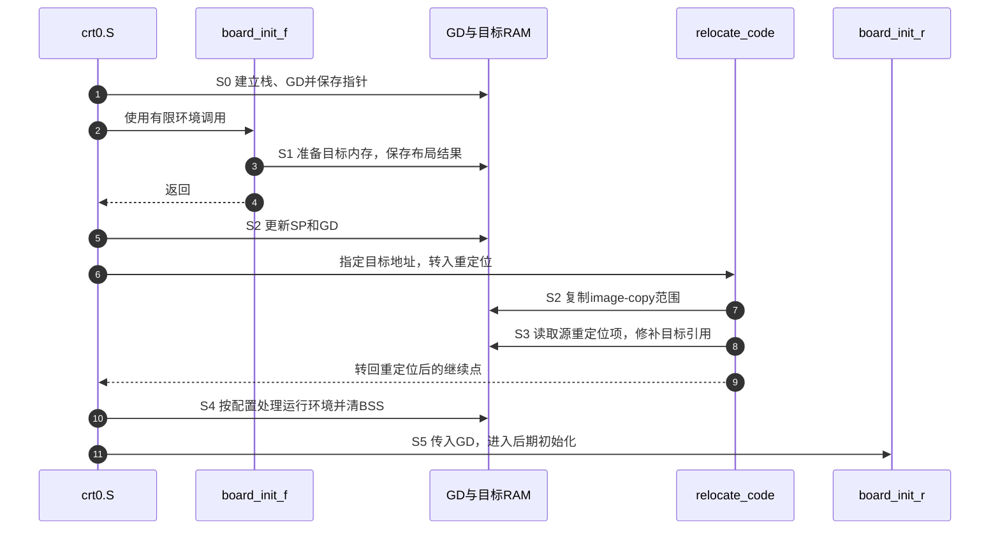
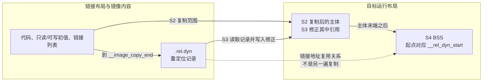

# 第1章\_从链接布局到启动阶段的交接

[链接脚本实验](../linker/P01_从目标文件到运行布局的链接脚本.md) 已经说明：脚本确定地址与边界，执行代码负责复制、清零和建立栈。真正的启动程序还要面对一个难题：它最终想在 DRAM 中运行，可刚获得控制权时，DRAM 可能尚未可用。不能让初始化 DRAM 的程序先依赖已经初始化好的 DRAM。

本章先从这个约束解释为什么会出现多个加载阶段，再用 **U-Boot v2022.10 的通用 ARM32 路径** 核对链接布局与运行交接。上游完整提交为 `4debc57a3da6c3f4d3f89a637e99206f4cea0a96`；[版本源码阅读索引](../../../research/source_reading/uboot/navigation/P01_ARM32链接布局与启动交接阅读索引.md) 保存来源、文件摘要和实现入口。这里没有把 ARM32 当作所有 U-Boot 架构，也没有把某个 Rockchip 厂商 SDK 的选项套到这个上游版本。

## 1.1\_大程序需要\_DRAM\_谁先把\_DRAM\_准备好

把所有驱动、命令和文件系统都塞进第一阶段，会遇到容量与初始化条件的限制：SoC 的启动 ROM 往往只支持规定的加载协议和初始存储空间，早期可用的片内存储又比后续 DRAM 小。即使最终镜像完全正确，它也可能装不进最早可用的区域，或者执行时访问尚未工作的内存控制器。

一种做法是把依赖拆开。前一个程序只完成下一次交接所需的最少工作：在当前可用空间执行，建立必要时钟、供电与内存条件，从支持的介质取出下一段程序，按约定把控制权交出去。后一段取得更大的运行空间后，再提供丰富功能。这样减少了最早阶段的体积与依赖，代价是多一套镜像布局、加载与交接约定，还必须维护阶段之间的版本匹配和内存占用。

**U-Boot proper** 指完整 U-Boot；**SPL（Secondary Program Loader）** 是可选的较小加载阶段；**TPL（Tertiary Program Loader）** 用在需要再增加一个更早阶段的配置中。并非所有平台都需要 SPL/TPL：如果已有固件完成内存初始化并能加载完整 U-Boot，就不必为了凑齐名称再加一层。TPL 也不能被定义成“固定 16～32 KiB、永远负责 DDR 训练”的硬件模块，它是构建与启动流程中的软件阶段。

下面是一种教学路径，箭头表示加载或转入执行，虚线表示可选阶段。具体 SoC 可能选择厂商加载器、其他固件或不同组合：

图中的同名阶段是逻辑角色，不代表一个统一的物理地址。v2022.10 还记录了可选 VPL 验证阶段及当时的实现限制；它不是本图必须执行的节点。[该版 Generic SPL framework](https://docs.u-boot.org/en/v2022.10/develop/spl.html) 说明 SPL/TPL 的独立构建与阶段关系。判断具体板采用什么组合，要查板配置、打包规则与实测启动日志，不能按年代或处理器型号猜测。

## 1.2\_为什么有多份脚本和多个镜像\_却不能按文件数数阶段

SPL 与完整 U-Boot 即使复用同一个源文件，也可以使用不同配置、不同目标文件目录和不同链接输入。SPL 的构建会带上阶段标识，生成 `spl/u-boot-spl`；完整 U-Boot 生成 `u-boot`。这两次独立链接各有自己的符号表，所以两份产物都叫 `_start` 并不构成一次链接里的重复定义。

独立符号表只解决 **构建命名空间**。运行时若两份镜像占据同一个 RAM 范围，仍须证明前一阶段不再使用那些字节、后一个镜像已加载完成，且前一级还在执行的代码、栈和缓冲区没有被提前覆盖。不能从“两次 ld”直接推出“地址永远不会冲突”。同一个 CPU 上交接执行也不等于所有协处理器、DMA 和其他核都已停止。

反过来，一个阶段可以有多种文件表示。ELF 便于调试，裸二进制便于装载，加上头部、设备树或签名后又形成打包产物。这些文件并非各自运行一次。

| 对象 | 本层身份 | 怎样判断它是否有独立执行入口 |
| --- | --- | --- |
| `u-boot`、`spl/u-boot-spl` | 不同链接任务生成的 ELF | 查 ELF 头、构建目标与对应启动路径 |
| `u-boot.bin`、`u-boot-nodtb.bin` | 某种配置下导出的二进制 | 回查生成规则，不能凭后缀认定新阶段 |
| `.dtb` | 编译后的设备树数据 | 由使用者解析，本身不是启动程序 |
| FIT，常见 `.itb` | 描述、组合和选择多个镜像组件的格式 | 解析后选出的固件或内核才可能执行；容器本身不是一个 CPU 阶段 |
| 环境变量映像 | 启动策略等配置数据 | 被环境子系统读取，不是独立 `.lds` 链接的程序 |
| `.lds` / 生成的链接脚本 | 一个链接任务的布局输入 | 一次链接也可通过 `INCLUDE` 读取多份脚本 |

U-Boot 的源脚本可以包含 `#include`、`#if` 和配置宏，是因为构建规则先运行 C 预处理器，产生 ld 能读懂的脚本。`CPUDIR/start.o` 之类记号也需要放回构建上下文，而不是直接把源脚本复制给 ld。最终地址还可能受到链接命令 `-Ttext` 等参数影响：源文件里出现 `. = 0`，不等于板上程序必然从物理零地址运行。

这一版本的选择过程见 [实现说明中的脚本选择与预处理](../../../research/source_reading/uboot/source_explanations/P01_ARM32链接布局与启动实现.md#1.1_先确定实际使用哪份脚本)。阅读自己工程时，应同时保留 `.config`、生成脚本、完整链接命令、ELF/map 和打包规则；仅保存源 `.lds` 不能重建最终镜像身份。

## 1.3\_完整\_U-Boot\_的数据为什么分几次才能使用

先缩小范围：以下主线选择 ARM32、非 SPL、使用该版通用 `crt0.S` 的通常重定位路径，省略 secure、EFI 等条件分支。它开始执行时只有有限的初始运行环境；即使已经能够调用 C 函数，也不能推断所有可写全局对象已经可以使用。

早期状态放进 **GD（global data）** 结构。启动汇编先保留空间、建立栈和 GD，再调用 `board_init_f()`。这个函数准备后续运行条件，并通过 GD 记录 DRAM 信息、目标重定位地址、新栈和新 GD 等结果。早期路径不能把要跨阶段保存的数据随意写进尚未就绪的普通 `.data/.bss` 对象。

`board_init_f()` 返回以后，仍是 `crt0.S` 组织后续动作：切换到准备好的栈与 GD，进入 `relocate_code()` 复制镜像并修正受支持的引用，回到重定位后的继续点，再建立最终运行环境并清零 BSS，最后进入 `board_init_r()`。所以“`board_init_f()` 负责清 BSS，再调用重定位，最后自动遍历全部注册表”不是这段代码的调用关系。

为了把布局和执行过程放在同一坐标里，后文统一使用 S0～S5：

| 阶段 | 触发与执行者 | 写入的状态及位置 | 后续读取者与完成条件 |
| --- | --- | --- | --- |
| S0 有限环境 | `crt0.S` 的 `_main` | 初始可用内存中的栈、清零后的 GD；ARM32 使用 `r9` 保存 GD 指针 | `board_init_f()` 能用栈和 GD 传递状态 |
| S1 规划目标 | `board_init_f()` 的初始化序列 | GD 中的 `relocaddr`、`reloc_off`、`start_addr_sp`、`new_gd` 等 | 返回给 `crt0.S`；目标内存应已具备所需条件 |
| S2 切换与复制 | `crt0.S`、`relocate_code()` | 新 SP/GD；把 image-copy 范围写到目标区域 | 复制结束后才处理目标中需要修补的引用 |
| S3 修正引用 | `relocate_code()` | 读取源侧 `.rel.dyn`，修改目标镜像中相应的字 | 受支持重定位项处理完，返回重定位后的继续点 |
| S4 完整 C 环境 | `crt0.S` 后续路径 | 向量/CPU 运行环境按配置处理；目标 BSS 区间写零 | 普通可写静态对象满足该路径的初始化要求 |
| S5 后期初始化 | `board_init_r()` | 后期子系统、设备模型、命令处理所需的软件状态 | 各自消费者按生命周期使用注册表与设备 |

这是多组状态的连续交接：GD 的规划结果、镜像字节、重定位记录、BSS 与设备初始化不是一个“是否启动完成”的布尔值。早期 GD 已经清零不意味着所有 BSS 清零，代码已经复制不意味着其中的指针已修正。跳过其中一项就可能出现“能执行几条指令，却在访问数据或调用函数指针时失败”的现象。

第 4 步明确了调用边界：F 返回之后，后面的动作由 C 接着组织。第 8 步不是“给所有地址都加一个数”，它受目标 ABI 与实现支持的重定位类型约束。固定源码中的 [布局与 `relocate_code` 实现说明](../../../research/source_reading/uboot/source_explanations/P01_ARM32链接布局与启动实现.md#1.3_复制区间与重定位记录不是同一段数据) 给出具体循环；这里先保留各阶段读写谁的完整关系。

## 1.4\_同一片地址为什么能先服务重定位\_再成为\_BSS

S3 需要重定位记录，S4 需要可清零的 BSS。两者生命周期不同，就有机会减少镜像和运行空间的占用。但这种优化必须从使用顺序推导，不能因为两节地址重叠就宣布“链接器会自动处理”。

该通用 ARM32 主脚本把 `__image_copy_end` 放在普通代码、数据、链接列表等之后；随后放 `.rel.dyn`，最后用覆盖布局把 BSS 的起点安排到 `__rel_dyn_start`。也就是说，从 **链接坐标** 看，BSS 与重定位区间的起点重合；从 **执行过程** 看，`relocate_code()` 从源位置读取重定位项，写入目标镜像，随后才在目标位置清 BSS。目标与源是否同一物理范围、是否跳过复制，仍要结合实际加载地址和 `relocaddr` 判断。

图中虚线只表示地址组织关系，不表示先把重定位表复制成 BSS 再解析。若在记录还会被读取时清掉它所占的存储，后续修正就可能读到零或坏条目；能否复用由生命周期保证。原脚本中的 `OVERLAY` 输出节属性也不能被读成“启动时自动切换”的执行指令。

源脚本还包含几个不能从名字猜用途的区域。它们不应遮住主线，但查看完整脚本时需要知道各自为何单列：

| 区域 | 单列的作用 | 本章边界 |
| --- | --- | --- |
| `.efi_runtime` 及关联重定位范围 | 把 EFI 运行期相关内容与一般代码分开组织 | 先专门匹配，再用 `.text*` 等接收其余内容，避免被先吞掉 |
| `.secure_text/.secure_data/.secure_stack` | 在配置要求下安置 ARMv7 安全状态相关代码、数据和栈，可能分离 VMA/LMA | 与镜像签名验证不是同一个机制；不能因 ARMv8 有异常级就说它没有安全状态划分 |
| `__u_boot_list` | 汇总命令、驱动等类型的链接生成数组 | 本脚本名称没有开头的点；不是 DTB 的另一个名字 |
| `.rel.dyn` 与 BSS | 连接 S3 的引用修正和 S4 的内存初始化 | 须按上述生命周期理解覆盖布局 |
| `.mmutable` | 源文件保留的特定旧平台用途 | 源注释已经限制新平台使用，不是所有板必须照抄的区域 |
| `.dynsym/.dynstr/.dynamic/.ARM.exidx` 等 | 保留 ELF 构建与工具链可能需要的节 | 是否进入某个二进制产物、是否被运行时消费，要查导出规则和实际节表 |

完整源文件在仓库 [上游副本](../../../research/source_reading/uboot/upstream/v2022.10/arch/arm/cpu/u-boot.lds)，必要裁剪与解释在 [布局实现说明](../../../research/source_reading/uboot/source_explanations/P01_ARM32链接布局与启动实现.md#1.2_把输出布局分成复制内容与阶段数据)。读者不需要离开正文才能理解图中关系；原文件用于核对条件分支与完整顺序。

## 1.5\_链接列表让描述符聚在一起\_不会替消费者执行所有工作

假设每增加一条命令都要手工修改一个中央数组，多处维护就容易漏登记。链接列表让每个模块在自己的源文件旁声明描述符，编译器把它放入有约定名称的输入节，链接器排序并保留这些节，消费者按边界查找。新增模块不必同时改一个巨大总表，但要遵守类型、命名、对齐和构建收集规则。

在这个版本中，列表名与条目名参与组成节名。例如命令列表中条目会处于 `__u_boot_list_2_cmd_2_<name>` 一类输入节；起点、条目与终点利用命名中的 `1/2/3` 排序。`ll_entry_start()`、`ll_entry_end()` 取得相应边界，`ll_entry_count()` 按元素类型计算数量。它是 **链接生成的连续数组协议**，不能因为名字带 list 就把它解释成运行时指针链表。

`U_BOOT_CMD(...)` 一类包装声明命令描述符；命令解析器找到对象后才调用其处理函数。驱动描述符的消费者则按设备模型的绑定、探测等时机使用它。把描述符加入链接列表，既没有使外设自动可用，也没有要求 `board_init_f()` 无条件调用表内所有函数。注册定义、运行时查找、设备实例和实际硬件操作需要分别判断。

[链接列表宏的实现说明](../../../research/source_reading/uboot/source_explanations/P01_ARM32链接布局与启动实现.md#1.5_链接列表怎样从声明变成有边界的数组) 给出唯一裁剪展开。若描述符消失，按上一章验证过的编译生成、归档抽取、GC 与脚本匹配顺序检查；若描述符存在而硬件不工作，再追消费者与设备初始化。两类问题不应该混成一个“注册失败”。

## 1.6\_把\_SPL\_放回同一个交接模型\_而不是删掉所有复杂功能

SPL 的价值是把早期依赖与容量限制控制住，不是满足“没有设备模型、没有列表、没有重定位记录”的定义。v2022.10 的通用 `arch/arm/cpu/u-boot-spl.lds` 明确包含 `__u_boot_list`、`.binman_sym_table`、`.rel.dyn` 和 BSS，并用可配置断言检查镜像大小、BSS 大小及整体占用。板级也可能选用另一份脚本，因此看到通用脚本里的节不代表每个最终产物都非空。

运行路径要单独核对。同版 ARM32 `crt0.S` 在 `CONFIG_SPL_BUILD` 分支跳过主 U-Boot 的 `relocate_code()` 路径；这是一项具体实现事实，不能外推为所有架构、所有版本的 SPL 永远固定在一个地址。`CONFIG_SPL_STACK_R` 还可以支持后续移动栈与 GD，移动栈不等于复制整个代码镜像。

BSS 清零也有条件：通常在进入 `board_init_r()` 前完成；设置 `CONFIG_SPL_EARLY_BSS` 的路径可在 `board_init_f()` 前提前清零，前提是平台已有合适内存。没有通用 framework 的特殊路径更要检查自己的板级入口。不能只按函数名套一个不存在的通用 `spl_board_init_f()` 接口。

| 观察维度 | 本版通用 ARM32 主 U-Boot | 本版通用 ARM32 SPL |
| --- | --- | --- |
| 构建与脚本 | 主链接任务和主脚本 | 独立目标文件与脚本选择 |
| 链接列表 | 有收集规则 | 通用 SPL 脚本也有收集规则 |
| 主体复制与修正 | 通常经过 `relocate_code()` | 此 `crt0.S` 分支跳过该主路径 |
| BSS 建立 | `board_init_f()` 返回后的后续路径 | 通常在后续路径，可配置 early BSS |
| 栈与 GD | 从有限环境交接到目标环境 | 可按配置移动，不能等同代码重定位 |
| 硬件/加载能力 | 由板配置及各子系统决定 | 按空间与职责裁剪，不能固定写成“无网络、无环境” |

## 1.7\_硬件需求应从下一次交接倒推

现在可以判断启动阶段会用到哪些硬件。若下一镜像在 eMMC，执行加载的阶段就需要对应控制器、时钟、复位、引脚和驱动；若镜像已经由前级放进 RAM，就可能不需要再次初始化该存储。若 DRAM 尚不可用，使用它前必须完成平台要求的供电、时序和训练；具体由哪个阶段承担，取决于容量、已有固件与板级设计。

UART 常用于观察，但“有日志更容易调试”不等于“所有 BootROM 都必须提供 UART 日志”。Timer 可能用于超时和硬件初始化延时，I²C 可能用于 PMIC，GPIO 可能控制复位；这些都是需求驱动的依赖，不是一张固定的 SPL 必选外设清单。

| 当前交接需求 | 应确认的资源 | 需要保存的板级证据 |
| --- | --- | --- |
| 从指定介质读取下一镜像 | 存储/USB 等控制器及其时钟、引脚、协议 | SoC 启动模式表、板连接、构建配置与加载日志 |
| 开始使用 DRAM | 控制器、PHY、供电、板上颗粒与训练数据 | 芯片/板手册与对应初始化代码版本 |
| 早期分配栈和 GD | 当时已可访问且不会被覆盖的内存 | 初始 SP、保留区间与 map，不只看 SRAM 总容量 |
| 搬运镜像并转入 | 目标空间、当前执行区、栈、缓冲区及必要同步 | 源/目标范围、加载格式、入口约定和实际跳转路径 |
| 加载操作系统 | 所选载荷格式、参数/DTB、平台启动约定 | 具体启动命令与目标操作系统协议 |

表中刻意没有编造 `SPI_FLASH_CMD`、`UART0_BASE` 一类“通用寄存器”。只有选定 SoC 控制器后，寄存器名称、位域与访问效果才有可核对的含义；本章不提供猜测的地址让读者照写。实际平台说明应就地列出其使用的寄存器表和证据。

最后做三个纸面判断。第一，SPL 的 map 里出现 `__u_boot_list` 是否矛盾？第二，主脚本里 BSS 与 `.rel.dyn` 起点相同，是否立即说明链接错误？第三，一块板不使用 SPL，是否就不能运行 U-Boot？

**解答：** 第一不矛盾，列表是组织描述符的机制，SPL 也可能需要。第二不能只看地址，要沿 S2～S4 核对源/目标位置和读写时间，确认后用者没有破坏前用者仍需的状态。第三可以由其他前级提供内存和加载条件，阶段是否存在取决于系统约束。本章证明的是如何连接布局与执行证据；要判断自己的板，下一步是带着同一组问题检查它的配置、生成脚本和启动路径，而不是复制这里的地址或分支。
