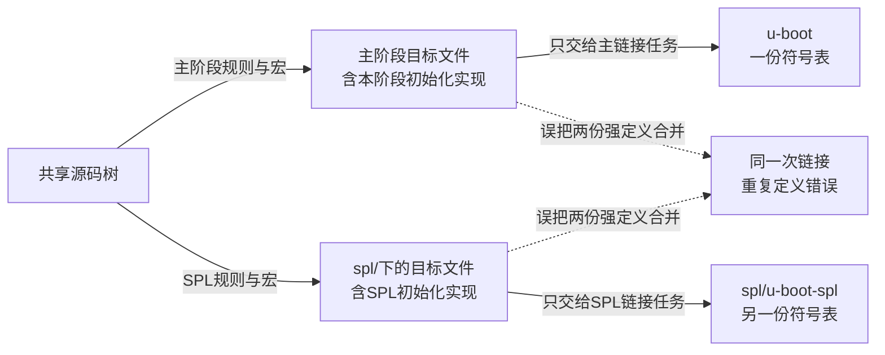

# 第2章\_从构建上下文找到实际进入镜像的函数

[上一章](P01_从链接布局到启动阶段的交接.md) 已经区分 SPL 与完整 U-Boot 的独立镜像。现在打开源码，却看到 `common/board_r.c` 与 `common/spl/spl.c` 都定义 `board_init_r()`。如果只凭全局搜索得到两个定义，就会怀疑重复符号；如果随口说“宏会自动屏蔽一个”，又无法解释到底哪条规则生效。

这次沿同一个问题走完整条证据链：**配置和构建上下文 → 输入文件 → 编译后的符号 → 链接输入 → 最终产物**。先用能在主机运行的小实验看清选择过程，再对应 U-Boot v2022.10、提交 `4debc57a3da6c3f4d3f89a637e99206f4cea0a96` 的真实规则。[源码模块导读](../../../research/source_reading/uboot/navigation/P02_构建上下文与入口选择导读.md) 给出版本原件与精确实现入口。本章不假定已经构建某块 ARM 板，也不把主机实验冒充 U-Boot 本体。

## 2.1\_同名定义是否冲突\_要问它们有没有进入同一次链接

**讲解层次：概念层。** 先用 C 对象与 GNU make 的构建关系解释选择过程，再映射到固定版本的 U-Boot。

两个 C 文件各自定义一个具有外部链接的同名函数，通常都能单独编译成 `.o`；冲突发生在它们同时进入同一次链接、链接器发现多个不允许并存的定义时。把两个对象分别链接为两个程序，则各自维护自己的符号空间。这与运行时选哪一个函数不是同一件事。

U-Boot 需要这种分离，是因为完整阶段和小加载阶段职责不同：同名初始化接口可以给两条启动路径各自提供实现。为此，构建系统不仅要选择文件，还要让同一公共源文件能以不同宏重新编译，输出到不同目录，否则第二次编译可能覆盖第一次的对象。



图中两条正常路径可以读取同一源码目录，但不能混用输出对象。构建隔离也不能只靠文件夹名字：如果链接命令仍把两边对象都传进去，目录分开了仍会报重复定义。

## 2.2\_用两个小程序同时观察变量传递与对象选择

“另一个 Makefile”不等于“全新的空环境”。GNU make 的子进程可以收到导出的变量以及命令行变量，但父 Makefile 中任意赋值并不会都自动变成环境变量；子进程里的赋值也不会反向修改父进程的变量。先把这一点做成可观察结果，再看 U-Boot 的复杂规则。

实验使用 Linux Bash 或 MSYS2 Bash、GNU make、宿主 GCC 和 `nm`。本次实际验证环境是 MSYS2 GNU make 4.4.1、GCC 15.3.0。生成的 `.exe` 是宿主测试程序，Linux 上这个后缀只是文件名；它们不是 ARM 固件。材料在 [build_context](../../../labs/system_software/uboot/build_context/)，先建立独立副本：

```bash
# 仓库根目录；不要在教材材料目录直接生成产物。
source_root="$(pwd)/research/source_reading/uboot/upstream/v2022.10"
lab_dir=$(mktemp -d "${TMPDIR:-/tmp}/uboot-context.XXXXXX")
cp labs/system_software/uboot/build_context/* "$lab_dir/"
cd "$lab_dir"
```

任务顺序是 **准备同名实现 → 由 Make 选择两组对象 → 运行并查看符号 → 故意混合链接**。先看入口 `main.c`。`DEMO_SPL` 只用于本实验，让同一个源文件的编译差异可以打印出来。

```c
#include <stdio.h>

const char *board_stage(void);

int main(void)
{
#ifdef DEMO_SPL
    const char *compiled_for = "spl";
#else
    const char *compiled_for = "proper";
#endif
    /* 同一源文件在两个目录各编译一次，打印编译与链接选择。 */
    printf("compiled=%s linked=%s\n", compiled_for, board_stage());
    return 0;
}
```

`proper.c` 和 `spl.c` 分别实现同一个接口，完整内容如下。二者都没有用 `#ifndef` 包住函数；成功构建必须靠输入选择，而不能靠一个并不存在的保护条件。

```c
/* 主阶段教学实现；函数名刻意与 spl.c 相同。 */
const char *board_stage(void)
{
    return "proper";
}
```

```c
/* SPL 教学实现；正常情况下不会与 proper.c 链入同一产物。 */
const char *board_stage(void)
{
    return "spl";
}
```

父 `Makefile` 负责发起两次构建。`demo_local` 只是本进程变量，`demo_exported` 显式导出，`demo_option` 稍后从命令行指定。

```make
# 这三个名字用于观察 Make 变量的传播，不是 U-Boot 配置项。
demo_local := parent_only
export demo_exported := parent_value
demo_option ?= default_value

.PHONY: all proper spl
all: proper spl

proper spl:
	$(MAKE) -f stage.mk stage=$@ all
	@printf 'parent after %s: exported=%s\n' '$@' '$(demo_exported)'
```

`.PHONY` 明确这些名字是操作目标，避免同名普通文件让 recipe 被跳过。`$(MAKE)` 使用当前 Make 程序，并按递归构建规则传递选项；`-f stage.mk` 选择子进程读取的规则文件，`stage=$@` 把当前目标名作为命令行赋值传入。子进程仍在当前目录，`-f` 本身没有执行 `cd`。

子规则 `stage.mk` 如下。recipe 行开头必须是真正的 Tab；上面的材料副本已经保留正确格式。

```make
ifeq ($(filter $(stage),proper spl),)
$(error stage must be proper or spl)
endif

# 先打印继承结果，再修改本进程的变量，不会反向修改父 make。
$(info child $(stage): local=$(demo_local) exported=$(demo_exported) option=$(demo_option))
demo_exported := child_value
build_dir := out/$(stage)
stage_source := $(stage).c
stage_cppflags :=
ifeq ($(stage),spl)
stage_cppflags := -DDEMO_SPL
endif

.PHONY: all run
all: $(build_dir)/demo.exe run

$(build_dir):
	mkdir -p $@

$(build_dir)/main.o: main.c | $(build_dir)
	$(CC) -std=c11 -Wall -Wextra -Werror $(stage_cppflags) -c $< -o $@

$(build_dir)/stage.o: $(stage_source) | $(build_dir)
	$(CC) -std=c11 -Wall -Wextra -Werror -c $< -o $@

$(build_dir)/demo.exe: $(build_dir)/main.o $(build_dir)/stage.o
	$(CC) $^ -o $@

run: $(build_dir)/demo.exe
	./$(build_dir)/demo.exe
```

`$(info ...)` 在子 Make 解析规则时打印收到的值；随后给 `demo_exported` 的赋值只改本进程。`build_dir` 分开两个输出目录，`stage_source` 则在 `proper.c` 与 `spl.c` 中选择一个。公共 `main.c` 各编译一次，SPL 那份额外加 `-DDEMO_SPL`。`| $(build_dir)` 是顺序依赖：要求先有目录，目录时间戳变化不作为重编该对象的普通理由。

现在执行：

```bash
make CC=gcc demo_option=command_line
```

两组输出中应出现以下关键行，编译命令夹在它们之间：

```text
child proper: local= exported=parent_value option=command_line
compiled=proper linked=proper
parent after proper: exported=parent_value
child spl: local= exported=parent_value option=command_line
compiled=spl linked=spl
parent after spl: exported=parent_value
```

`local=` 为空，说明普通本地赋值没有自动传入；导出的值和命令行值都到了子进程。子 Make 把导出变量改成 `child_value` 后，父进程打印的仍为 `parent_value`，第二个子进程也从父进程收到原值。这里没有共享可变变量表，只有进程启动时的传递和各自解析。

GNU make 通常通过环境传递显式导出项，通过 `MAKEFLAGS` 传播命令行赋值；普通 Makefile 赋值可以覆盖环境提供的缺省值，但命令行赋值通常优先于普通赋值。`override`、`-e`、显式重传等会改变具体优先级，排查时可用 `$(origin name)` 查看来源。本实验没有启用这些额外规则。[GNU make 的子 Make 变量通信规则](https://www.gnu.org/software/make/manual/html_node/Variables_002fRecursion.html) 是依据，输出则给出本次实际观察。

### 2.2.1\_把两份对象混在一起\_才会看到冲突

现在两次正常链接都成功，不能据此断言同名函数天然可以共存。先看两个对象：

```bash
nm out/proper/stage.o
nm out/spl/stage.o
```

两边都有已定义的 `board_stage`，`T` 表示代码区中的全局符号。它们在不同程序内，所以正常链接没有矛盾。故意把两边实现都放入一次链接：

```bash
# 这是预期失败的对照命令，不要把 wrong.exe 当作正常产物。
gcc out/proper/main.o out/proper/stage.o out/spl/stage.o -o wrong.exe
```

本次链接器报告 `multiple definition of board_stage`。不要用允许重复定义的链接选项掩盖它；恢复方法是重新使用只选择一份实现的 `make CC=gcc demo_option=command_line`，正常两个程序仍可以运行。

至此实验已经区分三个动作：Make 选择哪个文件，编译器按宏生成什么内容，链接器合并哪些对象。真实 U-Boot 也要逐层找证据，不能用“分家”两个字代替规则。

## 2.3\_U-Boot\_真正在哪一层排除\_board\_r.o

**讲解层次：概念到实现的映射。** 以下使用 U-Boot v2022.10 的真实规则，逐一定位实验里的文件选择、阶段宏和独立链接。

固定版本的顶层 Makefile 通过 `scripts/Makefile.spl` 发起 SPL 构建，输出对象前缀为 `spl/`。这条路径不叫源树下的 `spl/Makefile`；个别旧注释可能沿用旧称，实际执行命令才是判断依据。SPL 脚本读取公共配置和阶段生成配置，设置相应预处理标志，再选库目录和链接输入。

继续进入公共对象规则时，`scripts/Makefile.build` 会先清空 `obj-y` 等局部收集变量，依据输出路径辨认阶段前缀，读取公共与阶段配置，然后包含该源目录的 Kbuild 或 Makefile。因而相同的 `common/Makefile` 可以在不同上下文里得到不同对象集合，并非父 Make 的列表原样传下去后永远不变。

真实关口在 **`common/Makefile` 的 `ifndef CONFIG_SPL_BUILD` 块**：`board_f.o` 与 `board_r.o` 的加入位于这个块内。进入 SPL 上下文后，这两条加入规则不成立。SPL framework 的 `spl.o` 则由 `common/spl/Makefile` 根据阶段的 FRAMEWORK 配置加入。这里不需要编造 `common/board_r.c` 外围存在一个包住整个 `board_init_r()` 的 `#ifndef CONFIG_SPL_BUILD`。

另外，`ALL-y` 通常收集最终目标，`obj-y` 收集当前目录对象，`libs-y` 组织待递归/链接的库目录；这些普通 Make 变量的语义来自 U-Boot 规则，GNU make 不会因为变量以 `-y` 结尾就自动编译文件。看见 `board_r.o`，先确认它在哪个变量、哪段条件和哪次解析里。

下表是用 GNU make **直接读取仓库中的固定版本原始 Makefile**、只观察对象列表的实际结果。它没有编译完整 U-Boot，配置只提供本表所列的最小条件：

| 读取的原件 | 本次条件 | 关键结果 |
| --- | --- | --- |
| `common/Makefile` | 不定义 `CONFIG_SPL_BUILD` | 列表含 `board_f.o`、`board_r.o` |
| `common/Makefile` | `CONFIG_SPL_BUILD=y` | 列表不含二者 |
| `common/spl/Makefile` | `CONFIG_SPL_BUILD=y`、`CONFIG_SPL_FRAMEWORK=y`、`SPL_TPL_=SPL_` | 列表含 `spl.o` |

想独立复现，可在新文件 `selection.mk` 写入：

```make
# 只求值文件选择规则，不启动完整固件编译。
obj-y :=
include $(source_root)/$(selection)
.PHONY: show
show:
	@printf '%s\n' '$(obj-y)'
```

前面的准备命令已经保存 `source_root`。它指向固定原件，当前目录仍是实验副本；如果换了终端，先按准备步骤重新建立变量：

```bash
# source_root 已指向固定版本原件目录；先确认文件存在。
test -f "$source_root/common/Makefile"
make -s -f selection.mk source_root="$source_root" \
  selection=common/Makefile show
make -s -f selection.mk source_root="$source_root" \
  selection=common/Makefile CONFIG_SPL_BUILD=y show
make -s -f selection.mk source_root="$source_root" \
  selection=common/spl/Makefile CONFIG_SPL_BUILD=y \
  CONFIG_SPL_FRAMEWORK=y SPL_TPL_=SPL_ show
```

这只证明给定条件下规则如何求值。要证明自己的板最终链接了什么，还要看真实配置、阶段 `.cmd`、map 和符号表。完整裁剪及阶段配置生成来源见 [构建选择实现说明](../../../research/source_reading/uboot/source_explanations/P02_构建上下文与入口选择实现.md#2.1_对象列表由当前解析上下文重新建立)。

## 2.4\_CONFIG\_SPL\_和\_CONFIG\_SPL\_BUILD\_为什么不能互换

现在可以解释两个容易混淆的名称。`CONFIG_SPL` 表达项目是否需要生成 SPL；`CONFIG_SPL_BUILD` 标识当前这次编译/规则求值处于 SPL 构建上下文。一个启用 SPL 的工程，同时还要编译完整 U-Boot；若把前者当成后者，主阶段也可能错误地使用 SPL 专用实现。

同理，共享源码可能写 `CONFIG_IS_ENABLED(FOO)`。这个 U-Boot 辅助宏根据当前阶段选择 `CONFIG_FOO`、`CONFIG_SPL_FOO`、`CONFIG_TPL_FOO` 等名称后求值；它不是 Linux 同名概念的任意替换，也不是启动时读取一个可变配置开关。普通 `IS_ENABLED(CONFIG_FOO)` 不会自动把名称换成 SPL 版本。

| 当前问题 | 应核对的对象 | 时间点 |
| --- | --- | --- |
| 工程是否安排生成 SPL | `CONFIG_SPL` 与顶层目标依赖 | 构建规划 |
| 本次对象是否按 SPL 规则生成 | 阶段生成配置、`CONFIG_SPL_BUILD`、实际编译命令 | Make 求值与预处理 |
| 同一功能在当前阶段是否启用 | 对应阶段配置及 `CONFIG_IS_ENABLED(FOO)` 的展开 | 编译期 |
| 哪份实现最后被调用 | 链接后的符号、反汇编与实际执行路径 | 链接后及运行期 |

如果两个阶段共用一个对象路径，切换宏后却复用旧 `.o`，便可能把错误实现带入新镜像。U-Boot 的阶段输出目录、配置依赖和命令跟踪共同处理这个问题；单纯手写 `gcc -D...` 后保留同一个 `.o`，并没有自动获得这些保证。不要把生成的 `.cmd` 当成用户应手改的配置，它记录的是生成命令与依赖，真实输入应在 Makefile、Kconfig、源代码和板配置里修改。

## 2.5\_ARM32\_与\_ARM64\_的入口为何不必放在对称文件里

阶段选择已经清楚，但同一阶段还要选择目标体系结构。`config.mk` 从配置取得 `ARCH`、`CPU` 等，形成 `CPUDIR`；`arch/arm/Makefile` 通常据此给出启动对象 `head-y`。在这个版本中，ARM32 和 ARM64 都位于 `arch/arm/`，不能凭 CPU 是 64 位就把 U-Boot 的 `ARCH` 按 Linux 的习惯改成 `arm64`。

`CONFIG_SYS_CPU` 的字符串也不一定直接写在 defconfig 里。以固定版本的 QEMU ARM 为例，板级选择通过 `arch/arm/mach-qemu/Kconfig` 选择 `CPU_V7A` 或 `ARM64`，然后 `arch/arm/Kconfig` 为 `SYS_CPU` 提供 `armv7` 或 `armv8` 默认值。因此这里是特征选择影响路径字符串，不是“先设置任意字符串 armv8 就自动开启 ARM64”。

进一步看 `arch/arm/lib/Makefile`：普通 ARM32 路径加入 `vectors.o` 和 `crt0.o`；ARM64 路径加入 `crt0_64.o`；ARMv7-M 又有单独分支。前面相同的 `selection.mk` 直接求值也验证了 ARM32/ARM64 的这一差异。

| 固定版本中的普通路径 | `_start` 的定义 | 后续连接 |
| --- | --- | --- |
| ARMv7-A | `arch/arm/lib/vectors.S` 的 `.vectors` | 起始分支到 `reset`；`arch/arm/cpu/armv7/start.S` 的低级路径再转入 `_main` |
| AArch64 | `arch/arm/cpu/armv8/start.S` | `_start` 内分支到 `reset`，之后进入对应低级流程及 `crt0_64.S` |

链接器解析符号和节，不要求 `_start` 必须出现在名为 `start.S` 的文件。这个不对称可以从源码组织证明，但不能由此编造“ARMv7 的向量永远只能在 0 或 `0xffff0000`，所以函数必须放在 vectors.S”的架构定律。文件名是软件组织选择，复位入口与可重定位异常向量机制也需要分别判断；只靠目录不对称无法推导历史设计者的唯一动机。

这里还应区分 **ISA/执行状态选择** 与 **固件阶段选择**。ARM64 不等于主 U-Boot，ARM32 不等于 SPL；两条轴组合后才决定本次使用哪些对象和宏。[入口选择的实现说明](../../../research/source_reading/uboot/source_explanations/P02_构建上下文与入口选择实现.md#2.2_架构对象选择与入口符号位置分别核对) 保留关键规则与上游符号位置。

## 2.6\_拿自己的镜像验证\_而不是停在全局搜索结果

在已经有一次成功构建的 U-Boot 输出目录里，先记录版本与配置，再检查主 ELF 和 SPL ELF。只有启用并成功生成 SPL 时，第二组文件才应存在；没有该文件不能解释成“符号被隐藏”。下面 `CROSS_COMPILE` 应是与已构建目标匹配的工具前缀，主机实验的普通 `nm` 不替代它。

```bash
# 已有 U-Boot 构建输出目录；只读检查，不触发烧写。
"${CROSS_COMPILE}nm" -n u-boot | grep ' board_init_r$'
"${CROSS_COMPILE}nm" -n spl/u-boot-spl | grep ' board_init_r$'
grep -n 'board_r.o\|common/spl' u-boot.map spl/u-boot-spl.map
```

符号表能证明 ELF 里有哪个名字，map 能进一步追来源对象。`make V=1` 可以观察实际编译与链接命令，但它会执行构建，且无须重建的目标未必重新打印全部历史命令；不要把没有输出误判成没有参与过构建。已有 `.cmd` 文件和保存的构建日志可补足这一点。

定位时沿五个问题推进：首先查看函数的所有定义；其次确定当前 ELF 对应阶段与架构；然后检查该目录 Makefile 如何选择对象；再检查生成命令中的宏及预处理结果；最后用 map、符号表和反汇编确认。若是弱定义与板级强定义的替换，还要核对符号绑定属性；“SPL 与主镜像分开”不能解释同一次链接内所有同名符号情况。

教学 Makefile 没有实现 U-Boot 的命令变化跟踪。下面修改宏后的对照须用 `make -B CC=gcc demo_option=command_line` 强制重建，不能沿用旧 `.o`。

做两个变更前的预测。第一，在本章实验把 `stage_cppflags` 的 `-DDEMO_SPL` 去掉，但仍选择 `spl.c`，运行会显示什么？第二，把父 Makefile 的 `demo_local` 改为 `export demo_local := parent_only`，是否会让子 Make 对它的修改自动回写父进程？

**解答：** 第一会显示 `compiled=proper linked=spl`：公共源码的条件分支选错了，但链接输入仍是 SPL 实现。它说明文件选择与宏选择都需要正确，互相不能代替。第二只会让父值传入子进程，不会建立双向共享变量。恢复原文件后重新构建，再检查两组输出。这条证据链比记住“有两个世界”更具体：你现在能够指出哪一次解析收集了哪个对象，以及哪次链接最终拥有该定义。
