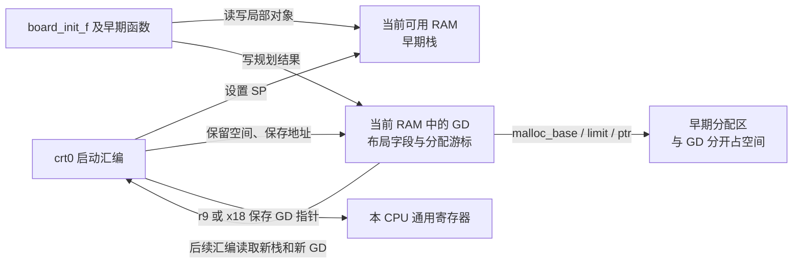
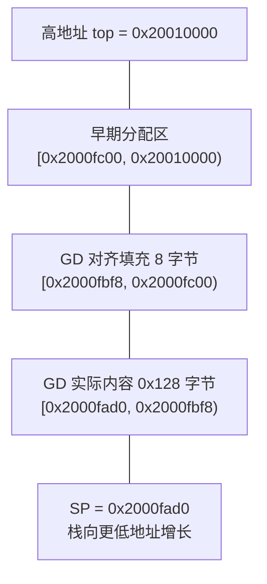
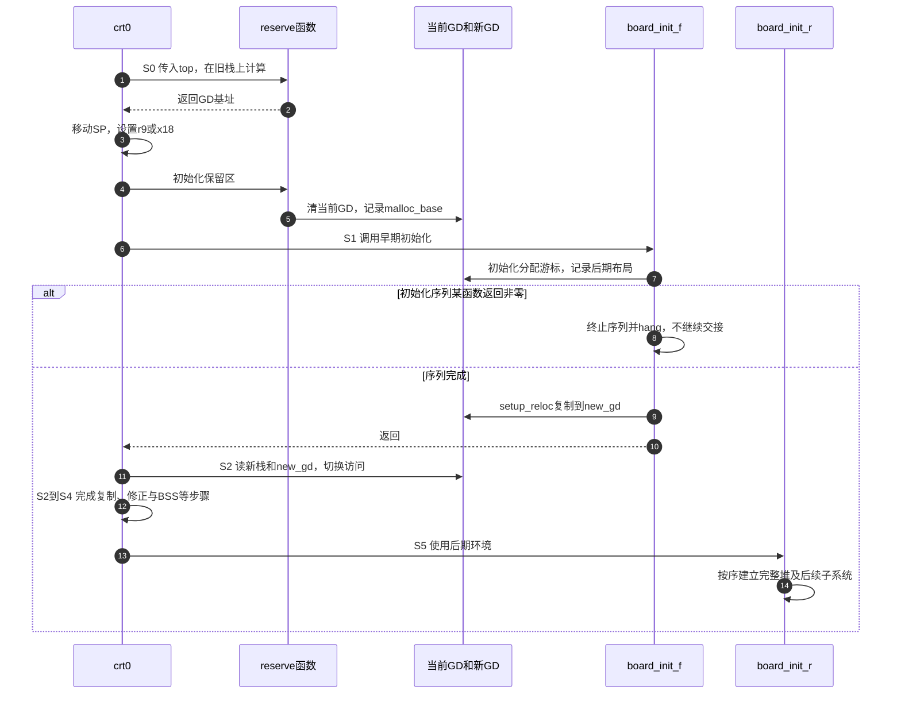

# 第4章\_先建立栈与GD再进入可用的C环境

[上一章](P03_从板配置到可核对的构建产物.md) 已经把源码构建成镜像，但文件里的 C 函数不会因为链接成功就自动获得运行环境。设想前级把控制权交给 U-Boot：当前栈指向哪里，未初始化的静态变量是否已经为零，`malloc()` 能从哪段内存取空间？这些问题不解决，第一条 C 调用就可能破坏启动现场。

本章放大 [第一章 S0～S5 周期](P01_从链接布局到启动阶段的交接.md#1.3_完整_U-Boot_的数据为什么分几次才能使用) 中的 **S0 有限环境、S1 规划目标和 S2 的 SP/GD 交接**，再解释 S5 如何建立完整分配器。继续采用上游 U-Boot v2022.10、提交 `4debc57a3da6c3f4d3f89a637e99206f4cea0a96`。ARM32 通用主路径作为主线，AArch64 只在必要处比较；SPL 分支单独标明。[源码总索引](../../../research/source_reading/uboot/navigation/README.md) 保留版本入口，[本模块导读](../../../research/source_reading/uboot/navigation/P04_栈与GD及分配器交接导读.md) 按同一阶段定位写入者和消费者。

## 4.1\_能执行\_C\_指令不等于所有\_C\_对象都已就绪

**讲解层次：概念层。** C 编译器生成的函数可能在栈上保存返回现场和局部对象，可能读写静态对象，也可能调用分配器或其他函数。编译器只按调用约定生成访问，并不负责为裸机初始化每一块存储。启动代码必须先保证它准备调用的那段代码所依赖的环境成立。

早期可以先提供一个小环境：在当前已经可靠可写的区域设置栈，再留出一块专门存放启动状态的空间。此时未必已经能修改最终 `.data` 所在区域，`.bss` 也未必清零。因此早期函数主要使用栈、常量和这块显式准备好的状态；它们不能随意读写普通可变全局对象。

这块启动状态就是 **GD（global data，全局启动数据）**。它是内存中的结构体，保存本次启动的内存布局、初始化标志、早期分配器游标等；CPU 的某个寄存器保存的是它的 **地址**，不是把整个结构体塞进寄存器。GD 的必要性来自交接：早期 C 函数要把算出的后期栈地址、重定位目标等结果交回启动汇编，而这些结果又不能依赖尚未就绪的普通全局变量。

GD 也不是“所有全局数据的总包”。早期分配区、栈、BSS 和最终堆都有自己的范围与生命周期；GD 用字段记录其中一些地址或状态。把 GD 清零，只证明这一个结构体的字节已初始化，不证明其他区域也已就绪。

下图的框表示 **软件使用的存储区或执行者**，不是新增硬件。箭头注明谁写、谁读；地址位置由本次布局决定。



## 4.2\_S0\_先算预留边界\_再移动栈\_最后写入\_GD

**讲解层次：实现层，U-Boot v2022.10。** 通用 ARM32 `crt0.S` 先按配置选择初始 SP，按 8 字节对齐后调用 `board_init_f_alloc_reserve(top)`。这个名字容易让人误以为它像 `malloc()` 一样立即改写内存，实际上它主要计算并返回保留区域的下边界。

为何分成两次调用？计算函数自己还在使用当前 C 调用栈。如果它一边执行、一边把这片栈上将来的 GD 区清零，就可能擦掉自身仍需使用的现场。实际顺序是：**在旧栈上计算 → 返回汇编 → 汇编把 SP 移到保留区下方 → 建立 GD 指针 → 再调用初始化函数写保留区**。这样下一次 C 调用的栈向低地址增长，避开上方的 GD 与早期分配区。

本例选择没有 `CONFIG_MALLOC_F_ADDR` 的普通路径、早期分配长度非零，并假设初始 top 为 `0x20010000`、早期分配区长度 `0x400`、`sizeof(struct global_data)` 为 `0x128`。这些数值仅用于算术演示，**不是某块板的地址或真实 GD 大小**。

1. 从 top 减去 `0x400`，得到 `0x2000fc00`，先给早期分配区留出预算。
2. 再减去 GD 实际大小 `0x128`，并向下按 16 对齐，得到 GD 基址 `0x2000fad0`。
3. 汇编将 SP 和 GD 指针设为这个基址；后续栈使用其下方空间。
4. 初始化函数只清零 GD 的 `0x128` 字节；GD 按 16 对齐占用 `0x130` 字节，所以再向上推进 `0x130` 得到 `malloc_base=0x2000fc00`。



图是地址区间顺序，连线不表示数据逐层流过。预留还要与当前代码、其他缓冲、异常栈和整片可用内存边界共同核对；函数做了减法不等于自动验证所有冲突。

旧稿追问的 `base += CONFIG_SYS_MALLOC_F_LEN` 不能跨版本当作固定实现。在本版 `board_init_f_init_reserve()` 中，关键向上推进是 **GD 大小向上取整后的长度**，随后把 `base` 记录为 `gd->malloc_base`；预留 early malloc 预算则发生在前面的 `top -= ...`。应问当前变量代表哪条边界、执行到哪一步，而不是记住一个看似通用的加法。[预留与初始化的唯一实现](../../../research/source_reading/uboot/source_explanations/P04_早期运行环境与GD交接实现.md#4.1_S0_计算边界与实际修改SP必须分开) 保留两函数和汇编交接。

## 4.3\_ABI\_约定如何连接汇编与\_C\_函数

上面的交接依赖一份共同约定：函数参数放在哪些寄存器，返回值在哪里，栈如何对齐，哪些寄存器被调用后仍应保留。这属于 **ABI（Application Binary Interface，应用二进制接口）** 的调用规则。汇编和编译器若各按自己的想法使用寄存器，即使代码都能单独汇编，也会在调用边界读错值。

这里使用的都是 CPU 通用寄存器或 SP，**不是 MMIO 地址**，不能按外设基址加偏移访问。下表只覆盖本章调用用到的角色，不代替完整浮点、复合参数和返回值规则。

| 本次用途 | ARM32 通用路径 | AArch64 通用路径 | 读写效果与约束 |
| --- | --- | --- | --- |
| 单个地址参数与结果 | 32 位 `r0` | 64 位 `x0` | 调用前传 top/base，函数返回后取计算结果；调用后不能指望旧参数仍在 |
| 栈指针 | 32 位 `sp` | 64 位 `sp` | 汇编切换下一次调用使用的栈区域；所选 crt0 分别按 8/16 字节对齐 |
| 本版 U-Boot 的 GD 地址 | 32 位 `r9` | 64 位 `x18` | 启动代码写地址，C 的 GD 访问按项目约定取它；这是项目实现选择 |
| 返回地址 | `lr`，即 `r14` | `x30`，通常别名 `lr` | 普通带链接调用写返回点，嵌套调用须按调用约定保存；跨重定位的返回点另有修正 |
| 常见整数参数起始寄存器 | `r0`～`r3` | `x0`～`x7` | 后续分配受类型与对齐规则影响，不能理解成任意对象都只占一个寄存器 |

规范对齐要求见 [AAPCS32 2025Q1，6.2.1 The Stack](https://github.com/ARM-software/abi-aa/blob/2025Q1/aapcs32/aapcs32.rst#the-stack) 与 [AAPCS64 2025Q1，6.4.5 The Stack](https://github.com/ARM-software/abi-aa/blob/2025Q1/aapcs64/aapcs64.rst#the-stack)。ARM32 的公共调用界面要求 SP 满足 8 字节对齐；AArch64 的公共界面要求 16 字节对齐，且通过 SP 访问内存也有相应约束。不能只说“不对齐时浮点会出问题”，然后忽略普通函数调用本身的约定。

`r9/x18` 在这里用于 GD，不代表所有 ARM 程序都用它们保存 GD。U-Boot 的 ARM 头文件还区分 GCC 寄存器变量与 Clang/LTO 读取辅助路径；写代码时应使用项目提供的声明和访问方式，不另造一个普通全局指针并假定编译器会自动放到同一寄存器。

## 4.4\_S1\_早期\_malloc\_为何简单\_又为何不能当完整堆

现在 GD 已经有地址，`malloc_base` 也记录了早期分配区，但分配器还需要知道容量和当前位置。主阶段的 `initf_malloc()` 设置 `malloc_limit` 为可用长度、`malloc_ptr=0`；SPL 的初始化路径有自己的同类设置。这里 `malloc_limit` 是本实现比较用的 **长度界限**，`malloc_ptr` 是相对基址的游标，不能仅凭字段注释里的 address 把两者都当绝对地址。

早期分配器可以采用很小的方案：从游标处取一段字节，再把游标推进并对齐。它不需要完整堆的空闲链表、合并和复杂元数据，因此适合资源有限的初始化阶段；代价是不能靠逐次 `free()` 回收这些小块，调用者也必须检查容量耗尽。空间被占用的原因可能是请求本身，也可能包含对齐填充。

本版 `malloc_simple()` 由 `common/malloc_simple.c` 实现。普通 `malloc()` 在完整分配器未启用、且配置提供早期分配区时可以转入它；配置直接选择 `SYS_MALLOC_SIMPLE` 时还会采用相应简化接口。其地址换算通过 `map_sysmem()` 完成，不能把源码中的系统地址转换省掉后宣称所有架构地址视图相同。

S1 中的状态分工如下，具体字段和分支见 [早期分配与完整堆的交接](../../../research/source_reading/uboot/source_explanations/P04_早期运行环境与GD交接实现.md#4.2_S1与S5_分配游标和完整堆分别初始化)：

| 状态 | 存储与写入者 | 读取者及含义 |
| --- | --- | --- |
| `malloc_base` | 当前 GD，由保留区初始化或指定地址配置路径设置 | 分配器计算本次实际区域起点 |
| `malloc_limit` | 当前 GD，由早期分配初始化设置 | 与新相对游标比较，限制使用量 |
| `malloc_ptr` | 当前 GD，初始化置零，成功分配后更新 | 下一次分配继续向后取空间 |
| 完整堆范围和管理元数据 | 后期 `mem_malloc_init()` 等路径准备 | 完整分配器按另一种管理协议使用 |
| `GD_FLG_FULL_MALLOC_INIT` | GD 的 flags，影响分配路径选择 | 不能脱离实际调用顺序单独当成“所有堆内存已初始化”的证据 |

最后一行有实际理由：本版主路径的 `initr_reloc()` 提前设置该标志，`init_sequence_r` 后面才执行 `initr_malloc()`；完整分配器还会检查自己的范围是否已初始化。SPL 的完整堆分支则在 `mem_malloc_init()` 后设置标志。必须核对所选路径，不能由一个宏名字推出通用时序。

更换 GD 或建立完整堆，并不自动把早期分配的每个对象搬进新堆。GD 的浅复制只复制字段值，指针指向的对象是否还可用要单独判断。尤其不能把早期区域返回的指针交给新完整堆的 `free()`，指望它识别另一套分配协议。

## 4.5\_用地址偏移实验检查布局\_清零和耗尽

把刚才的地址图变成一个可运行的 C 实验。程序用 4096 字节数组代表可用区域，输出的是 **数组内偏移**，不会访问真实 SRAM、修改 SP 或执行 ARM 启动指令。GD 的 `0x128` 大小、8 字节分配粒度都是教学选择；宿主的辅助状态结构不冒充真实 `gd_t`。

材料见 [early_memory.c](../../../labs/system_software/uboot/early_memory/early_memory.c)，完整代码如下。实验重点是先验证区间、只清指定区间、成功才推进游标；为避免给大整数计算留下歧义，容量检查采用减法形式。

```c
#include <assert.h>
#include <stdbool.h>
#include <stddef.h>
#include <stdio.h>
#include <string.h>

#ifndef ARENA_BYTES
#define ARENA_BYTES 0x400u
#endif

struct arena_state {
    size_t base;
    size_t limit;
    size_t cursor;
};

static bool take_bytes(struct arena_state *arena, size_t bytes, size_t *offset)
{
    /* 教学模型采用 8 字节粒度，先检查剩余容量，失败不推进游标。 */
    if (!bytes || arena->cursor > arena->limit ||
        bytes > arena->limit - arena->cursor)
        return false;
    size_t end = arena->cursor + bytes;
    size_t padding = (8u - end % 8u) % 8u;
    if (padding > arena->limit - end)
        return false;
    *offset = arena->base + arena->cursor;
    arena->cursor = end + padding;
    return true;
}

static int run_layout(size_t arena_bytes)
{
    unsigned char memory[0x1000];
    const size_t top = sizeof(memory);
    const size_t gd_bytes = 0x128; /* 假设值，不是实际 U-Boot 的 sizeof(gd_t)。 */
    if (arena_bytes > top || gd_bytes > top - arena_bytes)
        return 1;
    const size_t gd_base = (top - arena_bytes - gd_bytes) & ~(size_t)15;
    const size_t gd_rounded = (gd_bytes + 15u) & ~(size_t)15;
    const size_t arena_base = gd_base + gd_rounded;
    if (gd_base < 0x100 || arena_base > top || arena_bytes > top - arena_base)
        return 1; /* 本模型至少为下方栈区留下 256 字节。 */

    memset(memory, 0xa5, sizeof(memory));
    /* 只清 GD 的假设区间，模拟早期清 GD 与整个 BSS 清零的区别。 */
    memset(memory + gd_base, 0, gd_bytes);
    printf("gd=0x%zx arena=[0x%zx,0x%zx) stack_top=0x%zx\n",
           gd_base, arena_base, arena_base + arena_bytes, gd_base);
    printf("gd_first=%02x other_byte=%02x\n",
           (unsigned)memory[gd_base], (unsigned)memory[0]);

    struct arena_state arena = {arena_base, arena_bytes, 0};
    size_t first = 0, second = 0, unused = 0;
    if (!take_bytes(&arena, 13, &first) || !take_bytes(&arena, 13, &second))
        return 2;
    printf("first=0x%zx second=0x%zx used=%zu\n", first, second, arena.cursor);
    const size_t before = arena.cursor;
    const bool accepted = take_bytes(&arena, arena_bytes, &unused);
    assert(!accepted && arena.cursor == before);
    printf("oversize=rejected cursor_unchanged=%s\n",
           arena.cursor == before ? "yes" : "no");
    return 0;
}

int main(void)
{
    return run_layout(ARENA_BYTES);
}
```

在 Linux Bash 或 MSYS2 Bash、宿主 GCC 环境执行：

```bash
# linux-note 仓库根目录，输出写入独立临时目录。
memory_lab=$(mktemp -d "${TMPDIR:-/tmp}/uboot-memory.XXXXXX")
gcc -std=c11 -Wall -Wextra -Werror \
  labs/system_software/uboot/early_memory/early_memory.c \
  -o "$memory_lab/early_memory.exe"
"$memory_lab/early_memory.exe"
```

默认结果为：

```text
gd=0xad0 arena=[0xc00,0x1000) stack_top=0xad0
gd_first=00 other_byte=a5
first=0xc00 second=0xc10 used=32
oversize=rejected cursor_unchanged=yes
```

第一行对应前面地址图去掉基址后的布局。第二行证明清 GD 没有清整片内存。第三行两次各请求 13 字节，却共推进 32 字节，差额来自对齐。第四行证明失败没有消耗游标。这是带额外范围检查的教学模型，不是上游分配器的逐字副本，更没有验证真实板的内存可靠性。

先预测再修改：把编译命令加上 `-DARENA_BYTES=32`，两次请求还能成功吗？再改成 16 呢？**答案：** 32 字节正好容纳两次对齐后的请求，后续超额请求失败；16 字节只能容纳第一次，程序返回 2。若把区域预算改得比整个数组还大，程序在计算 GD 之前返回 1。增加 malloc 预算会把 GD 与栈边界向低地址挤压，不能只看分配器“空间更多”，还要核对其他区域余量。

## 4.6\_S1\_到\_S5\_GD\_搬了以后\_谁接着使用它

早期环境的意义最终在交接中体现。主 `board_init_f()` 按初始化序列准备内存与后期布局，`reserve_global_data()` 留出 `new_gd`，`setup_reloc()` 把当前 GD 内容复制过去；返回 `crt0` 后，汇编才切换 GD 指针与栈。更换指针前后访问的是两份不同位置的结构体，不能把“有了 new_gd 字段”当成已经切换。

| 本章观察点 | 第一章公共阶段 | 当前状态交接 |
| --- | --- | --- |
| 计算、切栈、清 GD | [S0 有限环境](P01_从链接布局到启动阶段的交接.md#1.3_完整_U-Boot_的数据为什么分几次才能使用) | 汇编与保留区函数建立当前 GD |
| 记录布局、准备新 GD 内容 | [S1 规划目标](P01_从链接布局到启动阶段的交接.md#1.3_完整_U-Boot_的数据为什么分几次才能使用) | C 初始化序列写当前 GD，再复制到新位置 |
| 改 SP 和 GD 指针 | [S2 切换与复制](P01_从链接布局到启动阶段的交接.md#1.3_完整_U-Boot_的数据为什么分几次才能使用) | 汇编从旧 GD 读取地址，后续访问新 GD |
| 主体重定位与 BSS 就绪后初始化完整堆 | [S3～S5](P01_从链接布局到启动阶段的交接.md#1.3_完整_U-Boot_的数据为什么分几次才能使用) | 不同状态分别完成，后期消费者按新环境运行 |



第 3 步在第 5 步写 GD 之前改变栈边界；第 9～11 步区分“新位置有了副本”和“CPU 已转用副本”；第 12 步仍包含第一章已展开的主体重定位与 BSS 工作，不能仅因 GD 迁移结束就跳过它们。初始化序列按返回值决定是否终止，`hang()` 是失败后的停机路径，**不是拿 GD 标志充当多核锁来拦住第二个 CPU**。

SPL 不应直接套用整条主阶段路径。本版 ARM32/ARM64 的通用 `crt0` 在 SPL 分支跳过主程序的 `relocate_code()`，可按配置调用 `spl_relocate_stack_gd()`；迁移栈/GD 不等于复制 SPL 主体，也不等于重新运行 DDR 训练。ARM32 的 `CONFIG_SPL_EARLY_BSS` 还能改变 BSS 清零时点，AArch64 同版本文件有不同分支顺序。下一步研究加载器时，必须先确认当前阶段、可用内存和板级钩子，才谈它从哪个介质把谁加载到哪里。
