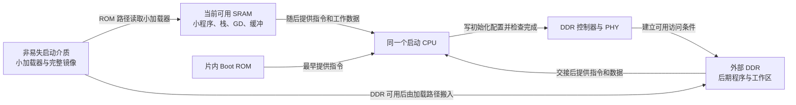
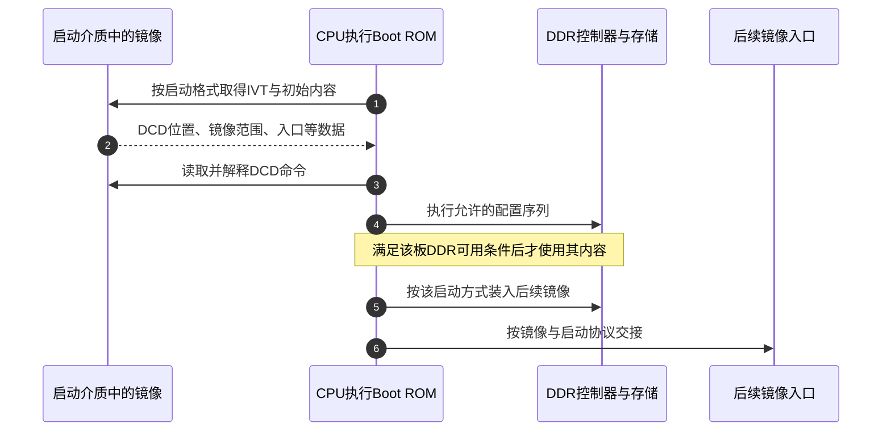
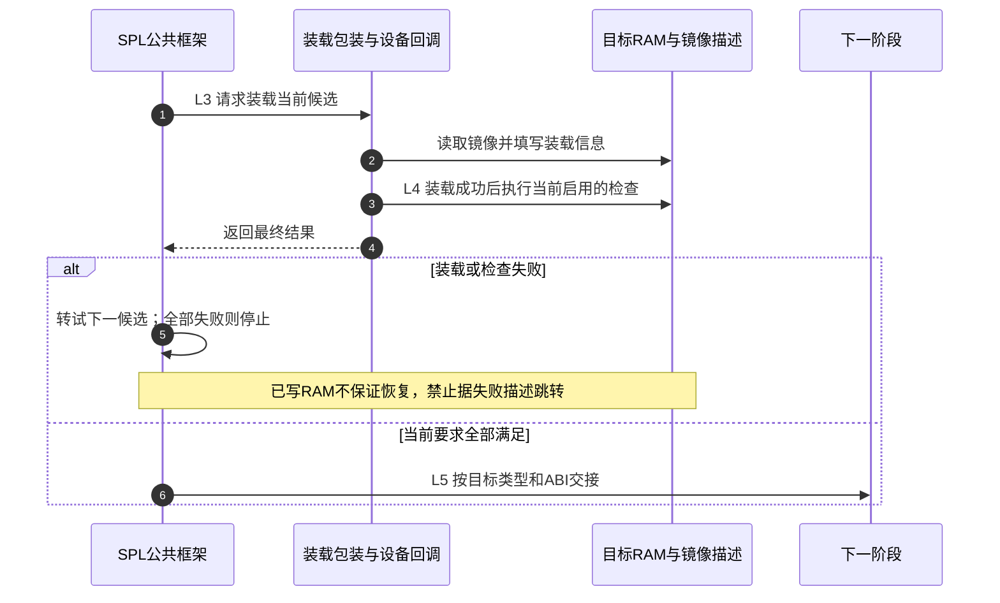

# 第5章\_为什么需要SPL以及它怎样交出下一阶段

[上一章](P04_先建立栈与GD再进入可用的C环境.md) 已经解释一段启动代码怎样准备栈和 GD。但这段代码先从哪里来？如果完整 U-Boot 比复位时可用的内存还大，而大容量 DDR 又尚未可用，难道要先把初始化 DDR 的程序放到 DDR 才能执行？这个循环正是分阶段启动要解决的问题。

本章先从存储和执行条件推导加载阶段，再沿一个 **SPL 初始化内存、装入 U-Boot proper 并交出控制权** 的场景走完流程。具体函数继续固定上游 v2022.10、提交 `4debc57a3da6c3f4d3f89a637e99206f4cea0a96`，入口见 [源码总索引](../../../research/source_reading/uboot/navigation/README.md) 与 [加载交接导读](../../../research/source_reading/uboot/navigation/P05_SPL装载与下一阶段交接导读.md)。平台反例会标明芯片与资料版本，不能用一个板的路径定义全部 ARM 启动。

## 5.1\_先有一小块可靠环境\_才能建立更大的环境

**讲解层次：概念层。** 处理器执行一条指令之前，取指地址必须已经能提供正确内容；C 函数还可能需要可靠的栈和工作数据。外部 DDR 的控制器、时钟、引脚、电气参数和必要训练尚未就绪时，不能仅因为地址图给它分配了范围，就把它当作可靠工作区。

先区分三个对象。**Boot ROM** 是芯片启动固件的存放位置，CPU 从其中执行指令；**SRAM** 通常提供无需按外部 DDR 那样训练的片内工作空间，但可访问范围、保留区和电源条件仍由平台规定；**DDR/DRAM** 提供较大的主存，需要先满足控制器与器件的初始化条件。Boot ROM 不是另一颗替 CPU 执行初始化的处理器，流程图中的“ROM 做某事”通常是“CPU 正在执行 ROM 中的代码”。

这些内存名称还来自不同分类角度。**静态随机存取存储器（Static Random-Access Memory，SRAM）** 与 **动态随机存取存储器（Dynamic Random-Access Memory，DRAM）** 区分存储单元的保持方式；DRAM 需要刷新。**双倍数据率（Double Data Rate，DDR）** 描述相应接口在时钟两沿传输数据的方式，本专题谈到的 DDR 内存属于 DRAM。于是“初始化 DRAM”说的是使这类主存可用，“DDR 初始化”更具体地指控制器、接口和器件相关设置；它们不是先初始化两块不同内存，也不意味着每条 CPU 指令都因此快一倍。

再把存储介质放进来：SD/eMMC、NAND 和 SPI Flash 里的镜像字节不一定能直接作为 CPU 指令读取。ROM 可能只能从有限介质、固定格式和有限初始区域取数据；加载器需要把选定镜像复制到可执行位置。某些平台支持 **XIP（execute in place，原地执行）**，程序直接从可取指的映射存储执行，但其可写数据和栈仍须另有可靠位置。可取指地址与可写 RAM 不是同一个条件。

假设某平台的 ROM 能把一个小程序放进可用 SRAM。最小可行方案就是：小程序在 SRAM 中运行，用自己的栈和数据准备 DDR；确认 DDR 可用后，再把较大的程序装进去。建立 DDR 可用性的那段代码及其必要工作数据必须先放在 **已经可靠的环境**，不能把自己唯一依赖的存储前提留到执行之后才成立。这个环境常是 ROM 加片内 SRAM，也可能是平台明确支持的其他存储组合；“只能在 SRAM 执行”同样过于绝对。

图中的框是物理存储或控制器，箭头标明取指、配置、复制和后续使用，不是五个并行工作线程。图固定本节的教学场景，不声称所有 SoC 都采用这些地址关系。



这里的 PHY 是连接控制逻辑与外部存储信号的物理接口部分，是否有独立训练固件、哪些步骤由硬件完成，必须看具体控制器。本文只使用“初始化完成后该内存可可靠访问”的交接条件，不把某代 DDR 的训练步骤推广到全部产品。

## 5.2\_SPL与TPL是对约束的分工\_不是芯片等级

**SPL（Secondary Program Loader，二级程序加载器）** 是 U-Boot 工程中的一个精简加载阶段。它可以只保留早期硬件初始化、必要存储驱动和镜像加载能力，使这部分代码能在完整 U-Boot 尚不能进入的环境中运行。**U-Boot proper** 指后面的完整主程序，通常包含命令行及更完整的启动逻辑；它不是 SPL 的一个普通函数。

这一拆分保留了大程序的功能，又把最早环境需要承受的代码和数据缩小了。代价也很具体：多个镜像要分别构建和打包，阶段之间要约定地址、格式、入口与状态，早期功能减少后诊断能力可能更有限。若 ROM 已能直接建立所需内存环境并装入完整程序，或者程序能在已有映射存储中运行，额外拆一层未必有价值。

仅看 `u-boot-spl.bin` 的文件大小仍然不够。假设一块教学板只给当前阶段留下 64 KiB 可用 SRAM，而代码/只读数据 40 KiB、已初始化数据 4 KiB、BSS 8 KiB、最坏栈 8 KiB、早期分配区 8 KiB、读取缓冲 4 KiB，合计就是 **72 KiB**。BSS 可以不占对应的镜像文件字节，却仍占运行内存。GD、对齐、ROM 保留空间和其他缓冲也必须进入实际预算；同一缓冲若确实分时复用，才可按已证明的生命周期减少同时占用。

若经过裁剪仍装不下，而平台允许更小程序先建立 DDR，再让较完整的 SPL 使用 DDR，就可能再引入 **TPL（Tertiary Program Loader，三级程序加载器）**。名字里的 tertiary 不表示它在时间上必须排在 SPL 后面；常见 U-Boot 顺序恰是 TPL 在 SPL 前。TPL 只保留打破当前内存约束所需的最小职责，再把加载能力交给 SPL。只有板级 ROM 协议、构建和装载路径支持这个交接，这种拆分才成立。

| 候选组织 | 前提与改变的环节 | 新成本或限制 |
| --- | --- | --- |
| ROM → proper | ROM 或前级已建立 proper 所需环境并支持其镜像 | 依赖该 ROM 的格式、配置能力和可用空间 |
| ROM → SPL → proper | 精简 SPL 及工作区能进入最早环境 | 多一份镜像和一条加载/交接协议 |
| ROM → TPL → SPL → proper | 更小 TPL 能先解决 SPL 的运行前提，平台支持下一阶段加载 | 更多阶段、镜像组合与调试边界 |
| 厂商 DDR 固件或 miniloader 参与 | 固件接口和打包工具明确规定其职责 | 必须另记二进制版本、参数和交接契约，不能只改称 TPL |

本版上游 [Generic SPL framework，U-Boot Phases](../../../research/source_reading/uboot/upstream/v2022.10/doc/develop/spl.rst) 还描述可选 VPL 验证阶段，并明确其当时实现仍在演进。本章不把它加入固定主线。判断自己的板需要几层，要逐层回答“谁能把谁放到哪里、进入时什么已经可用”，不能从 SoC 型号、ARM32/ARM64 或 SRAM 总容量单独推出答案。

## 5.3\_用DCD反例校正BootROM的能力边界

**讲解层次：平台实现，i.MX6ULL RM Rev.1，11/2017。** 前面的教学场景让 SPL 建立 DDR 环境，但它不是所有平台的必经路径。i.MX6ULL 的 ROM 能解释镜像中的 **DCD（Device Configuration Data，设备配置数据）**，据此配置片上外设；手册明确把 DDR 所需的寄存器配置列为用途之一。

DCD 是数据表，不是一段由 CPU 当普通指令执行的 C 程序。CPU 仍执行 ROM 中的解释逻辑，从镜像取得允许的命令和地址/值，再按规定配置硬件。这样，板级 DDR 配置可以随镜像提供，执行它的代码却已经在 ROM 中可用，因而没有“必须先在未初始化 DDR 执行 DDR 初始化代码”的循环。

要找到 DCD，ROM 先读镜像的 **IVT（Image Vector Table，镜像向量表）**。这里的 IVT 是镜像元数据，不能与 CPU 异常向量表混淆。它含有 DCD 和入口等地址；Boot Data 则描述镜像范围。下表按手册表 8-26、8-27 摘取当前推理所需字段，读者不必离开正文查含义。

| 结构与字段 | 本场景含义 | 由谁读取或使用 |
| --- | --- | --- |
| IVT `entry` | 镜像第一条执行指令的绝对地址 | ROM 完成相应加载/检查后用来交接 |
| IVT `dcd` | DCD 绝对地址；不需要时可为空 | ROM 的 DCD 解释路径 |
| IVT `boot data` | Boot Data 的绝对地址 | ROM 确定镜像描述位置 |
| Boot Data `start` / `length` | 镜像起点和字节长度 | ROM 的镜像范围处理 |
| Boot Data `plugin` | 是否采用插件镜像的标志 | ROM 选择对应协议；本节只讨论 DCD 路径 |

本地重绘下面的关系，强调表由谁解释；它不是内存地址按比例的布局图，也没有省略“先初始化再使用 DDR”的条件。



第 3～4 步仍由 ROM 代码推进，第 5～6 步才使用建立后的环境。图只画成功路径；镜像认证、错误处理和其他启动方式须按所选配置另核对，不能由 DCD 存在推出整个安全启动已成立。

手册图 8-23、8-24 的 DCD 布局可在当前层概括为 **4 字节头部 → 顺序排列的允许命令**。头部的 tag 为 `0xD2`，两字节大端 length 包括整个 DCD 及头部，version 为 `0x41`；本版给出的 DCD 最大尺寸是 1768 字节。这些是 DCD 数据格式，不是某个 MMIO 寄存器表。实际使用的寄存器和值仍必须由板的 DDR 设计确定，本章不提供跨板通用写寄存器清单。

依据为手册 §8.3.3（p.259）、§8.7.1.1～8.7.2（pp.310～312）；版本、摘要与取得入口见 [ARM 资料索引](../../../reference/external_resources/arm/README.md)，官方入口为 [NXP i.MX6ULL 文档页](https://www.nxp.com/products/i.MX6ULL)。固定 U-Boot 原件中，`board/freescale/mx6ullevk/imximage.cfg` 的非插件分支提供 DCD 数据，`configs/seeed_npi_imx6ull_defconfig` 则明确启用 SPL。它们已经说明，同属 i.MX6ULL 不能代替对实际板级方案的核对；配置模板还须求值得到实际 `.config`，不能仅凭另一个模板没写 SPL 就断言所有相关分支都关闭。

Rockchip 同样不能按品牌作绝对判断。本版 [Rockchip 文档](../../../research/source_reading/uboot/upstream/v2022.10/doc/board/rockchip/rockchip.rst) 分开描述 U-Boot TPL/SPL 打包与厂商 miniloader 组织，还给出选定平台的 SPL 单独打包和 TPL+SPL 组合。旧稿中没有不可变提交身份的厂商配置片段，已经在 [历史身份核对](../../../research/investigations/uboot_vendor_baselines.md#1.1_先拆开附件身份再比较启动方案) 保留；其中目录名、板字段和阶段选项需分别读取，不能据某个名称推广“RK3566 永远不需要 TPL”。

## 5.4\_SPL的完整周期是准备环境\_装载\_检查与交接

现在固定为“ROM 已把 SPL 放入可靠区域，由 SPL 建立所需 DDR 环境，再装入 proper”的主场景。**讲解层次：概念到实现映射，U-Boot v2022.10。** 同名 `board_init_f/r` 属于哪个镜像已经在第二章分清；这里选 SPL 自己的初始化与公共加载框架，不套用主 U-Boot 的整套重定位序列。

本章用 L0～L5 描述加载器自身周期。它发生在第一章 proper 的 S0～S5 之前；SPL 也会使用第四章解释的有限 C 环境，但两个程序不是共享一个持续运行的 `board_init_r()`。

| 本章阶段 | 进入条件与状态变化 | 与前文阶段的关系 |
| --- | --- | --- |
| L0 SPL 获得执行权 | 当前镜像、初始栈/GD 路径可执行 | 复用 [早期环境原理](P04_先建立栈与GD再进入可用的C环境.md#4.2_S0_先算预留边界_再移动栈_最后写入_GD)，具体宏属于 SPL 构建 |
| L1 建立加载所需硬件条件 | 板级早期路径准备时钟、DDR 或必要接口 | 不能从 proper 的 S1 初始化项列表推定本板 SPL 调用项 |
| L2 准备 SPL 公共服务 | BSS/栈交接及 `spl_init` 等按配置完成 | [GD 和分配器交接](P04_先建立栈与GD再进入可用的C环境.md#4.6_S1_到_S5_GD_搬了以后_谁接着使用它) 的 SPL 分支边界 |
| L3 选择来源并读取 | 候选设备、加载回调、RAM 中镜像内容逐步形成 | 仍是 SPL 的程序周期 |
| L4 完成当前配置要求的检查 | 描述中的大小、装载位置、入口及类型可用于交接 | 不是重新执行 proper 的链接器 |
| L5 交出控制权 | 按下一镜像 ABI 准备现场并跳转 | 成功进入 proper 才开始其 [S0～S5 周期](P01_从链接布局到启动阶段的交接.md#1.3_完整_U-Boot_的数据为什么分几次才能使用) |

L1 中，`dram_init()` 的名字不能独自证明 DDR 训练就发生在这次调用；它也可能接收前级已准备的环境并整理内存信息。必须继续追到板级定义和前级协议。某些 Rockchip 路径还支持返回 Boot ROM 继续加载，不能把箭头一律画成 SPL 自己直接读取所有阶段。

L3 的公共入口在 `common/spl/spl.c` 的 `board_init_r()`。它创建候选设备数组 `spl_boot_list` 和本次镜像描述 `spl_image`；这些是当前调用的对象。板级 `board_boot_order()` 填候选顺序，公共代码按顺序查找已链接进当前镜像的加载器，再由回调完成该介质与格式的处理。描述中的 `load_addr` 是装载目的地址，`entry_point` 是后续执行入口，二者不能默认相等。

| 对象 | 状态保存位置与写入者 | 后续读取者 |
| --- | --- | --- |
| 候选设备列表 | SPL `board_init_r` 的数组，板级钩子填充 | `boot_from_devices` 顺序尝试 |
| 加载器记录 | 当前 SPL 的链接列表，构建时登记设备类型和回调 | `spl_ll_find_loader` 按设备类型匹配 |
| `struct spl_image_info` | 当前调用栈上的镜像描述，加载回调及解析路径填写 | 检查、修正和下一镜像分派路径 |
| 目标镜像字节 | 已准备好的目标 RAM，由存储读取路径写入 | 检查代码，随后才是目标 CPU 执行流 |

上述类型、字段及回调的唯一实现见 [加载对象与选择实现](../../../research/source_reading/uboot/source_explanations/P05_SPL装载与下一阶段交接实现.md#5.1_L2到L3_候选设备与加载器记录怎样相遇)。SPL 的 `spl_init()` 失败会导致停止；`GD_FLG_SPL_INIT` 用来记录公共初始化进度，不是多 CPU 之间的抢占标志或锁。

## 5.5\_加载失败之后\_什么能回退\_什么已经改变

读取到一些字节、解析出入口、允许跳转，是三种不同状态。如果头部检查或当前要求的完整性检查失败，不能继续消费一个“看起来像地址”的字段。当前公共框架可以转试下一个候选设备；所有候选失败则停止，不把未成功的描述交给下一阶段。

但 **失败不等于回滚**：加载器可能已向目标 RAM 写入部分内容，也可能改变控制器状态。后续尝试必须重新建立自己所需的描述和内容；公共框架复用镜像描述对象，并不替每个加载器事务式恢复所有内存。具体清理、覆盖和失败副作用属于加载器契约。[加载结果与退出实现](../../../research/source_reading/uboot/source_explanations/P05_SPL装载与下一阶段交接实现.md#5.2_L3到L5_成功结果怎样成为交接入口) 保留实际顺序。



第 2 步允许发生部分写入；第 3 步只在装载成功后执行当前启用的检查，并非无条件解析失败数据。第 5 步不能画成“擦掉刚才所有操作”；第 6 步前仍须完成所选路径的修正和交接准备，也不代表每种目标都使用同一条函数调用。

例如，直接进入 U-Boot 的弱默认路径使用 `entry_point` 构成无参数入口函数并调用；加载 Linux 或可信固件时还可能需要设备树、参数、异常级与缓存状态等不同协议。SPL 也可能按配置直接启动操作系统，因此“下一阶段必然是 proper”只是本章主场景。所选格式允许裸镜像时，框架行为又不同于有头部格式；CRC 校验也不能代替密码学认证。这里的“成功”只能按实际启用的检查解释。

## 5.6\_用一个可运行模型观察回退与禁止交接

下面的宿主 C 模型使用两个内存数组模拟主、备来源，用另一数组模拟目标 RAM。教学格式的前四字节必须是 `DEMO`，第五字节给出入口偏移；这不是 U-Boot 镜像格式，也不执行数组里的机器码。它保留的关键过程是 **先检查可用环境、允许装载写入、检查结果、失败回退、成功才发布交接信息**。

完整材料为 [loader_handoff.c](../../../labs/system_software/uboot/loader_handoff/loader_handoff.c)。与上游的差异是模型只在成功后写结果对象，真实加载器可能在失败前已部分填写同一个描述；不要据模型推断上游具有事务提交机制。

```c
#include <stdbool.h>
#include <stddef.h>
#include <stdio.h>
#include <string.h>

struct image_result {
    size_t size;
    size_t entry_offset;
    const char *source;
};

struct candidate {
    const char *name;
    const unsigned char *bytes;
    size_t size;
};

static bool try_load(const struct candidate *candidate,
                     unsigned char *ram, size_t capacity,
                     struct image_result *result)
{
    printf("try %s\n", candidate->name);
    if (candidate->size < 8 || candidate->size > capacity) {
        puts("range rejected before copy");
        return false;
    }
    memcpy(ram, candidate->bytes, candidate->size);
    /* 失败检查发生在复制之后，RAM 已可能改变，不能把失败当成回滚。 */
    if (memcmp(ram, "DEMO", 4) != 0) {
        puts("header rejected after copy");
        return false;
    }
    const size_t entry = ram[4]; /* 教学格式：第五字节是数组内入口偏移。 */
    if (entry < 8 || entry >= candidate->size) {
        puts("entry rejected after copy");
        return false;
    }
    *result = (struct image_result){candidate->size, entry, candidate->name};
    return true;
}

int main(int argc, char **argv)
{
    bool ram_ready = true, fail_all = false;
    if (argc == 2 && strcmp(argv[1], "no-ram") == 0)
        ram_ready = false;
    else if (argc == 2 && strcmp(argv[1], "fail") == 0)
        fail_all = true;
    else if (argc != 1)
        return 2;

    unsigned char ram[64] = {0};
    const unsigned char good[16] = {'D', 'E', 'M', 'O', 8};
    const unsigned char bad[16] = {'B', 'A', 'D', '!', 8};
    struct candidate devices[] = {
        {"primary", bad, sizeof(bad)},
        {"backup", fail_all ? bad : good, sizeof(good)}
    };
    struct image_result result = {0};
    if (!ram_ready) {
        puts("RAM unavailable: no copy, no handoff");
        return 3;
    }
    for (size_t i = 0; i < sizeof(devices) / sizeof(devices[0]); ++i) {
        if (try_load(&devices[i], ram, sizeof(ram), &result)) {
            printf("handoff model: source=%s size=%zu entry=%zu\n",
                   result.source, result.size, result.entry_offset);
            return 0; /* 只报告交接条件，不把数组当机器码执行。 */
        }
    }
    printf("all failed: RAM starts with %c, no handoff\n", ram[0]);
    return 4;
}
```

在 Linux Bash 或 MSYS2 Bash、宿主 GCC 环境执行，输出写入独立临时目录：

```bash
# linux-note 仓库根目录。
loader_lab=$(mktemp -d "${TMPDIR:-/tmp}/uboot-loader.XXXXXX")
gcc -std=c11 -Wall -Wextra -Werror \
  labs/system_software/uboot/loader_handoff/loader_handoff.c \
  -o "$loader_lab/loader_handoff.exe"
"$loader_lab/loader_handoff.exe"
```

默认先从主来源读入错误头部，再从备来源得到有效内容：

```text
try primary
header rejected after copy
try backup
handoff model: source=backup size=16 entry=8
```

给程序加参数 `fail`，两个候选都失败，最后输出 `all failed: RAM starts with B, no handoff`，返回 4。RAM 里的 `B` 说明失败装载已经改变目标，但这并未获得执行许可。加参数 `no-ram` 则在尝试任何来源以前返回 3，输出 `RAM unavailable: no copy, no handoff`。真实故障中应同样区分“还不能写目标内存”和“可以写，但镜像或读取失败”，否则很容易在错误层反复换文件。

再做两个修改预测。把有效镜像的入口字节从 8 改成 16，会怎样？**答案：** 入口等于长度，已经落在半开区间之外，因此备来源也失败，不交接。把主来源改成有效镜像呢？**答案：** 主来源成功后立即结束候选循环，不再访问备来源；回退列表不是每次把所有来源都执行一遍。

现在可以判断阶段存在的原因，也能沿装载状态区分“运行环境成立、内容已读入、检查已通过、入口已执行”。仍不能仅凭这些步骤解释 ARM32/ARM64 的复位、异常级和多核等待；[下一章](P06_从复位入口到异常向量与主核交接.md) 回到具体处理器入口，把寄存器含义与平台前级协议分开核对。
