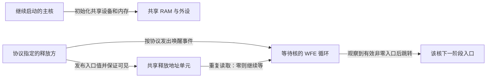
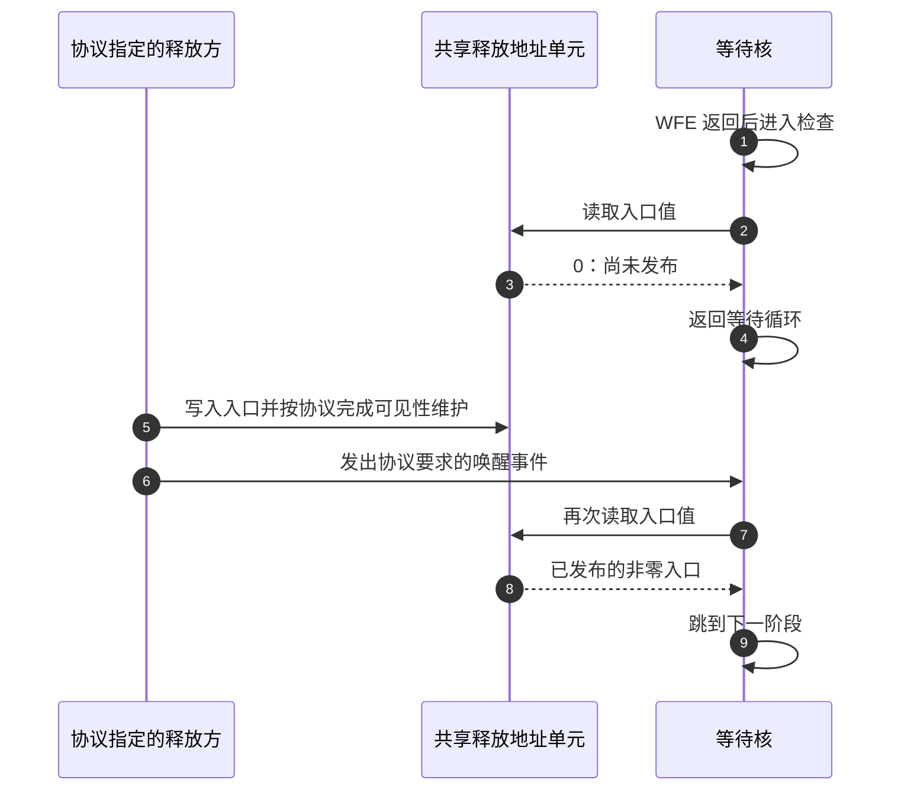

# 第6章\_从复位入口到异常向量与主核交接

[上一章](P05_为什么需要SPL以及它怎样交出下一阶段.md) 已经把“镜像已装载”和“可以交出执行权”分开。现在让前级跳到一个 ARM U-Boot 镜像：地址正确，机器码也正确，为什么第一件事仍不能直接调用普通 C 函数？

栈和 GD 是第四章给出的部分答案。另一些条件保存在处理器自身：当前权限、异常入口、选用哪个栈，以及是否已经启用地址转换。多个处理器同时进入镜像时，还要决定谁继续初始化共享设备。本章把这些条件放回入口路径，解释为什么源文件中的 `reset` 标签既不保证刚刚发生硬件复位，也不证明当前处理器运行在最高权限。

**讲解层次：概念到实现的映射。** 架构部分使用 Arm ARMv8-A 手册 DDI0487 G.b；代码实例固定 U-Boot v2022.10。先沿 [源码总索引](../../../research/source_reading/uboot/navigation/README.md) 定位版本，再进入 [ARM 入口模块导读](../../../research/source_reading/uboot/navigation/P06_ARM入口与异常向量导读.md)。这里不把旧厂商 SDK 的相似汇编当作同一实现。

## 6.1\_为什么进入reset标签不等于处理器刚刚复位

设想 ROM 已经把 SPL 放入可执行内存，SPL 又加载了 U-Boot proper。处理器只在最开始经历硬件复位；后面的两次交接通常是正在执行的软件改变控制流。它们可以落到各自名为 `reset` 的函数或标签，但名字不会清空系统寄存器，也不会使处理器重新进入复位权限。

需要分别记录三个地址。**硬件复位入口** 由处理器与 SoC 的复位配置决定，通常先进入 ROM。**镜像入口** 是前级按照镜像格式和交接协议选择的地址，U-Boot 的 `_start` 常在这里转向 `reset`。**异常向量基址** 则告诉硬件：正常运行中发生异常后，到哪里寻找处理入口。修改第三个地址，不会改写 ROM，也不会重新执行镜像头部。


图中的盒子是执行阶段或代码区域，不是三个处理器。ROM 到 SPL、SPL 到 proper 的箭头是否还经过安全固件，取决于平台；图只固定当前需要的交接关系。没有 SPL 的板可以由 ROM 直接交给另一前级或 proper，不能从这张图反推芯片必须采用三级启动。

在 AArch64 架构中，复位进入最高实现的异常级；该级的复位地址可由对应 `RVBAR_ELx` 描述。**这项复位规则不能移植到软件跳转。** 假如安全固件在 EL3 工作，随后按照协议把 proper 交到 EL2，proper 的 `reset` 就从 EL2 开始。EL 表示 Exception Level，即异常级，数字表达权限与异常处理层次，不是核编号或启动阶段编号。

> 架构依据：[DDI0487 G.b](https://developer.arm.com/documentation/ddi0487/gb)，D1.9 Reset，p.2471；D1.10.2 Exception vectors，pp.2477～2478。这里使用其中的复位与向量规则，不假定某块板的 ROM 地址。原件身份与取得方式见 [ARM 资料索引](../../../reference/external_resources/arm/README.md)。

## 6.2\_先识别当前权限再配置当前处理器

前级可能从不同异常级交出执行权，入口软件就不能无条件写 EL3 专用寄存器。否则在 EL1 进入的镜像可能在准备环境之前先触发非法访问。最小办法是先读取当前级别，再选择该级允许执行的配置路径。

U-Boot 的 `switch_el` 正是在做这件事。它读取 `CurrentEL`，比较后跳到 EL3、EL2 或 EL1 标签。**标签分支没有改变当前异常级。** 与此不同，真正从 EL3 降到 EL2，需要准备目标状态和返回地址，最后执行异常返回指令 `ERET`。因此阅读汇编时要区分“按 EL 选择代码”和“改变 EL”。两者都可能在注释里出现 switch，不能仅据英文单词判断。

这些寄存器是本处理器的硬件状态，不是共享 RAM 中的 C 变量。后文把一个执行指令的处理器元素称为 **PE（Processing Element）**，这里按一个核提供一个 PE 来理解。下面只列当前推理所需的访问与字段；`xN` 表示一个 64 位通用寄存器，`ELx` 必须替换成实际目标级别。

| 寄存器或接口 | AArch64 访问方式 | 当前需要的字段与效果 | 不能据此推出什么 |
| --- | --- | --- | --- |
| `RVBAR_ELx` | 存在对应实例且权限允许时以 `MRS` 只读访问 | 描述该最高实现异常级的复位向量地址，由实现或平台配置提供 | 不能用 MSR 改写成任意软件入口，也不等同于 VBAR |
| `CurrentEL` | `MRS xN, CurrentEL`，只读 | `EL[3:2]`：普通 EL1/2/3 环境分别读出 `0x4/0x8/0xc` | 读取或分支不会提高或降低权限；本章不覆盖嵌套虚拟化对读取的改变 |
| `SPSR_ELx` | 在允许权限下 `MRS/MSR` | 保存供异常返回恢复的 PSTATE，包括目标执行模式与屏蔽状态 | 写入以后尚未完成返回 |
| `ELR_ELx` | 在允许权限下 `MRS/MSR` | 保存供异常返回使用的程序地址 | 写地址本身不跳转，也不验证目标代码可执行 |
| `SPSel` | `MSR SPSel, #1` 等 | `SP[0]` 为 1 时选择当前级的 `SP_ELx`，为 0 时选择 `SP_EL0` | 选择栈寄存器不会分配栈，也不会给 SP 写入有效地址 |
| `DAIF` 与 `DAIFClr` | `MRS xN, DAIF`；`MSR DAIFClr, #imm` | D/A/I/F 位依次位于 9/8/7/6；1 表示相应屏蔽。立即数位依次对应 D/A/I/F，`#4` 清 A | 不等于同时解除 IRQ、FIQ 屏蔽，也不代替中断控制器配置 |

例如入口中的 `MSR DAIFClr, #4` 清除 A 屏蔽位，让相应条件下的 SError 不再被本级这项屏蔽阻挡。SError 是系统错误异常类别，与 IRQ、FIQ 分开。写成“打开全部中断”会误导后面的初始化顺序，因为 IRQ 的 I 位和 FIQ 的 F 位并未被这条指令清除。

> 字段依据：DDI0487 G.b 的 C5.2.1 CurrentEL（p.409）、C5.2.2 DAIF（pp.411～413）、C5.2.15 SPSel（p.451），以及 D1.10 的异常进入与返回模型。真正的 U-Boot 降级过程及 `ERET` 前的准备见 [异常级分支与实际降级](../../../research/source_reading/uboot/source_explanations/P06_ARM入口与异常向量实现.md#6.1_读取当前异常级与改变异常级是两种操作)。

### 6.2.1\_路由改变的是异常去向而不是当前权限

还存在一个看似相似的操作：把将来发生的异常路由到更高异常级。比如 EL3 固件需要接管某类外部异常，可以配置相应路由位。当前指令流仍在原来的级别，只有异常实际发生并被接收时，硬件才按照路由与其他条件进入目标级别。

U-Boot v2022.10 的 EL3 入口对 `SCR_EL3` 做读改写，将低四位置 1；EL2 的普通入口则对 `HCR_EL2` 设置 AMO。二者都不是把自己“切换到另一个 EL”。另外，EL2 的 VHE 模式允许部分 EL1 寄存器访问名指向 EL2 的状态；访问名称也不能直接当作执行权限的读数。

| 系统寄存器 | 访问权限与本节所用字段 | 在这里表达的作用 |
| --- | --- | --- |
| `SCR_EL3` | EL3 使用 `MRS/MSR`；NS bit 0，IRQ bit 1，FIQ bit 2，EA bit 3 | NS=1 指定较低异常级的 Non-secure 状态；IRQ/FIQ/EA 配置相应物理异常向 EL3 的路由。不是把正在 EL3 执行的代码改成 Non-secure EL1 |
| `HCR_EL2` | EL2 或更高允许权限下 `MRS/MSR`；AMO bit 5 | 在 EL2 已启用等条件下控制物理 SError 路由，并涉及虚拟 SError；设为 1 不会覆盖已指向 EL3 的路由。AMO 不是“辅助内存操作”功能 |
| `HCR_EL2` | E2H bit 34，要求 VHE 特性 | 启用 EL2 主机环境的相应访问语义；不改变 `CurrentEL`。该模式下在 EL2 写 `VBAR_EL1` 名称可以写到 EL2 的向量状态 |

这些位不是孤立的全局开关。实际异常去向还受当前安全状态、实现的异常级及其他路由控制影响。本表解释入口代码为什么分支，不提供一套可直接复制到任何板上的安全固件配置。

> 字段依据：DDI0487 G.b，D13.2.115 SCR_EL3（pp.3619～3620）、D13.2.48 HCR_EL2（E2H p.3321，AMO pp.3335～3336），以及 D13.2.140 VBAR_EL1 的访问伪代码（p.3774）。

### 6.2.2\_允许执行浮点指令与关闭异常屏蔽不是同一件事

上一小节处理的是异常到哪个 EL。入口还会设置另一类控制：当软件使用浮点或 SIMD 寄存器时，是直接执行，还是因为访问控制而产生同步异常。SIMD 指一条指令对多个数据元素进行运算；这里不讲它的运算方法，只关心代码能否使用这类处理器状态。

例如某段代码访问浮点寄存器，相关控制要求陷入更高 EL，那么即使 IRQ 已屏蔽，这次同步异常仍可能发生。屏蔽外部中断、选择异常路由、允许某类指令，是三个不同的条件。也不能只设置本级的许可，就假定更高 EL 的控制已经放行。

| 系统寄存器 | 当前需要的字段及访问方式 | 控制的具体含义 |
| --- | --- | --- |
| `CPTR_EL3` | 以相应权限用 `MRS/MSR` 访问；TFP bit 10 | TFP=1 可使浮点/Advanced SIMD 相关访问陷入 EL3；清零表示不由这一项控制引发陷入 |
| `CPTR_EL2`，非 E2H 格式 | `MRS/MSR`；TFP bit 10 | EL2 在当前安全状态有效时，控制相应访问是否陷入 EL2；TFP=0 不代表 EL3 一定放行 |
| `CPACR_EL1` | `MRS/MSR`；FPEN bits 21:20 | FPEN=`11` 表示不由这一字段让 EL1/EL0 的相关访问陷入；更高层控制仍须满足 |

U-Boot 入口注释中的“Enable FP/SIMD”应按这些控制理解，不是打开整颗 CPU 的中断，也不是一次性启用所有向量扩展。比如支持 SVE 的处理器还有自己的访问控制字段；本表不能代替它们。EL2 的 E2H 分支另有寄存器视图和字段布局，本章的非 E2H 行不能直接套用。

> 字段依据：DDI0487 G.b，D13.2.30 CPACR_EL1（p.3118）、D13.2.31 CPTR_EL2（pp.3125～3127）、D13.2.32 CPTR_EL3（p.3133）。此版本入口的具体写值与保留位见 [ARMv8 入口实现](../../../research/source_reading/uboot/source_explanations/P06_ARM入口与异常向量实现.md#6.3_不能把ARMv7的清理动作套到ARMv8入口)。

## 6.3\_为什么异常入口需要固定槽位而不是函数地址数组

现在处理器知道自己处在哪一层，但异常到来后应执行哪段代码？普通 C 函数指针数组由软件取出地址再调用。异常发生时，软件已经不能继续按原路径慢慢查表；架构因此规定入口位置，硬件依据异常种类和来源选择固定偏移，直接从那里取指。

AArch64 的向量表由 16 个槽位组成，整个表按 2 KiB 对齐，每个槽位起点间隔 128 字节。槽位里放的是指令，常用一条分支跳到更长的处理程序。**128 字节是相邻入口的距离，不是要求每个处理程序必须完整放在 128 字节内。** 在槽位里只放一个未经分支包装的 64 位函数地址，硬件会把这些字节当成指令，行为当然不会等同于 C 调用。

先固定目标是 EL1 的常见场景。EL1 自己发生异常时，需要区分当时选择 SP_EL0 还是 SP_EL1；从 EL0 进入 EL1 时，需要区分较低级的执行状态为 AArch64 还是 AArch32。每组再分同步异常、IRQ、FIQ、SError，形成下面的布局。

| 来源组 | 同步异常 | IRQ | FIQ | SError |
| --- | --- | --- | --- | --- |
| 当前 EL，异常前选择 SP_EL0 | `+0x000` | `+0x080` | `+0x100` | `+0x180` |
| 当前 EL，异常前选择 SP_ELx | `+0x200` | `+0x280` | `+0x300` | `+0x380` |
| 较低 EL，相关较低级为 AArch64 | `+0x400` | `+0x480` | `+0x500` | `+0x580` |
| 较低 EL，相关较低级为 AArch32 | `+0x600` | `+0x680` | `+0x700` | `+0x780` |

表中偏移相对于目标级的向量基址；“当前 EL”指来源与目标处于同一异常级，不能理解为所有异常都来自当前执行的这段 U-Boot。对 EL2/EL3，第三、四行按架构定义的目标下一较低级执行状态分类，涉及安全状态时还有对应规则，不能一概看最初发出异常的指令是 32 位还是 64 位。本章不展开双重故障等扩展对选槽的特殊影响。

| 基址寄存器 | 访问方式与关键字段 | 本节使用条件 |
| --- | --- | --- |
| `VBAR_EL1`、`VBAR_EL2`、`VBAR_EL3` | 允许权限下 `MRS/MSR`；基址位 `[63:11]`，低 11 位保留为 0 | 指向对应目标级的向量指令区，要求 2 KiB 对齐；高地址合法性还受地址配置约束 |
| `VBAR_EL0` | 不存在这个架构寄存器 | EL0 异常由更高异常级处理，不能为 EL0 凭空造一个同名表基址寄存器 |

如果 `VBAR_EL1=0x8000`，在 EL1 使用 SP_EL1 时发生并接收本级 IRQ，选择的入口是 `0x8000+0x280=0x8280`；如果从 AArch64 EL0 接收 IRQ，则是 `0x8480`。两次都属于 IRQ，来源组不同，入口就不同。若 IRQ 被路由到 EL2，应改用 EL2 的向量及其分类条件，不能沿用这个 EL1 算式。

> 本地表依据：DDI0487 G.b，D1.10.2 Table D1-5（pp.2477～2478）；VBAR_EL1 字段见 D13.2.140（p.3773）。U-Boot v2022.10 的运行时异常文件只提供本级所需的八个入口，并利用入口间隙放置公共保存代码；不能把该文件误读为所有架构槽位的通用实现。详见 [向量布局与保存现场](../../../research/source_reading/uboot/source_explanations/P06_ARM入口与异常向量实现.md#6.2_固定向量槽位如何连接软件保存现场)。

### 6.3.1\_用汇编产物验证槽位间距

这次必须使用汇编，因为要观察的正是指令和节内偏移，C 编译器不会替一组函数保证这种向量布局。实验只生成 AArch64 目标文件并读取它，不要求 ARM 板，也不在主机执行目标指令。需要带 AArch64 集成汇编器的 Clang 和 `llvm-readelf`；Linux shell 或 Windows 的 MSYS2 shell 均可，把工具加入 PATH。

材料 [vector_layout.S](../../../labs/system_software/uboot/vector_layout/vector_layout.S) 的完整内容如下。`.section` 创建可执行节，`.balign 2048` 声明对齐，`.org` 把下一个入口定位到指定节内位置；宏只减少十六次重复，槽位值仍逐项可查。

```asm
/* 教学布局：只验证向量槽位，不是可安装的异常处理程序。 */
.section .vectors, "ax"
.balign 2048
.global vector_table
vector_table:
.macro vector_slot name, offset
    .org vector_table + \offset
    .global \name
\name:
    b halted
.endm

vector_slot current_sp0_sync,   0x000
vector_slot current_sp0_irq,    0x080
vector_slot current_sp0_fiq,    0x100
vector_slot current_sp0_serror, 0x180
vector_slot current_spx_sync,   0x200
vector_slot current_spx_irq,    0x280
vector_slot current_spx_fiq,    0x300
vector_slot current_spx_serror, 0x380
vector_slot lower_a64_sync,     0x400
vector_slot lower_a64_irq,      0x480
vector_slot lower_a64_fiq,      0x500
vector_slot lower_a64_serror,   0x580
vector_slot lower_a32_sync,     0x600
vector_slot lower_a32_irq,      0x680
vector_slot lower_a32_fiq,      0x700
vector_slot lower_a32_serror,   0x780
.org vector_table + 0x800
.global vector_table_end
vector_table_end:

.text
halted:
    /* 无栈、无寄存器保存；实验不执行此处。 */
    b halted
```

先在仓库根目录生成临时目标文件，再查看节表与符号表：

```bash
# linux-note 仓库根目录；Clang 和 llvm-readelf 已加入 PATH。
vector_lab=$(mktemp -d "${TMPDIR:-/tmp}/uboot-vectors.XXXXXX")
clang --target=aarch64-none-elf -c \
  labs/system_software/uboot/vector_layout/vector_layout.S \
  -o "$vector_lab/vector_layout.o"
llvm-readelf -SW -s "$vector_lab/vector_layout.o"
```

`--target` 指定目标架构，`-c` 只生成可重定位目标文件。节表中 `.vectors` 的大小应为 `0x800`，对齐应为 2048；符号表中 `current_spx_irq` 应位于本节 `0x280`，`lower_a64_irq` 位于 `0x480`，`vector_table_end` 位于 `0x800`。这些都是节内值，尚未得到板上运行地址，也没有写入任何 VBAR。

再复制材料到临时目录，在第一条 `vector_slot` 后插入 `.space 128`。原先第一条分支已占 4 字节，再增加 128 字节后，位置变成 `0x84`，下一槽却要求回到 `0x80`。重新汇编应失败并报告 `.org` 试图回退。失败不会留下一个可以用于启动的合格新对象；修复后重新生成，不要把上一次成功的对象误当成本次输出。

这个实验验证了工具生成的布局和越界诊断，不能证明异常屏蔽、路由、现场保存或硬件返回正确。所有槽位都跳向死循环，而且没有设置栈；它是布局材料，不能装到真实系统的异常入口上。

## 6.4\_入口环境是多个独立条件共同成立

向量地址正确仍不足以安全进入 C。如果当前启用了未知页表，同一个数字地址可能访问到另一块内存；如果处理器已经缓存了旧指令或脏数据，简单地把某个使能位清零也未必满足交接协议。入口软件必须依据前级合同建立已知状态，而不能把一行“MMU off”注释当作所有分支都执行过的清理动作。

**讲解层次：实现层，U-Boot v2022.10。** ARMv8 `start.S` 在入口处声明小端、MMU 与 I/D cache 关闭的预期状态；它并没有在该处无条件通过 SCTLR 完成全部关闭过程。ARMv7 的 CP15 初始化路径则实际修改相关控制位，并依据配置决定是否启用指令缓存。两个文件不能合并讲成“所有 ARM 入口都会先关闭所有 cache”。

| ARMv7 入口涉及的控制状态 | 当前访问与字段 | 该版本路径的效果与限制 |
| --- | --- | --- |
| `CPSR` | `MRS/MSR`；模式位 `[4:0]`，I bit 7，F bit 6 | 保留 HYP 模式的特定路径，否则选择 SVC；设置 I/F 屏蔽。不能概括成无条件切 SVC |
| `SCTLR` | CP15 `MRC/MCR p15,0,Rt,c1,c0,0`；M bit 0，A bit 1，C bit 2，Z bit 11，I bit 12，V bit 13 | 当前路径关闭地址转换和数据缓存、处理对齐及预测控制，并按配置决定 I；V 与向量位置选择有关 |
| `VBAR` | 有相应架构能力时，CP15 `MCR p15,0,Rt,c12,c0,0`；基址 `[31:5]`，低 5 位保留，按 32 字节对齐 | 指定可重定位低向量基址；高向量、Monitor/Hyp 有其他选择规则，不能说所有 ARMv7 只能用 0 或 `0xffff0000` |

这张表只总结当前源码所用的 ARMv7 访问。TLB、缓存维护与屏障有各自作用，不能用 SCTLR 位表替代完整维护协议。字段依据为 ARMv7-A/R 手册 DDI0406 C.d 的 B1.8 异常处理、B4.1.130 SCTLR 和 B4.1.156 VBAR；对应版本代码的条件分支见 [两种入口环境的差异](../../../research/source_reading/uboot/source_explanations/P06_ARM入口与异常向量实现.md#6.3_不能把ARMv7的清理动作套到ARMv8入口)。

回到第四章的总流程，本章是在放大 [S0 建立有限环境](P04_先建立栈与GD再进入可用的C环境.md#4.2_S0_先算预留边界_再移动栈_最后写入_GD) 之前和之中的处理器准备工作。它不是一个单独寄存器状态机，而是权限、向量、内存属性、栈选择和处理器身份等条件共同组成的入口合同。

| 本地阶段 | 进入前与写入后的状态 | 写入者、落点与后续消费者 | 与已有周期的关系 |
| --- | --- | --- | --- |
| E0：前级交出入口 | 镜像已就位，处理器继承前级状态 | ROM/固件改变 PC；入口汇编读取系统状态 | proper 的 [S0](P01_从链接布局到启动阶段的交接.md#1.3_完整_U-Boot_的数据为什么分几次才能使用) 入口，或 SPL 的 [L0](P05_为什么需要SPL以及它怎样交出下一阶段.md#5.4_SPL的完整周期是准备环境_装载_检查与交接) 入口 |
| E1：建立本级处理条件 | 识别 EL/模式，按分支配置异常向量及控制 | 本 PE 的汇编写本 PE 系统寄存器；异常硬件随后读取 | 仍在 [S0](P01_从链接布局到启动阶段的交接.md#1.3_完整_U-Boot_的数据为什么分几次才能使用) / [L0](P05_为什么需要SPL以及它怎样交出下一阶段.md#5.4_SPL的完整周期是准备环境_装载_检查与交接)，尚未证明 C 环境成立 |
| E2：选择继续执行者 | 主核继续，按配置让其他核等待释放 | 身份来自本 PE；等待地址由约定共享内存承载 | 防止多个执行者同时进入 [S0](P01_从链接布局到启动阶段的交接.md#1.3_完整_U-Boot_的数据为什么分几次才能使用) 的共享初始化 |
| E3：进入 `_main` | 选择栈后，由 crt0 写有效 SP/GD 并进入早期 C | 本 PE 汇编与后续 C 读取自己的 SP/GD | 回到第四章 [S0](P04_先建立栈与GD再进入可用的C环境.md#4.2_S0_先算预留边界_再移动栈_最后写入_GD) 及后续 S1；SPL 回到 [L0～L2](P05_为什么需要SPL以及它怎样交出下一阶段.md#5.4_SPL的完整周期是准备环境_装载_检查与交接) |

## 6.5\_多个核进入同一地址为什么不能都继续初始化

单核入口只需为自己建立状态。若两个核都进入同一个镜像，而代码没有区分执行者，它们可能同时清 BSS、改共享 GD、初始化串口控制器。即使每个核都有自己的异常级寄存器，这些共享内存和外设也不会自动变成两份。

一种启动策略是只让选定主核继续，其他核停在一段很小的等待代码中。主核身份是启动协议的选择，不是由“更快的核先执行”决定。U-Boot 的 `CONFIG_ARMV8_MULTIENTRY` 分支可以通过 MPIDR 亲和性识别主核；该宏在此版本选择保留亲和性字段后全零的处理器。配置关闭时，不能凭同名宏假定仍进行了多核仲裁。

| 本节状态 | 访问或存储位置 | 写入者与读取者 |
| --- | --- | --- |
| `MPIDR_EL1` | `MRS` 读取；Aff0 `[7:0]`、Aff1 `[15:8]`、Aff2 `[23:16]`、Aff3 `[39:32]` | 处理器提供亲和性身份，入口按平台策略读取；不是密集连续的 Linux CPU 编号 |
| 释放地址单元 | 约定的共享内存，初始值为 0，非零值为入口地址 | 释放方按交接协议发布；等待核重复读取。具体地址和可见性要求由所选协议确定 |
| 等待事件状态 | `WFE` 等待事件，`SEV` 可产生事件通知 | 通知只促使重新检查，不携带入口指针，也不自动完成缓存清理 |

MPIDR 字段依据 DDI0487 G.b 的 D13.2.99（pp.3572～3573）；具体选核掩码、共享释放单元和设备树描述沿 [等待核实现](../../../research/source_reading/uboot/source_explanations/P06_ARM入口与异常向量实现.md#6.4_等待核怎样消费共享释放地址) 核对。



主核与释放方分开画，是因为释放方可能是稍后启动的操作系统，而不是 U-Boot 当前这段初始化代码。图中 RAM 是通信载体，箭头也不是一条“软件线程直连硬件模块”的虚构线路。



步骤 5 的可见性保证不能由步骤 6 替代；反过来，只写内存也不能假定正在等待的核必然立即继续。步骤 1 的返回可能由其他事件引起，所以步骤 2、7 必须重新检查条件。该图表达采用共享地址与事件的协议要求；U-Boot 等待桩本身不能证明外部释放方已经正确发布。

这里的等待与 `initcall_run_list` 失败后的 `hang()` 不同。失败停机没有释放地址和生产者，不能解释成“等待主核完成初始化”。同样，某核专用的缓存一致性控制位是否需要设置，要查该核实现手册与平台入口协议，不能把 Cortex-A53 的位复制到任意 ARMv8 核。

### 6.5.1\_沿一次入口检查自己的判断

给定以下现场：前级在 EL2 交出执行权，`CurrentEL=0x8`，向量表基址对齐，入口执行了 `DAIFClr #4`，随后执行 `SPSel #1`。现在能否调用需要栈的 C 函数？

**答案：还不能仅凭这些事实判断。** EL2 分支证明按当前权限选择了路径；A 屏蔽已清，但 I/F 状态没有由这条指令证明；栈寄存器已选择，但它是否保存有效地址仍须由 crt0 的 SP 初始化确认。再加上前级内存状态、GD 和当前 C 函数实际需求，才能判定调用前提。

第二问：两个核都执行到了名为 `reset` 的标签，是否意味着它们都重新从 ROM 复位？**答案：不是。** 必须追查控制流来源；标签命名不能证明硬件复位。第三问：释放地址已经写成非零但没有落实共享可见性和通知，是否可以删掉等待循环的重读？**答案：不可以。** 发布、通知与条件检查承担不同责任，删掉重读会把一次唤醒误当作入口已经可消费。

现在可以把 ARM 入口读成一组有先后条件的交接，而不是寄存器名清单。它仍没有回答“同一个数字为什么可能是物理地址、虚拟地址或链接地址”；[下一章的地址视图](P07_镜像搬迁为什么不等于改变内存映射.md) 继续保留本章建立的当前执行级、MMU 状态和镜像阶段，追踪镜像搬迁真正改变的内容。
