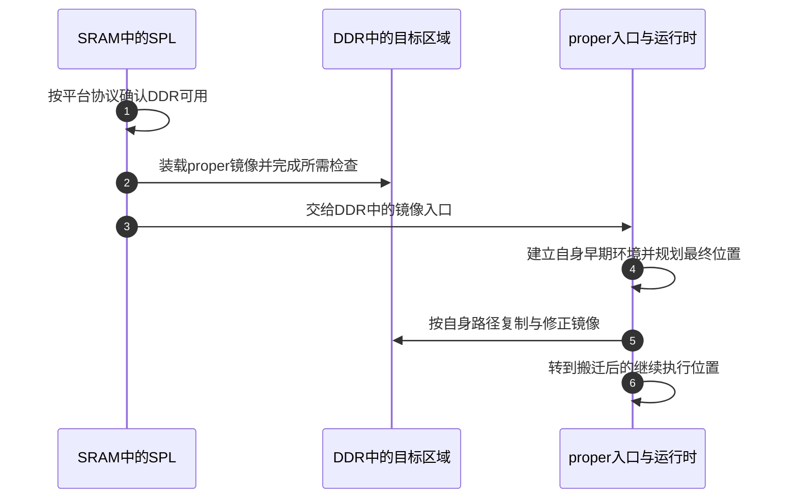

# 第7章\_镜像搬迁为什么不等于改变内存映射

[上一章](P06_从复位入口到异常向量与主核交接.md) 建立了处理器入口条件。接下来追踪一个更具体的问题：SPL 在片内 SRAM 执行，DDR 初始化成功，随后代码在 DDR 中继续运行。到底改变的是处理器当前地址、SoC 的地址映射，还是镜像里保存的指针？

这三件事可以相互配合，但没有哪一件会自动完成另外两件。先用地址空间把硬件与软件分开，再沿同一镜像的链接、初次运行与再次搬迁解释地址修正。本章的数值实验不执行目标机器码；具体 AArch64 路径仍采用 [U-Boot 固定版本](../../../research/source_reading/uboot/navigation/README.md)，对应 [地址与重定位模块](../../../research/source_reading/uboot/navigation/P07_地址视图与AArch64重定位导读.md)。

## 7.1\_一段地址背后至少有三个不同的问题

**讲解层次：概念层，处理器访问与镜像装载。** 假设处理器要取地址 `0x80001000` 处的指令。首先，执行环境要确定这个数如何转换成物理地址；其次，SoC 的物理地址解码要把事务送到对应存储器或设备；最后，那块存储器里的字节才决定处理器读到什么指令。

若当前启用地址转换，软件使用的虚拟地址可以经页表转换成不同物理地址；若处在已约定的无转换环境，就按相应入口合同解释。这里先用没有第二阶段转换的简单模型，不把所有虚拟化、总线地址和 DMA 地址都混在一起。


图中上半部分是一次访问路径，下半部分是决定镜像内容的两个软件动作。链接地址是链接器为符号安排的地址，不是另一块物理内存；文件偏移则是镜像文件中的位置，也不能直接用作处理器指针。

因此，分析启动地址要分别回答：**这个数字处在哪个地址空间；当前映射把它送到哪里；那里现在是谁写入的什么内容。** 单说“代码已经在 DDR”无法回答它是否按链接地址装载、是否启用了地址转换，以及绝对地址引用是否已修正。

| 名称 | 谁决定它 | 当前动作改变它时，什么可能保持不变 |
| --- | --- | --- |
| 链接地址 | 链接脚本与链接器 | 可以与初次装载地址不同；原 ELF 的符号值不会因复制自动重写 |
| 初次运行地址 | 前级装载协议与入口选择 | SoC 对 SRAM/DDR 的物理窗口可以一直保持原样 |
| 最终搬迁地址 | 当前 U-Boot 的内存规划 | 镜像内部相对偏移可以保持不变，但部分绝对引用需要重新计算 |
| 虚拟到物理的映射 | 当前处理器地址转换配置 | 改映射不必搬动底层物理字节；必须满足架构同步等协议 |
| SoC 地址别名 | 芯片集成的解码规则及其控制 | 两个窗口可能访问同一存储体；别名范围不等于新增容量 |

## 7.2\_DDR可用不意味着它必须接管零地址

旧模型容易把启动理解成“ROM 先占 0，随后 SRAM 占 0，最后 DDR 接管 0”。某些平台确有启动别名或重映射功能，但它不能从 ARM 指令集、DDR 就绪或 SPL 这个名字推出。一个更简单也完全可行的系统，是让 ROM、SRAM 和 DDR 从一开始就有各自固定的物理窗口；DDR 尚未初始化时，该窗口存在，却还不能作为可靠工作内存。

**讲解层次：实现层，i.MX6ULL 的物理地址地图。** NXP《i.MX 6ULL Applications Processor Reference Manual》Rev.1、11/2017 的 Table 2-1 给出下面这些相关区域。这里只摘录当前推理需要的行，不把全部外设窗口堆到一起。

| 物理地址范围，端点包含在内 | 手册中的对象 | 这个范围能证明什么 |
| --- | --- | --- |
| `0x00000000～0x00016fff` | Boot ROM，92 KiB | 低地址是 ROM 区域，不能因为 DDR 就绪就改称 DDR |
| `0x00017000～0x00017fff` | 受保护 Boot ROM 区，4 KiB | 与前一行合计 96 KiB ROM 地址区，保护属性须另查 |
| `0x00900000～0x0091ffff` | OCRAM，128 KiB | 片上 SRAM 有自己的窗口，不需要先搬到高地址才能在 DDR 就绪后继续存在 |
| `0x00920000～0x0097ffff` | OCRAM aliased，384 KiB 地址窗口 | 手册标为别名区域，不能加上前一行宣称有 512 KiB 独立 SRAM |
| `0x80000000～0xffffffff` | MMDC DDR 控制器窗口，2 GiB 地址空间 | DDR 的窗口从 `0x80000000` 开始；窗口大小不证明板上安装了 2 GiB 内存 |

OCRAM 是该芯片片上 RAM 的产品名称。MMDC 是其外部内存控制器；处理器通过控制器访问 DDR 芯片。这里区分控制器能译码的范围、实际接入的存储容量以及当前可用范围，否则很容易把一张地址表读成板级 BOM。

从这张地图可以直接推出：这块 SoC 并不需要让 DDR 占据 0 地址才能启动；片上 SRAM 也不会因为执行流进入 DDR 就自动消失。是否把某段 SRAM 留给后续固件、栈或其他用途，还要看保留约定和生命周期。它在物理地图中存在，不等于当前所有软件都可以任意覆盖。

> 资料定位：NXP `IMX6ULLRM` Rev.1，§2.2 ARM Platform Memory Map，Table 2-1，pp.175～176；ROM 使用 OCRAM 的内部布局见 §8.4.1、Figure 8-3，p.260。原件与官方入口见 [ARM 资料索引](../../../reference/external_resources/arm/README.md)。上游 v2022.10 的 MX6ULL 配置也选择 `0x80000000` 为 SDRAM 基址，见 [平台地址常量的求值](../../../research/source_reading/uboot/source_explanations/P07_AArch64相对重定位与地址交接实现.md#7.1_平台窗口与软件选择的地址不是同一个配置)。

### 7.2.1\_换存储体运行只需让下一次取指到达正确内容

现在假设 SRAM 中的 SPL 把 proper 装到 DDR 的预定位置。加载阶段写的是另一份镜像，随后跳到它的入口。这不要求 SPL 自己也搬过去，更不要求把 SRAM 的物理窗口改成 DDR。proper 进入后还可能为了腾出连续装载空间，把自身再次搬到更高地址，那是第一章讲过的另一个操作周期。



步骤 2～3 是加载另一阶段，步骤 5～6 是 proper 自身搬迁，两者的执行者和入口合同不同。图没有任何一步要求改写 SoC 的 SRAM/DDR 窗口。真正需要改映射的工程，应额外列出映射控制的写入者、生效时刻和正在执行的代码如何跨过切换，不能把这一动作藏在“跳到 DDR”四个字里。

## 7.3\_同一个镜像移动后哪些数值应该改变

先固定只搬镜像、不改页表、不改物理窗口的模型。镜像链接基址为 L，某条指令在 `L+0x100`，目标函数在 `L+0x180`。如果两者一起移动到 D，距离仍为 `0x80`。在指令编码范围与其他前提满足时，已经正确编码的 PC 相对引用可以保留这个距离。

但镜像中一个指针槽若保存了绝对地址 `L+0x180`，简单复制会把这个旧数值原样带到新位置。指针槽本身已经位于 D 区域，它保存的值却仍指向 L 区域。为它计算新值，是地址修正的职责。

也不是“所有数据都加一个差值”。计数值 42 应仍为 42；指向不随镜像搬迁的设备物理窗口的常量，也不能跟着镜像基址随意变化。哪些位置需要什么运算，由链接器产生的重定位记录和所选运行时支持的类型共同决定，不能靠扫描数据中“长得像地址”的整数来猜。

| 镜像内容 | 整体复制后的值 | 是否能仅凭所在节决定修正 |
| --- | --- | --- |
| 与镜像内目标相对寻址的指令 | 编码原样复制，内部距离可能仍成立 | 不能；还要核对指令形式、范围、页面关系与构建约束 |
| 指向随镜像一起移动对象的绝对引用 | 仍是旧地址，需要适用记录计算新值 | 不能；修正依据是记录类型与目标关系 |
| 普通整数、字符串字节 | 通常继续保持原值 | 不能把 `.data` 全部加偏移 |
| 外部设备地址或外部对象指针 | 是否需要变化取决于外部对象和访问合同 | 镜像移动不等于外部对象也移动，须分别处理 |

**位置无关构建也不等于任意地址都能直接运行。** 具体工具链和启动实现可能仍需要动态重定位记录、页对齐或其他限制。U-Boot v2022.10 的 AArch64 `CONFIG_POSITION_INDEPENDENT` 入口就检查 4 KiB 装载对齐，并修正支持的 `.rela.dyn` 项。把 PIC 与 relocation 写成二选一，会遗漏实际同时存在的两部分。

## 7.4\_三个基址怎样避免把偏移加两遍

**讲解层次：概念到实现的映射，U-Boot v2022.10 AArch64。** 在支持入口修正的配置下，一份镜像可能先从链接位置 L 被加载到 R，再由 proper 自身搬到 D。记录中的位置和加数以链接视图为起点，入口修正和后续搬迁分别使用各自目的位置计算。

本地固定以下数值，均是教学地址，不对应真实芯片布局：`L=0x1000`、`R=0x2000`、`D=0x5000`。镜像偏移 `+8` 有一个指针槽，指向镜像偏移 `+0x18` 的数据。AArch64 RELA 记录把“在哪里写”和“用于算新值的加数”分开保存。

| 当前字段 | 本例值 | 在本例中的含义 |
| --- | --- | --- |
| `r_offset` | `0x1008` | 链接视图中待修正槽位的位置 |
| `r_info` 的类型部分 | `R_AARCH64_RELATIVE=1027` | 本版汇编识别的相对基址修正类型；不是支持所有 ELF 类型的动态链接器 |
| `r_addend` | `0x1018` | 记录保存的原始加数，本例就是链接视图中的目标地址 |
| 首次差值 `R-L` | `0x1000` | 入口修正写到 `0x2008`，值为 `0x2018` |
| 最终差值 `D-L` | `0x4000` | 搬迁修正写到 `0x5008`，值为 `0x5018` |

关键是第二次从 **记录的加数** 计算 `0x1018+0x4000`。如果把第一次已经修正过的槽值 `0x2018` 再加上 `D-L`，会得到错误的 `0x6018`。读取槽中旧值再加偏移，属于另一种需要单独证明的运算，不能从 ARM32 REL 路径直接照抄到这里。

RELA 的 `r_offset`、`r_info`、`r_addend` 在本版 ELF64 结构中各占 8 字节，一项为 24 字节。具体结构、指针步长和两次修正的读取位置见 [AArch64 修正循环](../../../research/source_reading/uboot/source_explanations/P07_AArch64相对重定位与地址交接实现.md#7.2_入口修正与搬迁修正都从RELA加数计算)。类型语义另对照 [Arm AAELF64 2025Q1，§5.7.13 Dynamic relocations](https://github.com/ARM-software/abi-aa/blob/2025Q1/aaelf64/aaelf64.rst#5713dynamic-relocations)：它规定相对装载调整的运算，具体采用哪些类型仍由 U-Boot 实现限定。

这里是在细化 [第一章 S2～S4](P01_从链接布局到启动阶段的交接.md#1.3_完整_U-Boot_的数据为什么分几次才能使用) 的地址交接，不另造一套互不相干的阶段。首次入口修正发生在 S0 早期；最终修正处在 S3 复制之后，返回地址的准备则在进入搬迁函数之前。**复制字节、修正引用、把执行流交给新副本** 三项都完成，才有理由继续使用新镜像。

## 7.5\_用数值模型观察该改与不该改的内容

实验把四个 64 位数当作镜像：普通整数、待修正指针、外部固定地址、被指向的数据。它使用 C 的数组复制和整数运算，不把 `0x1000` 等教学地址转换成宿主指针。模型还检查写入范围以便安全观察错误输入；这些检查不是上游汇编的原有保证。

完整材料是 [relative_fixup.c](../../../labs/system_software/uboot/relative_fixup/relative_fixup.c)。下列程序只支持本例的非负搬迁差值，拒绝越界或非对齐槽位；真实镜像加载器需要根据它的格式和平台合同处理更多条件。

```c
#include <inttypes.h>
#include <stdint.h>
#include <stdio.h>
#include <string.h>

/* 数值地址模型：这些整数不作为宿主机指针解引用。 */
struct image {
    uint64_t words[4];
};

struct relative_record {
    uint64_t location;
    uint64_t addend;
};

static int apply_relative(struct image *image, uint64_t link_base,
                          uint64_t run_base, struct relative_record record)
{
    uint64_t offset;

    /* 教学模型先检查写入范围；不是声称上游汇编做了这些检查。 */
    if (record.location < link_base)
        return -1;
    offset = record.location - link_base;
    if (offset % sizeof(uint64_t) ||
        offset > sizeof(*image) - sizeof(uint64_t) ||
        run_base < link_base ||
        record.addend > UINT64_MAX - (run_base - link_base))
        return -1;
    image->words[offset / sizeof(uint64_t)] =
        record.addend + (run_base - link_base);
    return 0;
}

int main(int argc, char **argv)
{
    const uint64_t link_base = 0x1000;
    const uint64_t initial_base = 0x2000;
    const uint64_t final_base = 0x5000;
    struct relative_record record = {0x1008, 0x1018};
    struct image initial = {{42, 0x1018, 0x90000000, 7}};
    struct image final;
    uint64_t copied_pointer;

    if (argc > 2 || (argc == 2 && strcmp(argv[1], "bad-record")))
        return 2;
    if (argc == 2) {
        record.location = link_base + sizeof(initial);
        if (apply_relative(&initial, link_base, initial_base, record) != -1)
            return 3;
        if (initial.words[1] != 0x1018)
            return 3;
        puts("record rejected before write");
        return 1;
    }
    if (apply_relative(&initial, link_base, initial_base, record))
        return 3;
    printf("initial: slot=%" PRIx64 " value=%" PRIx64 "\n",
           initial_base + 8, initial.words[1]);

    /* 复制保留旧指针值；第二次修正仍从记录中的原始 addend 计算。 */
    final = initial;
    copied_pointer = final.words[1];
    if (apply_relative(&final, link_base, final_base, record))
        return 3;
    printf("final: slot=%" PRIx64 " value=%" PRIx64 "\n",
           final_base + 8, final.words[1]);
    printf("wrong double adjustment=%" PRIx64 "\n",
           copied_pointer + (final_base - link_base));
    printf("integer=%" PRIu64 " external=%" PRIx64 " payload=%" PRIu64 "\n",
           final.words[0], final.words[2], final.words[3]);
    return final.words[1] == 0x5018 && final.words[0] == 42 &&
           final.words[2] == 0x90000000 && final.words[3] == 7 ? 0 : 3;
}
```

在仓库根目录使用 GCC 或兼容 C11 编译器执行：

```bash
# linux-note 仓库根目录；Linux shell 或已有 GCC 的 MSYS2 shell。
fixup_lab=$(mktemp -d "${TMPDIR:-/tmp}/uboot-fixup.XXXXXX")
gcc -std=c11 -Wall -Wextra -Werror \
  labs/system_software/uboot/relative_fixup/relative_fixup.c \
  -o "$fixup_lab/relative_fixup.exe"
"$fixup_lab/relative_fixup.exe"
```

预期结果如下。输出中的 `slot` 是本次目的位置中的槽地址，`value` 才是槽中保存的指向对象的地址；二者不能混读。

```text
initial: slot=2008 value=2018
final: slot=5008 value=5018
wrong double adjustment=6018
integer=42 external=90000000 payload=7
```

给程序加参数 `bad-record`，它把槽位改到镜像末端以外，应输出 `record rejected before write` 并返回 1，原指针未被改写。非法参数返回 2；若模型的内部检查失败则返回 3。正常路径返回 0。

再做一个预测：只改 `record.addend`，会不会改变修正的存储位置？**答案：不会。** 存储位置由 `record.location` 和目的基址决定，加数决定写进去的值。把目标数据从偏移 `0x18` 移到其他位置时，应按新布局同时核对记录及消费者，不能只改某次输出中看到的地址。

第二问：删除第二次修正，只保留 `final=initial`，会怎样？**答案：新镜像仍保存 `0x2018`。** 如果旧副本暂时还在，错误可能被掩盖；一旦旧区域被复用，指针就访问错误内容。因此“复制后看起来能跑”不证明引用已全部正确。

现在可以从具体动作解释地址变化：初始化 DDR 改变可用条件，改映射改变地址解释，复制改变字节所在区域，重定位记录改变指定引用，分支或返回改变执行位置。它们可以依次发生，也可以有些完全不需要；必须按当前镜像与平台逐项证明。[下一章](P08_命令名怎样找到镜像里的实现函数.md) 在完整运行环境上追踪命令记录，观察镜像中的名字和函数指针怎样成为可调用接口。
