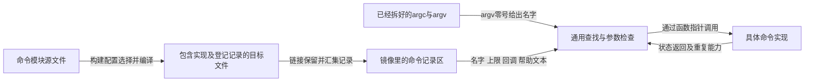
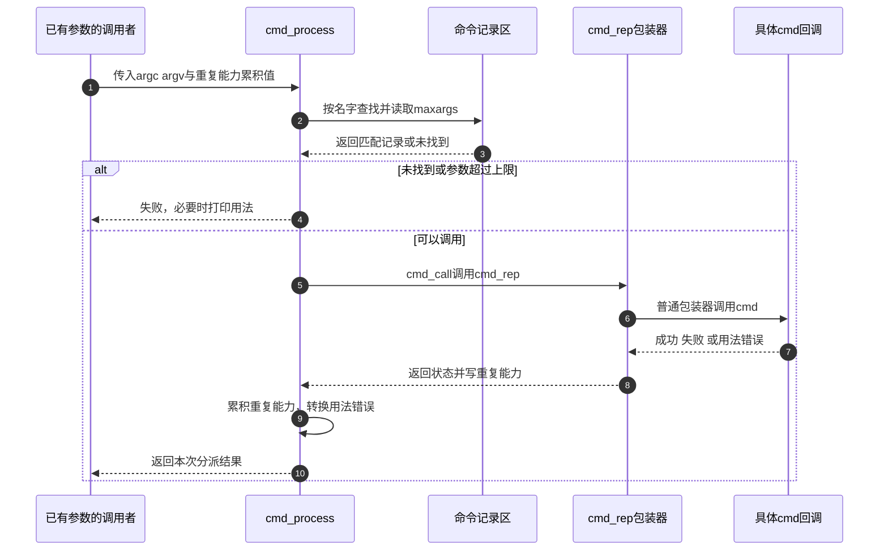

# 第8章\_命令名怎样找到镜像里的实现函数

前几章把镜像带到了可以使用完整运行环境的位置。现在 U-Boot 显示提示符，用户输入 `echo hello`，随后串口打印 `hello`。处理器并不认识英文 echo，C 函数也不会因为名字叫 `do_echo` 就自动收到这串字符。二者之间需要一份明确的登记和查找关系。

本章先假定参数已经拆好：`argc=2`，`argv[0]="echo"`，`argv[1]="hello"`。只追踪命令登记、名称查找、参数检查和函数调用；如何从原始字符串得到这些参数、怎样执行多条命令，留给后续单元。源码采用 [固定版本总索引](../../../research/source_reading/uboot/navigation/README.md) 中的 U-Boot v2022.10，沿 [命令注册模块](../../../research/source_reading/uboot/navigation/P08_命令注册与分派导读.md) 查找实现。

## 8.1\_为什么需要记录而不是直接按字符串调用C函数

**讲解层次：概念层，命令分派。** 最朴素的办法是写一长串 `if (!strcmp(name,"echo"))`，再调用对应函数。命令少时它很直观；命令增加以后，中央分派函数必须知道每个名字、函数、参数上限和帮助文本，新增模块也要修改这个中央列表。

换一种组织：每个命令提供一条记录，登记名字、实现函数与调用约束；通用分派代码只遍历记录。这样新增命令主要改变记录集合，而不要求改写通用名称匹配逻辑。代价是命令要遵守统一函数签名，并且构建系统必须把这些分散记录保留下来、提供可遍历边界。



这张图同时区分构建期与运行期。构建期产生记录区，运行期根据其中的函数指针调用；命令字符串不会要求 bootloader 去磁盘上搜索一个同名 C 文件。记录集合属于当前构建出来的镜像，源目录里存在某个命令文件不代表当前板已经启用它。

U-Boot 用链接列表完成这项汇集，第一章已经解释 [链接记录怎样形成可遍历数组](P01_从链接布局到启动阶段的交接.md)。本章复用这一机制，新增的是每条 `cmd` 记录的调用合同，而不是另造一个运行时注册服务。

## 8.2\_U\_BOOT\_CMD把哪些事实交给通用分派器

**讲解层次：实现层，U-Boot v2022.10。** `cmd/echo.c` 定义实现函数，并通过 `U_BOOT_CMD(echo, CONFIG_SYS_MAXARGS, 1, do_echo, usage, help)` 这样的登记，把用户名字 `echo` 关联到 `do_echo`。其中 `usage` 和 `help` 在真实代码中是字符串参数，这里只用字段名代称以便看清关系。

名字参数是预处理器标识符 `echo`，宏把它字符串化用于查找，也用于生成链接记录的符号；它不是要求实现函数必须叫 echo。实现参数 `do_echo` 才提供 C 函数地址。`cmd/Makefile` 又以 `CONFIG_CMD_ECHO` 控制 `echo.o` 是否进入构建，`CONFIG_CMDLINE` 控制正常命令登记路径。

| 登记参数 | 当前意义 | 一个容易漏掉的条件 |
| --- | --- | --- |
| `name` | 用户键入的命令名称 | 宏入口不写引号，展开后的记录保存名称字符串 |
| `maxargs` | 最大参数数量，包含命令名本身 | `show value` 已经是两个参数；它不检查参数最小数量和内容是否合法 |
| `repeatable` | 普通登记入口的重复策略选择值 | 在本版会选择包装回调，并非直接存入旧版整数成员 |
| `command` | 实现函数指针 | 必须符合本版函数签名，不是任意 C 函数都能塞进去 |
| `usage`、`help` | 短说明、长帮助字符串 | 长帮助受 `CONFIG_SYS_LONGHELP` 控制；二者都不是回调函数 |
| completion 参数 | 扩展登记形式中的补全回调 | 与命令执行回调分开，受补全配置控制 |

本版记录类型为 `struct cmd_tbl`。旧材料中的 `cmd_tbl_t`、`struct cmd_tbl_s` 和整数 `repeatable` 成员来自其他版本，不能混进本版结构说明。

| 当前结构成员 | 保存什么 | 谁读取、何时使用 |
| --- | --- | --- |
| `name` | 命令字符串 | `find_cmd_tbl` 与候选输入比较 |
| `maxargs` | 参数上限 | `cmd_process` 调用前检查 |
| `cmd` | 普通实现回调 | 普通重复策略包装器调用 |
| `cmd_rep` | 可同时返回重复能力的回调 | `cmd_call` 使用它调用，并取得本次执行的重复能力 |
| `usage`、可选 `help` | 帮助文本地址 | `cmd_usage` 打印，不能写成“执行 help 指针” |
| 可选 `complete` | 补全回调 | 补全过程使用，与执行结果无关 |

两层回调看起来比旧整数复杂，是因为一个主命令可以含有行为不同的子命令，重复能力不一定只由整个主命令的一项固定值决定。普通 `U_BOOT_CMD` 用“总是可重复”或“从不自动重复”的包装器调用 `cmd`；需要动态决定的登记形式可以直接提供 `cmd_rep`。具体宏展开与字段顺序见 [登记记录的唯一实现](../../../research/source_reading/uboot/source_explanations/P08_命令记录与查找分派实现.md#8.1_登记宏如何生成当前版本的命令记录)。

这里的“可重复”用于交互循环按回车重复上次输入等策略，不是线程安全属性，也不是禁止用户再次明确输入同一命令的权限开关。某条命令不适合自动重复，仍可以在用户再次输入后被正常调用。

## 8.3\_找到名字以后还要检查什么

先看名称。`find_cmd_tbl` 优先返回完整匹配；没有完整匹配时，恰好一个前缀匹配也可作为缩写。比如只有 `show` 和 `shutdown` 两条记录时，`sho` 唯一指向 show，`sh` 却同时匹配两条，因此拒绝。新增命令后，原来唯一的短前缀可能变得歧义；长期脚本应尽量使用完整名称。

对于 `md.b` 这样的名字，查找层先按点号以前部分寻找命令；后缀是否有效、代表什么，仍由相关命令路径处理。不能因为查找成功就断言任何 `.x` 后缀都有效。普通命令也不会仅凭有一个点号就自动获得字节访问能力。

找到记录后，`cmd_process` 检查最大参数数量。若参数不多于上限，它仍不能知道某个命令是否缺必需参数、地址是否对齐或所选设备是否存在，这些必须由具体实现检查。以要求一个值的 `show` 为例，上限为 2，但单独输入 `show` 只有一个参数，也应由回调返回用法错误。

| 命令回调结果 | 数值 | 分派层随后怎样处理 |
| --- | --- | --- |
| `CMD_RET_SUCCESS` | 0 | 作为成功交给上层 |
| `CMD_RET_FAILURE` | 1 | 作为失败交给上层，不自动承诺撤销命令副作用 |
| `CMD_RET_USAGE` | -1 | 调用 `cmd_usage` 打印文本，随后对外形成失败结果 1 |

普通失败不一定打印用法，因为“设备读取失败”和“参数写错”不是同一种错误。调用回调前通过参数上限，也不等于整个命令已经通过安全或权限验证。



步骤 2～3 决定是否存在候选，步骤 5 才开始执行；因此“找到了命令”不证明命令已经运行。步骤 8 的重复能力与返回状态是两份信息，成功但不可自动重复是合法结果。上层如何累计多条命令的失败和重复能力，不能只看这张单次分派图，下一单元会继续追踪。

## 8.4\_用宿主程序观察记录查找与回调交接

实验把已经分好的参数直接交给一个小型分派器，用普通静态数组代替链接列表。它保留名字、参数上限和两层回调，省略 U-Boot 的 flags、补全及点号后缀规则。`shutdown` 只是打印消息的模型，不会关闭主机；本实验不连接板卡。

完整材料 [command_dispatch.c](../../../labs/system_software/uboot/command_dispatch/command_dispatch.c) 如下。主机 shell 负责把启动参数交给 `main`，所以这里还没有编写 U-Boot 风格字符串解析器。

```c
#include <stdio.h>
#include <string.h>

struct command;
typedef int (*command_fn)(struct command *, int, char *const []);
typedef int (*repeat_fn)(struct command *, int, char *const [], int *);

/* 教学记录：保留两层回调，省略真实 U-Boot 的 flags 和补全接口。 */
struct command {
    const char *name;
    int maxargs;
    command_fn execute;
    repeat_fn execute_with_repeat;
    const char *usage;
};

static int repeat_yes(struct command *entry, int argc, char *const argv[],
                      int *repeatable)
{
    *repeatable = 1;
    return entry->execute(entry, argc, argv);
}

static int repeat_no(struct command *entry, int argc, char *const argv[],
                     int *repeatable)
{
    *repeatable = 0;
    return entry->execute(entry, argc, argv);
}

static int do_show(struct command *entry, int argc, char *const argv[])
{
    (void)entry;
    if (argc != 2)
        return -1;
    printf("show: %s\n", argv[1]);
    return 0;
}

static int do_shutdown(struct command *entry, int argc, char *const argv[])
{
    (void)entry;
    (void)argc;
    (void)argv;
    puts("shutdown model only: no hardware action");
    return 0;
}

static struct command commands[] = {
    {"show", 2, do_show, repeat_yes, "show text"},
    {"shutdown", 1, do_shutdown, repeat_no, "shutdown"},
};

static struct command *lookup(const char *name)
{
    struct command *candidate = NULL;
    size_t length = strlen(name);
    unsigned int matches = 0;

    if (!length)
        return NULL;
    for (size_t i = 0; i < sizeof(commands) / sizeof(commands[0]); ++i) {
        if (strncmp(name, commands[i].name, length))
            continue;
        if (length == strlen(commands[i].name))
            return &commands[i];
        candidate = &commands[i];
        ++matches;
    }
    return matches == 1 ? candidate : NULL;
}

int main(int argc, char **argv)
{
    struct command *entry;
    int repeatable = 0;
    int result;

    if (argc < 2) {
        puts("usage: command_dispatch command [argument]");
        return 2;
    }
    --argc;
    ++argv; /* 当前 argv[0] 变成教学命令名。 */
    entry = lookup(argv[0]);
    if (!entry) {
        puts("unknown or ambiguous command");
        return 1;
    }
    if (argc > entry->maxargs)
        result = -1;
    else
        result = entry->execute_with_repeat(entry, argc, argv, &repeatable);
    if (result == -1) {
        printf("usage: %s\n", entry->usage);
        return 1;
    }
    printf("result=%d repeatable=%d\n", result, repeatable);
    return result ? 1 : 0;
}
```

在仓库根目录编译，再分别执行完整名和缩写：

```bash
# linux-note 仓库根目录；Linux 或已有 GCC 的 MSYS2 shell。
command_lab=$(mktemp -d "${TMPDIR:-/tmp}/uboot-command.XXXXXX")
gcc -std=c11 -Wall -Wextra -Werror \
  labs/system_software/uboot/command_dispatch/command_dispatch.c \
  -o "$command_lab/command_dispatch.exe"
"$command_lab/command_dispatch.exe" show hello
"$command_lab/command_dispatch.exe" sho hello
```

两次都应先打印 `show: hello`，再打印 `result=0 repeatable=1`，退出值为 0。`sho` 能成立是因为当前记录集合里只有一个匹配前缀。

把输入改为 `sh`，应打印 `unknown or ambiguous command` 并返回 1。输入 `show` 缺少值，输入 `show one two` 超过上限，两者都打印 `usage: show text` 并返回 1，但拒绝发生的位置不同：前者进入了回调，后者在分派层已经被挡住。

执行 `shutdown`，应打印模型提示及 `result=0 repeatable=0`，返回 0。这验证成功状态与重复能力不是同一个整数。若完全不传命令名，宿主程序给出自身用法并返回 2，尚未进入命令查找。

再预测两个修改。新增名字为 `short` 的记录后，`sho` 是否仍唯一？**答案：不唯一。** 两个前缀都符合，需要完整名或更长的唯一前缀。只把 show 的帮助文本改成其他内容，会不会改变执行函数？**答案：不会。** 调用目标保存在回调字段，帮助文本只在打印路径被读取。

## 8.5\_从模型回到一个真实命令的构建位置

模型数组帮助观察查找，真实 U-Boot 则由构建配置、登记宏、链接保留和运行期查找共同完成。沿已有 echo 命令可以复查一条完整路径：`cmd/Kconfig` 的 `CMD_ECHO` → `cmd/Makefile` 的 `echo.o` → `cmd/echo.c` 的 `do_echo` 与 `U_BOOT_CMD` → 镜像中的 `cmd` 记录 → 通用分派回调。

如果写了实现和宏却没把目标文件编进镜像，提示符仍找不到命令；如果记录存在但参数上限错误，回调也可能根本没有执行。检查实际 ELF 的链接记录应复用 [构建产物核对](P03_从板配置到可核对的构建产物.md)，不能把源文件截图当成当前镜像证据。

`command.h` 中的 `#ifndef __ASSEMBLY__` 用于让汇编预处理时跳过 C 类型和声明。普通 C 编译仍需要这些定义；不能因为顶层构建给汇编路径定义过 `__ASSEMBLY__`，就说整个 U-Boot 都剔除了 C 命令结构。

当前已经能解释名字如何变成回调，也能区分登记、参数检查、执行和帮助输出。还没有解决的是原始字符串的生命期：环境变量可以保存命令文本，执行命令又可能修改环境；分号与换行也可能有不同失败边界。这些需要继续追踪解析器的缓冲区与返回值。
