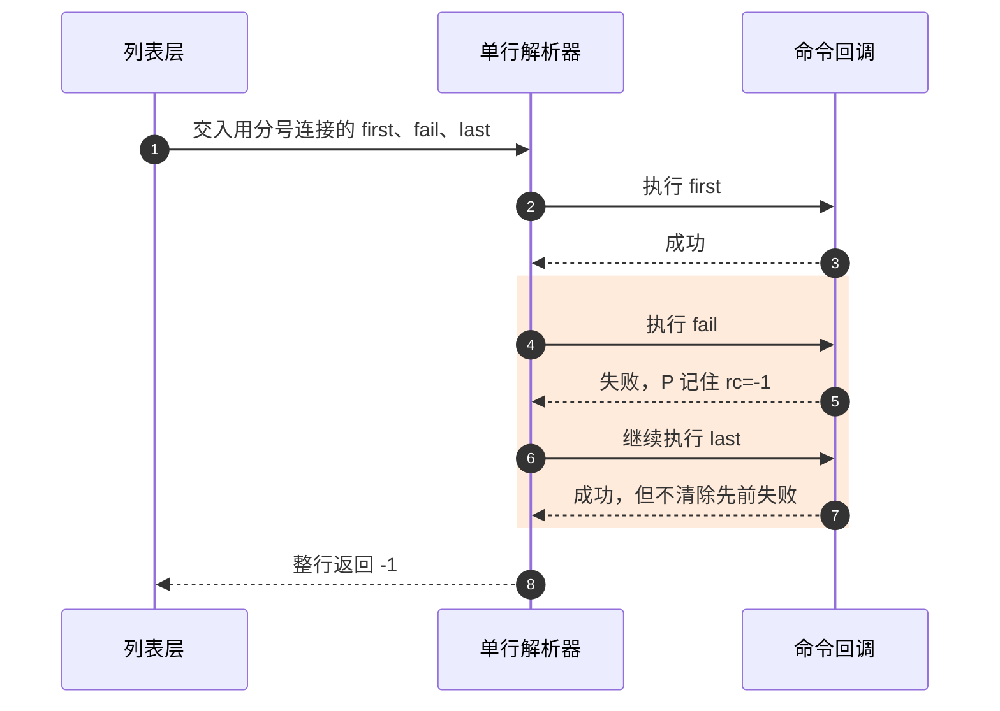
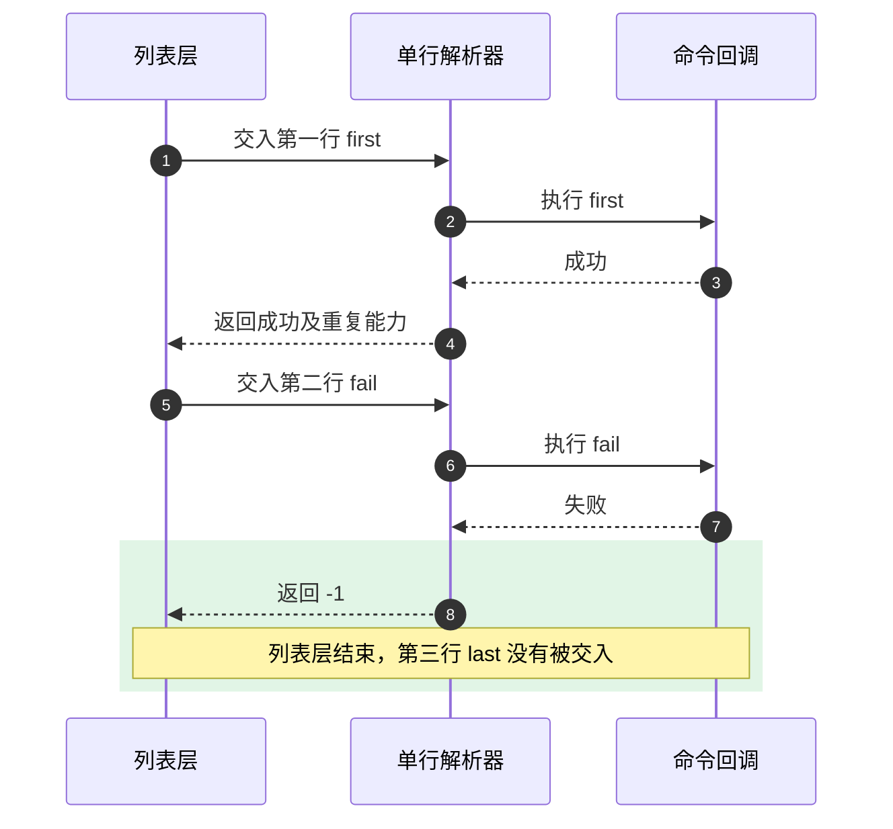

# 第9章\_命令字符串怎样跨过缓冲区与失败边界

[上一章](P08_命令名怎样找到镜像里的实现函数.md) 已经能从 `argc/argv` 找到命令记录并调用函数。不过，串口收到的是字符，环境变量保存的也是字符。是谁把 `echo hello` 变成两个参数？如果输入里有两条命令，第一条失败以后，第二条究竟会不会执行？这些决定发生在查找命令之前，也发生在命令返回之后。

本章沿 **输入字符串 → 工作副本 → 单条命令文本 → 参数 → 执行结果** 追踪一次处理。具体实现以 [U-Boot v2022.10 固定源码索引](../../../research/source_reading/uboot/navigation/README.md) 为界，重点解释启用 `CONFIG_CMDLINE`、未启用 Hush 的 simple 解析路径。这里的解析器负责解释字符和安排调用；它不替命令完成下载、校验或启动。

先考虑一个实际风险：把“加载镜像；启动镜像”写进启动字符串。如果加载失败，启动命令是否被跳过，不能根据自然语言的先后关系推断。我们先弄清字符串存在哪里、怎样拆开，再看哪一层真正决定停止。

## 9.1\_为什么拿到字符串以后还要建立工作副本

假设环境变量 `bootcmd` 保存了几条命令。`env_get` 返回指向环境数据的指针，调用者暂时借用这段存储；它没有因此取得一份独立字符串。随后执行的命令可能修改环境，使原来的内容或存储位置发生变化。若解析器一边执行、一边继续从这份借来的字符串读下一条，就把“命令执行的副作用”带回了“尚未完成的解析”。

还有一个更直接的问题：C 字符串用 `\0` 结束。若想把 `first;last` 拆成两个可交给普通 C 函数的字符串，解析器可以把分号改为 `\0`，保存后一段的起始指针。但这样会修改输入，不能直接在只读字符串常量或调用者不允许修改的数据上进行。

simple 路径用不同层的副本解决不同问题。`run_command_list` 在需要切换行时准备可写的列表缓冲区；处理单行的 `cli_simple_run_command` 又把该行复制到栈上的 `cmdbuf`，隔离后续执行对输入来源的影响。随后环境变量展开写到另一个栈缓冲区 `finaltoken`；参数数组 `argv` 的元素指向 `finaltoken` 内部，并不各自拥有字符串。


图中两次复制不是同一件事重复做：列表副本允许修改换行，行副本让当前行不再依赖环境存储的稳定性。`finaltoken` 又承担展开后的文本，原字符串与展开结果可以有不同长度。回调若想在返回以后继续使用某个参数，必须按自己的生命周期要求保存内容，不能把 `argv[i]` 当作永久有效的地址；下一条命令就可能覆盖它，函数返回后栈数组也不再有效。

现在再看列表包装函数何时分配，才有判断每个分支的依据。下面的 `len` 是调用者提供的有效输入长度，不是任意负数都具有特殊含义。

| `run_command_list(cmd, len, flag)` 的输入条件 | 包装层是否复制 | 原因与结束动作 |
| --- | --- | --- |
| `len == -1`，simple 路径，包含换行 | 分配 `strlen(cmd)+1` 字节并复制 | 后续要把换行改成 `\0`，完成后释放 |
| `len == -1`，simple 路径，不含换行 | 包装层不分配 | 列表层无需修改换行；单行层仍复制到 `cmdbuf` |
| `len >= 0`，显式长度 | 分配 `len+1` 字节，复制指定长度并补 `\0` | 适用于已知长度的脚本文本，完成后释放 |
| `len == -1`，Hush 路径 | 包装层不分配 | 该分支依据 Hush 不修改输入的契约 |
| 需要分配但 `malloc` 失败 | 不执行解析器，返回 1 | 没有可用工作副本 |

`cmd` 必须指向满足长度约定的有效数据；这不是自动验证所有坏指针和错误长度的接口。显式长度路径还要求调用者保证这段数据确实可读。`source` 从脚本镜像得到数据地址和长度后使用这个入口；自动启动路径则通常传入以 `\0` 结尾的字符串和 `-1`。这说明两种长度形式有不同来源，不意味着包装函数本身验证了镜像真实性。实现分支见 [列表缓冲区的所有权](../../../research/source_reading/uboot/source_explanations/P09_命令解析缓冲区与失败传播实现.md#9.1_列表包装层何时取得可写副本)。

## 9.2\_为什么变量展开不能替代执行一个命令列表

有了可写的行副本，解析器先找未被转义、且位于单引号之外的分号，把一行切成单条命令文本。然后才扫描当前这条文本中的 `${name}` 或 `$(name)`，用环境变量值替换它们。这里的“宏处理”是运行时文本替换，与 C 预处理器的 `#define` 无关。

这个顺序会产生一个容易预测错的结果。设环境变量 `ALL_CMD` 的值为 `echo first;echo last`：

1. 输入仅有 `${ALL_CMD}` 时，原始输入没有分号，所以分隔阶段只得到一条文本。
2. 替换后得到 `echo first;echo last`，但这一轮不会返回分号切分阶段。
3. 参数拆分按空格和制表符进行，得到 `echo`、`first;echo`、`last`；这次只调用一次 `echo`。

因此，`${ALL_CMD}` 是把值放进当前命令的文本。要把环境变量值作为命令字符串重新解析，应使用已启用的 `run ALL_CMD`。`run` 是上一章那种有登记记录和回调的普通命令；其回调 `do_run` 用参数名查环境，再把查到的值交给 `run_command`。裸写 `ALL_CMD` 则只会尝试查找名为 `ALL_CMD` 的命令，不会自动执行同名变量。

变量展开本身还需要记住“当前正处于哪种语境”。否则看到 `$` 后面的字符，无法判断它是变量引用的开始还是普通内容。simple 实现用一个局部整数维护四种扫描状态：

| 状态 | 正在等待什么 | 当前字符引起的主要变化 |
| --- | --- | --- |
| 0：普通文本 | 未转义的 `$` 或单引号 | `$` 进入状态 1；单引号进入状态 3；其他字符复制 |
| 1：已看到 `$` | `(` 或 `{` | 符合则记录变量名起点并进入状态 2；否则输出 `$` 和当前字符，回到 0 |
| 2：变量名内部 | `)` 或 `}` | 取变量名、调用 `env_get`、复制值，回到 0；变量不存在则不复制值 |
| 3：单引号内部 | 未转义的结束单引号 | 结束时回到 0；内部字符直接复制，避免本轮变量展开 |

表格描述此版本的实际扫描逻辑，不能由此推断它具有完整 Shell 语法。例如单引号在展开阶段被移除，后续参数拆分只认识空白；`echo 'a b'` 的内部参数仍会拆成 `a` 和 `b`。因为 `echo` 把参数用空格连接打印，肉眼看到 `a b` 并不能证明它只收到了一个参数。

当展开后的字符串过长时，`cli_simple_process_macros` 会截断并返回 `-ENOSPC`，但本版上层 **没有检查这个返回值**，仍继续拆参数。同样，参数拆分达到 `CONFIG_SYS_MAXARGS` 时会打印提示并返回已有参数数量，不是以错误码保证整条命令不执行。这里必须区分“底层发现容量限制”和“调用链落实拒绝执行”：前者成立不能替后者作证。边界与状态源码见 [展开与参数切分](../../../research/source_reading/uboot/source_explanations/P09_命令解析缓冲区与失败传播实现.md#9.3_展开状态和参数地址怎样从文本中形成)。

## 9.3\_同样是三条命令为什么失败后的动作不同

先不用真实下载或启动命令，避免副作用干扰观察。设 `first` 和 `last` 都成功，`fail` 返回失败，三者都正常返回而不跳走，也没有 Ctrl-C 中断。输入 `first;fail;last` 时，分号切分和逐条执行都由单行解析器负责。它把失败记入自己的 `rc`，却没有在失败分支跳出循环。



第 5 步已经知道失败，第 6 步仍然发生。第 7 步成功也不会把整行结果改回成功。因而“最后一条命令执行了”和“整行返回成功”不是同一个判断。

现在只把两个分号换成换行，仍使用同样的参与者。外层列表解析器逐行调用内层，每次收到负值就停止，后一行尚未交给内层。



这里的关键是第 8 步：失败已经到达负责“下一行是否开始”的层，`last` 才被阻止。若输入是第一行 `first;fail;last`、第二行 `after`，第一行的 `last` 仍执行，第二行的 `after` 不执行。外层来不及撤销内层已经完成的动作。

`run first_var second_var` 又增加一个环境变量循环。`do_run` 先查 `first_var`，执行其值；若该值执行失败，就返回，不再查找和执行 `second_var`。但 `first_var` 内部用分号连接的后续命令仍受前一种规则约束。环境变量循环的停止点不是内部每一条命令的停止点。

据此可以检查启动脚本：**有依赖的动作必须使用当前解析器确实支持的条件执行方式**。Hush 支持 `if … then … else … fi` 等控制结构；simple 不能因写了 `if` 就得到同样的控制流。启用哪种解析器由构建配置决定，不由输入字符串自动选择。这里不把换行当作面向所有入口的通用条件运算符，也不把两个解析器的完整语法混用。官方 [Command-line Parsing](https://github.com/u-boot/u-boot/blob/4debc57a3da6c3f4d3f89a637e99206f4cea0a96/doc/usage/cmdline.rst) 说明两类解析器和 `run` 的一般规则；本节的换行与缓冲区结论来自已固定的 simple 实现。

## 9.4\_在宿主机观察两层停止位置

下面用 C 模型保留刚才的两层循环，让失败发生在可控的 `fail` 令牌上。模型只比较分号和换行，不实现引号、转义、变量展开、命令查找或硬件动作；任何其他非空令牌都作为成功命令打印。这样观察到的 `execute` 行只代表调用发生，没有下载、跳转或写设备的副作用。

把下列完整程序保存为 [command_lines.c](../../../labs/system_software/uboot/command_lines/command_lines.c)。它总是复制列表以简化所有权，实际 U-Boot 包装层的有条件复制仍以前表为准。

```c
#include <stdio.h>
#include <stdlib.h>
#include <string.h>

/* 教学模型仅接受字面命令，不实现引号、转义和环境变量展开。 */
static int execute_token(char *token)
{
    while (*token == ' ' || *token == '\t')
        ++token;
    printf("execute: [%s]\n", token);
    return strcmp(token, "fail") == 0 || *token == '\0' ? 1 : 0;
}

static int execute_line(const char *input)
{
    char copy[128];
    char *token;
    int failed = 0;

    if (strlen(input) >= sizeof(copy))
        return -1;
    strcpy(copy, input); /* 后续切分只修改这一行的工作副本。 */
    token = copy;
    for (;;) {
        char *separator = strchr(token, ';');
        if (separator != NULL)
            *separator = '\0';
        if (execute_token(token) != 0)
            failed = 1; /* 记住失败，但继续本行的下一条命令。 */
        if (separator == NULL)
            break;
        token = separator + 1;
    }
    return failed ? -1 : 1; /* 模型中所有成功命令均可重复。 */
}

static int execute_list(const char *input)
{
    char *copy = malloc(strlen(input) + 1);
    char *line;
    int result = 0;

    if (copy == NULL)
        return 1;
    strcpy(copy, input);
    line = copy;
    for (;;) {
        char *separator = strchr(line, '\n');
        if (separator != NULL)
            *separator = '\0';
        if (*line != '\0' && execute_line(line) < 0) {
            result = 1;
            break; /* 外层在失败行结束后停止，不撤销已执行命令。 */
        }
        if (separator == NULL)
            break;
        line = separator + 1;
    }
    free(copy);
    return result;
}

int main(int argc, char **argv)
{
    const char *input;
    int result;

    if (argc != 2) {
        fprintf(stderr, "usage: %s semicolon|newline|mixed|ok\n", argv[0]);
        return 2;
    }
    if (strcmp(argv[1], "semicolon") == 0)
        input = "first;fail;last";
    else if (strcmp(argv[1], "newline") == 0)
        input = "first\nfail\nlast";
    else if (strcmp(argv[1], "mixed") == 0)
        input = "first;fail;last\nafter";
    else if (strcmp(argv[1], "ok") == 0)
        input = "first\n\nlast";
    else
        return 2;
    result = execute_list(input);
    printf("list result=%d\n", result);
    return result;
}
```

在具有 C 编译器的 Linux 或 MSYS2 Shell 中，进入该文件所在目录编译。`-Werror` 将编译警告作为错误，便于发现模型修改后的类型或接口问题。

```bash
# 执行位置：command_lines.c 所在目录。
cc -std=c11 -Wall -Wextra -Werror command_lines.c -o command_lines
./command_lines semicolon
echo $?
```

应依次看到 `first`、`fail`、`last` 三次执行，`list result=1`，Shell 返回码也是 1。这是预期的失败结果，不是实验编译失败。程序的成功路径返回 0，未知模式或缺少模式返回 2。

```bash
# 同一目录；每次先预测最后一条会不会被打印。
./command_lines newline
echo $?
./command_lines mixed
echo $?
./command_lines ok
echo $?
```

`newline` 只打印 `first`、`fail`，返回 1；`mixed` 打印 `first`、`fail`、`last`，不打印 `after`，返回 1；`ok` 跳过真正的空行，打印 `first`、`last`，返回 0。输入若是一行空格，便不是字符长度为零的空行：在实际 simple 路径中，它进入单行解析后得不到命令，产生失败。

再做一次局部修改：给 `execute_line` 中检查 `execute_token` 返回值的 `if` 加上花括号，在设置 `failed = 1` 后立即 `break`。重新运行 `semicolon`，`last` 消失了。这说明“遇错继续”由内层控制流决定；改动返回码的数字而不改变循环，并不能阻止调用。恢复修改后再运行，确认它回到原来的轨迹。

## 9.5\_返回值必须结合所在层阅读

现在可以回收上一章留下的重复能力：simple 单行函数成功时返回 0 或 1，分别表示不可重复和可重复；错误返回 -1。普通 `run_command` 把两种成功都变成 0、错误变成 1。若把前者的 1 当成通用失败码，会把成功且可重复的命令误判为失败。

交互循环使用 `run_command_repeatable` 保留这种区别。输入非空行时保存到 `lastcommand`；按空回车时带 `CMD_FLAG_REPEAT` 再运行保存的字符串。返回值小于等于 0 时清空保存内容，因此失败或不可重复的行不会继续留作下一次空回车重复。保存的是命令文本，不是一次已经拆好的 `argv`。

| 所在层 | 成功与失败的解释 | 谁消费结果 |
| --- | --- | --- |
| `cmd_process` | 0 成功，非零失败；另通过指针输出/累积重复能力 | 单行解析器 |
| `cli_simple_run_command` | -1 失败；0 成功不可重复；1 成功可重复 | 包装函数或列表层 |
| simple 路径的 `run_command` | 0 成功，1 失败 | 如 `do_run` 的变量循环 |
| `cli_simple_run_command_list` | 0 列表成功，1 失败 | `run_command_list` |
| simple 路径的 `run_command_repeatable` | 保留 -1/0/1 | 交互循环 |

参数名也不能代替控制流核对：`flag` 携带执行上下文，不能一律解释为“遇错停止开关”。本版 `cli_simple_run_command_list` 虽接收它，却调用 `cli_simple_run_command(line, 0)`，没有向下转发；`do_run` 则通过 `flag | CMD_FLAG_ENV` 调用 `run_command`。两条路径必须分别读。源码入口见 [失败传播和上下文标志](../../../research/source_reading/uboot/source_explanations/P09_命令解析缓冲区与失败传播实现.md#9.4_谁决定继续下一条下一行和下一个环境变量)。

最后用三个小问题自检。第一，`run_command_list` 不分配堆内存，是否证明命令在原始环境字符串上直接切分？不是，单行层还有 `cmdbuf`。第二，变量展开报告过长，是否证明命令没有执行？在此版本中不是，上层忽略了该返回值。第三，`run a b` 中 `a` 的值为 `first;fail;last`，是否会执行 `last` 和 `b`？在本章 simple 条件下 `last` 执行、`b` 不执行，整次 `run` 失败。

至此可以把命令文本、临时地址、登记记录和失败边界接起来，但它们只能解释“调用了哪个命令、后续还会不会调用”。某个板是否能成功下载和启动，还需要镜像格式、地址布局、驱动及平台配置证据；命令解析成功不能代替这些结论。
