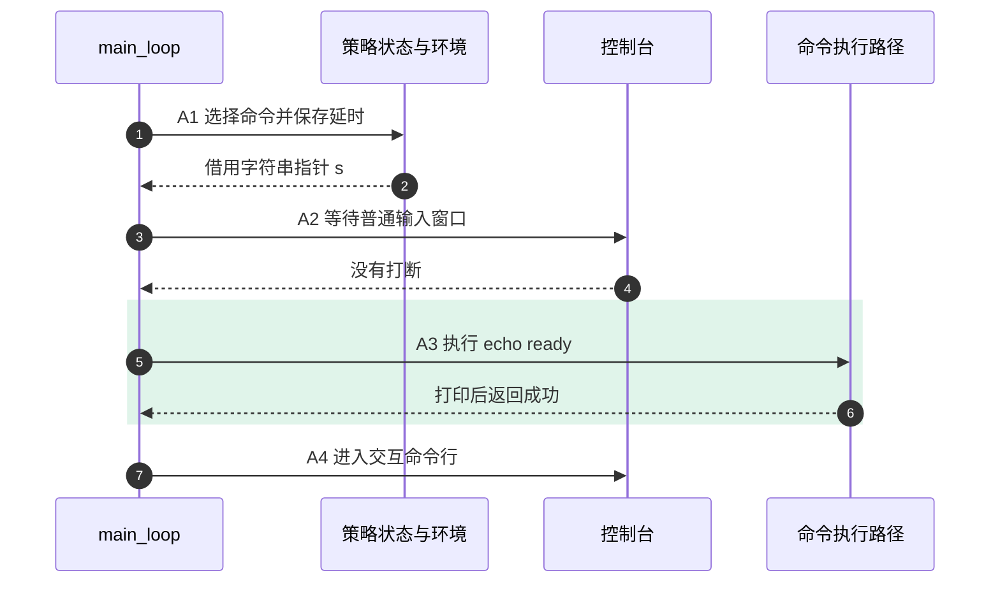
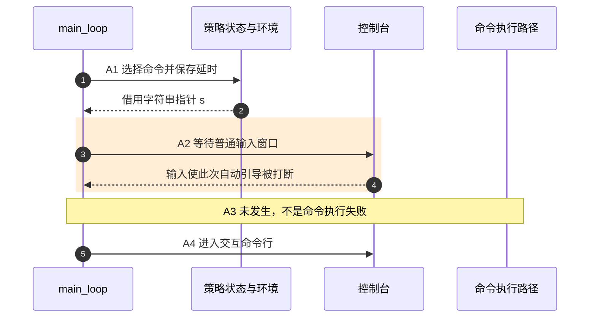

# 第10章\_自动引导如何选择命令与保留维护入口

[上一章](P09_命令字符串怎样跨过缓冲区与失败边界.md) 已经解释一串命令怎样形成参数、执行并传播失败。现在还剩一个起点问题：没有人在串口输入命令，设备为什么仍会自动启动？如果设备需要现场维护，谁决定给人多久输入机会，以及什么时候转入命令行？

本章先把命令选择、输入等待和命令执行分开，再用固定 U-Boot v2022.10 核对它们如何连接。版本仍是 [源码总索引](../../../research/source_reading/uboot/navigation/README.md) 中的不可变提交，具体入口在 [自动引导模块](../../../research/source_reading/uboot/navigation/P10_自动引导选择与交互退路导读.md)。这里的正常路径是已启用自动引导、具备交互命令行的 proper；受限执行分支另外说明，不把串口提示符当成所有构建都必须提供的能力。

## 10.1\_自动执行与人工维护为什么需要分开的决定

**讲解层次：概念层，启动策略与命令执行。** 一台固定用途设备希望上电后自动启动系统；维护人员又希望在系统镜像损坏时取得控制台。如果固件一取得命令便立即执行，人可能来不及阻止；如果永远等输入，无人值守启动又无法完成。倒计时提供一种折中：允许在有限窗口中打断，未打断便执行选定命令。

这里有三个不同状态。第一是“准备执行什么”，它通常是一串文本；第二是“是否允许执行”，由延时配置和输入结果决定；第三是“执行后发生什么”，由具体命令决定。命令可以只打印一行，也可以加载镜像、尝试引导或返回错误。前两项都成功，仍不证明处理器已进入操作系统。

环境变量是固件保存名称与字符串值的一种软件机制。`bootcmd` 保存启动命令，`bootdelay` 保存延时策略，`bootargs` 则通常承载传给操作系统的参数；不能把这三者当成同一条字符串。环境的持久化后端由构建和板配置选择，可以使用 Flash、MMC、文件系统等，也可以使用默认环境。不存在“所有 U-Boot 都从 NOR 的第二分区读环境”的统一协议。

在本版 proper 中，后期环境初始化先按条件装载环境或建立默认值，再处理控制设备树带来的环境信息。之后主循环读取的是当前环境状态，不是在每次 `env_get` 时重新读取整个存储分区。维护时应分别确认当前值、是否保存以及下一次启动的来源，不能把一次内存中改值等同于持久化成功。

## 10.2\_从选定字符串到交出控制权\_中间经过哪些状态

**讲解层次：实现层，U-Boot v2022.10 的普通自动引导路径。** `main_loop` 先准备命令行解析环境，按配置执行 `preboot` 等早期动作，再调用 `bootdelay_process`。这里的 `cli_init` 并不动态登记全部命令；第八章的命令记录早已由构建和链接形成。`preboot` 在主启动策略之前执行，因此它也可能改变后面读取的环境。

`bootdelay_process` 根据环境、默认配置以及可选的控制设备树/菜单取得延时，并根据启动计数或自检状态选择 `bootcmd`、`altbootcmd` 或 `failbootcmd`。它把延时写入 `common/autoboot.c` 中的静态变量 `stored_bootdelay`，把选中字符串的指针返回给主循环。**它没有执行通常所说的“按任意键停止启动”的等待循环。** 那个循环属于后续 `autoboot_command` 调用的 `abortboot`。

控制设备树是 U-Boot 自己用于配置行为的树；不能默认它就是最后传给 Linux 的那份 DTB。主循环还会让 `cli_process_fdt` 检查这棵树中的启动命令覆盖和受限执行选项。下面先固定未进入受限执行分支的情况。

| 阶段 | 写入者、状态位置与后续读取者 | 完成后能证明什么 |
| --- | --- | --- |
| A0 准备输入 | 环境初始化建立当前值；`main_loop` 的可选预处理可再改值 | 主循环具有本次配置，不等于环境已保存 |
| A1 选择命令 | `bootdelay_process` 写静态 `stored_bootdelay`，返回借用字符串指针 `s`；主循环可按控制树覆盖 `s` | 后面的执行门得到候选文本和延时 |
| A2 决定是否执行 | `autoboot_command` 读两者；普通等待路径消费控制台输入，返回是否打断 | 候选获准执行，或此次被跳过 |
| A3 执行命令 | `run_command_list` 解析文本并调用具体命令；副作用由命令实现决定 | 可能返回，也可能完成不返回的系统交接 |
| A4 返回后的路径 | `autoboot_command` 可执行菜单命令；返回 `main_loop` 后进入 `cli_loop` | 在当前 CLI 配置下继续交互，不能据此判断上一步必然失败 |

这些状态是同一 CPU 顺序运行的软件状态，不需要构造一个“倒计时线程”来解释它们。字符串在 A1 中仍是借用的地址；A3 内部何时复制、展开和切分，复用上一章的缓冲区周期。菜单键也保存在静态变量中，其含义取决于实际输入路径。

下面两张图固定相同参与者。第一种情况，倒计时没有被打断，选中的命令只打印文本并正常返回。



步骤 5～6 执行成功，步骤 7 仍进入 CLI。这是“成功返回”和“成功进入内核”不同的直接例子。第二种情况，控制台输入在普通等待窗口中打断启动。



第二图步骤 4 改变的是执行许可，命令根本没有被调用。两图都简化掉已禁用的菜单分支；有菜单配置时，要在自动命令之后单独检查菜单命令，不能把它画成 `bootdelay_process` 内部总会执行的动作。

## 10.3\_零延时为什么仍可能接受输入

已经知道 A1 和 A2 分开，便可以解释几个容易误设的值。`bootdelay=0` 表示没有正数倒计时，不表示整个输入检查被跳过。普通单键路径会先查已到达的输入，再决定是否继续等待；即使无需再等待，已经排队的字符也可能阻止执行。

| 延时与命令条件 | 此版本普通路径的行为 | 维护意义 |
| --- | --- | --- |
| `s == NULL` | 不执行自动命令，也不调用本次 `abortboot` | 没有候选文本，延时值不能凭空产生命令 |
| `-1` | 跳过自动命令 | 禁用的是自动执行；不能据此保证 CLI 一定存在 |
| `-2` | 有命令便执行，不查打断输入 | 不能依赖普通按键窗口取得维护入口 |
| `0` | 进入打断检查，但没有正数倒计时 | 单键路径仍可消费预先到达的输入 |
| 正数 | 按所选普通单键或 keyed 策略处理输入窗口 | 具体按键、口令及超时由配置决定 |

`keyed` 指要求特定键串或口令的策略，不等于任意键都能打断。它还可能采用散列检查等配置。本章不展开口令实现，只区分打断判定与后续命令执行期间的 Ctrl-C 检查。两段检查位于不同时间，关闭其中一段不能证明另一段也被关闭。

下面的完整 C 模型只保留普通单键条件：启动时已有一个字符排队，观察四种延时如何决定是否读取输入。它不访问串口，不计时，也不执行 U-Boot 命令。先预测输出，再在有 C 编译器的主机运行。

```c
#include <stdbool.h>
#include <stdio.h>

struct policy_result {
    bool checked_input;
    bool ran_command;
};

static struct policy_result decide(int delay, const char *command,
                                   bool pending_key)
{
    struct policy_result result = {false, false};
    bool aborted = false;

    /* 只建模普通单键策略；特殊值在读取输入之前处理。 */
    if (command == NULL || delay == -1)
        return result;
    if (delay >= 0) {
        result.checked_input = true;
        aborted = pending_key;
    }
    result.ran_command = !aborted;
    return result;
}

int main(void)
{
    const int delays[] = {-2, -1, 0, 3};
    unsigned int i;

    for (i = 0; i < sizeof(delays) / sizeof(delays[0]); ++i) {
        struct policy_result r = decide(delays[i], "echo ready", true);
        printf("delay=%d input=%d command=%d\n", delays[i],
               r.checked_input, r.ran_command);
    }

    /* 未设置命令时，不能因为强制启动值而凭空产生命令。 */
    printf("missing=%d\n", decide(-2, NULL, false).ran_command);
    return 0;
}
```

材料位于 [autoboot_policy.c](../../../labs/system_software/uboot/autoboot_policy/autoboot_policy.c)。在仓库根目录、具有 GCC 的 Bash 中执行：

```bash
# 从仓库根目录编译宿主模型，不生成目标板固件。
cc -std=c11 -Wall -Wextra -Werror \
  labs/system_software/uboot/autoboot_policy/autoboot_policy.c \
  -o /tmp/autoboot_policy
/tmp/autoboot_policy
```

应看到 `-2` 对应 `input=0 command=1`，`-1` 对应 `0/0`，`0` 和 `3` 都对应 `1/0`，最后 `missing=0`。将传给 `decide` 的 `pending_key` 改为 `false` 后，`0` 和 `3` 应改为执行命令；`-1` 仍不执行。若把条件错误改成 `delay > 0`，零延时将不再检查已有字符，这个变化就能暴露错误模型。

模型未表现的细节还包括菜单键记录：本版单键实现对“调用前已有字符”和“倒计时中才收到字符”使用不同分支，前者消费字符却不记录 `menukey`。因此“按了菜单键”必须说明在哪个读取分支发生，不能仅凭字符值推断 `menucmd` 一定执行。精确代码见 [输入分支与菜单位置](../../../research/source_reading/uboot/source_explanations/P10_自动引导选择与执行门实现.md#10.2_A2与A3_特殊延时如何决定是否读取输入)。

## 10.4\_命令返回以后\_为什么不保证还有交互退路

在普通路径中，执行函数的返回值并未被 `autoboot_command` 用来判断“系统已经启动”。如果返回，它继续恢复先前临时关闭的 Ctrl-C 状态、检查菜单命令，然后交回主循环。真正把控制权交给内核且不返回的命令，自然不会执行这些后续语句。

另一个分支来自控制设备树的 `bootsecure`。此处的受限执行帮助器绕过完整 shell 解析，直接按命令记录调用，关闭 Ctrl-C，命令返回时进入 `hang`；它不会再按普通路径提供 CLI。这个名字也不等于已完成密码学验证：输入树是否可信、命令是否验证镜像，仍要由其他机制证明。尤其该版本实现中，若控制树没有覆盖命令，传入的指针仍可能来自先前的环境选择，不能把注释里的设计意图当成已经实现的来源保证。

最后要顺着调用者核对“重试”。`run_main_loop` 外层确实有反复调用 `main_loop` 的循环；但本版 `main_loop` 在 `cli_loop` 返回后紧接 `panic`。不能仅看到外层循环，就声称 simple CLI 超时返回一定会重新自动引导；实际还要核对 `CONFIG_RESET_TO_RETRY` 等路径是否先触发复位，以及中间函数是否正常返回。源码说明将这些返回点放在同一条链中。

现在可以预测三种现象：看见提示符不证明上条命令失败；没有按键窗口不证明串口坏了；一个名为 secure 的帮助器不证明整条启动链已认证。[下一章](P11_内存镜像如何变成Linux入口现场.md) 把 A3 中的普通命令替换为真正处理镜像的引导命令，核对它从内存中读取什么、何时完成内核入口准备。其总体合同可先对照 [Linux 交接桥接章](../../../publications/books/running_linux_kernel/P04_uboot启动流程说明.md#4.3_Linux接手的是一组条件_不只是一个入口地址)。
