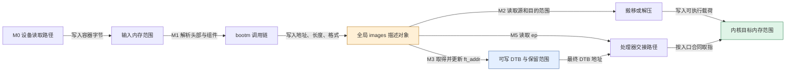
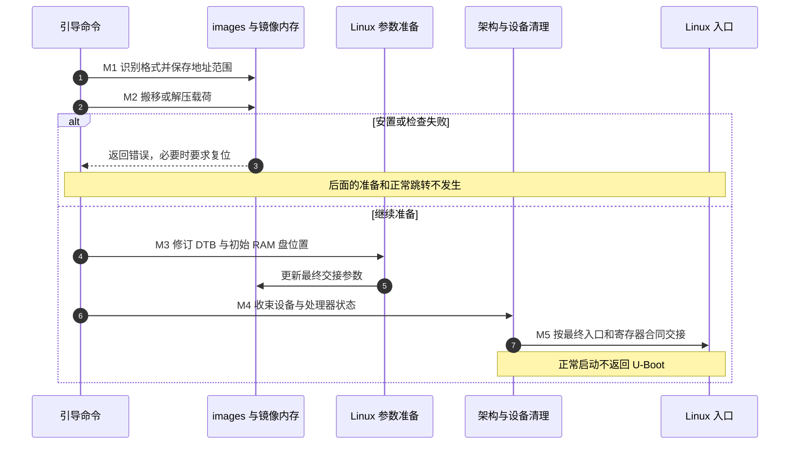

# 第11章\_内存镜像如何变成Linux入口现场

[上一章](P10_自动引导如何选择命令与保留维护入口.md) 已经把候选命令交给执行器。但执行 `echo ready` 会返回，启动 Linux 则要把处理器交给另一个程序。中间缺的不是再找一个函数名，而是让镜像字节、参数内存和处理器状态同时满足入口合同。

本章固定上游 U-Boot v2022.10，沿一份已经位于可访问内存中的镜像，追踪识别、安置、准备参数和交接。先读 [源码总索引](../../../research/source_reading/uboot/navigation/README.md) 了解版本，再由 [镜像交接模块](../../../research/source_reading/uboot/navigation/P11_镜像解析与Linux交接导读.md) 定位实现。主线采用 ARM64 Linux 与 DTB；ARM32、其他操作系统、厂商扩展和安全启动链不自动共享同一入口合同。

## 11.1\_读到字节以后\_为什么还不能直接跳进去

**讲解层次：概念层，存储读取、镜像格式与执行入口。** 假设启动脚本已经从存储设备把一个文件读入 RAM。读成功只证明指定范围中有了这些字节：文件可能带容器头，内核可能被压缩，载荷可能要求放到另一地址，DTB 也可能位于别处。如果直接跳到文件首字节，处理器可能把头部数据当成指令，或在错误地址执行依赖固定布局的代码。

因此至少要回答四个问题：现在的字节是什么格式；真正载荷在哪里、多长；载荷应放在哪里、从哪里执行；后续软件从哪里取得参数。文件读取和后面三项工作可以由不同命令完成。常见脚本中的 `load` 或网络下载先取得字节，`bootm` 再处理已有内存镜像；`bootm_find_os()` 不能概括成“从 NAND 或 MMC 读取内核”。本版也有可选预加载检查钩子，但不能由钩子名字推断它替所有板完成存储读取。

**FIT（Flattened Image Tree）** 是描述多个镜像组件及其组合的容器格式，可以将内核、DTB 和其他载荷关联起来。格式识别或普通校验通过也不等于镜像来源已认证，签名验证还依赖配置、密钥和实际验证路径。它采用树形描述，不等于提供给 Linux 描述硬件的那份 DTB；容器里面还可以包含 DTB 组件。旧式 uImage 则用固定头部描述载荷属性。裸 ARM64 `Image` 有自己的启动头部，不应因为也是一个文件，就直接套用 uImage 头部解释。

| 已有输入 | 本版通常采用的入口 | 入口要处理什么 | 不能仅凭名字保证什么 |
| --- | --- | --- | --- |
| 受支持的 FIT 或旧式镜像容器 | `bootm` | 识别容器、选择组件、取得载荷和入口属性 | 不保证相关格式、校验或操作系统处理器已编入 |
| ARM64 Linux 平坦 `Image`，或配置支持的压缩形式 | `booti` | 解压、解释 Image 头部、必要时搬移，再接公共交接阶段 | 不会自动从任意存储设备查找文件 |
| 启动命令文本 | `run` 或自动引导执行路径 | 解析并调用上述命令 | 命令返回成功不等于 Linux 已执行 |

这里的“平坦”表示按 Image 布局提供的字节，不是 ELF 段表。选择命令依据真实格式和当前构建能力，不能依据文件后缀或“64 位一定用某命令”这种省略条件的规则。ARM64 内核也可以被放进 FIT，交给支持它的 `bootm`。

## 11.2\_同一份镜像为何需要源地址加载地址和入口地址

**讲解层次：实现层，镜像状态的归属。** U-Boot 用 `bootm_headers_t` 描述本次引导，普通 `bootm` 使用 `boot/bootm.c` 的全局对象 `images`。对象保存指针、长度、格式和阶段信息，并不把整个内核文件装进这个结构体。参与者在同一 CPU 的顺序调用链中读写它；真正的载荷和 DTB 字节仍在各自内存范围。

沿一个周期划分为 M0～M5。阶段号是本章阅读标记，不能与源码的位掩码数值混为一谈。

| 阶段 | 进入条件、写入者与状态位置 | 下一位消费者与退出条件 |
| --- | --- | --- |
| M0 已取得输入 | 前面的设备命令把容器写入已规划范围；参数给出地址 | `bootm` 根据参数或默认加载地址找到输入；读取是否成功需另有证据 |
| M1 识别与选择 | `bootm_start` 初始化 `images`；查找路径写格式、载荷范围、加载地址和 `ep` | 后续安置路径读取这些字段；格式或组件错误则停止正常推进 |
| M2 安置载荷 | `bootm_load_os` 依据 `images.os` 搬移或解压，更新载荷长度，维护缓存与范围登记 | 参数准备使用新的内存占用；错误可能需要复位，不能假设原输入完好 |
| M3 准备参数 | Linux 准备路径安置并修订 DTB，处理初始 RAM 盘及板级信息 | `images.ft_addr` 等成为最终交接输入；不是仅保留最初文件地址 |
| M4 收束固件活动 | 架构和板钩子、设备移除及处理器清理减少遗留活动 | 进入所需执行状态；这时不能假设任意设备命令仍可安全重试 |
| M5 交出执行 | ARM64 路径把最终 DTB 地址送入参数寄存器，跳到 `images.ep` | 正常 Linux 引导不返回；意外返回交给错误处理 |

图中的 `images` 是描述对象，不是数据必须流经的复制缓冲区。关闭一条中断、移动某个指针或写一个阶段位，都不能代替图中实际发生的内存写入。

| 本章使用的字段 | 值的含义与变化 | 容易误读之处 |
| --- | --- | --- |
| `os.start/end` | 容器范围的起止地址 | 不能当作解压后的内核范围 |
| `os.image_start/image_len` | 最初指载荷源与长度；装载后 `image_len` 更新为解压/安置后的长度 | 同一字段在阶段变化后含义有所推进 |
| `os.load` | 内核载荷的目标地址 | 不必等于容器地址或源载荷地址 |
| `ep` | 最终执行入口，由格式解析或 Image 处理确定 | 不保证等于文件头或任意加载地址 |
| `ft_addr/ft_len` | DTB 的位置与记录长度；准备时地址可能变化 | 不能只记住读取文件时的原始地址 |
| `rd_start/end`、`initrd_start/end` | 初始 RAM 盘的原范围与准备后的范围 | Linux 应得到准备后有效范围 |
| `lmb` | 启用逻辑内存块管理时的可用/保留范围账本 | 登记占用不是对所有越界写的硬件隔离 |
| `state` | 源码用于阶段选择和顺序控制的位信息 | 不是每个阶段成功完成的可靠收据 |

最后一项尤其重要：`do_bootm_states` 在执行前就将请求位并入 `images->state`，而 `bootm_start` 又会重置全局对象。失败时没有逐项撤销成功标志的事务机制。要证明 M2 成功，必须看调用结果和对应内存状态，不能只看 `LOADOS` 位是否出现。

考虑一个纯地址练习，单位为 MiB，区间包含起点、不含终点。容器位于 `[32,48)`，压缩载荷在 `[33,41)`，解压结果预计长 24。若目标是 `[40,64)`，哪怕载荷源只有 8，输出仍会覆盖容器和部分源。若改为 `[64,88)`，它与容器分开，却还必须避开 DTB、初始 RAM 盘、U-Boot 本体及保留内存。**消除一种重叠不等于证明整体布局安全。** 本版某些重叠检查位于解压之后，因此不能把报错理解为“所有数据还没被碰过”。

## 11.3\_参数准备为什么会改写设备树

已经把内核放到目标范围，仍需让它知道本次机器和启动选择。DTB 文件给出初始描述，运行中的固件可能知道实际内存容量、启动参数、初始 RAM 盘位置和次级核释放地址；这些信息需要与最终布局一致。M3 因而不仅查到一根 DTB 指针，还会按配置修订其内容。

本版 ARM Linux 的 DTB 路径从 `boot_prep_linux` 进入 `image_setup_linux`：先登记 DTB 内的保留范围，按配置准备命令行区域，再处理 DTB 安置，最后经 `image_setup_libfdt` 完成通用、架构和板级修订。普通完整 `bootm` 的 ARM 路径不是必然单独执行一个 `BOOTM_STATE_FDT` 阶段；这些工作可在 `OS_PREP` 内完成。

| 修订内容 | 默认数据来源或执行者 | 必须保留的条件 |
| --- | --- | --- |
| `/chosen/bootargs` | 默认板钩子返回环境中的 `bootargs` | 板可覆盖钩子；无新字符串不等于主动清除已有属性 |
| 内存节点范围 | ARM 架构修订读取板信息中的 DRAM 范围 | 受实际配置、保留/裁剪处理及板钩子影响 |
| 初始 RAM 盘边界 | 准备后的 `initrd_start/end` | 有有效范围才描述，不能把旧地址继续传下去 |
| `cpu-release-addr` 与等待代码保留范围 | 配置适用时的 spin-table 修订 | CPU 节点须已采用 `spin-table`；此版不把其他方法强改成它 |
| 其他板级属性 | `ft_board_setup` 等可选钩子 | 由具体实现证明，不能把函数入口存在视为已完成所有修订 |

`boot_relocate_fdt` 的常见路径分配带扩展余量的新范围并复制 DTB。但 `fdt_high` 的全一值允许原地使用，源码假定旧 DTB 后面已有足够空间。这个选择减少复制，却把可写性、余量和相邻对象不被覆盖的责任留给布局设计；它不是“无论放哪里都可原地扩容”的许可。

次级核方法的选择也不能凭空改写。固定版 `spin_table_update_dt` 会先检查 CPU 节点：有节点不是 `spin-table` 就返回，不去破坏 PSCI 等方法；全部适用时才写释放地址和保留范围。等待核如何观察释放单元，复用 [第六章的多核入口](P06_从复位入口到异常向量与主核交接.md)，这里关心的是把同一块状态正确交给下一阶段。

## 11.4\_最后一次打印为什么还不能证明Linux已经运行

设备不仅会响应 CPU 读写，还可能通过 DMA 主动写内存。如果固件准备把内存交给 Linux，却让旧 USB 控制器继续向原缓冲区写数据，Linux 后来把这块内存用作其他对象，就可能被旧设备破坏。因此 M4 必须考虑遗留设备活动，不能只关注 CPU 的下一条跳转指令。

本版装载阶段已经按配置关闭中断并停止部分网络/USB 活动；最终 ARM 交接还调用板清理、驱动移除以及 `cleanup_before_linux`。ARMv8 的默认清理关闭并失效指令缓存、处理数据缓存并关闭地址转换，随后还有多核唤醒及执行状态交接。实际板钩子、DMA 和缓存一致性仍需逐板核对；源码安排了清理入口，不是对所有外设都已安全停止的运行证明。

以 ARM64 Linux 为例，最终 `x0` 是 DTB 的物理地址，`x1`～`x3` 为零，入口前还需符合异常级别、中断屏蔽、MMU 和缓存等要求；完整本地对照见 [Linux 入口合同表](../../../publications/books/running_linux_kernel/P04_uboot启动流程说明.md#4.3_Linux接手的是一组条件_不只是一个入口地址)。这与普通 C 函数调用可依赖既有运行环境不同。`armv8_switch_to_el2` 的名字也不意味着每次都从 EL3 降级：它读取当前级别，已处于相应执行条件时走不同分支，不能把一条固定“EL3→EL2→EL1”画成所有启动的必经路线。

串口上的 `Starting kernel ...` 由固件在最后清理过程中打印，时间仍早于最终跳转；trace 配置的 fake 路径甚至会执行清理并打印而不真正进入内核。因此该行适合作为进度定位，不能证明 Linux 已执行第一条指令。要继续判断，需要下一阶段日志、调试器停点或其他实际观测。

若普通目标上的 Linux 交接意外返回，`boot_selected_os` 把它转成 `BOOTM_ERR_RESET`，调用者再走复位处理。standalone 镜像、sandbox 和 fake 状态有允许返回的特例。不能把“回调返回 0”直接当作“内核启动成功”，也不能在已经清理设备以后无条件承诺还能继续正常交互。

## 11.5\_怎样把启动日志对应到当前缺失条件

现在用同一阶段表判断三个现场。文件读取完成但报告格式错误，优先核对 M0 的实际字节和 M1 的格式/构建能力；显示已经搬移内核但 DTB 准备失败，追查 M3 的可写空间、保留范围和具体修订错误；最后打印后沉默，范围已缩小到末段清理、入口合同和内核早期路径，仍不能只凭沉默断言串口或内核某一方有错。

再做两个预测练习。第一，把 `booti` 的目标计算得到的地址记下来，是否可以立即断言整个内核范围都在有效 RAM？不能，地址计算与完整范围核对是不同证明，还要检查长度、溢出、保留区和其他对象。第二，把 `fdt_high` 设为全一值能否修复所有“分配 DTB 失败”？不能，它改为原地使用，需要旧位置满足空间与协议条件；它可能把清楚的分配错误变成覆盖数据。

本章的源码说明用合成 Image 头和宿主桩核对地址选择及返回分支，不执行特权指令，也不尝试在主机跳入 Linux 镜像。真正的板级复现应先记录配置、镜像身份、源与目标范围、每步返回和最后观测点，再用 M0～M5 逐项收窄。到这里，U-Boot 一侧的“自动选择命令→处理镜像→交出执行”已闭合；下一阶段才由内核建立自己的地址转换、全局状态和初始化执行链。
