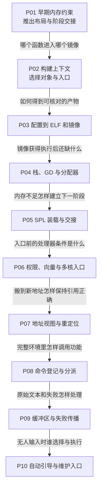

# 第1章\_U-Boot从构建到启动与命令执行

U-Boot 是在操作系统之前运行的引导软件。它从芯片启动固件或其他前级取得控制权，建立所需运行条件，选择并加载后续载荷，也可以提供交互命令。本专题面向已有 C 基础的读者，沿“镜像怎样形成、怎样获得可用内存、怎样交出控制权、输入怎样调用功能”连续学习，不要求先记住所有板级初始化函数。

最初的 NXP 与 Rockchip 对照材料，希望把零散的工程经验整理成可以解释和复查的运行过程。现在按问题拆成十章，并把固定版本的源码讲解与历史平台证据分开。默认顺序中的前一章建立模型，后一章用新的约束继续完善它；源码路径、图片和配置用于核对模型，不代替正文推导。

## 1.1\_从可执行条件走到完整命令周期

先修是 C 指针、数组和函数调用，以及 [链接脚本的地址与布局](../linker/P01_从目标文件到运行布局的链接脚本.md)。这里的 **片上系统（System-on-Chip，SoC）** 指把处理器、片上存储和多种控制器集成到一颗芯片的系统；SoC、处理器指令集、开发板和 U-Boot 板配置不是同一个对象。内存器件、供电、布线和启动方式仍可能因板而异。

这张图是阅读依赖，不是处理器执行顺序。真实启动时，复位/前级入口先于 C 环境；教材先在 P01 建立整体布局，再逐步放大运行条件，最后于 P06 回到入口核对早期假设。

| 章节与实际入口 | 本章解决的问题 | 已有前提与留给下一章的问题 |
| --- | --- | --- |
| [P01 从链接布局到启动阶段的交接](P01_从链接布局到启动阶段的交接.md) | 链接边界如何参与复制、清零和阶段交接 | 依赖链接脚本基础；还不知道同名函数选哪份 |
| [P02 从构建上下文找到实际进入镜像的函数](P02_从构建上下文找到实际进入镜像的函数.md) | 分清父子 Make、阶段宏、对象选择与独立链接 | 已知镜像有阶段；继续追踪配置和产物 |
| [P03 从板配置到可核对的构建产物](P03_从板配置到可核对的构建产物.md) | 把板模板、配置求值、ELF 和打包产物连起来 | 已知对象选择；获得镜像仍不等于 C 环境可用 |
| [P04 先建立栈与GD再进入可用的C环境](P04_先建立栈与GD再进入可用的C环境.md) | 解释早期栈、GD、分配器和状态交接 | 已知镜像布局；进一步追问小阶段怎样加载下一镜像 |
| [P05 为什么需要SPL以及它怎样交出下一阶段](P05_为什么需要SPL以及它怎样交出下一阶段.md) | 从空间与协议约束推导 SPL/TPL，追踪候选、装载、检查和跳转 | 已知早期工作区；还需核对入口的处理器状态 |
| [P06 从复位入口到异常向量与主核交接](P06_从复位入口到异常向量与主核交接.md) | 区分复位与软件标签、当前权限与异常路由、主核与等待核 | 沿已有交接模型回查入口；继续检验地址变化 |
| [P07 镜像搬迁为什么不等于改变内存映射](P07_镜像搬迁为什么不等于改变内存映射.md) | 分开物理解码、地址转换和字节搬移，推导相对重定位 | 已知运行前提；接下来进入完整环境中的命令机制 |
| [P08 命令名怎样找到镜像里的实现函数](P08_命令名怎样找到镜像里的实现函数.md) | 从名字到记录、匹配、参数检查与回调结果 | 假设已有 argc/argv；继续追问参数由谁构造 |
| [P09 命令字符串怎样跨过缓冲区与失败边界](P09_命令字符串怎样跨过缓冲区与失败边界.md) | 追踪借用字符串、展开结果、参数地址与分层失败 | 复用命令分派；继续追问自动命令从哪里来 |
| [P10 自动引导如何选择命令与保留维护入口](P10_自动引导如何选择命令与保留维护入口.md) | 分清选择命令、检查输入、执行及返回后的交互退路 | 已知解析与返回边界；实际进入内核仍需镜像与入口协议证据 |

## 1.2\_需要查源码或回到真实板时走哪条支线

[U-Boot 源码总索引](../../../research/source_reading/uboot/navigation/README.md) 固定上游 v2022.10 的不可变提交，按模块导读进入唯一实现标题。知识正文先解释职责、过程与边界；模块导读定位状态和函数协作；实现文档再展开宏、字段和裁剪源码。这三个入口分别服务于学机制、找路径和读实现。

[旧材料的版本身份与平台差量](../../../research/investigations/uboot_vendor_baselines.md) 保留 NXP 2016/2022、Rockchip 2017 配置与原图，解释为什么不能将它们拼成一个版本。涉及 i.MX6ULL ROM、地址空间和启动寄存器时，使用正文中的本地表格，再沿 [Arm 资料索引](../../../reference/external_resources/arm/README.md) 追溯官方手册；图中存在某个硬件模块，不等于某阶段已经使用过它。

本专题的宿主实验用于验证 Make 规则、地址计算、数据布局和命令控制流。没有标为已执行的交叉构建、QEMU 或板级启动步骤，仍属于按固定证据说明的操作路径。应用到实物之前，需要把实际板配置、工具链、镜像格式、加载地址和交接协议连成自己的证据链。
