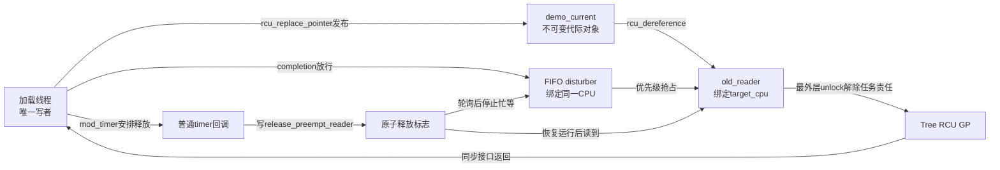
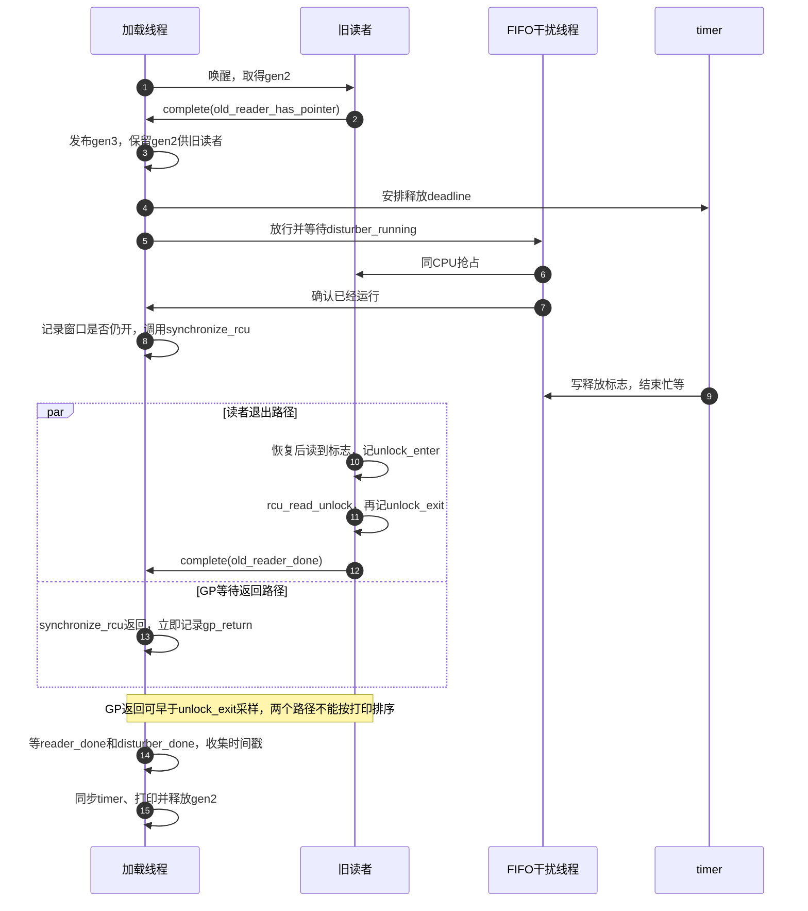

# 第1章\_晚到读者与抢占读者的对象回收实验

## 1.1\_实验要回答的两个问题

“任务已经存在”和“任务已经取得旧对象”是不同事实。假设共享配置从 gen1 换成 gen2：一个线程虽然早已创建，但尚未读取共享入口，旧对象回收为什么不用等它？再把线程放进读侧，让它先取得 gen2，然后在唯一持有该指针的任务尚未退出时切换 CPU 执行者，CPU 已经切换为什么仍不能释放 gen2？

[配套模块](late_and_preempted_reader.c)按顺序构造两种现场：第一阶段用 completion 把晚到线程挡在读侧外，gen1 撤销并经过宽限期后才放行；第二阶段让已取得 gen2 的普通读者在同一目标 CPU 上被 FIFO 实时线程抢占，再观察同步等待。**宽限期（Grace Period，GP）** 等待的是有关旧读者结束，并非等待所有早已创建的任务。

这里用门闩替代“运行队列前面恰好有许多任务”，只重现关键前提：晚到者在旧对象释放前未执行 `rcu_dereference()`，没有取得旧地址。第二阶段使用短忙等放大窗口，是观察实验，不是性能基准或生产实现。

前置模型见 [抽象推演中的旧集合](../../../../knowledge/linux/synchronization_and_asynchrony/synchronization/rcu/P02_RCU_抽象机制推演.md#2.6_第四步_定义宽限期要等待的集合)；配置差异见 [读侧执行模型](../../../../knowledge/linux/synchronization_and_asynchrony/synchronization/rcu/P06_Tree_RCU_读侧执行模型与配置差异.md#6.11_实验与结论一一配对)；进入版本源码时先读 [公共接口模块导读](../../../../research/source_reading/rcu/navigation/P02_Linux_6.12_RCU公共接口与读侧模型模块源码概念导读.md#2.8_端到端状态与通信)。

## 1.2\_场景和参与者

模块加载线程是唯一更新者，依次发布 gen1、gen2、gen3。对象中的 `generation/value` 在发布后保持不变；共享入口 `demo_current` 用 RCU 指针协议替换。下面的通知只编排实验，不替代 RCU 自己的 GP 证明。

| 状态地址 | 写入者 | 读取或等待者 | 作用 |
| --- | --- | --- | --- |
| `demo_current` | 模块加载/退出线程 | 两个 reader | 当前发布对象的正式入口 |
| `start_late_reader` completion | gen1 回收后的加载线程 | late reader，位于读侧外 | 保证第一次取指针晚于替换 |
| `old_reader_has_pointer` completion | 已取得 gen2 的 old reader | 加载线程 | 保证第二次替换发生在取得旧地址之后 |
| `start_disturber`/`disturber_running` | 加载线程/FIFO 线程 | FIFO 线程/加载线程 | 确认同 CPU 干扰任务已经运行 |
| `release_preempt_reader` 原子标志 | timer 回调或清理路径 | old reader 与 FIFO 线程主动轮询 | 结束短忙等，不表示 GP 已完成 |
| `old_reader_done`/`disturber_done` | 对应线程 | 加载或清理路径 | 交接线程退出读侧后的观察数据 |
| `old_unlock_enter_ns/exit_ns`、`release_ns` | reader、timer | 取得 completion 且同步撤销 timer 后的加载线程 | 保存事件边界；不依赖 printk 交错 |



第二阶段要求至少两个在线 CPU、可抢占普通 RCU，以及 **非 PREEMPT_RT 的完整抢占运行模式**。CPU hotplug 读锁固定在线集合；它不会固定加载线程的 CPU 亲和性。自动选择只在选择时避开加载线程所在 CPU，要固定实验布局应使用后面的 `taskset`。

## 1.3\_构建前检查

下面的命令在实验目录执行，内核源码核对基线为 NXP Linux 6.12.20、提交 `dfaf2136deb2af2e60b994421281ba42f1c087e0`。外部模块必须使用实际目标镜像对应的配置、生成头文件与符号版本，不能仅凭相同的版本字符串认定匹配。

```bash
uname -r
grep -E 'CONFIG_(TREE_RCU|PREEMPT_RCU|PREEMPT|PREEMPT_DYNAMIC|PREEMPT_RT|RCU_TRACE)=' /boot/config-"$(uname -r)"
cat /sys/devices/system/cpu/online
test -d /lib/modules/"$(uname -r)"/build
```

目标第二阶段需 `TREE_RCU=y`、`PREEMPT_RCU=y`、`PREEMPT_RT=n`，并实际运行在完整抢占模式。动态抢占构建还要核对启动选择；`PREEMPT_RCU=y` 本身不能证明当前忙等任务一定被强制抢占。若完整窗口未建立，后面会把本次结果判为不充分。只有一个在线 CPU、未启用 PREEMPT_RCU 或启用 PREEMPT_RT 时，模块仍运行第一阶段，并明确跳过第二阶段。

没有 `/boot/config-*` 时使用 `/proc/config.gz` 或与运行镜像身份一致的构建配置。`nproc` 可能反映进程的可用 CPU 集合，不能替代在线集合与亲和性核对。`RCU_TRACE` 仅影响可选 trace；普通日志仍可运行。

排除 PREEMPT_RT 的原因是本例依赖普通 timer 回调放行忙等。RT 下的线程化执行和优先级关系不同，不能假定低优先级的 timer 执行者一定抢过 FIFO 干扰任务；本实验没有建立那套释放证明。

## 1.4\_构建和运行

```bash
make
# 在另一个终端观察，不清空系统已有内核日志。
sudo dmesg --follow | grep --line-buffered rcu_lifetime_lab
```

回到实验目录的运行终端：

```bash
sudo insmod ./late_and_preempted_reader.ko hold_ms=300
sudo rmmod late_and_preempted_reader
```

如 CPU0、CPU1 都在线且当前任务可用，可以固定加载线程在 CPU0、读者与干扰任务在 CPU1：

```bash
sudo taskset -c 0 insmod ./late_and_preempted_reader.ko target_cpu=1 hold_ms=500
sudo rmmod late_and_preempted_reader
```

`target_cpu=-1` 自动选择；显式目标必须在线且在选择时不同于加载者 CPU，否则第二阶段被跳过并打印原因。`hold_ms` 范围为 20～5000 ms，表示 **从安排 timer 起算的释放延迟**；timer 在唤醒 FIFO 任务之前安排，GP 计时在确认 FIFO 已运行之后才开始，因此不能把它解释成“保证抢占这么久”或“GP 至少等这么久”。

模块在入队后不主动睡在普通 RCU 读侧内。FIFO 线程和旧读者忙等原子标志；完成实验后线程在读侧外休眠，等待 `kthread_stop()` 收束。

## 1.5\_预期证据

先将第二阶段按统一事件顺序展开：



正常第一阶段会记录 `late reader saw generation=2 value=200`：线程早已存在不代表持有 gen1。第二阶段会记录取得 gen2、FIFO 运行、`window_open_at_start` 和 `event_ns`。这些字段是 **预期格式**，本文没有声称本轮已经取得目标运行日志。

| 观察 | 能证明什么 | 不能直接推出什么 |
| --- | --- | --- |
| late reader 读到 gen2 | 本编排放行后读取到新入口 | 一切可能交错均已覆盖 |
| `window_open_at_start=0` | GP 测量前已经放行 | 不能据短耗时声称抢占等待已验证 |
| `window_open_at_start=1` 且 FIFO 已运行 | GP 调用前采样点的门闩仍关闭，目标执行者已切换 | 采样后仍可能立即放行；不单凭这一位定位 blocked 队列或等待时长 |
| `gp_return >= unlock_enter` | 结果未出现明显早于退出入口的时间反例 | 时间戳不能精确定位函数内部清责任指令 |
| `gp_return < unlock_exit` | GP 可能已满足而读者尚未执行解锁后的采样 | 这本身不是错误，不能要求 unlock 后日志先打印 |

旧版模块把“GP returned”打印放在 `wait_for_completion(old_reader_done)` 后；这会人为形成日志顺序。因此现在 **先记录实际 GP 返回时刻，再等待观察数据就绪**。模块仍额外等 reader 完成才释放 gen2，防止异常观察故意变成释放后使用；它不靠“没有崩溃”证明 GP 正确。

若 `gp_return < unlock_enter`，会输出错误提示，应结合对应 trace、时钟源与配置复查。若释放发生过早，本次只能算未建立所需窗口，调整负载或短暂增加 `hold_ms` 后再试。GP 耗时不等于 hold_ms：起算位置、定时器粒度、系统负载和虚拟化都会影响观察。

## 1.6\_可选trace证据

trace 用来把实验线程关联到 RCU 的具体任务责任，不能只搜索一次 GP end 就认定是本次等待。先确认 tracefs 已挂载、事件存在且没有被配置关闭。使用独立实例，避免清空其他人的全局 trace：

```bash
trace_instance=/sys/kernel/tracing/instances/rcu_lifetime_lab
sudo mkdir "$trace_instance" || exit 1  # 已存在则停止，先确认它的使用者。
for trace_event in rcu_preempt_task rcu_unlock_preempted_task rcu_grace_period; do
    test -f "$trace_instance/events/rcu/$trace_event/enable" || exit 1
    echo 1 | sudo tee "$trace_instance/events/rcu/$trace_event/enable" >/dev/null
done
echo 1 | sudo tee "$trace_instance/tracing_on" >/dev/null
sudo insmod ./late_and_preempted_reader.ko hold_ms=500
echo 0 | sudo tee "$trace_instance/tracing_on" >/dev/null
sudo cat "$trace_instance/trace" > rcu_lifetime_trace.txt
sudo rmmod late_and_preempted_reader
```

读取 `rcu_lifetime_old` 对应 PID、目标 CPU 和 GP 代次。需要解释的关系是：旧读者被登记到叶节点 blocked 队列；CPU 的静止态证据可以先成立；旧任务退出解除其任务责任；对应 GP 才能满足联合完成条件。系统同时有其他 GP 和 reader，不能把不同代次的事件拼成一个因果链。

没有事件可能是配置、实例支持或过滤问题；不能反推机制不存在。`rcu_unlock_preempted_task` 是实现中的报告点，仍需按固定源码解释它相对内部摘链和唤醒的位置，而不是当作用户 printk 的替代名字。

## 1.7\_为什么实验没有在读侧里sleep

读者在取得对象之后通知加载线程，再短暂忙等，不主动调用 `schedule()`、`msleep()` 或等待队列。被抢占来自同 CPU 更高优先级 FIFO 线程，属于非自愿抢占。读侧中的日志和 completion 通知是实验观测与编排开销，所以本模块也不能用来测量生产读侧的延迟。

timer 回调写入原子释放标志；该标志控制何时退出忙等，不承担 GP 完成语义。它甚至可能在 FIFO 真正运行之前到期，代码因此检查 GP 开始时窗口是否仍开。清理路径也写此标志，并放行两个等待门闩，随后同步 timer、停止线程，避免线程永远等在已经退出的模块代码里。

## 1.8\_反例与失败判定

| 现象 | 优先核对 | 处理或结论 |
| --- | --- | --- |
| 第二阶段跳过 | CPU、PREEMPT_RCU、PREEMPT_RT、显式目标 | 第一阶段结果仍独立有效；不要把跳过当通过 |
| 外部模块编译或装载失败 | 目标构建身份、工具链、导出符号和模块策略 | 先解决环境匹配，未获得运行证据 |
| `window_open_at_start=0` | 实际抢占模式、调度延迟和timer起算点 | 观察窗口无效，不推断GP等待性能 |
| 没有RCU trace事件 | TRACE配置和实例支持 | 日志只能提供较弱的事件边界证据 |
| unlock后日志晚于GP日志 | 打印位置和调度交错 | 不能据此判错；使用事件时间戳与对应trace |
| 读侧出现主动切换告警 | 是否加入阻塞操作、实际RT条件 | 恢复本例前提，先消除误用 |

如果把 `complete(start_late_reader)` 提前到第一次 GP 以前，第一阶段是否还证明晚到者一定读 gen2？答案是不能；门闩不再保证第一次读取晚于替换与回收，必须重新分析交错。如果 FIFO 已运行但 timer 也已经放行，是否算完成第二阶段？答案也是不能；运行过干扰任务不等于 GP 测量期间旧读者仍被阻挡。

## 1.9\_清理

```bash
# 确认模块仍在时卸载；不要用忽略所有错误掩盖卸载失败。
lsmod | grep late_and_preempted_reader
sudo rmmod late_and_preempted_reader
make clean
```

若使用了专用 trace 实例，保存记录后关闭事件并删除该实例；前面任一步失败时也应执行这段收尾：

```bash
echo 0 | sudo tee "$trace_instance/tracing_on" >/dev/null
for trace_event in rcu_preempt_task rcu_unlock_preempted_task rcu_grace_period; do
    test ! -f "$trace_instance/events/rcu/$trace_event/enable" || \
        echo 0 | sudo tee "$trace_instance/events/rcu/$trace_event/enable" >/dev/null
done
sudo rmdir "$trace_instance"
```

模块退出先放行并收束线程和timer，再撤销正式入口、等待 GP、释放最后对象。构建产物和运行记录不作为已验证结果自动进入仓库。

## 1.10\_本轮验证边界

本轮核对代码中的发布、门闩、时间采样、失败清理及其与固定版本接口的关系，并检查文档和图示。当前目标工作树与运行内核不可用，**未完成目标模块构建、装载、抢占或trace实验**。上文给出的是可执行步骤、预期格式与判定规则，不是本轮成功运行的报告。
