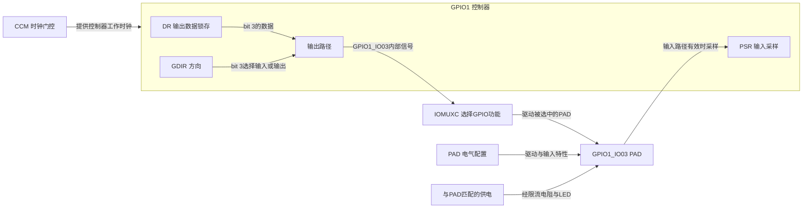
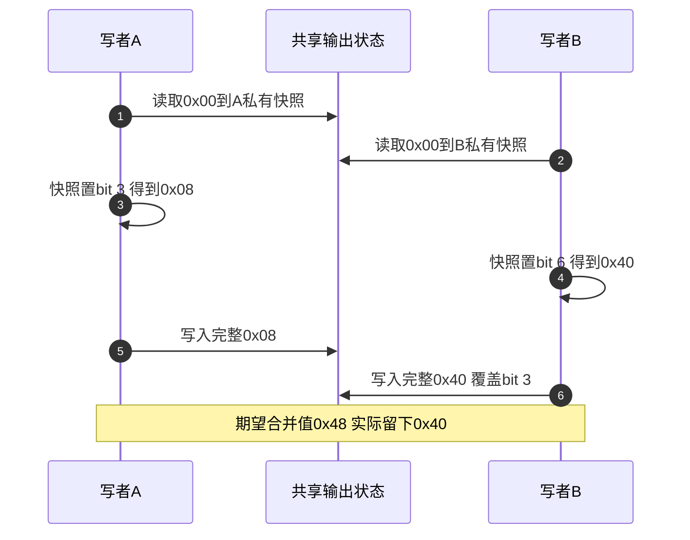

# 第1章\_LED点灯+ioremap

把一个通用输入输出引脚（General-Purpose Input/Output，GPIO）拉低，为什么还不足以保证发光二极管（Light-Emitting Diode，LED）点亮？引脚可能没有选成 GPIO 功能，方向可能还是输入，控制器可能没有可用时钟；即使这些都正确，板上的 LED 接线与有效电平也必须相符。本章沿 GPIO1_IO03 追踪这些条件，再解释 Linux 的 `ioremap` 做了哪一部分，以及为什么普通 LED 消费者应交给已有 GPIO 驱动管理。

本章采用 i.MX6ULL 寄存器作为具体对象，低电平点亮作为教学电路假设。**芯片手册证明寄存器和 PAD 功能，板级原理图才证明哪一颗 LED 接在该脚。** 原稿没有提供可核定版本的整板原理图，因此下图表达条件关系，不宣称所有 i.MX6ULL 开发板都这样接线。可执行部分是完整宿主 C 模型；真实硬件操作在 [设备树集成](P02_LED点灯+dts.md) 和 [字符设备实验](P03_字符设备_LED与设备树完整实验.md) 按资源归属展开。

## 1.1\_从数据位到发光还要经过哪些条件

GPIO 控制器内的数据锁存器保存希望输出的值，方向寄存器决定线路是否作为输出；IOMUXC 是引脚复用控制器，决定芯片连接外部电路的焊盘（PAD）使用哪种内部功能，并配置输入迟滞、驱动强度等电气属性。CCM 时钟控制模块提供控制器运行所需的时钟条件。这些是不同硬件职责，修改其中一项不会自动完成其余设置。



若采用图示低有效连接，GPIO 输出低使 LED 支路形成电流，输出高使它熄灭。GPIO 位值描述电平，`on` 描述设备意图；二者在本例相反。以后使用带有效极性的 GPIO 描述符时，内核可以完成这次翻译，消费者不应再次反转。

先看本次真正涉及的寄存器。下表中的地址均为 **SoC 物理内存映射 I/O（MMIO）地址**，不是可直接在普通 C 程序中解引用的宿主指针。地址与字段来自 NXP `IMX6ULLRM` Rev.1、11/2017。

| 寄存器 | 物理地址与访问 | 本例字段及作用 |
| --- | --- | --- |
| `CCM_CCGR1` | `0x020c406c`，32 位读写 | `CG13[27:26]` 管 GPIO1 时钟；`00` 关闭、`01` RUN 开而 WAIT/STOP 关、`10` 保留、`11` 除 STOP 外开启。不能把 `11` 解释为任何低功耗状态都不断钟 |
| `IOMUXC_SW_MUX_CTL_PAD_GPIO1_IO03` | `0x020e0068`，32 位读写，保留位不随意改 | `MUX_MODE[3:0]=5` 选择 GPIO1_IO03；`SION[4]` 控制强制输入路径，并不是输出方向位 |
| `IOMUXC_SW_PAD_CTL_PAD_GPIO1_IO03` | `0x020e02f4`，32 位读写，保留位按手册要求处理 | 配置 PAD 电气属性，下面逐字段解释旧值 `0x10b0` |
| `GPIO1_DR` | `0x0209c000`，32 位读写 | 输出模式下 bit 3 保存输出值；输入模式下读值受输入信号与 IOMUX 路径影响，不能始终视为软件输出锁存器镜像 |
| `GPIO1_GDIR` | `0x0209c004`，32 位读写 | bit 3 为 0 选择输入，为 1 选择输出；需要 IOMUX 同时选择 GPIO |
| `GPIO1_PSR` | `0x0209c008`，32 位只读 | 观察有效输入路径的 PAD 状态；输出回读还需相应回环输入条件，读 DR 不等于测到了引脚电压 |

GPIO 章节明确要求寄存器以 32 位访问。即使只控制 bit 3，也不能把地址加 3 当成第三根 GPIO，或用单字节写入代替正确的位更新。更不能把所有 GPIO 寄存器套用同一种读改写规则：中断状态寄存器另有写 1 清除语义，后续按键实验会单独处理。

### 1.1.1\_把0x10b0拆开以后才能判断电气意图

旧代码直接写 `0x10b0`，却把它解释成“中等驱动能力与 22 kΩ 上拉”。只看十六进制外形无法得出这些结论。要按 GPIO1_IO03 这个 PAD 的位图拆分，再解释字段组合。

| 字段 | `0x10b0` 对应值 | 本 PAD 的含义与组合条件 |
| --- | --- | --- |
| `HYS[16]` | 0 | 输入迟滞未开启 |
| `PUS[15:14]` | 0 | pull 选择编码为 100 kΩ 下拉；本例 PUE 未选择 pull，不能据此宣布下拉电阻正在工作 |
| `PUE[13]` | 0 | 选择 keeper，保持器模式 |
| `PKE[12]` | 1 | keeper/pull 功能使能；与上一行合看为 keeper |
| `ODE[11]` | 0 | 未选择开漏输出 |
| `SPEED[7:6]` | 2 | 此 PAD 手册列为 medium（100 MHz）档位，描述配置等级，不保证板上可实现任意 100 MHz 波形 |
| `DSE[5:3]` | 6 | `R0/6` 驱动编码；手册给出 R0 随供电条件变化，不能解释成固定 6 mA |
| `SRE[0]` | 0 | 慢边沿；改成 `0x10b1` 只改变 SRE，不会开启开漏 |

保持器和上拉电阻不是同一功能。配置还必须适合电源域、外接电路和信号要求；本表用于解读旧值，不把它作为任意 LED、蜂鸣器或高速引脚的通用配方。

> 手册定位：§18.6.23～18.6.24、pp.698～701；§28.4.3～28.5.3、pp.1355～1359；§32.6.10、p.1571；§32.6.156、pp.1793～1794。官方原件入口见 [Arm 资料索引](../../../../../../reference/external_resources/arm/README.md)。本页已列出当前推理所需地址和字段，外链用于核对版本与完整上下文。

## 1.2\_ioremap建立访问路径\_不会取得设备所有权

内核代码通常使用虚拟地址访问设备。`ioremap` 为给定物理区域建立适合设备访问的映射，返回带 `__iomem` 标注的访问地址；调用方检查映射是否成功，再使用 `readl/writel` 或适用的 I/O 访问接口。`iounmap` 撤销映射。这里的 `__iomem` 帮助区分地址类别，不是“所有访问自动安全”的开关。

但映射成功，只说明取得了一条访问路径。它没有替你申请 GPIO 线路，没有取得 IOMUX 状态的使用权，也没有让其他驱动停止修改同一控制器。即使仅想控制一个 LED，CCM 字段与 GPIO bank 都可能与其他设备共享，私自映射不能建立合法的所有者关系。

本仓库固定 Linux 6.12.20 的 `gpio-mxc` 驱动通过 `devm_platform_ioremap_resource()` 取得控制器资源，并接入 GPIO 框架；相应基础操作使用 `bgpio_data` 软件影子和控制器锁协调输出更新。LED 消费者应申请一根线路，借由提供者完成访问。**资源申请、映射、共享状态保护与设备生命周期是不同步骤**；把 `ioremap` 改成托管版本，也不会自动补齐其余责任。

> 固定源码核对：NXP Linux 6.12.20 的 [gpio-mxc.c](https://github.com/nxp-imx/linux-imx/blob/dfaf2136deb2af2e60b994421281ba42f1c087e0/drivers/gpio/gpio-mxc.c) 中的控制器准备，以及 [gpio-mmio.c](https://github.com/nxp-imx/linux-imx/blob/dfaf2136deb2af2e60b994421281ba42f1c087e0/drivers/gpio/gpio-mmio.c) 中使用 `bgpio_data` 与 `bgpio_lock` 的输出路径。源码阅读从 [GPIO 阅读索引](../../../../../../research/source_reading/gpiolib/navigation/P01_Linux_6.12_GPIO源码阅读索引.md) 进入。

因此，普通 Linux LED 实验不再给出一份绕开现有提供者、同时写 CCM/IOMUX/GPIO 的可加载模块。直接寄存器路径仍值得学习，用来理解硬件责任和提供者实现；本章用数值模型观察位更新，下一章通过现有框架兑现真实硬件控制。若在专用系统中开发 GPIO 提供者本身，须另行证明控制器级资源、时钟、复用、锁和退出协议，不能只在消费者里多加一把 mutex。

## 1.3\_两个不同GPIO也可能覆盖同一寄存器

设一整个 bank 的输出值最初为 `0x00`。写者 A 要把 bit 3 置 1，写者 B 要把 bit 6 置 1。两者修改不同位，为什么仍会丢失更新？因为普通读改写最终提交的是整个 32 位数，而不是“只修改这一位”的独立事务。



给 A 自己加 mutex，只能串行那些也获取同一把锁的访问。B 如果属于已有 GPIO 驱动，它不会自动使用 A 的私有锁。两份软件各自保存影子值时更不能靠“每次先读一下”保证正确：需要同一个状态所有者或双方共同遵守的协议。

真实 `GPIO_DR` 的读取还受到方向和输入路径影响，不能把读到的所有输入位当成原输出锁存值保留。因此下一节刻意把对象命名为 `output_latch`：它是普通内存中的纯输出值模型，不模拟 GPIO 输入、多时钟域、屏障、电气反馈或整颗芯片。图证明的是丢失更新的因果过程，不是实测一次寄存器冲突。

## 1.4\_运行位更新与输入边界的完整模型

模型提供 `on`、`off` 两条完整命令，可在末尾带一个换行。它先检查输入，再修改 bit 3，并保持其他模型位；空写入不动作，未知输入拒绝。将解析与执行分开，可以明确“哪种输入改变了状态”，避免把未知命令默认为关灯。

完整文件为 [led_register_model.c](materials/led_register_model.c)，与下面代码一致。

```c
/* 寄存器数值模型：只操作宿主变量，不访问真实硬件地址。 */
#include <inttypes.h>
#include <stdint.h>
#include <stdio.h>
#include <string.h>

#define LED_MASK (UINT32_C(1) << 3)
#define OTHER_MASK (UINT32_C(1) << 6)

/* 一次写入是一条完整命令；只接受on/off，可带一个结尾换行。 */
static int parse_command(const unsigned char *bytes, size_t count, int *on)
{
    if (!count)
        return 0; /* 空写入没有动作，不把空字符串当成二进制零。 */
    if (count > 4)
        return -1;
    if (bytes[count - 1] == '\n')
        --count;
    if (count == 2 && !memcmp(bytes, "on", 2)) {
        *on = 1;
        return 1;
    }
    if (count == 3 && !memcmp(bytes, "off", 3)) {
        *on = 0;
        return 1;
    }
    return -1; /* 完整匹配；onward或带NUL的输入不会截断成on。 */
}

static uint32_t apply_output(uint32_t output_latch, int on)
{
    /* 假设本模型中bit 3已配置为普通GPIO输出，LED为低有效。 */
    return on ? output_latch & ~LED_MASK : output_latch | LED_MASK;
}

static int write_model(uint32_t *output_latch,
                       const unsigned char *bytes, size_t count)
{
    int on = 0;
    int result = parse_command(bytes, count, &on);

    if (result > 0)
        *output_latch = apply_output(*output_latch, on);
    return result;
}

int main(void)
{
    uint32_t latch = UINT32_C(0xa8);
    uint32_t first_snapshot;
    uint32_t second_snapshot;
    uint32_t shared;
    const unsigned char invalid[] = {'o', 'n', 0};

    if (write_model(&latch, (const unsigned char *)"on\n", 3) != 1 ||
        latch != UINT32_C(0xa0))
        return 1;
    printf("on:  latch=%02" PRIx32 " pin=low\n", latch);
    if (write_model(&latch, (const unsigned char *)"off", 3) != 1 ||
        latch != UINT32_C(0xa8))
        return 1;
    printf("off: latch=%02" PRIx32 " pin=high\n", latch);
    if (write_model(&latch, invalid, sizeof(invalid)) != -1 ||
        write_model(&latch, (const unsigned char *)"onward", 6) != -1 ||
        write_model(&latch, (const unsigned char *)"", 0) != 0 ||
        latch != UINT32_C(0xa8))
        return 1;
    puts("invalid/empty: unchanged");

    /* 两个写者先取相同快照，再分别置位；严格按顺序模拟交错。 */
    shared = 0;
    first_snapshot = shared;
    second_snapshot = shared;
    shared = first_snapshot | LED_MASK;
    shared = second_snapshot | OTHER_MASK;
    printf("stale snapshots: %02" PRIx32 "\n", shared);
    if (shared != OTHER_MASK)
        return 1;

    /* 统一所有者串行读改写，第二次使用第一次提交后的状态。 */
    shared = 0;
    shared |= LED_MASK;
    shared |= OTHER_MASK;
    printf("serialized updates: %02" PRIx32 "\n", shared);
    return shared == (LED_MASK | OTHER_MASK) ? 0 : 1;
}
```

在仓库根目录使用 C11 编译器构建；输出仅放入新建临时目录。

```bash
# linux-note仓库根目录；Linux或已安装GCC的MSYS2 shell。
led_lab=$(mktemp -d "${TMPDIR:-/tmp}/led-register.XXXXXX")
gcc -std=c11 -Wall -Wextra -Werror \
  labs/platforms/nxp/imx6ull/drivers/P01_LED点灯/materials/led_register_model.c \
  -o "$led_lab/led_register_model.exe"
"$led_lab/led_register_model.exe"
```

输出应为：

```text
on:  latch=a0 pin=low
off: latch=a8 pin=high
invalid/empty: unchanged
stale snapshots: 40
serialized updates: 48
```

前两行从 `0xa8` 开始，只改变 bit 3；`0xa0` 中其他置位继续存在。第三行验证含 NUL 的 `on`、超长前缀和空输入不会改变状态。后两行重现上一节交错，再比较统一所有者顺序更新的结果。程序返回 0 表示这些检查成立，返回 1 表示某项预测与模型不符。

先改一个条件：把 `apply_output()` 中的按位清除替换成 `return 0`。LED 位仍会变低，但其他位也丢失，程序应失败。再预测：让第二个写者在 A 提交后才取得快照，合并结果会是什么？答案是 `0x48`，因为 B 在新状态上增加 bit 6；这解释了为什么需要保护整个读改写周期，不能只保护最后的写语句。

## 1.5\_把字节协议与字符设备生命周期接回来

原稿用同一个接口同时接收 ASCII 数字、二进制数和文本词。它保留了一个有用的问题：用户写入的字节是什么，驱动应按什么合同解释？但“只看首字节”会把 `onward` 当成 `on`，截断后返回原长度也会谎称消费了全部输入。本章改用完整匹配；后续字符设备实验再明确自己的命令格式。

| 输入内容 | 实际字节或长度 | 为什么不能混读 |
| --- | --- | --- |
| 普通 `echo 1` 输出 | 通常为 `0x31 0x0a`，两个字节 | ASCII `'1'` 是 49；不能说 echo 在所有选项和实现下都必然加换行 |
| `printf '\001'` 输出 | 一个值为 1 的字节 | 二进制值 1 不等于字符 `'1'` |
| `printf '\000'` 输出 | 一个零字节 | 长度为 1；用 `%s` 显示为空不表示没有写入 |
| `write` 的 `count=0` | 没有输入字节 | 不应读取旧缓冲区并执行一次动作 |
| 超长或含未定义后缀的命令 | 超出本接口定义 | 应按合同报错或返回实际处理量，不能截断执行后无条件返回原长度 |

旧记录中有 `write: "" (first=0, len=0) => ON`，也有 `echo 1` 对应 `first=49, len=1` 的日志。所列最小代码并没有这些打印语句，日志中的 `len` 又未给出计算方式，因此它们只能作为历史转录，不能拿来证明那个代码实际接收的 `count`。原始上下文保存在本次重构前提交 `6ca33b35` 的本文件，未把时间戳当成重新运行的证据。

字符设备部分仍需完成另一条交接链：准备硬件与私有状态，登记设备号和访问入口，允许用户打开，最后关闭新访问并处理已有文件。`cdev` 将设备号接到 `file_operations`，`struct file` 保存成功打开实例的上下文，`file->private_data` 可指向驱动状态。`device_create` 产生设备模型对象，`/dev` 节点的出现还依赖 devtmpfs 或用户空间管理，不能把它当作注册函数内直接创建普通文件。

尤其是 **设备解绑与最后一个文件关闭可以发生在不同时间**。`cdev_del` 不会让已经打开的文件凭空消失，`devm` 资源随解绑释放也不等于这些文件不再持有状态。后续完整实验会把停止硬件访问和最终释放对象分开；通用推导见 [字符设备专题](../../../../../../knowledge/driver_model/character_device/大纲.md) 与 [对象持有关系](../../../../../../knowledge/linux/object_lifetime/kref/大纲.md)。

旧稿最后列出的 `read/write`、迭代 I/O、ioctl、poll/fasync、mmap 和定位接口，应按业务需求进入 [file_operations 专题](../../../../../../knowledge/driver_model/file_operations/大纲.md)，不能笼统称作“Linux 6.1 都推荐换成更高效版本”。同步、映射和异步通知各有额外合同；增加 LED 闪烁或脉宽调制（Pulse-Width Modulation，PWM） 也会引入时间、取消、退出和硬件能力问题，不会只改一行输出函数就自动正确。

本章能解释寄存器、映射、位更新和输入边界；宿主模型没有执行真实 MMIO。下一章从这些尚未完成的资源责任出发，让 GPIO、pinctrl、时钟和 LED 框架各自管理所属状态，再观察设备树如何把它们连接起来。
