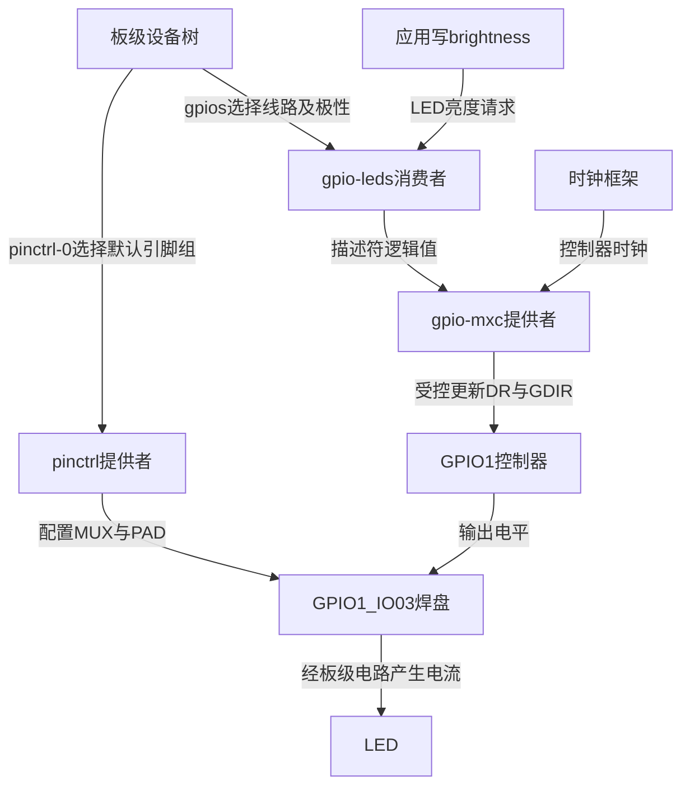
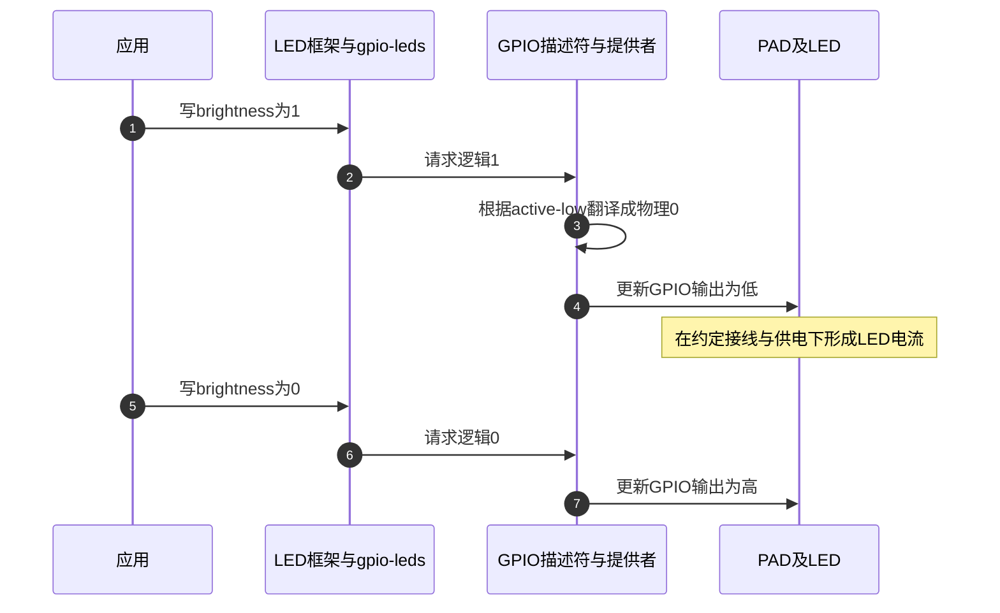

# 第2章\_LED点灯+dts

上一章已经解释，一根 GPIO 输出背后有时钟、方向、数据和引脚复用几种责任。Linux 已经有管理这些硬件的提供者，LED 应怎样声明自己的线路，而不再自己写一组共享寄存器？本章先用内核已有的 `gpio-leds` 驱动完成连接。下一章才增加自定义字符设备协议，比较它额外承担的生命周期责任。

本例仍假设板级原理图确认 LED 通过限流电路接到 GPIO1_IO03，且低电平点亮。**这一接线是实验前提，不是根据 SoC 名称推测出的事实。** GPIO1_IO03 还可以承载其他功能；必须检查当前板文件及实际用途，不能让 LED 与 I²C、串口或其他消费者同时占用该 PAD。

## 2.1\_把一颗LED的需求交给已有的状态所有者

对应用而言，需求是“点亮这颗灯”。GPIO 提供者负责控制器寄存器访问，pinctrl 提供者负责复用和 PAD 配置，时钟框架与控制器驱动负责所需时钟。LED 驱动在这些能力之上维护亮度和触发器接口。它不需要复制 GPIO bank 的寄存器影子，也不需要知道 CCGR1 的物理地址。

设备树保存硬件连接描述。启动时，内核根据节点匹配驱动；驱动取得已注册 GPIO 提供者的描述符，后续将逻辑值交给描述符接口。描述符是内核管理对象，设备树节点并不内嵌一个 `gpiod` 成员，应用也不能把 DT 中的三个数字当作用户指针。



这里减少的是消费者自行管理寄存器的责任，并没有消除底层访问。GPIO 提供者仍维护共享状态和锁，框架仍处理资源获取和释放。若另一驱动已经独占线路，后来的申请应失败；这比两者都成功映射后互相覆盖输出更早暴露错误。

## 2.2\_先核对板级连接\_再写两个相互配合的节点

下面是加入 **实际板级设备树源文件（DTS）** 的片段，使用 NXP Linux 6.12.20 固定基线中的 i.MX6UL/6ULL 引脚定义。它不是完整板级设备树，不能脱离处理器、内存、电源和板上其余设备单独启动。板文件通常已通过包含链获得 `imx6ul-pinfunc.h`；应沿实际包含链核对，不能凭旧 SDK 文件名选择构建对象。

先在原理图中核对 LED 极性、GPIO1_IO03 对应封装 PAD、供电与限流电阻，再检查已有节点没有占用它。若实际接线不同，必须一起修改线路、引脚宏和电气配置，不只替换 `gpios` 中的数字。

```dts
#include <dt-bindings/gpio/gpio.h>

/ {
    /* 与下一章的自定义消费者二选一，不能同时申请同一线路。 */
    leds {
        compatible = "gpio-leds";
        pinctrl-names = "default";
        pinctrl-0 = <&pinctrl_note_led>;

        led-0 {
            label = "note:status";
            gpios = <&gpio1 3 GPIO_ACTIVE_LOW>;
            default-state = "off";
        };
    };
};

&iomuxc {
    pinctrl_note_led: noteledgrp {
        fsl,pins = <
            MX6UL_PAD_GPIO1_IO03__GPIO1_IO03 0x10b0
        >;
    };
};
```

`default-state = "off"` 是 LED 驱动接管时的逻辑初值，不是从上电起保证绝无闪烁。Boot ROM、引导程序和内核接管前的 PAD 状态仍可能影响 LED。若产品要求上电不闪，要沿整条启动链和外接电路检查，不能只改变这一项属性。

| 属性或对象 | 谁解释它 | 本例具体作用 |
| --- | --- | --- |
| `compatible = "gpio-leds"` | 设备匹配与 GPIO LED 驱动 | 选择已有 LED 消费者，不是选择 GPIO 控制器驱动 |
| `pinctrl-names`、`pinctrl-0` | 设备核心与 pinctrl 框架 | 选择默认复用/电气配置组；数字 0 是状态索引 |
| `gpios = <&gpio1 3 GPIO_ACTIVE_LOW>` | GPIO 框架与 GPIO1 提供者 | 控制器、控制器内偏移 3、低有效标志；不是三段物理地址 |
| `label` | LED 命名逻辑 | 本例期望名称 `note:status`；重复名字可能被调整，应查看实际生成的 LED 目录 |
| `default-state = "off"` | GPIO LED 驱动 | 接管后逻辑关闭；本例对应物理高 |
| `fsl,pins` 的引脚宏与配置值 | i.MX pinctrl 提供者 | 选择 GPIO 功能并应用 PAD 配置；具体字段须按目标 PAD 手册解释 |

### 2.2.1\_引脚宏为什么不是一个GPIO号码

基线中的 `MX6UL_PAD_GPIO1_IO03__GPIO1_IO03` 展开为五个单元，再加 `0x10b0` 组成一条六单元配置。它描述 pinctrl 的寄存器位置和选择值，不是 GPIO 描述符编号。

| 单元 | 本例值 | 含义 |
| --- | --- | --- |
| mux 寄存器偏移 | `0x0068` | 相对 IOMUXC 区域的复用寄存器位置 |
| PAD 寄存器偏移 | `0x02f4` | 电气配置寄存器位置 |
| input select 寄存器偏移 | `0x0000` | 此功能条目没有另列需写的输入选择寄存器，不能据此访问基址零偏移 |
| mux 模式 | `0x5` | 选择 GPIO1_IO03 |
| input select 值 | `0x0` | 与上面的 input select 项配合 |
| PAD 配置 | `0x10b0` | keeper 使能、非开漏、DSE 为 R0/6、慢边沿等，完整拆位见上一章 |

本实验涉及的 MMIO 地址、32 位访问约束与 `0x10b0` 全部字段已经列在 [上一章寄存器与 PAD 表](P01_LED点灯+ioremap.md#1.1.1_把0x10b0拆开以后才能判断电气意图)。这里只比较 DTS 如何引用这些配置；无需打开手册才能继续理解连接关系。

GPIO1 控制器的 `#gpio-cells = <2>` 表示 phandle 后有两个 GPIO 参数单元；这是控制器绑定合同，不能为了“简化 LED”任意改为 1。其 `gpio-ranges = <&iomuxc 0 23 10>` 这一段将 GPIO 偏移 0～9 映射到 pinctrl 引脚 23～32。因此 GPIO1 偏移 3 对应 pinctrl 引脚 26。**23 和 26 都不是本例应写进 `gpios` 的 GPIO 全局编号**，这里的消费者仍写偏移 3。

GPIO 的线路描述与中断描述也有不同合同。按键若使用这个 GPIO 控制器作为中断父级，两个中断单元通常是线路偏移与触发类型，并非“编号与优先级”。普通 `interrupts` 属性通过 `interrupt-parent` 指定父级；把 phandle 直接塞进其中，要改用相应 `interrupts-extended` 格式，而不是混合两种语法。本章 LED 不需要中断属性。

## 2.3\_逻辑点亮只翻译一次\_不要在驱动里再次取反

低有效标志记录在描述符的配置中。LED 消费者请求逻辑 1，GPIO 层将它翻译成物理低；逻辑 0 翻译成物理高。有效极性与电气上的开漏是两个独立属性，低有效 LED 并不自动意味着开漏输出。

| 设备意图 | 描述符逻辑值 | `GPIO_ACTIVE_LOW` 物理电平 | `GPIO_ACTIVE_HIGH` 物理电平 |
| --- | --- | --- | --- |
| 关闭 | 0 | 高 | 低 |
| 点亮 | 1 | 低 | 高 |

所以自定义消费者应写 `gpiod_set_value_cansleep(desc, on)`，而不是在低有效节点上再写 `on ? 0 : 1`。后者把“点亮”翻译成逻辑关闭，造成双重反转。`GPIOD_OUT_LOW` 中的 LOW 也是初始化逻辑 0；在本例应得到关闭对应的物理高，而不能仅凭枚举名称判断引脚电压。



此图有意没有加入“消费者读回寄存器以确认点亮”。LED 亮度属性保存的是软件请求状态，不是光学检测结果；即使输出电平正确，LED 断路、接反或电源未接仍可能不亮。

## 2.4\_构建和运行分别检查哪一份描述

修改 DTS 后，必须构建启动链实际加载的设备树二进制文件（DTB）。源码文件正确、DTB 构建成功、引导程序加载新 DTB、内核运行时出现预期节点，是四个不同事实。不要把某个旧 SDK 路径当成所有板的固定入口。

在已核定版本、已配置交叉工具链的内核树中，按该板维护的构建流程执行 `make ARCH=arm dtbs`，或构建该树支持的具体 DTB 目标。然后记录目标 DTB 的摘要、部署位置以及引导程序选择 DTB 的变量/命令，按板级部署规程更新。这里不提供一个未经板卡核对的覆盖启动分区命令。

内核需要 GPIO、i.MX GPIO 提供者、i.MX pinctrl 以及 `CONFIG_LEDS_CLASS`、`CONFIG_LEDS_GPIO` 等相关配置。配置为模块时还需加载模块及依赖；配置为内建时无需 `insmod`。驱动加载成功也不证明节点已匹配或 GPIO 申请成功，应查看实际绑定和错误日志。

运行端可按下面顺序观察。命令在目标 Linux 上执行，LED 路径以实际目录为准。

```bash
# 先确认设备树是此次部署的版本，并观察驱动绑定与日志。
ls /sys/class/leds
dmesg | tail -n 80

# 仅在确认此项就是本实验LED后，使用具有写权限的shell执行。
led=/sys/class/leds/note:status
cat "$led/max_brightness"
if [ -e "$led/trigger" ]; then
    cat "$led/trigger"
    printf 'none\n' > "$led/trigger"
fi
printf '1\n' > "$led/brightness"
cat "$led/brightness"
printf '0\n' > "$led/brightness"
```

先关闭触发器，是为了避免 timer、磁盘活动等机制继续改写亮度；如果内核没有启用 LED 触发器支持，`trigger` 文件可能不存在，此时不执行这两条 trigger 命令。普通 GPIO LED 为二值输出，不把 brightness 的数值当成硬件 PWM 占空比。

| 观察结果 | 已取得的有限证据 | 下一步检查 |
| --- | --- | --- |
| 没有 LED 目录 | 尚未建立此 LED 的用户接口 | 运行 DT、驱动配置/加载、匹配、延迟探测和资源申请错误 |
| 目录存在，写入报错 | 接口存在但本次请求未按预期完成 | 权限、实际错误码、节点身份；不要只凭灯的状态猜 errno |
| 写入成功，灯反向变化 | 软件请求已被接受 | 有效极性、电路接线及是否有其他控制路径；不要直接增加第二次取反 |
| 软件亮度变化，灯不变 | 只能证明软件侧请求状态 | pinctrl、资源归属、实际 PAD 电压、供电与 LED 电路 |
| 周期性自行变化 | 存在其他亮度更新来源的可能 | 当前 trigger、其他应用与系统策略 |

本轮文档核对了固定源码、绑定文件和芯片手册；没有对用户开发板执行烧写或测量。因此这些是待在目标板运行的实验步骤，不是本轮实测日志。

## 2.5\_增加一颗灯时\_先分清连接与接口需求

若原理图确认第二颗 LED 位于另一根可用线路，标准驱动可在 `leds` 下增加第二个子节点，每个节点声明自己的 `gpios`、名称和初始状态，并补齐该 PAD 的 pinctrl 配置。不能只把第一个节点复制后仍占用 GPIO1_IO03，也不能拿“GPIO2_IO10”这个逻辑名称替代该板实际封装 PAD 的宏。

如果应用只需要开关、标准触发器或常规 LED 管理，继续使用本章的 LED 类接口即可。若学习目标是设计字符设备命令、保存打开实例以及处理解绑，才进入下一章。自定义接口会增加解析、并发、对象持有和错误处理责任；它不会因为名字叫 `/dev/led` 就比标准接口更直接地控制硬件。

练习：把有效极性改为 HIGH，而驱动逻辑保持不变，点亮时输出什么？答案是物理高。若板上仍采用低有效接线，灯的实际效果将反向。再把 `default-state` 改为 `on`，能否保证从上电到驱动接管都亮？不能，它只定义驱动接管时的状态；前面的启动阶段仍未被该属性约束。

现在可以沿“板级连接 → 描述符 → GPIO 提供者 → PAD”解释一次点亮，也能区分软件请求与硬件观察。下一章保持同一条硬件路径，增加完整字符设备协议，重点处理用户文件仍打开时设备被解绑的情况。

> 固定源码依据：NXP `linux-imx`，Linux 6.12.20，提交 `dfaf2136deb2af2e60b994421281ba42f1c087e0` 的 [leds-gpio.yaml](https://github.com/nxp-imx/linux-imx/blob/dfaf2136deb2af2e60b994421281ba42f1c087e0/Documentation/devicetree/bindings/leds/leds-gpio.yaml)、[leds-gpio.c](https://github.com/nxp-imx/linux-imx/blob/dfaf2136deb2af2e60b994421281ba42f1c087e0/drivers/leds/leds-gpio.c)、[imx6ul-pinfunc.h](https://github.com/nxp-imx/linux-imx/blob/dfaf2136deb2af2e60b994421281ba42f1c087e0/arch/arm/boot/dts/nxp/imx/imx6ul-pinfunc.h)、[imx6ul.dtsi](https://github.com/nxp-imx/linux-imx/blob/dfaf2136deb2af2e60b994421281ba42f1c087e0/arch/arm/boot/dts/nxp/imx/imx6ul.dtsi)。进一步阅读源码时，从 [GPIO 源码阅读索引](../../../../../../research/source_reading/gpiolib/navigation/P01_Linux_6.12_GPIO源码阅读索引.md) 进入；芯片寄存器依据及字段已经放在上一章。
