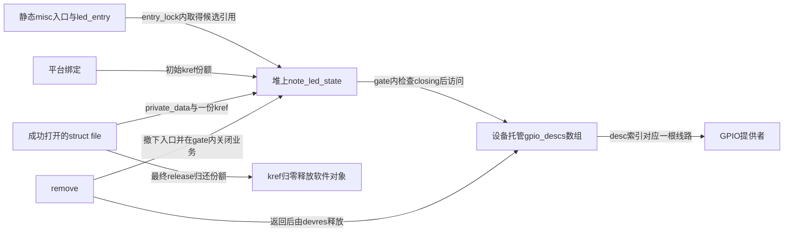
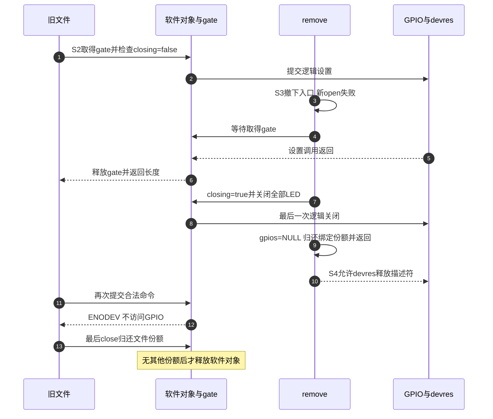

# 第3章\_字符设备\_LED与设备树完整实验

上一章已经用标准 LED 类接口接通“应用意图 → GPIO 描述符 → 控制器 → PAD”。如果只需常规点灯，应继续使用它。本章换一个学习问题：自己设计 `/dev/note_led`，让一次写入选择一颗 LED，再观察设备被解绑时，已经打开的文件应该怎么办。

这里保留 GPIO、pinctrl 与时钟提供者的职责，自定义的只是消费者及字节协议。读者应先完成前两章，并理解 [字符设备专题](../../../../../../knowledge/driver_model/character_device/大纲.md) 中的打开实例与回调关系。实验针对 NXP Linux 6.12.20 固定源码基线；本轮完成源码与宿主检查，不冒称已经在开发板加载。

## 3.1\_先确定文件协议\_再决定需要保存什么状态

本实验一个平台设备管理 1～16 根 LED GPIO，一次 `write` 提交一条 `索引 on/off` 命令。例如 `0 on\n` 点亮第 0 颗 LED，`0 off` 关闭它。索引按照设备树 `led-gpios` 的顺序，从 0 开始；这个索引既不是 GPIO 控制器内偏移，也不是 GPIO 的历史全局编号。

为何不继续沿用旧稿“0 表示点亮、1 表示关闭”的协议？那个约定把低有效接线泄漏给应用，换一种接线就要重学数字含义。本例用 `on/off` 表达业务意图，用描述符的极性配置完成物理电平翻译。应用与消费者都不再额外取反。

| 输入与操作 | 合同 |
| --- | --- |
| `0 on`、`15 off`，末尾可带一个换行符 LF | 语法有效；索引还必须小于实际线路数 |
| 空写入 | 返回 0，不读取用户字节、不碰硬件，包括解绑之后 |
| 多余空白、回车换行 CRLF、前导零、未知后缀、内嵌 NUL | 拒绝，不通过截断或字符串终止符猜测意图 |
| 大于 7 字节 | `-E2BIG`；最长合法命令为 `15 off\n` |
| 用户内存复制失败 | `-EFAULT`；尚未提交 GPIO 操作 |
| 合法命令访问已关闭实例 | `-ENODEV`；解析检查先发生，错误输入可能先得到解析错误 |
| 成功写入 | 返回本次完整长度；表示提交了逻辑设置，不证明 LED 发光 |
| read、ioctl、poll 通知、mmap | 本实验不定义这些业务；不为点灯凑齐全部 file_operations |

不跨多次写入拼装命令，因此 `write("0 ")` 后再 `write("on")` 不能组成一次点亮。这样的完整消息协议足够简单，也避免为半条命令增加每文件缓存和退出回收。本例只支持一个成功绑定的平台节点；多个 LED 放进同一数组，第二个节点明确返回 `-EBUSY`，不会覆盖第一个节点的全局指针。

## 3.2\_绑定与打开拥有不同寿命\_不能共用一个释放时刻

考虑一个用户程序已经打开设备并停在等待输入。管理员此时执行平台设备 `unbind`，驱动的 `remove` 返回后，设备托管的 GPIO 资源会释放。用户程序随后继续 `write`，它的 `struct file` 仍然存在。如果 `private_data` 指向随设备释放的内存，第一步解引用就可能访问失效地址；即使对象没释放，其中的 GPIO 描述符也已经失效。

要解决这两个问题，需分别保住软件对象，并关掉硬件访问路径。本例用 `kref` 保存软件对象的持有份额，用对象内 `gate` 互斥锁串行化完整 GPIO 操作与关闭过程。解绑先阻止新打开、等待当前硬件操作结束，再设 `closing` 并关闭所有 LED，之后才允许 GPIO 资源释放。旧文件保留对象，但只能得到“设备已不可用”。



图中的 misc 是内核提供的简单字符设备登记机制，本例把它的入口结构保留到模块退出；devres 是设备托管资源的管理机制，解绑后负责释放 GPIO 描述符。两者不会自动延长本例堆对象的寿命。

这不是只有一个状态值的状态机。绑定入口是否存在、对象是否关闭、对象引用数和 GPIO 资源是否仍归该设备所有，是几组相关但不同的状态。统一按以下阶段观察，后面的代码与实验都回到这条时间线。

| 阶段 | 触发与写入者 | 状态落点与变化 | 谁随后读取、何时退出 |
| --- | --- | --- | --- |
| S0 准备 | probe | 分配堆对象，kref=1；申请描述符数组，逻辑初值关闭 | 准备失败不发布入口，由错误路径回收；成功才进入 S1 |
| S1 发布 | probe 持 entry_lock | `led_entry` 指向对象，drvdata 保存绑定身份 | open 在同一锁内读取入口并取得候选份额 |
| S2 使用 | open/write/release | 成功打开把份额交给 `file->private_data`；write 在 gate 内检查 closing，再访问数组 | 写操作结束释放 gate；最后文件释放归还该实例份额 |
| S3 撤下 | remove 先 entry_lock 后 gate | 入口置空；等待在途 GPIO 操作结束；closing=true，全部逻辑关闭，gpios=NULL | 旧文件再执行合法命令时看到 closing；remove 归还绑定份额 |
| S4 退场 | devres 与最后的文件 release | remove 返回后释放 GPIO；最后 kref 归零才释放堆对象 | 不再从对象最终释放回调访问 GPIO |
| S5 重新绑定 | 新 probe | 创建新的对象和描述符；新 open 取得新对象份额 | 旧 fd 仍指向旧的关闭对象，不自动连接新硬件 |

`entry_lock` 保护入口指针和获取份额的交接，不能在裸指针已经悬空后才补 `kref_get`。`gate` 保护“检查还能访问”和“完成访问”这整个区间，不能检查后立即解锁再操作 GPIO。引用计数本身不提供这两种互斥。



如果 remove 先取得 gate，写者就在锁后直接看到关闭状态。如果 open 已在 S1 取得候选份额，但还没有检查 gate，remove 也可以先关闭；open 随后自行归还候选份额并失败。反过来，open 检查成功后 remove 才关闭，open 可以成功返回，但第一次 write 失败；这也是允许的并发结果。

> 生命周期依据：固定基线的 [drivers/base/dd.c](https://github.com/nxp-imx/linux-imx/blob/dfaf2136deb2af2e60b994421281ba42f1c087e0/drivers/base/dd.c) 先执行设备 remove，再经 `device_unbind_cleanup` 调用 `devres_release_all`。这正是 S3 必须完成停止访问、不能把停止动作拖到对象最终释放时的原因。

`.owner = THIS_MODULE` 防止正常模块卸载时仍有打开文件使用模块代码，但 **不阻止平台设备解绑**。`devm` 管硬件资源回收，`kref` 管本例堆对象寿命，`closing+gate` 管业务访问；三者都不能代替另两个。

## 3.3\_把设备树的线路数组连接到消费者

沿用上一章的 `pinctrl_note_led` 引脚组，停用那一章的 `gpio-leds` 节点，再加入下面的根节点。两个消费者必须二选一。`linux-note,led-lab` 是本仓库实验自定的匹配标识，不宣称它是上游标准绑定。

```dts
#include <dt-bindings/gpio/gpio.h>

/ {
    note-led {
        compatible = "linux-note,led-lab";
        pinctrl-names = "default";
        pinctrl-0 = <&pinctrl_note_led>;
        led-gpios = <&gpio1 3 GPIO_ACTIVE_LOW>;
        status = "okay";
    };
};
```

消费者用连接名 `"led"` 取得 `led-gpios`。`"red"` 对应 `red-gpios`，并不是在 `gpio-names` 中列出 red 后就能自动改变连接名。若要加入另一颗 LED，在核对线路和 pinctrl 后给 `led-gpios` 追加完整 GPIO 描述；数组索引按条目顺序增加。本例不虚构第二颗 LED 的实际接线。

| 实际接口或对象 | 参数/成员 | 本实验用法与边界 |
| --- | --- | --- |
| `gpiod_count(dev, "led")` | 设备与连接名 | 先检查数量为 1～16；负返回值按错误传播 |
| `devm_gpiod_get_array(dev, "led", GPIOD_OUT_LOW)` | **三个参数** | 返回 `struct gpio_descs *` 或错误指针；没有额外的 count 输出参数 |
| `struct gpio_descs` | `ndescs`、`desc[]`，另有框架内部使用的 `info` | 用前两者检查数量和选择描述符，不把它画成 `device_node` 的内部成员 |
| `gpiod_set_value_cansleep(desc, on)` | 单根描述符、逻辑值 | 在可睡眠上下文调用；本例 gate 是 mutex，不是自旋锁 |
| `platform_set/get_drvdata` | 当前平台设备的私有指针 | 让 remove/shutdown 找到对应绑定对象，不把多个绑定反复 memset 到一个全局结构 |

低有效、引脚宏展开、GPIO 控制器单元数和 `gpio-ranges` 的解释承接 [设备树连接](P02_LED点灯+dts.md)。本实验不直接访问寄存器；涉及的 MMIO 地址和字段见 [寄存器表](P01_LED点灯+ioremap.md#1.1_从数据位到发光还要经过哪些条件)。数据流仍然经过已有 GPIO 提供者。

## 3.4\_完整实现如何兑现发布\_使用和撤下顺序

材料目录包含头文件、内核模块和 Kbuild 文件。解析器不依赖硬件，按长度检查完整输入；因此内嵌 NUL 不会被 `strlen` 或字符串截断变成另一条命令。它只在成功时输出索引和逻辑值，尚未执行任何 GPIO 操作。

### 3.4.1\_先把输入变成明确意图

[note_led_protocol.h](materials/note_led_protocol.h) 的完整内容：

```c
/* 一次write提交一条命令；解析器同时用于驱动与宿主边界检查。 */
#ifndef NOTE_LED_PROTOCOL_H
#define NOTE_LED_PROTOCOL_H
#ifdef __KERNEL__
#include <linux/errno.h>
#include <linux/types.h>
#else
#include <errno.h>
#include <stddef.h>
#endif

#define NOTE_LED_LIMIT 16U
#define NOTE_LED_COMMAND_MAX 7U

/* 只接受0..15的十进制索引、一个空格、on/off及可选的一个LF。 */
static inline int note_led_parse(const char *buf, size_t count,
                                 unsigned int *index, int *on)
{
    size_t pos = 0;
    unsigned int number;
    int value;

    if (!count)
        return 0;
    if (count > NOTE_LED_COMMAND_MAX)
        return -E2BIG;
    if (buf[count - 1] == '\n')
        --count;
    if (count < 4 || buf[0] < '0' || buf[0] > '9')
        return -EINVAL;
    number = (unsigned int)(buf[pos++] - '0');
    if (pos < count && buf[pos] >= '0' && buf[pos] <= '9') {
        if (!number)
            return -EINVAL; /* 不接受01之类的别名。 */
        number = number * 10 + (unsigned int)(buf[pos++] - '0');
    }
    if (number >= NOTE_LED_LIMIT || pos >= count || buf[pos++] != ' ')
        return -EINVAL;
    if (count - pos == 2 && buf[pos] == 'o' && buf[pos + 1] == 'n')
        value = 1;
    else if (count - pos == 3 && buf[pos] == 'o' &&
             buf[pos + 1] == 'f' && buf[pos + 2] == 'f')
        value = 0;
    else
        return -EINVAL;
    *index = number;
    *on = value;
    return 1;
}
#endif
```

解析器只确认索引处于协议范围 0～15，实际设备可能只有一根线路，write 仍须在对象有效时检查 `index < nr_leds`。把语法范围和设备能力分开，才能说明“格式正确但本设备没有这颗灯”为什么仍应失败。

### 3.4.2\_让每个成功绑定拥有自己的对象

下面是完整 [note_led.c](materials/note_led.c)。静态 misc 入口由模块登记，平台 probe 则发布可用对象；所以 `/dev/note_led` 可以已经存在，但没有成功绑定时 open 会返回 `ENODEV`。节点出现与硬件准备完成仍是两个不同事实。

```c
// SPDX-License-Identifier: GPL-2.0
#include <linux/fs.h>
#include <linux/gpio/consumer.h>
#include <linux/kref.h>
#include <linux/miscdevice.h>
#include <linux/module.h>
#include <linux/mutex.h>
#include <linux/of.h>
#include <linux/platform_device.h>
#include <linux/slab.h>
#include <linux/uaccess.h>
#include "note_led_protocol.h"

struct note_led_state {
    struct kref ref;
    struct mutex gate;
    bool closing;
    unsigned int nr_leds;
    struct gpio_descs *gpios; /* 只在gate内、closing为false时供业务使用。 */
};
static DEFINE_MUTEX(entry_lock);
static struct note_led_state *led_entry; /* 本实验只支持一个绑定实例。 */

static void note_led_free(struct kref *ref)
{
    struct note_led_state *state = container_of(ref, struct note_led_state, ref);
    kfree(state); /* 描述符由devm随解绑释放，这里不再操作硬件。 */
}

static void note_led_put(struct note_led_state *state)
{
    kref_put(&state->ref, note_led_free);
}

static int note_led_open(struct inode *inode, struct file *file)
{
    struct note_led_state *state;
    int result;

    (void)inode;
    file->private_data = NULL; /* 替换misc核心放入的静态miscdevice地址。 */
    mutex_lock(&entry_lock);
    state = led_entry;
    if (state)
        kref_get(&state->ref); /* 入口锁内仍有绑定份额，不能从悬空指针加引用。 */
    mutex_unlock(&entry_lock);
    if (!state)
        return -ENODEV;
    mutex_lock(&state->gate);
    result = state->closing ? -ENODEV : 0;
    mutex_unlock(&state->gate);
    if (result) {
        note_led_put(state); /* 失败open不会得到release回调，必须自行回滚。 */
        return result;
    }
    file->private_data = state;
    return nonseekable_open(inode, file);
}

static int note_led_release(struct inode *inode, struct file *file)
{
    struct note_led_state *state = file->private_data;
    (void)inode;
    file->private_data = NULL;
    note_led_put(state);
    return 0;
}

static ssize_t note_led_write(struct file *file, const char __user *buf,
                              size_t count, loff_t *position)
{
    struct note_led_state *state = file->private_data;
    char command[NOTE_LED_COMMAND_MAX];
    unsigned int index = 0;
    int on = 0;
    int result;

    (void)position;
    if (!count)
        return 0; /* 空写入不触碰用户地址，也不操作GPIO。 */
    if (count > sizeof(command))
        return -E2BIG;
    if (copy_from_user(command, buf, count))
        return -EFAULT;
    result = note_led_parse(command, count, &index, &on);
    if (result < 0)
        return result;
    mutex_lock(&state->gate);
    if (state->closing)
        result = -ENODEV;
    else if (index >= state->nr_leds)
        result = -EINVAL;
    else {
        /* 描述符处理有效极性；这里绝不再对active-low取反。 */
        gpiod_set_value_cansleep(state->gpios->desc[index], on);
        result = (int)count;
    }
    mutex_unlock(&state->gate);
    return result;
}

static const struct file_operations note_led_fops = {
    .owner = THIS_MODULE,
    .open = note_led_open,
    .release = note_led_release,
    .write = note_led_write,
};

static struct miscdevice note_led_device = {
    .minor = MISC_DYNAMIC_MINOR,
    .name = "note_led",
    .fops = &note_led_fops,
    .mode = 0600,
};

static int note_led_probe(struct platform_device *pdev)
{
    struct note_led_state *state;
    int count;
    int result = 0;

    state = kzalloc(sizeof(*state), GFP_KERNEL);
    if (!state)
        return -ENOMEM;
    kref_init(&state->ref); /* 绑定管理者的初始份额。 */
    mutex_init(&state->gate);
    mutex_lock(&entry_lock);
    if (led_entry) {
        result = -EBUSY;
        goto fail;
    }
    count = gpiod_count(&pdev->dev, "led");
    if (count <= 0 || count > (int)NOTE_LED_LIMIT) {
        result = count < 0 ? count : -EINVAL;
        goto fail;
    }
    state->gpios = devm_gpiod_get_array(&pdev->dev, "led", GPIOD_OUT_LOW);
    if (IS_ERR(state->gpios)) {
        result = PTR_ERR(state->gpios);
        goto fail;
    }
    state->nr_leds = state->gpios->ndescs;
    if (!state->nr_leds || state->nr_leds > NOTE_LED_LIMIT) {
        result = -EINVAL;
        goto fail;
    }
    platform_set_drvdata(pdev, state);
    led_entry = state; /* 硬件准备成功后才发布，可见性由入口锁建立。 */
    mutex_unlock(&entry_lock);
    dev_info(&pdev->dev, "ready: %u logical LEDs\n", state->nr_leds);
    return 0;
fail:
    mutex_unlock(&entry_lock);
    note_led_put(state);
    return dev_err_probe(&pdev->dev, result, "LED resources unavailable\n");
}

/* 调用方持有gate；在devm释放前关闭业务，并使全部LED逻辑关闭。 */
static void note_led_stop(struct note_led_state *state)
{
    unsigned int i;
    if (state->closing)
        return;
    state->closing = true;
    for (i = 0; i < state->nr_leds; ++i)
        gpiod_set_value_cansleep(state->gpios->desc[i], 0);
    state->gpios = NULL; /* 留给旧文件的对象不再保存可用硬件入口。 */
}

static void note_led_remove(struct platform_device *pdev)
{
    struct note_led_state *state = platform_get_drvdata(pdev);
    mutex_lock(&entry_lock);
    led_entry = NULL;
    mutex_lock(&state->gate);
    note_led_stop(state);
    mutex_unlock(&state->gate);
    mutex_unlock(&entry_lock);
    platform_set_drvdata(pdev, NULL);
    note_led_put(state); /* 交还绑定份额；旧文件可能继续保留对象。 */
}

static void note_led_shutdown(struct platform_device *pdev)
{
    struct note_led_state *state = platform_get_drvdata(pdev);
    mutex_lock(&state->gate);
    note_led_stop(state); /* shutdown不是remove，不提前归还绑定份额。 */
    mutex_unlock(&state->gate);
}

static const struct of_device_id note_led_match[] = {
    { .compatible = "linux-note,led-lab" },
    { }
};
MODULE_DEVICE_TABLE(of, note_led_match);

static struct platform_driver note_led_driver = {
    .probe = note_led_probe,
    .remove = note_led_remove,
    .shutdown = note_led_shutdown,
    .driver = {
        .name = "note_led",
        .of_match_table = note_led_match,
    },
};

static int __init note_led_init(void)
{
    int result = platform_driver_register(&note_led_driver);
    if (result)
        return result;
    result = misc_register(&note_led_device);
    if (result)
        platform_driver_unregister(&note_led_driver);
    return result;
}

static void __exit note_led_exit(void)
{
    misc_deregister(&note_led_device);
    platform_driver_unregister(&note_led_driver);
}
module_init(note_led_init);
module_exit(note_led_exit);
MODULE_LICENSE("GPL");
MODULE_DESCRIPTION("GPIO描述符与解绑后文件生命周期实验");
```

按 S0～S4 追踪实现：probe 检查资源后才设置 `led_entry`；open 在入口锁内拿份额，然后在 gate 内检查业务状态；write 把用户内存复制放在 GPIO 临界区外，但把关闭检查与硬件访问放在同一个 gate 内；remove 撤下入口后等待 gate，关闭线路并归还绑定份额。最终释放回调只释放软件对象，避免在 devm 清理之后再次碰硬件。

`shutdown` 是关机路径，它关闭业务与灯，但不等于解绑，不提前消费绑定份额；以后若执行 remove，关闭函数是幂等的。本例没有 suspend/resume 恢复策略，也没有 PWM、定时闪烁或事件队列。若增加定时工作，必须把取消并等待工作退出纳入 S3，不能认为设置 closing 后工作就已经停止。

`misc_register` 省去了本例手工管理字符设备号与 class 的样板，但没有省去对象生命周期。旧稿中的 `class_create(THIS_MODULE, name)` 属于旧版本接口；本例基线不使用这条路径，也不能把旧参数形式直接移植到 Linux 6.12。一般字符设备登记与失败回滚继续由字符设备专题承担。

### 3.4.3\_构建对象与目标内核必须一致

同目录 [Makefile](materials/Makefile) 完整内容：

```make
obj-m += note_led.o
```

在已有配置、生成头文件和所需符号信息的 **目标内核构建环境** 中运行以下命令。`KDIR` 是该次构建输出树，`CROSS_COMPILE` 使用该板内核已验证的工具链前缀；不要把宿主 `/lib/modules` 的内核误当成目标 ARM 内核。

```bash
# 进入本实验materials目录；先由目标内核构建环境设置KDIR和CROSS_COMPILE。
test -n "$KDIR" && test -d "$KDIR" || exit 1
test -n "$CROSS_COMPILE" || exit 1
make -C "$KDIR" M="$PWD" ARCH=arm CROSS_COMPILE="$CROSS_COMPILE" modules
```

这是外部模块 Kbuild，生成 `note_led.ko`。仅运行 `modules_prepare` 不保证所有模块版本信息已经齐全，启用 MODVERSIONS 时尤其要核对目标构建的 `Module.symvers`。模块与设备树分别部署，修改源文件不会自动更换运行中的版本。先按上一章确认 DTB，再加载模块，检查 probe 的 `ready: N logical LEDs` 或实际错误。

```bash
# 目标Linux，模块和DTB已经按板级流程部署，当前目录含note_led.ko。
insmod ./note_led.ko
ls -l /sys/bus/platform/drivers/note_led
ls -l /dev/note_led
printf '0 on\n' > /dev/note_led
printf '0 off\n' > /dev/note_led
```

写入需要相应权限；默认节点模式为 0600。模块登记成功不等于 probe 成功，资源延迟就绪也可能导致稍后重试。若没有 `ready`，检查匹配、运行设备树和 GPIO 提供者；若提示资源占用，先查是否仍启用了上一章的消费者，不通过改动态设备号来“解决”GPIO 冲突。

## 3.5\_保留旧文件跨过解绑\_验证两种寿命确实分离

只用反复执行 `echo` 不容易观察旧文件，因为每次 shell 重定向通常重新打开再关闭。下面的完整 [led_unbind_probe.c](materials/led_unbind_probe.c) 会保留一个 fd，停下来让另一个终端解绑，再继续用同一个 fd 写入；重新绑定后，再比较旧 fd 与新 fd。

```c
/* 在目标Linux运行；另一个终端按正文完成解绑和重新绑定。 */
#include <errno.h>
#include <fcntl.h>
#include <stdio.h>
#include <string.h>
#include <unistd.h>

static int expect_write(int fd, const char *command, size_t count,
                        ssize_t expected, int expected_errno)
{
    ssize_t result;
    int saved_errno;
    errno = 0;
    result = write(fd, command, count);
    saved_errno = errno;
    printf("write(%zu): result=%ld errno=%d\n", count, (long)result, saved_errno);
    return result == expected && (result >= 0 || saved_errno == expected_errno);
}

static int wait_for_operator(const char *message)
{
    int ch;
    puts(message);
    fflush(stdout);
    do {
        ch = getchar();
    } while (ch != '\n' && ch != EOF);
    return ch != EOF;
}

int main(int argc, char **argv)
{
    int old_fd;
    int new_fd = -1;
    int result = 1;
    const char invalid[] = {'0', ' ', 'o', 'n', 0};

    if (argc != 2) {
        fprintf(stderr, "usage: %s /dev/note_led\n", argv[0]);
        return 2;
    }
    old_fd = open(argv[1], O_WRONLY);
    if (old_fd < 0) {
        perror("open before unbind");
        return 1;
    }
    if (!expect_write(old_fd, "0 off\n", 6, 6, 0) ||
        !expect_write(old_fd, invalid, sizeof(invalid), -1, EINVAL) ||
        !expect_write(old_fd, "", 0, 0, 0))
        goto out;
    if (!wait_for_operator("在另一终端完成unbind后，按回车；本程序保留旧fd。") ||
        !expect_write(old_fd, "0 on\n", 5, -1, ENODEV))
        goto out;
    if (!wait_for_operator("在另一终端完成bind后，按回车；旧fd仍不应连接新设备。") ||
        !expect_write(old_fd, "0 on\n", 5, -1, ENODEV))
        goto out;
    new_fd = open(argv[1], O_WRONLY);
    if (new_fd < 0) {
        perror("open after bind");
        goto out;
    }
    if (!expect_write(new_fd, "0 off\n", 6, 6, 0))
        goto out;
    puts("旧文件被隔离，新文件访问重新绑定的实例；没有证明LED电气状态。");
    result = 0;
out:
    if (new_fd >= 0)
        close(new_fd);
    close(old_fd);
    return result;
}
```

在目标 Linux 的本机 C 编译环境运行，或使用匹配的用户空间交叉工具链构建后部署。它是用户程序，不能用内核模块的编译参数构建。

```bash
# 目标Linux中放有led_unbind_probe.c的目录。
cc -std=c11 -Wall -Wextra -Werror led_unbind_probe.c -o led_unbind_probe
./led_unbind_probe /dev/note_led
```

第一次暂停前，程序验证完整关闭命令、含 NUL 的非法输入和空写入。随后在第二个有权限的终端找出唯一绑定节点：

```bash
# 目标Linux；只对确认为本实验的note_led驱动执行。
driver=/sys/bus/platform/drivers/note_led
device=
for entry in "$driver"/*; do
    [ -L "$entry" ] || continue
    [ "$(readlink -f "$entry/driver")" = "$driver" ] || continue
    [ -z "$device" ] || { printf '发现多个绑定，停止本实验\n'; exit 1; }
    device=${entry##*/}
done
[ -n "$device" ] || { printf '没有成功绑定的实验设备\n'; exit 1; }
printf '本次解绑设备：%s\n' "$device"
printf '%s' "$device" > "$driver/unbind"
```

回到程序终端按回车，旧 fd 的合法写入应返回 -1，errno 为 `ENODEV`。它报告错误码符号对应的本机整数，不硬编码“所有系统 ENODEV 都是多少”。程序继续暂停后，在第二终端使用刚保存的设备名重新绑定：

```bash
# 延续上一个终端，device变量仍保存刚解绑的节点名。
printf '%s' "$device" > "$driver/bind"
```

确认绑定成功后再按回车。旧 fd 仍应返回 `ENODEV`，新 open 则取得 S5 的新对象，可以关闭第 0 颗灯。最后关闭两个文件，旧对象的最后份额才归还。退出程序后可正常 `rmmod note_led`；不要使用强制卸载绕过仍打开文件的保护。

这组实验验证的是接口与对象交接，不是电气输出质量。若重新绑定失败，先保留旧 fd 的错误结果并排查资源，不把失败日志改成预期成功。`gpiod_set_value_cansleep` 没有在此接口返回逐次硬件成功码，write 返回长度也不能证明灯已点亮或总线从未出错。

## 3.6\_从一个成功结果继续找边界

先预测再改动：设备树只有一根线路时，`1 on` 的语法正确，但实际索引检查返回 `EINVAL`；`01 on` 在解析阶段就失败。若输入分成两次写入，均不能凑成命令。若在 open 取得候选引用后立即解绑，open 可以失败并归还引用，也可能先成功而随后的 write 失败；不能要求这段并发只能出现一个返回组合。

再检查一项危险修改：若把 write 中的 `mutex_unlock` 移到 GPIO 调用之前，remove 可以在检查通过之后释放描述符，重新形成“检查时有效、使用时失效”的窗口。若把堆对象改成 `devm_kzalloc`，即使保留 kref，devm 仍会按设备寿命释放它；旧 fd 的份额不能阻止另一套回收规则。

增加多颗 LED 时，本例逐条命令设置单线，停止时也逐线关闭，不承诺所有灯同一硬件周期翻转。若应用需要 红、绿、蓝三色（RGB）混色、整体原子切换、PWM 或周期闪烁，应先建立相应硬件能力和接口合同；把多个 GPIO 放进数组不会自动得到这些保证。

本轮已验证范围与结果随检查记录维护：宿主寄存器模型、真实解析器边界和抽取的生命周期分支检查，以及 ARM 目标前端使用实际内核头文件的语法检查。它们不能代替完整 Kbuild、目标板模块加载、用户拷贝故障注入和真实并发压力测试。上面的板级实验保留为可执行验证步骤。

> 源码依据：NXP `linux-imx` 固定提交 `dfaf2136deb2af2e60b994421281ba42f1c087e0` 的 [consumer.h](https://github.com/nxp-imx/linux-imx/blob/dfaf2136deb2af2e60b994421281ba42f1c087e0/include/linux/gpio/consumer.h)、[platform_device.h](https://github.com/nxp-imx/linux-imx/blob/dfaf2136deb2af2e60b994421281ba42f1c087e0/include/linux/platform_device.h)、[misc.c](https://github.com/nxp-imx/linux-imx/blob/dfaf2136deb2af2e60b994421281ba42f1c087e0/drivers/char/misc.c) 与 [fs/open.c](https://github.com/nxp-imx/linux-imx/blob/dfaf2136deb2af2e60b994421281ba42f1c087e0/fs/open.c)。进入具体 GPIO 实现前先看 [源码阅读索引](../../../../../../research/source_reading/gpiolib/navigation/P01_Linux_6.12_GPIO源码阅读索引.md)；对象份额的通用推导见 [kref 专题](../../../../../../knowledge/linux/object_lifetime/kref/大纲.md)。原稿未经验证的结构体布局、部分代码与日志保存在重构前提交 `6ca33b35`，不继续冒充本版可运行接口。
