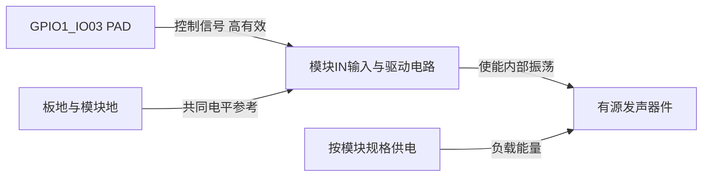
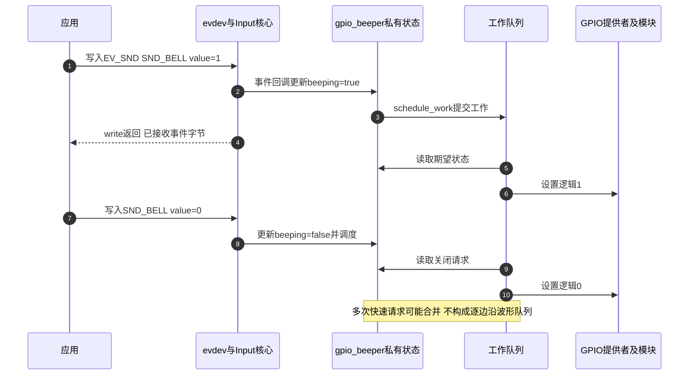

# 第1章\_beep+dts

LED 实验已经把“设备意图”与“GPIO 电平”分开。把相同的开关命令用于蜂鸣器，是否就一定能听见声音？要先看声音怎样产生：有的器件内部已经有振荡电路，只需使能；有的器件需要外部持续提供周期信号，固定高低电平不能代替这个周期。

本章从这一区别选择 Linux 驱动，再完成一个有明确接线前提的 GPIO 蜂鸣器实验。前置为 [LED 实验](../P01_LED点灯/大纲.md) 中的 GPIO 描述符、极性、pinctrl 与设备树部署。原稿只有空的电路图标题，没有经过版本核定的整板原理图；下面分别标出历史连接线索和可重复搭建的条件示例。

## 1.1\_先确定谁产生周期\_再选择GPIO开关还是PWM

声音来自机械振动。**有源蜂鸣器** 在这里指内含振荡电路的器件或模块：供电与使能条件满足后，内部产生周期驱动，外部 GPIO 只负责开与关。若 GPIO 前面还有晶体管或模块输入电路，软件有效极性应按整条控制路径判断，而不是只看蜂鸣器正负端。

**被动蜂鸣换能器** 则需要外部驱动产生周期变化。适用时可以使用脉宽调制（PWM）控制器提供周期波形，再经过匹配的功率驱动电路。PWM 控制器负责连续产生边沿，软件设置周期与占空比；不是让用户进程按音频频率反复写 GPIO。操作系统调度与系统调用延迟会使后者的边沿时刻不稳定，还持续消耗 CPU。

这里没有根据“蜂鸣器”三个字选择唯一实现。器件数据手册、板级电路和所接信号的硬件能力共同决定方案。

| 比较项 | `gpio-beeper` | `pwm-beeper` |
| --- | --- | --- |
| 适用连接 | GPIO 控制已能自行振荡的器件或发声模块 | PWM 输出连接适合该波形及驱动电路的换能器 |
| 周期由谁产生 | 器件内部；GPIO 消费者只请求开关 | PWM 控制器；消费者设置周期 |
| 本基线声明的声音能力 | `EV_SND/SND_BELL` | `EV_SND/SND_BELL` 与 `SND_TONE` |
| 数值语义 | BELL 的非负非零值表示开启，不是频率 | BELL 非零使用配置频率；TONE 正值表示 Hz，0 停止 |
| 设备树连接 | `gpios` 一根线路及极性 | `pwms` 一个 PWM 描述，按实际电路描述 `amp-supply`；`beeper-hz` 指定铃声频率 |
| 本章操作范围 | 完整 GPIO 条件实验 | 解释选择与边界，不虚构本板 PWM 接线 |

固定 Linux 6.12.20 的 PWM 驱动把正频率换算为 `period_ns = 1000000000 / frequency_hz`，请求 50% 占空比，再由 PWM 提供者实现；例如 1000 Hz 对应请求周期 1,000,000 ns。实际实现还有时钟分频、硬件分辨率与驱动电路限制，不能仅由这个公式保证声音质量。把 `SND_BELL` 的值写成 1000 也不会让 GPIO 蜂鸣器得到 1000 Hz。

> 选择依据：固定提交 `dfaf2136deb2af2e60b994421281ba42f1c087e0` 的 [gpio-beeper 驱动](https://github.com/nxp-imx/linux-imx/blob/dfaf2136deb2af2e60b994421281ba42f1c087e0/drivers/input/misc/gpio-beeper.c)、[pwm-beeper 驱动](https://github.com/nxp-imx/linux-imx/blob/dfaf2136deb2af2e60b994421281ba42f1c087e0/drivers/input/misc/pwm-beeper.c) 和相应 [GPIO 绑定](https://github.com/nxp-imx/linux-imx/blob/dfaf2136deb2af2e60b994421281ba42f1c087e0/Documentation/devicetree/bindings/input/gpio-beeper.yaml)、[PWM 绑定](https://github.com/nxp-imx/linux-imx/blob/dfaf2136deb2af2e60b994421281ba42f1c087e0/Documentation/devicetree/bindings/input/pwm-beeper.yaml)。

## 1.2\_连接器上的BEEP标签还不能证明驱动电路

仓库按键实验保留了下面这张连接器局部图，左侧可见 `BEEP` 连接到 J2 的第 5 脚。它可以作为追线入口，但没有完整显示蜂鸣器、驱动晶体管、供电和电平关系，原图左边文字也被裁切；图中未给出可核定的板卡型号与版本。


因此不能从这张图直接填出本板 `gpios` 的控制器、线路与极性，也不能判断器件内是否含振荡电路。若要使用板载 BEEP，应继续找到这一网络的完整原理图及对应器件资料，核对到 SoC PAD，再选择上节方案。这个证据缺口不能靠写一段 DTS 消除。

为了让软件步骤仍可复现，本章另设一个 **外接教学连接**：选择已经确认空闲的 GPIO1_IO03，连接到一个具有匹配输入电平、内部振荡及驱动电路的有源发声模块 IN 端，假设 IN 高有效；模块按其规格独立供电并与板共地。它不冒充上图的板载 BEEP，也不要求 GPIO 直接承担发声器件的负载电流。



接线前按模块数据手册确认输入阈值、允许电压、供电和负载路径。若实际是低有效模块，修改有效极性；若是没有合适驱动级的裸器件，这份三线连接前提就不成立。此前占用 GPIO1_IO03 的 LED 消费者也必须停用，不能让两个实验同时申请它。

## 1.3\_用标准绑定描述这条条件连接

在实际板级 DTS 中加入以下片段，并按 LED 章节的流程构建、部署、核对运行 DTB。片段依赖该板已有的 SoC 包含链和 `imx6ul-pinfunc.h`，不是可以单独启动的完整设备树。

```dts
#include <dt-bindings/gpio/gpio.h>

/ {
    beeper {
        compatible = "gpio-beeper";
        pinctrl-names = "default";
        pinctrl-0 = <&pinctrl_note_beeper>;
        gpios = <&gpio1 3 GPIO_ACTIVE_HIGH>;
    };
};

&iomuxc {
    pinctrl_note_beeper: notebeepergrp {
        fsl,pins = <
            MX6UL_PAD_GPIO1_IO03__GPIO1_IO03 0x10b0
        >;
    };
};
```

`gpio-beeper` 使用没有连接名的 `gpios` 属性，不是前一字符设备实验自定义的 `led-gpios`。它以逻辑 0 申请输出初态，描述符再根据 `GPIO_ACTIVE_HIGH/LOW` 翻译物理电平。本例高有效时初态为低，低有效时则应为高；消费者不额外取反。

| 本例配置 | 当前含义与依据 |
| --- | --- |
| `&gpio1 3` | GPIO1 控制器内偏移 3；不是连接器 J2 的脚号 |
| `GPIO_ACTIVE_HIGH` | 教学模块 IN 高有效；必须与实际控制电路一致 |
| `MUX_MODE=5` 的引脚宏 | 把 GPIO1_IO03 PAD 接到 GPIO 功能 |
| `0x10b0` | 沿用已解释的此 PAD 配置：keeper 使能、非开漏、DSE=R0/6、慢边沿等；须满足实际连接的电气要求 |
| `CONFIG_INPUT_GPIO_BEEPER`、`CONFIG_INPUT_EVDEV` | 分别提供 GPIO 蜂鸣器驱动和本章使用的 event 用户接口，还需相应 GPIO/pinctrl 提供者 |

这里没有新增直接寄存器访问。MUX、PAD、GPIO 的物理地址和字段见 [LED 寄存器表](../P01_LED点灯/P01_LED点灯+ioremap.md#1.1_从数据位到发光还要经过哪些条件) 与 [0x10b0 拆位](../P01_LED点灯/P01_LED点灯+ioremap.md#1.1.1_把0x10b0拆开以后才能判断电气意图)，本章只增加发声消费者。

## 1.4\_声音请求为什么通过Input接口送到工作队列

Linux Input 框架除了接收按键等输入，也定义设备可接受的反馈请求，声音事件就是其中一种。GPIO 蜂鸣器登记 `EV_SND` 事件类型与 `SND_BELL` 声音代码；evdev 为应用提供 `/dev/input/eventN` 文件接口。这里是应用向设备发送发声意图，与按键驱动向应用报告按下方向相反。

probe 在设备托管的堆内存中创建 `struct gpio_beeper`，其中保存 GPIO 描述符、`beeping` 期望值与 `work` 工作项；Input 私有指针和工作项的宿主关系都能找到同一个对象。本基线的事件回调把期望状态保存在该对象的 `beeping` 字段，再调度其中的 `work`。工作队列在可睡眠上下文读取这个状态，调用 `gpiod_set_value_cansleep`。这样，可能睡眠的 GPIO 提供者访问不会直接塞进 Input 事件处理的锁上下文。



图中把工作执行画在 write 返回后，是一种可能顺序，不是强制延后保证。关键是两个完成点不同：evdev 接收了完整事件，并不等于工作已经执行、GPIO 已经变化或声音已经产生。输入核心还会依据设备能力过滤事件；在这个版本的路径中，设备事件回调的返回值不会作为逐次硬件完成结果传回 evdev write。因此应用先查能力，也不能仅凭 write 返回字节数证明声学成功。

工作记录的是期望开关状态，不是每次开关的完整历史。快速发送“开、关”可能在工作读取前就变成最终关闭，不能据此合成音频波形。Input 设备最后的使用者关闭时，驱动 close 回调等待相关工作退出并关闭蜂鸣器；关闭某一个 fd 不一定已经是最后使用者，应用仍应明确发送停止请求。

> 路径依据：固定版本 [evdev.c 的 evdev_write](https://github.com/nxp-imx/linux-imx/blob/dfaf2136deb2af2e60b994421281ba42f1c087e0/drivers/input/evdev.c)、[Input 核心](https://github.com/nxp-imx/linux-imx/blob/dfaf2136deb2af2e60b994421281ba42f1c087e0/drivers/input/input.c) 与本章已引的 GPIO 蜂鸣器驱动。框架概念见 [Input 专题](../../../../../../knowledge/driver_model/input/大纲.md)，源码位置从 [Input 源码阅读索引](../../../../../../research/source_reading/input/navigation/P01_Linux_6.12_Input源码阅读索引.md) 进入。这里仅解释本实验的反馈路径，不复制完整 Input 实现教程。

## 1.5\_用完整input\_event提交一次短促请求

不要把文本 `echo 1` 写到 event 节点。evdev 接收的是目标用户空间 ABI 的 `struct input_event`，其中 `type/code/value` 分别表示事件类型、代码和值；结构大小还与 ABI 有关，不应硬编码成某个字节数。下面程序直接包含目标系统的 `<linux/input.h>`，先查询 `SND_BELL` 能力，再请求开启，等待约 200 ms，最后明确关闭。

它是用户程序，无需编写第二份内核蜂鸣器驱动。信号处理只设置停止标志，停止事件在普通执行路径发送；200 ms 是应用等待时间，不是精确发声时长。完整文件为 [beeper_bell.c](materials/beeper_bell.c)。

```c
/* 目标Linux程序：确认SND_BELL能力，短暂请求发声，再明确关闭。 */
#define _POSIX_C_SOURCE 200809L
#include <errno.h>
#include <fcntl.h>
#include <linux/input.h>
#include <signal.h>
#include <stdio.h>
#include <sys/ioctl.h>
#include <time.h>
#include <unistd.h>

static volatile sig_atomic_t stop_requested;

static void request_stop(int signal_number)
{
    (void)signal_number;
    stop_requested = 1;
}

static int send_bell(int fd, int on)
{
    struct input_event event = {0};
    ssize_t written;
    event.type = EV_SND;
    event.code = SND_BELL;
    event.value = on;
    do {
        written = write(fd, &event, sizeof(event));
    } while (written < 0 && errno == EINTR);
    if (written != (ssize_t)sizeof(event)) {
        if (written >= 0)
            errno = EIO; /* 不把不足一个事件的结果误当成功。 */
        return -1;
    }
    return 0;
}

int main(int argc, char **argv)
{
    unsigned char sounds[(SND_MAX + 8) / 8] = {0};
    char name[128] = {0};
    struct timespec delay = {0, 200000000L};
    struct sigaction action = {0};
    int fd;
    int result = 1;

    if (argc != 2) {
        fprintf(stderr, "usage: %s /dev/input/eventN\n", argv[0]);
        return 2;
    }
    action.sa_handler = request_stop;
    sigemptyset(&action.sa_mask);
    if (sigaction(SIGINT, &action, NULL) || sigaction(SIGTERM, &action, NULL)) {
        perror("sigaction");
        return 1;
    }
    fd = open(argv[1], O_WRONLY);
    if (fd < 0) {
        perror("open");
        return 1;
    }
    if (ioctl(fd, EVIOCGBIT(EV_SND, sizeof(sounds)), sounds) < 0 ||
        ioctl(fd, EVIOCGNAME(sizeof(name)), name) < 0) {
        perror("query input device");
        goto out;
    }
    name[sizeof(name) - 1] = '\0';
    printf("device: %s\n", name);
    if (!(sounds[SND_BELL / 8] & (1U << (SND_BELL % 8)))) {
        fprintf(stderr, "device does not advertise SND_BELL\n");
        goto out;
    }
    if (stop_requested)
        goto out;
    if (send_bell(fd, 1) < 0) {
        perror("bell on");
        goto stop;
    }
    /* 200ms是用户程序等待时间，不是硬件实际发声时长的保证。 */
    while (!stop_requested && nanosleep(&delay, &delay) < 0) {
        if (errno != EINTR) {
            perror("nanosleep");
            goto stop;
        }
    }
    result = 0;
stop:
    if (send_bell(fd, 0) < 0) {
        perror("bell off");
        result = 1;
    }
out:
    if (close(fd) < 0) {
        perror("close");
        result = 1;
    }
    return result;
}
```

先在目标 Linux 上找出当前蜂鸣器对应的 event 节点，不把数字 N 当成固定设备身份：

```bash
# 目标Linux，查看各event设备名称，再结合运行DT和设备路径核对。
for item in /sys/class/input/event*; do
    [ -e "$item/device/name" ] || continue
    printf '%s: ' "${item##*/}"
    cat "$item/device/name"
done
```

GPIO 驱动使用平台设备名作为 Input 名称，PWM 驱动则设置自己的名称；找到候选后还要沿 `device` 链接核对硬件来源。多个设备可能有类似名字，不能只选列表中第一个。程序的能力查询会拒绝未声明 `SND_BELL` 的节点，但能力相同也不等于就是预期那颗蜂鸣器。

```bash
# 目标Linux中存放beeper_bell.c的目录；或使用匹配目标ABI的用户态交叉工具链。
cc -std=c11 -Wall -Wextra -Werror beeper_bell.c -o beeper_bell

# 先把刚核定的实际节点读入变量，避免照抄一个固定event编号。
printf '已核定的蜂鸣器event节点：'
read -r beeper_event
./beeper_bell "$beeper_event"
```

打开和写入需要对应权限。正常情况下程序打印设备名、提交开关事件并返回 0；本章没有附造一个未经运行的发声日志。若能力查询失败，检查节点与 evdev；若写入成功但无声，依次检查工作/驱动状态、线路是否正确、PAD 电平、模块供电、有效极性以及器件是否实际需要周期驱动。不要通过随意提高输出驱动强度来代替这些检查。

## 1.6\_由观察选择下一步\_而不是靠换数字试声音

先作预测：对 GPIO 蜂鸣器发送 BELL 值 1000，会不会变成 1000 Hz？不会，本基线只把正值转成开启状态。若使用 `pwm-beeper` 的 TONE 请求 1000 Hz，驱动会请求 1 ms 周期，但仍需匹配的 PWM 路由、驱动电路与换能器。把 `compatible` 从 gpio 改为 pwm 而不改变实际资源描述和硬件连接，并不能完成转换。

再比较两个结论：“event write 返回成功”和“示波器观察到控制信号正确”。前者说明事件字节被接收，后者补充了实际电气路径的一段证据；两者都不能单独证明器件内部振荡和声学输出正常。这与前面 LED 的软件亮度、引脚电平和实际发光是同一条分层判断原则。

本轮核对了固定驱动、绑定、事件能力及下发路径，并用实际应用函数配合系统调用桩检查参数、能力、短写、信号与失败收尾分支；桩不模拟 Linux ABI，也不等于已在目标 Linux 编译运行。保留原连接器图并限定其证明范围。正文的板级编译、部署、运行与测量步骤需要在具备上述接线前提的环境执行；没有把本地源码核对当作硬件验收。下一组 [按键中断实验](../P03_KEY_LED_interrupt/P01_key_led_interrupt.md) 将改变信息方向：从外部电平变化出发，讨论如何采样、去抖和更新 LED。
