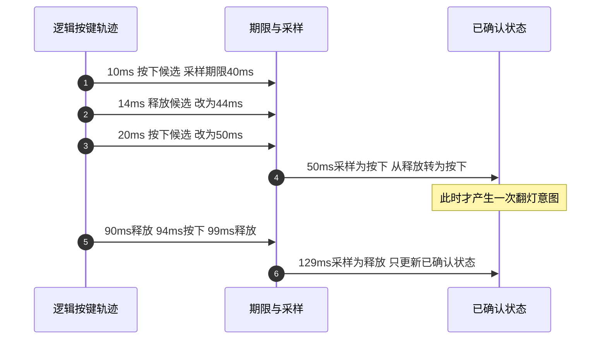

# 第1章\_从按键电平变化到GPIO中断

前面的 LED 实验由软件主动改变 GPIO 输出。现在把方向倒过来：用户按下按键，输入电平发生变化，GPIO 控制器怎样通知软件，软件又凭什么认定这是“一次按下”？硬件能报告边沿，却不知道手指的意图；本章先把这两个判断分开，再比较固定时间窗与稳定状态确认。

贯穿示例沿用 GPIO1_IO03 的 LED，并把 UART1_CTS_B PAD 复用为 GPIO1_IO18 读取按键。低有效接线是本实验前提，仍需结合实际板卡原理图确认。第一章运行宿主轨迹模型，第二章再把稳定状态确认实现为完整内核消费者；不要把这里的数值模型当成已经运行的中断驱动。

## 1.1\_先沿连接追到焊盘\_不要把三个编号混在一起

已有实验保留了下面的连接器局部图。红框中，J2 第 48 脚标有 UART1_CTS、KEY0，第 47 脚标有 GPIO_3、LED0。它给出了追线线索，但没有显示按键上拉、LED 限流和完整控制电路，也没有可核定的整板版本。因此本章保留原图，同时把“实际按下为低、LED 低有效”作为需要板级确认的前提。


**连接器脚号、SoC 焊盘名和 GPIO 控制器内偏移属于三个不同编号空间。** J2 的第 48 脚不等于 GPIO48。NXP 引脚定义中的 `MX6UL_PAD_UART1_CTS_B__GPIO1_IO18` 才说明：UART1_CTS_B 这个 PAD 选择 GPIO 功能时，连接到 GPIO1 的第 18 条线路。


GPIO 控制器先保存“某种触发条件出现过”的状态，再经父中断让软件处理。`gpio-mxc` 读取有效状态位，通过 GPIO 的 IRQ 域找到对应子中断；消费者拿到的是 Linux IRQ 号，而不是直接拿着 PAD 名调用函数。这条路径建立后，才能解释旧日志里的 `irq=46` 为什么不等于 `GPIO1_IO18` 的 18。

| 本例标识 | 它标识的对象 | 依据与使用位置 |
| --- | --- | --- |
| J2 第 48 脚 | 历史图里的连接器位置 | 只用于板级追线，不能直接写入 GPIO 描述 |
| UART1_CTS_B | SoC PAD 名称 | pinctrl 引脚宏选择其 GPIO 功能 |
| `&gpio1 18` | GPIO1 提供者内的线路偏移 | 本例 `key-gpios` 的连接描述 |
| GPIO1 父中断的两个 SPI 参数 66、67 | 固定 `imx6ul.dtsi` 中声明的父控制器连接 | GPIO bank 的父连接，不是每根按键自己的 Linux IRQ 号 |
| `gpiod_to_irq()` 的正返回值 | 本次内核运行的 Linux IRQ | 交给 IRQ 申请接口；不能假定一直是历史日志中的 46 |

本章不要求消费者自行配置父中断或清除 GPIO 状态。已有 GPIO 与 IRQ 提供者负责这些工作；消费者通过描述符和 IRQ 接口参与，避免再次映射共享寄存器与提供者互相覆盖。

## 1.2\_当前电平与曾经发生过边沿\_是两份不同状态

假设按键释放时线路被上拉为高，按下时接地变低。读取输入电平可以回答“现在是什么”，边沿状态位则回答“是否检测到过所配置的变化”。一次短低脉冲可能已经结束，状态位仍为 1；在中断回调中读到高，不一定说明中断控制器出错。

先把当前推理需要的寄存器放在一起。下面都是 i.MX6ULL 的 32 位 MMIO 寄存器，地址不能直接作为普通用户程序指针；本章仅解释其职责，不从消费者直接写它们。

| 寄存器 | GPIO1/本 PAD 地址 | 本例字段与读写效果 |
| --- | --- | --- |
| `IOMUXC_SW_MUX_CTL_PAD_UART1_CTS_B` | `0x020e008c` | `MUX_MODE[3:0]=5` 选择 GPIO1_IO18；`SION[4]` 为强制输入路径控制，不是方向位 |
| `IOMUXC_SW_PAD_CTL_PAD_UART1_CTS_B` | `0x020e0318` | 配置输入迟滞、pull/keeper 与驱动属性，下一小节拆开旧值 |
| `GPIO1_GDIR` | `0x0209c004` | bit 18 为 0 选择输入，需要复用也为 GPIO |
| `GPIO1_PSR` | `0x0209c008`，只读 | bit 18 反映有效 GPIO 输入路径采样，不是边沿次数 |
| `GPIO1_ICR2` | `0x0209c010` | `ICR18[5:4]`：00 低电平、01 高电平、10 上升沿、11 下降沿 |
| `GPIO1_IMR` | `0x0209c014` | bit 18 为 1 允许对应中断，为 0 屏蔽；不是把电平固定住 |
| `GPIO1_ISR` | `0x0209c018` | bit 18 表示触发状态；写 1 清除。状态记录独立于 IMR，屏蔽不等于不记录 |
| `GPIO1_EDGE_SEL` | `0x0209c01c` | bit 18 为 1 时检测两种边沿，覆盖该线路 ICR 配置；为 0 时采用 ICR |

ISR 是位图，不是事件计数器。状态位已经为 1 时，又发生几个边沿，不会因此在一个 bit 中排出几个独立事件。也不能对写 1 清除寄存器套普通读改写：读出多个置位后把完整值写回，可能顺手清除其他线路的状态。Linux 提供者按其协议维护这些位，消费者只读取业务需要的 GPIO 逻辑值。

这也解释了旧“关中断线等待 30 ms”方案的限制：关线能阻止当前 IRQ 的处理，但硬件仍可能留下 pending 状态；重新开线后可能立即再处理。**屏蔽、清状态、采样和确认一次按下是不同操作。** 不应由消费者随意清寄存器，试图把几项责任混为一项。

### 1.2.1\_0x110b0与0x1b0b0为什么不能都叫上拉

按键释放时必须有确定的电平来源，不能让输入悬空。外接电阻和 PAD 内部 pull 都可能参与，选择仍以电路要求为准。旧稿把 `0x110b0` 注释为“输入并上拉”，但这个值选择了 keeper；要先按位图拆开，再解释组合。

| 字段 | `0x110b0` | `0x1b0b0` | 本 PAD 含义 |
| --- | --- | --- | --- |
| `HYS[16]` | 1 | 1 | 开启输入迟滞；迟滞不等于机械按键去抖 |
| `PUS[15:14]` | 0 | 2 | pull 选择编码分别为 100 kΩ 下拉、100 kΩ 上拉；是否应用还要看 PUE/PKE |
| `PUE[13]` | 0 | 1 | 前者选择 keeper，后者选择 pull |
| `PKE[12]` | 1 | 1 | 开启 keeper/pull 功能 |
| `ODE[11]` | 0 | 0 | 未选择开漏输出 |
| `SPEED[7:6]` | 2 | 2 | 手册的 medium（100 MHz）配置档位，不表示按键需要以此频率运行 |
| `DSE[5:3]` | 6 | 6 | R0/6 驱动编码，不是固定 6 mA；输入状态不能由此推断正在驱动线路 |
| `SRE[0]` | 0 | 0 | 慢边沿配置 |

两值都没有替软件设置 GDIR；方向仍由 GPIO 提供者设置。`0x1b0b0` 的字段组合选择内部上拉，而 `0x110b0` 是保持器组合，不能仅因 HYS 和 PKE 都为 1 就把它叫上拉。本实验后续按上拉、低有效接线组织，但不会据此推测某块板是否已经装有外接电阻。

> 硬件依据：NXP `IMX6ULLRM` Rev.1、11/2017，§28.5.2～28.5.8（pp.1359～1369）、§32.6.19（p.1580）、§32.6.165（pp.1811～1812）；入口见 [Arm 资料索引](../../../../../../reference/external_resources/arm/README.md)。本页已经给出本次比较需要的地址与字段。

## 1.3\_第一次边沿立即翻灯\_为什么可能把松手也算成按下

机械触点接通或断开时，输入可能短时间反复变化。若只监听低有效按键的下降沿，每个下降沿立即翻转 LED，一次按下可能翻转多次；松手阶段的抖动也可能重新出现下降沿。只看边沿方向，还不能区分它属于哪一次稳定状态转换。

一个简单改进是时间窗限流：接受一个下降沿，随后 30 ms 内的下降沿丢弃。它实现成本低，反应快，也能压住一部分密集边沿。但是第一次短噪声已经被接受；如果松手的抖动距离上次接受超过 30 ms，它仍会当作新的按下。把窗口变长只能改变误判与漏掉快速操作的边界，不能让边沿自动获得“手指按下”的语义。

更强的业务规则是：同时观察两种边沿，每次观察到边沿都延后采样时刻；经过一段安静期后读取当前逻辑电平，与上次已确认状态比较。只有“已确认释放 → 已确认按下”才翻转 LED，释放只更新状态并为下一次按下做好准备。



这里的“安静”首先是软件已观察到的边沿之间没有新记录，不是对连续模拟电压的无限精度证明。中断合并、采样误差、工作调度延迟和硬件滤波都会影响观测。第二章会进一步处理“工作已经开始读 GPIO，新 IRQ 又更新了期限”的交错，不能只调用一次延迟 API 就宣布采样必然稳定。

## 1.4\_运行同一组轨迹\_比较两种规则的结果

下面模型只输入逻辑按键状态：1 表示按下，0 表示释放，已经完成有效极性翻译。两种算法看到同一组时间点，才能比较它们各自接受了什么。模型按整数毫秒推进，同一时刻先处理边沿再处理到期采样；这只是明确的教学时序，不模拟 Linux 调度、GPIO 电压或中断丢失。

完整文件为 [debounce_compare.c](materials/debounce_compare.c)：

```c
/* 逻辑按键轨迹模型：只计算已给定的时间序列，不访问GPIO或模拟调度器。 */
#include <stdbool.h>
#include <stddef.h>
#include <stdio.h>

struct key_edge {
    unsigned int ms;
    bool pressed; /* 已经过有效极性翻译，1表示按下。 */
};

struct comparison {
    unsigned int guarded_edges;
    unsigned int stable_presses;
};

static struct comparison compare(const struct key_edge *edges, size_t count,
                                  unsigned int window_ms, unsigned int finish_ms)
{
    struct comparison result = {0, 0};
    unsigned int now, accepted_at = 0, deadline = 0;
    size_t next = 0;
    bool have_accepted = false, pending = false;
    bool sample = false, stable = false;

    for (now = 0; now <= finish_ms; ++now) {
        /* 同一时刻先处理边沿，再尝试采样，明确模型的边界次序。 */
        while (next < count && edges[next].ms == now) {
            sample = edges[next].pressed;
            if (sample && (!have_accepted || now - accepted_at >= window_ms)) {
                ++result.guarded_edges;
                accepted_at = now;
                have_accepted = true;
            }
            deadline = now + window_ms;
            pending = true;
            ++next;
        }
        if (pending && now >= deadline) {
            if (sample != stable) {
                stable = sample;
                if (stable)
                    ++result.stable_presses;
            }
            pending = false;
        }
    }
    return result;
}

static int check(const char *name, const struct key_edge *edges, size_t count,
                  unsigned int expected_guard, unsigned int expected_stable)
{
    struct comparison result = compare(edges, count, 30, 260);
    printf("%s: edge_guard=%u stable_press=%u\n", name,
           result.guarded_edges, result.stable_presses);
    return result.guarded_edges == expected_guard &&
           result.stable_presses == expected_stable;
}

int main(void)
{
    const struct key_edge short_pulse[] = {{10, true}, {15, false}};
    const struct key_edge press_release_bounce[] = {
        {10, true}, {14, false}, {20, true},
        {90, false}, {94, true}, {99, false}
    };
    const struct key_edge two_short_presses[] = {
        {10, true}, {20, false}, {30, true}, {40, false}
    };
    const struct key_edge two_long_presses[] = {
        {10, true}, {80, false}, {130, true}, {200, false}
    };

    if (!check("short pulse", short_pulse, 2, 1, 0) ||
        !check("press/release bounce", press_release_bounce, 6, 2, 1) ||
        !check("two short presses", two_short_presses, 4, 1, 0) ||
        !check("two long presses", two_long_presses, 4, 2, 2))
        return 1;
    return 0;
}
```

在仓库根目录构建，结果放入新建临时目录：

```bash
# Linux或已安装GCC的MSYS2 shell；当前位置为linux-note仓库根目录。
key_lab=$(mktemp -d "${TMPDIR:-/tmp}/key-debounce.XXXXXX")
gcc -std=c11 -Wall -Wextra -Werror \
  labs/platforms/nxp/imx6ull/drivers/P03_KEY_LED_interrupt/materials/debounce_compare.c \
  -o "$key_lab/debounce_compare.exe"
"$key_lab/debounce_compare.exe"
```

输出为：

```text
short pulse: edge_guard=1 stable_press=0
press/release bounce: edge_guard=2 stable_press=1
two short presses: edge_guard=1 stable_press=0
two long presses: edge_guard=2 stable_press=2
```

第一行说明固定时间窗已经接受短脉冲，而稳定状态规则没有确认按下。第二行的多出来的一次来自松手抖动。第三行不是稳定规则“更聪明地找回了两次按下”，恰恰说明两个很短的真实操作也可能被过滤掉。第四行两者都得到两次，说明简单规则在受约束的输入条件下也可能够用。

练习：把 `compare` 的窗口实参由 30 改为 4，先预测第一行。答案是稳定规则也会确认这个 5 ms 脉冲；旧预期检查因此失败，提醒我们窗口是业务选择。完整四组计数应分别变成 `1/1`、`3/1`、`2/2`、`2/2`，按新的规则更新预期后再运行。减小窗口减少等待，也让更多短变化成为有效状态，不能只说“响应更快”。

## 1.5\_旧日志能证明回调发生\_不能替代状态判断

原稿保存了下面这些运行记录。本轮没有取得生成日志的确切源码提交、内核配置和板卡版本，因此保留为历史观察，不能当作新实现的实测验收。数字 46 是当时的 Linux IRQ，不能写死到新驱动或设备树。

```text
[11110.482963] imx6ull-led_key_int led_key_int@0: HW debounce unsupported, using SW debounce: 30 ms
[11110.492368] imx6ull-led_key_int led_key_int@0: irq=46 ready; falling edge; debounce=30 ms
[11110.500863] imx6ull-led_key_int led_key_int@0: probed: ACTIVE_LOW key/led, FALLING irq, debounce=30 ms
[11113.047434] imx6ull-led_key_int: hardirq latched IRQ46 @ jiff=1081304
[11113.258841] imx6ull-led_key_int: hardirq latched IRQ46 @ jiff=1081325
[11113.347117] imx6ull-led_key_int: hardirq latched IRQ46 @ jiff=1081334
[11113.476367] imx6ull-led_key_int: hardirq latched IRQ46 @ jiff=1081347
[11113.623146] imx6ull-led_key_int: hardirq latched IRQ46 @ jiff=1081361
[11113.789754] imx6ull-led_key_int: hardirq latched IRQ46 @ jiff=1081378
[11114.006699] imx6ull-led_key_int: hardirq latched IRQ46 @ jiff=1081400
[11114.212355] imx6ull-led_key_int: hardirq latched IRQ46 @ jiff=1081420
```

这些间隔已经超过原来的 30 ms 限流窗口，所以持续出现打印不说明窗口代码一定没有执行；也不能在缺少电平轨迹和手部操作记录时断定每一条都是同一次机械抖动。旧稿的上半部用 `pr_info`，线程部分却用 `trace_printk`，后者走 tracing 缓冲并受内核配置影响；仅在内核日志中看不到线程打印，不能推出线程没有运行。

旧代码还把 active-low 描述符的按下值注释成 0。描述符读取已经应用有效极性，低有效按键按下通常返回逻辑 1；负返回值则是错误，不能先转 bool 当作按下。LED 的逻辑 1 同样表示有效状态，不能再次以物理低为理由取反。这些边界将在下一章完整代码中逐一兑现。

硬件去抖若由提供者支持，可以减少软件需要处理的抖动，但需要核对具体控制器能力和返回值。`gpiod_set_debounce()` 成功、不支持和其他失败不是同一结果；不能因为例程打印了一句“fallback”就忽略所有资源错误。本组第二章明确实现软件策略，不声称 i.MX6ULL GPIO 控制器已经提供了硬件去抖。

本章建立了输入采样、边沿状态、编号和去抖语义，也看到延迟确认会漏掉过短操作的代价。接下来进入 [第二章完整稳定状态实验](P02_确认稳定按键状态再翻转LED.md)：处理期限更新与采样交错，并保证解绑时先停止 IRQ 生产者，再取消工作和释放 GPIO。

> 软件依据：固定 NXP Linux 6.12.20 提交 `dfaf2136deb2af2e60b994421281ba42f1c087e0` 的 [imx6ul-pinfunc.h](https://github.com/nxp-imx/linux-imx/blob/dfaf2136deb2af2e60b994421281ba42f1c087e0/arch/arm/boot/dts/nxp/imx/imx6ul-pinfunc.h)、[imx6ul.dtsi](https://github.com/nxp-imx/linux-imx/blob/dfaf2136deb2af2e60b994421281ba42f1c087e0/arch/arm/boot/dts/nxp/imx/imx6ul.dtsi) 与 [gpio-mxc.c](https://github.com/nxp-imx/linux-imx/blob/dfaf2136deb2af2e60b994421281ba42f1c087e0/drivers/gpio/gpio-mxc.c)。源码入口见 [GPIO 源码阅读索引](../../../../../../research/source_reading/gpiolib/navigation/P01_Linux_6.12_GPIO源码阅读索引.md)。旧驱动全文保存在本次重构前提交 `d361ae1c`，不把未修正的历史模块继续列为本版可加载实现。
