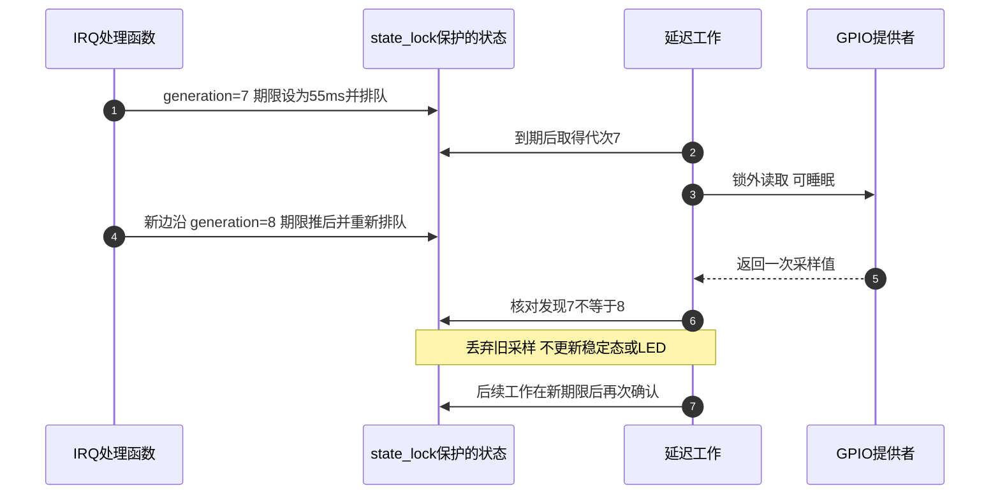
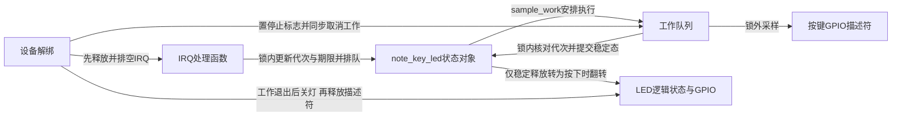

# 第2章\_确认稳定按键状态再翻转LED

上一章用同一组轨迹说明：第一次边沿立即翻灯，再丢弃一段时间内的边沿，不能可靠区分按下、松手抖动和短脉冲。本章把“安静一段时间后确认状态”落实到内核，继续处理两个实际交错：工作正在读 GPIO 时来了新 IRQ，以及解绑正在取消工作时 IRQ 又提交了工作。

实验采用上一章已说明的 GPIO1_IO18 低有效按键与 GPIO1_IO03 低有效 LED。它是 **运行态实验**，完整模块会拒绝系统休眠；第三章换用具有明确电源管理协议的 `gpio-keys` 完成唤醒验证。这里不把一个缺少休眠交接的去抖样例直接当作唤醒驱动。

## 2.1\_定时器到期只意味着可以检查\_不意味着已经稳定

延迟工作把定时等待与可睡眠的工作执行连接起来：IRQ 更新期望采样期限，工作队列稍后执行 GPIO 读取。它替代了旧稿分开维护 hrtimer、开关 IRQ、锁存位和普通工作项的组合，减少了必须配对的状态。

但只调用 `mod_delayed_work` 仍不够。假设旧工作已经开始执行，随后 IRQ 把采样期限推后，已经运行的函数不会被这次调用倒退到尚未开始。因此工作必须自己检查期限；如果在解锁后读取 GPIO 的过程中又出现 IRQ，还必须识别这次采样对应的旧条件已经失效。

本例增加两份相关状态：`quiet_until_ns` 保存按单调时钟计算的最早确认时刻，`generation` 每次观察到 IRQ 就递增。工作在读取前检查期限并记下代次，读取后再核对代次；代次改变时丢弃本次结果，新 IRQ 已经安排后续工作。



定时调度使用 jiffies，而期限检查使用 `ktime_get_ns()` 的单调时间。`msecs_to_jiffies` 只把等待要求换成内核 tick 数，不能单独证明已经过去精确的 30 ms；若工作执行时仍早于期限，本例再排一个 tick 后检查。真正的输出时间还包括调度与 GPIO 访问延迟，所以这里保证的是确认条件，不是实时响应上限。

## 2.2\_把每个状态放进所属对象\_再规定停止顺序

每次成功绑定创建一个 `note_key_led` 堆对象。GPIO 描述符、延迟工作和按键状态都属于该实例，不使用旧稿函数内 `static bool on` 在多个设备或重载之间共享灯状态。



运行条件不是一个 pending 位可以表达的：代次/期限负责判定样本是否仍有效，`stable_pressed` 负责辨认业务状态转换，`led_on` 保存输出意图，`stopping` 决定是否还允许继续排队。下面按同一操作周期追踪它们。

| 阶段 | 写入者与具体存储 | 读取者、通信和退出条件 |
| --- | --- | --- |
| S0 准备 | probe 分配对象，申请两根 GPIO，读取初始逻辑按键，初始化锁和工作 | 所有回调所需状态先准备好，再登记 IRQ；初始已经按住不算一次新按下 |
| S1 记录边沿 | IRQ 在 `state_lock` 内增加 generation，更新 quiet_until_ns，重新排队 | 工作项把“需要稍后检查”交给队列，不保存每一次边沿的独立消息 |
| S2 获取候选 | 工作检查 stopping 和期限，记下 generation，再解锁读取 GPIO | GPIO 读取可睡眠；不能持自旋锁调用 `_cansleep` 接口 |
| S3 提交或丢弃 | 工作重新加锁，核对 stopping 和 generation；成功才更新 stable_pressed/led_on | 过时代次丢弃；读取失败保留原状态并稍后重试；只有释放到按下翻灯 |
| S4 停止 | 先释放并排空 IRQ；停止动作置 stopping，再同步取消延迟工作 | 没有生产者再新增 IRQ 工作；工作也看到停止标志，不再自行重试 |
| S5 释放 | 停止动作在工作退出后关闭 LED；随后设备托管资源逆序回收 | GPIO 描述符在最后一次硬件访问结束后释放，对象最后释放 |

`state_lock` 使用自旋锁，是因为 IRQ 与工作需要短暂共享状态；所有可能睡眠的 GPIO 访问都放在锁外。同一工作项在同一队列不会同时执行两份，因而 LED 翻转业务由这一条工作路径串行执行；停止动作则通过同步取消等待当前工作结束后再关灯。

托管回收也必须有顺序。本例先登记“停止工作并关灯”的清理动作，**最后登记 IRQ 资源**。设备资源按逆序释放，因此先排空 IRQ，再停止工作，最后释放此前取得的 GPIO 和对象。旧稿只在 remove 中取消定时器/工作，却仍保留可提交新工作的 IRQ，关闭窗口并没有真正封住。

## 2.3\_设备树只指定连接\_消费者从按键描述符取得IRQ

本例使用自定义实验绑定 `linux-note,key-led-lab`，不是上游通用设备绑定。`debounce-ms` 是此代码定义的安静期参数，范围为 1～1000 ms，缺省 30 ms；零不表示已启用硬件去抖。停用此前占用相同线路的 LED、蜂鸣器或按键消费者后，再在实际板级 DTS 加入片段。

```dts
#include <dt-bindings/gpio/gpio.h>

/ {
    key-led {
        compatible = "linux-note,key-led-lab";
        pinctrl-names = "default";
        pinctrl-0 = <&pinctrl_note_key_led>;
        led-gpios = <&gpio1 3 GPIO_ACTIVE_LOW>;
        key-gpios = <&gpio1 18 GPIO_ACTIVE_LOW>;
        debounce-ms = <30>;
    };
};

&iomuxc {
    pinctrl_note_key_led: notekeyledgrp {
        fsl,pins = <
            MX6UL_PAD_GPIO1_IO03__GPIO1_IO03  0x10b0
            MX6UL_PAD_UART1_CTS_B__GPIO1_IO18 0x1b0b0
        >;
    };
};
```

按键的 PAD 与中断寄存器、两种 PAD 配置值的区别已经在 [上一章本地表格](P01_从按键电平变化到GPIO中断.md#1.2_当前电平与曾经发生过边沿_是两份不同状态) 给出。这里通过 `gpiod_to_irq(key)` 从同一根按键线路得到 Linux IRQ，避免再抄一份可能指向不同线路的 `interrupts` 属性。GPIO 提供者必须确实支持把这条线路用作中断，映射失败应结束 probe。

IRQ 申请指定双边沿，是为了观察按下与释放的候选变化；低有效只改变逻辑值解释，不会把“物理两种边沿”变成一种。驱动读取 `gpiod_get_value_cansleep` 后，0 是逻辑释放，1 是逻辑按下，负值是错误。LED 写逻辑 1 就是点亮，不再额外取反。

## 2.4\_完整模块怎样实现上述交接

[note_key_led.c](materials/note_key_led.c) 包含全部实现。probe 在 IRQ 可见前初始化工作和初始状态，IRQ 申请成功后再安排一次采样，覆盖初次读取与开始接收 IRQ 之间可能发生的变化。

```c
// SPDX-License-Identifier: GPL-2.0
/* 运行态实验：双边沿更新安静期限，确认一次按下才翻转LED。 */
#include <linux/gpio/consumer.h>
#include <linux/interrupt.h>
#include <linux/jiffies.h>
#include <linux/ktime.h>
#include <linux/module.h>
#include <linux/of.h>
#include <linux/platform_device.h>
#include <linux/property.h>
#include <linux/slab.h>
#include <linux/spinlock.h>
#include <linux/workqueue.h>

struct note_key_led {
    struct device *dev;
    struct gpio_desc *key;
    struct gpio_desc *led;
    struct delayed_work sample_work;
    spinlock_t state_lock;
    u64 generation;
    u64 quiet_until_ns;
    unsigned int debounce_ms;
    int irq;
    bool stopping;
    bool stable_pressed;
    bool led_on;
};

static void note_key_sample(struct work_struct *work)
{
    struct note_key_led *state = container_of(to_delayed_work(work),
                                              struct note_key_led, sample_work);
    unsigned long flags;
    u64 generation;
    int level;
    bool changed = false, toggle = false, on = false;

    spin_lock_irqsave(&state->state_lock, flags);
    if (state->stopping)
        goto unlock_first;
    if (ktime_get_ns() < state->quiet_until_ns) {
        /* jiffies定时负责安排执行，单调时钟才核对实际安静期限。 */
        mod_delayed_work(system_wq, &state->sample_work, 1);
        goto unlock_first;
    }
    generation = state->generation;
    spin_unlock_irqrestore(&state->state_lock, flags);

    level = gpiod_get_value_cansleep(state->key); /* 自旋锁外，允许提供者睡眠。 */

    spin_lock_irqsave(&state->state_lock, flags);
    if (state->stopping)
        goto unlock_second;
    if (generation != state->generation)
        goto unlock_second; /* 新IRQ已排好下一次工作，丢弃这次过时采样。 */
    if (level < 0) {
        mod_delayed_work(system_wq, &state->sample_work,
                         msecs_to_jiffies(state->debounce_ms));
        spin_unlock_irqrestore(&state->state_lock, flags);
        dev_warn_ratelimited(state->dev, "GPIO read failed: %d\n", level);
        return;
    }
    if (!!level != state->stable_pressed) {
        state->stable_pressed = !!level;
        changed = true;
        if (state->stable_pressed) {
            state->led_on = !state->led_on;
            toggle = true;
        }
        on = state->led_on;
    }
    spin_unlock_irqrestore(&state->state_lock, flags);

    /* 同一工作项在同一队列不并发执行；退出动作等待工作结束后再关灯。 */
    if (toggle)
        gpiod_set_value_cansleep(state->led, on);
    if (changed)
        dev_info(state->dev, "stable key=%u LED logical=%u\n", !!level, on);
    return;

unlock_second:
    spin_unlock_irqrestore(&state->state_lock, flags);
    return;
unlock_first:
    spin_unlock_irqrestore(&state->state_lock, flags);
}

static irqreturn_t note_key_irq(int irq, void *data)
{
    struct note_key_led *state = data;
    unsigned long flags;
    (void)irq;

    spin_lock_irqsave(&state->state_lock, flags);
    if (!state->stopping) {
        ++state->generation;
        state->quiet_until_ns = ktime_get_ns() +
                               (u64)state->debounce_ms * NSEC_PER_MSEC;
        mod_delayed_work(system_wq, &state->sample_work,
                         msecs_to_jiffies(state->debounce_ms));
    }
    spin_unlock_irqrestore(&state->state_lock, flags);
    return IRQ_HANDLED;
}

static void note_key_stop(void *data)
{
    struct note_key_led *state = data;
    unsigned long flags;

    /* 此动作早于IRQ资源登记，因此正常devres逆序回收时IRQ已先释放并排空。 */
    spin_lock_irqsave(&state->state_lock, flags);
    state->stopping = true;
    spin_unlock_irqrestore(&state->state_lock, flags);
    cancel_delayed_work_sync(&state->sample_work);
    gpiod_set_value_cansleep(state->led, 0); /* 描述符及提供者仍然有效。 */
}

static int note_key_probe(struct platform_device *pdev)
{
    struct device *dev = &pdev->dev;
    struct note_key_led *state;
    unsigned long flags;
    int level, irq, result;

    state = devm_kzalloc(dev, sizeof(*state), GFP_KERNEL);
    if (!state)
        return -ENOMEM;
    state->dev = dev;
    state->debounce_ms = 30;
    if (device_property_present(dev, "debounce-ms")) {
        result = device_property_read_u32(dev, "debounce-ms", &state->debounce_ms);
        if (result)
            return dev_err_probe(dev, result, "invalid debounce-ms\n");
    }
    if (!state->debounce_ms || state->debounce_ms > 1000)
        return dev_err_probe(dev, -EINVAL, "debounce-ms must be 1..1000\n");
    state->led = devm_gpiod_get(dev, "led", GPIOD_OUT_LOW);
    if (IS_ERR(state->led))
        return dev_err_probe(dev, PTR_ERR(state->led), "led-gpios\n");
    state->key = devm_gpiod_get(dev, "key", GPIOD_IN);
    if (IS_ERR(state->key))
        return dev_err_probe(dev, PTR_ERR(state->key), "key-gpios\n");
    level = gpiod_get_value_cansleep(state->key);
    if (level < 0)
        return dev_err_probe(dev, level, "initial key read\n");
    state->stable_pressed = !!level; /* 初始已经按住不计一次新按下。 */
    spin_lock_init(&state->state_lock);
    INIT_DELAYED_WORK(&state->sample_work, note_key_sample);
    state->quiet_until_ns = ktime_get_ns() +
                           (u64)state->debounce_ms * NSEC_PER_MSEC;
    result = devm_add_action_or_reset(dev, note_key_stop, state);
    if (result)
        return result;
    irq = gpiod_to_irq(state->key);
    if (irq < 0)
        return dev_err_probe(dev, irq, "key IRQ mapping\n");
    state->irq = irq;
    result = devm_request_irq(dev, irq, note_key_irq,
                              IRQF_TRIGGER_RISING | IRQF_TRIGGER_FALLING,
                              dev_name(dev), state);
    if (result)
        return dev_err_probe(dev, result, "request key IRQ\n");

    /* 再次安排采样，覆盖首次读取与IRQ申请之间可能发生的电平变化。 */
    spin_lock_irqsave(&state->state_lock, flags);
    mod_delayed_work(system_wq, &state->sample_work,
                     msecs_to_jiffies(state->debounce_ms));
    spin_unlock_irqrestore(&state->state_lock, flags);
    platform_set_drvdata(pdev, state);
    dev_info(dev, "ready: IRQ=%d quiet=%u ms, initial key=%u\n",
             irq, state->debounce_ms, !!level);
    return 0;
}

static void note_key_shutdown(struct platform_device *pdev)
{
    struct note_key_led *state = platform_get_drvdata(pdev);
    /* shutdown不自动执行解绑的devres逆序清理，因此显式停止生产者。 */
    devm_free_irq(&pdev->dev, state->irq, state);
    note_key_stop(state);
}

static int __maybe_unused note_key_suspend(struct device *dev)
{
    dev_info(dev, "runtime lab: unbind before system sleep\n");
    return -EBUSY; /* 不把没有PM交接的运行态样例伪装成唤醒驱动。 */
}
static DEFINE_SIMPLE_DEV_PM_OPS(note_key_pm_ops, note_key_suspend, NULL);

static const struct of_device_id note_key_match[] = {
    { .compatible = "linux-note,key-led-lab" },
    { }
};
MODULE_DEVICE_TABLE(of, note_key_match);

static struct platform_driver note_key_driver = {
    .probe = note_key_probe,
    .shutdown = note_key_shutdown,
    .driver = {
        .name = "note_key_led",
        .of_match_table = note_key_match,
        .pm = pm_sleep_ptr(&note_key_pm_ops),
    },
};
module_platform_driver(note_key_driver);
MODULE_LICENSE("GPL");
MODULE_DESCRIPTION("GPIO按键安静期限确认与LED翻转运行态实验");
```

注意 S3 与 S4 的交错：工作在锁内提交了一次有效状态，解锁后准备设置 LED，此时退出开始。停止动作会等待该工作完整结束，然后再关灯；描述符仍保留到这个过程之后。因此不必为了覆盖这次 GPIO 调用而在自旋锁内睡眠。

GPIO 读取失败时，本例保留旧稳定态并安排重试，避免把负 errno 当成按下，也避免释放边沿恰好读取失败后永远保留按下状态。重试是按安静期安排的慢路径；停止标志同时阻止 IRQ 排队和工作自重试，`cancel_delayed_work_sync` 才能完成收尾。

关机的 `shutdown` 不自动等同于解绑的 devres 回收，因此代码显式释放 IRQ 后执行停止动作。系统休眠则返回 `-EBUSY`，明确限制本运行态模块的使用范围；下一章在解除本消费者后验证真正的唤醒协议。不能把“这个模块不允许休眠”当作整个板卡不支持休眠的结论。

同目录 [Makefile](materials/Makefile) 完整内容为：

```make
obj-m += note_key_led.o
```

在与目标板匹配、已经配置并准备好构建产物的内核环境中，设置 `KDIR` 与该环境使用的 `CROSS_COMPILE`，然后构建外部模块：

```bash
# 本实验materials目录；KDIR为目标内核构建输出树，不是宿主内核目录。
test -n "$KDIR" && test -d "$KDIR" || exit 1
test -n "$CROSS_COMPILE" || exit 1
make -C "$KDIR" M="$PWD" ARCH=arm CROSS_COMPILE="$CROSS_COMPILE" modules
```

构建得到 `note_key_led.ko`。DTS/DTB 与模块分别部署，步骤与版本核对沿用 [LED 的设备树部署](../P01_LED点灯/P02_LED点灯+dts.md#2.4_构建和运行分别检查哪一份描述)。模块、运行 DT 和板上实际接线必须指向同一个实验，不能沿用旧稿用户目录中的 SDK 路径猜测版本。

## 2.5\_按状态转换观察\_不要只数中断打印

在目标 Linux 加载新模块，先保持按键释放，观察成功准备日志，再操作按键。以下为需要在板端执行的步骤，本轮没有生成新的板级日志。

```bash
# 目标Linux，当前目录含已按匹配内核构建的模块。
insmod ./note_key_led.ko
dmesg | tail -n 40
cat /proc/interrupts
```

准备日志报告本次 Linux IRQ、安静期和初始逻辑按键。随后一次持续按下应产生稳定按下记录并翻转 LED；持续按住不应不断翻灯；松开会更新稳定释放状态，下一次稳定按下再翻转。中断计数可以比稳定状态变化多，因为抖动边沿本来就是被合并的候选。

| 操作 | 应观察的业务结果 | 不能据此额外证明什么 |
| --- | --- | --- |
| 启动前已经按住 | 初始记录为按下，不作为一次新按下翻灯 | 不保证捕获 IRQ 申请前的完整历史 |
| 正常按下并保持超过安静期 | 一次稳定按下，LED 逻辑值翻转 | 不保证固定的端到端响应上限 |
| 松开并等待稳定 | 更新为释放，LED 不翻转 | 不表示松手期间没有硬件边沿 |
| 极短按下后释放 | 可能没有稳定按下 | 不保证每次人手动作都会成为软件事件 |
| 连续操作时卸载 | 停止生产者、排空工作、逻辑关灯后释放 | 不能用一次成功卸载替代长期并发压力验证 |

```bash
# 目标Linux；在已观察正常按下/释放后验证退出路径。
rmmod note_key_led
dmesg | tail -n 40
```

若要验证解绑，同样先从 `/sys/bus/platform/drivers/note_key_led` 核对当前绑定实例，再使用其 `unbind` 接口；不要照抄旧节点名。probe 失败时，也应核对 GPIO 是否已被其他实验占用、默认 pinctrl 是否成功应用，以及按键读取和 IRQ 映射的真实错误。失败后不应留下仍可调度的工作。

## 2.6\_保留旧门控实验的观察\_重新界定它的保证

旧稿采用“第一次边沿关线 → hrtimer 到点开线 → 普通工作无条件翻灯”。该方法可以实现一种限流，但没有在安静期后读取并确认按键状态；窗口内状态也未形成逐边沿队列。先开 IRQ 再清 `armed` 还引入额外交接窗口，普通工作合并又不保证每个锁存请求都各翻一次。

旧记录中的以下输出仍有历史价值，但只说明相应程序打印过业务变量：

```text
[   23.378828] imx6ull-key-hrtimer-gate led_key_int@0: ready: irq=46, debounce=30ms (hrtimer gate)
[   26.147301] imx6ull-key-hrtimer-gate led_key_int@0: work: consume one key event, LED=1
[   27.438520] imx6ull-key-hrtimer-gate led_key_int@0: work: consume one key event, LED=0
[   27.921904] imx6ull-key-hrtimer-gate led_key_int@0: work: consume one key event, LED=1
[   28.354121] imx6ull-key-hrtimer-gate led_key_int@0: work: consume one key event, LED=0
[   28.750926] imx6ull-key-hrtimer-gate led_key_int@0: work: consume one key event, LED=1
[   29.029896] imx6ull-key-hrtimer-gate led_key_int@0: work: consume one key event, LED=0
```

原实现对 active-low 描述符写 `on ? 0 : 1`，又把 `GPIOD_OUT_HIGH` 注释成“灭”，打印的 `LED=1` 并不能证明实际 LED 正在亮。本版把逻辑意图、物理电平和观察证据分开；完整旧稿仍保存在重构前提交 `d361ae1c`。

练习：删去采样后 `generation` 比较会发生什么？若读 GPIO 期间收到新边沿，旧采样可能在新的安静期限之前提交。再把停止动作登记到 IRQ 之后，逆序释放时会先取消工作、后释放 IRQ，新 IRQ 就可能在两者之间再次排队。两项问题分别发生在运行阶段和退出阶段，需要不同的交接顺序，不能靠一把锁或“都用了 devm”概括解决。

现在已经能从一次边沿追到稳定按下，再追到退出时最后一次硬件访问。下一章 [系统休眠与按键唤醒](P03_key_interrupt_wakeup_kernel.md) 会增加电源状态与唤醒路由；本章运行态模块先退出，避免把两套消费者同时绑到同一线路。

> 版本依据：NXP Linux 6.12.20，固定提交 `dfaf2136deb2af2e60b994421281ba42f1c087e0`。延迟工作接口和同一工作项的执行约束核对 [workqueue.c](https://github.com/nxp-imx/linux-imx/blob/dfaf2136deb2af2e60b994421281ba42f1c087e0/kernel/workqueue.c) 与 [workqueue.h](https://github.com/nxp-imx/linux-imx/blob/dfaf2136deb2af2e60b994421281ba42f1c087e0/include/linux/workqueue.h)；GPIO 与 IRQ 接口从 [GPIO 源码阅读索引](../../../../../../research/source_reading/gpiolib/navigation/P01_Linux_6.12_GPIO源码阅读索引.md) 进入。检查记录区分实际函数分支模型、ARM 前端检查与尚未执行的目标 Kbuild/板级测试，不把它们混作一种验收。
