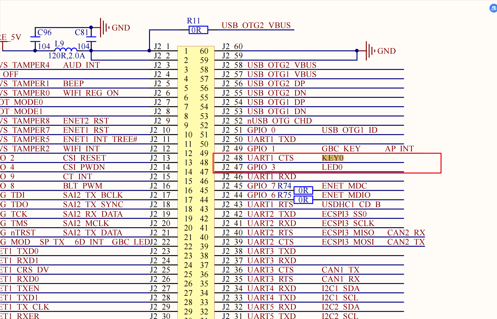
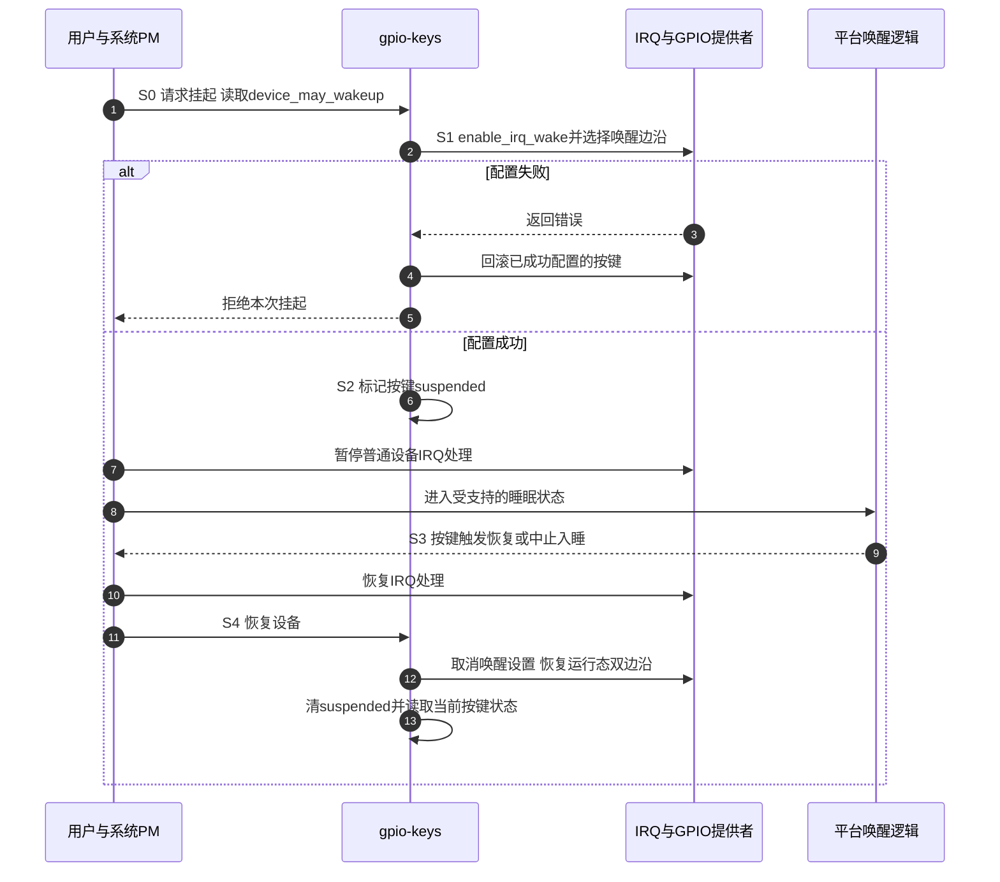

# 第3章\_从运行中断到按键唤醒

上一章已经能把按键边沿变成稳定状态，并在解绑时停止 IRQ 和延迟工作。现在让系统进入休眠：CPU 不再像运行时那样持续执行，部分设备和时钟也可能停止。此时按键是否还能让系统恢复，取决于低功耗状态下保留的接收与唤醒路径，不能仅由“运行时 IRQ 打印正常”推出。

本章沿用低有效 KEY0 接到 GPIO1_IO18 的教学接线，先解释运行中断与唤醒请求的区别，再用内核已有的 `gpio-keys` 驱动完成条件明确的实验。上一章的自写模块用于理解去抖与退出，本章改用有系统休眠回调的标准消费者；两者不可同时占用同一按键。LED 的业务动作放在系统恢复后理解，不能要求已暂停的工作线程在睡眠最深处继续翻灯。

## 3.1\_CPU暂停处理后\_谁还能接住按键

运行时，GPIO 控制器检测输入变化，把请求送到中断控制器，内核再调用驱动。睡眠时，电源管理要避免驱动继续访问已经断电或停钟的设备，所以通常会在设备挂起的 late 阶段之后暂停普通设备 IRQ 的处理。若直接照搬运行路径，按键可能没有可用的检测电路，或者检测到了却不能启动系统恢复。

唤醒配置解决的是这段缺口：根据选择的睡眠深度，让必要的输入检测、信号路由和平台唤醒逻辑保持可用。按键到来后，它先促使正在进行的休眠中止，或使已经睡眠的系统恢复；设备恢复到可以访问的阶段后，驱动才能继续完成普通事件处理。并不是把去抖线程偷偷留在一个断电的 CPU 上。


图中的唤醒路径是功能关系，不宣称 i.MX6ULL 内部另有一个按此方框命名的独立模块。对本实验，`gpio-mxc` 的唤醒回调把 GPIO 子 IRQ 的请求传给父 IRQ；GPIO1_IO18 属于高半组，使用控制器的第二个父 IRQ。父级、SoC 电源控制及所选睡眠方式还必须支持这条路线。Linux IRQ 数字由本次内核分配，不能把旧日志的 46 当作焊盘编号或所有启动中固定的唤醒编号。

按键接线继续以第一章保留的原图为线索：



局部图没有证明完整上拉电路、整板版本及睡眠时供电是否保持。本实验的低有效接线、GPIO1_IO18 输入和外部电平保持条件，都要在实际板卡确认。输入在运行时不悬空，并不自动证明它在深睡眠时也不会失去上拉。

## 3.2\_唤醒能力与本次策略怎样接到硬件

硬件具备接收条件以后，还需要软件决定“这次允许哪个设备唤醒”。否则每一个可产生中断的设备都会成为不受控的唤醒源。设备树描述按键具备唤醒用途，驱动据此登记设备能力；设备的 `power/wakeup` 决定当前是否允许使用；挂起回调再依据这个决定为实际 IRQ 配置唤醒。这三步分别是描述、策略和执行。

`gpio-keys` 把每个按键的配置放在 `gpio_keys_button`，运行数据放在 `gpio_button_data`。其中 `button->wakeup` 表示该按键的唤醒用途，`bdata->suspended` 表示驱动已经进入相应阶段，IRQ 子系统的 `irq_data` 则保存 IRQ 的唤醒设置。用户改变的是父设备的唤醒策略，不是直接改这些私有结构；设备挂起回调读取策略并逐个配置按键。

因此这不是一个布尔值能完整表达的状态机。设备能力、用户策略、IRQ 是否成功设为唤醒源，以及系统处于哪个电源阶段，是相互关联但不同的状态。下面沿一个周期使用同一组阶段观察它们。



S1 不能只调用函数后不看返回值。固定版本中，如果 `enable_irq_wake()` 失败，单键配置立即失败；若改变唤醒边沿失败，会撤销刚才的唤醒使能。多键设备中，后面的按键配置失败还要回滚前面成功的按键。S4 则依据 IRQ 中实际保留的唤醒状态撤销配置，并报告恢复时的当前按键状态。这样才能避免“日志说已准备，但硬件没有接受”或多键只完成一半的挂起。

| 本地状态或接口 | 谁负责修改或读取 | 本实验中的含义 |
| --- | --- | --- |
| 子节点 `wakeup-source` | 驱动解析设备树 | 此按键被描述为唤醒来源 |
| 设备 `power/wakeup` | 用户设置，驱动以 `device_may_wakeup()` 读取 | 当前设备是否获准唤醒，不证明线路配置已成功 |
| `enable_irq_wake()` / `disable_irq_wake()` | 驱动经 IRQ 提供者调用 | 为具体 IRQ 建立或撤销唤醒配置，必须处理错误 |
| `gpio_button_data.suspended` | 挂起、恢复及回滚路径维护，IRQ 路径读取 | 区分唤醒阶段的事件处理，不能代替 IRQ 配置结果 |
| `IRQF_NO_SUSPEND` | 申请 IRQ 时的特殊标志 | 让该 IRQ 在设备 IRQ 暂停阶段仍可处理；不保证系统唤醒 |
| `pm_wakeup_irq` | PM 核心记录，用户只读 | 本次路径记录到的唤醒 IRQ 线索，不是全部唤醒源清单 |

`IRQF_NO_SUSPEND` 用于有特殊需要的 IRQ，不是普通按键“加上就能唤醒”的开关。官方休眠文档明确区分它与 `enable_irq_wake()`；对同一设备的同一 IRQ，不能把两者叠加当成通用方案。本章只有从 GPIO 推导的一条 IRQ，没有另外声明专用 wake IRQ，也不套用其他设备的双 IRQ 设计。

本节涉及的是软件状态与接口，不能为它们编造 MMIO 地址。PAD 和 GPIO 的寄存器位置、位义已在 [第一章的状态与寄存器表](P01_从按键电平变化到GPIO中断.md#1.2_当前电平与曾经发生过边沿_是两份不同状态) 给出；本章通过 pinctrl、GPIO 和 IRQ 提供者访问它们，不在消费者里绕过驱动直接写寄存器。

## 3.3\_用标准按键描述接通这条路径

现在把上述角色落到一个设备树节点。先停用上一章的 `linux-note,key-led-lab` 节点和模块，确认没有其他消费者占用 GPIO1_IO18 或 UART1_CTS_B。仅卸载模块但保留一份准备再次绑定的冲突设备描述，也不适合作为长期板级配置。

下面片段放入已经包含 i.MX6ULL SoC 描述和 `imx6ul-pinfunc.h` 的板级 DTS。完整实验配置也保存在 [key_wakeup.dtsi](materials/key_wakeup.dtsi)；它是待合入板级源文件的片段，不是可单独启动的完整设备树。

```dts
#include <dt-bindings/gpio/gpio.h>
#include <dt-bindings/input/input.h>
#include <dt-bindings/input/gpio-keys.h>

/ {
    note_keys: note-keys {
        compatible = "gpio-keys";
        label = "note-wakeup-key";
        pinctrl-names = "default";
        pinctrl-0 = <&pinctrl_note_wakeup_key>;

        key-wakeup {
            label = "KEY0";
            linux,code = <KEY_F13>;
            gpios = <&gpio1 18 GPIO_ACTIVE_LOW>;
            debounce-interval = <30>;
            wakeup-source;
            wakeup-event-action = <EV_ACT_ASSERTED>;
        };
    };
};

&iomuxc {
    pinctrl_note_wakeup_key: note-wakeup-key-grp {
        fsl,pins = <
            /* GPIO输入的电气参数须与实际板卡核对。 */
            MX6UL_PAD_UART1_CTS_B__GPIO1_IO18 0x1b0b0
        >;
    };
};
```

这里 `GPIO_ACTIVE_LOW` 让逻辑“按下”对应低电平；`EV_ACT_ASSERTED` 选择进入有效状态时唤醒，因此此接线下选择下降沿。运行态仍需要按下与松开的双边沿，驱动在恢复阶段还原。`debounce-interval` 的单位是毫秒，由 `gpio-keys` 消费；它不是上一章自写驱动的 `debounce-ms`，也不能证明物理唤醒请求要先经过 30ms 稳定确认。

`KEY_F13` 是 Input 事件码，值为 183。这里故意不使用常被桌面电源策略消费的 `KEY_POWER`，让“硬件能唤醒”与“用户程序收到什么键后关机”分开观察。F13 也可能被用户程序绑定动作，实验环境应先核对接收者。下一单元会解释 Input 的按下、松开和状态同步。

`0x1b0b0` 在此 PAD 中启用迟滞、上拉/保持功能并选择 100kΩ 上拉，其他电气字段见第一章。它与旧稿的 `0x110b0` 不同：后者选择的是 keeper，不能注释成 100kΩ 上拉。内部上拉是否足以满足实际板卡、是否在目标睡眠状态保留，仍由板级电气和电源设计决定。

旧稿声明了 `default`、`sleep` 两个 pinctrl 状态，却没有在自写挂起回调里选择 sleep。**给状态取名不等于它已经被切换。** 本版本核对的 `gpio-keys` 挂起/恢复回调也没有调用 `pinctrl_pm_select_sleep_state()` / `pinctrl_pm_select_default_state()`；所以本例只声明实际使用的 default，不用一个无人消费的 sleep 节点制造低功耗保证。若板级方案确实需要睡眠时改复用或上下拉，应核对实际负责选择状态的驱动和恢复顺序，不能仅添加一个名字就结束。

内核需要 `CONFIG_INPUT`、`CONFIG_KEYBOARD_GPIO`、`CONFIG_INPUT_EVDEV`，系统睡眠实验还需要平台支持下的 `CONFIG_PM_SLEEP` / `CONFIG_SUSPEND`。GPIO、pinctrl 和对应中断控制器驱动也必须存在。构建与部署继续采用 [LED 设备树实验的版本核对](../P01_LED点灯/P02_LED点灯+dts.md#2.4_构建和运行分别检查哪一份描述)，使用匹配板型的 DTB；本章没有新的自写 `.ko` 需要编译。

## 3.4\_先验证运行路径\_再选择睡眠深度

先启动新配置并确认 `gpio-keys` 绑定成功。以下命令均在目标 Linux 上执行；不要把宿主机目录当作目标板的 sysfs。

```bash
# 目标Linux；查看实际绑定实例与Input设备名。
ls -l /sys/bus/platform/drivers/gpio-keys/
for item in /sys/class/input/event*; do
    [ -f "$item/device/name" ] || continue
    printf '%s: ' "$item"
    cat "$item/device/name"
done
```

本片段的设备标签为 `note-wakeup-key`。找到匹配的 event 设备后，核对其 `device` 链接及父平台设备；不能永久假定为 `event1`。按下和松开应使对应 GPIO 子 IRQ 的计数变化，并能在下一单元的事件读取器中观察 F13 事件。如果这一步就失败，应先检查运行 DT、复用、接线及资源占用，暂时不要把问题归给深睡眠。

本例顶层节点名是 `note-keys`。在上面的驱动目录确认确有这个实例并绑定到 `gpio-keys` 后，再使用下面的路径；如果实际部署改了节点名或层级，应从实际绑定链接取得设备路径。

```bash
# 目标Linux；记录原策略，退出实验时用于恢复。
key_device=/sys/bus/platform/devices/note-keys
readlink -f "$key_device/driver"
cat "$key_device/power/wakeup"
cat /sys/power/state
cat /sys/power/mem_sleep
```

`power/wakeup` 通常显示 `enabled` 或 `disabled`。`state` 列出系统接受的请求，`mem_sleep` 列出 `mem` 可选择的方式，方括号标出当前选择。例如只有实际输出含 `deep` 时，才讨论该板当前内核提供的 deep 入口；不能把任何 `echo mem` 都解释为同样深度的硬件睡眠。若属性或模式缺失，先核对内核配置和平台支持。

```bash
# 目标Linux，root；确认该设备和模式后再启用唤醒策略。
printf 'enabled\n' > "$key_device/power/wakeup"
# 仅当mem_sleep实际列出deep且本轮要验证它时执行下一行。
printf 'deep\n' > /sys/power/mem_sleep
```

这两次写入分别选择设备策略和睡眠方式，没有替代按键驱动的 S1 配置。测试前保持按键释放，并准备板卡可用的恢复方式。若入睡前就已经按住，之后没有新的下降沿，选择“有效沿唤醒”的配置未必还能得到一次新请求。

```bash
# 目标Linux，root；本段作为一次操作执行。
# 读回当前完成的唤醒计数；计数变化或仍有活动唤醒时，不强行继续。
if read -r wake_count < /sys/power/wakeup_count &&
   printf '%s\n' "$wake_count" > /sys/power/wakeup_count; then
    printf 'mem\n' > /sys/power/state
else
    printf '唤醒状态发生变化，请检查后重新发起休眠。\n' >&2
fi
```

`wakeup_count` 的读写握手用于把“检查到没有未处理唤醒”与“开始休眠”连接起来。读取得到计数，写回时内核验证它没有变化且没有仍在进行的唤醒事件；失败就不执行后续 `mem`。它不能修复硬件接线，也不是用固定延时猜测系统是否已经安静。

系统进入目标状态后再按下按键。恢复后记录日志、唤醒 IRQ 和运行态事件，再次验证松开与按下都能报告，避免只验证第一次醒来却漏掉运行态双边沿的恢复。

```bash
# 目标Linux；恢复后记录当前观察。
cat /sys/power/pm_wakeup_irq
dmesg | tail -n 100
cat /proc/interrupts
```

`pm_wakeup_irq` 只返回 PM 路径记录到的 IRQ，未记录时可能为空。它不列出所有同时到来的来源，也不保证每种平台或固件唤醒路径都有一个可报告的 Linux IRQ。把它与本次绑定的 IRQ、挂起/恢复日志和实际按键操作对照，才能形成有限证据。实验结束后恢复先前记录的 `power/wakeup` 和 `mem_sleep` 策略；不要一律写 disabled 覆盖原来的选择。

## 3.5\_醒来不等于已经重放全部按键动作

系统恢复时，触发唤醒的按键可能仍被按住，也可能已经释放。只在恢复完成后读取电平，会漏掉“曾经按过”的事实；反过来，把每次唤醒都当成经过完整稳定判定的一次用户点击，也会把噪声或短脉冲当成业务命令。

固定版本的 `gpio-keys` 对标记为唤醒的按键，在 IRQ 处理看到 `bdata->suspended` 且类型为按键时，会先补报按下，再通过去抖路径读当前状态；恢复回调也会重新报告 GPIO 状态。这个处理试图保留唤醒按键曾被触发的语义，不等于逐个保存睡眠期间的所有边沿。它与上一章严格按安静期提交稳定状态的教学模块，承担的保证不同。

因此本章先把成功条件定为“该路径能使指定睡眠状态中止或恢复，并且恢复后按键仍正常工作”。若还要按一下就翻 LED，应由恢复后能够运行的业务接收 Input 事件，并明确短按、重复、丢失与初始状态的规则；不要在电源状态尚不允许访问时强行写 LED GPIO。Input 状态与用户读取之间的交接在 [下一单元](../P04_Input子系统/key-input.md) 继续展开。

练习一：运行态事件正常，但写 `mem` 失败，日志出现配置唤醒 IRQ 失败，应该先检查哪里？先看 S1 的返回错误及 GPIO/父 IRQ 提供者，不用重复调整用户读取程序。练习二：休眠前把键保持在低电平，为什么没有“再次按下”沿？边沿表达的是一次变化，已有的有效电平不等于新下降沿。练习三：只有声明 `sleep` 状态而没有选择它，能否证明低功耗复用已应用？不能，应定位真正调用选择接口的执行路径及其结果。

## 3.6\_旧实验日志留下了什么证据

旧稿采用自写线程化 IRQ 模块，保留了如下完整观察。它属于原实验记录，板卡、电源配置与运行内核的精确身份未随记录完整保存；本轮没有在目标板重跑，也不把它当成上述 `gpio-keys` 配置的验证结果。

```text
/mnt/nfs/driver # insmod key_led_int.ko				   # 加载驱动
[  729.886417] demo_led_key_int led_key_int@0: demo_led_key_int probed, irq=46, debounce=30 ms
/mnt/nfs/driver # [  731.869970] demo_led_key_int led_key_int@0: into thread interrupt!
[  732.062045] demo_led_key_int led_key_int@0: into thread interrupt!
[  732.226923] demo_led_key_int led_key_int@0: into thread interrupt!
[  732.385781] demo_led_key_int led_key_int@0: into thread interrupt!
/mnt/nfs/driver # echo mem > /sys/power/state			# 让 kernel 进入睡眠
[  734.627317] PM: suspend entry (deep)
[  734.631207] Filesystems sync: 0.000 seconds
[  734.638483] Freezing user space processes
[  734.642621] Freezing user space processes completed (elapsed 0.000 seconds)
[  734.649741] OOM killer disabled.
[  734.652986] Freezing remaining freezable tasks
[  734.658766] Freezing remaining freezable tasks completed (elapsed 0.001 seconds)
[  734.666248] printk: Suspending console(s) (use no_console_suspend to debug)
[  734.773959] fec 20b4000.ethernet eth0: Link is Down
[  734.775367] PM: suspend devices took 0.110 seconds
[  734.778654] Disabling non-boot CPUs ...
[  734.778676] Turn off M/F mix!
[  734.780306] demo_led_key_int led_key_int@0: into thread interrupt!
[  734.880901] demo_led_key_int led_key_int@0: into thread interrupt!
[  735.263782] usb 1-1: reset high-speed USB device number 2 using ci_hdrc
[  735.588366] PM: resume devices took 0.800 seconds
[  735.628930] OOM killer enabled.
[  735.632081] Restarting tasks ... done.
[  735.637134] random: crng reseeded on system resumption
[  735.645137] PM: suspend exit
/mnt/nfs/driver # rmmod key_led_int.ko [  737.043949] fec 20b4000.ethernet eth0: Link is Up - 100Mbps/Full - flow control rx/tx
/mnt/nfs/driver # cat /sys/power/pm_wakeup_irq				# 查看是谁进行的唤醒操作
46
/mnt/nfs/driver #
```

该记录显示一次以 deep 为入口的挂起/恢复日志，并在随后查询时得到 IRQ 46。它不能单凭时间戳证明系统实际停留在最深状态多长时间，也不能仅凭“进入线程中断”的打印证明该线程在设备完全断电期间正常访问了硬件。挂起被中止、恢复过程中补处理请求等阶段，都要结合更完整的电源与 IRQ 路径判断。

旧稿另外存在忽略 `enable_irq_wake()` 返回值、无条件登记设备唤醒、把未选择的 sleep 状态当作已应用，以及把 `IRQF_NO_SUSPEND` 解释成“能唤醒但查不到”的问题。本章以明确的阶段与标准驱动替换该实验实现，旧源码仍可在重构前提交 `4a2b1a76` 找到。下一步要继续解决的，是驱动怎样把稳定按键状态交给多个用户程序，而不是继续增加中断打印。

> 依据：NXP Linux 6.12.20，固定提交 `dfaf2136deb2af2e60b994421281ba42f1c087e0`。源码入口见 [Input阅读索引](../../../../../../research/source_reading/input/navigation/P01_Linux_6.12_Input源码阅读索引.md)。本章核对 [gpio_keys.c](https://github.com/nxp-imx/linux-imx/blob/dfaf2136deb2af2e60b994421281ba42f1c087e0/drivers/input/keyboard/gpio_keys.c) 的单键与多键唤醒、挂起、恢复和GPIO事件路径，[设备树绑定](https://github.com/nxp-imx/linux-imx/blob/dfaf2136deb2af2e60b994421281ba42f1c087e0/Documentation/devicetree/bindings/input/gpio-keys.yaml)，[休眠与中断规则](https://github.com/nxp-imx/linux-imx/blob/dfaf2136deb2af2e60b994421281ba42f1c087e0/Documentation/power/suspend-and-interrupts.rst)，以及 `drivers/gpio/gpio-mxc.c`、`kernel/power/main.c`、`drivers/base/power/wakeup.c`。这些材料证明软件协议，不代替本板所选睡眠状态的电气与平台验证。
