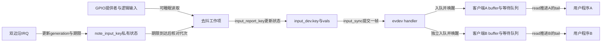
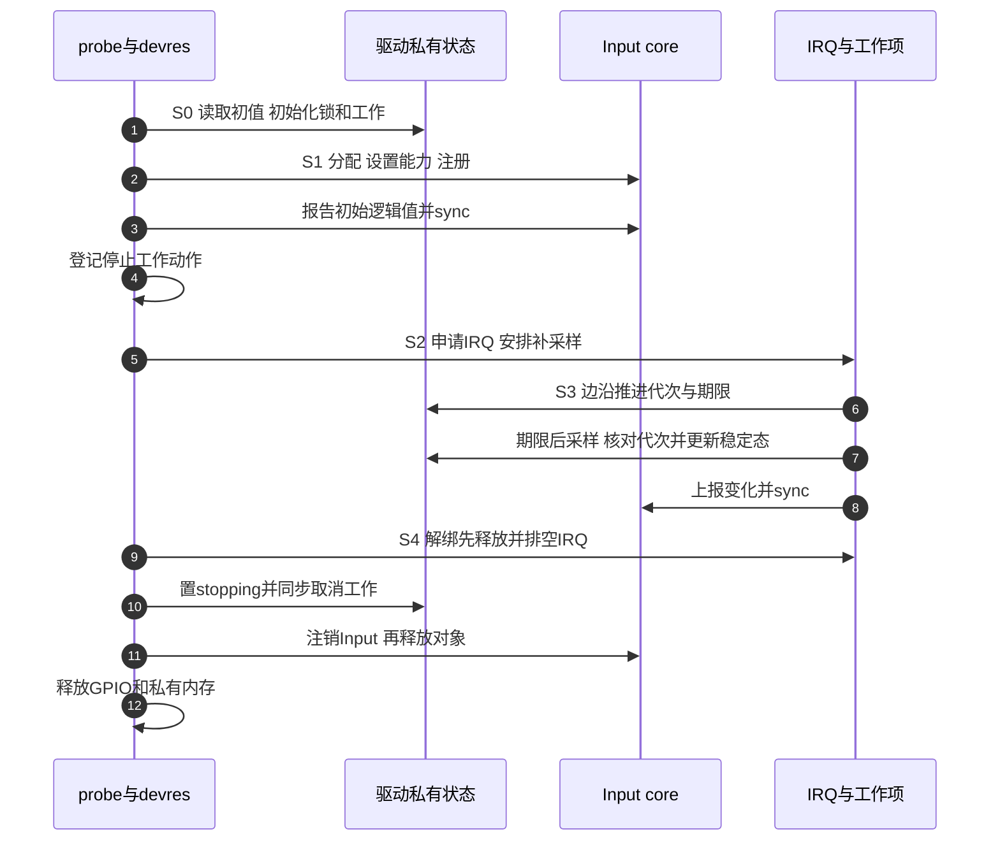

# 第1章\_从稳定按键到Input事件

前面的按键实验已经能确认逻辑按下，并在驱动内部翻转 LED。但如果现在要求终端程序、桌面程序和测试工具都能观察按键，再让每个驱动自造一套字符设备协议，用户程序就必须了解每块板的私有格式。Input 子系统提供统一的事件类型、按键码和状态接口，让硬件驱动负责形成可信状态，让接收者按同一种协议读取。

本章保留原实验“写一个 GPIO 按键 Input 驱动”的学习任务，沿用前一组的安静期限与代次去抖，把最终动作从翻灯改成上报按键。它是运行态教学模块；真正需要系统唤醒时，优先采用 [上一组的标准 gpio-keys 实验](../P03_KEY_LED_interrupt/P03_从运行中断到按键唤醒.md)。这两种消费者不能同时申请同一线路。

## 1.1\_稳定状态怎样交给多个接收者

按键硬件只有一份电平，驱动也只需形成一份已确认状态。但两个程序读取事件的速度不同，不能让较快的程序把较慢程序的事件“读走”。Input core 保存设备当前状态，并向连接的 handler 分发事件；evdev handler 再为每次打开建立独立客户端队列。程序等待的是自己的队列，读取后推进的也是自己的消费位置。

这里有三个不同层次的状态：驱动的 `stable_pressed` 表示最后确认的逻辑按键；`input_dev.key` 位图是 Input core 接受后的当前状态；`evdev_client.buffer` 保存某个打开实例尚未读走的事件历史。当前状态位图不是无限长日志，客户端队列也不是硬件的 GPIO ISR。



`input_report_key()` 接受的是 **逻辑按下状态**。描述符接口 `gpiod_get_value_cansleep()` 已经按 `GPIO_ACTIVE_LOW` 转换，返回 1 表示有效，0 表示无效；负数是读取错误。无论实际电路是低有效还是高有效，都不应再根据 `gpiod_is_active_low()` 手动反相。旧稿的表达式恰好在低有效例子上看起来正常，却把高有效分支倒置了。

输入 core 会过滤一些没有状态变化的重复报告。驱动先保持自己的稳定态，再用 `input_report_key()` 和 `input_sync()` 组成一帧，便于接收者识别本次报告边界。`input_sync()` 不会等待每个用户程序处理完成，也不意味着电气信号已经被硬件测量为稳定；稳定判断仍由前面的采样协议负责。

| 接口或字段 | 本实验的取值与作用 | 不应作出的推断 |
| --- | --- | --- |
| `EV_KEY` | 类型值 1，表示按键事件 | 不是 GPIO 控制器编号 |
| `KEY_F13` | 事件码 183，本例对外报告这个键 | 不是 Linux IRQ，也不是焊盘号 |
| 按键值 0 / 1 / 2 | 松开 / 按下 / 自动重复 | 2 不是又发生一次物理按下 |
| `EV_SYN`、`SYN_REPORT` | 类型 0、码 0，提交事件帧边界 | 不是驱动和用户之间的完成确认 |
| `input_set_capability()` | 注册前声明支持本键的 `EV_KEY` | 声明能力本身不产生事件 |
| `stable_pressed` | 驱动锁内维护的最后确认状态 | 不是用户队列已经消费的位置 |
| `input_dev.key` | core 在事件路径维护的位图 | 不能恢复遗漏的全部按下历史 |

本章使用的是软件接口，无须也不存在这些名称对应的统一 MMIO 基址。真实 GPIO/PAD 位义沿用 [按键第一章的寄存器表](../P03_KEY_LED_interrupt/P01_从按键电平变化到GPIO中断.md#1.2_当前电平与曾经发生过边沿_是两份不同状态)。进一步核对软件状态可从 [Input 源码阅读索引](../../../../../../research/source_reading/input/navigation/P01_Linux_6.12_Input源码阅读索引.md) 进入，再看 [事件接受与分发](../../../../../../research/source_reading/input/source_explanations/P01_事件接受与批量分发.md#1.1_报告入口先接受状态再决定交付)。

## 1.2\_先建立初始状态\_再允许IRQ生产事件

把翻灯替换成上报，还不等于一个完整 Input 驱动。注册后用户可以立即打开设备；申请 IRQ 后回调也可能立即执行。若在 IRQ 已启用后才写初始 `stable_pressed`，工作项可能先提交新状态，probe 随后又用较旧的采样覆盖它。若只写驱动私有变量、不向 core 报告，启动前一直按住的键还会造成两层状态不一致。

本例先读 GPIO、拒绝负错误码，再准备私有状态和工作项。随后分配 Input 对象、设置能力并注册，紧接着报告初始逻辑值；最后才申请 IRQ，并安排一次补采样，覆盖首次读取到 IRQ 建立之间可能发生的变化。初始查询表达“当前处于什么状态”，不把启动前已按住自动解释成用户刚刚点击了一次。

注册与初始报告不是对用户的一次原子发布。极早打开的客户端可能先读到默认释放，然后收到初始按下；接收程序必须把它当作状态对齐。正常启动后的读取器还应主动查询当前位图，不能假设打开之前的事件都会在自己的新队列里重播。



S3 仍使用前章的期限与代次算法：读取 GPIO 可能睡眠，因此先在锁内记住代次，锁外读取，再回锁核对。读取期间来了新边沿，就丢弃旧采样，让新期限对应的工作继续；读取失败保留旧稳定态并重试，不能用 `!!负错误码` 生成一次按下。报告发生在锁外，由同一工作项顺序完成；IRQ 只更新候选条件，不直接修改 Input 状态。

S4 依赖资源登记次序。托管 Input 分配和注册先发生，停止动作后发生，IRQ 最后申请；逆序撤销时就先停止生产者，再等待工作退出，最后注销 Input 与释放 GPIO、私有对象。`devm_` 保证按登记关系回收，不负责猜出正确的依赖顺序。旧稿原有“停止动作早于 IRQ 登记”的方向是对的，本版保留并补齐初始发布和错误处理。

## 1.3\_把同一按键交给本实验消费者

本例继续使用 GPIO1_IO18 低有效输入。先停用前章的 `gpio-keys` 或翻灯消费者，确认这个 PAD 与 GPIO 没有被 UART 或其他设备占用。板级 DTS 已包含 SoC 描述和 `imx6ul-pinfunc.h` 时，加入以下完整片段；配套文件为 [input_key.dtsi](materials/input_key.dtsi)。

```dts
#include <dt-bindings/gpio/gpio.h>
#include <dt-bindings/input/input.h>

/ {
    note_input_key: note-input-key {
        compatible = "linux-note,input-key-lab";
        pinctrl-names = "default";
        pinctrl-0 = <&pinctrl_note_input_key>;
        key-gpios = <&gpio1 18 GPIO_ACTIVE_LOW>;
        linux,code = <KEY_F13>;
        debounce-ms = <10>;
    };
};

&iomuxc {
    pinctrl_note_input_key: note-input-key-grp {
        fsl,pins = <
            /* 上拉与实际板级接线、供电条件一起确认。 */
            MX6UL_PAD_UART1_CTS_B__GPIO1_IO18 0x1b0b0
        >;
    };
};
```

`linux-note,input-key-lab` 和 `debounce-ms` 是本教学模块定义的契约，不是标准 `gpio-keys` 的绑定。10ms 是本次选择的安静期，短于它的按下可能被过滤；它不是对所有机械按键的普遍承诺。键码可配置在 `1..KEY_MAX`，默认 F13；0 是保留码，不用于上报。使用 `KEY_POWER` 可能触发系统已有的电源策略，所以本例先选 F13，并仍要求核对用户程序的键绑定。

原稿只声明 pinctrl 组但没有在设备节点引用，本例用 `pinctrl-0` 连上它。`0x1b0b0` 的上拉字段也与原来的 keeper 配置区分，含义及 UART1_CTS_B 对应的寄存器见前置章。DTS 部署按 [LED 设备树实验](../P01_LED点灯/P02_LED点灯+dts.md#2.4_构建和运行分别检查哪一份描述) 核对实际启动 DTB，不凭源文件存在就认定设备树已生效。

## 1.4\_完整模块怎样发布和撤销事件来源

下面是 [note_input_key.c](materials/note_input_key.c) 的完整实现。去抖交接已在前置章推导，这里重点沿 S0～S4 找到初始报告、工作中的报告和停止动作。没有 `.open` 启停优化：绑定期间一直观察这一个按键；这是明确的教学取舍，产品设计可依据接收者与唤醒需求再引入启停协议。

```c
// SPDX-License-Identifier: GPL-2.0
/* 运行态实验：双边沿更新安静期限，将确认后的逻辑按键交给Input。 */
#include <linux/gpio/consumer.h>
#include <linux/interrupt.h>
#include <linux/input.h>
#include <linux/jiffies.h>
#include <linux/ktime.h>
#include <linux/module.h>
#include <linux/of.h>
#include <linux/platform_device.h>
#include <linux/property.h>
#include <linux/slab.h>
#include <linux/spinlock.h>
#include <linux/workqueue.h>

struct note_input_key {
    struct device *dev;
    struct gpio_desc *key;
    struct input_dev *input;
    unsigned int keycode;
    struct delayed_work sample_work;
    spinlock_t state_lock;
    u64 generation;
    u64 quiet_until_ns;
    unsigned int debounce_ms;
    int irq;
    bool stopping;
    bool stable_pressed;
};

static void note_key_sample(struct work_struct *work)
{
    struct note_input_key *state = container_of(to_delayed_work(work),
                                              struct note_input_key, sample_work);
    unsigned long flags;
    u64 generation;
    int level;
    bool changed = false;

    spin_lock_irqsave(&state->state_lock, flags);
    if (state->stopping)
        goto unlock_first;
    if (ktime_get_ns() < state->quiet_until_ns) {
        /* jiffies定时负责安排执行，单调时钟才核对实际安静期限。 */
        mod_delayed_work(system_wq, &state->sample_work, 1);
        goto unlock_first;
    }
    generation = state->generation;
    spin_unlock_irqrestore(&state->state_lock, flags);

    level = gpiod_get_value_cansleep(state->key); /* 自旋锁外，允许提供者睡眠。 */

    spin_lock_irqsave(&state->state_lock, flags);
    if (state->stopping)
        goto unlock_second;
    if (generation != state->generation)
        goto unlock_second; /* 新IRQ已排好下一次工作，丢弃这次过时采样。 */
    if (level < 0) {
        mod_delayed_work(system_wq, &state->sample_work,
                         msecs_to_jiffies(state->debounce_ms));
        spin_unlock_irqrestore(&state->state_lock, flags);
        dev_warn_ratelimited(state->dev, "GPIO read failed: %d\n", level);
        return;
    }
    if (!!level != state->stable_pressed) {
        state->stable_pressed = !!level;
        changed = true;
    }
    spin_unlock_irqrestore(&state->state_lock, flags);

    /* 同一工作项不并发执行；输入注销在停止动作之后，报告期间对象仍有效。 */
    if (changed) {
        input_report_key(state->input, state->keycode, !!level);
        input_sync(state->input);
    }
    return;

unlock_second:
    spin_unlock_irqrestore(&state->state_lock, flags);
    return;
unlock_first:
    spin_unlock_irqrestore(&state->state_lock, flags);
}

static irqreturn_t note_key_irq(int irq, void *data)
{
    struct note_input_key *state = data;
    unsigned long flags;
    (void)irq;

    spin_lock_irqsave(&state->state_lock, flags);
    if (!state->stopping) {
        ++state->generation;
        state->quiet_until_ns = ktime_get_ns() +
                               (u64)state->debounce_ms * NSEC_PER_MSEC;
        mod_delayed_work(system_wq, &state->sample_work,
                         msecs_to_jiffies(state->debounce_ms));
    }
    spin_unlock_irqrestore(&state->state_lock, flags);
    return IRQ_HANDLED;
}

static void note_key_stop(void *data)
{
    struct note_input_key *state = data;
    unsigned long flags;

    /* 此动作早于IRQ资源登记，因此正常devres逆序回收时IRQ已先释放并排空。 */
    spin_lock_irqsave(&state->state_lock, flags);
    state->stopping = true;
    spin_unlock_irqrestore(&state->state_lock, flags);
    cancel_delayed_work_sync(&state->sample_work);
}

static int note_key_probe(struct platform_device *pdev)
{
    struct device *dev = &pdev->dev;
    struct note_input_key *state;
    unsigned long flags;
    int level, irq, result;

    state = devm_kzalloc(dev, sizeof(*state), GFP_KERNEL);
    if (!state)
        return -ENOMEM;
    state->dev = dev;
    state->debounce_ms = 10;
    state->keycode = KEY_F13;
    if (device_property_present(dev, "debounce-ms")) {
        result = device_property_read_u32(dev, "debounce-ms", &state->debounce_ms);
        if (result)
            return dev_err_probe(dev, result, "invalid debounce-ms\n");
    }
    if (!state->debounce_ms || state->debounce_ms > 1000)
        return dev_err_probe(dev, -EINVAL, "debounce-ms must be 1..1000\n");
    if (device_property_present(dev, "linux,code")) {
        result = device_property_read_u32(dev, "linux,code", &state->keycode);
        if (result)
            return dev_err_probe(dev, result, "invalid linux,code\n");
    }
    if (!state->keycode || state->keycode > KEY_MAX)
        return dev_err_probe(dev, -EINVAL, "linux,code must be 1..KEY_MAX\n");
    state->key = devm_gpiod_get(dev, "key", GPIOD_IN);
    if (IS_ERR(state->key))
        return dev_err_probe(dev, PTR_ERR(state->key), "key-gpios\n");
    level = gpiod_get_value_cansleep(state->key);
    if (level < 0)
        return dev_err_probe(dev, level, "initial key read\n");
    state->stable_pressed = !!level; /* 描述符已经应用极性，不能再手动反相。 */
    spin_lock_init(&state->state_lock);
    INIT_DELAYED_WORK(&state->sample_work, note_key_sample);
    state->quiet_until_ns = ktime_get_ns() +
                           (u64)state->debounce_ms * NSEC_PER_MSEC;
    state->input = devm_input_allocate_device(dev);
    if (!state->input)
        return -ENOMEM;
    state->input->name = "note_input_key";
    state->input->id.bustype = BUS_HOST;
    input_set_capability(state->input, EV_KEY, state->keycode);
    result = input_register_device(state->input);
    if (result)
        return result;
    /* 发布后先对齐core初始状态，再允许IRQ生产者运行。 */
    input_report_key(state->input, state->keycode, !!level);
    input_sync(state->input);

    result = devm_add_action_or_reset(dev, note_key_stop, state);
    if (result)
        return result;
    irq = gpiod_to_irq(state->key);
    if (irq < 0)
        return dev_err_probe(dev, irq, "key IRQ mapping\n");
    state->irq = irq;
    result = devm_request_irq(dev, irq, note_key_irq,
                              IRQF_TRIGGER_RISING | IRQF_TRIGGER_FALLING,
                              dev_name(dev), state);
    if (result)
        return dev_err_probe(dev, result, "request key IRQ\n");

    /* 再次安排采样，覆盖首次读取与IRQ申请之间可能发生的电平变化。 */
    spin_lock_irqsave(&state->state_lock, flags);
    mod_delayed_work(system_wq, &state->sample_work,
                     msecs_to_jiffies(state->debounce_ms));
    spin_unlock_irqrestore(&state->state_lock, flags);
    platform_set_drvdata(pdev, state);
    dev_info(dev, "ready: IRQ=%d quiet=%u ms, code=%u initial=%u\n",
             irq, state->debounce_ms, state->keycode, !!level);
    return 0;
}

static void note_key_shutdown(struct platform_device *pdev)
{
    struct note_input_key *state = platform_get_drvdata(pdev);
    /* shutdown不自动执行解绑的devres逆序清理，因此显式停止生产者。 */
    devm_free_irq(&pdev->dev, state->irq, state);
    note_key_stop(state);
}

static int __maybe_unused note_key_suspend(struct device *dev)
{
    dev_info(dev, "runtime lab: unbind before system sleep\n");
    return -EBUSY; /* 不把没有PM交接的运行态样例伪装成唤醒驱动。 */
}
static DEFINE_SIMPLE_DEV_PM_OPS(note_key_pm_ops, note_key_suspend, NULL);

static const struct of_device_id note_key_match[] = {
    { .compatible = "linux-note,input-key-lab" },
    { }
};
MODULE_DEVICE_TABLE(of, note_key_match);

static struct platform_driver note_key_driver = {
    .probe = note_key_probe,
    .shutdown = note_key_shutdown,
    .driver = {
        .name = "note_input_key",
        .of_match_table = note_key_match,
        .pm = pm_sleep_ptr(&note_key_pm_ops),
    },
};
module_platform_driver(note_key_driver);
MODULE_LICENSE("GPL");
MODULE_DESCRIPTION("GPIO稳定按键到Input事件的运行态实验");
```

同目录 [Makefile](materials/Makefile) 内容为：

```makefile
obj-m += note_input_key.o
```

`devm_input_allocate_device()` 分配的对象交给 `input_register_device()` 注册后，由 devres 分阶段注销和释放；本例不再额外手工 `input_free_device()`。相关生命周期实现见 [分配发布与两步资源撤销](../../../../../../research/source_reading/input/source_explanations/P03_分配发布与两步资源撤销.md)。本模块在系统挂起回调返回 `-EBUSY`，明确限制为运行态实验；没有把未经电源交接的工作项包装成唤醒驱动。要做低功耗测试，应切回上一组标准驱动。

## 1.5\_先观察绑定\_再把事件交给用户

构建前准备已配置、已构建并与目标运行内核匹配的内核树，设置 `KDIR` 与 ARM 交叉工具链前缀。Input core、evdev、GPIO 与 pinctrl 提供者都需要由目标配置支持。

```bash
# Linux构建环境；进入本章materials，环境变量指向匹配目标的构建树与工具链。
: "${KDIR:?请先设置匹配目标的内核构建目录}"
: "${CROSS_COMPILE:?请先设置ARM交叉工具链前缀}"
make -C "$KDIR" M="$PWD" ARCH=arm CROSS_COMPILE="$CROSS_COMPILE" modules
```

产物 `note_input_key.ko` 与板级 DTB 分别部署。本轮只核对固定版本接口并进行 ARM 前端检查，没有在目标板构建或加载。目标板部署完成后先观察绑定：

```bash
# 目标Linux，root；当前目录含匹配内核的模块。
insmod ./note_input_key.ko
dmesg | tail -n 40
for item in /sys/class/input/event*; do
    [ -f "$item/device/name" ] || continue
    printf '%s: ' "$item"
    cat "$item/device/name"
done
```

找到名称 `note_input_key`，再核对其父设备对应本次 DT 节点。`inputN`、`eventN` 和 Linux IRQ 是不同的运行时编号，任何一个都不保证等于旧日志的数字。绑定成功只说明资源和接口建立完成，完整用户观察在 [下一章](P02_读取Input事件并恢复丢失状态.md) 进行。

练习：把接线及设备树改为高有效，驱动是否还要加一个取反？不需要，描述符已负责极性。如果初始 GPIO 读取返回 `-EIO`，应该上报按下、上报释放还是拒绝绑定？应拒绝绑定，避免把未知电平伪装成已确认状态。如果工作中的读取失败，则保留最后状态并重试，二者发生的生命周期阶段不同。

按键持续操作时解绑或卸载，应按 S4 停止 IRQ 和工作，然后撤销 Input 设备。下一章的读取器会把设备断开作为明确结束条件，而不是不断轮询一个已经失效的文件。本章完整旧源码保存在重构前提交 `97573a62`；原始用户日志移到下一章统一解释，未删除其观察内容。

> 版本依据：NXP Linux 6.12.20，固定提交 `dfaf2136deb2af2e60b994421281ba42f1c087e0`。Input core、evdev 与描述符语义通过本地源码索引追溯；本章的私有驱动是仓库教学实现，不是上游驱动原件。ARM 前端和确定性控制流检查不能证明真实 IRQ 并发、板卡电气或长期负载可靠性。
