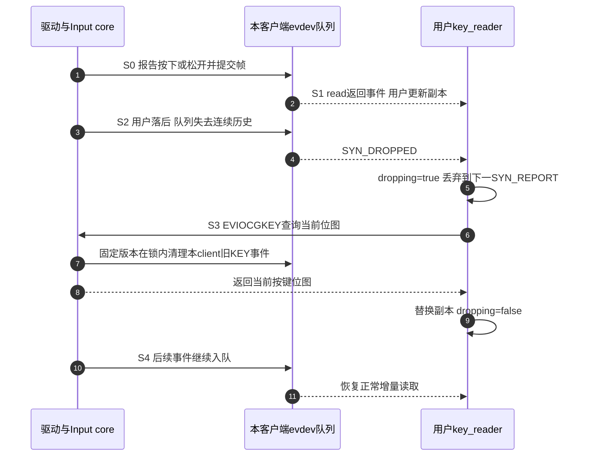

# 第2章\_读取Input事件并恢复丢失状态

上一章把硬件按键接到 Input core，并为用户公开 evdev 接口。现在程序打开设备时，按键可能已经被按住；程序处理慢时，队列也可能丢失事件。只循环读取并把所有非零值打印成 pressed，既不能区分重复，也不能让程序知道自己的状态是否仍可信。

本章写一个完整的单键观察器，依次处理初始状态、事件帧、失步恢复和设备断开。它同时可用于上一章自写驱动和前一组标准 `gpio-keys`：选择真实 event 路径与它宣告支持的键码即可。这里输出诊断信息，不执行关机、翻灯等业务动作，也不把一次位图查询当作新点击。

## 2.1\_新打开的队列没有过去的完整历史

一次 `open()` 建立一个新的 evdev 客户端。它从自己的队列接收后续事件，不会自动重放设备注册以来的按下记录。因此，打开时只等待“下一次按下”会漏掉已经保持为按下的键；把所有键默认设为释放也可能与 core 当前状态不符。

程序先用 `EVIOCGBIT(EV_KEY, ...)` 核对设备是否支持目标键，再用 `EVIOCGKEY(...)` 查询当前按键位图。能力位图回答“能报告哪些键”，状态位图回答“目前哪些键按下”；查询缓冲长度和返回值都要检查。设备名称便于人工定位，但不能代替能力核对，更不是全系统唯一标识。

| 查询或事件 | 本例怎样使用 | 结果不能证明什么 |
| --- | --- | --- |
| `EVIOCGNAME` | 打印打开对象的设备名 | 同名不代表同一个物理设备 |
| `EVIOCGBIT(EV_KEY, len)` | 核对目标键码对应能力位 | 能力位为1不表示目前按住 |
| `EVIOCGKEY(len)` | 初始化或恢复当前按键位图 | 不给出过去每次按下的时间和数量 |
| `EV_KEY` 值0、1 | 更新观察器状态并打印 | 单条事件不是所有设备状态的全局快照 |
| `EV_KEY` 值2 | 单独打印自动重复 | 不能累计为新的物理点击 |
| `SYN_REPORT` | 标识本设备事件帧结束 | 不是系统中所有设备同时采样 |
| `SYN_DROPPED` | 标记客户端已失去连续事件历史 | 不能继续把剩余增量当完整历史 |

程序保存的 `key_reader.pressed` 是用户自己的副本，内核不会直接修改它。正常情况下，用户通过读取事件更新副本；失步时，通过查询 core 当前状态重新建立副本。二者的交接是本章主线，后面的代码只是把它落实。

## 2.2\_丢失事件后为什么必须丢弃到帧边界

假设用户上次确认键已释放，随后按下、松开、再按下，但程序长时间没有读。队列容量有限，无法无限保存这段历史。evdev 用 `SYN_DROPPED` 告知该客户端失步；此后看到的零散值不足以拼回完整过程，继续统计点击只会把猜测当事实。

观察器在标记处进入 dropping 状态，忽略后续事件直到下一个 `SYN_REPORT`，然后调用 `EVIOCGKEY` 取得当前位图。这样可以重新回答“现在是否按住”，却仍无法回答“中间按了几次”。程序打印 resync，并明确这不是新点击。需要每次操作都不可丢失的业务，还要另行设计持久记录、确认或容量合同，不能靠 Input 当前位图补全历史。



S3 不只是普通内存复制。固定版本的 evdev 在锁内复制位图，并清理本客户端内核队列中相同类型的旧事件，防止新快照之后又重放旧 KEY 状态；其他客户端不被一起清空。详细实现见 [位图查询与队列清理](../../../../../../research/source_reading/input/source_explanations/P08_状态重同步与事件时间.md#8.1_位图查询为何还会清理客户端队列)。

但是内核无法清理已经由 `read()` 复制到用户数组里的旧批次尾部。因此本教学程序一次只读一条 `input_event`，在失步帧边界查询后没有本地批次尾巴需要继续处理。代价是每条事件一次系统调用；普通单键实验足够，改成批量读取时必须同时处理“查询后本地旧批次”的边界，不能只把数组变大。

## 2.3\_完整读取器怎样处理正常与异常结果

下面是 [read_key.c](materials/read_key.c) 的完整内容。默认键码为 F13，也可以在命令行给出另一个有效键码；设备路径必须显式选择，避免把扫描到的第一个同名设备当作目标。

```c
/* 单键evdev观察器：先取当前状态，失步后重新取状态，不伪造丢失的点击。 */
#define _POSIX_C_SOURCE 200809L
#include <errno.h>
#include <fcntl.h>
#include <linux/input.h>
#include <poll.h>
#include <signal.h>
#include <stdbool.h>
#include <stdio.h>
#include <stdlib.h>
#include <string.h>
#include <sys/ioctl.h>
#include <unistd.h>

#define WORD_BITS (8U * sizeof(unsigned long))
#define KEY_WORDS ((KEY_CNT + WORD_BITS - 1U) / WORD_BITS)
static volatile sig_atomic_t stop_requested;

struct key_reader {
    unsigned int code;
    bool dropping;
    bool pressed;
};

static void request_stop(int signal_number)
{
    (void)signal_number;
    stop_requested = 1;
}

static bool bitmap_has(const unsigned long *bits, unsigned int code)
{
    return !!(bits[code / WORD_BITS] & (1UL << (code % WORD_BITS)));
}

static int snapshot_key(int fd, struct key_reader *reader, const char *reason)
{
    unsigned long bits[KEY_WORDS] = {0};
    int bytes;

    do {
        bytes = ioctl(fd, EVIOCGKEY(sizeof(bits)), bits);
    } while (bytes < 0 && errno == EINTR && !stop_requested);
    if (bytes < 0)
        return -1;
    if ((unsigned int)bytes * 8U <= reader->code) {
        errno = EPROTO;
        return -1;
    }
    reader->pressed = bitmap_has(bits, reader->code);
    printf("%s: code=%u current=%s (not a new click)\n",
           reason, reader->code, reader->pressed ? "pressed" : "released");
    return 0;
}

static int consume_event(int fd, struct key_reader *reader,
                         const struct input_event *event)
{
    if (event->type == EV_SYN && event->code == SYN_DROPPED) {
        reader->dropping = true;
        puts("SYN_DROPPED: event history lost; ignore until next SYN_REPORT");
        return 0;
    }
    if (reader->dropping) {
        if (event->type == EV_SYN && event->code == SYN_REPORT) {
            if (snapshot_key(fd, reader, "resync") < 0)
                return -1;
            reader->dropping = false;
        }
        return 0;
    }
    if (event->type == EV_SYN && event->code == SYN_REPORT) {
        puts("-- SYN_REPORT --");
        return 0;
    }
    if (event->type != EV_KEY || event->code != reader->code)
        return 0;
    switch (event->value) {
    case 0:
    case 1:
        reader->pressed = event->value == 1;
        printf("EV_KEY code=%u value=%d %s\n", reader->code, event->value,
               reader->pressed ? "pressed" : "released");
        break;
    case 2:
        printf("EV_KEY code=%u value=2 repeat (not a new press)\n", reader->code);
        break;
    default:
        errno = EPROTO;
        return -1;
    }
    return 0;
}

int main(int argc, char **argv)
{
    struct key_reader reader = {.code = KEY_F13};
    struct sigaction action = {0};
    unsigned long capabilities[KEY_WORDS] = {0};
    struct pollfd wait_fd;
    char name[256] = {0};
    int fd, result = EXIT_FAILURE, bytes;

    if (argc < 2 || argc > 3) {
        fprintf(stderr, "usage: %s /dev/input/eventX [keycode]\n", argv[0]);
        return 2;
    }
    if (argc == 3) {
        char *end;
        unsigned long code;
        errno = 0;
        code = strtoul(argv[2], &end, 10);
        if (errno || end == argv[2] || *end || !code || code > KEY_MAX) {
            fputs("keycode must be 1..KEY_MAX\n", stderr);
            return 2;
        }
        reader.code = (unsigned int)code;
    }
    action.sa_handler = request_stop;
    sigemptyset(&action.sa_mask);
    if (sigaction(SIGINT, &action, NULL) || sigaction(SIGTERM, &action, NULL)) {
        perror("sigaction");
        return EXIT_FAILURE;
    }
    fd = open(argv[1], O_RDONLY | O_NONBLOCK | O_CLOEXEC);
    if (fd < 0) {
        perror("open");
        return EXIT_FAILURE;
    }
    if (ioctl(fd, EVIOCGNAME(sizeof(name) - 1), name) < 0) {
        perror("EVIOCGNAME");
        goto out;
    }
    bytes = ioctl(fd, EVIOCGBIT(EV_KEY, sizeof(capabilities)), capabilities);
    if (bytes < 0) {
        perror("EVIOCGBIT");
        goto out;
    }
    if ((unsigned int)bytes * 8U <= reader.code ||
        !bitmap_has(capabilities, reader.code)) {
        fputs("device does not advertise selected key\n", stderr);
        goto out;
    }
    printf("device=%s code=%u\n", name, reader.code);
    if (snapshot_key(fd, &reader, "initial") < 0) {
        perror("EVIOCGKEY initial");
        goto out;
    }
    wait_fd.fd = fd;
    wait_fd.events = POLLIN;
    while (!stop_requested) {
        struct input_event event;
        ssize_t size;
        int ready;

        wait_fd.revents = 0;
        /* 有限超时让停止标志与poll之间的窄窗口也能退出。 */
        ready = poll(&wait_fd, 1, 1000);
        if (ready < 0) {
            if (errno == EINTR)
                continue;
            perror("poll");
            goto out;
        }
        if (!ready)
            continue; /* 超时只是没有可读帧，不能据此宣布设备失效。 */
        if (wait_fd.revents & (POLLERR | POLLHUP | POLLNVAL)) {
            fputs("event device disconnected or poll failed\n", stderr);
            goto out;
        }
        if (!(wait_fd.revents & POLLIN))
            continue;
        /* 一次只取一条，重同步后没有用户缓冲中的旧批次尾巴需要重放。 */
        size = read(fd, &event, sizeof(event));
        if (size < 0) {
            if (errno == EINTR || errno == EAGAIN)
                continue;
            perror("read");
            goto out;
        }
        if (size != (ssize_t)sizeof(event)) {
            fputs("unexpected EOF or incomplete input_event\n", stderr);
            goto out;
        }
        if (consume_event(fd, &reader, &event) < 0) {
            perror("event or resync");
            goto out;
        }
    }
    result = EXIT_SUCCESS;
out:
    if (close(fd) < 0) {
        perror("close");
        result = EXIT_FAILURE;
    }
    return result;
}
```

`O_NONBLOCK` 使读取不会因为就绪状态变化而无限阻塞，`poll()` 负责正常等待。超时表示这一秒没有可读帧，不表示 GPIO 失效。`POLLHUP`、`POLLERR`、`POLLNVAL` 和读取错误分别进入明确退出路径；`EINTR`、`EAGAIN` 则允许重新等待。Ctrl+C 或 SIGTERM 只由信号处理函数设置标志，最多等一次有限 poll 超时后退出，避免在信号上下文执行复杂清理。

程序按 Linux UAPI 的 `sizeof(struct input_event)` 读记录，不硬编码 16 或24字节，也不访问不同时间 ABI 下可能不存在的 `event.time` 成员。它不打印事件时间，因此不存在将默认事件时钟与用户单调时钟直接相减的问题。若要做延迟测量，应先约定时钟并说明时间戳生成点，不能把本观察器的打印延迟当硬件响应时间。

输出是逐事件诊断流，`SYN_REPORT` 显示帧边界；发生失步时，从失步提示开始的历史不再完整。程序没有根据打印行立即执行业务动作。把它改成业务消费者时，应先决定按帧提交、重复键、初始持有、丢失历史和重同步各自如何影响动作，不能简单把所有 pressed 字样都接到“翻一次灯”。

## 2.4\_编译运行并验证两种打开时机

使用目标 Linux 的编译器及其用户态 sysroot 编译，不能拿宿主 Windows 的可执行文件直接放到开发板。代码与上一章内核模块在同一 materials 目录，构建方式不同：模块走 Kbuild，读取器链接目标 C 库。

```bash
# Linux构建环境；在本章materials中，CROSS_COMPILE是匹配目标用户态的工具链前缀。
: "${CROSS_COMPILE:?请先设置ARM用户态交叉工具链前缀}"
"${CROSS_COMPILE}gcc" -std=c11 -Wall -Wextra -Werror read_key.c -o read_key
```

部署读取器前，完成上一章模块与设备树的版本核对；使用标准 `gpio-keys` 时不加载本教学模块。目标板先列出实际事件设备：

```bash
# 目标Linux；找到note_input_key或标准实验的note-wakeup-key。
for item in /sys/class/input/event*; do
    [ -f "$item/device/name" ] || continue
    printf '%s: ' "$item"
    cat "$item/device/name"
done
```

从输出确定路径，并核对父设备。以下用变量明确表示选择结果，而不把示例 event 号写成固定事实。

```bash
# 目标Linux，具有事件设备读取权限；手工填写刚核对的实际路径。
read -r -p '输入实际event设备路径: ' key_event
./read_key "$key_event" 183
```

先在释放状态打开，应看到 initial released；按住时出现 `EV_KEY value=1`，松开出现0，并由 `SYN_REPORT` 分帧。然后停止程序，在已经按住的状态重新打开，应看到 initial pressed，而不是等待一个实际上还没有发生的新按下。默认教学驱动没有声明自动重复能力，长期按住不应靠它不断产生 value=2；读取器仍能辨认其他支持重复的设备发出的2。

| 观察场景 | 本版预期 | 需要继续核查的异常 |
| --- | --- | --- |
| 释放时打开后正常按放 | 初始释放，后续按下/松开成帧 | 极性、稳定状态和绑定设备是否正确 |
| 已按住后打开 | initial pressed，不打印成新点击 | core初始状态是否已经对齐，目标键码是否正确 |
| 持续按住 | 状态保持；本模块不主动重复 | 程序是否把重复或多客户端打印混算成点击 |
| 能力不含所选键 | 明确失败退出 | 是否选错event设备或配置码 |
| 用户落后导致SYN_DROPPED | 丢弃到帧边界，再报告resync当前态 | 不得用resync重建缺失点击次数 |
| 设备解绑 | 等待或读取明确失败退出 | 不能在POLLHUP后忙循环 |

可以用两个终端同时打开同一个 event 设备，观察独立队列都收到后续事件；这不是独占抓取实验，不使用 `EVIOCGRAB`。在另一个终端执行上一章模块的 `rmmod note_input_key`，观察读取器退出以及驱动停止顺序。使用标准 `gpio-keys` 时不要卸载不存在的教学模块，而应按其实际设备生命周期验证。

失步不一定能靠一次人手按键复现。暂停进程再快速产生事件只是条件实验，未观察到 `SYN_DROPPED` 不证明队列永远不会满；本轮对该分支使用构造事件和系统调用桩验证控制流，没有伪造真实队列溢出的板级日志。

## 2.5\_对照旧记录\_保留现象并修正解释

原笔记完整输出如下。当时使用 KEY_POWER（116）、旧设备名和 `/dev/input/event1`；它属于原实验，不能替代本版 F13 配置的实际运行结果。

```text
~ # cd /mnt/nfs/driver/
/mnt/nfs/driver # ls
demo_test.out  input_test.ko
/mnt/nfs/driver # insmod input_test.ko
[   25.334899] input_test: loading out-of-tree module taints kernel.
[   25.342520] input: demo_key_input_devm as /devices/platform/demo-key@0/input/input2
[   25.351367] demo-gpio-key demo-key@0: demo_key: irq=46, debounce=10ms, code=116, active-low

/mnt/nfs/driver # ./demo_test.out
[INFO] matched "demo_key_input_devm" at /dev/input/event1
[INFO] start reading… (poll timeout 5000 ms)
  EV_KEY  KEY_POWER    (116)  pressed   @232885.387813s
-- SYN_REPORT ------------------------------------
  EV_KEY  KEY_POWER    (116)  released  @232885.517828s
-- SYN_REPORT ------------------------------------
  EV_KEY  KEY_POWER    (116)  pressed   @232885.727839s
-- SYN_REPORT ------------------------------------
  EV_KEY  KEY_POWER    (116)  released  @232885.897803s
-- SYN_REPORT ------------------------------------
  EV_KEY  KEY_POWER    (116)  pressed   @232886.027819s
-- SYN_REPORT ------------------------------------
  EV_KEY  KEY_POWER    (116)  released  @232886.127900s
-- SYN_REPORT ------------------------------------
  EV_KEY  KEY_POWER    (116)  pressed   @232886.427800s
-- SYN_REPORT ------------------------------------
  EV_KEY  KEY_POWER    (116)  released  @232886.577797s
-- SYN_REPORT ------------------------------------
  EV_KEY  KEY_POWER    (116)  pressed   @232886.657793s
-- SYN_REPORT ------------------------------------
  EV_KEY  KEY_POWER    (116)  released  @232886.777790s
-- SYN_REPORT ------------------------------------
```

这些记录说明当时用户程序读到了按下和松开帧，无法证明高有效接线、GPIO 读取失败、初始按住、失步恢复和解绑都正确。旧程序把任意非零值当 pressed，扫描范围固定在 event0～63，对 `POLLHUP` 和读取0字节没有完整退出处理，也没有 `SYN_DROPPED` 重同步；本版围绕这些缺口保留了事件读取目标，并把错误变成可观察的分支。

练习一：initial pressed 与 `EV_KEY value=1` 都写着按下，为什么不能自动算两次点击？前者是打开时快照，后者是事件增量；点击计数必须有自己的状态和时间边界。练习二：收到 `SYN_DROPPED` 后，下一条刚好是松开，能否立即恢复正常？不能，应丢弃至下一 `SYN_REPORT` 并查询当前状态。练习三：把单条读取改成16条批量读取，仅在帧边界查询后继续遍历数组有什么问题？数组尾部可能早于新快照，重放会把刚恢复的副本倒退。

现在能从 GPIO 逻辑状态追到 Input core，再追到每个客户端的队列、用户副本和失步恢复。需要扩展到多键、多轴或多点触摸时，继续 [Input 通用专题](../../../../../../knowledge/driver_model/input/大纲.md)；不能把单键的一位状态直接当作完整触摸帧协议。

> 依据：NXP Linux 6.12.20 固定提交 `dfaf2136deb2af2e60b994421281ba42f1c087e0`；阅读入口见 [Input源码索引](../../../../../../research/source_reading/input/navigation/P01_Linux_6.12_Input源码阅读索引.md)。UAPI 来自 `include/uapi/linux/input.h`、`input-event-codes.h`，客户端读取和状态查询来自 `drivers/input/evdev.c`。本轮控制流桩不模拟 Linux ABI；目标用户态编译、真实事件读取、断开与溢出验证仍需在目标环境执行。
