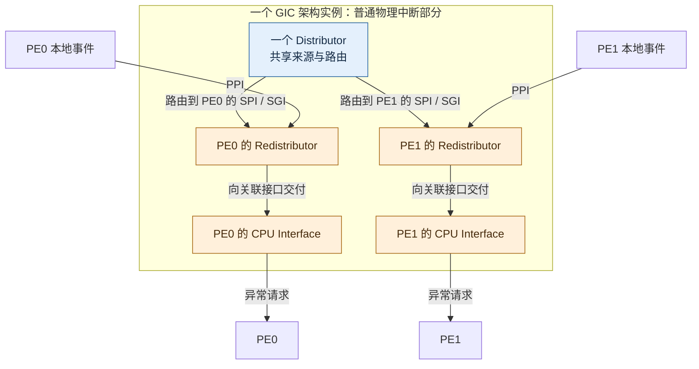
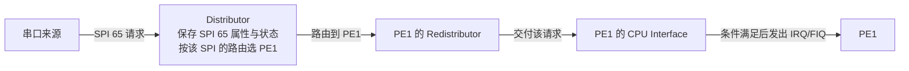
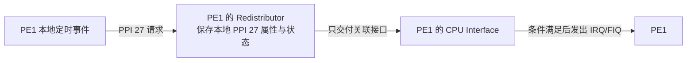
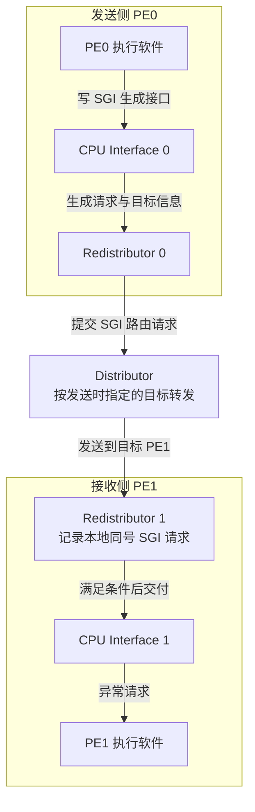
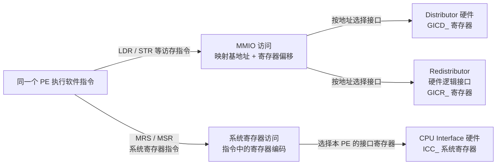
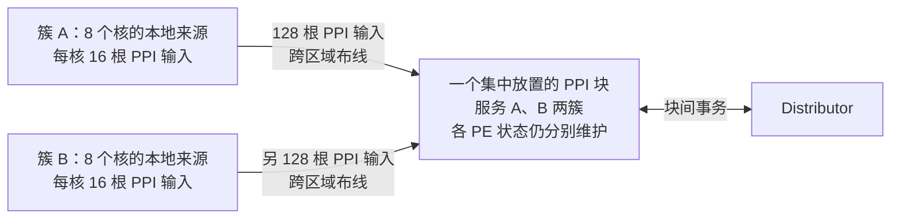
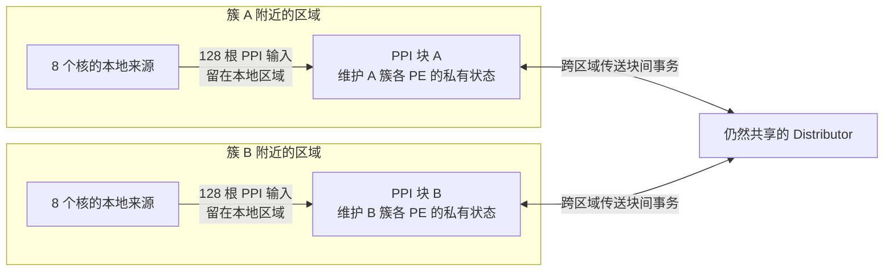
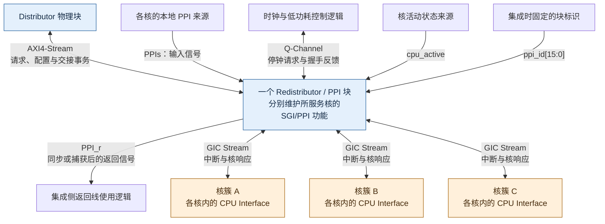
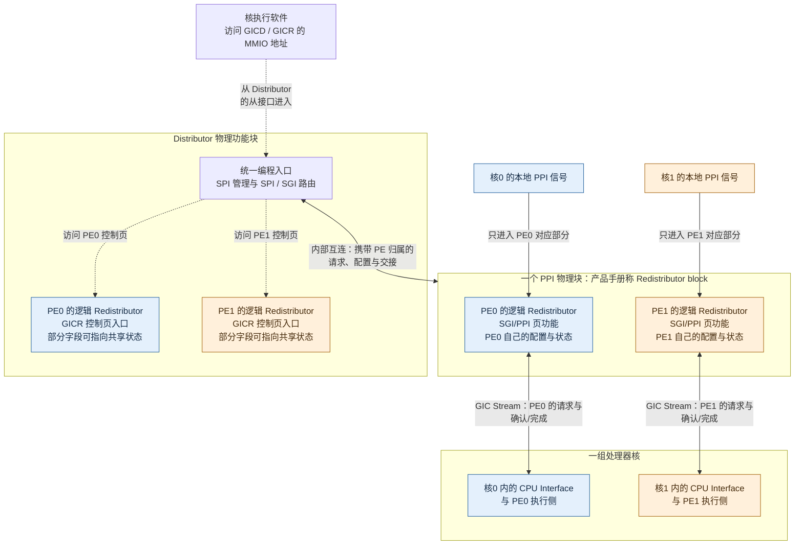

# 第3章\_多核控制器的角色\_寄存器与编号

## 3.1\_增加第二个处理器后\_什么必须拆开

前两章建立了中断控制器与芯片的关系。本章把 **通用中断控制器（Generic Interrupt Controller，GIC）** 的 v3.0 规则放到两个处理器的场景中：同一个串口请求可以交给其中一个处理器，但每个处理器自己的定时事件，不能因为编号相同就混成一个来源。

Arm 文档常把一个能执行指令的处理实体称为 **处理单元（Processing Element，PE）**。本章用 PE0、PE1 表示两个教学对象，不是在声明 RK3588 的真实硬件编号；**中央处理器（Central Processing Unit，CPU）** 接口是每个 PE 对应的中断接收与处理接口。

以下采用已经开启 **亲和性路由（Affinity routing）** 的 GICv3.0 物理中断模型：硬件用处理器的层次坐标识别接收目标，坐标的具体编码到第七章再展开。旧式兼容操作的寄存器归属可能不同，不能把本章的分工无条件搬到所有模式。

若把所有状态混在一个全局对象中，就无法同时表达“PE0 正在处理自己的定时事件”和“PE1 尚未确认自己的定时事件”。相反，若把所有配置复制到每个 PE，又难以表达一个外设来源应当只交给一个目标。于是必须先区分共享来源与每个 PE 私有的状态。

## 3.2\_先分清三种来源\_再看编号范围

**第一种**来源是芯片里的串口、网络等外设，请求可以被路由到适当的 PE。它称为 **共享外设中断（Shared Peripheral Interrupt，SPI）**。“共享”指系统范围内的来源和路由，不等于 Linux 多个驱动共享同一中断线，也不表示广播给所有 PE。

**第二种**来源与某个 PE 固定关联，例如该 PE 的定时事件。它称为 **私有外设中断（Private Peripheral Interrupt，PPI）**。两个 PE 可以使用相同的编号表示各自的定时中断，但它们不是同一份待处理状态。

**第三种**来源是软件希望通知另一个 PE，例如提示它检查新任务。它称为 **软件产生中断（Software Generated Interrupt，SGI）**。软件写控制器提供的生成接口，硬件把请求交给指定接收者；待办工作的详细内容仍需另外保存。

来源编号称为 **中断标识符（Interrupt Identifier，INTID）**。在本专题的 GICv3.0 范围内，前三类按以下区间区分：

| 类型 | 已解释的来源 | INTID 范围 | 确定状态时还需要什么 |
| --- | --- | --- | --- |
| 第三种 | SGI | <span style="color:var(--typora-code-color-b42318, #b42318)">0～15</span> | 接收目标 PE；同号请求不是按发送者分别计数 |
| 第二种 | PPI | <span style="color:var(--typora-code-color-b42318, #b42318)">16～31</span> | 该请求所属 PE |
| 第一种 | SPI | <span style="color:var(--typora-code-color-b42318, #b42318)">32～1019</span> | 系统中的具体来源；实际实现通常只覆盖其中一部分 |

编号范围是架构允许的空间，不是“芯片实际有这么多外设”。<span style="color:var(--typora-code-color-b42318, #b42318)">1020～1023 是特殊返回值空间，不能分配给普通外设</span>。更大的消息中断空间稍后由具体问题引出；GICv3.1 新增的扩展范围不纳入 RK3588 的 v3.0 主线。

> 官方对照：[规范 IHI0069 H.b](https://developer.arm.com/documentation/ihi0069/hb)，2.2 INTIDs（2-35）与 4.3 Private Peripheral Interrupts、4.4 Software Generated Interrupts、4.5 Shared Peripheral Interrupts；先核对 GICv3.0 编号区间，再看各类型的归属规则。概览 198123 第 4 章的 Interrupt types 是更短的复习入口。

## 3.3\_三种接口怎样分工

刚才的三类来源留下两个不同的问题：一个共享来源怎样选接收者，选定之后怎样与该接收者自己的请求汇合？如果只把几个模块排成一列，会让人误以为每类请求都从同一个入口进入；如果只说“每个模块管一些配置”，又看不见请求怎样到达处理器。下面先确定组件与 PE 的对应关系，再沿具体请求走一遍。

### 3.3.1\_一个控制器实例怎样配上多个处理器

一个 GIC 架构实例包含一个 **分发器（Distributor）**，承担共享来源及目标路由职责；每个受支持 PE 分别对应一个 **再分发器（Redistributor）** 逻辑组件，承担该 PE 的本地来源和交付职责，还对应一个 **处理器接口（CPU Interface）**，承担该 PE 的接收控制及软件交接职责。后文出现的消息翻译组件是可选部分，本节先画已经建立的 SPI、PPI 和 SGI 所需结构。

下图把两个接收侧并排画出。大框表示同一个 GIC 架构实例，蓝色是系统共享组件，橙色是与各 PE 对应的组件；上下位置用于阅读，没有表示父子包含或芯片上的真实距离。



这张图只画接收方向，SGI 的发送方向在 3.3.4 单独补齐。“一个 Distributor”以 **一个 GIC 实例** 为范围，不是在断言任何 SoC 都只能有一个中断控制器。“每 PE 一个 Redistributor”是架构逻辑对应关系，实际产品可以把多个逻辑接口放在同一个物理功能块中。

Redistributor 与 Distributor 同属控制器中的不同组件。前者不是后者内部的一份子，也不是因为接收 SPI 就替 Distributor 再管理一套 SPI 来源配置。这里要区分 **组件属于谁** 与 **请求经过谁**：两者共同属于 GIC，而一条请求可以先后经过两者。

> 图与正文依据：[规范 IHI0069 H.b](https://developer.arm.com/documentation/ihi0069/hb)，3.1 The GIC logical components，图 3-1 与图 3-2（3-42～3-43）。本图是据规范重新组织的教学逻辑图，未画消息翻译部分，不是 RK3588 硅片版图。

### 3.3.2\_每个组件接收什么\_向哪里交付

**Distributor 接收共享外设的 SPI 请求**，保存这个来源的使能、优先级、触发方式、中断组、请求状态和目标路由信息，再把请求送往所选 PE 的 Redistributor。它还接收发送侧提出的 SGI 请求，按请求中的目标信息转发给一个或多个目标 Redistributor。除此以外，它提供一些整个 GIC 实例共享的控制接口；“提供公共配置”是另一项职责，不能拿来替代上面的输入与输出描述。

**Redistributor 接收已经路由到关联 PE 的 SPI、SGI，以及直接面向该 PE 的 PPI**。它管理该 PE 的 SGI/PPI 单独属性和状态，把本地与已路由来的请求组织起来，向关联 CPU Interface 交付。后面的消息中断同样需要这个接收侧，并增加内存表与电源交接接口。这里管理的“本地状态”，指“PE0 的 PPI 27”和“PE1 的 PPI 27”能够分别记录，不能因为编号一样就合成一份。

**CPU Interface 是与本 PE 关联的硬件中断控制逻辑。** 它接收关联 Redistributor 提供的中断，结合本 PE 的组接收许可、优先级门限和正在处理的优先级，决定是否发出 **普通中断请求（Interrupt Request，IRQ）** 或 **快速中断请求（Fast Interrupt Request，FIQ）** 信号。这里的判断与信号输出由硬件完成；IRQ/FIQ 表示向 PE 提出的异常请求，不能证明软件已经读走外设数据。

**软件通过寄存器访问 CPU Interface。** PE 响应请求并进入软件异常处理路径后，执行相应寄存器读写指令，由 CPU Interface 硬件完成来源确认、优先级释放以及适用模式下的停用。这些操作的访问方式在下一节说明，状态变化在第四、五章展开。发送 SGI 时，同样由 PE 上的软件执行生成操作，CPU Interface 硬件承接该操作并把请求交给路由侧。

以串口为例，CPU Interface 管理中断的交付及相关控制状态；PE 执行异常入口和驱动代码，由驱动读取串口数据寄存器、取走实际字节。图中把 CPU Interface 与 PE 的执行职责分别画出，是为了区分这两项功能；CPU Interface 可以集成在处理器核内部，后面的 [GIC-600 功能块图](#3.4.1_PPI块为什么这样设计_从布线与电源约束到每核状态归属)给出了具体对应关系。

### 3.3.3\_SPI先选择目标\_PPI直接进入本地

先固定一个教学请求：串口的 SPI 65 已配置给 PE1。这里的 65 只为说明对象关系，不是 RK3588 串口的实测编号。



SPI 经过目标 Redistributor，并不在那里变成一个 PPI。这个 SPI 的来源使能、优先级和路由仍按 SPI 编号统一配置；不能先在 Distributor 配成 PE1，又期待 PE1 的 Redistributor 为同一来源另配一个 PE0 目标。

现在换成 PE1 的本地定时事件，教学编号为 PPI 27：



这条路径没有先到 Distributor 选择 PE。PPI 的归属已经由它与 PE 的关联确定，不能使用 SPI 路由配置把它任意改派出去。若 PE0 也有 PPI 27，那是另一份本地实例，是否同时发生取决于各自的事件源，不是 GIC 把一条 PPI 广播成两份。

这两张图表达 **架构逻辑请求路径**，省略确认和完成方向；并没有声称芯片内部必须为每根箭头铺设一根独立导线。具体产品可以用互连事务承载这些交互。

### 3.3.4\_SGI的发送侧和接收侧都要画出来

SGI 的来源是软件，不能只画“目标 Redistributor 收到 SGI”而省略它从哪里来。固定 PE0 通知 PE1 的场景，发送过程如下：



这里 **SGI 经过 Distributor 转发**，而 **SGI 的接收状态和单中断属性属于目标 PE 的 Redistributor**。两句话同时成立：前一句说请求经过谁，后一句说配置与状态属于谁。不能因为 SGI 的配置是本地的，就断言它和 PPI 一样不经过 Distributor。

<span style="color:var(--typora-code-color-b42318, #b42318)">发送者还可以指定多个接收者</span>。此时 Distributor 将请求送往相应的多个 Redistributor，各接收 PE 处理自己的 SGI 实例；这与“一个 SPI 从候选 PE 中选一个接收者”不同。具体目标字段及广播条件在[第七章](P07_目标选择_核间通知与电源交接.md#7.2_硬件目标坐标不是Linux逻辑编号)展开。

> 三条请求路径依据：[规范 IHI0069 H.b](https://developer.arm.com/documentation/ihi0069/hb)，3.1（3-42）逐项描述 SPI、PPI、SGI 的路径，图 3-2 的脚注 b 再次指出 SGI 经 Distributor 路由。箭头表示架构组件之间的交付关系，不以寄存器访问路径代替中断请求路径。

### 3.3.5\_配置的作用范围不会改写请求路径

现在再问“改谁的配置会影响谁”，就有了清楚的对象：

| 配置属于哪一层 | 配置对象与作用范围 | 不能据此推出什么 |
| --- | --- | --- |
| Distributor 的 SPI 单中断配置 | 某个 SPI 编号的使能、优先级、组别和目标 | 不是给每个 PE 各建一张 SPI 私有使能表 |
| Distributor 的实例级共享控制 | 例如整个 GIC 实例的中断组许可 | 对 PPI 有约束，不等于 PPI 请求绕道经过 SPI 路由 |
| 对应 Redistributor 的本地配置 | 该 PE 的 SGI/PPI 属性和状态，以及接收侧参与、电源状态 | 接收 SPI 不等于拥有这个 SPI 的独立路由配置 |
| 对应 CPU Interface 的接收配置 | 该 PE 的组接收许可、门限与处理交接 | 接收门限不是某个来源的独立优先级值 |
| PE 自身的异常控制 | 当前处理器执行状态是否允许相应异常进入 | 控制器已发出请求，不等于 PE 已执行处理程序 |

例如，一个 PPI 已在本地使能，仍可能因为它所属组被全局禁止而不能交付。起作用的是一项公共许可；请求入口依然是本地 Redistributor。第六章用[独立的配置作用范围图](P06_权限_安全分组与初始化闭环.md#6.3.2_硬件结构与配置归属先对齐)说明这种共同约束，不把它画成每种请求都必须经过的串行筛选流水线。

反过来也不能说“Redistributor 的配置绝不影响 SPI”：它的接收侧参与状态可能影响某个 PE 是否适合参加 SPI 的候选选择。**谁持有一个 SPI 的路由属性** 与 **某个 PE 是否有资格接收** 是两个问题，第七章会分别追踪。

试着只改一个条件：把 SPI 65 从 PE1 改到 PE0，是否也把 PE1 的 PPI 27 搬过去？答案是否定的。改变的是共享来源的目标属性，PPI 27 的本地来源、配置和状态没有随之转移。这就是把“按来源编号配置”和“按 PE 保存状态”分开的价值。

> 官方对照：[规范 IHI0069 H.b](https://developer.arm.com/documentation/ihi0069/hb)，2.1 The Distributor and Redistributors、4.7.2 Interaction of group and individual interrupt enables（4-69～4-70）。先核对配置对象，再核对使能条件，不能由控制范围推导电路连接。

## 3.4\_软件怎样访问GIC\_寄存器接口怎样落到物理电路

前面已经分清 Distributor、Redistributor 和 CPU Interface 的硬件职责，现在要回答：**PE 上的软件究竟怎样读写它们？这里的两种方式，就是 MMIO 访问和系统寄存器访问。** 区别在于软件用什么指令、怎样指定要访问的寄存器。

1. **内存映射输入输出（Memory-Mapped Input/Output，MMIO；官方常写 Memory-mapped I/O）访问**：用内存地址定位硬件寄存器，再通过读写事务访问。本章 Distributor 的 `GICD_`、Redistributor 的 `GICR_` 寄存器采用这种方式。
2. **系统寄存器访问（System register access）**：用架构定义的系统寄存器编码指定目标，通过专门的系统寄存器指令访问。本章 CPU Interface 的 `ICC_` 寄存器采用这种方式，不需要提供一个 GIC 设备基地址。

这里的 **寄存器（Register）** 指 GIC 向软件提供的硬件状态与控制接口。两种方式都由 PE 执行软件指令，访问的也都是硬件；CPU Interface 使用系统寄存器接口，并没有变成软件模块。读写可能返回状态、改变配置，甚至推进状态机，所以不能把这些寄存器当作没有额外副作用的普通变量。

以下继续采用本章的 GICv3.0 物理中断模型，并固定 **AArch64（64 位执行状态）**、CPU Interface 系统寄存器接口已启用且当前软件具有访问权限。旧式兼容接口另有条件，不能把这里的对应关系推广到所有 GIC 版本和运行模式。

先看 **MMIO 怎样按地址找到寄存器**。芯片给 Distributor 分配物理基地址；操作系统可以把这段设备空间映射到虚拟地址，随后使用符合设备属性、访问宽度和顺序要求的读写操作。它使用地址寻址，但访问目标仍是设备寄存器，不是普通内存中的数据。

例如，`GICD_CTLR` 是 **分发器控制寄存器（Distributor Control Register）**，位于 Distributor 寄存器块的偏移 `0x0000`，宽度为 32 位。假设通用寄存器 `X0` 已保存可用的 Distributor 映射基地址，用加载指令 `LDR` 发起一次读取，形式可以写成：

```asm
// AArch64 访问形式示例：假定设备映射及访问权限已经建立。
// X0 保存映射基地址，W1 接收读出的 32 位值。
LDR W1, [X0, #0x0000]
```

方括号内的 `X0 + 0x0000` 指定访问地址。PE 发出读事务，由地址映射和互连把它送到 Distributor 的对应接口，返回值写入 `W1`。这里 `X0` 是处理器的 64 位通用寄存器，`W1` 是通用寄存器 `X1` 的低 32 位视图；这些是指令的地址或数据操作数，不是另一组 GIC 寄存器。该片段只演示寻址，不是包含映射、屏障与错误处理的完整驱动。

再看 **系统寄存器访问怎样指定目标**。`ICC_IAR1_EL1` 是 **中断确认寄存器 1（Interrupt Controller Interrupt Acknowledge Register 1，IAR1）**，属于当前 PE 的 CPU Interface。软件通过 `MRS` 指令读取它：

```asm
// AArch64 访问形式示例：读取会执行中断确认，不能当作无副作用的探测。
// X2 接收确认返回值；这条指令没有使用 GIC 的映射基地址。
MRS X2, ICC_IAR1_EL1
```

汇编器把 `ICC_IAR1_EL1` 这个架构名称编码进系统寄存器指令，PE 据此访问相应硬件接口，将返回值放进通用寄存器 `X2`。这里没有 `[基地址 + 偏移]` 这样的访存操作数，也不是先把字符串当作地址。`MRS`、`MSR` 都是指令助记符，不是通用 C 函数；实际软件可以用封装这些指令的访问器，但封装不改变底层访问方式。

这次读取还说明了“访问形式”和“操作语义”的区别：MRS 说明怎样访问，而 IAR1 的定义决定读取具有确认副作用。若取得一个有效来源，就产生后续处理与完成义务；确认、清源和结束不能用上面这一行代替，完整配对在[第四章](P04_一次中断的状态转换与完成协议.md#4.3_确认_清源_优先级下降与停用)展开。

两次访问都由 PE 执行指令，但选择目标的依据不同：一次把设备地址交给访存路径，一次把系统寄存器编码交给本核接口。现在再把这两条路径并列，表格只补齐指令形式与接口范围：

| 比较项 | MMIO 访问 | 系统寄存器访问 |
| --- | --- | --- |
| 怎样指定目标 | 寄存器块的映射基地址 + 寄存器偏移 | 架构定义的系统寄存器编码，汇编中通常写寄存器名称 |
| AArch64 指令形式 | `LDR` 读取、`STR` 写入等访存指令 | `MRS` 读取、`MSR` 写入系统寄存器 |
| 是否使用设备映射地址 | 使用；物理地址由芯片集成决定，软件可能使用映射后的虚拟地址 | 不用一个 MMIO 地址选择 `ICC_` 寄存器 |
| 本章的 GIC 接口 | Distributor：`GICD_`；Redistributor：`GICR_` | 当前 PE 的 CPU Interface：`ICC_` |

刚才的例子分别读取控制值和确认来源。两次读取的目标、宽度与副作用不同，下面把这些差别落实到寄存器字段。**只读（Read-Only，RO）** 表示软件不能写，**可读写（Read/Write，RW）** 表示接口允许读写；这两个标记都不能说明访问有没有副作用。表内 `Dist_base` 表示 Distributor 寄存器块的基地址，不是某颗 SoC 的固定数值。**寄存器写入待完成（Register Write Pending，RWP）** 是控制寄存器中的一个硬件状态字段，用于指示其规定范围内的先前写入是否仍在传播。

| 寄存器与作用范围 | 访问路径、宽度与属性 | 本节需要读懂的字段及效果 |
| --- | --- | --- |
| `GICD_CTLR`，整个 GIC 实例的 Distributor 控制 | MMIO：`Dist_base + 0x0000`；32 位，RW，但其中状态位可为 RO | 本例只读取控制值；其中 `[31] RWP` 是只读的“寄存器写入待完成”状态，1 表示它跟踪的写入尚未完成传播，0 表示这些写入已完成。它不跟踪所有写入；组使能等控制字段随安全视图而异，在第六章按视图展开 |
| `ICC_IAR1_EL1`，当前 PE 的组 1 确认接口 | 系统寄存器：`MRS Xt, ICC_IAR1_EL1`；64 位，RO；没有 MMIO 偏移 | `[23:0] INTID` 返回来源编号或特殊值；编号实现为 16 位时 `[23:16]` 为保留零，`[63:24]` 也为保留零。读取得到有效来源时同时执行中断确认，并非单纯观察；1020～1023 属于前文说明的特殊返回值空间 |

这里只用第一行演示“按地址读”，用第二行演示“按系统寄存器编码读”。RWP 的完整同步规则在[第六章](P06_权限_安全分组与初始化闭环.md#6.6_写入顺序_内存可见与硬件完成是三个问题)说明；“组 1”是中断接收分组名称，本节不改变其分组配置。两个访问片段均沿用本节开头的权限和接口启用前提。



这张图只画 **软件编程访问路径**，箭头表示软件怎样选择硬件接口，不表示 SPI、PPI、SGI 请求的传播，也不规定各功能块在芯片中的摆放位置。尤其要注意：Redistributor 虽然按 PE 对应，其编程接口仍是 MMIO；不能根据“每 PE 一份”判断访问方式。

现在再判断“给 GIC 基地址加一个偏移，就能读 CPU Interface 的确认寄存器”为什么不成立：在这里选定的系统寄存器接口中，IAR1 由指令编码选择，没有可随意换算的 MMIO 偏移。对某个内存地址执行 LDR，不会因此变成对 `ICC_IAR1_EL1` 的系统寄存器读取，还可能访问完全无关的设备。下一小节继续把这些逻辑接口放回 GIC-600 的物理功能块，分清访问接口与电路组织。

> 官方对照：[规范 IHI0069 H.b](https://developer.arm.com/documentation/ihi0069/hb)，12.1.2 Relation between System registers and memory-mapped registers、12.1.7 GIC System register access、12.2.14 ICC_IAR1_EL1，以及 12.8/12.10 的 Distributor/Redistributor register map。`GICD_CTLR` 的偏移、32 位宽度见 12.9.4。分别查看系统寄存器编码和内存映射，不把两种目录当作同一基址下的偏移表。

### 3.4.1\_PPI块为什么这样设计\_从布线与电源约束到每核状态归属

前面的逻辑图已经说明：每个 PE 必须能分别记录自己的 SGI/PPI 配置与状态，CPU Interface 再按本 PE 的接收条件决定是否向处理器提出异常请求。但它还没回答一个造芯片时必须面对的问题：**直接接收各核 PPI 信号、维护本地状态、向各核交付请求的这些电路，放在哪里，怎样分组？** 软件看到的“每 PE 一份逻辑接口”没有替芯片设计者做出这个物理布局选择。

#### (1)\_接收电路集中放置\_布线和关电会遇到什么约束

先作一个教学假设：芯片有相隔一定距离的 A、B 两个核簇，每簇 8 个核，每核接入 16 根 PPI 输入线。这里选 16 只是为了算清布线数量，不是在报告 RK3588 的实际连接。每簇就有 `8 × 16 = 128` 根 PPI 输入，两簇合计 256 根；这还没有计算返回线和其他接口信号。

一种朴素布置是把这些本地接收电路集中放在 Distributor 附近。它可以正确保存各 PE 的状态，公共互连与控制也容易集中安排。但是如果两个核簇距离这里都较远，256 根 PPI 输入就都需要从核附近穿过芯片区域来到同一个接收点。每根线都要完成实际布线，并满足接收端采样、时序和必要的同步条件；增加核数时，需要远距离引入的本地信号也随之增加。架构上“都叫 PPI”不会让这些导线自动合成一根。

第二个约束来自电源。假设 A 簇暂时空闲，B 簇仍要工作。若两簇的接收电路共用一个不可整体分开的电源块，就不能简单地把这个块随 A 簇关掉，因为 B 簇还依赖它。芯片可以继续增加内部电源划分，但这本身就是需要设计的分区和交接机制，不能只靠“软件不再给 A 发中断”替代。

这时可以改变布局：**把直接连接一组核的本地接收、状态维护和交付电路组织成一个块，放在这组核附近；它与远处 Distributor 之间通过硬件事务通信。** 在 GIC-600 r1p6 中，这个产品物理块称为 Redistributor block，也称 **PPI 块（PPI block）**。下面用同一组核对比两种放置方式；两图只突出 PPI 输入布线和块间通信，核侧 CPU Interface 的完整连接紧接着展开。



这个方案的代价集中在两簇到接收点的长距离输入布线，以及共用块与单簇关电需求之间的协调。若系统小、这些核本来就放得很近，集中放置仍可能是合理选择。



第二种布置没有减少 PPI 来源数量，也没有省掉本地的 256 根输入线；**它缩短了这些线需要跨区域铺设的距离，把远处共享组件与本地接收侧的通信集中到块间接口上。** A 簇要休眠时，也可以在完成规定的状态交接与接口静止协议后，把 PPI 块 A 与 A 簇一起关电，同时保留 B 簇所需的块。关电前的协议不能省略，第七章再追踪其完成条件。

拆块也有代价：要有更多物理实例、块间路由以及时钟或电源域交界处的适配，事务传输仍会占用带宽和时间。它没有免费消除通信，只是改变了信号在哪里接收、状态在哪里维护、哪些距离由消息接口跨越。因此，**核簇分散且需要分别关电时，按簇就近放块有明确价值；核少、距离近且共同管理电源时，共用一个块也可能更合适。** 不能把“每 PE 一个逻辑 Redistributor”进一步推成“必须每核制造一个独立 PPI 物理块”。

> 设计依据：GIC-600 r1p6 技术参考手册（Technical Reference Manual，TRM），1.2 Components（印刷页 1-13）建议将 Redistributor 放在服务的处理器附近以缩短布线；2.2 Redistributor（2-29）明确举出“两簇、每簇八核，各放一个块以减少 PPI 布线并随核关电”，同时说明小系统可以把全部核合在一个块中。上面的每核 16 根输入、256 根合计及两幅布局图，是在该设计选择上建立的教学算例，不是手册给出的特定芯片版图或性能测量。

#### (2)\_将接收电路放到核旁\_PPI块怎样交付一次请求

现在让 A 簇里某个核的本地定时事件发生。输入首先到附近 PPI 块中与该核对应的接收部分；硬件按该输入的配置进行监测，以及需要的同步或捕获，并维护这个 PE 的 PPI 属性和状态。另一个核即使使用相同 PPI 编号，也进入另一份本地状态，不能因共用物理块而混合。

这个块还维护各核的 SGI 配置和状态，并接收 Distributor 已经路由到这些核的其他中断。**它把本地请求与 Distributor 送来的请求一起做优先级选择，再向对应核的 CPU Interface 交付。** CPU Interface 位于各个处理器核内，继续结合本 PE 的组接收许可、优先级门槛与正在处理的优先级，决定是否提出 IRQ/FIQ。两个部件承担接收链上的不同步骤，PPI 块没有代替核内 CPU Interface。

两者之间的通信接口叫 **GIC Stream**，是传递中断与核侧响应的硬件协议专名。软件在核上执行确认或完成操作以后，相关硬件交接也通过这条接口返回；PPI 块继续与 Distributor 协作。它不执行驱动，不读取串口数据，也不是一个“不断扫描所有核的软件工作线程”。因此，PPI 块这个名字突出的是就近连接的私有输入，**并不表示它只接收 PPI，或者所有进入它的请求都变成了 PPI。** SPI 的共享来源属性仍归 Distributor，SGI/PPI 的私有状态按目标 PE 区分。

由此再看“每 PE 一个 Redistributor”与“一个块连接多个核”，就不矛盾了：**前者规定逻辑接口和私有状态的对应关系，后者选择这些功能在芯片中怎样合并放置。** GIC-600 的 PPI 块是落实本地接收、就近布线和可分区电源管理的一种产品组织方式，并非 GICv3 架构强制所有产品采用的唯一物理划分。

> 功能依据：GIC-600 r1p6 TRM，2.2 Redistributor（2-29）的功能列表：维护 SGI/PPI 编程、监测并按需同步 PPI 线、对本地与 Distributor 送来的中断做优先级选择、维护与核的 GIC Stream 通信；CPU Interface 位于核内及双向事务说明见 2.2.2（2-30）。

#### (3)\_按所服务的核选择配置\_一个块能接多少核与PPI

上面的分簇方案为每个块安排了 8 个核、每核 16 根 PPI 输入；要把它做成具体产品，就得检查一个块是否支持这个核数、输入数以及所需的通信组织。下面再用手册 **表 2-9 Configurable options for the Redistributor** 细化这些选择：中间列保留五项原始选项值，最后一列说明它们影响什么。这些是产品生成与芯片集成时的选择，不是 Linux 在运行时任意改变的核数。

| 原表配置项 | r1p6 表 2-9 的选项值 | 在本节怎样理解 |
| --- | --- | --- |
| `Number of cores downstream`，下游核数 | 1～64 | 一个 PPI 物理块可服务 1～64 个核；每核对应的逻辑状态仍分别维护 |
| `PPIs per core`，每核 PPI 数 | 8、12、16 | 决定每个核接入多少根 PPI；2.2.4 还要求共用该块的核采用相同数量的 PPI 与返回线 |
| `ECC support`，纠错码（Error Correction Code，ECC）支持 | True、False，即支持或不支持 | 属于内部存储保护的可选能力，不决定“每 PE 一份状态”；原表脚注指向 3.16 的可靠性机制 |
| `Bus data width`，总线数据宽度 | 原表写作 `16 or 32` | 是传输接口配置，不能据此推算逻辑 Redistributor 的个数；同版资料的宽度表述差异见下文 |
| `GIC Stream bus structure`，GIC Stream 总线结构 | `Flexible buses and domains`，总线与域可灵活组织 | 不要求每个核独占一条物理总线；连接可按核组及相关域组织 |

这里已经能直接得到“可以用一个块服务两个核”的依据：2 在 1～64 的范围内。它没有证明 RK3588 采用了两个核一块，也没有把架构允许的 16 个 PPI 编号都变成必然接出的输入线。

**保留原件中的差异：** 同一本 r1p6 手册，表 2-9 的 `Bus data width` 写作 `16 or 32`，2.2.1 的 Distributor 方向 AXI4-Stream 接口文字却写作 16 位或 64 位；2.2.2 又明确 GIC Stream 使用一对 16 位接口。这里按各条目的实际内容呈现，不擅自改成一致数值，也不把三个描述直接当成同一接口的同一宽度保证。核数与状态归属的结论不依赖这个宽度差异；具体硬件集成仍须核对对应接口与产品配置。

> 表格来源：GIC-600 r1p6 TRM，100336_0106_00_en，2.2.6，表 2-9，印刷页 2-31；PPI 数量约束见 2.2.4（2-30～2-31），两类流接口宽度见 2.2.1/2.2.2（2-30）。本表是原表事实的中文重排与解释。

#### (4)\_连接配置好的PPI块\_各类接口怎样配合

选定服务的核数与输入数，还没有完成连接：PPI 块既要接收本地信号，也要与 Distributor 和核内 CPU Interface 交接；若希望安全停钟，还要让时钟控制方知道它是否仍忙于事务。因此，下面的接口图除了请求输入，还必须画出响应与低功耗握手。先对齐图中的名字：**AXI4-Stream** 是 Arm AMBA 系列中的流式传输接口名称，这里承载硬件事务；**Q-Channel** 是低功耗握手接口的专名，用来协商何时可安全关停时钟。原图的 `PPI_r` 表示 PPI 信号经过同步或捕获电路后的返回线，`cpu_active` 表示核的活动状态，`ppi_id[15:0]` 是集成时固定接出的物理块标识，均不是普通外设的 INTID。

下图依据手册 **图 2-2 GIC-600 Redistributor** 重绘，保留其全部接口类别及方向。一个“核簇”表示一组核；图中三个核簇是原图的连接示例，不代表每个产品必须有三个簇，也不代表只允许三个核。



先沿 Distributor、PPI 块、各核 CPU Interface 之间的双向路径读：请求由上游交付，核侧通过接口返回响应。再看其他连接：本地 PPI 直接进入 PPI 块；返回线、活动状态、块标识和低功耗握手承担不同的集成职责，不能把它们都当作待处理的中断。原图只标接口端点，图中外围中文框是为说明连接对象而补的功能角色，不是在增加手册规定的独立硬件模块。

| 原图侧边接口 | 方向以 PPI 块为参照 | 必须一起读的条件与用途 |
| --- | --- | --- |
| `PPIs` / `PPI_r` | 前者输入，后者输出 | 每根 PPI 有对应的同步或捕获后返回线，可用于构造跨时钟域的脉冲展宽；它不是“驱动已经处理完”的确认线 |
| `Q-Channel` | 请求与反馈双向握手 | PPI 块忙于处理中断或传送事务时，可以拒绝静止请求；涉及停钟的完整过程留到电源交接时展开 |
| `cpu_active` | 输入 | 表 2-8：表示核处于活动状态而非保持等低功耗状态，可参与“从多个候选中选一个核”的 SPI 目标选择；该信号未在块内同步，跨域输入须在外部同步 |
| `ppi_id[15:0]` | 输入 | 表 2-8：集成时固定的唯一块标识，主要用于检查集成正确性；不是 SGI/PPI 编号，也不是 GIC Stream 的目标核编号 |

> 图与接口表来源：GIC-600 r1p6 TRM，2.2 图 2-2（2-29）、2.2.3～2.2.5 及表 2-8（2-30～2-31）。图按接口事实重绘，表按原说明归纳；本图未表示电路面积、物理距离或时钟域边界。

#### (5)\_多个核共用PPI块\_软件怎样仍访问各自状态

产品接口图解决了“物理块连着谁”，但还不能直接指导软件修改某个核的状态。例如软件只想关闭 PE0 的本地定时中断，就必须先选择 PE0 的寄存器地址窗口，再选择本地中断对应的字段；即使 PE1 与它共用物理块，也不能把 PE1 的配置一起改掉。这里的软件窗口称为编程页，它帮助软件选择逻辑对象，并不承诺电路都在同一物理位置。

GIC-600 把这些 MMIO 访问统一接到 Distributor 的编程入口：访问 SGI/PPI 页时，再经产品内部互连到维护相应本地功能的 PPI 块。架构的每核 Redistributor 地址空间分成控制页和 SGI/PPI 页；前者的功能归 Distributor 物理块，后者的功能归 PPI 块。这使软件的“每 PE 一份接口”与硬件的物理分组可以同时成立。下面把已建立的对应关系列在一起，表内 GICR 表示 Redistributor 寄存器接口，与前面 `GICR_` 前缀的含义相同。

| 软件与架构看到的对象 | GIC-600 r1p6 的功能归属 | 两个核共用一个 PPI 块时 |
| --- | --- | --- |
| 每 PE 的 GICR 控制页 | Distributor 物理块 | PE0、PE1 均有对应页入口；不保证其中每个字段都各有一份独立存储 |
| 每 PE 的 GICR SGI/PPI 页 | 服务这些核的 PPI 物理块 | PE0、PE1 的 SGI/PPI 属性及状态分别维护 |
| 每 PE 的 CPU Interface | 各自的处理器核内 | 每个核通过自身系统寄存器接口与自身接收控制状态交互 |

下图固定“两个核由同一 PPI 物理块服务”的教学集成方案。外框表示产品物理块，内部带 PE 编号的框表示 **按 PE 对应的逻辑接口，以及各 PE 私有的 SGI/PPI 配置与状态**，不宣称它们就是产品内部单独划出的电路子模块。蓝色对应 PE0，橙色对应 PE1；同色部分分布在两个物理块中，共同实现该 PE 的相应逻辑接口。实线表示请求、配置与交接事务，虚线表示软件访问；按 PE 分开画的箭头不表示每个 PE 必须独占一条物理总线。这是教学配置，不是在宣称 RK3588 恰好采用这个块数、核数或物理摆放位置。

还要限定“每 PE 一页”的含义：**地址入口按 PE 出现，不保证控制页的所有字段都按 PE 独立存储。** 某些产品字段允许从多个页入口访问同一份状态；GIC-600 的部分电源状态和后文的消息中断表配置就是这样的情况。下面颜色用于跟踪逻辑接口，不能用它证明所有控制位都复制了一份；这里必须独立区分的是 PE0 与 PE1 各自的 SGI/PPI 配置和状态。



沿蓝色部分看，PE0 的 GICR 控制页入口在 Distributor 物理块，SGI/PPI 页功能在 PPI 物理块；橙色的 PE1 也有对应入口与自己的 SGI/PPI 状态。比如两个 PE 都使用 PPI 27，关闭 PE0 的 PPI 27 使能，不会顺带关闭 PE1 的 PPI 27；同编号的 Pending、Active 等状态也分别维护。

共享传输接口又怎样分清“交给谁”与“谁回应”？例如，PPI 块要向 PE1 交付请求，就要随事务提供目标核标识，使接收侧选中 PE1 的 CPU Interface；PE1 返回响应时，同样要提供来源核标识，PPI 块才能把响应关联回正确的核。共享的是传输通路，目标选择和响应归属仍由事务携带的信息区分。下面再用手册 **表 2-7 GIC Stream protocol interface signals** 的四个条目，对齐实际信号名与方向；这里的上行、下行只以 PPI 块与核的相对位置命名。

| 表 2-7 中的名称 | 方向与性质 | 解决什么问题 |
| --- | --- | --- |
| `iri` | 下行信号名前缀；PPI 块发送、CPU Interface 接收 | 承载发往核侧的事务 |
| `icc` | 上行信号名前缀；CPU Interface 发送、PPI 块接收 | 承载核侧返回的事务；这个硬件信号前缀不等于上一节的 `ICC_` 系统寄存器名称 |
| `iritdest` | 下行的目标核标识 | 指出当前事务交给簇中的哪个核 |
| `icctid` | 上行的来源核标识 | 指出当前返回事务由簇中的哪个核发出 |

手册说明这两个核标识采用二进制编码，可支持 64 个核，并允许通过互连分接形成 1～64 核的组织。因此，共用一个物理块或一条传输通路，并不会自动把各 PE 的状态混在一起：事务仍带着选择目标或识别来源所需的信息。

这个实现还有一个关键分离：**GICR 寄存器通过 Distributor 的编程入口访问**，不代表 PPI 信号也必须先经过 Distributor。图中 PPI 仍直接进入本 PE 对应的接收部分；同色控制页与 SGI/PPI 页之间表达的是功能归属，不是“中断先穿过控制页，再穿过 SGI/PPI 页”的流水线。因此，寄存器前缀能帮助找到逻辑职责，不能当作某个物理电路块的邮寄地址。

每 PE 的彩色归属图省略了消息翻译、内存访问、共享外设汇聚和电源管理支路；前面的产品接口图保留了 PPI 块本身的低功耗与状态接口。消息组件在第八、九章建立以后，[产品互连的两种全景](P09_设备事件翻译与命令完成.md#9.2.3_同一组功能块可以怎样互连)会继续呈现原手册图 1-1/1-2 对应的连接关系与差别。RK3588 的实际块数和连接另见[芯片集成记录](../../rockchip/rk3588/P01_RK3588的GIC-600集成与手册核对.md#1.2_怎样确认控制器身份)，不能由这个两核教学配置推出。

> 逻辑页归属图、表与核标识表依据：[GIC-600 r1p6 TRM，100336](https://developer.arm.com/documentation/100336/0106)，1.2 Components（1-13）、2.2 Redistributor（2-29，含 GICR 编程入口说明）与 2.2.2 Redistributor GIC Stream protocol interface、表 2-7（2-30）。控制页部分字段共享的产品限制见 3.6.3（3-59）及附录 B 表 B-1（Appx-B-204），本专题在电源交接和消息状态章节逐项展开。以上页码均为印刷页码；这些是此产品的物理功能组织，不是所有 GICv3 实现必须采用的划分。

### 3.4.2\_硬件状态怎样传播\_一个时钟周期能说明什么

刚才的功能块图解释了请求经过谁，还没有解释这些块怎样交换信息。软件能读取 `GICD_ISPENDR<n>`，即 **中断置挂起寄存器（Interrupt Set-Pending Registers）**，观察 SPI 的挂起状态，并不意味着 CPU Interface 也在反复执行同样的寄存器读取。这个名称描述软件可访问的接口；硬件之间可以用专门的信号和消息传递请求、确认与完成事务。GIC-600 的功能块互连采用基于 AXI4-Stream 的传输，处理器接口侧使用 GIC Stream 协议；它们是硬件通信接口，不能画成一个软件线程轮询另一个模块。

通信需要时间，但“电路传播速度”和“时钟频率”也不是二选一的解释。在同步数字电路中，**组合逻辑（Combinational logic）** 经逻辑门与布线传播信号，存在传播延迟；**时序逻辑（Sequential logic）** 按工作时钟采样和保存状态。若两个模块使用不同的时钟，还需要 **跨时钟域（Clock Domain Crossing，CDC）** 的同步或握手，让信息可靠地交给接收者。具体用了几级逻辑、在哪个时钟边沿接收，由实现与集成决定。

工作时钟可能来自 **锁相环（Phase-Locked Loop，PLL）** 及其分频，也可能来自其他时钟源。决定某段同步逻辑节拍的是它实际收到的时钟，不能直接拿处理器核的最高主频代替。GIC-600 手册允许按时钟域、电源域组合功能块，并为中断输入提供可选同步逻辑；这已经说明“所有部分必定与 PE 同频”不是可以预设的条件。

例如，**假设** 某段逻辑的工作频率为 200 MHz，则一个周期为 `1 / 200 MHz = 5 ns`。只有另外知道该段需要 N 个周期，才能用 `N / f` 估算这一段的时间；输入采样、其他时钟域、互连传输及仲裁仍须分别核对。这个算例没有确认 RK3588 的 GIC 频率，更没有证明“SPI 从输入变化到处理器可见只要 5 ns”。PE 的周期数也不能直接换成执行完成的指令条数。

回到软件能做的事情：它可以读取公开的挂起接口，观察当前是否存在待处理请求；这既不会测出内部传播用了几个周期，也不会代替硬件之间的请求交付。下面把这个观察入口的地址和读写效果列清：

| 本节观察的寄存器组 | MMIO 地址、宽度与索引 | 读取与写入分别意味着什么 |
| --- | --- | --- |
| `GICD_ISPENDR<n>`，Distributor 中的 SPI 挂起状态接口 | `Dist_base + 0x0200 + 4 × n`；每项 32 位，RW；普通 SPI 的 n 是 INTID 除以 32 的整数商，位号是余数 | 读某位为 1：该来源处于 Pending 或 Active and Pending，即存在待处理请求；写该位为 1：软件增加挂起状态；写 0 无作用。读状态本身不确认中断，也不读取外设数据 |

例如 SPI 65 对应 `GICD_ISPENDR2`，偏移为 `0x0208`，bit 1；本节只讨论读它以观察状态。该位不是事件计数器，反复置 1 也不会排出多项通知。普通 SPI 只使用 32～1019，来源还必须已实现且当前安全视图允许访问。依据：IHI0069 H.b，12.9.28，印刷页 12-597～12-598；Pending 与 Active 的完整区别在下一章建立。

因此，计算硬件延迟需要具体实现和运行条件，判断软件是否应等待则需要接口契约。**状态变化有传播延迟，不等于软件必须等待固定几个周期。** 下一章先建立确认与停用，再用[两条状态更新路径](P04_一次中断的状态转换与完成协议.md#4.4.1_清源与停用先后不同_谁保证状态正确)解释这两类问题为什么必须分开。

> 实现对照：[GIC-600 r1p6 TRM](https://developer.arm.com/documentation/100336/0106)，1.2 Components（1-13～1-14）、2.2.2 Redistributor GIC Stream protocol interface（2-30）、2.5.2 SPI Collator wires（2-41）与 3.3 Physical interrupt signals（3-52）。这些条目支持互连、时钟域与输入同步的实现说明；200 MHz 是教学假设，不是芯片参数。

## 3.5\_一个编号怎样找到对应状态位

先考虑一个具体动作：软件要允许 SPI 65 交付，同时保留 SPI 66 等其他来源原有的使能状态。如果接口只提供一个按普通变量使用的 32 位使能字，软件就得先读出整字、改变其中一位，再写回整字；两个执行者分别改不同位时，较晚写回的旧快照可能覆盖另一方刚完成的修改。

因此，这里需要能直接表达“只设置这些位”或“只清除这些位”的硬件操作，未选中的位保持不动。GIC 把这两种动作分别放在置使能与清使能接口中：软件向目标位写 1 来选择动作，向其他位写 0 表示不修改。它解决的是不同位的更新方式；若两个执行者同时使能和禁止同一个来源，仍须由软件协调所有权。

共享来源的 `GICD_ISENABLER<n>` 是 **Interrupt Set-Enable Register（中断置使能寄存器）** 的规范名称，每个 32 位寄存器对应 32 个编号。写某位为 1，使对应来源使能；其他位写 0 不修改它们。对应的 `GICD_ICENABLER<n>` 是 **Interrupt Clear-Enable Register（中断清使能寄存器）**，写 1 清除使能。

对一个已经核实存在、归当前软件所有的 SPI，编号为 i 时，寄存器序号是 i 除以 32 的整数商，位位置是 i 对 32 取余。这是编号到寄存器接口的映射，不是推测控制器内部存储地址。

同一个使能动作还要回答“操作谁的状态”。SPI 按共享来源编号定位；SGI/PPI 则先选择所属 PE，再选择本地编号。因此，私有来源使用 **GICR_ISENABLER0（Interrupt Set-Enable Register 0，中断置使能寄存器 0）** 与 **GICR_ICENABLER0（Interrupt Clear-Enable Register 0，中断清使能寄存器 0）**，每个 PE 各有一对。下面都按 32 位 MMIO 访问；读两种寄存器都能看到对应使能状态，区别在于 **写 1 执行的动作**。后续算式采用 C 的非负整数运算：`/` 取整数商，`%` 取余数。

先说明它们所用的基址。这里的 **页（Frame）** 是架构定义的寄存器地址窗口，不是操作系统页表中的页。GICv3.0 为每个逻辑 Redistributor 定义相邻的两个 64 KiB 窗口：控制页的基地址符号为 `RD_base`，SGI/PPI 页的基地址符号为 `SGI_base`，所以该 PE 的 `SGI_base = RD_base + 0x10000`。选择另一个 PE 就要找到另一个 PE 的页；不能把一块公共的 `SGI_base` 用于全部 PE。各 PE 窗口的实际分布仍来自芯片与固件描述，不能据此假定整颗芯片无空洞地排列它们。

| 寄存器 | 基址与偏移 | 编号与位的对应 | 写入效果 |
| --- | --- | --- | --- |
| `GICD_ISENABLER<n>`，SPI 置使能 | `Dist_base + 0x0100 + 4 × n` | `n = i / 32`，bit `i % 32`；本章普通 SPI 为 i=32～1019 | 写 1 使能对应来源，写 0 不变 |
| `GICD_ICENABLER<n>`，SPI 清使能 | `Dist_base + 0x0180 + 4 × n` | 与上一行相同；同一个来源无需换位号 | 写 1 禁止对应来源转发，写 0 不变；不会因此清除外设事件或完成活动中断 |
| `GICR_ISENABLER0`，某 PE 的 SGI/PPI 置使能 | 该 PE 的 `SGI_base + 0x0100` | bit i 对应本地 INTID i；SGI 为 0～15，PPI 为 16～31 | 对可编程位写 1 使能，写 0 不变 |
| `GICR_ICENABLER0`，某 PE 的 SGI/PPI 清使能 | 该 PE 的 `SGI_base + 0x0180` | 与上一行相同；先选 PE 的页，再选位 | 对可编程位写 1 禁止，写 0 不变 |

这些寄存器均为 RW，但未实现来源以及不允许当前安全视图访问的位受架构限制，不能按普通内存一样假定任意值都能写回。SGI 是否可改变使能也有实现选择，下文继续限定本卷的产品行为。以 i=65 为例，商为 2，于是选中寄存器组中名称为 `GICD_ISENABLER2` 与 `GICD_ICENABLER2` 的两个条目，再在其中选择 bit 1：

```text
教学例子：i = 65，不代表 RK3588 串口的实际编号
寄存器序号 = 65 / 32 的整数商 = 2
位位置 = 65 % 32 = 1
置使能：向 GICD_ISENABLER2 写入仅 bit 1 为 1 的值
清使能：向 GICD_ICENABLER2 写入仅 bit 1 为 1 的值
```

在这个例子中，置使能与清使能使用相同的位号，选择不同地址才决定“设置”还是“清除”。向清使能寄存器写 0 并不会关闭 SPI 65；0 的含义仍是不修改，这正是它与普通变量赋值不同的地方。

SGI/PPI 的对应使能操作进入目标 PE 的 Redistributor 逻辑接口，不能把上式生搬到 Distributor 的 SPI 寄存器族后期待它操作另一个 PE 的私有状态。架构允许实现把 SGI 固定为始终使能，不能从有寄存器位就推定该位一定可写；本卷采用的 GIC-600 r1p6 则明确让全部 SGI 都具有可编程使能，产品依据与组控制边界见[第六章](P06_权限_安全分组与初始化闭环.md#6.3.2_硬件结构与配置归属先对齐)。使能也不等于设置活动状态或清除请求，下一章将分别观察这些维度。

> 表与算例依据：[规范 IHI0069 H.b](https://developer.arm.com/documentation/ihi0069/hb)，12.9.26 GICD_ISENABLER<n>（12-593～12-594）、12.9.7 GICD_ICENABLER<n>（12-554～12-555）、12.11.25 GICR_ISENABLER0（12-688～12-689）、12.11.5 GICR_ICENABLER0（12-649～12-650），以及 12.10 的每 PE 两页布局（12-634）。页码为印刷页码；同章带 E 后缀的扩展范围不属于这里的 v3.0 算例。

## 3.6\_编号相同不等于对象相同

现在做三个判断：PE0 和 PE1 的同号 PPI 是两份状态；一个 SPI 的路由改变，不意味着它变成了另一个来源；控制器返回的 INTID 也不必等于 Linux 对外显示的中断编号。最后一项属于硬件到软件的映射，后续交接章节再解释。

## 3.7\_动手计算同一个编号的不同寄存器索引

使能只回答“允许这个来源交付吗”，还不能决定怎样识别它的请求、多个来源同时就绪时先选谁，以及共享来源交给哪个 PE。控制器因而还需要触发类型、优先级和目标路由三类配置：触发类型说明按电平还是边沿识别请求，优先级参与选择先后，目标路由选择接收侧。它们描述同一个来源的不同属性；改变其中一个，不会自动改好另外几个。

现在只解决这些属性在编程接口里怎样定位，不提前展开后续章节的状态机。已经知道使能接口每个寄存器装 32 个来源；触发类型每来源占两位，因此一个 32 位寄存器装 16 个来源；优先级每来源占一个字节，因此装 4 个来源。这些数量来自接口定义，不是所有寄存器统一按 32 求商。

触发类型使用 **中断配置寄存器（Interrupt Configuration Registers）**，寄存器族名为 `GICD_ICFGR<n>`；优先级使用 **中断优先级寄存器（Interrupt Priority Registers）** `GICD_IPRIORITYR<n>`。程序还会输出 **中断路由寄存器（Interrupt Routing Registers）** `GICD_IROUTER<n>` 的条目名称，它每个来源有独立条目，用来配置目标。此处只算位置，路由内容到第七章再展开。

为避免“算出名字却仍不知道它对应哪一段地址”，把本次参与计算的寄存器组放在同一张表中。表中 i 均为本章普通 SPI 的 INTID（32～1019），k 是该寄存器内的字段序号。所有偏移相对 `Dist_base`，所有行均为 RW；源未实现或权限不足时，不能据此假定写入有效。路由字段中的 **中断路由模式（Interrupt Routing Mode，IRM）** 决定是固定一个接收目标，还是从参与候选中选一个。

| 寄存器组 | 宽度与地址偏移 | 每来源字段及索引 | 本节所需的字段语义 |
| --- | --- | --- | --- |
| `GICD_ISENABLER<n>` | 32 位；`0x0100 + 4 × n` | `n = i / 32`，bit `i % 32` | 写 1 使能，写 0 不变；见前节的置/清配对表 |
| `GICD_ICFGR<n>` | 32 位；`0x0C00 + 4 × n` | `n = i / 16`，`k = i % 16`，字段 `[2k+1:2k]` | `00` 表示电平触发，`10` 表示边沿触发；字段低位固定保留零，不应写成 `01` 或 `11` |
| `GICD_IPRIORITYR<n>` | 32 位寄存器，支持按字节访问；`0x0400 + 4 × n` | `n = i / 4`，`k = i % 4`，字段 `[8k+7:8k]` | 保存一个来源的优先级编码，数值越小优先级越高；实际实现的有效优先级位数在第五章说明 |
| `GICD_IROUTER<n>` | 64 位；`0x6000 + 8 × n` | `n = i`，每个 SPI 一项，条目步长 8 字节 | `[31] IRM` 选择固定目标或从候选目标中选一个；四段 8 位坐标位于 `[7:0]`、`[15:8]`、`[23:16]`、`[39:32]`，固定目标时用于定位 PE；这些坐标称 Aff0～Aff3，第七章再解码目标 |

这里列位域是为了看清“64 位的独立条目”和“32 位里装多个来源”并非同一种布局；本算例不会修改目标，也不把这些字段当作已经可用的板级配置。

代入同一个 SPI 65，路由寄存器直接选中序号为 65 的 `GICD_IROUTER65`，另外三个组则先按每项容纳的来源数计算商和余数。可在运行程序前手工核对：

| 本次访问对象 | 相对 Distributor 基址的偏移 | 本来源占据的位置 |
| --- | --- | --- |
| `GICD_ISENABLER2` | `0x0100 + 4 × 2 = 0x0108` | bit 1 |
| `GICD_ICFGR4` | `0x0C00 + 4 × 4 = 0x0C10` | bits `[3:2]` |
| `GICD_IPRIORITYR16` | `0x0400 + 4 × 16 = 0x0440` | bits `[15:8]`，其字节偏移为 `0x0441` |
| `GICD_IROUTER65` | `0x6000 + 8 × 65 = 0x6208` | 整个 64 位路由条目 |

本例使用 C11 做纯整数计算，完整程序与配套的[寄存器索引算例](examples/register_indices.c)一致。`strtol` 把十进制参数转成整数；先检查范围和是否还有未解析字符，再转换成无符号编号。计算中的 `/` 是非负整数除法，`%` 取余数，与前面按每组容量求商和余数的推导一致。程序不会读取寄存器，也不检查芯片是否实现该来源。

程序用标准库常量 `EXIT_FAILURE` 表示输入错误，用 `EXIT_SUCCESS` 表示计算完成；它们是交给宿主命令行的退出状态，与 GIC 中的中断状态无关。错误信息写到标准错误流 `stderr`，正常计算结果写到标准输出，便于区分“没有算出结果”和“算出了一个零值”。

```c
/* 普通 SPI 的寄存器索引算例；仅做整数计算，不访问硬件。 */
#include <errno.h>
#include <stdio.h>
#include <stdlib.h>

int main(int argc, char **argv)
{
    char *end = NULL;
    long parsed;
    unsigned int intid;

    if (argc != 2) {
        fprintf(stderr, "用法: %s INTID（十进制普通 SPI：32～1019）\n", argv[0]);
        return EXIT_FAILURE;
    }
    errno = 0;
    parsed = strtol(argv[1], &end, 10);
    if (errno != 0 || end == argv[1] || *end != '\0' ||
        parsed < 32 || parsed > 1019) {
        fputs("本例只计算 GICv3.0 普通 SPI：32～1019 的十进制整数\n", stderr);
        return EXIT_FAILURE;
    }
    intid = (unsigned int)parsed;

    /* 商选择寄存器，余数选择同一寄存器中的位或字段。 */
    printf("使能: GICD_ISENABLER%u, bit %u\n", intid / 32, intid % 32);
    printf("触发: GICD_ICFGR%u, bits %u:%u\n",
           intid / 16, 2 * (intid % 16) + 1, 2 * (intid % 16));
    printf("优先级: 字节 %u; GICD_IPRIORITYR%u, bits %u:%u\n",
           intid, intid / 4, 8 * (intid % 4) + 7, 8 * (intid % 4));
    printf("目标: GICD_IROUTER%u\n", intid);
    return EXIT_SUCCESS;
}
```

以下命令从仓库根目录执行，需要已经安装支持 C11 的 GCC。先创建编译产物目录：

```bash
# 工作目录：仓库根目录；Bash
mkdir -p .cache/gic_examples
```

这个目录只放生成文件，配套源码仍在 `examples/` 中。若使用 PowerShell，以 `New-Item -ItemType Directory -Force .cache/gic_examples` 完成同一步；后面的 GCC 参数相同。

```bash
# 工作目录：仓库根目录；GCC 编译器已加入 PATH
gcc -std=c11 -Wall -Wextra -Werror -pedantic platforms/arm/architecture/gic/examples/register_indices.c -o .cache/gic_examples/register_indices.exe
```

`-std=c11` 选择本例的语言标准，警告选项帮助发现参数与类型错误，`-o` 指定生成的可执行文件。编译成功后，再运行刚生成的程序：

```bash
# 工作目录：仓库根目录
./.cache/gic_examples/register_indices.exe 65
```

输出中的 `GICD_ICFGR4`、`GICD_IPRIORITYR16`、`GICD_IROUTER65` 分别是刚才三种寄存器族中序号为 4、16、65 的条目名称，不是新的接口。运行结果应为：

```text
使能: GICD_ISENABLER2, bit 1
触发: GICD_ICFGR4, bits 3:2
优先级: 字节 65; GICD_IPRIORITYR16, bits 15:8
目标: GICD_IROUTER65
```

同一个 65，在三类寄存器中的商分别为 2、4、16；只有路由族直接使用 INTID 选择条目。得到位置还不等于可以写：来源存在性、所有权、触发配置修改时机、访问宽度及内存属性仍要另外核对。

先预测把输入改为 64、95、96 会怎样，再运行。64 对应使能 bit 0；95 对应寄存器 2 的 bit 31；96 才进入寄存器 3 的 bit 0。再输入 31，程序应以非零退出码报告范围错误，因为私有来源不能套用本例的 SPI 路径。这个拒绝是教学边界，不是说 INTID 31 在整个 GIC 中非法。

> 官方对照：[IHI0069 H.b](https://developer.arm.com/documentation/ihi0069/hb)，12.9.9 GICD_ICFGR、12.9.20 GICD_IPRIORITYR、12.9.22 GICD_IROUTER、12.9.26 GICD_ISENABLER。先核对每来源占多少位，再计算商和余数。

本章建立了“到哪里配置、按什么编号定位”的模型，仍没解释为什么处理入口已经运行，中断却会一直重复或者再也不来。下一章沿一个来源完整走过确认、处理和结束，追踪状态由谁改变。

资料定位：[198123 第 4～5 章](https://developer.arm.com/documentation/198123/0302)；[IHI0069 H.b 的中断类型、编程接口与使能寄存器条目](https://developer.arm.com/documentation/ihi0069/hb)。本章所有编号算例均为教学值。

上一篇：[上一章](P02_从控制器规则到芯片与软件身份.md#2.1_已经知道职责_为什么还要分清名称)

[专题大纲](大纲.md#1.2_因果阅读地图)

下一篇：[状态与完成](P04_一次中断的状态转换与完成协议.md#4.1_处理入口已经运行_为什么还没有完成)
