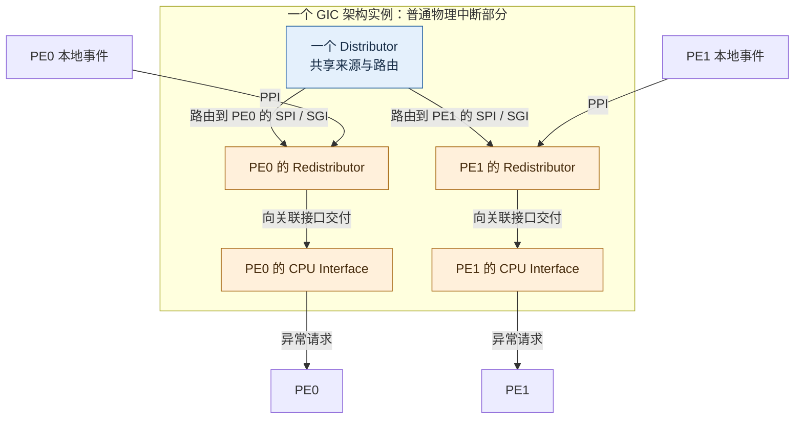
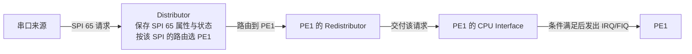
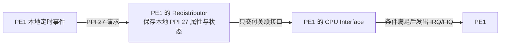
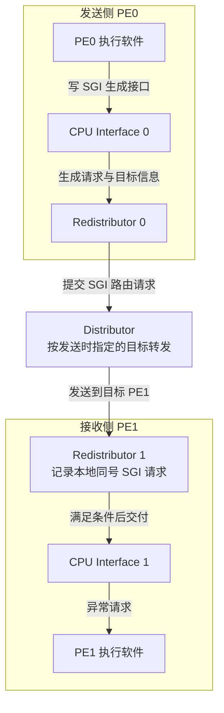
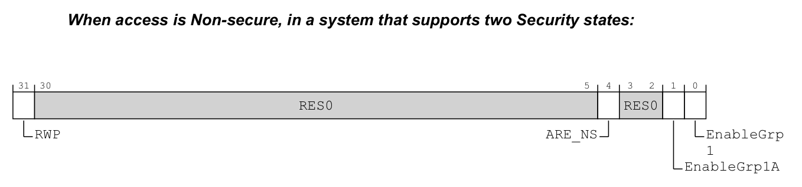
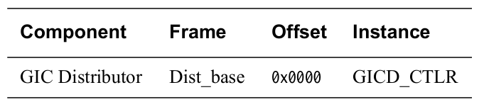
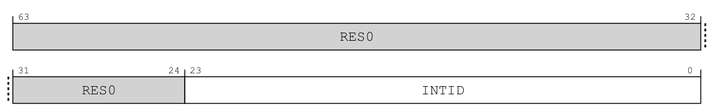
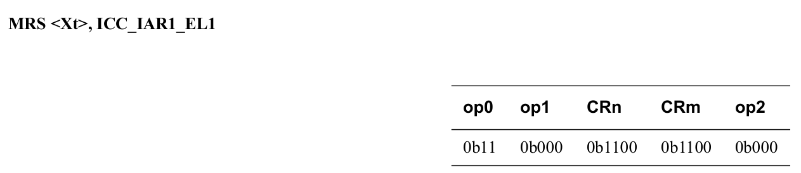
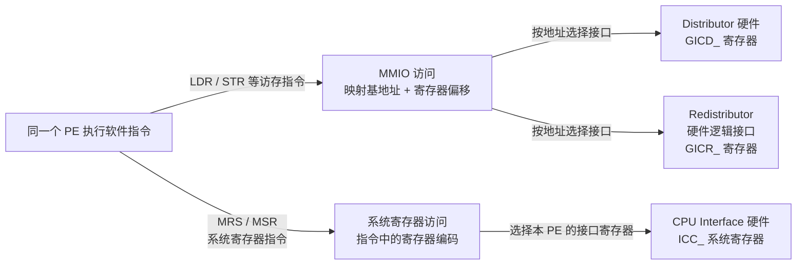

# 第3章\_多核角色与架构编程接口

## 3.1\_增加第二个处理器后\_什么必须拆开

**讲解层次：概念层。** 本节至 3.3 节依据 IHI0069 H.b 中适用于 GICv3.0 的规则，建立逻辑角色与状态归属；3.4 节建立架构编程接口。下一章把这些逻辑角色映射到 GIC-600 r1p6 的物理功能块，再追踪实际配置与交付路径。PE0、PE1 是教学编号。

前两章建立了中断控制器与芯片的关系。本章把 **通用中断控制器（Generic Interrupt Controller，GIC）** 的 v3.0 规则放到两个处理器的场景中：同一个串口请求可以交给其中一个处理器，但每个处理器自己的定时事件，不能因为编号相同就混成一个来源。

Arm 文档常把一个能执行指令的处理实体称为 **处理单元（Processing Element，PE）**。本章用 PE0、PE1 表示两个教学对象，不是在声明 RK3588 的真实硬件编号；**中央处理器（Central Processing Unit，CPU）** 接口是每个 PE 对应的中断接收与处理接口。

以下采用已经开启 **亲和性路由（Affinity routing）** 的 GICv3.0 物理中断模型：硬件用处理器的层次坐标识别接收目标，坐标的具体编码到第十一章再展开。旧式兼容操作的寄存器归属可能不同，不能把本章的分工无条件搬到所有模式。

若把所有状态混在一个全局对象中，就无法同时表达“PE0 正在处理自己的定时事件”和“PE1 尚未确认自己的定时事件”。相反，若把所有配置复制到每个 PE，又难以表达一个外设来源应当只交给一个目标。于是必须先区分共享来源与每个 PE 私有的状态。

## 3.2\_先分清三种来源\_再看编号范围

**第一种**来源是芯片里的串口、网络等外设，请求可以被路由到适当的 PE。它称为 **共享外设中断（Shared Peripheral Interrupt，SPI）**。“共享”指该来源在 GIC 实例范围内统一管理，可以选择接收目标；不表示广播给所有 PE。

**第二种**来源与某个 PE 固定关联，例如该 PE 的定时事件。它称为 **私有外设中断（Private Peripheral Interrupt，PPI）**。两个 PE 可以使用相同的编号表示各自的定时中断，但它们不是同一份待处理状态。

**第三种**来源是软件希望通知另一个 PE，例如提示它检查新任务。它称为 **软件产生中断（Software Generated Interrupt，SGI）**。软件写控制器提供的生成接口，硬件把请求交给指定接收者；待办工作的详细内容仍需另外保存。

来源编号称为 **中断标识符（Interrupt Identifier，INTID）**。在本专题的 GICv3.0 范围内，前三类按以下区间区分：

| 类型 | 已解释的来源 | INTID 范围 | 确定状态时还需要什么 |
| --- | --- | --- | --- |
| 第三种 | SGI | <span style="color:var(--typora-code-color-b42318, #b42318)">0～15</span> | 接收目标 PE；同号请求不是按发送者分别计数 |
| 第二种 | PPI | <span style="color:var(--typora-code-color-b42318, #b42318)">16～31</span> | 该请求所属 PE |
| 第一种 | SPI | <span style="color:var(--typora-code-color-b42318, #b42318)">32～1019</span> | 系统中的具体来源；实际实现通常只覆盖其中一部分 |

编号范围是架构允许的空间，不是“芯片实际有这么多外设”。<span style="color:var(--typora-code-color-b42318, #b42318)">1020～1023 是特殊返回值空间，不能分配给普通外设</span>。更大的消息中断空间稍后由具体问题引出；GICv3.1 新增的扩展范围不纳入 RK3588 的 v3.0 主线。

> 官方对照：[规范 IHI0069 H.b](https://developer.arm.com/documentation/ihi0069/hb)，2.2 INTIDs（2-35）与 4.3 Private Peripheral Interrupts、4.4 Software Generated Interrupts、4.5 Shared Peripheral Interrupts；先核对 GICv3.0 编号区间，再看各类型的归属规则。概览 198123 第 4 章的 Interrupt types 是更短的复习入口。

## 3.3\_三种接口怎样分工

**讲解层次：概念层。** 以下 Distributor、Redistributor、CPU Interface 均指 GICv3.0 的架构逻辑组件；图中的组件数量和连线不直接规定产品物理分块。

刚才的三类来源留下两个不同的问题：一个共享来源怎样选接收者，选定之后怎样与该接收者自己的请求汇合？如果只把几个模块排成一列，会让人误以为每类请求都从同一个入口进入；如果只说“每个模块管一些配置”，又看不见请求怎样到达处理器。下面先确定组件与 PE 的对应关系，再沿具体请求走一遍。

### 3.3.1\_一个控制器实例怎样配上多个处理器

一个 GIC 架构实例包含一个 **分发器（Distributor）**，承担共享来源及目标路由职责；每个受支持 PE 分别对应一个 **再分发器（Redistributor）** 逻辑组件，承担该 PE 的本地来源和交付职责，还对应一个 **处理器接口（CPU Interface）**，承担该 PE 的接收控制及软件交接职责。本节先画已经建立的 SPI、PPI 和 SGI 所需结构。

下图把两个接收侧并排画出。大框表示同一个 GIC 架构实例，蓝色是系统共享组件，橙色是与各 PE 对应的组件；上下位置用于阅读，没有表示父子包含或芯片上的真实距离。



这张图只画接收方向，SGI 的发送方向在 3.3.4 单独补齐。“一个 Distributor”以 **一个 GIC 实例** 为范围，不是在断言任何 SoC 都只能有一个中断控制器。“每 PE 一个 Redistributor”是架构逻辑对应关系，实际产品可以把多个逻辑接口放在同一个物理功能块中。

在这张架构逻辑图中，Redistributor 与 Distributor 是 GIC 的不同功能组件；接收 SPI 不意味着 Redistributor 另行管理一套 SPI 来源配置。这里要区分 **功能职责** 与 **请求经过谁**：一条请求可以先后经过两者。实际产品还可以把部分逻辑功能放进同一物理块，后面的 GIC-600 实例会说明这种实现划分。

> 图与正文依据：[规范 IHI0069 H.b](https://developer.arm.com/documentation/ihi0069/hb)，3.1 The GIC logical components，图 3-1 与图 3-2（3-42～3-43）。本图是据规范重新组织的教学逻辑图，未画消息翻译部分，不是 RK3588 硅片版图。

### 3.3.2\_每个组件接收什么\_向哪里交付

**Distributor 接收共享外设的 SPI 请求**，保存这个来源的使能、优先级、触发方式、中断组、请求状态和目标路由信息，再把请求送往所选 PE 的 Redistributor。它还接收发送侧提出的 SGI 请求，按请求中的目标信息转发给一个或多个目标 Redistributor。除此以外，它提供一些整个 GIC 实例共享的控制接口；“提供公共配置”是另一项职责，不能拿来替代上面的输入与输出描述。

**Redistributor 接收已经路由到关联 PE 的 SPI、SGI，以及直接面向该 PE 的 PPI**。它管理该 PE 的 SGI/PPI 单独属性和状态，把本地与已路由来的请求组织起来，向关联 CPU Interface 交付。后面的消息中断同样需要这个接收侧，并增加内存表与电源交接接口。这里管理的“本地状态”，指“PE0 的 PPI 27”和“PE1 的 PPI 27”能够分别记录，不能因为编号一样就合成一份。

**CPU Interface 是与本 PE 关联的硬件中断控制逻辑。** 它接收关联 Redistributor 提供的中断，结合本 PE 的组接收许可、优先级门限和正在处理的优先级，决定是否发出 **普通中断请求（Interrupt Request，IRQ）** 或 **快速中断请求（Fast Interrupt Request，FIQ）** 信号。这里的判断与信号输出由硬件完成；IRQ/FIQ 表示向 PE 提出的异常请求，不能证明软件已经读走外设数据。

**软件通过寄存器访问 CPU Interface。** PE 响应请求并进入软件异常处理路径后，执行相应寄存器读写指令，由 CPU Interface 硬件完成来源确认、优先级释放以及适用模式下的停用。这些操作的访问方式在下一节说明，状态变化在第四、五章展开。发送 SGI 时，同样由 PE 上的软件执行生成操作，CPU Interface 硬件承接该操作并把请求交给路由侧。

以串口为例，CPU Interface 管理中断的交付及相关控制状态；PE 执行异常入口和驱动代码，由驱动读取串口数据寄存器、取走实际字节。图中把 CPU Interface 与 PE 的执行职责分别画出，是为了区分这两项功能；CPU Interface 可以集成在处理器核内部，后面的 [GIC-600 功能块图](P04_GIC600的物理实现_从逻辑映射到输入输出.md#4.1_从GICv3到GIC600_逻辑角色怎样落到物理块)给出了具体对应关系。

### 3.3.3\_SPI先选择目标\_PPI直接进入本地

先固定一个教学请求：串口的 SPI 65 已配置给 PE1。这里的 65 只为说明对象关系，不是 RK3588 串口的实测编号。



SPI 经过目标 Redistributor，并不在那里变成一个 PPI。这个 SPI 的来源使能、优先级和路由仍按 SPI 编号统一配置；不能先在 Distributor 配成 PE1，又期待 PE1 的 Redistributor 为同一来源另配一个 PE0 目标。

现在换成 PE1 的本地定时事件，教学编号为 PPI 27：



这条路径没有先到 Distributor 选择 PE。PPI 的归属已经由它与 PE 的关联确定，不能使用 SPI 路由配置把它任意改派出去。若 PE0 也有 PPI 27，那是另一份本地实例，是否同时发生取决于各自的事件源，不是 GIC 把一条 PPI 广播成两份。

这两张图表达 **架构逻辑请求路径**，省略确认和完成方向；并没有声称芯片内部必须为每根箭头铺设一根独立导线。具体产品可以用互连事务承载这些交互。

### 3.3.4\_SGI的发送侧和接收侧都要画出来

SGI 的来源是软件，不能只画“目标 Redistributor 收到 SGI”而省略它从哪里来。固定 PE0 通知 PE1 的场景，发送过程如下：



这里 **SGI 经过 Distributor 转发**，而 **SGI 的接收状态和单中断属性属于目标 PE 的 Redistributor**。两句话同时成立：前一句说请求经过谁，后一句说配置与状态属于谁。不能因为 SGI 的配置是本地的，就断言它和 PPI 一样不经过 Distributor。

<span style="color:var(--typora-code-color-b42318, #b42318)">发送者还可以指定多个接收者</span>。此时 Distributor 将请求送往相应的多个 Redistributor，各接收 PE 处理自己的 SGI 实例；这与“一个 SPI 从候选 PE 中选一个接收者”不同。固定目标在[第十一章](P11_SPI目标选择与每PE状态.md#11.2_怎样取得目标PE的硬件亲和坐标)展开，SGI 的目标列表与广播条件在[第十二章](P12_SGI核间通知与电源交接.md#12.1.2_目标列表与广播_同名IRM为什么有不同含义)展开。

> 三条请求路径依据：[规范 IHI0069 H.b](https://developer.arm.com/documentation/ihi0069/hb)，3.1（3-42）逐项描述 SPI、PPI、SGI 的路径，图 3-2 的脚注 b 再次指出 SGI 经 Distributor 路由。箭头表示架构组件之间的交付关系，不以寄存器访问路径代替中断请求路径。

### 3.3.5\_配置的作用范围不会改写请求路径

现在再问“改谁的配置会影响谁”，就有了清楚的对象：

| 配置属于哪一层 | 配置对象与作用范围 | 不能据此推出什么 |
| --- | --- | --- |
| Distributor 的 SPI 单中断配置 | 某个 SPI 编号的使能、优先级、组别和目标 | 不是给每个 PE 各建一张 SPI 私有使能表 |
| Distributor 的实例级共享控制 | 例如整个 GIC 实例的中断组许可 | 对 PPI 有约束，不等于 PPI 请求绕道经过 SPI 路由 |
| 对应 Redistributor 的本地配置 | 该 PE 的 SGI/PPI 属性和状态，以及接收侧参与、电源状态 | 接收 SPI 不等于拥有这个 SPI 的独立路由配置 |
| 对应 CPU Interface 的接收配置 | 该 PE 的组接收许可、门限与处理交接 | 接收门限不是某个来源的独立优先级值 |
| PE 自身的异常控制 | 当前处理器执行状态是否允许相应异常进入 | 控制器已发出请求，不等于 PE 已执行处理程序 |

例如，一个 PPI 已在本地使能，仍可能因为它所属组被全局禁止而不能交付。起作用的是一项公共许可；请求入口依然是本地 Redistributor。第九章用[独立的配置作用范围图](P09_权限_安全分组与异常路由.md#9.3.2_硬件结构与配置归属先对齐)说明这种共同约束，不把它画成每种请求都必须经过的串行筛选流水线。

反过来也不能说“Redistributor 的配置绝不影响 SPI”：它的接收侧参与状态可能影响某个 PE 是否适合参加 SPI 的候选选择。**谁持有一个 SPI 的路由属性** 与 **某个 PE 是否有资格接收** 是两个问题，第十一章会分别追踪。

试着只改一个条件：把 SPI 65 从 PE1 改到 PE0，是否也把 PE1 的 PPI 27 搬过去？答案是否定的。改变的是共享来源的目标属性，PPI 27 的本地来源、配置和状态没有随之转移。这就是把“按来源编号配置”和“按 PE 保存状态”分开的价值。

> 官方对照：[规范 IHI0069 H.b](https://developer.arm.com/documentation/ihi0069/hb)，2.1 The Distributor and Redistributors、4.7.2 Interaction of group and individual interrupt enables（4-69～4-70）。先核对配置对象，再核对使能条件，不能由控制范围推导电路连接。

## 3.4\_软件怎样访问GIC\_地址访问与系统寄存器

**讲解层次：概念层（架构编程接口）。** 先依据 IHI0069 H.b 的寄存器规则区分地址访问与指令编码访问，暂不把 GICD/GICR 地址窗口等同于物理模块；具体落点在下一章映射。

前面已经分清 Distributor、Redistributor 和 CPU Interface 的硬件职责，现在要回答：**PE 上的软件究竟怎样读写它们？这里的两种方式，就是 MMIO 访问和系统寄存器访问。** 区别在于软件用什么指令、怎样指定要访问的寄存器。

1. **内存映射输入输出（Memory-Mapped Input/Output，MMIO；官方常写 Memory-mapped I/O）访问**：用内存地址定位硬件寄存器，再通过读写事务访问。本章 Distributor 的 `GICD_`、Redistributor 的 `GICR_` 寄存器采用这种方式。
2. **系统寄存器访问（System register access）**：用架构定义的系统寄存器编码指定目标，通过专门的系统寄存器指令访问。本章 CPU Interface 的 `ICC_` 寄存器采用这种方式，不需要提供一个 GIC 设备基地址。

这里的 **寄存器（Register）** 指 GIC 向软件提供的硬件状态与控制接口。两种方式都由 PE 执行软件指令，访问的也都是硬件；CPU Interface 使用系统寄存器接口，并没有变成软件模块。读写可能返回状态、改变配置，甚至推进状态机，所以不能把这些寄存器当作没有额外副作用的普通变量。

以下继续采用本章的 GICv3.0 物理中断模型，并固定 **AArch64（64 位执行状态）**、CPU Interface 系统寄存器接口已启用且当前软件具有访问权限。旧式兼容接口另有条件，不能把这里的对应关系推广到所有 GIC 版本和运行模式。

先看 **MMIO 怎样按地址找到寄存器**。芯片给 Distributor 分配物理基地址；操作系统可以把这段设备空间映射到虚拟地址，随后使用符合设备属性、访问宽度和顺序要求的读写操作。它使用地址寻址，但访问目标仍是设备寄存器，不是普通内存中的数据。

例如，`GICD_CTLR` 是 **分发器控制寄存器（Distributor Control Register）**，位于 Distributor 寄存器块的偏移 `0x0000`，宽度为 32 位。假设通用寄存器 `X0` 已保存可用的 Distributor 映射基地址，用加载指令 `LDR` 发起一次读取，形式可以写成：

```asm
// AArch64 访问形式示例：假定设备映射及访问权限已经建立。
// X0 保存映射基地址，W1 接收读出的 32 位值。
LDR W1, [X0, #0x0000]
```

方括号内的 `X0 + 0x0000` 指定访问地址。PE 发出读事务，由地址映射和互连把它送到 Distributor 的对应接口，返回值写入 `W1`。这里 `X0` 是处理器的 64 位通用寄存器，`W1` 是通用寄存器 `X1` 的低 32 位视图；这些是指令的地址或数据操作数，不是另一组 GIC 寄存器。该片段只演示寻址，不是包含映射、屏障与错误处理的完整驱动。

再看 **系统寄存器访问怎样指定目标**。`ICC_IAR1_EL1` 是 **中断确认寄存器 1（Interrupt Controller Interrupt Acknowledge Register 1，IAR1）**，属于当前 PE 的 CPU Interface。软件通过 `MRS` 指令读取它：

```asm
// AArch64 访问形式示例：读取会执行中断确认，不能当作无副作用的探测。
// X2 接收确认返回值；这条指令没有使用 GIC 的映射基地址。
MRS X2, ICC_IAR1_EL1
```

汇编器把 `ICC_IAR1_EL1` 这个架构名称编码进系统寄存器指令，PE 据此访问相应硬件接口，将返回值放进通用寄存器 `X2`。这里没有 `[基地址 + 偏移]` 这样的访存操作数，也不是先把字符串当作地址。`MRS`、`MSR` 都是指令助记符，不是通用 C 函数；实际软件可以用封装这些指令的访问器，但封装不改变底层访问方式。

这次读取还说明了“访问形式”和“操作语义”的区别：MRS 说明怎样访问，而 IAR1 的定义决定读取具有确认副作用。若取得一个有效来源，就产生后续处理与完成义务；确认、清源和结束不能用上面这一行代替，完整配对在[第六章](P06_一次中断的状态转换与完成协议.md#6.3_确认_清源_优先级下降与停用)展开。

两次访问都由 PE 执行指令，但选择目标的依据不同：一次把设备地址交给访存路径，一次把系统寄存器编码交给本核接口。要判断前面的解释是否符合接口定义，还需要回到原寄存器条目，核对地址或编码、位布局，以及读操作的实际含义。

刚才的例子分别读取控制值和确认来源。现在把手册的寄存器条目摊开，先看原位布局和访问表，再逐项判断这两次读取有什么不同。本专题的 **原图节选** 保留手册中的位号、英文标签和排列；图后的 **中文字段对照** 是依据同一条目写出的释义；最后的比较表才是本文归纳。三者各有用途，不能把归纳表当作原件。

读图前只需要认清三个标记。**只读（Read-Only，RO）** 表示接口不允许软件写，**可读写（Read/Write，RW）** 表示接口允许读写；它们都不能保证访问没有副作用。**保留零（Reserved, RES0）** 标明架构保留且按零处理的位置，不是可以由软件另作他用的空白字段。`Dist_base` 是 Distributor 寄存器块的基地址符号，不是某颗 SoC 的固定地址。

**先读 GICD_CTLR：地址找到寄存器，访问视图决定怎样解释位。** 同一个寄存器在不同安全状态下有不同布局；安全状态用于划分访问权限，第九章再完整建立其模型。本次只展示“系统支持两种安全状态、由 Non-secure 侧访问”的视图，并且只读取，不据此编写初始化值。



> 原图节选：[IHI0069 H.b](https://developer.arm.com/documentation/ihi0069/hb)，12.9.4 **GICD_CTLR, Distributor Control Register**，印刷页 12-546；字段的跨页说明见 12-546～12-547，RWP 的共同定义见 12-544。该位布局没有单独图号，不能把章节号写成图号。

原图从 bit 31 排到 bit 0。先找到最左侧的 `RWP`，再看其右侧大段 `RES0`，最后读低位开关；不要看到低位有多个使能名称，就把它们理解成几个可以无条件同时使用的开关。

| 位号 | 原图字段名 | 中文字段对照：定义与当前视图的条件 |
| --- | --- | --- |
| `[31]` | `RWP` | **寄存器写入待完成（Register Write Pending）**，RO；1 表示它跟踪的写入效果仍可能在传播，0 表示这些效果已对相关逻辑组件可见。它只跟踪规范指定的组禁止、路由／安全控制及清使能写入，不是全部寄存器写入的完成标志 |
| `[30:5]` | `RES0` | 保留零；不能从其他安全视图复制这里的字段含义 |
| `[4]` | `ARE_NS` | 非安全侧的亲和路由使能；本视图中它是安全视图相应字段的别名。未实现非安全侧旧式兼容接口时固定读 1、写入被忽略；亲和路由的目标含义到第七章建立 |
| `[3:2]` | `RES0` | 保留零 |
| `[1]` | `EnableGrp1A` | `ARE_NS=1` 时控制非安全组 1 的使能；`ARE_NS=0` 时此位置为 RES0 |
| `[0]` | `EnableGrp1` | `ARE_NS=0` 时控制非安全组 1 的使能；`ARE_NS=1` 时此位置为 RES0 |

下面是同一条目的原访问表。表头 `Component` 说明组件，`Frame` 说明偏移所加的窗口基址，`Offset` 给出偏移，`Instance` 给出对应寄存器。



> 原表节选：IHI0069 H.b，12.9.4 的 **Accessing the GICD_CTLR**，印刷页 12-549；寄存器宽度 32 位见同条目 Attributes。访问表本身没有单独表号。

把 `Dist_base` 与 `0x0000` 相加，就得到本例 `LDR W1, [X0, #0x0000]` 所使用的地址；32 位的返回值再按上述视图拆字段。即使访问表给出 RW，字段表中的 `RWP` 仍是 RO。完整视图选择和 RWP 跟踪范围见[第十章](P10_初始化顺序与硬件完成握手.md#10.3_写入顺序_内存可见与硬件完成是三个问题)。

**再读 ICC_IAR1_EL1：编码选择接口，读操作同时承担确认。** 先看原件的 64 位布局。手册分两行画出高、低各 32 位，这是同一个寄存器，不是两个 32 位寄存器。



> 原图节选：[IHI0069 H.b](https://developer.arm.com/documentation/ihi0069/hb)，12.2.14 **ICC_IAR1_EL1, Interrupt Controller Interrupt Acknowledge Register 1**，印刷页 12-255，Field descriptions；本条目没有单独图号。

| 位号 | 原图字段名 | 中文字段对照：先保留原定义，再限定解释 |
| --- | --- | --- |
| `[63:24]` | `RES0` | 保留零；原图把 `[63:32]` 和 `[31:24]` 分行绘制，字段说明将两段合并 |
| `[23:0]` | `INTID` | 返回能够向当前 PE 发出通知、且可在当前安全状态和异常级确认的最高优先级待处理中断编号；不满足可观察条件时返回特殊编号，不能一律当成外设来源 |
| `[23:16]` 的实现条件 | 仍属于原图的 `INTID` 字段 | INTID 可以实现 16 位或 24 位，由 `ICC_CTLR_EL1.IDbits` 或 `ICC_CTLR_EL3.IDbits` 描述；只实现 16 位时，这 8 位为 RES0。它是字段的条件说明，不是原图另定义了一个新字段 |

现在看原件紧随其后的访问编码表：



> 原表节选：IHI0069 H.b，12.2.14 的 **Accessing ICC_IAR1_EL1**，印刷页 12-256。表中的 `op0`、`op1`、`CRn`、`CRm`、`op2` 是系统寄存器指令的编码字段，不是五个内存地址；汇编器根据 `ICC_IAR1_EL1` 填入这些固定编码。

原条目的 Purpose 另行规定了读取具有中断确认效果。这个动作不能只从 `INTID` 位图或 RO 属性推出：取得普通有效编号时，读取同时建立后续处理与完成义务；取得特殊值时，必须先判断其语义，不能照普通来源执行结束操作。1020～1023 是整个架构的特殊编号空间，**不表示 IAR1 在本节条件下会返回其中每一个值**，具体判断在[第六章](P06_一次中断的状态转换与完成协议.md#6.6_没有真正确认的编号不能按正常中断结束)展开。

访问也有条件：本卷采用已实现 GICv3、系统寄存器接口已开启、权限配置允许物理接口访问的情形。**异常级 0（Exception Level 0，EL0）** 是这里需要先认清的最低特权执行层，不能直接读取该接口；其他异常级还可能因访问控制而陷入异常，或者被路由到虚拟接口。原条目 12-256～12-257 的访问规则给出这些分支，第九、十章再解释权限控制和初始化。这里的 `MRS` 片段不替代该前提检查。

看过两份原件后，才能把当前差异收拢为复习表：

| 比较项 | MMIO 访问：本例 `GICD_CTLR` | 系统寄存器访问：本例 `ICC_IAR1_EL1` |
| --- | --- | --- |
| 怎样指定目标 | 寄存器块的映射基地址 + 寄存器偏移；本例为 `Dist_base + 0x0000` | 架构定义的系统寄存器编码，<span style="color:var(--typora-code-color-b42318, #b42318)">汇编中通常写寄存器名称</span> |
| AArch64 指令形式 | `LDR` 读取、`STR` 写入等访存指令 | `MRS` 读取、`MSR` 写入系统寄存器；本例只允许读 |
| 是否使用设备映射地址 | 使用；物理地址由芯片集成决定，软件可能使用映射后的虚拟地址 | 不用一个 MMIO 地址选择 `ICC_` 寄存器 |
| 本章的 GIC 接口 | Distributor：`GICD_`；<br />Redistributor：`GICR_` | 当前 PE 的 CPU Interface：`ICC_` |
| 返回宽度 | 32 位，按选定安全视图解释 | 64 位，低 24 位为带实现条件的 INTID 字段 |
| 本次读取的作用 | 观察控制／状态值，含 RWP | 取得确认结果；普通有效来源伴随确认动作 |
| 不能由表面属性推出的保证 | RW 不表示每个字段都可写，RWP 也不跟踪所有写入 | RO 不表示读取没有副作用，字段有 24 位也不表示实现支持全部编号 |



这张图只画 **软件编程访问路径**，箭头表示软件怎样选择硬件接口，不表示 SPI、PPI、SGI 请求的传播，也不规定各功能块在芯片中的摆放位置。尤其要注意：Redistributor 虽然按 PE 对应，其编程接口仍是 MMIO；不能根据“每 PE 一份”判断访问方式。

现在再判断“给 GIC 基地址加一个偏移，就能读 CPU Interface 的确认寄存器”为什么不成立：在这里选定的系统寄存器接口中，IAR1 由指令编码选择，没有可随意换算的 MMIO 偏移。对某个内存地址执行 LDR，不会因此变成对 `ICC_IAR1_EL1` 的系统寄存器读取，还可能访问完全无关的设备。下一章继续把这些逻辑接口放回 GIC-600 的物理功能块，分清访问接口与电路组织。

> 官方对照：[规范 IHI0069 H.b](https://developer.arm.com/documentation/ihi0069/hb)，12.1.2 Relation between System registers and memory-mapped registers、12.1.7 GIC System register access、12.2.14 ICC_IAR1_EL1，以及 12.8/12.10 的 Distributor/Redistributor register map。`GICD_CTLR` 的偏移、32 位宽度见 12.9.4。分别查看系统寄存器编码和内存映射，不把两种目录当作同一基址下的偏移表。

上一篇：[从控制器规则到芯片与软件身份](P02_从控制器规则到芯片与软件身份.md#2.1_已经知道职责_为什么还要分清名称)

[专题大纲](大纲.md#1.2_因果阅读地图)

下一篇：[GIC600的物理实现_从逻辑映射到输入输出](P04_GIC600的物理实现_从逻辑映射到输入输出.md#4.1_从GICv3到GIC600_逻辑角色怎样落到物理块)
