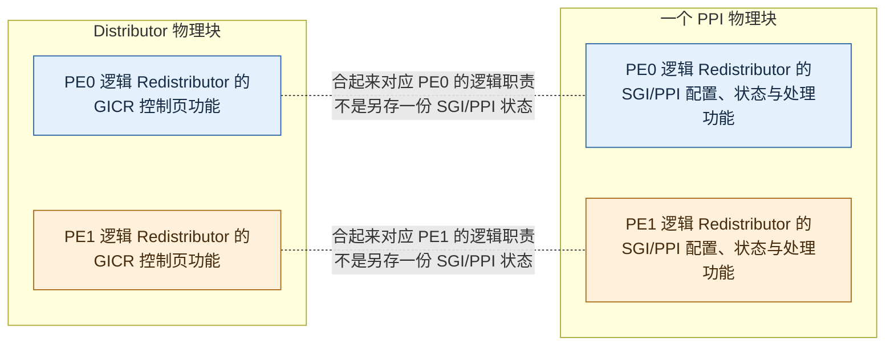
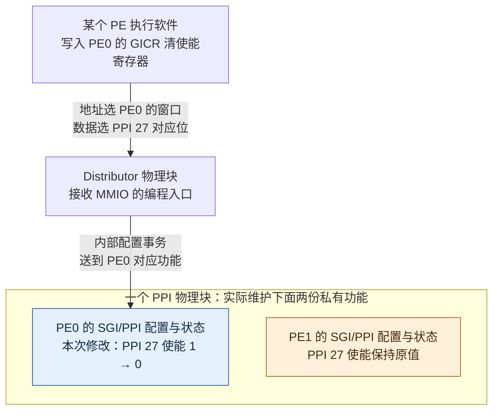
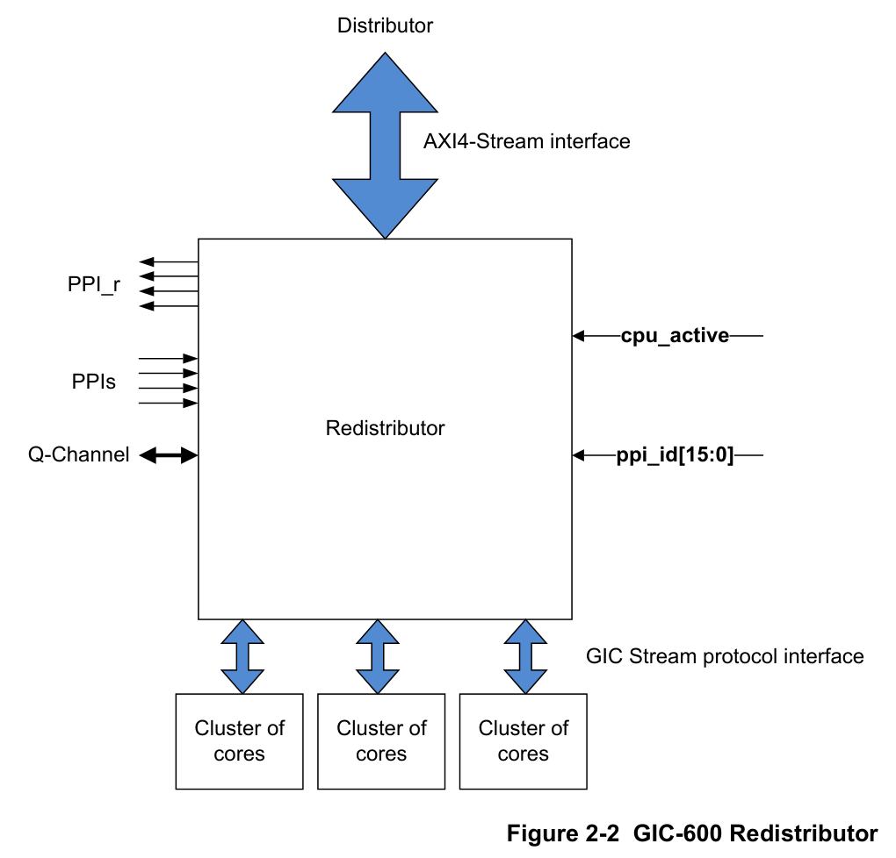
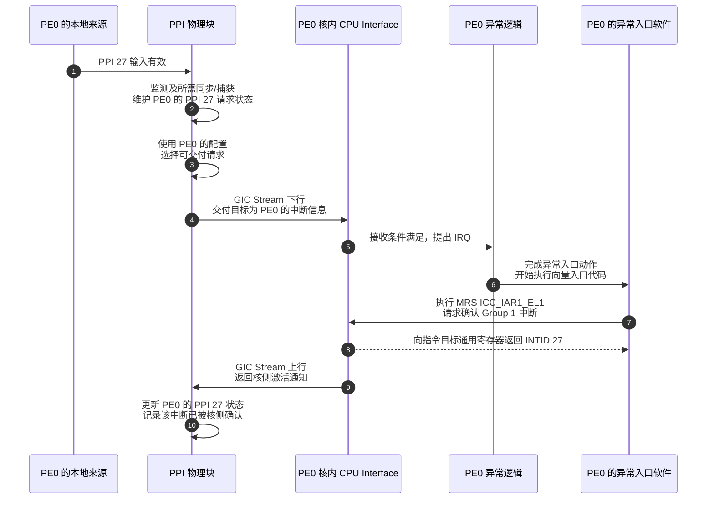
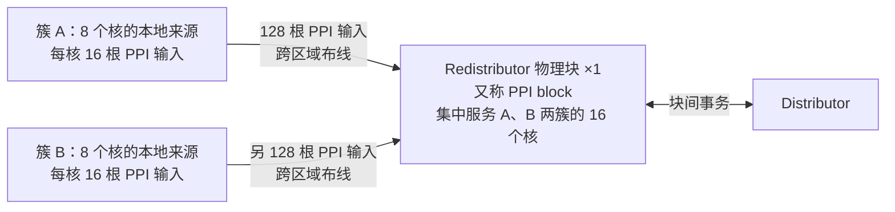
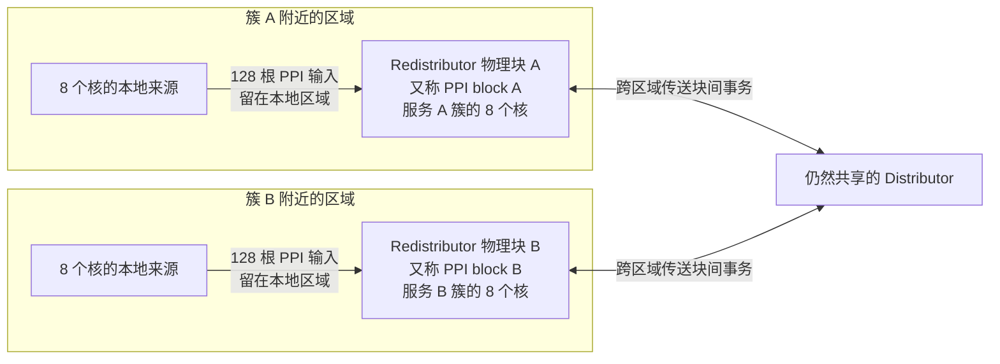
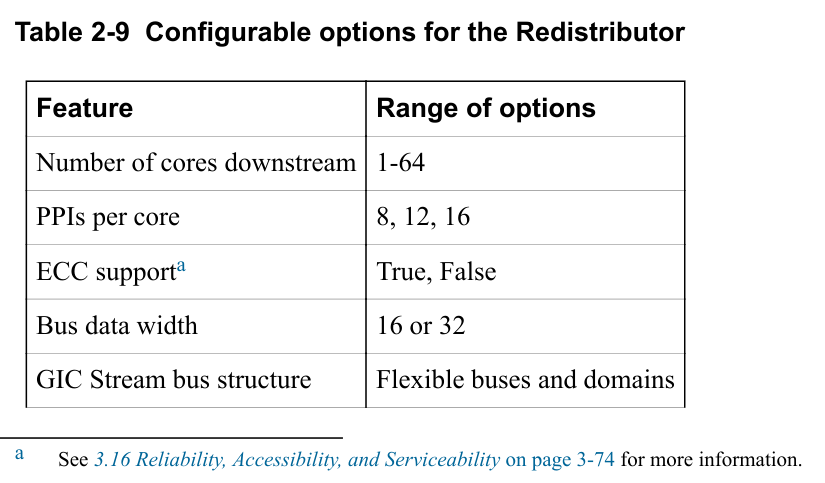
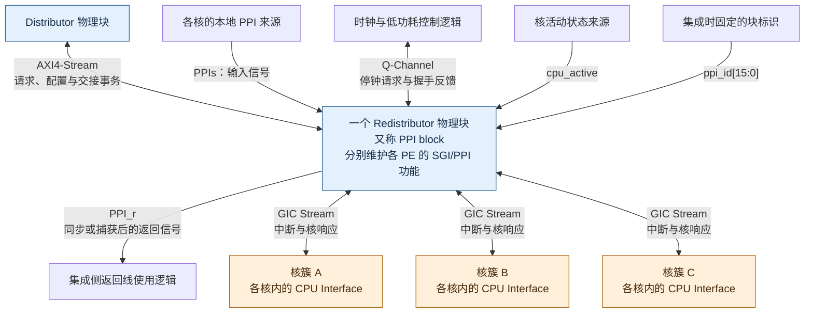
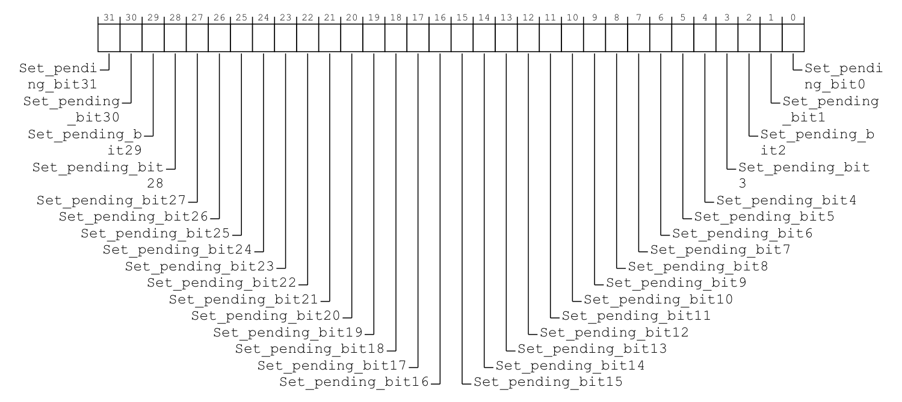

# 第4章\_GIC600的物理实现\_从逻辑映射到输入输出

## 4.1\_从GICv3到GIC600\_逻辑角色怎样落到物理块

**讲解层次：概念到实现的映射。** 左侧概念以 GICv3.0 架构为准，右侧实现限定为 GIC-600 r1p6。先建立名称、数量和功能落点，再进入配置、请求及布局细节。

前面的架构图规定：**每个 PE 对应一个逻辑 Redistributor，以及自己的 CPU Interface。** 软件也已经能用 MMIO 访问 `GICR_` 寄存器。现在需要把这两件事落到电路上：软件写入 PE0 的私有中断配置，究竟改了哪里的状态？这个状态所在的电路怎样把请求交给 PE0？如果一个物理块服务多个 PE，“每 PE 一份”又体现在哪里？

下面固定 GIC-600 r1p6，以两个 PE 共用一个 PPI 物理块为教学实例。先把每个 PE 的逻辑 Redistributor 对应到实际功能位置，再追踪同一个 PPI 27 的配置与交付；最后讨论物理布局与集成参数。RK3588 的实际数量在 4.1.5 节与原件对照。

### 4.1.1\_规范角色与产品物理块怎样逐项对应

先对齐名字。GIC-600 手册把维护一组核的 SGI/PPI 功能的物理块称为 **Redistributor block**，并说明它也叫 **PPI block**。这两个名字在该产品手册中指同一种物理模块；前面“每 PE 一个 Redistributor”使用的是 GICv3 的架构概念。后文将产品模块统一称为 **PPI 物理块**，将规范角色称为 **逻辑 Redistributor**，保留原手册名称供对照。

**GIC-600 确实通过 PPI 物理块实现每 PE 逻辑 Redistributor 的 SGI/PPI 功能。** 完整逻辑角色的其他职责还要映射到 Distributor 物理块，下面逐项列出；不能把“每 PE 一个”直接改成“每 PE 一颗独立器件”，也不能把 PPI 块放在这些假想器件之外，再画成只负责收线的模块。

还需要看完整的 GICR 地址空间。GICv3 为每个 PE 提供控制页与 SGI/PPI 页；GIC-600 把前者的功能放在 Distributor 物理块，后者的功能放在 PPI 物理块。**这个划分说明不同寄存器功能放在哪里，不是在两块之间复制两套同名状态。** CPU Interface 则位于相应处理器核内。

完整映射还要提前定位一种后面才展开的来源：**局部性专属外设中断（Locality-specific Peripheral Interrupt，LPI）**，用于大量消息来源，相关配置与挂起状态由内存表承载。本章只交代其处理功能落在哪个物理块，表的组织及缓存交接到消息中断章再推导，不能用它代替当前 SGI/PPI 状态模型。

| 软件／架构中的对象 | GIC-600 r1p6 的实际功能落点 | 两个 PE 共用一块时怎样理解 |
| --- | --- | --- |
| Distributor 的 SPI 来源属性、状态、目标路由及全局组控制 | Distributor 物理块 | SPI 按来源保存；全局组规则由该物理块承担，不会因此改写各 PE 的私有使能位 |
| PE0、PE1 各自的 GICR SGI/PPI 页 | 同一个 PPI 物理块中各自对应的私有功能 | 对 PE0 页的访问修改或读取 PE0 的状态；PE1 的状态仍单独维护 |
| PE0、PE1 各自的 GICR 控制页 | Distributor 物理块 | 页入口按 PE 出现，但部分字段可以指向共享状态，不能据页数推断所有存储都复制了两份 |
| 各 PE 的架构 LPI 功能；其内存表将在第十三章建立 | Distributor 物理块，使用该芯片共用的 LPI 缓存 | 物理缓存集中不取消按 PE 区分的挂起状态；不是另在 PPI 块中放置同一份 LPI 缓存 |
| PE0、PE1 各自的 CPU Interface | 各自处理器核内 | 每个 PE 有自己的接收控制和系统寄存器访问接口 |

表中的 SGI/PPI 页、控制页与 LPI 三行说明逻辑 Redistributor 的功能落点；最后一行是与它配合的另一种架构组件，**CPU Interface 不属于 Redistributor**。在当前两个 PE 的例子中，有两个逻辑 Redistributor、两个 CPU Interface、一个 PPI 物理块；逻辑对象数与物理块数分别计数。

下面只展开已经需要的控制页与 SGI/PPI 页对应关系，LPI 细节留到第十三章。两个外框表示产品物理块；内部小格按功能划分，不断言内部有边界独立的硬件子模块。相同颜色和虚线只表示“同属哪个逻辑 Redistributor”，没有请求、读写或状态复制流过这些虚线。

沿蓝色看，是 PE0 逻辑 Redistributor 的控制页与私有中断功能；沿橙色看，是 PE1 的对应功能。图中没有增加两个外置再分发器，CPU Interface 也没有作为其中的一部分着色。接下来的配置图和请求时序图再画实际通信，检验同一份状态怎样被软件修改、被硬件使用。

> 功能落点依据：[GIC-600 r1p6 TRM](https://developer.arm.com/documentation/100336/0106)，1.2 Components（印刷页 1-13）明确 SGI 页功能在产品 Redistributor，所有核的 command and control pages 在 Distributor；2.2 Redistributor（2-29）说明 GICR 经 Distributor 的 ACE-Lite 从端口编程。控制页部分字段共享的产品限制见 3.6.3（3-59）及附录 B 表 B-1（Appx-B-204）。这是该产品的实现划分，不是所有 GICv3 产品必须采用的电路布局。

### 4.1.2\_追踪私有配置访问\_软件到底设置了谁

**讲解层次：实现层。** 以下追踪 GIC-600 r1p6 的访问入口与最终状态位置，仍用前述两个 PE 的教学配置。

先看一个具体动作：软件要关闭 **PE0 的 PPI 27**，但保持 PE1 的同号中断不变。软件选择 PE0 的 GICR 寄存器窗口，再向它的 SGI/PPI 页中对应的清使能位写 1；置／清使能寄存器的原位布局与索引在下一章的 5.1 节展开。这里先追踪这次访问的终点。

**在 GIC-600 中，PE0 和 PE1 各自的 SGI/PPI 配置与状态，由服务它们的 PPI 物理块维护。** 软件对 PE0 的这次写入，经 Distributor 的编程入口和内部互连，到达 PPI 块中属于 PE0 的功能，最终关闭 PE0 的 PPI 27；PE1 的对应使能状态保持原值。软件正在设置的“PE0 的 Redistributor SGI/PPI 寄存器”，与物理上被修改的“PPI 块内 PE0 的配置状态”，是 **同一个配置对象的两种定位方式**。

因此，这里没有“PPI 块先保存一份设置，再通过信号线去更新外面另一颗 Redistributor”的两级模型。**PPI 块内部就实现了这些私有中断的状态维护与处理功能；它不是独立再分发器之外的一只接线盒。** 手册给出了功能所在的物理块，但没有要求读者把每一份状态想象成版图上边界分明的独立小模块。

图中蓝、橙两个小格表示 **按 PE 区分的配置、状态与相应处理功能**，不是对内部触发器、存储单元或布线的版图描摹。软件随后读取这份配置时，也经 Distributor 的编程入口访问该 PE 对应的功能，由该功能提供读结果并沿访问路径返回。访问哪个 PE 的 GICR，由所访问的地址窗口确定；发起 MMIO 的 PE 不必就是被配置的 PE。该访问仍须满足[权限与安全分组章节](P09_权限_安全分组与异常路由.md#9.1_为什么照着寄存器名写值还不够)说明的权限条件。

这就落实了 **one Redistributor per PE** 中的“每 PE”：PE0 的 PPI 27 与 PE1 的 PPI 27 有分别对应的使能、优先级和状态。把它们做进一个物理块，没有把两个逻辑 Redistributor 合成一个。对于八个 PE，同样要保留八份逻辑对应关系；不能从物理块的数量倒推逻辑 Redistributor 的数量。

### 4.1.3\_从输入到核侧确认\_同一份状态怎样参与交付

**讲解层次：实现层。** 依据 GIC-600 r1p6 的 PPI 块与 GIC Stream 接口，把前面的 GICv3 请求/确认语义放到实际端点上。

刚才关闭使能时，被修改的是 PPI 块内部 PE0 的那份状态。现在换成已经完成配置、使能与接收许可均满足的一次本地请求，仍然追踪这份功能。先看手册原图，确认输入和输出端点确实在哪里。

> 原图来源：[GIC-600 r1p6 TRM](https://developer.arm.com/documentation/100336/0106)，2.2 Redistributor，Figure 2-2，印刷页 2-29。中间的 Redistributor 就是前文的 PPI 物理块；下方核簇内部的 CPU Interface 位置由 2.2.2（2-30）说明。侧边的返回线和低功耗端口在 4.1.6 节逐项展开。

原图左侧 `PPIs` 是各核的本地中断输入；上方是 Distributor 与 PPI 块之间的 AXI4-Stream 接口；下方 **GIC Stream** 是传递中断与核侧响应的硬件协议接口，核侧端点为各核内部的 CPU Interface。**PPI 块不把线接到一个外置 Redistributor 再等待它处理；原图中间的块自己就承担按 PE 维护状态、选择请求和交付的工作。**

让 PE0 的本地来源产生一次请求，教学编号仍用 PPI 27。信号进入 PPI 块内与 PE0 对应的接收部分，硬件完成所需的监测、同步或捕获，并维护 PE0 的请求状态。PE1 即使也有编号 27，它的输入与状态仍单独对应。PPI 块把本地请求与 Distributor 已经路由来的请求做优先级选择，经 GIC Stream 交付目标核；CPU Interface 继续按本 PE 的组接收许可、优先级门槛与运行优先级决定是否提出 IRQ/FIQ。下图选定非安全 Group 1、由 EL1 的 IRQ 入口处理，假定相关路由、接收和屏蔽条件均允许，且确认时仍由 PPI 27 获选。

步骤 2～3 使用的配置与维护的状态就在 PPI 块内部。步骤 4 与步骤 9 是 GIC Stream 的两个传送方向；步骤 7～8 是软件访问核内系统寄存器及取得返回值，与配置 GICR 时经过 Distributor 入口的 MMIO 路径不同。步骤 8 的指令返回和步骤 9 的硬件通知按各自职责展开，不规定二者逐拍先后或固定时延。本图闭合“收到输入—向核交付—确认通知返回”的过程；异常保存、驱动服务、优先级释放与停用到第六章展开，不能把激活通知当成驱动已经处理完设备。

如果来源换成 SPI，它先进入共享来源管理与路由路径，由 Distributor 把请求交给服务目标 PE 的 PPI 块，再汇入上述核侧交付路径。**本地 PPI 不必先绕到 Distributor；SPI 经过 PPI 块也不会变成 PPI。** 共享来源的属性仍按 SPI 管理，私有配置与状态仍按 PE 区分。驱动读取串口数据走的是软件访问串口寄存器的路径，PPI 块不执行驱动，也不代读设备数据。

共享的流接口怎样分清“交给哪个核”与“哪个核在回应”？手册表 2-7 给出下行目标和上行来源的标识。下面保留原信号名，中文列为对原表的解释。

| 表 2-7 中的名称 | 方向与性质 | 解决什么问题 |
| --- | --- | --- |
| `iri` | 下行信号名前缀；PPI 块发送、CPU Interface 接收 | 承载发往核侧的事务 |
| `icc` | 上行信号名前缀；CPU Interface 发送、PPI 块接收 | 承载核侧返回的事务；此信号前缀不是软件系统寄存器名 `ICC_` |
| `iritdest` | 下行的目标核标识 | 当前事务应交给哪个核 |
| `icctid` | 上行的来源核标识 | 当前返回事务由哪个核发出 |

这些核标识采用二进制编码，可支持 64 个核；产品还允许通过互连分接形成 1～64 核的组织。它说明共享通道怎样区分参与者，不把各 PE 的独立状态合并成一份，也不要求每个 PE 独占一条物理总线。

> 请求与响应依据：GIC-600 r1p6 TRM，2.2 的功能列表（2-29）、2.2.2 Redistributor GIC Stream protocol interface 及 Table 2-7（2-30）。时序图是依据功能关系组织的教学过程，不代表逐拍波形、固定时延或协议包的完整格式；IAR 读取的确认语义见第三章的原寄存器图与第六章状态协议。

### 4.1.4\_接收电路按核组放置\_布线与电源收益从哪里来

**讲解层次：实现层（产品布局选择与教学比较）。** GIC-600 r1p6 支持按核组组织 PPI 块；以下核簇位置与导线数量是明确给定的教学条件，不是 RK3588 版图数据。

现在已经知道接收、状态维护和交付发生在哪里，再比较这些电路的放置位置。先作一个教学假设：芯片有相隔一定距离的 A、B 两个核簇，每簇 8 个核，每核接入 16 根 PPI 输入线。这里选 16 只是为了算清布线数量，不是在报告 RK3588 的实际连接。每簇就有 `8 × 16 = 128` 根 PPI 输入，两簇合计 256 根；这还没有计算返回线和其他接口信号。

一种朴素布置是把这些本地接收电路集中放在 Distributor 附近。它可以正确保存各 PE 的状态，公共互连与控制也容易集中安排。但是如果两个核簇距离这里都较远，256 根 PPI 输入就都需要从核附近穿过芯片区域来到同一个接收点。每根线都要完成实际布线，并满足接收端采样、时序和必要的同步条件；增加核数时，需要远距离引入的本地信号也随之增加。架构上“都叫 PPI”不会让这些导线自动合成一根。

第二个约束来自电源。假设 A 簇暂时空闲，B 簇仍要工作。若两簇的接收电路共用一个不可整体分开的电源块，就不能简单地把这个块随 A 簇关掉，因为 B 簇还依赖它。芯片可以继续增加内部电源划分，但这本身就是需要设计的分区和交接机制，不能只靠“软件不再给 A 发中断”替代。

这时可以改变布局：**把直接连接一组核的本地接收、状态维护和交付电路组织成一个块，放在这组核附近；它与远处 Distributor 之间通过硬件事务通信。** 在 GIC-600 r1p6 中，这个产品物理块称为 Redistributor block，也称 **PPI 块（PPI block）**；两个名称指同一种物理模块。本节比较的是 **集中放置一个模块实例**，还是 **按已有核簇就近布置多个模块实例**。它没有在 Redistributor 前面增加一层 PPI 汇聚器，也没有负责创建 CPU 核簇。

**以下是两种芯片设计与集成方案，不是软件运行时可以切换的模式。** 芯片设计者选择物理块数量、各块服务的核以及接口和电源连接；芯片实现后，运行中的软件可以调整中断路由、优先级或参与电源交接，但不能把一个核从物理块 A 重新接线到物理块 B。下面两图只突出 PPI 输入布线和块间通信，核侧交付仍遵循 4.1.3 节已经建立的路径。

这个方案的代价集中在两簇到接收点的长距离输入布线，以及共用块与单簇关电需求之间的协调。若系统小、这些核本来就放得很近，集中放置仍可能是合理选择。

第二种布置没有减少 PPI 来源数量，也没有省掉本地的 256 根输入线；**它缩短了这些线需要跨区域铺设的距离，把远处共享组件与本地接收侧的通信集中到块间接口上。** A 簇要休眠时，也可以在完成规定的状态交接与接口静止协议后，把 PPI 块 A 与 A 簇一起关电，同时保留 B 簇所需的块。关电前的协议不能省略。第十二章先追踪逐 PE 的交接条件，并说明它与整个 PPI 物理块关电协议的区别。

这里改变的是物理实例数量与布置方式；两种方案都会分别维护各 PE 的 SGI/PPI 状态。布线收益还要拆成两个动作看：**先把接收点搬近，让每簇的 128 根 PPI 输入线留在附近；再用消息接口承载需要交付的中断信息与块间交接。** 本地 PPI 从附近的 Redistributor 物理块交付核内 CPU Interface，不需要为了“汇聚”而先绕到远处 Distributor。

“多路输入经消息接口传送”不等于简单并串转换：硬件先监测输入、维护状态并做优先级选择，再通过接口传送中断身份、目标与相关交接信息。它不是循环发送所有 PPI 输入电平的扫描器。GIC-600 的每个 GIC Stream 接口采用上行、下行各一条 16 位 AXI4-Stream 通路，还需要控制和目标等信号；不能把“流”理解为一根串行导线。

| 在同一组核上比较什么 | 集中接收改成就近接收后的变化 |
| --- | --- |
| 每簇的 128 根 PPI 输入线 | 根数仍为 128，改变的是接收点位置与所需布线距离 |
| 各来源与核侧交付之间的信息传递 | 经过状态维护、优先级选择，再由协议事务交付；不要求每个来源都用独立专线直达 CPU Interface |
| 跨区域连接 | 用适合该接口的事务通路交换信息，降低长距离专线布线压力；接口本身仍包含多根数据与控制线 |
| 全芯片信号线总根数与布线面积 | 不能仅凭这个框图算出减少多少，还取决于接口数量、位宽、布局和跨域适配 |

拆块也有代价：要有更多物理实例、块间路由以及时钟或电源域交界处的适配，事务传输仍会占用带宽和时间。它没有免费消除通信，只是改变了信号在哪里接收、状态在哪里维护、哪些距离由消息接口跨越。因此，**核簇分散且需要分别关电时，按簇就近放块有明确价值；核少、距离近且共同管理电源时，共用一个块也可能更合适。** 不能把“每 PE 一个逻辑 Redistributor”进一步推成“必须每核制造一个独立 PPI 物理块”。

> 设计依据：GIC-600 r1p6 技术参考手册（Technical Reference Manual，TRM），1.2 Components（印刷页 1-13）建议将 Redistributor 放在服务的处理器附近以缩短布线；2.2 Redistributor（2-29）明确举出“两簇、每簇八核，各放一个块以减少 PPI 布线并随核关电”，同时说明小系统可以把全部核合在一个块中。上面的每核 16 根输入、256 根合计及两幅布局图，是在该设计选择上建立的教学算例，不是手册给出的特定芯片版图或性能测量。

### 4.1.5\_谁决定每块服务哪些核\_硬件集成参数与软件配置

**讲解层次：实现层（GIC-600 r1p6 产品生成与集成）。** 先核对产品允许的硬件选项，再切换到 RK3588 的已选配置。

上面的分簇方案为每个块安排了 8 个核、每核 16 根 PPI 输入；要把它做成具体产品，就得检查一个块是否支持这个核数、输入数以及所需的通信组织。下面先看手册 **表 2-9 Configurable options for the Redistributor** 原表，再看中文对照。

> 原表来源：[GIC-600 r1p6 TRM](https://developer.arm.com/documentation/100336/0106)，2.2.6 Redistributor configuration，Table 2-9，印刷页 2-31；原表及同页 ECC 脚注拼接，未重写其参数值。该节指向产品 Configuration and Integration Manual，讨论产品生成与芯片集成选项。

**这里的“可配置”由芯片设计者在硬件生成、综合与集成时选择，不是操作系统向某个寄存器写入这些值。** 例如 `Number of cores downstream` 决定生成的块连接多少个核；已经制成的芯片不能由软件把这个连接数量从 8 改成 16。软件改变 SPI 的目标、SGI 的接收集合或者核的运行状态，都仍使用已有连接。下表中间列保留五项原始选项值，最后一列解释其影响。

| 原表配置项 | r1p6 表 2-9 的选项值 | 在本节怎样理解 |
| --- | --- | --- |
| `Number of cores downstream`，下游核数 | 1～64 | 一个 PPI 物理块可服务 1～64 个核；每核对应的逻辑状态仍分别维护 |
| `PPIs per core`，每核 PPI 数 | 8、12、16 | 决定每个核接入多少根 PPI；2.2.4 还要求共用该块的核采用相同数量的 PPI 与返回线 |
| `ECC support`，纠错码（Error Correction Code，ECC）支持 | True、False，即支持或不支持 | 属于内部存储保护的可选能力，不决定“每 PE 一份状态”；原表脚注指向 3.16 的可靠性机制 |
| `Bus data width`，总线数据宽度 | 原表写作 `16 or 32` | 是传输接口配置，不能据此推算逻辑 Redistributor 的个数；同版资料的宽度表述差异见下文 |
| `GIC Stream bus structure`，GIC Stream 总线结构 | `Flexible buses and domains`，总线与域可灵活组织 | 不要求每个核独占一条物理总线；连接可按核组及相关域组织 |

这里已经能直接得到“可以用一个块服务两个核”的依据：2 在 1～64 的范围内。它没有证明 RK3588 采用了两个核一块，也没有把架构允许的 16 个 PPI 编号都变成必然接出的输入线。

**保留原件中的差异：** 同一本 r1p6 手册，表 2-9 的 `Bus data width` 写作 `16 or 32`，2.2.1 的 Distributor 方向 AXI4-Stream 接口文字却写作 16 位或 64 位；2.2.2 又明确 GIC Stream 使用一对 16 位接口。这里按各条目的实际内容呈现，不擅自改成一致数值，也不把三个描述直接当成同一接口的同一宽度保证。核数与状态归属的结论不依赖这个宽度差异；具体硬件集成仍须核对对应接口与产品配置。

> 表格来源：GIC-600 r1p6 TRM，100336_0106_00_en，2.2.6，表 2-9，印刷页 2-31；PPI 数量约束见 2.2.4（2-30～2-31），两类流接口宽度见 2.2.1/2.2.2（2-30）。本表是原表事实的中文重排与解释。

**讲解层次：实现层（RK3588 芯片集成）。** 以下依据 RK3588 TRM V1.0 Part1，核对该芯片实际选择。

**RK3588 实际配置是一个 PPI 物理块服务全部 8 个核。** 其 TRM 的 CPU 章节把四个 Cortex-A55 和四个 Cortex-A76 画在一个共享 DSU-L3 的簇中；GIC 集成表则列出 `num_clusters=1`、`cpus_per_clsuter_0=8`、`ppi_count=1`。所以上面“两簇、每簇八核、两块”的教学设计不能套成 RK3588 的实物配置；CPU 原图、GIC 原图及原表的逐项核对见[RK3588 的簇与物理块数量](../../rockchip/rk3588/P01_RK3588的GIC-600集成与手册核对.md#1.4.2_一个八核簇与一个PPI块_怎样核对数量)。这里的 **DynamIQ 共享单元（DynamIQ Shared Unit，DSU）** 提供这些核共用的三级缓存与相关共享功能。

例如 RK3588 的八个 PE 仍对应八个逻辑 Redistributor 和八个核内 CPU Interface；`ppi_count=1` 只说明这些 PE 的 SGI/PPI 功能集中在一个物理块。核簇、GIC 集成分组、逻辑 Redistributor 和物理块分别数不同对象，不能用一个数量代替其余数量。

### 4.1.6\_在请求路径旁补齐接口\_返回线与低功耗怎样配合

**讲解层次：实现层（GIC-600 r1p6 产品接口）。** 回到产品手册的连接能力，图中的核组不是 RK3588 的实例数量。

选定服务的核数与输入数，还没有完成连接：PPI 块既要接收本地信号，也要与 Distributor 和核内 CPU Interface 交接；若希望安全停钟，还要让时钟控制方知道它是否仍忙于事务。因此，下面的接口图除了请求输入，还必须画出响应与低功耗握手。先对齐图中的名字：**AXI4-Stream** 是 Arm AMBA 系列中的流式传输接口名称，这里承载硬件事务；**Q-Channel** 是低功耗握手接口的专名，用来协商何时可安全关停时钟。原图的 `PPI_r` 表示 PPI 信号经过同步或捕获电路后的返回线，`cpu_active` 表示核的活动状态，`ppi_id[15:0]` 是集成时固定接出的物理块标识，均不是普通外设的 INTID。

下图依据手册 **图 2-2 GIC-600 Redistributor** 重绘，保留其全部接口类别及方向。一个“核簇”表示一组核；图中三个核簇是原图的连接示例，不代表每个产品必须有三个簇，也不代表只允许三个核。

先沿 Distributor、PPI 块、各核 CPU Interface 之间的双向路径读：请求由上游交付，核侧通过接口返回响应。再看其他连接：本地 PPI 直接进入 PPI 块；返回线、活动状态、块标识和低功耗握手承担不同的集成职责，不能把它们都当作待处理的中断。原图只标接口端点，图中外围中文框是为说明连接对象而补的功能角色，不是在增加手册规定的独立硬件模块。

| 原图侧边接口 | 方向以 PPI 块为参照 | 必须一起读的条件与用途 |
| --- | --- | --- |
| `PPIs` / `PPI_r` | 前者输入，后者输出 | 每根 PPI 有对应的同步或捕获后返回线，可用于构造跨时钟域的脉冲展宽；它不是“驱动已经处理完”的确认线 |
| `Q-Channel` | 请求与反馈双向握手 | PPI 块忙于处理中断或传送事务时，可以拒绝静止请求；涉及停钟的完整过程留到电源交接时展开 |
| `cpu_active` | 输入 | 表 2-8：表示核处于活动状态而非保持等低功耗状态，可参与“从多个候选中选一个核”的 SPI 目标选择；该信号未在块内同步，跨域输入须在外部同步 |
| `ppi_id[15:0]` | 输入 | 表 2-8：集成时固定的唯一块标识，主要用于检查集成正确性；不是 SGI/PPI 编号，也不是 GIC Stream 的目标核编号 |

> 图与接口表来源：GIC-600 r1p6 TRM，2.2 图 2-2（2-29）、2.2.3～2.2.5 及表 2-8（2-30～2-31）。图按接口事实重绘，表按原说明归纳；本图未表示电路面积、物理距离或时钟域边界。

本节已经把架构接口、实际状态、请求与配置访问分别落到产品功能块。第十三、十四章建立消息中断以后，[产品互连的两种全景](P14_设备事件身份与ITS实现映射.md#14.2.3_同一组功能块可以怎样互连)再加入消息翻译、内存访问、共享外设汇聚等支路；这里不把尚未建立的全部组件塞进同一张图。

## 4.2\_硬件状态怎样传播\_一个时钟周期能说明什么

**讲解层次：实现层（GIC-600 r1p6 的通信接口）。** 先回收上一节已经映射到物理块的路径，再区分传播模型和软件可见状态。

刚才的功能块图解释了请求经过谁，还没有解释这些块怎样交换信息。软件能读取 `GICD_ISPENDR<n>`，即 **中断置挂起寄存器（Interrupt Set-Pending Registers）**，观察 SPI 的挂起状态，并不意味着 CPU Interface 也在反复执行同样的寄存器读取。这个名称描述软件可访问的接口；硬件之间可以用专门的信号和消息传递请求、确认与完成事务。GIC-600 的功能块互连采用基于 AXI4-Stream 的传输，处理器接口侧使用 GIC Stream 协议；它们是硬件通信接口，不能画成一个软件线程轮询另一个模块。

**讲解层次：概念层（同步电路传播与 GICv3.0 接口保证）。** 以下频率算例解释如何估算延迟，不表示已经测得产品内部时序。

通信需要时间，但“电路传播速度”和“时钟频率”也不是二选一的解释。在同步数字电路中，**组合逻辑（Combinational logic）** 经逻辑门与布线传播信号，存在传播延迟；**时序逻辑（Sequential logic）** 按工作时钟采样和保存状态。若两个模块使用不同的时钟，还需要 **跨时钟域（Clock Domain Crossing，CDC）** 的同步或握手，让信息可靠地交给接收者。具体用了几级逻辑、在哪个时钟边沿接收，由实现与集成决定。

工作时钟可能来自 **锁相环（Phase-Locked Loop，PLL）** 及其分频，也可能来自其他时钟源。决定某段同步逻辑节拍的是它实际收到的时钟，不能直接拿处理器核的最高主频代替。即使已经知道核的频率，也仍需分别核对控制器与互连的工作时钟；不能把“所有部分与 PE 同频”当作前提。

例如，**假设** 某段逻辑的工作频率为 200 MHz，则一个周期为 `1 / 200 MHz = 5 ns`。只有另外知道该段需要 N 个周期，才能用 `N / f` 估算这一段的时间；输入采样、其他时钟域、互连传输及仲裁仍须分别核对。这个算例没有确认 RK3588 的 GIC 频率，更没有证明“SPI 从输入变化到处理器可见只要 5 ns”。PE 的周期数也不能直接换成执行完成的指令条数。

回到软件能做的事情：它可以读取公开的挂起接口，观察当前是否存在待处理请求；这既不会测出内部传播用了几个周期，也不会代替硬件之间的请求交付。先看这个接口在手册里的原位布局，每个小格只占一位：

> 原图节选：[IHI0069 H.b](https://developer.arm.com/documentation/ihi0069/hb)，12.9.28 **GICD_ISPENDR&lt;n&gt;, Interrupt Set-Pending Registers**，印刷页 12-597；跨页字段条件与访问表见 12-598。每项为 32 位 RW，MMIO 地址为 `Dist_base + 0x0200 + 4 × n`。

原图中的 `Set_pending_bit<x>` 对应编号 `32 × n + x`。`n` 选择哪一个寄存器，`x` 选择其中哪一位，二者不能混用。下面按原条目的读／写条件分别作中文对照，避免把同一个 1 的两种含义压在一句话中：

| 字段与操作 | 原定义的中文对照 | 对当前观察有什么意义 |
| --- | --- | --- |
| `Set_pending_bit<x>`，读 0 | 此来源当前没有挂起状态 | 不表示外设数据缓冲区一定为空 |
| 同一位，读 1 | 此来源为 Pending 或 Active and Pending | 只能确认存在挂起状态，不能从这一位分出两者 |
| 同一位，写 0 | 不改变挂起状态 | 不是清挂起操作 |
| 同一位，写 1 | 为对应来源增加挂起状态；已经挂起时不会再累加成计数 | 它是一项状态操作，不等于产生一份新的外设数据 |

未实现来源的位属于 **读零、写忽略（Read-As-Zero, Writes Ignored，RAZ/WI）**；安全访问权限也会限制可观察的来源。本卷亲和路由模式中的 SGI/PPI 使用 Redistributor 的对应接口，不把这张 Distributor 图的低 32 个编号当作各 PE 的私有状态入口。位布局本身没有表达这些条件，必须连同 12-598 的 Accessing 说明一起读。

例如 SPI 65 对应 `GICD_ISPENDR2`，偏移为 `0x0208`，bit 1；本节只讨论读它以观察状态。该位不是事件计数器，反复置 1 也不会排出多项通知。普通 SPI 只使用 32～1019，来源还必须已实现且当前安全视图允许访问。依据：IHI0069 H.b，12.9.28，印刷页 12-597～12-598；Pending 与 Active 的完整区别在第六章建立。

因此，计算硬件延迟需要具体实现和运行条件，判断软件是否应等待则需要接口契约。**状态变化有传播延迟，不等于软件必须等待固定几个周期。** 第六章建立确认与停用后，再用[两条状态更新路径](P06_一次中断的状态转换与完成协议.md#6.4.1_清源与停用先后不同_谁保证状态正确)解释这两类问题为什么必须分开。

> 实现对照：[GIC-600 r1p6 TRM](https://developer.arm.com/documentation/100336/0106)，1.2 Components（1-13～1-14）、2.2.2 Redistributor GIC Stream protocol interface（2-30）、2.5.2 SPI Collator wires（2-41）与 3.3 Physical interrupt signals（3-52）。这些条目支持互连、时钟域与输入同步的实现说明；200 MHz 是教学假设，不是芯片参数。

现在可以沿地址访问找到真正被修改的逐 PE 状态，也能区分请求交付、核侧返回和电源控制。下一章回到软件的具体动作：给定一个编号，怎样从手册位图算出寄存器条目和字段位置，并只改动所选来源？

上一篇：[多核角色与架构编程接口](P03_多核角色与架构编程接口.md#3.1_增加第二个处理器后_什么必须拆开)

[专题大纲](大纲.md#1.2_因果阅读地图)

下一篇：[寄存器位图与编号索引](P05_寄存器位图与编号索引.md#5.1_一个编号怎样找到对应状态位)
