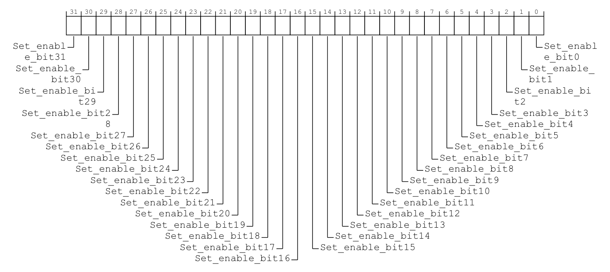
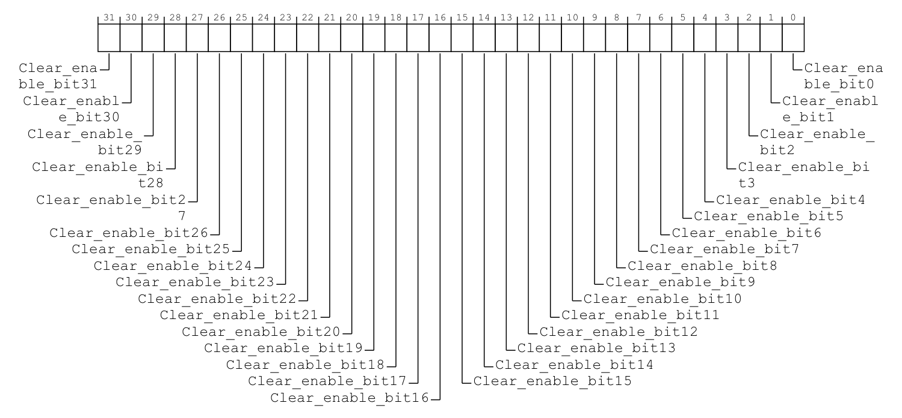
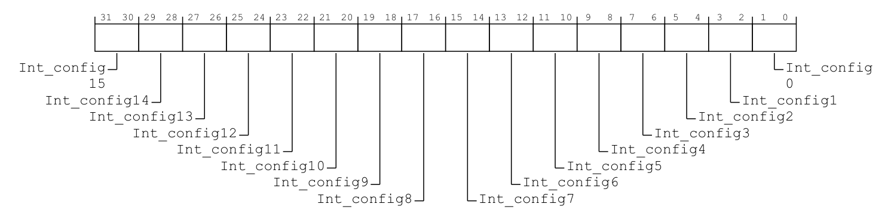
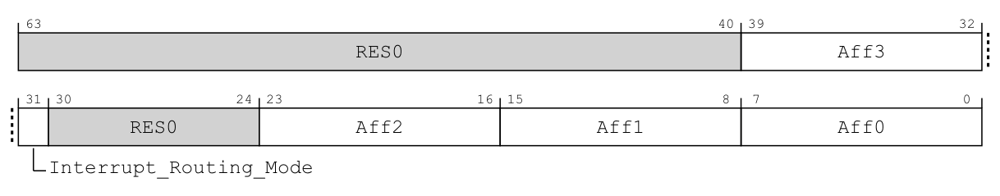

# 第5章\_寄存器位图与编号索引

## 5.1\_一个编号怎样找到对应状态位

**讲解层次：概念层（GICv3.0 寄存器契约）。** 下面先按 IHI0069 H.b 解释原位布局、访问语义与索引，不用地址排布推断内部存储电路。

第三章区分了 MMIO 与系统寄存器，上一章又把 GICR 的地址视图映射到实际状态位置。本章只解决“给定来源与所属 PE，如何选中要读写的字段”，并用完整 C 算例检查索引计算；确认和完成的状态机留给下一章。

先考虑一个具体动作：软件要允许 SPI 65 交付，同时保留 SPI 66 等其他来源原有的使能状态。如果接口只提供一个按普通变量使用的 32 位使能字，软件就得先读出整字、改变其中一位，再写回整字；两个执行者分别改不同位时，较晚写回的旧快照可能覆盖另一方刚完成的修改。

因此，这里需要能直接表达“只设置这些位”或“只清除这些位”的硬件操作，未选中的位保持不动。GIC 把这两种动作分别放在置使能与清使能接口中：软件向目标位写 1 来选择动作，向其他位写 0 表示不修改。它解决的是不同位的更新方式；若两个执行者同时使能和禁止同一个来源，仍须由软件协调所有权。

共享来源的 `GICD_ISENABLER<n>` 是 **Interrupt Set-Enable Register（中断置使能寄存器）** 的规范名称，每个 32 位寄存器对应 32 个编号。写某位为 1，使对应来源使能；其他位写 0 不修改它们。对应的 `GICD_ICENABLER<n>` 是 **Interrupt Clear-Enable Register（中断清使能寄存器）**，写 1 清除使能。

对一个已经核实存在、归当前软件所有的 SPI，编号为 i 时，寄存器序号是 i 除以 32 的整数商，位位置是 i 对 32 取余。这是编号到寄存器接口的映射，不是推测控制器内部存储地址。

同一个使能动作还要回答“操作谁的状态”。SPI 按共享来源编号定位；SGI/PPI 则先选择所属 PE，再选择本地编号。因此，私有来源使用 **GICR_ISENABLER0（Interrupt Set-Enable Register 0，中断置使能寄存器 0）** 与 **GICR_ICENABLER0（Interrupt Clear-Enable Register 0，中断清使能寄存器 0）**，每个 PE 各有一对。下面都按 32 位 MMIO 访问；读两种寄存器都能看到对应使能状态，区别在于 **写 1 执行的动作**。后续算式采用 C 的非负整数运算：`/` 取整数商，`%` 取余数。

先说明它们所用的基址。这里的 **页（Frame）** 是架构定义的寄存器地址窗口，不是操作系统页表中的页。GICv3.0 为每个逻辑 Redistributor 定义相邻的两个 64 KiB 窗口：控制页的基地址符号为 `RD_base`，SGI/PPI 页的基地址符号为 `SGI_base`，所以该 PE 的 `SGI_base = RD_base + 0x10000`。选择另一个 PE 就要找到另一个 PE 的页；不能把一块公共的 `SGI_base` 用于全部 PE。各 PE 窗口的实际分布仍来自芯片与固件描述，不能据此假定整颗芯片无空洞地排列它们。

先按原件看 Distributor 的置／清两个入口。两图的格数相同，但字段名分别以 `Set_enable`、`Clear_enable` 开头；真正决定写 1 做什么的是各自字段定义，不能仅靠格子的形状判断。



> 原图节选：[IHI0069 H.b](https://developer.arm.com/documentation/ihi0069/hb)，12.9.26 **GICD_ISENABLER&lt;n&gt;**，印刷页 12-593；字段条件、索引与访问表续于 12-594。


> 原图节选：同规范 12.9.7 **GICD_ICENABLER&lt;n&gt;**，印刷页 12-554；条件与访问表续于 12-555。

再看每 PE 的 SGI/PPI 入口。外观仍是 32 个单比特字段，但原条目把字段 `x` 直接对应本 PE 的 INTID `x`，不再用 Distributor 的 `32 × n + x` 选择共享来源。


> 原图节选：同规范 12.11.25 **GICR_ISENABLER0**，印刷页 12-688；访问表见 12-689。



> 原图节选：同规范 12.11.5 **GICR_ICENABLER0**，印刷页 12-649；访问条件与地址表续于 12-650。

四份原条目都逐位定义读写行为，可以合在下面这张 **中文字段对照** 中核验；它按共同操作重排，不是手册原表：

| 原字段名与范围 | 读 0／读 1 | 写 0 | 写 1 | 编号归属 |
| --- | --- | --- | --- | --- |
| `GICD_ISENABLER<n>`<br />`Set_enable_bit<x>`，`x=0～31` | 禁止／允许转发 | 不变 | 允许转发 | `32 × n + x` |
| `GICD_ICENABLER<n>`<br />`Clear_enable_bit<x>`，`x=0～31` | 禁止／允许转发 | 不变 | 禁止转发 | `32 × n + x` |
| `GICR_ISENABLER0`<br />`Set_enable_bit<x>`，`x=0～31` | 禁止／允许转发 | 不变 | 允许转发 | 该 PE 的 `x`；0～15 为 SGI，16～31 为 PPI |
| `GICR_ICENABLER0`<br />`Clear_enable_bit<x>`，`x=0～31` | 禁止／允许转发 | 不变 | 禁止转发 | 该 PE 的 `x`；分区同上 |

这张对照限于已经实现、允许当前视图访问且可编程的位。读值反映状态，写值选择动作，因此“读到 1 后原样写回”在置使能与清使能入口会产生相反效果。接下来才将原件中的基址、偏移和这个字段映射整理成查用表：

| 寄存器 | 基址与偏移 | 编号与位的对应 | 写入效果 |
| --- | --- | --- | --- |
| `GICD_ISENABLER<n>`，SPI 置使能 | `Dist_base + 0x0100 + 4 × n` | `n = i / 32`，bit `i % 32`；本章普通 SPI 为 i=32～1019 | 写 1 使能对应来源，写 0 不变 |
| `GICD_ICENABLER<n>`，SPI 清使能 | `Dist_base + 0x0180 + 4 × n` | 与上一行相同；同一个来源无需换位号 | 写 1 禁止对应来源转发，写 0 不变；不会因此清除外设事件或完成活动中断 |
| `GICR_ISENABLER0`，某 PE 的 SGI/PPI 置使能 | 该 PE 的 `SGI_base + 0x0100` | bit i 对应本地 INTID i；SGI 为 0～15，PPI 为 16～31 | 对可编程位写 1 使能，写 0 不变 |
| `GICR_ICENABLER0`，某 PE 的 SGI/PPI 清使能 | 该 PE 的 `SGI_base + 0x0180` | 与上一行相同；先选 PE 的页，再选位 | 对可编程位写 1 禁止，写 0 不变 |

这些寄存器均为 RW，但未实现来源以及不允许当前安全视图访问的位受架构限制，不能按普通内存一样假定任意值都能写回。SGI 是否可改变使能也有实现选择，下文继续限定本卷的产品行为。以 i=65 为例，商为 2，于是选中寄存器组中名称为 `GICD_ISENABLER2` 与 `GICD_ICENABLER2` 的两个条目，再在其中选择 bit 1：

```text
教学例子：i = 65，不代表 RK3588 串口的实际编号
寄存器序号 = 65 / 32 的整数商 = 2
位位置 = 65 % 32 = 1
置使能：向 GICD_ISENABLER2 写入仅 bit 1 为 1 的值
清使能：向 GICD_ICENABLER2 写入仅 bit 1 为 1 的值
```

在这个例子中，置使能与清使能使用相同的位号，选择不同地址才决定“设置”还是“清除”。向清使能寄存器写 0 并不会关闭 SPI 65；0 的含义仍是不修改，这正是它与普通变量赋值不同的地方。

SGI/PPI 的对应使能操作进入目标 PE 的 Redistributor 逻辑接口，不能把上式生搬到 Distributor 的 SPI 寄存器族后期待它操作另一个 PE 的私有状态。架构允许实现把 SGI 固定为始终使能，不能从有寄存器位就推定该位一定可写。

**讲解层次：实现层（GIC-600 r1p6 的选项）。** 前面已将每 PE 的 SGI/PPI 使能状态映射到 PPI 物理块；该产品选择让全部 SGI 都具有可编程使能，产品依据与组控制边界见[第九章](P09_权限_安全分组与异常路由.md#9.3.2_硬件结构与配置归属先对齐)。使能也不等于设置活动状态或清除请求，下一章将分别观察这些维度。

> 表与算例依据：[规范 IHI0069 H.b](https://developer.arm.com/documentation/ihi0069/hb)，12.9.26 GICD_ISENABLER<n>（12-593～12-594）、12.9.7 GICD_ICENABLER<n>（12-554～12-555）、12.11.25 GICR_ISENABLER0（12-688～12-689）、12.11.5 GICR_ICENABLER0（12-649～12-650），以及 12.10 的每 PE 两页布局（12-634）。页码为印刷页码；同章带 E 后缀的扩展范围不属于这里的 v3.0 算例。

## 5.2\_改变接收PE时\_SPI的INTID会不会改变

**讲解层次：概念层（GICv3.0 共享来源的身份与接收目标）。** 对同一个 GIC 中的同一个 SPI，**把接收目标从 PE0 改为 PE1，不会改变它的 INTID**。改变的是交给哪个 PE，编号仍标识原来的中断来源。

以 SPI 65 为例，比较固定目标路由修改前、修改已经生效后的配置：

| 观察时点 | 中断来源 | 配置的接收 PE | 该来源的 INTID |
| --- | --- | --- | --- |
| 修改路由之前 | 同一个外设输入对应的 SPI 65 | PE0 | 65 |
| 目标从 PE0 改为 PE1，且新路由已经生效之后 | 仍是原来的 SPI 65 | **PE1** | **仍为 65** |

软件修改的是 `GICD_IROUTER65` 中指定目标 PE 的字段。“65”选中哪个来源的路由条目，条目中的目标字段决定交给谁；**接收者改变，不会给这个来源重新编号。** 当该来源分别交给 PE0 或 PE1、并由相应 PE 确认时，返回的有效中断编号都是 65。

这里说明路由目标与 INTID 的关系。修改何时生效、已经挂起的请求怎样选择目标，见[固定目标与一次选择几个接收者](P11_SPI目标选择与每PE状态.md#11.2.1_固定目标与1-of-N_一次选择几个接收者)；下一节先对照原位图，观察来源索引与目标字段各在什么位置。

> 表格是依据规范编写的前后对照，不是手册原表。依据：[IHI0069 H.b](https://developer.arm.com/documentation/ihi0069/hb)，12.9.22 **GICD_IROUTER&lt;n&gt;**（12-584～12-586）。原位图及字段对照见下一节。

## 5.3\_动手计算同一个编号的不同寄存器索引

**讲解层次：概念层（架构规则与主机算例）。** 寄存器布局依据 IHI0069 H.b；程序只计算索引，不访问或仿真 GIC-600 电路。

使能只回答“允许这个来源交付吗”，还不能决定怎样识别它的请求、多个来源同时就绪时先选谁，以及共享来源交给哪个 PE。控制器因而还需要触发类型、优先级和目标路由三类配置：触发类型说明按电平还是边沿识别请求，优先级参与选择先后，目标路由选择接收侧。它们描述同一个来源的不同属性；改变其中一个，不会自动改好另外几个。

现在只解决这些属性在编程接口里怎样定位，不提前展开后续章节的状态机。已经知道使能接口每个寄存器装 32 个来源；其余属性应按各自原位布局重新数清字段，不能统一按 32 求商。

触发类型使用 **中断配置寄存器（Interrupt Configuration Registers）**，寄存器族名为 `GICD_ICFGR<n>`；优先级使用 **中断优先级寄存器（Interrupt Priority Registers）** `GICD_IPRIORITYR<n>`。程序还会输出 **中断路由寄存器（Interrupt Routing Registers）** `GICD_IROUTER<n>` 的条目名称，它每个来源有独立条目，用来配置目标。此处只算位置，路由内容到第十一章再展开。

先看配置寄存器的原图。它将 32 位分为 16 个 `Int_config` 字段，每个字段占两位：



> 原图节选：[IHI0069 H.b](https://developer.arm.com/documentation/ihi0069/hb)，12.9.9 **GICD_ICFGR&lt;n&gt;**，印刷页 12-558；访问表见 12-559。

| 位号与原字段名 | 中文字段对照 | 读图后的约束 |
| --- | --- | --- |
| `[2x+1:2x]`，`Int_config<x>`，`x=0～15` | `00` 表示电平敏感，`10` 表示边沿触发 | 每来源占两位，单项容纳 16 个来源 |
| 每个字段内的低位 `[2x]` | RES0 | 不能把低位另作开关，`01`、`11` 不是本卷的有效触发编码 |

寄存器支持 RW 不等于能随时改变触发方式。原条目要求不能在来源仍单独使能时改变 `Int_config`；有挂起状态时改变边沿／电平类型，还会使挂起状态变得不确定。当前实验只算位置，不写硬件。未实现来源以及当前安全视图不能控制的字段也不属于可任意写入的普通内存。

优先级原图的分法不同。它有四个字节字段，原名称保留字节偏移，便于同地址计算对应：


> 原图节选：同规范 12.9.20 **GICD_IPRIORITYR&lt;n&gt;**，印刷页 12-580；字段、编号公式与访问限制见 12-580～12-582。

| 位号 | 原字段名 | 中文字段对照 |
| --- | --- | --- |
| `[31:24]` | `Priority_offset_3B` | 字节偏移 3 的来源优先级 |
| `[23:16]` | `Priority_offset_2B` | 字节偏移 2 的来源优先级 |
| `[15:8]` | `Priority_offset_1B` | 字节偏移 1 的来源优先级 |
| `[7:0]` | `Priority_offset_0B` | 字节偏移 0 的来源优先级 |

这四行都使用“数值越小，优先级越高”的编码方向，但一格画成 8 位，不保证八位都实现。未实现的低位读零、写忽略；实际优先级位数与安全视图的数值解释在[第七章](P07_优先级数值_门槛与分组.md#7.2_优先级数值为什么越小越紧急)继续。寄存器允许按字节访问，故先求寄存器序号后，还可以用余数定位其中的字节。

最后看路由寄存器：一个 SPI 独占一个 64 位条目。图中的四个 `Aff` 字段保存目标的分层坐标，不能把它们当成四个来源的配置槽。



> 原图节选：同规范 12.9.22 **GICD_IROUTER&lt;n&gt;**，印刷页 12-584；字段条件、索引和访问表续于 12-585～12-586。

| 位号 | 原图字段名 | 中文字段对照 |
| --- | --- | --- |
| `[63:40]` | `RES0` | 保留零 |
| `[39:32]` | `Aff3` | 目标亲和层级 3 |
| `[31]` | `Interrupt_Routing_Mode` | **中断路由模式（Interrupt Routing Mode，IRM）**：0 按四段亲和坐标指定 PE，1 从参与候选中选择一个 PE |
| `[30:24]` | `RES0` | 保留零 |
| `[23:16]` | `Aff2` | 目标亲和层级 2 |
| `[15:8]` | `Aff1` | 目标亲和层级 1 |
| `[7:0]` | `Aff0` | 目标亲和层级 0 |

本接口在亲和路由启用时使用，普通 SPI 的 `n` 就是 INTID。原图给出了全部坐标位置，但还不能据此随意选择目标：固定路由需命中实际存在的 PE，1-of-N 需硬件支持且有符合条件的参与者；IRM=1 时亲和字段的读值不能继续当作固定目标使用。这些条件以及坐标怎样对应核，留到[第十一章](P11_SPI目标选择与每PE状态.md#11.2_怎样取得目标PE的硬件亲和坐标)按具体请求展开。

看过三张原图后，再把本次参与计算的寄存器组放在同一张 **索引归纳表** 中。表中 i 均为本章普通 SPI 的 INTID（32～1019），k 是该寄存器内的字段序号。所有偏移相对 `Dist_base`，所有行均为 RW；源未实现或权限不足时，不能据此假定写入有效。

| 寄存器组 | 宽度与地址偏移 | 每来源字段及索引 | 本节所需的字段语义 |
| --- | --- | --- | --- |
| `GICD_ISENABLER<n>` | 32 位；`0x0100 + 4 × n` | `n = i / 32`，bit `i % 32` | 写 1 使能，写 0 不变；见前节的置/清配对表 |
| `GICD_ICFGR<n>` | 32 位；`0x0C00 + 4 × n` | `n = i / 16`，`k = i % 16`，字段 `[2k+1:2k]` | `00` 表示电平触发，`10` 表示边沿触发；字段低位固定保留零，不应写成 `01` 或 `11` |
| `GICD_IPRIORITYR<n>` | 32 位寄存器，支持按字节访问；`0x0400 + 4 × n` | `n = i / 4`，`k = i % 4`，字段 `[8k+7:8k]` | 保存一个来源的优先级编码，数值越小优先级越高；实际实现的有效优先级位数在第七章说明 |
| `GICD_IROUTER<n>` | 64 位；`0x6000 + 8 × n` | `n = i`，每个 SPI 一项，条目步长 8 字节 | `[31] IRM` 选择固定目标或从候选目标中选一个；四段 8 位坐标位于 `[7:0]`、`[15:8]`、`[23:16]`、`[39:32]`，固定目标时用于定位 PE；这些坐标称 Aff0～Aff3，第十一章再解码目标 |

这里列位域是为了看清“64 位的独立条目”和“32 位里装多个来源”并非同一种布局；本算例不会修改目标，也不把这些字段当作已经可用的板级配置。

代入同一个 SPI 65，路由寄存器直接选中序号为 65 的 `GICD_IROUTER65`，另外三个组则先按每项容纳的来源数计算商和余数。可在运行程序前手工核对：

| 本次访问对象 | 相对 Distributor 基址的偏移 | 本来源占据的位置 |
| --- | --- | --- |
| `GICD_ISENABLER2` | `0x0100 + 4 × 2 = 0x0108` | bit 1 |
| `GICD_ICFGR4` | `0x0C00 + 4 × 4 = 0x0C10` | bits `[3:2]` |
| `GICD_IPRIORITYR16` | `0x0400 + 4 × 16 = 0x0440` | bits `[15:8]`，其字节偏移为 `0x0441` |
| `GICD_IROUTER65` | `0x6000 + 8 × 65 = 0x6208` | 整个 64 位路由条目 |

本例使用 C11 做纯整数计算，完整程序与配套的[寄存器索引算例](examples/register_indices.c)一致。`strtol` 把十进制参数转成整数；先检查范围和是否还有未解析字符，再转换成无符号编号。计算中的 `/` 是非负整数除法，`%` 取余数，与前面按每组容量求商和余数的推导一致。程序不会读取寄存器，也不检查芯片是否实现该来源。

程序用标准库常量 `EXIT_FAILURE` 表示输入错误，用 `EXIT_SUCCESS` 表示计算完成；它们是交给宿主命令行的退出状态，与 GIC 中的中断状态无关。错误信息写到标准错误流 `stderr`，正常计算结果写到标准输出，便于区分“没有算出结果”和“算出了一个零值”。

```c
/* 普通 SPI 的寄存器索引算例；仅做整数计算，不访问硬件。 */
#include <errno.h>
#include <stdio.h>
#include <stdlib.h>

int main(int argc, char **argv)
{
    char *end = NULL;
    long parsed;
    unsigned int intid;

    if (argc != 2) {
        fprintf(stderr, "用法: %s INTID（十进制普通 SPI：32～1019）\n", argv[0]);
        return EXIT_FAILURE;
    }
    errno = 0;
    parsed = strtol(argv[1], &end, 10);
    if (errno != 0 || end == argv[1] || *end != '\0' ||
        parsed < 32 || parsed > 1019) {
        fputs("本例只计算 GICv3.0 普通 SPI：32～1019 的十进制整数\n", stderr);
        return EXIT_FAILURE;
    }
    intid = (unsigned int)parsed;

    /* 商选择寄存器，余数选择同一寄存器中的位或字段。 */
    printf("使能: GICD_ISENABLER%u, bit %u\n", intid / 32, intid % 32);
    printf("触发: GICD_ICFGR%u, bits %u:%u\n",
           intid / 16, 2 * (intid % 16) + 1, 2 * (intid % 16));
    printf("优先级: 字节 %u; GICD_IPRIORITYR%u, bits %u:%u\n",
           intid, intid / 4, 8 * (intid % 4) + 7, 8 * (intid % 4));
    printf("目标: GICD_IROUTER%u\n", intid);
    return EXIT_SUCCESS;
}
```

以下命令从仓库根目录执行，需要已经安装支持 C11 的 GCC。先创建编译产物目录：

```bash
# 工作目录：仓库根目录；Bash
mkdir -p .cache/gic_examples
```

这个目录只放生成文件，配套源码仍在 `examples/` 中。若使用 PowerShell，以 `New-Item -ItemType Directory -Force .cache/gic_examples` 完成同一步；后面的 GCC 参数相同。

```bash
# 工作目录：仓库根目录；GCC 编译器已加入 PATH
gcc -std=c11 -Wall -Wextra -Werror -pedantic platforms/arm/architecture/gic/examples/register_indices.c -o .cache/gic_examples/register_indices.exe
```

`-std=c11` 选择本例的语言标准，警告选项帮助发现参数与类型错误，`-o` 指定生成的可执行文件。编译成功后，再运行刚生成的程序：

```bash
# 工作目录：仓库根目录
./.cache/gic_examples/register_indices.exe 65
```

输出中的 `GICD_ICFGR4`、`GICD_IPRIORITYR16`、`GICD_IROUTER65` 分别是刚才三种寄存器族中序号为 4、16、65 的条目名称，不是新的接口。运行结果应为：

```text
使能: GICD_ISENABLER2, bit 1
触发: GICD_ICFGR4, bits 3:2
优先级: 字节 65; GICD_IPRIORITYR16, bits 15:8
目标: GICD_IROUTER65
```

同一个 65，在三类寄存器中的商分别为 2、4、16；只有路由族直接使用 INTID 选择条目。得到位置还不等于可以写：来源存在性、所有权、触发配置修改时机、访问宽度及内存属性仍要另外核对。

先预测把输入改为 64、95、96 会怎样，再运行。64 对应使能 bit 0；95 对应寄存器 2 的 bit 31；96 才进入寄存器 3 的 bit 0。再输入 31，程序应以非零退出码报告范围错误，因为私有来源不能套用本例的 SPI 路径。这个拒绝是教学边界，不是说 INTID 31 在整个 GIC 中非法。

> 官方对照：[IHI0069 H.b](https://developer.arm.com/documentation/ihi0069/hb)，12.9.9 GICD_ICFGR、12.9.20 GICD_IPRIORITYR、12.9.22 GICD_IROUTER、12.9.26 GICD_ISENABLER。先核对每来源占多少位，再计算商和余数。

本章建立了“到哪里配置、按什么编号定位”的模型，仍没解释为什么处理入口已经运行，中断却会一直重复或者再也不来。下一章沿一个来源完整走过确认、处理和结束，追踪状态由谁改变。

资料定位：[198123 第 4～5 章](https://developer.arm.com/documentation/198123/0302)；[IHI0069 H.b 的中断类型、编程接口与使能寄存器条目](https://developer.arm.com/documentation/ihi0069/hb)。本章所有编号算例均为教学值。

上一篇：[GIC600的物理实现_从逻辑映射到输入输出](P04_GIC600的物理实现_从逻辑映射到输入输出.md#4.1_从GICv3到GIC600_逻辑角色怎样落到物理块)

[专题大纲](大纲.md#1.2_因果阅读地图)

下一篇：[一次中断的状态转换与完成协议](P06_一次中断的状态转换与完成协议.md#6.1_处理入口已经运行_为什么还没有完成)
