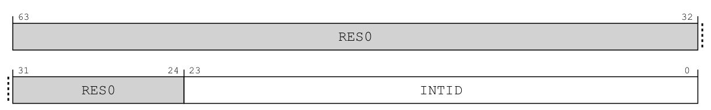
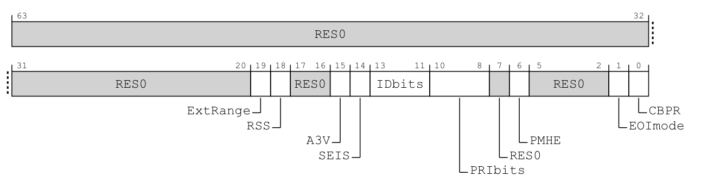
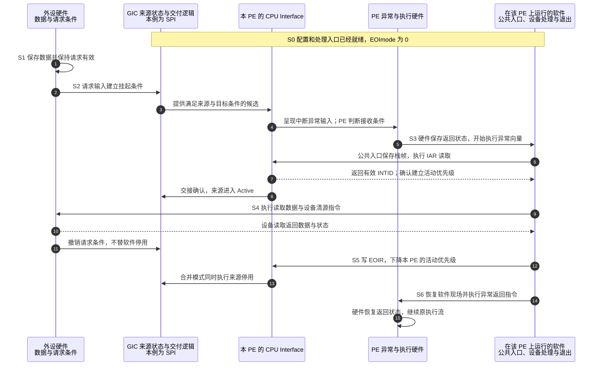
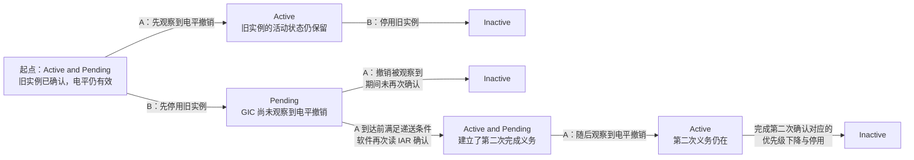
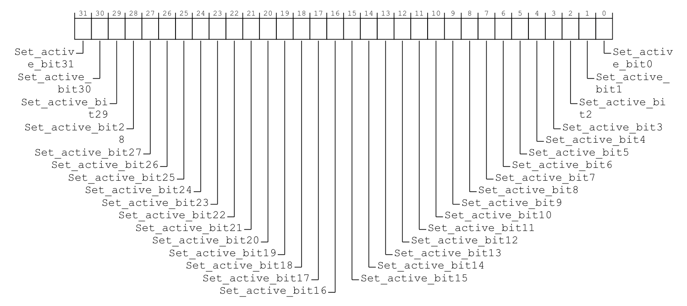
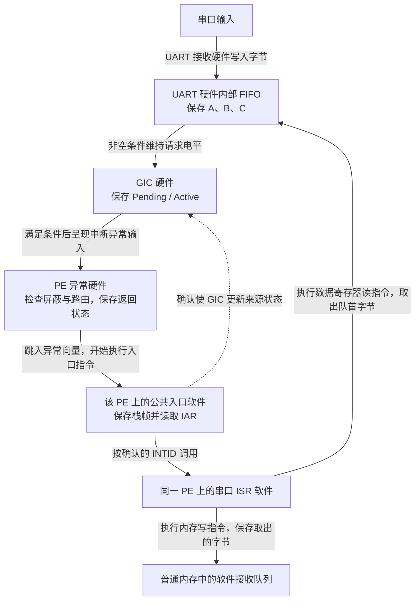
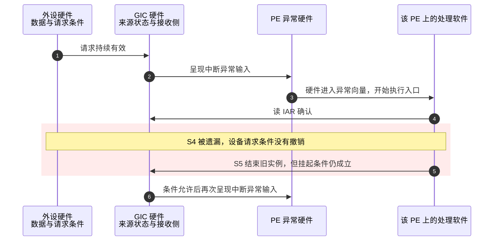

# 第6章\_一次中断的状态转换与完成协议

## 6.1\_处理入口已经运行\_为什么还没有完成

**讲解层次：概念层。** 依据 IHI0069 H.b 的 GICv3.0 物理中断契约建立状态与完成协议；串口过程是教学场景，不代表某套内核的实现。

上一章知道了 **通用中断控制器（Generic Interrupt Controller，GIC）** 在何处配置来源。现在假设一个串口来源已经使能，目标 **处理单元（Processing Element，PE）** 也允许接收。数据到达以后，软件进入了处理入口：这是否意味着中断已经结束？

不是。进入入口只证明处理器接受了一次异常通知；外设数据可能尚未取走，控制器也未必已经把具体来源交给软件。本章把这几件事拆开，先闭合一个普通中断的完整周期，再用“处理期间又来事件”检验它。

本章讨论 GICv3.0 普通递送路径中的 **共享外设中断（Shared Peripheral Interrupt，SPI）**、**私有外设中断（Private Peripheral Interrupt，PPI）** 和 **软件产生中断（Software Generated Interrupt，SGI）** 的状态模型。后文的消息中断另有差量，不能把本章四状态表无条件推广过去。

## 6.2\_一个正在处理位为什么不够

**讲解层次：概念层。** 以下依据 IHI0069 H.b 4.1.2，区分来源的 Pending、Active 与接收侧状态。

假设只用一个位记录“这个来源正在处理”。软件确认请求时把它置位，结束时清零。若处理期间该来源又产生一次事件，新事件与正在处理的旧事件就无法区分。

因此需要分别表达两项事实：**挂起（Pending）** 表示当前存在等待确认的请求；**活动（Active）** 表示该来源已经被确认，但尚未完成停用。两者可以同时成立。

| 挂起 | 活动 | 名称 | 能推出什么 |
| --- | --- | --- | --- |
| 0 | 0 | Inactive，非活动 | 当前没有这两类控制器状态；不代表外设永远不会再请求 |
| 1 | 0 | Pending，挂起 | 有请求等待确认 |
| 0 | 1 | Active，活动 | 已确认的交接仍未停用 |
| 1 | 1 | Active and Pending，活动且挂起 | 旧交接未停用，同时存在挂起条件 |

这不是软件维护四个独立布尔变量。它是两个状态维度的组合，由控制器维护；架构提供观察与控制接口，没有规定内部必须用哪种存储电路。SPI 通过 **分发器（Distributor）** 的共享来源接口观察，SGI/PPI 通过所属 **再分发器（Redistributor）** 的每 PE 逻辑接口观察。来源身份也不同：SPI 用全局 INTID 区分；PPI 27 则必须连同所属 PE 一起定位，PE0 与 PE1 的同号来源分别维护状态。

而且整个系统仍不止这一张状态表。外设保存数据及请求条件；控制器保存挂起/活动与配置；处理器保存异常屏蔽和执行状态；软件保存当前处理进度。这四层组成协作过程，不能用一个“中断完成”变量代替。

> 官方对照：[规范 IHI0069 H.b](https://developer.arm.com/documentation/ihi0069/hb)，4.1.2 Interrupt handling state machine；[概览 198123，3.2-01](https://developer.arm.com/documentation/198123/0302) 第 4 章（PDF 第 13 页）的状态图。核对 Active and Pending 的组合条件；“设备数据、控制器状态、处理器现场、软件进度”四层划分是本专题的分析框架。

**讲解层次：概念到实现的映射。** 用 GIC-600 r1p6 1.2、2.2 和 2.2.2 把上述状态落到产品功能块：SPI 功能在 Distributor 物理块；SGI/PPI 配置与状态由服务相应 PE 的 Redistributor 物理块维护，该块也叫 PPI block；CPU Interface 位于各处理器核内。

因此，观察 PE0 的私有状态时，MMIO 访问经 Distributor 的统一编程入口到达 PPI 块内 PE0 的功能，读取的是那里维护的状态。它不是先读一份“逻辑 Redistributor 状态”，再同步到 PPI 块中的第二份状态。两个 PE 可以共用一个 PPI 块，但同号私有来源仍分别维护。来源的 Active 与核内 CPU Interface 的活动优先级也不能合成一份：前者记录哪个来源尚未停用，后者约束这个 PE 接收后来的请求，下一节将看到两者可以在不同时间释放。内部存储单元的具体组织不由这些功能归属推断。

> 产品依据：[GIC-600 r1p6 TRM](https://developer.arm.com/documentation/100336/0106)，1.2（1-13）、2.2（2-29）、2.2.2（2-30）。完整配置访问和物理连接见[第四章的状态落点](P04_GIC600的物理实现_从逻辑映射到输入输出.md#4.1_从GICv3到GIC600_逻辑角色怎样落到物理块)。下文回到所有合规实现应遵守的状态协议。

## 6.3\_确认\_清源\_优先级下降与停用

**讲解层次：概念层。** 依据 IHI0069 H.b 4.1.1 与 12.2 的系统寄存器条目，固定已获准访问的 Non-secure Group 1 物理接口。

**确认（Acknowledge）** 是处理器向控制器领取一个可处理来源的协议动作。先将当前路径命名为 **非安全第 1 组（Non-secure Group 1）**：这是一种中断安全归属，不是优先级高低。在该路径读取 `ICC_IAR1_EL1`，即 **Interrupt Acknowledge Register，IAR（中断确认寄存器）**，取得 **中断标识符（Interrupt Identifier，INTID）**，并推进控制器状态。安全分组在第 9 章完整建立；这里先固定这一条正常路径，不把所有分组混在一起。

为什么选这条路径？本例假设固件已经把串口交给非安全操作系统，将来源配置成 Non-secure Group 1，由该 PE 在 AArch64 的 Non-secure EL1 处理物理中断，不把接口访问重定向成虚拟中断操作；这是一项 **示例前提**，并非所有中断都必须属于 Group 1。若来源配置成 Group 0，就使用对应的 Group 0 确认接口，不能靠读取 IAR1 把来源改组。

寄存器名中的两个数字也不在同一分类轴上：`IAR1` 的 1 指 **中断安全分组 Group 1**；`EL1` 指 **异常级（Exception Level，EL）** 的命名层次。EL 是处理器的软件权限与异常执行层次，EL1 通常运行整个内核，内存管理、系统调用和中断处理都可以在这一层执行，绝非为中断单独预留。下表还会用到 EL3，即第 3 异常级，在本卷传统安全模型中通常由高权限安全固件使用；这里只用它界定访问条件，不提前展开各异常级的分工。寄存器的 EL1 后缀也不表示只能从 EL1 访问；更高异常级的访问仍依架构权限和截获控制决定。先由 GIC 与处理器的路由配置决定进入哪里，再由入口软件选择匹配的确认接口；完整关系见[安全组与异常路由](P09_权限_安全分组与异常路由.md#9.3_安全组不是优先级分组)。

所以读确认寄存器不是无副作用的调试操作。原本留给处理入口确认的来源，可能被这次读取领走。处理器进入异常和读取该寄存器是两个动作；读取也可能发生在软件主动查询时。

**设备清源（Clearing the peripheral interrupt condition）** 则是处理外设条件：读取数据、清除设备状态位或完成设备规定的握手。清源方式由外设定义，不存在一个对所有设备都正确的“往状态寄存器写 1”。控制器不知道具体数据是否已经处理完。

串口数据取走以后，GIC 的交接为什么还不能自动结束？确认时建立的不只有这个来源的 Active 状态，还包括接收侧的 **运行优先级（Running priority）**：它约束当前 PE 是否能接收其他来源。设备清源只改变外设条件，不会替软件释放这两项控制器状态；反过来，允许其他来源继续进入，也不一定表示当前设备的处理已经结束。

因此，GIC 把结束动作分成两部分：

- **优先级下降（Priority drop）**：结束本次确认对接收侧运行优先级的占用，恢复此前的优先级约束。
- **停用（Deactivation）**：清除该来源已确认但未停用的活动状态；若仍有挂起请求，它不会因此一起消失。

`ICC_EOIR1_EL1` 是 **中断结束寄存器（End Of Interrupt Register，EOIR）**，`ICC_DIR_EL1` 是 **中断停用寄存器（Deactivate Interrupt Register，DIR）**。其配合方式由 `ICC_CTLR_EL1`，即 **中断控制器控制寄存器（Interrupt Controller Control Register）**，中的 `EOImode` 字段决定；EOI 是 End Of Interrupt（中断结束）的缩写，EOImode 是该结束模式的字段标识；这是工作模式，不是由函数名猜出的规则。

先把这几个接口在手册中的位布局放在眼前，再核对结束模式的解释。以下四幅图是 **IHI0069 H.b 的寄存器位布局原图节选**，不是本专题重新绘制的摘要；字段表为对应条目的中文整理。它们均为当前 PE 的 64 位系统寄存器，不使用 MMIO 偏移。IAR1 用 `MRS` 读取，EOIR1、DIR 用 `MSR` 写入，CTLR 按各字段权限读写；这里仍限定前述已获准访问、没有截获或虚拟接口重定向的 Non-secure EL1 物理路径。


> 原图来源：[IHI0069 H.b](https://developer.arm.com/documentation/ihi0069/hb)，12.2.14 ICC_IAR1_EL1，印刷页 12-255；副作用与访问条件续至 12-256。


> 原图来源：同规范 12.2.10 ICC_EOIR1_EL1，印刷页 12-247；配对与访问规则续至 12-248。



> 原图来源：同规范 12.2.8 ICC_DIR_EL1，印刷页 12-243。

三个接口的位布局相同，**字段方向和读写动作不同**。IAR1 的首次读表过程见[第三章系统寄存器访问](P03_多核角色与架构编程接口.md#3.4_软件怎样访问GIC_地址访问与系统寄存器)；这里复用原图与两个写接口比较。下表按三个原条目并列整理，不把相同图形解释成相同操作。

| 原图位段 | 原文字段 | IAR1 的中文对照 | EOIR1／DIR 的中文对照 |
| --- | --- | --- | --- |
| `[63:24]` | `RES0` | 保留为零，不是第二个状态字段 | 保留为零，不能把模式或地址写入这里 |
| `[23:0]` | `INTID` | 读出当前可确认的来源编号；不满足可观察／可确认条件时可能返回特殊 INTID。有效读取同时确认来源 | EOIR1 写回相应 IAR1 返回的 INTID；DIR 写入要停用的 INTID。两者不清除设备条件 |
| `[23:16]` 的实现条件 | 16-bit / 24-bit INTID | `ICC_CTLR_EL1.IDbits` 报告只实现 16 位时，这一部分为 `RES0` | 同一位宽限制适用；字段图的 24 位不等于每台机器都有 24 位有效编号 |



> 原图来源：同规范 12.2.6 ICC_CTLR_EL1，印刷页 12-233；以下字段中文整理对应 12-233～12-235。图保留完整布局，后续章节才使用的能力字段也列出用途，避免把它们误认成可任意写入的空位。

| 位段 | 原文字段 | 中文对照与条件 |
| --- | --- | --- |
| `[63:20]`、`[17:16]`、`[7]`、`[5:2]` | `RES0` | 保留为零 |
| `[19]` | `ExtRange` | 只读，报告 CPU Interface 是否支持 1024～8191 的扩展 INTID；本章 GICv3.0 普通来源不用该范围 |
| `[18]` | `RSS` | 只读，报告定向 SGI 是否支持 Aff0 大于 15；核间通知章节再使用 |
| `[15]` | `A3V` | 只读，报告 SGI 生成接口是否支持非零 Aff3 |
| `[14]` | `SEIS` | 只读，报告本地系统错误中断生成功能是否受支持 |
| `[13:11]` | `IDbits` | 只读；`000` 为 16 位 INTID，`001` 为 24 位，其余编码保留 |
| `[10:8]` | `PRIbits` | 只读，已实现优先级位数减一；第七章用它理解有效优先级精度 |
| `[6]` | `PMHE` | 是否允许把优先级屏蔽寄存器用作中断分发提示；存在 EL3 且两安全状态有效时此视图只读，其他配置按条目判断 |
| `[1]` | `EOImode` | 当前安全状态的结束模式：0 将优先级下降与停用合并，1 将二者分开；存在 EL3 时对应 EL3 控制寄存器中的安全／非安全模式别名 |
| `[0]` | `CBPR` | 是否让 Group 1 与 Group 0 共用二进制分割点寄存器 0；存在 EL3 且两安全状态有效时此视图只读，第七章再解释其抢占含义 |

从原图可直接读出：**写回来源编号** 使用 INTID 字段，**选择结束模式** 使用 CTLR 的 bit 1。它们位于不同寄存器，向 EOIR1 写一个“模式 1”会变成对 INTID 1 的操作，并不会选择分离模式。

先沿一条最小路径把它们接起来。假设处理期间没有新事件，当前 PE 读取 IAR1，保存返回的串口编号，随后处理数据并解除设备条件。若采用合并模式，一次对应的 EOIR1 写入就同时释放运行优先级和该来源的 Active；若采用分离模式，EOIR1 只释放运行优先级，软件还要在适当时刻用 DIR 停用该来源。两种模式都需要处理设备，差别在于 GIC 的两项结束职责是否由同一次写入完成。

下面是从字段定义和访问规则得到的 **完成协议归纳**，不是手册原表：

| 当前模式 | 写 EOIR 的效果 | 对本章普通中断还需什么 |
| --- | --- | --- |
| EOImode 为 0 | 优先级下降并停用 | 不再为该次确认额外写 DIR |
| EOImode 为 1 | 只做优先级下降 | 合适时再写 DIR 完成停用 |

分离模式允许两件事在不同时间完成，但也增加了配对义务。实际系统选择哪种模式，必须结合其控制器初始化和退出路径判断。

配对还包括执行者与顺序：优先级下降必须由确认它的同一 PE 完成；同一 CPU Interface 上的有效 EOIR 写入，须按 IAR 确认的逆序进行，并使用保存的完整确认返回值。分离模式下，DIR 必须晚于它所对应的 EOIR，但不同来源的 DIR 之间没有同样的逆序要求。SGI/PPI 必须由确认它的 PE 停用；SPI 允许由另一 PE 停用，这需要软件明确交接责任，不能据此让另一 PE 代做原 PE 的优先级下降。在合并模式下额外写 DIR，或在分离模式下先 DIR 后 EOIR，均不属于有效的普通完成序列。

再回看三张 INTID 原图：相同的编号宽度没有取消执行者和先后次序约束。普通 SPI/PPI/SGI 仍受第三章编号范围限制；有效串口确认值必须交回匹配的结束接口，特殊返回值则不能据这张布局图自行制造一笔普通完成义务。12.2.8 还明确描述了错误顺序的硬件后果：分离模式先写 DIR，来源可被停用，但活动优先级仍未下降；这正是“Active 已清”不能证明整个完成协议已结束的反例。

> 规则对照：[IHI0069 H.b](https://developer.arm.com/documentation/ihi0069/hb)，4.1.1 Physical CPU interface 中的确认、Priority drop 与 Deactivation；位布局、字段中文整理与本专题的完成协议归纳须合在一起读，不能只凭寄存器名称判断动作。


### 6.3.1\_同一来源还没收尾\_为什么接收侧可以先释放优先级

**讲解层次：概念层。** 依据 IHI0069 H.b 4.1.1 比较两项完成义务；虚拟机例子只说明分离的用途，不展开虚拟化实现。

刚才先处理设备再结束交接，两项结束动作可以连在一起。若设备条件必须由稍后运行的另一个软件上下文清除，确认来源的当前入口是否也要一直占着运行优先级等待？两项状态约束的对象不同：运行优先级约束当前 PE 是否接收其他来源，Active 则记录 **这个 INTID 的处理交接尚未停用**。假设来源 A 已确认，若一直保留 A 的运行优先级，不够高的其他来源也会被挡住；若立即同时停用 A，设备尚未撤销的电平又可能使 A 被递送。前者把等待设备的时间扩散到其他来源，后者过早重新开放同一来源。

分离模式使软件可以在协议允许时先写 EOIR，释放接收侧优先级，再保留 A 的 Active 状态，直到真正承担设备处理的路径完成清源后才停用。这期间其他来源仍须通过各自的使能、优先级和处理器屏蔽条件；EOIR 本身不会替软件解除这些条件。

一个典型用途是 **虚拟机（Virtual Machine，VM）** 的设备中断交接。**虚拟机管理程序（Hypervisor）** 管理真实硬件并安排虚拟机运行。管理程序收到物理来源 A 后，可能需要通知虚拟机，由虚拟机里的驱动稍后处理设备。在这个场景中，物理入口的优先级占用可以先结束，而真实来源的停用必须等设备处理完成；虚拟完成怎样与物理停用联动，需要另一个有明确状态和权限的虚拟化协议，不能把虚拟机的一次 EOI 当作天然等于物理 DIR。

| 时刻 | PE 接收侧的约束 | 物理来源 A | 仍欠的动作 |
| --- | --- | --- | --- |
| 确认 A 后 | A 占用运行优先级 | Active；也可能有 Pending | 设备处理、优先级下降、停用 |
| 分离模式下先写 EOIR | 恢复此前运行优先级 | Active 仍保留 | 设备处理与停用 |
| 设备条件消除并完成停用 | 不再被 A 占用 | 无其他挂起条件时回到 Inactive | 按软件协议继续执行 |

如果设备清源与控制器收尾都由当前入口连续完成，合并模式更容易维护：一次 EOIR 同时兑现两项义务。只有需要把两项完成时刻分开，并且能追踪后续停用责任时，分离才有价值；它增加的代价是异步状态、完成配对以及异常退出时的清理责任。这里没有宣称某套内核实际采用了上述交接流程。

> 官方对照：[概览 198123，3.2-01](https://developer.arm.com/documentation/198123/0302)，第 6 章 End of interrupt，PDF 第 34～35 页；[IHI0069 H.b](https://developer.arm.com/documentation/ihi0069/hb)，4.1.1 的 Priority drop 与 Deactivation。表格是按两项协议职责构造的场景，不是虚拟化实现步骤。

## 6.4\_用同一组阶段闭合正常周期

**讲解层次：概念层。** 以下用 IHI0069 H.b 的状态协议和 Arm Exception model 1.0 的异常边界组织一轮教学时序，不规定产品物理分块。

以下 S0～S6 是本专题统一的叙述阶段，不是规范寄存器中的数值编码。本例为 **电平触发（Level-sensitive）** 的 SPI：外设在有未处理条件时持续保持请求，软件清源后才撤销。另一种 **边沿触发（Edge-triggered）** 表示输入出现约定跳变，留到下一节比较。

| 阶段 | 进入与变化 | 状态位置及写入者 | 后续读取者与退出条件 |
| --- | --- | --- | --- |
| S0 准备 | 初始化来源、接收侧和处理入口 | 配置软件写 GIC 寄存器、处理器状态及软件表 | 递送硬件与处理入口使用这些设置；条件具备才放开来源 |
| S1 事件 | 数据到达，外设条件成立 | 外设更新自己的缓冲区和状态 | 请求输入把条件传播给 GIC |
| S2 保留与选择 | 请求挂起，等待满足递送条件 | GIC 保存挂起状态并读取使能、路由、优先级 | 接收侧允许时发出异常通知 |
| S3 确认 | 进入异常后读取 IAR，建立活动状态 | PE 执行读指令，GIC 推进该 INTID 状态和运行优先级 | 软件取得真实 INTID；电平仍高时可为活动且挂起 |
| S4 处理设备 | 读取数据并消除设备条件 | PE 执行驱动读写；外设按自身寄存器语义更新数据/状态并撤销请求 | GIC 观察输入撤销；当前实例仍待结束 |
| S5 完成协议 | 优先级下降；按模式完成停用 | PE 写 EOIR，必要时写 DIR；GIC 更新状态 | 无新挂起条件时回到非活动，否则保留后续请求 |
| S6 继续执行 | 退出当前处理现场 | 软件恢复上下文，处理器执行异常返回 | 恢复原路径，或者继续处理满足条件的请求 |



软件一栏表示该 PE 执行的代码，不是另一颗处理器。步骤 5 的硬件异常进入尚未确认来源，步骤 6～8 才展开 IAR 访问、读值返回与确认的状态效果；这些是同一次确认的架构职责，不要求某个产品严格按图中行序安排内部握手。步骤 9～10 展开设备访问与读值返回，步骤 11 的设备条件撤销不是步骤 13 的来源停用，步骤 12～13 的控制器完成也不是步骤 14～15 的处理器返回。来源状态与交付逻辑在图中合并为一个观察对象，没有在产品中增加一个独立模块。

> 官方对照：[IHI0069 H.b](https://developer.arm.com/documentation/ihi0069/hb)，4.1 Interrupt lifecycle；[Exception model 1.0](https://developer.arm.com/-/media/Arm%20Developer%20Community/PDF/Learn%20the%20Architecture/Exception%20model.pdf?revision=a62f2bf2-b08a-4a4f-8cbe-38c67ddf4434)，5.2 Taking an exception 与 5.5 Returning from an exception。前者约束 GIC 交接，后者区分 PE 自动保存的返回状态与软件负责保存的通用寄存器。

### 6.4.1\_清源与停用先后不同\_谁保证状态正确

**讲解层次：概念层。** 依据 IHI0069 H.b 的状态机与寄存器观察契约，比较两条更新路径；内部传播不按假定时钟周期推算。

上图先画设备撤销请求，再画 GIC 完成停用，便于看清正常周期。实际处理时，S4 的设备清源和 S5 的 GIC 停用走两条路径：前一条是 PE 访问外设、外设改变请求输出，再由 GIC 观察输入；后一条是 PE 操作 CPU Interface，由 GIC 执行停用。**软件先执行清源访问，不自动证明 GIC 一定先观察到请求撤销。** 第四章说明了硬件传播需要时间，这里要判断这种先后差异究竟改变什么。

先固定条件：一个普通电平 SPI 已确认，电平仍有效，因此处于 Active and Pending；挂起只由这个电平维持，没有软件额外置挂起，也没有新的设备事件。把 **GIC 观察到电平撤销** 记为 A，把 **GIC 执行有效停用** 记为 B。A 不是“PE 刚执行了清源指令”，B 也不是“PE 刚发出了寄存器写入”；本例比较的是两项效果到达状态机的顺序。

若 A 先到，GIC 去掉 Pending，保留尚未停用的 Active；B 再到，清掉 Active，得到 Inactive。若 B 先到，GIC 先去掉 Active，仍然有效的电平让 Pending 保留；A 随后到达时，若期间没有再次确认，就去掉 Pending，同样回到 Inactive。



图中的第三条路径解释了为什么两种顺序不能无条件视为相同结果。B 先到时，短暂保留的 Pending 可能再次获得递送机会；如果软件在 A 到达前又真正确认了该来源，A 只能撤销挂起条件，不能替软件结束新建立的 Active。第二次确认仍要匹配自己的完成协议。反过来，仅仅再次出现异常请求，也不证明已经完成第二次确认：如果条件在读取 IAR 前消失，软件可能读到第 6.6 节将介绍的特殊返回值。

这些箭头可以逐项对应到规范图 4-3。下表只整理本节普通电平 SPI 用到的转移；表中的 `B1`、`B2` 等是原图编号，与上图自定义的事件 A、B 不是同一套命名。

| 原图转移标记 | 转移前 → 转移后 | 在本节限定条件下，什么使它发生 |
| --- | --- | --- |
| B1 | Pending → Inactive | GIC 观察到设备撤销电平，且没有其他挂起原因 |
| B2 | Active and Pending → Active | 同样观察到电平撤销，但已确认的实例尚未停用 |
| D | Pending → Active and Pending | 软件读取 IAR，确认了仍保持有效电平的来源 |
| E1 | Active → Inactive | 软件完成该实例的停用，此时没有 Pending |
| E2 | Active and Pending → Pending | 软件完成该实例的停用，但挂起条件仍然存在 |

按表追一次“先清源、后停用”，就是 B2 → E1；追一次“先停用、后清源，期间未再确认”，就是 E2 → B1；若期间再次确认，则会经过 E2 → D → B2 → E1。这样无需另开原图，也能检查正文三条路径分别保留了哪一部分状态。

这几条都是按规定推进的状态路径。这里所谓的 **先后竞争**，是两条输入路径谁先被观察到；它不等于“硬件把 Pending 和 Active 更新到一半，被 CPU 插入一条指令破坏了”。GIC 实现必须保证架构可见的状态转换和交付行为正确，内部触发器、采样、仲裁与跨时钟域传递的可靠性由硬件设计和芯片集成承担。软件无需通过估算 PE 和 GIC 的频率比来维持这张状态机，也不能从这项保证推导出多个寄存器读数是同一时刻的全局快照。

软件需要维护的是另一层契约：处理外设数据，按设备规定解除请求条件，按当前模式配对确认、优先级下降与停用；若后一步依赖前一步已被指定硬件观察到，再使用对应接口规定的顺序或完成机制。分离模式可以先下降优先级，再处理设备，最后停用，所以“清源在停用之前”不能压缩成“所有 EOI 都必须在清源之后”。第十章的[同步与完成边界](P10_初始化顺序与硬件完成握手.md#10.3_写入顺序_内存可见与硬件完成是三个问题)会进一步区分这些保证。

因此，普通处理流程没有一项通用义务叫“轮询 Distributor，直到 Active/Pending 全部刷新成零再返回”。这不排除硬件接口内部的握手等待或处理器因访问而停顿；它们与驱动额外执行一个延时循环是不同的机制。新的事件可以让 Pending 合法地再次出现；完成当前确认的义务与证明该来源此后一直静默，是两项不同要求。确实需要停止、重配置或交接来源时，应按该操作的协议建立静止条件，不能用固定延时或任意状态读回代替。

试着只改一个条件：B 先到，但在 A 被观察前软件没有再次读取 IAR，是否欠第二次 EOI？**不欠**，因为第二次确认尚未发生。若已再次确认，随后读设备发现没有新数据，是否可以省略完成协议？**也不能**，设备是否还有数据与 GIC 是否已建立本次完成义务是两个事实。处理软件应重新核实设备状态，不能按中断进入次数虚构数据。

> 官方对照：[IHI0069 H.b](https://developer.arm.com/documentation/ihi0069/hb)，4.1.2 Interrupt handling state machine，图 4-3 及 B1/B2、D、E1/E2 转换（4-56～4-57）；4.1.1 的 Priority drop 与 Deactivation（4-52～4-54）；12.1.6 Observability of the effects of accesses to the GIC registers（12-195～12-196）。图按上述限定条件组合架构状态转换，不规定电路内部更新周期，也不宣称“同时到达”必须采用某个固定仲裁顺序。

排查这类先后差异时，还可能需要观察一个已知来源的状态。例如串口设备处理函数已经返回，想知道该来源在 GIC 中是否仍是 Active。再次读取 IAR 不能回答这个问题，因为它会尝试领取一个合格请求，可能给软件增加一笔新的完成义务。需要的是按已知 INTID 观察状态的接口，让“查询原来的交接是否还在”与“领取下一次交接”分开。

架构为此提供可读的活动状态接口，也允许软件在受控的状态保存、恢复过程中置入 Active。后一种写入不是正常确认协议：它修改指定来源的活动状态，不替软件选择并领取一个可处理请求。理解这一区别以后，再看同一个接口为什么同时具有读取状态与写 1 置位两种语义。

沿用第五章的地址窗口：`GICD_base` 是 Distributor 的 MMIO 基址，`SGI_base` 是所选 PE 的 Redistributor 中 SGI/PPI 页基址；实际物理地址由芯片定义。表中限定亲和性路由已开启，`n = INTID DIV 32`，`x = INTID MOD 32`，DIV 和 MOD 分别表示整数除法与取余。

表中另一个访问条件 `DS=0`，指 `GICD_CTLR` 的 **禁用安全状态（Disable Security，DS）** 字段为 0，即保留 Secure 与 Non-secure 两安全状态。这里仅据此区分访问权限；该字段的完整位图与模式含义见[安全分组章的控制寄存器对照](P09_权限_安全分组与异常路由.md#9.3.2_硬件结构与配置归属先对齐)，不要求在当前完成协议中修改它。




> 原图来源：[IHI0069 H.b](https://developer.arm.com/documentation/ihi0069/hb)，12.9.24（12-589）与 12.11.23（12-684）。两幅原图都逐位标为 `Set_active_bit<x>`；下表是字段定义及访问位置的中文整理。

| 原文字段／属性 | `GICD_ISACTIVER<n>` | `GICR_ISACTIVER0` |
| --- | --- | --- |
| 32 位 MMIO 访问位置 | `GICD_base + 0x0300 + 4n`；本路径只用已实现的 SPI 位 | 所选 PE 的 `SGI_base + 0x0300` |
| `Set_active_bit<x>`，`[x]` | 位 x 对应 INTID `32n+x` | 位 x 对应该 PE 的 INTID x；`[15:0]` 为 SGI，`[31:16]` 为 PPI |
| 读 0／读 1 | 0：不存在 Active；1：Active 或 Active and Pending | 同左，状态身份还包含当前选定的 PE |
| 写 0／写 1 | 0 无效果；1 添加 Active，已经 Active 时不再改变 | 同左，不等于读取 IAR 并领取请求 |
| 访问边界 | 亲和性路由开启时 SGI/PPI 位读零写忽略；未实现／未获授权的来源另受访问限制 | 亲和性路由未开启时对应位读零写忽略；`DS=0` 时安全来源对非安全访问读零写忽略 |

在原图中定位 SPI 65，应选择 n=2，再找 bit 1；定位 PE1 的 PPI 27，则选择 PE1 的 SGI/PPI 页并找 bit 27。两张图的位名相同，地址窗口和来源身份不同。

因此，读到串口对应位为 1，只能确认这份活动状态仍存在：分离模式可能已经完成优先级下降，却还没有停用；受控恢复也可能由软件置入 Active。单凭一次读数，不能证明某个设备处理函数此刻正在执行，也不能推出设备还保存多少数据。

这些 MMIO 访问受来源安全归属与当前访问权限限制；未实现的来源不能通过写位创造出来。读取不会领取中断，软件也不应以“写 Active”代替 IAR 确认协议。这里说明观察与恢复接口的职责，不把额外轮询活动位加入普通中断的完成步骤。

> 官方对照：[规范 IHI0069 H.b](https://developer.arm.com/documentation/ihi0069/hb)，12.9.24 GICD_ISACTIVER（12-589～12-590）和 12.11.23 GICR_ISACTIVER0（12-684～12-685）的读写定义与状态保存／恢复用途。表格保留了 SPI 与每 PE 私有来源的范围差异；普通确认与完成仍遵守前述 IAR、EOIR、DIR 协议。

## 6.5\_处理期间再次来事件会怎样

**讲解层次：概念层。** 依据 IHI0069 H.b 的普通来源状态机，设备缓冲与处理循环另用明确的教学条件建模。

先看边沿请求：第一次边沿使状态挂起，S3 确认后成为活动；此时又出现一个边沿，状态变成活动且挂起。S5 停用只结束活动的那一部分，状态回到挂起，后续可以再次被确认。

但若在已经挂起、尚未确认期间连续出现多个边沿，并没有无限多个挂起位替它们计数。实际工作量应当保存在设备队列、计数器或软件队列中。控制器承担通知，不替设备提供无界存储。

### 6.5.1\_串口数据由谁保存\_当前处理能否读走后来到达的字节

**讲解层次：概念层。** 以下是串口缓冲与 GIC 状态协作的教学模型，不指定某款 UART 寄存器实现。

**挂起与活动描述中断通知的状态，不给设备事务分配存储空间。** 控制器里没有“第一次中断的数据”和“第二次中断的数据”这两份缓冲。数据在哪里、一次读取消耗多少数据，必须回到外设与驱动的约定。

以 **通用异步收发器（Universal Asynchronous Receiver/Transmitter，UART）** 接收串口字节为例。这里选择一个教学设备：内部有 **先进先出缓冲（First-In, First-Out，FIFO）**，这是保存多个字节的队列类型；接收逻辑把新字节放到队尾，软件读取数据寄存器时取出队首字节，接收中断按“FIFO 非空”保持电平有效。实际 UART 可能使用阈值、超时等条件，必须按对应手册替换，不能把本例当作所有串口的规则。

下面的 **中断服务程序（Interrupt Service Routine，ISR）** 是在 PE 上执行的设备处理代码，由公共入口确认来源后调用。



UART 硬件保存输入，GIC 硬件保存通知状态，PE 执行 ISR 把字节移入软件队列；没有另一颗处理器暗中替 ISR 工作，GIC 也不会读取串口数据寄存器。

| 本章阶段与动作 | UART FIFO | GIC 能知道什么 | 谁实际移动数据 |
| --- | --- | --- | --- |
| S1：接收 A | `[A]` | 请求输入有效 | UART 接收逻辑写入 A |
| S2～S3：挂起、进入异常、读 IAR | `[A]` | 该 INTID 已确认；电平仍有效时还可有 Pending | 尚未读取设备数据 |
| S4：ISR 尚未读取，B、C 又到达 | `[A,B,C]` | 仍只能看到该来源的请求条件，不知道字节数 | UART 接收逻辑追加 B、C |
| S4：连续三次读数据寄存器 | `[B,C]` → `[C]` → `[]` | 请求条件最终撤销 | PE 每次取一个字节，并写入软件队列 |
| S5：完成对应控制器协议 | `[]` | 无其他挂起条件时结束本轮交接 | 无数据搬运 |

**B、C 可以被当前这次 ISR 一起读走。** “在 Active 期间到达”不会给字节贴上下一轮处理的标签。数据寄存器在本例中是 FIFO 的读取窗口，多次读同一地址可以依次取出不同字节；它不是始终只保存最后一个字节的普通变量。

下面是这个设备模型的接收片段，所有动作是教学伪代码，不能直接作为驱动部署：

```text
读取设备状态，确认是否存在接收数据或错误
当设备报告 FIFO 非空，且本次处理预算未耗尽：
    读取一次数据寄存器，取出一个队首字节
    按软件队列协议保存字节，并处理队列已满的情况
重新检查设备状态，按设备契约清除已处理的中断原因
若预算已耗尽但还有数据：安排可靠的后续消费路径
按当前模式完成 GIC 的优先级下降与停用
```

处理预算用于限制一次入口占用 PE 的时间。不断有输入时，“一直读到空”可能长时间不退出；但有预算就必须有后续处理安排。本例采用电平条件，留下数据就仍有请求条件；采用边沿通知的设备则不能假定“只读一部分，退出后一定再来一次边沿”。

### 6.5.2\_通知合并\_再次进入与数据溢出分别意味着什么

**讲解层次：概念层。** 延续本章设备模型，对照 IHI0069 H.b 4.1.2 的 Pending/Active 语义。

若教学设备改为每次接收字节都产生一个边沿，A、B 在 S3 确认前先后到达，可以只留下一个 Pending，而 FIFO 仍有 `[A,B]`。ISR 检查 FIFO 后可取走两个字节。若 B 在确认后到达，GIC 可以成为 Active and Pending；即使当前 ISR 已经读走 B，锁存的边沿通知仍可能让软件后来再次进入。此时应重新读设备状态，不能凭中断次数推算字节数，也不能凭“设备已经空了”伪造额外数据。

电平方式则表达当前条件：当 FIFO 清空且没有其他中断原因时，设备撤销请求，GIC 按电平规则更新挂起条件。**Active and Pending 不证明一定发生了第二次独立事件**；原来的电平一直未撤销，也能维持待处理条件。

数据是否丢失取决于保存它的资源。如果设备只有一个接收槽，A 尚未取走时 B 到达，设备可能丢弃新字节，也可能按自身规则覆盖旧字节，并报告 **接收溢出（Overrun）**。有 FIFO 时同样可能因容量耗尽而溢出。GIC 只保留通知，无法还原已经丢掉的字节；软件接收队列满了也是另一处独立的数据丢失点。

FIFO、计数器、双缓冲和 **直接内存访问（Direct Memory Access，DMA）** 是不同的保存或搬运方案。DMA 由另一个硬件数据搬运单元按预设描述把设备数据写入内存，不是 GIC 的附带能力；使用它仍须处理缓冲所有权与消费速度。选择哪一种，取决于数据是否需要逐项保存、峰值输入量、处理延迟和资源容量。

因此，ISR 取得的 INTID 只定位到串口来源，仍须读设备状态区分接收数据、发送缓冲可写、接收溢出或 **帧错误（Framing error）** 等具体原因。一个来源可能汇总多种设备条件；它不等于“一份字节数据”或“一项软件工作”。

> 官方对照：[IHI0069 H.b](https://developer.arm.com/documentation/ihi0069/hb)，4.1.2 的边沿、电平及确认/停用状态转换；[概览 198123，3.2-01](https://developer.arm.com/documentation/198123/0302)，第 4 章 Interrupt handling。UART 缓冲、阈值与伪代码是明确限定的教学设备模型，不冒充 RK3588 串口寄存器实测。

### 6.5.3\_忘记清源与忘记停用为什么表现不同

**讲解层次：概念层。** 以下在 IHI0069 H.b 的电平来源模型中逐步推演故障，不用控制器状态代替设备状态。


电平请求还有另一种情况：第一次事件尚未清除，线就一直有效，不需要出现“第二次独立事件”也能继续形成挂起条件。下面专门画出忘记清源的错误路径。



步骤 5 结束旧交接，不会让外设自动变好。因此反复进中断时，先核对设备条件与触发类型，不应只加一个强制清活动状态的寄存器写入来掩盖问题。

反方向的错误也成立：分离模式下处理完设备、写了 EOIR，却漏掉 DIR，来源可能保持活动。没有连续中断风暴，不表示配对正确。

> 官方对照：[规范 IHI0069 H.b](https://developer.arm.com/documentation/ihi0069/hb)，4.1.2 Interrupt handling state machine。沿边沿到来、确认、输入电平撤销和停用分别查转换条件；本节错误时序图是为了显化省略 S4 的后果，不是把外设行为变成 GIC 的寄存器规定。

## 6.6\_没有真正确认的编号不能按正常中断结束

**讲解层次：概念层。** 依据 IHI0069 H.b 的特殊 INTID 与确认接口契约判断完成义务。

IAR 读取可能返回 1023，表示本次没有可确认的合适来源。它不是某个设备的 INTID，也不是“中断号 1023 出故障”。从异常通知到软件实际读取之间，条件可能变化；软件主动读 IAR 时也可能本来就没有可领取的请求。

1020～1023 整段属于特殊值空间，含义与读取接口、版本和执行环境有关。对于本章固定的普通路径，只有确认了真实来源，才形成相应的结束义务；不能把特殊返回值分派给设备处理函数，再无条件写 EOIR 或 DIR。

下面是 **协议伪代码**，用于检查动作配对，不是可直接编译或部署到 Rockchip RK3588（瑞芯微的芯片产品专名）的驱动；现场保存、访问权限和屏障由后续章节解释。

```text
读取确认寄存器并保存完整返回值
如果返回值属于特殊编号：结束本次查询，不伪造一次确认
否则：
    找到该真实来源的软件处理路径
    处理设备数据并按设备契约清源
    写回与本次确认匹配的结束信息，完成优先级下降
    如果当前模式分离结束与停用：完成对应停用
恢复处理器执行现场
```

## 6.7\_亲手分开数据\_挂起与完成义务

**讲解层次：概念层（可执行教学模型）。** 以下 C 程序用于观察本章状态关系，不仿真 GIC-600 电路，也不访问真实设备寄存器。

到这里有三种容易看起来相似的结果：数据没读完、设备读完但来源还 Active、来源已经结束却又有 Pending。我们用一个离散模型把它们放到同一组变量中观察。它只使用本章已经建立的普通中断、FIFO 与两种结束模式；不模拟优先级仲裁、屏障、电平采样时延、软件置 Pending 或真实寄存器。硬件传播的先后差异仍按[6.4.1 的两条路径](#6.4.1_清源与停用先后不同_谁保证状态正确)分析，不能用本模型的立即赋值推算芯片周期数。

环境为 C11 和标准库。`struct source` 把同一来源的四种状态放在一起：`data` 与 `used` 是设备保存的字节及数量，`edge_pending` 是边沿历史，`active` 是未停用的确认，`priority_busy` 是尚未下降的运行优先级占用。它们是教学变量，不是 GIC 内部实现字段。缓冲容量固定为 16 字节，本例最多放入两个；容量检查失败直接报告错误，不把覆盖数据误当正常接收。

枚举常量 `TRIGGER_LEVEL`、`TRIGGER_EDGE` 分别选择电平与边沿模型；`DATA_CAPACITY` 是上述缓冲容量的程序常量。字符串中的 A、B 只是先后收到的两个字节，因此 `"AB"` 表示设备里有两个字节，不是两次中断的计数。标准库的 `EXIT_SUCCESS`、`EXIT_FAILURE` 分别表示程序正常结束与检查失败，也不属于控制器状态。

`receive()` 加入设备数据，`acknowledge()` 认领通知，`drain()` 取走当前全部数据，`eoi()` 下降优先级，`deactivate()` 补齐分离模式的停用。特别留意 `drain()` 不修改 `edge_pending`：数据与已经锁存的边沿通知是两份独立状态。`require()` 是始终执行的普通检查函数，关闭 C 断言也不会跳过状态推进或检查。程序使用栈内对象，不打开设备，退出时无需释放动态内存。

先预测两处结果：分离模式下只做 EOI，新字节 B 能否再次被确认？边沿模型中 B 已被当前 ISR 读走，后面还可能再进入一次吗？运行后再对照下面的解释。

```c
/* 普通中断的离散教学模型；状态在进程内，不读写设备寄存器。 */
#include <stdbool.h>
#include <stdio.h>
#include <stdlib.h>
#include <string.h>

enum trigger_kind { TRIGGER_LEVEL, TRIGGER_EDGE };
enum { DATA_CAPACITY = 16 };

struct source {
    enum trigger_kind trigger;
    char data[DATA_CAPACITY + 1];
    size_t used;
    bool edge_pending;
    bool active;
    bool priority_busy;
};

static void require(bool condition, const char *message)
{
    /* 普通函数始终执行，不受 NDEBUG 影响；失败时报告动作条件。 */
    if (!condition) {
        fprintf(stderr, "模型检查失败: %s\n", message);
        exit(EXIT_FAILURE);
    }
}

static bool pending(const struct source *source)
{
    return source->trigger == TRIGGER_LEVEL
        ? source->used != 0 : source->edge_pending;
}

static void receive(struct source *source, char value)
{
    /* 电平模型以缓冲非空维持请求；边沿模型每个字节产生一次边沿。 */
    require(source->used < DATA_CAPACITY, "教学缓冲已满");
    source->data[source->used++] = value;
    source->data[source->used] = '\0';
    if (source->trigger == TRIGGER_EDGE)
        source->edge_pending = true;
}

static bool acknowledge(struct source *source)
{
    /* 只保留一个来源，其他交付条件假定满足。 */
    if (source->active || !pending(source))
        return false;
    source->edge_pending = false;
    source->active = true;
    source->priority_busy = true;
    return true;
}

static void drain(struct source *source, char result[DATA_CAPACITY + 1])
{
    /* 保留本次取出的字符供检查，再清空设备数据；不清边沿历史。 */
    memcpy(result, source->data, source->used + 1);
    source->used = 0;
    source->data[0] = '\0';
}

static void eoi(struct source *source, bool split)
{
    require(source->priority_busy, "没有尚待优先级下降的确认");
    source->priority_busy = false;
    if (!split)
        source->active = false;
}

static void deactivate(struct source *source)
{
    require(source->active && !source->priority_busy,
            "本模型要求先确认、再下降优先级、最后停用");
    source->active = false;
}

static void show(const char *label, const struct source *source)
{
    printf("%s: pending=%d, active=%d, priority_busy=%d, data=%s\n",
           label, pending(source), source->active, source->priority_busy,
           source->used != 0 ? source->data : "-");
}

int main(void)
{
    struct source normal = { .trigger = TRIGGER_LEVEL };
    struct source uncleared = { .trigger = TRIGGER_LEVEL };
    struct source unfinished = { .trigger = TRIGGER_LEVEL };
    struct source merged = { .trigger = TRIGGER_EDGE };
    struct source late = { .trigger = TRIGGER_EDGE };
    char drained_data[DATA_CAPACITY + 1];
    bool was_acknowledged;

    receive(&normal, 'A');
    was_acknowledged = acknowledge(&normal);
    require(was_acknowledged, "正常路径应当能够确认");
    drain(&normal, drained_data);
    require(strcmp(drained_data, "A") == 0, "正常路径应读出 A");
    eoi(&normal, false);
    show("正常", &normal);

    receive(&uncleared, 'A');
    was_acknowledged = acknowledge(&uncleared);
    require(was_acknowledged, "漏清源场景应先确认");
    eoi(&uncleared, false);  /* 故意不取走设备数据。 */
    show("漏清源", &uncleared);
    was_acknowledged = acknowledge(&uncleared);
    require(was_acknowledged, "电平条件仍在，应能再次确认");
    drain(&uncleared, drained_data);
    eoi(&uncleared, false);

    receive(&unfinished, 'A');
    was_acknowledged = acknowledge(&unfinished);
    require(was_acknowledged, "漏停用场景应先确认");
    drain(&unfinished, drained_data);
    eoi(&unfinished, true);  /* 分离模式，暂不执行停用。 */
    receive(&unfinished, 'B');
    show("漏停用", &unfinished);
    was_acknowledged = acknowledge(&unfinished);
    require(!was_acknowledged, "旧 Active 尚在，新请求不能再次确认");
    deactivate(&unfinished);
    was_acknowledged = acknowledge(&unfinished);
    require(was_acknowledged, "停用旧交接后应能确认 B");
    drain(&unfinished, drained_data);
    eoi(&unfinished, false);

    receive(&merged, 'A');
    receive(&merged, 'B');
    show("确认前两次边沿", &merged);
    was_acknowledged = acknowledge(&merged);
    require(was_acknowledged, "合并的边沿应提供一次确认");
    drain(&merged, drained_data);
    require(strcmp(drained_data, "AB") == 0, "一次通知可以对应两个字节");
    eoi(&merged, false);

    receive(&late, 'A');
    was_acknowledged = acknowledge(&late);
    require(was_acknowledged, "先确认 A 对应的请求");
    receive(&late, 'B');  /* 确认后再来的边沿锁存为新通知。 */
    drain(&late, drained_data);
    require(strcmp(drained_data, "AB") == 0, "本轮可以一并读走 A 和 B");
    eoi(&late, false);
    show("本轮已读走后来数据", &late);
    was_acknowledged = acknowledge(&late);
    require(was_acknowledged, "数据已读走，新边沿通知仍可确认");
    drain(&late, drained_data);
    require(strcmp(drained_data, "") == 0, "后一轮可以没有剩余设备数据");
    eoi(&late, false);
    return EXIT_SUCCESS;
}
```

配套材料：[完整状态模型](examples/interrupt_lifecycle.c)。

以下命令从仓库根目录执行，需要已经安装支持 C11 的 GCC。先创建编译产物目录：

```bash
# 工作目录：仓库根目录；Bash
mkdir -p .cache/gic_examples
```

这个目录只放生成文件，配套源码仍在 `examples/` 中。若使用 PowerShell，以 `New-Item -ItemType Directory -Force .cache/gic_examples` 完成同一步；后面的 GCC 参数相同。

```bash
# 工作目录：仓库根目录；GCC 编译器已加入 PATH
gcc -std=c11 -Wall -Wextra -Werror -pedantic platforms/arm/architecture/gic/examples/interrupt_lifecycle.c -o .cache/gic_examples/interrupt_lifecycle.exe
```

`-std=c11` 选择本例的语言标准，警告选项帮助发现参数与类型错误，`-o` 指定生成的可执行文件。编译成功后，再运行刚生成的程序：

```bash
# 工作目录：仓库根目录
./.cache/gic_examples/interrupt_lifecycle.exe
```

五行输出应为：

```text
正常: pending=0, active=0, priority_busy=0, data=-
漏清源: pending=1, active=0, priority_busy=0, data=A
漏停用: pending=1, active=1, priority_busy=0, data=B
确认前两次边沿: pending=1, active=0, priority_busy=0, data=AB
本轮已读走后来数据: pending=1, active=0, priority_busy=0, data=-
```

第二行里，控制器的两项完成义务都兑现了，但设备数据 A 留着，电平条件再次要求服务。第三行恰好相反：A 已读走，优先级也释放了，然而旧 Active 未停用；B 只能等待，程序里的补偿动作是先停用旧交接，再确认新请求。不能把两类故障都修成“多写一次 EOIR”。

第四行是两个字节与一个通知位；第五行是零个字节与一个通知位。它们共同反驳“中断次数就是数据数量”。边沿是否发生与数据是否已被这轮 ISR 取走，是两个不同事实。程序中的 `require()` 同时检查这些关系；检查失败时，先找到最近改动的动作顺序，不要把输出字符串改成预期值掩盖错误。

现在修改最后一个场景，把 `receive(&late, 'B')` 移到首次 `acknowledge(&late)` 之前。先预测最后一行的 Pending，再重新编译运行；原来的“数据已读走，新边沿通知仍可确认”检查应失败。原因是两个边沿在首次确认前合并，首次确认已经消费这个挂起位，所以此时 Pending 为 0。

要完成这一变体，保留末尾的 `was_acknowledged = acknowledge(&late)`，把随后的检查改为 `require(!was_acknowledged, "确认前合并，不应再确认")`，并去掉其后第二轮的 `drain()`、空字符串检查和 `eoi()`。不要为没有发生的确认补结束动作。建议先在练习副本中修改；恢复本页给出的原程序并重新编译，即可回到初始实验。

这段程序验证的是我们写出的模型是否自洽，不能证明芯片已经按某个时序采样了电平，更不能证明真实系统已正确初始化。将来做板上实验时，要用真实设备状态、控制器状态与软件调用证据分别替换这些教学变量。

本章闭合了“谁改变哪项状态”，也用完整周期和离散实验分开了真实数据、挂起请求与完成义务。还没解释一个已经挂起的来源为什么可能迟迟不被选择：下一章先建立优先级数值、门槛与分组规则，再由第八章接上处理器屏蔽和嵌套恢复。

资料定位：[IHI0069 H.b，第 4.1 节的确认、优先级下降与停用规则](https://developer.arm.com/documentation/ihi0069/hb)；[198123 第 4、6 章](https://developer.arm.com/documentation/198123/0302)。示例未执行板上验证。

上一篇：[寄存器位图与编号索引](P05_寄存器位图与编号索引.md#5.1_一个编号怎样找到对应状态位)

[专题大纲](大纲.md#1.2_因果阅读地图)

下一篇：[优先级数值_门槛与分组](P07_优先级数值_门槛与分组.md#7.1_已经挂起的请求_为什么仍然不能进入)
