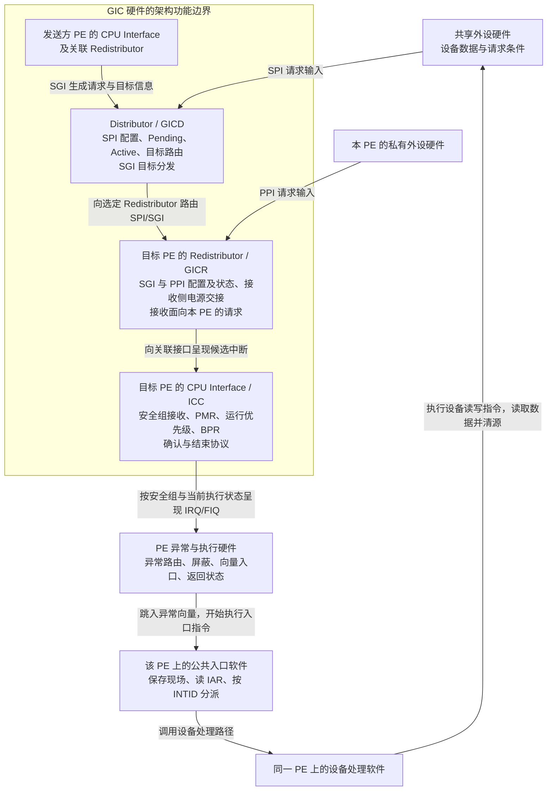
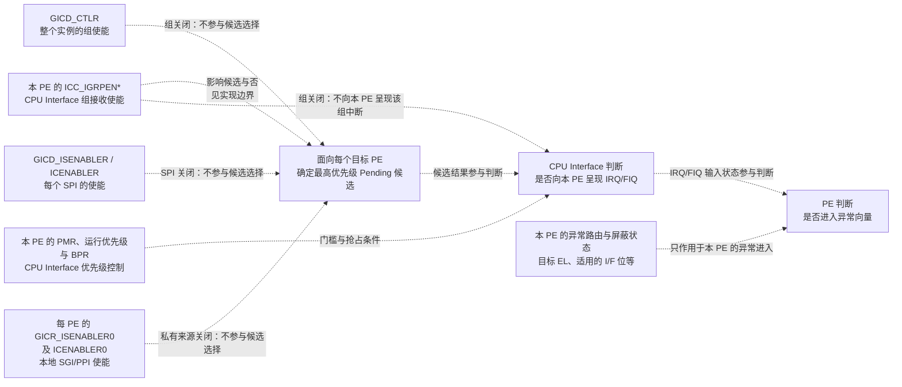

# 第6章\_权限\_安全分组与初始化闭环

## 6.1\_为什么照着寄存器名写值还不够

前面已经能追踪 **通用中断控制器（Generic Interrupt Controller，GIC）** 的请求处理与优先级。但这些过程默认初始化成立。现在把机器放回启动时刻：处理入口还没建立，软件权限可能尚未开放，接收侧也未必处于可接收状态。此时先使能外设，可能让请求进入尚未准备好的路径。

本章放大 [S0 准备阶段](P04_一次中断的状态转换与完成协议.md#4.4_用同一组阶段闭合正常周期)，说明初始化的因果依赖，而不是给出可以在任意开发板上直接运行的寄存器写值表。默认讨论 AArch64 这个 64 位执行状态、GICv3.0 的亲和性路由，以及普通非安全操作系统使用的物理中断路径。

## 6.2\_先区分权限层次与安全状态

设想串口请求已经送到一个 **处理单元（Processing Element，PE）**，这时 PE 正在执行应用。处理代码在哪里运行？应用是否能随意把串口改交给另一个系统？这两个问题需要处理器的权限与安全模型来回答。

**异常级（Exception Level，EL）** 是 Arm 处理器组织软件权限和异常目标的层次。编号 EL0、EL1、EL2、EL3 分别表示第 0～3 异常级。同一个 PE 会随执行过程进入不同 EL，不是每个 EL 各有一颗处理器，也不是把所有来源分成四种中断。

| 异常级 | 常见的软件职责 | 与当前中断路径的关系 |
| --- | --- | --- |
| EL0 | 应用程序 | 可以被中断打断，但不能直接作为物理中断的异常接收目标 |
| EL1 | 操作系统内核 | 运行内存管理、系统调用、驱动等；处理中断是其中一种工作 |
| EL2 | 管理虚拟机的软件 | 可以按配置接管某些物理异常或截获下层访问 |
| EL3 | 安全固件 | 可以配置安全交接与高权限异常路由 |

这些是机制允许的软件安排，不断言所有系统都实际运行四层软件。如果应用能任意改所有中断配置，内核就无法保证隔离；因此访问某个寄存器需要满足当前权限与上层许可。寄存器名带有 EL1，也不等于“只有 EL1 能访问”或“这个寄存器决定去 EL1”。

**安全状态（Security state）** 则描述 PE 当前处在哪个安全访问域。本章采用传统的 **Secure（安全）** 与 **Non-secure（非安全）** 两状态模型；Non-secure 是域名，不表示系统已经遭到攻击。Secure EL1 与 Non-secure EL1 都是 EL1，但属于不同安全环境中的软件上下文。EL 说明权限层次，安全状态说明访问域，两者组合描述 PE 当前的执行位置；传统模型中的 EL3 承担安全切换控制，不能把它们当作任意自由组合的两张标签表。

这时可以定位第三种对象了：**中断安全组描述 GIC 中某个来源的归属；安全状态和 EL 描述处理器及软件当前的执行位置。** 两者通过“GIC 呈现哪种异常输入，处理器把该输入路由到哪层”连接。它们有关联，但来源上的一个分组位不会自行改变 PE 的 EL，也不直接选择某个设备函数。

> 官方对照：[Exception model，Version 1.0，ARM062-1010708621-27](https://developer.arm.com/-/media/Arm%20Developer%20Community/PDF/Learn%20the%20Architecture/Exception%20model.pdf?revision=a62f2bf2-b08a-4a4f-8cbe-38c67ddf4434)，第 2 章 Privilege and Exception levels、3.1 Execution states、3.2 Security state、5.3 Routing asynchronous exceptions。这里不引入后续架构增加的安全状态。

## 6.3\_安全组不是优先级分组

本节沿一条物理来源路径，把“来源归哪个安全域”“先交给哪个 PE”“最后由哪个 EL 接收”分别落到具体硬件状态，再把它们连成一次过程。

### 6.3.1\_来源分组位放在哪里\_与其他组有什么区别

先把启动中的所有权问题说具体：串口准备交给普通非安全操作系统使用，另一个来源则保留给安全软件。即使两者碰巧使用相同优先级，也不能让非安全内核随意改写、确认安全软件的来源。优先级只回答紧急程度，不能承担这份隔离责任；GIC 还必须为来源保存安全归属，并在后续访问与递送时使用它。

因此，准备阶段先由有权软件标明来源归属，普通内核随后只能在获准的范围内配置和处理。请求到来时，GIC 按已经保存的归属判断访问与呈现规则，不是由设备处理函数临时声明自己属于哪个安全域。下面的三种安全组，是这份归属及递送规则的架构编码；它们不是优先级高低，也不是三个固定的异常级。

**中断标识符（Interrupt Identifier，INTID）** 标识 GIC 的一个来源。在启用两安全状态的 GICv3 配置中，每个来源可以分配到 **安全第 0 组（Secure Group 0）**、**安全第 1 组（Secure Group 1）** 或 **非安全第 1 组（Non-secure Group 1）**。这些是访问与安全归属类别，影响谁能配置、确认和接收它。

**共享外设中断（Shared Peripheral Interrupt，SPI）** 的这些配置保存在 **分发器（Distributor）** 一侧，通过 `GICD_IGROUPR<n>`，即 **Interrupt Group Registers（中断分组寄存器）**，与 `GICD_IGRPMODR<n>`，即 **Interrupt Group Modifier Registers（中断分组修饰寄存器）** 的对应位表达。下面列的是来源对应的单个位，不是整个寄存器的数值：

| IGROUPR 位 | IGRPMODR 位 | 来源安全归属 |
| --- | --- | --- |
| 0 | 0 | Secure Group 0 |
| 0 | 1 | Secure Group 1 |
| 1 | 0 | Non-secure Group 1 |
| 1 | 1 | 保留编码，硬件按 Non-secure Group 1 处理；不把它当作初始化时的有效配置选择 |

有权安全软件在 S0 初始化或受控重新配置时写这些位；GIC 在后续递送与访问检查中使用它们。**私有外设中断（Private Peripheral Interrupt，PPI）** 与 **软件产生中断（Software Generated Interrupt，SGI）** 的分组由目标 PE 对应的 **再分发器（Redistributor）** 保存，接口为 `GICR_IGROUPR0`、`GICR_IGRPMODR0`。普通非安全内核不能因为需要一个来源，就擅自把安全固件保留的来源改组。

将上面的两位编码落实到地址时，先区分三个 MMIO 窗口：`GICD_base` 是 Distributor 基址，`RD_base` 是所选 PE 的 Redistributor 控制页基址，`SGI_base` 是同一 PE 的 SGI/PPI 页基址。它们是窗口名称，芯片的实际基址需由平台资料提供；不能拿一个 PE 的窗口偏移去控制另一 PE。

| 分组寄存器与作用范围 | MMIO 地址与宽度 | 当前相关位及访问语义 |
| --- | --- | --- |
| `GICD_IGROUPR<n>`：共享 SPI 的组属性 | `GICD_base + 0x0080 + 4n`，32 位 | bit x 对应 INTID `32n+x`，与下面的同号修饰位组合；按权限可读写 |
| `GICD_IGRPMODR<n>`：共享 SPI 的组修饰 | `GICD_base + 0x0D00 + 4n`，32 位 | bit x 为同一 SPI 的修饰位；不是第二个独立使能开关 |
| `GICR_IGROUPR0`：所选 PE 的 SGI/PPI 组属性 | `SGI_base + 0x0080`，32 位 | bit x 对应该 PE 的 INTID x；低 16 位为 SGI，高 16 位为 PPI |
| `GICR_IGRPMODR0`：所选 PE 的 SGI/PPI 组修饰 | `SGI_base + 0x0D00`，32 位 | 与该 PE 的 `GICR_IGROUPR0` 同号位组合，不改变另一 PE 的同号来源 |

本表继续限定亲和性路由开启、两安全状态有效。在这个边界下，上述分组寄存器对非安全访问读作 0、写入无效；有权安全软件写入的是来源的归属，读取不会确认它。SPI 的 n、x 分别为 `INTID DIV 32`、`INTID MOD 32`。依据为 IHI0069 H.b 的 12.9.13、12.9.15（12-566～12-571）以及 12.11.12（12-662～12-663）、12.11.14（12-666～12-667）。

上表限定两安全状态有效，亦即 `GICD_CTLR` 中 **禁用安全状态（Disable Security，DS）** 字段为 0；单安全状态配置应查它自己的编码语义，不能直接套用三类来源表。

后面的 GICD/GICR 是 Distributor 与 Redistributor 寄存器前缀的合写，分别指分发器和再分发器接口。**二进制分割点寄存器（Binary Point Register，BPR）** 把优先级分为用于抢占的高位与用于排队细分的低位；**优先级屏蔽寄存器（Priority Mask Register，PMR）** 保存接收门槛。它们延续上一章的优先级规则，作用与安全归属不同。现在可以把易混名称放在同一张表里：

| 名称 | 分类或控制什么 | 状态位置与作用时刻 | 不会直接决定什么 |
| --- | --- | --- | --- |
| 中断安全组 | 某 INTID 的安全归属 | GICD/GICR 分组位；S0 配置，S2～S3 递送与访问时使用 | 组优先级数值、最终处理函数 |
| 中断安全组使能 | 是否放开指定安全组的递送 | `GICD_CTLR` 的全局使能与每 PE 的 `ICC_IGRPEN*` 接收使能 | 不修改来源归属，也不修改 EL |
| 组优先级 | 优先级高位部分；高位相等的来源互不因子优先级抢占 | 来源优先级与接收侧 BPR；S2 比较抢占条件 | Secure/Non-secure 归属 |
| 安全状态 | PE 当前所在的安全访问域 | 处理器执行状态；影响访问和 IRQ/FIQ 呈现 | 某个设备 INTID 的分组位 |
| 异常级 EL | PE 当前软件权限层次及异常接收层次 | 处理器执行状态与异常路由；S3 建立异常入口 | 外设数据或工作队列长度 |

### 6.3.2\_硬件结构与配置归属先对齐

**处理器接口（CPU Interface）** 是每 PE 的 GIC 架构接口；CPU 是 **Central Processing Unit（中央处理器）**。该接口以 `ICC_*` 系统寄存器提供确认、优先级和结束协议，其中 **中断确认寄存器（Interrupt Acknowledge Register，IAR）** 用于领取具体 INTID。它属于 GIC 的功能模型，但可以集成在处理器核内；下图画的是 **功能边界与状态所有权**，不是声称所有 GIC 电路都物理独立于 CPU 核。

**IRQ（Interrupt Request，中断请求）** 与 **FIQ（Fast Interrupt Request，快速中断请求）** 是呈现给 PE 的两类中断异常输入。设备到 GIC 的请求线，与 GIC 向 PE 呈现的 IRQ/FIQ，不是同一层的“设备原样直连”。

图中的 `GICD`、`GICR` 分别表示 Distributor 与 Redistributor 的寄存器接口，`ICC` 表示处理器接口系统寄存器族；SPI、PPI 和 SGI 沿用前文已经建立的三类来源。



图中实线表示架构规定的请求递送与处理动作，未展开芯片内部总线。SPI 经 Distributor 到目标 Redistributor，再到关联 CPU Interface；PPI 直接进入本地 Redistributor；SGI 由发送侧接口产生，经 Distributor 分发给一个或多个目标 Redistributor。**经过哪个模块，与来源配置保存在哪个接口，是两个问题：SPI 的配置与状态不会因为经过目标 Redistributor，就变成该 PE 的 SGI/PPI 状态。** SGI 入口是发送方发出的生成命令，也不能画成某根外设引脚。消息中断的内存状态与翻译服务在后文单独建立。

#### (1)\_全局组使能怎样约束本地请求

只看上图，容易产生一个新疑问：PPI 没有走 Distributor 的 SPI 路由路径，为什么关掉 `GICD_CTLR` 的组使能，它仍然不能送达？原因是 **请求流向** 与 **配置作用范围** 不同。Distributor 既管理共享来源，又提供 GIC 实例级的控制接口；后者的影响不以“请求是否穿过 SPI 路由逻辑”为边界。

再看三种准备进度：某个串口处理路径尚未准备好，只应暂缓这一个来源；PE1 的入口尚未准备好，应暂缓 PE1 接收这一组，但让已经就绪的 PE0 继续工作；如果整个非安全组尚未完成交接，则需要实例范围的组控制。一个开关不能同时表达这三种范围，否则局部准备会不必要地挡住其他接收者。下文分别用来源使能、本 PE 组接收和全局组使能表达它们。

这里把范围限制为当前 GICv3.0 亲和性路由下的 SGI、PPI、SPI。`GICD_CTLR` 是 **分发器控制寄存器（Distributor Control Register）**，其中三类安全组的全局使能约束整个 GIC 实例。以两安全状态有效时的安全访问视图为例，`EnableGrp0`、`EnableGrp1S`、`EnableGrp1NS` 分别允许 Group 0、Secure Group 1、Non-secure Group 1 参与递送；非安全访问视图及单安全状态模式的字段语义应另查对应寄存器定义。

再看来源自己的开关。`GICR_ISENABLER0` 是 **中断置使能寄存器（Interrupt Set-Enable Register）**，`GICR_ICENABLER0` 是对应的 **中断清使能寄存器（Interrupt Clear-Enable Register）**。在一个 PE 的 Redistributor 中操作它们，只改变该 PE 的 SGI/PPI 单中断使能，不会改变另一 PE 的同号私有来源，也不会为到来的 SPI 创建第二套私有使能位。SPI 的单中断使能仍由 `GICD_ISENABLER<n>`、`GICD_ICENABLER<n>` 这组 GICD 接口按 INTID 管理。

接收端还有自己的选择。`ICC_IGRPEN0_EL1`、`ICC_IGRPEN1_EL1` 是 **中断组使能寄存器（Interrupt Group Enable Registers）**，控制本 PE 的 CPU Interface 是否接收相应组；Group 1 还须分清安全与非安全副本，上层可以通过 `ICC_IGRPEN1_EL3` 控制对应使能。PMR 与运行优先级继续决定本 PE 的优先级条件。即使这些 GIC 条件都满足，PE 自身仍要依据异常路由和屏蔽状态决定是否进入异常。

下面只画 **配置作用范围与判断依赖**。虚线表示控制状态或前一项判断结果影响哪项判断，没有一条表示 PPI 请求需要绕行的硬件连线；判断框是规范语义的分界，也不是额外的硬件模块。



规范 4.7.2 把两个时刻分开：先由 GICD/GICR 所控制的状态确定各目标 PE 的 **最高优先级挂起中断（highest priority pending interrupt）**，再由 CPU Interface 判断是否向 PE 发出信号。对 Pending 来源，单中断未使能，或所属组在 `GICD_CTLR` 中关闭，都会使它退出前一项候选选择。PPI/SGI 的本地来源开关即使已经打开，也不能越过全局组开关。**这是配置控制状态的作用范围，不表示 PPI 请求进入了 Distributor 的 SPI 路由路径。**

只关闭 CPU Interface 的组使能，则不能简单理解成同样的“从候选集合删除”。对于 PPI 这样固定接收 PE 的 **直接中断（direct interrupt）**，如果单中断和全局组均已使能，该来源是否继续参与最高优先级候选选择，由实现定义。若它仍被选为最高优先级来源，硬件不会向 PE 呈现它，却可能因此挡住另一个已开放组中的较低优先级 Pending 来源。因此，“关闭一组以后，其他组必然立刻获得递送机会”不是可移植保证。下一章的 **1-of-N（从多个候选 PE 中选一个）** SPI 路由另有明确规则：关闭某 PE 的相应 CPU Interface 组使能，会使该 PE 不能被选为这个请求的接收者。

SGI 的来源开关还需保留一个实现边界：规范 4.7.1 允许实现将 SGI 永久使能，也允许通过 `GICR_ISENABLER0`、`GICR_ICENABLER0` 使能和禁用它们，具体选择属于 **实现定义（IMPLEMENTATION DEFINED）**。不能仅凭存在这两个寄存器名，就承诺任意芯片都能关闭每个 SGI；“SGI 单中断永久使能”也不等于它不受组使能、优先级及 PE 接收条件约束。

还要区分“暂停递送”与“是否记录后来发生的事件”。单独禁止某个来源，不阻止它改变 Pending 等状态；但规范 4.7.3 对 **三个全局组使能都为 0** 的情况另留边界：新的边沿请求是否置 Pending，以及 SGI 生成操作是否能置 Pending，均由实现定义。因此，不能把“关闭来源后仍能积累请求”推广成“任意实现关闭全部全局组以后，仍一定记录所有新通知”。

至此，三个开关各自挡住什么、相互怎样约束已经分清。初始化时再把对应范围落实为以下读写；字段中的“使能”只改变许可，不代替确认或结束协议。

`GICD_CTLR` 位于 `GICD_base + 0x0000`，是 32 位 MMIO 寄存器，访问属性必须按字段区分。这里仅列上述组控制在两安全状态安全视图中的字段；下表的全局范围均是当前 GIC 实例。

| 字段 | 位号与属性 | 当前机制中的效果与前提 |
| --- | --- | --- |
| `EnableGrp0` / `EnableGrp1NS` / `EnableGrp1S` | 分别为 bit 0 / 1 / 2，可读写 | 0 禁止、1 允许相应安全组递送；不改来源分组，不清除已有 Active |

非安全软件看到的不是以上完整安全视图。在本章非安全亲和性路由已开启，即 ARE_NS 为 1 的边界下，非安全视图 bit 1 名为 `EnableGrp1A`，是安全视图 `EnableGrp1NS` 的读写别名；bit 0 为保留零位，不能照抄旧式模式 bit 0 的组使能写法。单安全状态视图又有自己的字段布局，本章不将两者混用。依据为 IHI0069 H.b 的 12.9.4（12-544～12-549）；模式字段的权限和变更条件在第 6.4 节集中说明。

| 来源使能接口 | MMIO 地址、宽度与范围 | 读写对应位的效果 |
| --- | --- | --- |
| `GICD_ISENABLER<n>` | `GICD_base + 0x0100 + 4n`；32 位；共享 SPI | 读出当前使能；写 1 置使能，写 0 无效 |
| `GICD_ICENABLER<n>` | `GICD_base + 0x0180 + 4n`；32 位；同一组共享 SPI | 读出当前使能；写 1 清使能，写 0 无效 |
| `GICR_ISENABLER0` | `SGI_base + 0x0100`；32 位；所选 PE 的 SGI/PPI | 读出当前使能；写 1 置使能，写 0 无效 |
| `GICR_ICENABLER0` | `SGI_base + 0x0180`；32 位；所选 PE 的 SGI/PPI | 读出当前使能；对可禁止的来源，写 1 清使能，写 0 无效 |

SPI 的位号仍为 `INTID MOD 32`，寄存器序号 n 为 `INTID DIV 32`；私有来源直接以 INTID 作为位号。置位与清位接口读取的是同一份使能状态，不能用“向置使能接口写 0”来禁止来源。访问受来源安全权限与实现能力限制，写入不会自动清 Pending 或完成 Active。上述偏移和语义来自 IHI0069 H.b 的 12.9.7（12-554～12-555）、12.9.26（12-593～12-594）、12.11.5（12-649～12-650）、12.11.25（12-688～12-689）；禁止动作的传播完成另见第 6.6 节。

| 当前 PE 的 CPU Interface 接口 | 宽度与访问方式 | 本章相关字段及作用 |
| --- | --- | --- |
| `ICC_IGRPEN0_EL1` | 64 位系统寄存器，按权限 `MRS/MSR` 可读写 | Enable bit 0：0 禁止、1 允许本 PE 的 Group 0 接收 |
| `ICC_IGRPEN1_EL1` | 64 位系统寄存器，按权限 `MRS/MSR`；按安全状态分副本 | Enable bit 0：控制当前安全状态的 Group 1 接收，不控制其他 PE |
| `ICC_IGRPEN1_EL3` | 64 位系统寄存器，EL3 用 `MRS/MSR` 可读写 | `EnableGrp1NS` bit 0、`EnableGrp1S` bit 1；分别与上述非安全／安全副本的 Enable 位互为别名，不是额外串联的两道开关 |

这里仍讨论物理接口，假设系统寄存器访问已获许可、未被截获或重定向。关闭组接收不代替确认、优先级下降或停用；优先级门槛与状态接口的本章作用，继续使用第五章的 [PMR、RPR 与 APR 表](P05_优先级_屏蔽与嵌套处理.md#5.3_先过固定门槛_再过当前处理的门槛)。组接收位依据为 IHI0069 H.b 的 12.2.15～12.2.17（12-257～12-264）。

回到本卷已经核对的 GIC-600 r1p6，产品手册附录 B 表 B-1（Appx-B-203）为上述三个问题给出了具体选择。下面按本节的问题重排相关行，其他实现定义项不在这里展开。

| 表 B-1 的项目 | GIC-600 r1p6 的选择 | 对前面推理的影响 |
| --- | --- | --- |
| Interrupt enables | 全部 SGI 都有可编程使能 | 在这个产品上，可以用对应的 GICR 来源使能接口开关 SGI，不必把它们当作永久使能 |
| Interrupt prioritization 中的组使能条目 | 被 CPU Interface 禁止的中断不参加最高优先级挂起中断选择，也不阻塞已完全使能的较低优先级中断 | 这个产品没有采用前述“被禁止的组仍占据最高候选位置”的实现选择 |
| Effects of disabling interrupts | 请求进入 Pending 不受 `GICD_CTLR.EnableGrp*` 取值影响 | 即使全局组都被关闭，产品仍可记录新请求；记录请求与允许递送仍是两个动作 |

表格分别回答“这个产品怎样实现”与“所有架构合规产品必须保证什么”。不能把右侧的产品结论扩大成任意 GICv3 实现都必须采用的规则。

#### (2)\_用一个PPI检查四种开关的边界

固定一个纸面例子：PE0、PE1 各有一个本地定时来源，均使用教学编号 INTID 29。这个编号在 PPI 范围内，但这里不声称它就是某块板的定时器连接。两个来源都属于 Non-secure Group 1，各自的来源使能、全局组使能及 CPU Interface 组使能均已开放；两颗 PE 都在 Non-secure EL1 执行，IRQ 路由到各自当前 EL1，优先级条件也允许接收。再假定 PE0 的来源已 Pending、尚未被确认，设备请求条件持续有效。

每一行都从这个起点独立推演，配置写入已按要求完成传播；先预测是否还能递送给 PE0，再判断影响会不会扩展到 PE1。

| 只改变这一项 | 需要判断的边界 |
| --- | --- |
| 清除 PE0 对应 GICR 中 INTID 29 的单中断使能 | PE1 的同号 PPI 是否也被关闭？ |
| 清除安全视图 `GICD_CTLR.EnableGrp1NS` | 为什么 PE0、PE1 的这组 PPI 都受影响？ |
| 只关闭 PE0 的 Non-secure `ICC_IGRPEN1_EL1.Enable` | PE1 的组接收是否改变？是否能保证 PE0 另一组的低优先级来源立刻递送？ |
| 只把 PE0 的 PSTATE.I 设为 1 | GIC 的来源使能或 Pending 是否因此被清除？ |

**参考答案：** 第一行只关闭 PE0 的这一个来源；PE1 的 INTID 29 有自己的 GICR 状态，不随之改变。第二行关闭的是 GIC 实例级 Non-secure Group 1，两个 PE 的该组来源都不能进入最高优先级候选选择，原因是共享控制的范围。第三行仅阻止 PE0 接收这一组，不改变 PE1；对 PE0 的其他组能否立刻递送，未固定实现时还要按刚才的直接中断规则判断，若采用 GIC-600 r1p6 的选择，该禁用组来源就不会占住最高优先级候选。第四行只阻止本例中 PE0 的同级 IRQ 异常进入，不回写 GICD/GICR 的来源配置，也不阻止 PE1 接收自己的 IRQ。

四行都没有执行来源确认，所以不能把 **使能（Enable）** 写成“将中断激活”；**活动（Active）** 是确认后产生的处理交接状态。关闭组或来源使能也不等于执行清 Pending，更不能代替已经 Active 的来源完成结束与停用协议。对本例仍持续有效、尚未确认的 PPI，相关开关重新开放且其余条件满足后，可以继续递送；不需要靠“再来一次新事件”重新获得那个仍然存在的请求。至于把 IRQ 改路由到更高 EL 后怎样解释 PSTATE 屏蔽，要继续进入下一节的异常路由模型，不能把本例条件外推。

> 官方对照：[IHI0069 H.b](https://developer.arm.com/documentation/ihi0069/hb)，3.1 The GIC logical components（3-42）核对 SPI/PPI/SGI 请求路径；4.7.1 Enabling individual interrupts、4.7.2 Interaction of group and individual interrupt enables、4.7.3 Effect of disabling interrupts（4-69～4-70）核对来源使能、全局组使能、CPU Interface 组使能及实现定义边界。[GIC-600 r1p6 手册](https://developer.arm.com/documentation/100336/0106)，附录 B 表 B-1（Appx-B-203）的 Interrupt enables、Interrupt prioritization、Effects of disabling interrupts 三行给出产品选择；表内历史寄存器泛称不代替当前 IHI0069 的 `ICC_IGRPEN*` 编程接口定义。图与 PPI 例子是依据这些规则绘制的原创教学材料，不是芯片布局或板上实测。

### 6.3.3\_安全组怎样影响IRQ与FIQ\_又怎样到达EL

来源已经归组、目标 PE 也已选定，仍有一个交接问题：同一 PE 正在运行非安全应用时，普通串口请求与安全软件拥有的请求不能都直接交给当前内核。GIC 先按来源组别和 PE 当前执行状态呈现 IRQ 或 FIQ；随后 PE 再依据异常路由决定交给哪层软件。前一步只决定输入类别，不能完成后一步的安全切换或函数分派。

第一步由 GIC 选择向目标 PE 呈现哪一种输入。例如，在 Non-secure EL0/EL1 执行时，Non-secure Group 1 呈现 IRQ，Secure Group 1 则呈现 FIQ，使后续处理器路由能够区分这两条交接路径。本章使用 GICv3 两安全状态、AArch64 的基础组合：

| 目标 PE 当前执行位置 | Secure Group 0 | Secure Group 1 | Non-secure Group 1 |
| --- | --- | --- | --- |
| Secure EL0/EL1 | FIQ | IRQ | FIQ |
| Non-secure EL0/EL1/EL2 | FIQ | FIQ | IRQ |
| EL3 | FIQ | FIQ | FIQ |

因此，在非安全系统执行时，同为 Group 1 的两个安全归属可以呈现不同输入。GICv3 本章边界内 **Group 0 呈现为 FIQ**；Group 1 则要看当前安全状态与 EL，不能把它永远画成 IRQ。该表不涵盖 Secure EL2 等扩展组合。

第二步由 PE 决定输入进入哪一异常级。`SCR_EL3` 是 **Secure Configuration Register（安全配置寄存器）**，其 IRQ/FIQ 路由字段可以把相应物理异常送往 EL3。`HCR_EL2` 是 **Hypervisor Configuration Register（虚拟机管理程序配置寄存器）**，其中 IMO/FMO 是针对物理 IRQ/FIQ 路由至 EL2 的控制字段。本节只使用不重定向到 EL2 的主线；涉及虚拟化时需联合核对完整路由条件。EL3 路由配置优先于 EL2 路由配置，未被高层接管且符合当前执行条件的请求才按低层路径处理。

固定一个完整例子：串口是 Non-secure Group 1 SPI，目标 PE 正在 Non-secure EL0/EL1；`SCR_EL3.IRQ=0`，EL2 存在时未通过 `HCR_EL2.IMO` 等适用控制接管这条 IRQ；来源、接收侧与屏蔽条件均已准备好。GIC 呈现 IRQ，PE 接收到 EL1，再由 EL1 公共入口读 IAR1 识别来源。若同一时刻到来的是 Secure Group 1，则在这个非安全执行环境中呈现 FIQ；当 `SCR_EL3.FIQ=1` 时先进入 EL3，由安全固件决定安全上下文交接，不能直接画成“GIC 跳到 Secure EL1 的驱动”。

| 当前 PE 的处理器系统寄存器 | 宽度与访问权限 | 本节相关字段 | 对物理 IRQ/FIQ 的作用 |
| --- | --- | --- | --- |
| `SCR_EL3` | 64 位；EL3 通过 `MRS/MSR` 读写，普通 EL1 不可自行配置 | IRQ bit 1、FIQ bit 2 | 对应位置 1 时将相应物理异常路由到 EL3；置 0 只表示不由这项控制接管到 EL3，不是直接指定 EL1 |
| `HCR_EL2` | 64 位；有权的 EL2/EL3 软件通过 `MRS/MSR` 访问 | IMO bit 4、FMO bit 3；本例固定 TGE bit 27 与 E2H bit 34 为 0 | 在当前安全状态启用 EL2、且前述普通路由条件成立时，IMO/FMO 为 1 将对应物理 IRQ/FIQ 送往 EL2，除非已由 EL3 接管；为 0 不由这项控制接管 |

两者都属于处理器的异常路由配置，不是 GIC 寄存器；读取不确认中断，修改也不执行 EOI。TGE、E2H 会改变路由或宿主执行规则，所以本节明确固定它们，不能把表中 IMO/FMO 的两种取值推广到所有虚拟化模式。字段依据为 [DDI0487 M.c](https://developer.arm.com/documentation/ddi0487/mc)，D24.2.168 的 IRQ/FIQ（D24-9641～D24-9642）、D24.2.61 的 IMO/FMO（D24-8949～D24-8950）。

**GIC 的目标路由选择“哪个 PE”，处理器的异常路由选择“这个 PE 的哪个 EL”。** `GICD_IROUTER<n>` 是前者的 SPI 路由寄存器；SCR/HCR 是后者的处理器控制。改 SPI 目标不能自动改成 EL2 处理，改来源安全组也不是直接把一个 EL 数字写进 GIC。

| GIC 目标接口 | 地址、宽度与相关字段 | 与上表的区别 |
| --- | --- | --- |
| `GICD_IROUTER<n>`，一个 SPI 对应一项，n 直接等于 INTID | MMIO `GICD_base + 0x6000 + 8n`，64 位、按权限可读写；Aff0 `[7:0]`、Aff1 `[15:8]`、Aff2 `[23:16]`、Aff3 `[39:32]`，IRM bit 31 | IRM 为 0 时按亲和性坐标选择 PE；没有“目标 EL”字段，写入不确认来源。IRM 为 1 的候选选择条件到下一章建立 |

这里假设亲和性路由已经开启、写入有效的目标，后文再说明来源活动期间改目标的边界。地址与位域来自 IHI0069 H.b 的 12.9.22（12-584～12-585）；完整的目标选择见[硬件目标坐标](P07_目标选择_核间通知与电源交接.md#7.2_硬件目标坐标不是Linux逻辑编号)。PSTATE.I/F 的系统寄存器入口、位号及本章使用的屏蔽含义，见第五章的 [DAIF 表](P05_优先级_屏蔽与嵌套处理.md#5.5.1_哪些异常受哪个屏蔽位约束)。

**处理器状态（Processor State，PSTATE）** 的 I/F 位是本 PE 的接收控制之一。目标 EL 高于当前 EL 时不能套用“当前 I 位为 1 就挡住一切”的模型；目标低于当前 EL 时也不会强行降级进入。组归属、输入呈现、异常路由和当前执行状态要顺着同一条请求联合判断。

> 官方对照：[概览 198123，3.2-01](https://developer.arm.com/documentation/198123/0302)，第 4 章 Security model，PDF 第 16～17 页的输入呈现表与路由例子；第 6 章 Handling interrupts 的安全切换例子。[IHI0069 H.b](https://developer.arm.com/documentation/ihi0069/hb)，4.6 Interrupt grouping、12.9.13 GICD_IGROUPR、12.9.15 GICD_IGRPMODR。[Exception model 1.0](https://developer.arm.com/-/media/Arm%20Developer%20Community/PDF/Learn%20the%20Architecture/Exception%20model.pdf?revision=a62f2bf2-b08a-4a4f-8cbe-38c67ddf4434)，5.3 Routing asynchronous exceptions。

### 6.3.4\_把安全归属与异常进入放回S0到S6

下面仍使用[第四章的 S0～S6](P04_一次中断的状态转换与完成协议.md#4.4_用同一组阶段闭合正常周期)，放大刚才的非安全串口主线。**向量基地址寄存器（Vector Base Address Register，VBAR）** 保存异常入口集合的位置；**异常链接寄存器（Exception Link Register，ELR）** 保存返回地址；**保存的程序状态寄存器（Saved Program Status Register，SPSR）** 保存进入前的执行状态。它们由 PE 使用，不能当作 GIC 寄存器。

相对地，`ICC_IAR1_EL1` 是本例的中断确认接口；`ICC_EOIR1_EL1` 是 **中断结束寄存器（End Of Interrupt Register，EOIR）** 接口，`ICC_DIR_EL1` 是 **中断停用寄存器（Deactivate Interrupt Register，DIR）** 接口。它们推进 GIC 状态；**异常返回指令（Exception Return，ERET）** 则恢复 PE 的执行状态与位置。

| 阶段 | 谁执行或改变硬件状态 | 本例的状态落点 | 这一阶段解决的问题 |
| --- | --- | --- | --- |
| S0 准备 | 有权固件、控制器启动代码、设备驱动各自配置所属状态 | GIC 来源分组/优先级/目标；PE 的 SCR/HCR、VBAR 与接收状态；软件分派表 | 谁拥有来源，谁能够安全接收 |
| S1 事件 | 外设硬件保存数据并产生请求 | 外设缓冲与状态寄存器 | 真实工作在哪里 |
| S2 保留与选择 | GIC 保存 Pending，按使能、目标、优先级和安全组选择 | SPI 的 GICD 状态、目标 CPU Interface 的接收状态 | 哪个 PE 现在有资格收到哪个输入 |
| S3 异常进入与确认 | PE 先路由 IRQ 到 EL1，保存 ELR/SPSR 并跳向 VBAR；公共入口保存软件现场，再读 `ICC_IAR1_EL1` | PE 的返回状态、软件栈、GIC 的 Active 与运行优先级 | 先知道从哪里执行，再确认具体 INTID |
| S4 处理设备 | PE 执行来源对应的设备处理代码 | 外设数据/状态与软件队列 | 取走工作并消除设备请求条件 |
| S5 完成协议 | PE 执行结束寄存器写入，GIC 更新交接状态 | `ICC_EOIR1_EL1`，分离模式另用 `ICC_DIR_EL1` | 结束优先级占用，并完成来源停用 |
| S6 返回 | 公共退出代码恢复现场，PE 执行异常返回 | 软件栈、ELR/SPSR 与恢复后的 PSTATE | 返回之前的执行位置 |

S3 先进入架构向量再读 IAR；S5 的控制器结束也不是 S6 的处理器返回。把这两处分开，才能判断故障发生在来源识别、设备处理、控制器交接还是执行现场恢复。

这条时间线使用的确认、完成和返回接口已在前两章建立。下面只收拢本次交接所需的读写含义，再据此检查初始化。

| 本章复用的接口 | 本次使用的访问与效果 | 已建立的具体定义 |
| --- | --- | --- |
| `ICC_IAR1_EL1` | 当前 PE 的 64 位系统寄存器；读 INTID `[23:0]`，普通有效返回即确认 | [第四章确认与完成接口表](P04_一次中断的状态转换与完成协议.md#4.3_确认_清源_优先级下降与停用) |
| `ICC_EOIR1_EL1` / `ICC_DIR_EL1` | 当前 PE 的 64 位只写系统寄存器；按保存的 INTID 完成优先级下降／停用，效果由 EOImode 决定 | [第四章模式、配对与顺序](P04_一次中断的状态转换与完成协议.md#4.3_确认_清源_优先级下降与停用) |
| `ELR_EL1` / `SPSR_EL1` | 当前 PE 的 64 位处理器系统寄存器；保存返回地址／返回状态，公共入口须保护嵌套现场 | [第五章异常现场表](P05_优先级_屏蔽与嵌套处理.md#5.6.1_硬件先保存什么_公共入口还必须保存什么) |

有了这条链，初始化要求就不再是一串孤立寄存器名：必须先为各个后续阶段建立有效状态，才允许 S1 的设备请求进入。


## 6.4\_全局\_每核与每个来源分别准备什么

沿刚才的串口周期倒推启动工作：如果 PE1 刚开始运行，PE0 上的串口处理已经正常，PE1 不能为了准备自己的入口而重置全局来源；设备驱动稍后加入一个来源时，也不应重建每颗 PE 的接收接口。因此，准备工作要按状态所有权分工：全局软件先建立共享基础，每个 PE 建立自己的接收路径，设备路径最后补齐来源与处理数据。

**处理单元（Processing Element，PE）** 是接收并执行处理代码的实体。**再分发器（Redistributor）** 承担每个 PE 的接收侧配置；**处理器接口（CPU Interface；CPU 即 Central Processing Unit，中央处理器）** 承担确认与优先级交接。下表把这三种准备范围与遗漏后的结果对齐：

| 作用域 | 状态由谁准备 | 接收路径需要的条件 | 遗漏后的典型结果 |
| --- | --- | --- | --- |
| 全局 | 拥有控制器全局配置的软件 | 分发器的路由模式、组递送和共享来源基础设置 | 多个 PE 同时受到影响，或某类请求无法分发 |
| 每 PE | 固件与该 PE 的内核启动路径按职责交接 | 对应再分发器可用、CPU Interface 可访问、优先级与组接收设置、异常入口 | 其他 PE 正常，某个 PE 收不到 |
| 每来源 | 控制器驱动与设备驱动各管所属部分 | 类型、优先级、路由、使能；设备处理函数与设备条件准备 | 只有某个来源失败或持续重触发 |

**分发器控制寄存器（Distributor Control Register）** `GICD_CTLR` 包含组使能与路由相关字段。**亲和性路由使能（Affinity Routing Enable，ARE）** 表达按处理器硬件坐标路由的模式；GIC-600 不提供旧式兼容操作，其 ARE 固定为开启，不能把“先切到旧模式再初始化”当作当前平台通用步骤。

这里还有一项先后依赖：全局软件必须先确认固件留下的安全状态和路由模式，后续代码才能正确解释前面的分组位、组使能位与目标配置。随手修改模式会改变这些接口的解释环境，所以能够改写的实现也规定了关闭相关组、排空活动来源等前置条件；固定模式的实现则根本没有这一步切换。

`GICD_CTLR` 的地址仍是 `GICD_base + 0x0000`、宽度为 32 位。以下两行沿用两安全状态安全视图，读写须由有权软件执行；组使能字段已经在第 6.3.2 节解释。

| 字段 | 位号与属性 | 当前机制中的效果与前提 |
| --- | --- | --- |
| `ARE_S` / `ARE_NS` | 分别为 bit 4 / 5；是否可编程取决于实现 | 选择安全／非安全亲和性路由。若可编程，ARE_S 从 0 到 1 前三组都须关闭，ARE_NS 从 0 到 1 前非安全 Group 1 须关闭；不能从 1 改回 0。GIC-600 不支持旧式操作，不能按可切换模式处理 |
| `DS` | bit 6；可编程与否由实现决定 | 0 保留两安全状态。可编程实现要改为 1，须先关闭三组且不存在 Active 或 Active and Pending 来源；一旦置 1，只能由硬件复位清回 0 |

这些模式字段的定义与变更前提依据 IHI0069 H.b 的 12.9.4（12-544～12-549）；不是普通设备驱动每次启动时都应改写的参数。

再检查每个 PE 的访问准备。即使来源已经分配给当前内核、全局组也已开放，入口中的读取 IAR 指令仍可能在到达确认动作前就被上层截获，或因所需接口未启用而无法按预期访问。来源配置不会替软件打开这条访问路径，必须先完成固件与各异常级之间的许可交接。

CPU Interface 的系统寄存器访问由 `ICC_SRE_ELn` 中的 **系统寄存器使能（System Register Enable，SRE）** 等控制决定，n 表示对应异常级。

* 上层允许访问与当前层选择接口需要共同成立；
* 某些核将有关位固定为开启，也必须依据该实现确认，不能默认一次低权限写入就打开所有访问。

| 当前 PE 的系统寄存器 | 宽度、访问方式与本节字段 | 本节需要核实的许可 |
| --- | --- | --- |
| `ICC_SRE_EL1` | 64 位，按权限 `MRS/MSR`；SRE bit 0 | SRE 为 1 选择 EL1 的系统寄存器接口；其写入是否有效仍受上层配置和固定值实现约束 |
| `ICC_SRE_EL2` | 64 位，按权限 `MRS/MSR`；SRE bit 0、Enable bit 3 | SRE 控制 EL2 接口；Enable 控制低层对 `ICC_SRE_EL1` 的访问是否因这一控制而陷入 EL2；EL2 须在当前安全状态有效 |
| `ICC_SRE_EL3` | 64 位，EL3 用 `MRS/MSR`；SRE bit 0、Enable bit 3 | SRE 控制 EL3 接口；Enable 控制低层对 SRE 寄存器的访问是否因这一控制而陷入 EL3；另有 EL2 截获条件时仍须联合判断 |

SRE 与 Enable 不是“允许一切 ICC 访问”的总钥匙。Enable 的说明针对下层 **SRE 寄存器访问**，不能直接套成每一个 ICC 操作的唯一权限条件；组归属、异常路由与其他截获控制仍可能影响访问。当实现把相应字段固定为 1、或 SRE 为 0 导致 Enable 采用特殊有效值时，也不能仅看一次普通位写入推断模式已经切换。依据为 IHI0069 H.b 的 12.2.23～12.2.25（12-279～12-288）。

每个 PE 还需要有效的异常向量入口、可用栈和现场保存规则。异常向量是处理器在发生异常时使用的入口集合，其位置由 `VBAR_ELn`，即 **Vector Base Address Register（向量基地址寄存器）** 指定。向量入口与某个串口驱动函数不是同一层：先进入架构处理入口，再识别来源并分派到设备逻辑。

| 本例的处理器接口 | 宽度、访问方式与字段 | 作用与前提 |
| --- | --- | --- |
| `VBAR_EL1` | 64 位系统寄存器，当前无截获／重定向前提下 EL1 可 `MRS/MSR`；VBA `[63:11]`，低 11 位为 0 | 指定本 PE 进入 EL1 异常的向量表基址，要求 2 KiB 对齐并满足当前地址空间的有效地址规则；写入不触发 IRQ，不确认来源，也不是写设备处理函数的指针 |

这里用 `VBAR_EL1` 落实前述 `VBAR_ELn` 的 EL1 实例，更高异常级有各自的向量入口。该表依据 [DDI0487 M.c](https://developer.arm.com/documentation/ddi0487/mc)，D24.2.213（D24-10087～D24-10089）；表地址准备好仍不等于入口代码、栈和返回现场已经准备好。

> 官方对照：[概览 198123，3.2-01](https://developer.arm.com/documentation/198123/0302)，第 5 章 Configuring the Arm GIC（PDF 第 20～26 页）；[GIC-600 r1p6 手册](https://developer.arm.com/documentation/100336/0106)，3.9 Backwards compatibility（3-63）说明不支持旧式操作。系统寄存器许可继续查规范 IHI0069 H.b 第 12.2 节的 ICC_SRE_EL1/EL2/EL3 条目；向量查 Exception model 第 6 章 The vector tables。

## 6.5\_唤醒接收侧为什么要握手

PE 已经能执行启动代码，不等于它的 GIC 接收接口已经完成从静止到工作的转换。软件若清一个睡眠请求位就立刻继续使用接口，会把“已经提出准备接收”误当成“硬件已经准备好”。这里需要两份不同所有者的状态：软件表达交接请求，硬件回报相关接口的交接结果，后续初始化等待这个结果。

再分发器的 `GICR_WAKER` 是 **再分发器唤醒寄存器（Redistributor Wake Register）**。其 **`ProcessorSleep`（处理器休眠）** 字段由有权软件表达处理器的睡眠交接请求；**`ChildrenAsleep`（下属接口已休眠）** 由硬件反映有关接收侧接口的握手状态。两个字段不是同一个软件变量的别名。

在适用的启动序列中，软件清除 ProcessorSleep，然后等待 ChildrenAsleep 变为 0，再按契约配置和使用 CPU Interface。从 ProcessorSleep 为 1 转成 0 以前，必须先确认 ChildrenAsleep 已为 1，即前一次静止交接已经完成；不能在关核握手尚未完成时直接反向改位。原因是软件提出“准备接收”和硬件完成接口状态转换可能相隔一段时间；立即继续访问，不能由刚刚那次写指令证明安全。

这里的“等待”要带失败处理：若硬件、时钟或权限条件不成立，无限循环会把启动故障变成死等。工程实现应提供有依据的超时与诊断，并且 **不能在超时后假装握手已经完成**。具体等待多久由平台和驱动设计决定，本专题不虚构统一的微秒数。

下面把这次请求、等待和完成判断落到两个字段；位号只细化已经建立的握手，不替代前述先决条件。

该寄存器是所选 PE 的 32 位 MMIO 接口，地址为 `RD_base + 0x0014`，不是 `SGI_base` 页中的来源配置。两安全状态有效时，非安全访问读作 0、写入无效；必须先确认执行握手的软件具有访问权限。读取它只观察状态，不确认任何中断。

| 字段与位号 | 谁改变它 | 读到 1 表示什么 | 读到 0 表示什么 |
| --- | --- | --- | --- |
| `ProcessorSleep`，bit 1 | 有权软件写入 | PE 已进入或正在进入低功耗状态；到达该 Redistributor 的中断保持 Pending，并触发唤醒请求，不向 CPU Interface 继续传递 | PE 不在、也不正在进入上述低功耗状态 |
| `ChildrenAsleep`，bit 2 | 硬件更新，软件只读 | 与所连接 PE 相关的接口都已静止 | 与该 PE 相连的接口可能仍在活动 |

该表按 IHI0069 H.b 的 12.11.42（12-728～12-729）整理。位 1 表达软件交接状态，位 2 提供接口握手结果；不能把其中任一位单独当作“整个核已经断电”的读数。

关核时的逆向交接还要考虑未结束的请求和目标迁移，下一章单独解释；执行一条等待中断指令不自动等于应当设置 ProcessorSleep。

> 官方对照：[规范 IHI0069 H.b](https://developer.arm.com/documentation/ihi0069/hb)，12.11.42 GICR_WAKER, Redistributor Wake Register（12-728～12-729）；[GIC-600 r1p6 手册](https://developer.arm.com/documentation/100336/0106)，3.6.2 Processor core power management（3-57～3-58）。表中字段含义与正文先决条件共同构成握手协议，不能把一次写指令当成已经完成握手。

## 6.6\_写入顺序\_内存可见与硬件完成是三个问题

第四章已经说明，[清源与停用的先后差异](P04_一次中断的状态转换与完成协议.md#4.4.1_清源与停用先后不同_谁保证状态正确)可以形成不同的合法状态路径，GIC 内部状态机的正确性由硬件保证。这里进一步回答软件的问题：下一步需要依赖哪项效果，凭什么知道它已经被所需的观察者看到？

软件写了一个配置值，至少可能经过处理器、互连和控制器内部更新。**内存屏障（Memory barrier）** 用于建立特定访问的顺序或完成要求；**缓存维护（Cache maintenance）** 用于使某些内存更新被正确观察；**状态轮询（Status polling）** 则确认设备协议已经达到规定状态。三者不能互相冒充。

例如，软件要先禁止一个 SPI，再执行依赖“该禁止已经生效”的受控重新配置。禁止值由 PE 发出，经互连到达控制器，还可能继续传播到受影响的逻辑组件；写指令已经执行，不能独自证明这些组件都已看到变化。软件需要控制器报告这一段传播是否完成，再决定后续动作能否继续。

`GICD_CTLR` 与 `GICR_CTLR` 的 **寄存器写入待完成（Register Write Pending，RWP）** 字段为规范列出的部分写入提供这份完成观察。对上述受跟踪的禁止操作，软件写入后轮询相应 RWP，得到完成结果才依赖该效果；它不是等待中断处理函数返回，也不为未列入范围的写入作证。

先把本章已经用到的受跟踪操作列出来。`GICD_CTLR.RWP` 位于 bit 31，`GICR_CTLR.RWP` 位于 bit 3；值为 1 表示被跟踪的效果仍在传播，值为 0 才提供相应完成保证。下表是本章相关操作的选取，不是两个 RWP 字段的完整跟踪清单。

| RWP 所在接口 | MMIO 地址、宽度与范围 | 字段访问属性 |
| --- | --- | --- |
| `GICD_CTLR` | `GICD_base + 0x0000`；32 位，实例级控制 | RWP bit 31 只读，软件不能写 0 催促完成；组使能见第 6.3.2 节，模式字段见第 6.4 节 |
| `GICR_CTLR` | 所选 PE 的 `RD_base + 0x0000`；32 位，Redistributor 控制 | RWP bit 3 只读，报告当前安全状态的受跟踪写入；其他控制字段不因此都具备同样的完成语义 |

| 本章相关的配置动作 | 用哪个字段观察 | 该动作的跟踪边界 |
| --- | --- | --- |
| 关闭 `GICD_CTLR` 中的全局组使能 | `GICD_CTLR.RWP` | 组使能只跟踪从 1 到 0 的变化，不能用同一规则证明从 0 到 1 的开放已经传播完成 |
| 修改可编程的 ARE 或 DS 字段 | `GICD_CTLR.RWP` | 跟踪这些字段的写入；仍须先满足各字段的修改前提，固定字段不能因此变成可编程字段 |
| 经 `GICD_ICENABLER<n>` 禁止来源 | `GICD_CTLR.RWP` | 对本章的 SPI，观察其禁止动作向 GIC 各逻辑组件传播完成 |
| 经 `GICR_ICENABLER0` 禁止当前 PE 的 PPI 或可禁止的 SGI | 该 PE 对应的 `GICR_CTLR.RWP` | 保证针对当前安全状态受跟踪的写入效果已经可见；并不替另一个 PE 完成它的私有来源配置 |

例如写 `GICD_IPRIORITYR<n>` 修改优先级，就不在这张 RWP 跟踪清单中。它是 `GICD_base + 0x0400 + 4n` 的 32 位优先级配置接口，每个字节对应一个来源；其字节访问与位数规则见[第五章优先级接口表](P05_优先级_屏蔽与嵌套处理.md#5.2_优先级数值为什么越小越紧急)。读到 RWP 为 0，不能单凭这个结果证明该优先级写入满足了后续操作要求的全部同步条件。

RWP 不是“所有 GIC 寄存器都写完”的通用标志；没有被它跟踪的寄存器，要按自己的规则处理。普通 `ICC_EOIR1_EL1` / `ICC_DIR_EL1` 停用操作和外设请求电平的撤销，不是靠 RWP 证明完成的。RWP 变为 0 也不意味着设备处理函数已经退出。内存中表项的可见性与后文消息翻译服务的命令完成，稍后还会出现不同的确认方式。

> 官方对照：[规范 IHI0069 H.b](https://developer.arm.com/documentation/ihi0069/hb)，12.9.4 GICD_CTLR 的 RWP 字段（12-544），12.11.2 GICR_CTLR 的 RWP 字段（12-642）。上表整理本章所需的跟踪范围；原条目还包含后续路由、电源与 LPI 功能的相关写入，不能从 Register Write Pending 的名字推导它跟踪所有寄存器。

再看一个与普通处理中断直接相关的依赖：软件已经通过 CPU Interface 发出 SPI 停用操作，接下来需要保证 Distributor 以及访问 Distributor 的其他 PE 能观察到该操作。仅以“系统寄存器写指令已经执行”作为证明还不够；这与让硬件状态机正确执行停用，是不同的问题。

规范 12.1.6 为此给出了明确保证。**指令同步屏障（Instruction Synchronization Barrier，ISB）** 建立所要求的指令上下文同步；**数据同步屏障（Data Synchronization Barrier，DSB）** 在该条款指定的条件下建立相应操作的可观察性。对于这里的系统寄存器写入，须先在写入之后执行 ISB 或其他适用的上下文同步操作，再执行访问类型覆盖读和写的 DSB；只覆盖写的 DSB 不满足该条款条件。完成这一同步后，最近的 SPI Deactivate 命令已被 Distributor 以及任意 PE 对 Distributor 的访问观察到。这是一个有对象、有前提的保证，不能泛化成“屏障对停用传播没有作用”。

但这项保证也没有同时承诺 **外设请求线已经撤销并被 GIC 观察到**。停用已被观察到时，来源仍可能因有效电平或新事件而处于 Pending；ISB 也不是外设清源完成指令。设备访问的顺序、写入完成或必要读回，应按该设备、互连与所用访问接口的契约处理；不能随便读一个寄存器就认为所有路径已同步。

实际框架和架构访问器可能已经承担所需同步，应按它们的契约使用。这里没有给每次中断返回额外添加固定指令序列，而是解释：需要证明停用被观察到，就使用规范给出的相应完成条件；需要证明设备不再请求，就继续核对设备路径。等待固定纳秒数或几个 GIC 时钟周期，不能替代其中任何一项证明。

> 精确依据：[IHI0069 H.b](https://developer.arm.com/documentation/ihi0069/hb)，12.1.6 Observability of the effects of accesses to the GIC registers（12-195～12-196），其中分别列出 SPI 确认、Deactivate、DSB 的读写访问类型，以及 DSB 之前的 ISB／上下文同步前提。该节约束特定操作的观察范围，不是整个系统所有设备都已静止的保证。

## 6.7\_用依赖关系检查一次初始化

现在让串口从停止产生请求走到能够交给 PE0：先建立有权且可用的接收入口，再准备来源和设备状态，最后逐层开放。中途若访问许可、唤醒握手或必需的写入完成观察失败，缺失条件仍会影响后续阶段，所以不能用“前面大部分都成功”作为继续放开请求的依据。

下面是启动或独占教学环境下的 **动作级伪代码**。每个动作表示需要实现并验证的职责，不是可直接调用的 Linux 接口；省略了平台时钟、映射、具体访问器和寄存器编码，不能粘贴到运行中的 Linux 后执行。

```text
保持当前处理器异常接收受控，设备请求源暂不启动
确认当前权限、固件交接与控制器身份
建立异常入口、栈、现场保存和来源分派结构
在所有权范围内准备全局路由与组配置
使目标再分发器完成可接收握手；失败则停止启用路径并报告
准备每 PE 的系统寄存器访问、优先级门槛和结束模式
在来源尚未放开时配置其类型、优先级与目标
建立设备处理所需的数据结构，处理遗留设备条件
按照各寄存器契约完成必要的屏障与完成等待
放开组、来源及处理器接收条件，最后允许设备开始产生请求
```

该顺序表达的是关键依赖，不声称全部平台必须用同一条寄存器排列。重要的是：任何已经放开的输入，都只能到达已经准备好的接收者；失败回滚也只清理自己拥有且已经建立的资源，不能重置全系统 GIC。

## 6.8\_启动失败后\_哪些动作可以继续

用一份假想启动记录做纸面排障：全局配置已经由拥有者准备好；PE0 正常接收；PE1 的软件已经清除 ProcessorSleep，但连续观察 ChildrenAsleep 仍为 1，等待超时。设备驱动此时希望把一个 SPI 路由到 PE1。先判断应该继续放开来源、全局重置 GIC，还是停止这条接收路径的发布。

超时只证明在规定观察期限内没有得到握手完成证据，不证明硬件永远损坏，也不表示可以忽略。应停止把新工作交给尚未就绪的 PE1，保留必要现场，检查权限、时钟、电源与实现要求；如果要继续使用 PE0，必须由已有路由和软件所有权协议明确接管，而不是随便写另一个目标。PE0 已正常工作，所以重置全局控制器反而可能破坏无关来源。

若失败前仅分配了本地软件资源、尚未交给硬件，可按分配路径释放；若某些地址已经发布给硬件，就要先证明访问已经停止，再归还内存。失败回滚与正常启动共享同一组所有权边界，只是方向相反。

再预测一个变体：ChildrenAsleep 已为 0，但某次来源禁止操作的 RWP 一直未清，是否能够因为“核已经醒了”继续修改受依赖配置？不能。前一项只完成电源接口交接，后一项仍欠该寄存器契约的完成观察。把每个完成标志写在它负责的动作旁边，才能避免用一个成功标志替整段初始化盖章。

现在可以检查“初始化完成”的含义：不是某个函数返回了 0，而是从外设请求到安全可用处理入口的每个必要条件都已经成立。下一章把这个结论放到第二个 PE 和电源切换中，检查状态交接还能否成立。

复查顺序：先用本章各节的官方对照核对访问权、分组和握手，再逐项检查初始化依赖。本章没有执行裸机或板级初始化。

上一篇：[上一章](P05_优先级_屏蔽与嵌套处理.md#5.1_已经挂起的请求_为什么仍然不能进入)

[专题大纲](大纲.md#1.2_因果阅读地图)

下一篇：[跨核与电源交接](P07_目标选择_核间通知与电源交接.md#7.1_把请求交给另一个处理器_改变了什么)
