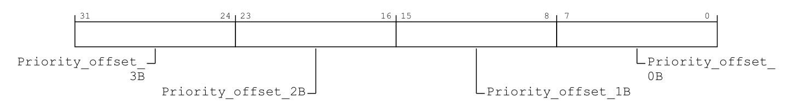
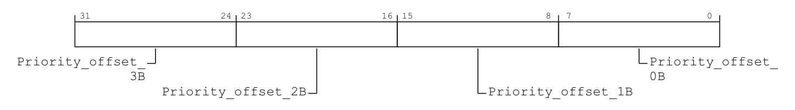
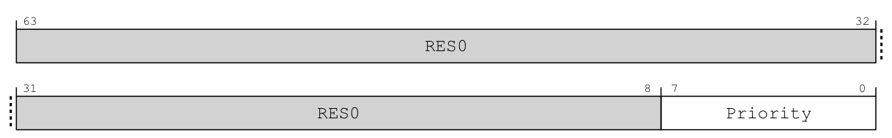
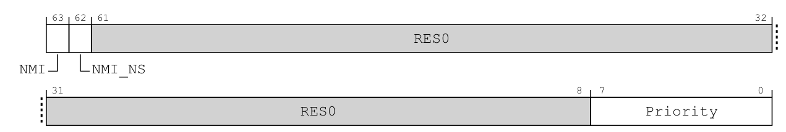
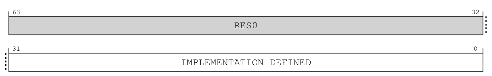
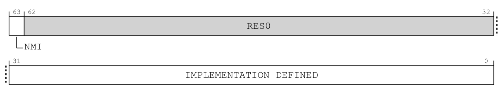
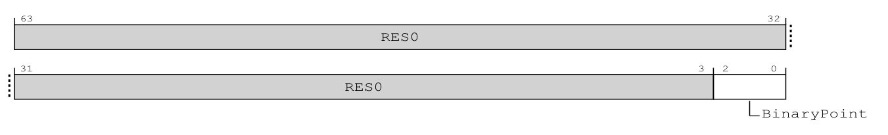
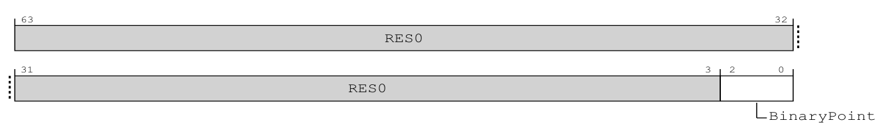
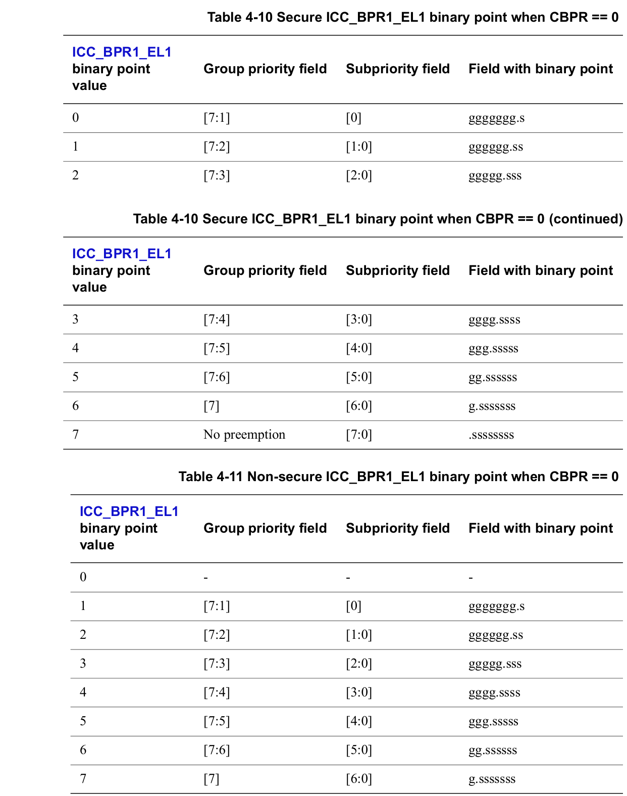

# 第7章\_优先级数值\_门槛与分组

## 7.1\_已经挂起的请求\_为什么仍然不能进入

**讲解层次：概念层。** 本章以 IHI0069 H.b 的 GICv3.0 优先级规则为主线；核对 GIC-600 的精度选择时单独标明实现层。

**通用中断控制器（Generic Interrupt Controller，GIC）** 保存了一个挂起请求，只表示该请求在等待确认，不代表它现在就能打断处理器。上一章的 [S2～S3](P06_一次中断的状态转换与完成协议.md#6.4_用同一组阶段闭合正常周期)之间，还存在接收条件的筛选。

本章只建立控制器怎样比较来源、怎样用门槛和组优先级决定候选及抢占资格。通过这些判断以后，处理器是否接受异常、软件能否安全嵌套，留给下一章。

本章先固定 **非安全第 1 组（Non-secure Group 1）**：这是把来源交给非安全软件使用的中断安全归属，不决定优先级。后文会明确区分它与“组优先级”。再固定同一个接收 **处理单元（Processing Element，PE）**，先看两个来源竞争。这样可以分开“在等待者中选谁”和“能否打断已经运行的处理代码”，不把安全切换、目标路由和嵌套同时倒进一个例子。

## 7.2\_优先级数值为什么越小越紧急

**讲解层次：概念层。** 依据 IHI0069 H.b 4.8 与优先级寄存器条目讨论编码、有效位和比较规则。

先回到同一个 PE 面前的两个请求：串口有数据待取，另一个本地定时来源也已挂起。假设系统设计要求先服务后者，仅靠 INTID 只能认出“是谁”，还不能表达“当前应该先给谁机会”。软件需要为每个来源配置紧急程度，GIC 再把这份配置用于候选选择；这份紧急程度就是本节的优先级。

GIC 用无符号数表示优先级，数值较小的来源具有较高优先级。这是编码约定，不是“中断号小所以优先”。**中断标识符（Interrupt Identifier，INTID）** 负责识别来源，优先级是另一个配置维度。

架构提供 8 位优先级字段，但实现可以只实现其中的高若干位。未实现的低位不能提供额外区分能力。因此不能因为字段有 8 位，就宣称有 256 个有效优先级。本章算例取 0x40、0x60、0x68、0x80 这些值，并假设所需高位有效；对具体机器还应核对实现与当前安全访问视图。

两条请求都挂起时，控制器先依据有效优先级选择适合递送的来源。对无法从当前信息区分的请求，不应依赖“刚好这一次先来了谁”建立软件正确性；设备队列和任务依赖不能寄托在未确认的仲裁细节上。

这里的数值比较描述同一时刻已经进入仲裁观察范围的候选。请求与配置的传播需要时间，不能把这个静态比较升级为“真实机器总按优先级从高到低进入处理函数”的绝对承诺。规范保证满足条件的最高优先级请求会在有限时间内送达，同时明确不保证较高优先级中断总在较低优先级中断之前被接收。后面的排队算例都固定候选集合与配置已经稳定，用来练习比较规则。

这些数值不是保存在设备数据寄存器中，而是写入 GIC 的 **中断优先级寄存器（Interrupt Priority Registers）**。亲和性路由开启时，接口按来源归属分成两组。下表的 `GICD_base` 是 Distributor 的 MMIO 基址，`SGI_base` 是所选 PE 的 SGI/PPI 页基址；`n = INTID DIV 4`，`b = INTID MOD 4`，即每个 32 位寄存器容纳四个来源的优先级。





> 原图来源：[IHI0069 H.b](https://developer.arm.com/documentation/ihi0069/hb)，12.9.20（12-580）与 12.11.21（12-680）。下面保留原字段名逐项中文对照；两图相同的字节布局不表示作用于同一组来源。

| 位段 | 原文字段 | 对应来源与中文读法 |
| --- | --- | --- |
| `[31:24]` | `Priority_offset_3B` | INTID `4n+3` 的优先级，位于当前寄存器字节偏移 3 |
| `[23:16]` | `Priority_offset_2B` | INTID `4n+2` 的优先级，字节偏移 2 |
| `[15:8]` | `Priority_offset_1B` | INTID `4n+1` 的优先级，字节偏移 1 |
| `[7:0]` | `Priority_offset_0B` | INTID `4n` 的优先级，字节偏移 0 |

四个字段都以数值较小表示较高优先级，实际有效范围取决于实现。H.b 同时描述后续非屏蔽来源的字段限制，本章 GICv3.0 普通可屏蔽来源按通常优先级解释，不把原图的 8 位宽度当作有效精度承诺。

`GICD_IPRIORITYR<n>` 位于 `GICD_base + 0x0400 + 4n`，亲和性路由路径使用已实现 SPI 的对应项；`GICR_IPRIORITYR<n>` 位于所选 PE 的 `SGI_base + 0x0400 + 4n`，n=0～3 覆盖 SGI，n=4～7 覆盖 PPI。两组都是 32 位可读写接口，也允许按字节访问。以 SPI 65 为例，n=16、b=1，原图指向 `[15:8]`；只改它的字节地址是 `GICD_base + 0x0400 + 65`，不是把优先级值 65 写入某个公共门槛。

写这些字段修改仲裁配置，不会确认或结束中断。访问还受来源安全归属限制；未实现的优先级低位读作 0、写入无效。多字节访问包含多个来源，软件必须避免无意覆盖相邻配置。依据为 IHI0069 H.b 的 12.9.20（12-580～12-581）、12.11.21（12-680～12-681）及 12.1.3 的访问宽度规则。

> 官方对照：[规范 IHI0069 H.b](https://developer.arm.com/documentation/ihi0069/hb)，4.8 Interrupt prioritization（4-71～4-72），特别是实现优先级位数、同优先级仲裁的实现定义，以及有限时间递送与实际接收顺序的保证边界。数值算例仅在所用位有效、处于相同安全访问视图时成立，不是 RK3588 运行配置。

## 7.3\_先过固定门槛\_再过当前处理的门槛

**讲解层次：概念层。** 依据 IHI0069 H.b 4.8.5～4.8.6，来源优先级、CPU Interface 门槛与活动优先级是不同状态。

选出了等待者中的高优先级来源，还不等于现在适合打断这个 PE。假设内核正在准备一段暂时不能被普通设备处理打断的本地状态，但仍希望允许更紧急的来源进入。逐个改写所有来源的优先级，既会改动原有先后关系，也不是只改变本 PE 当前接收政策的办法。接收侧需要一个独立门槛：来源保留自己的优先级和 Pending，当前 PE 只接收门槛以上的请求。

**优先级屏蔽寄存器（Priority Mask Register，PMR）** 的具体系统寄存器名为 `ICC_PMR_EL1`。它保存当前 PE 的优先级门槛，只有数值严格小于门槛的请求，才满足这一项递送条件。这里比较的是同一访问视图中的值；跨安全状态的数值转换不在本算例中混用。

如果门槛是 0x80，优先级 0x40 和 0x60 可以通过，0x80 本身不能通过。通过 PMR 仍不代表可以确认：来源可能未使能、目标不匹配，或者当前已经占用了更高的运行优先级。

但固定门槛还有一个缺口：门槛允许 0x40 和 0x60，不代表 0x60 已在处理时仍能无条件接受另一个 0x60。接收侧还要知道“此前确认、尚未完成优先级下降的处理，占用了什么优先级”，再判断后来者能否打断它。

**运行优先级（Running priority）** 表达接收侧尚未完成优先级下降的确认带来的约束。它不是 C 函数当前运行到哪行，也不是外设缓冲区的紧急程度。软件确认中断时，控制器更新它；软件按协议写结束寄存器后，再恢复之前的约束。可通过 `ICC_RPR_EL1`，即 **Running Priority Register（运行优先级寄存器）**，观察该接收侧状态。

```text
初始没有占用的中断优先级：运行优先级为 idle 值 0xFF
确认优先级 0x60 的来源：运行优先级收紧
优先级 0x40 的新来源到来：可能满足抢占条件
优先级 0x80 的新来源到来：不能因此抢占 0x60
完成当前优先级下降：恢复此前的接收侧约束
```

**抢占（Preemption）** 指更高优先级的请求引起嵌套处理，打断当前较低优先级的处理过程。硬件允许抢占，还不等于软件现场已经能安全嵌套；处理器异常屏蔽、栈、保存现场和处理程序可重入性仍须满足条件。

再把这条时间线延长一步：0x60 的来源尚未下降优先级时，0x40 的来源又被合法确认。现在接收侧首先受较高的那一档约束，但当 0x40 对应的 EOIR 到来，0x60 的约束还应恢复，不能直接变成 idle。**因此，接收侧必须保留尚未结束的活动优先级信息，运行优先级只是由这些信息形成的当前结果。** 仅抄下一个 RPR 读数，不能代替保存全部相关状态。

普通处理中，这些信息由确认和优先级下降协议推进，设备驱动无需手工维护它们。需要受控保存、恢复 CPU Interface 状态的软件，则通过 **活动优先级寄存器（Active Priority Registers，APR）** 访问这部分状态；它们不能与第六章按 INTID 保存的 Active 位混为一谈。下表都属于当前 PE 的 CPU Interface，AArch64 使用系统寄存器访问，不使用 MMIO 地址。

先看手册怎样分别画出“门槛”“当前结果”和“保存状态”，再判断它们为何不能互相代替。





> 原图来源：[IHI0069 H.b](https://developer.arm.com/documentation/ihi0069/hb)，12.2.19（12-267）与 12.2.20（12-270）。两者都是 64 位系统寄存器，PMR 用 `MRS/MSR` 读写，RPR 只读；下表为字段中文对照。

| 寄存器、位段 | 原文字段 | 中文对照及本章范围 |
| --- | --- | --- |
| PMR `[63:8]` | `RES0` | 保留为零 |
| PMR `[7:0]` | `Priority` | 优先级门槛；仅数值严格更小的来源满足此条件，未实现低位读零写忽略 |
| RPR `[63]`、`[62]` | `NMI`、`NMI_NS` | H.b 保留了后续 NMI 功能的布局；本章不实现该扩展，这两位按对应无扩展分支为 `RES0`，不能从图中推断当前平台具有 NMI |
| RPR `[61:8]` | `RES0` | 保留为零 |
| RPR `[7:0]` | `Priority` | 当前运行优先级；没有活动优先级时返回 idle 值 `0xFF` |

PMR 的写入改变后续接收门槛，不清 Pending。规范要求它的屏蔽效果自同步：写指令在架构上执行后，不需要另加 **指令同步屏障（Instruction Synchronization Barrier，ISB）** 才阻挡被新门槛屏蔽的请求；这项保证不证明其他 GIC 配置已完成。RPR 的读则只观察结果，不确认来源，也不下降优先级。





> 原图来源：同规范 12.2.1（12-216）、12.2.2（12-219）。每项都是 64 位、按权限 `MRS/MSR` 的系统寄存器；AP0R 保存 Group 0 信息，AP1R 保存 Group 1 信息并按安全状态分副本。

| 原图位段 | AP0R 的字段 | AP1R 的字段 | 中文对照 |
| --- | --- | --- | --- |
| `[63]` | `RES0` | `NMI`，仅 n=0 且相应扩展实现时有效 | 本章普通 GICv3.0 分支两者都为保留零 |
| `[62:32]` | `RES0` | `RES0` | 保留为零 |
| `[31:0]` | `IMPLEMENTATION DEFINED` | `IMPLEMENTATION DEFINED` | 实现定义的活动优先级状态；架构要求全零与没有活动优先级一致，没有把 bit x 定义成 INTID x |

因此，不能照第六章的 ISACTIVER 读法，把 APR 的一个置位位解释成某个来源仍活动。**手册在这一位置明确保留实现定义，比作者替它编一张逐来源位表更准确。** 普通 IAR／EOIR 协议更新这些状态；受控保存恢复才按原值和规定顺序访问 APR。

APR 的 n 取值是否实现取决于支持的优先级位数；不能假定 0～3 四项都存在。直接写入任意 APR 数值可能破坏抢占关系，状态恢复须遵守原值和规定顺序；这里提供的是状态位置说明，不是一份切换上下文的代码。上述系统寄存器均以前述物理接口访问许可已建立为前提，PMR/RPR 的安全视图还需与来源优先级一致。

> 官方对照：[规范 IHI0069 H.b](https://developer.arm.com/documentation/ihi0069/hb)，4.8.5 Preemption、4.8.6 Priority masking；上表按 12.2.19 ICC_PMR_EL1（12-267～12-269）、12.2.20 ICC_RPR_EL1（12-270～12-272）、12.2.1 ICC_AP0R（12-216～12-218）及 12.2.2 ICC_AP1R（12-219～12-222）整理。门槛、运行优先级与活动优先级保存接口各自承担不同问题。

**讲解层次：概念到实现的映射。** 在 GIC-600 r1p6 中，SPI 的优先级功能位于 Distributor 物理块，SGI/PPI 的逐 PE 优先级功能位于 PPI 物理块；本 PE 的 PMR、活动优先级与 RPR 则属于核内 CPU Interface。前两类通过 MMIO 从 Distributor 编程入口访问，后一类通过本 PE 的系统寄存器指令访问。

例如，有权软件把 PE0 的 PPI 29 优先级字段从 0x80 改为 0x40，最终修改的是 PPI 块中 PE0 对应来源的那一个配置字段。本次写入不修改 PE1 的 PPI 29 优先级字段；在没有其他软件改写该字段、也没有复位的条件下，PE1 的这项配置保持原值。这不表示 PE1 的整个 PPI 状态被冻结：它自己的设备事件、确认与停用仍可分别改变 Pending、Active。两个 PE 共用一个 PPI 物理块，也不把这些逐 PE 状态变成一份。

若只想让 PE0 暂时少接收一些请求，写 PE0 的 PMR 就改变核内门槛，无须逐个改写来源优先级，也不向各来源复制一份新优先级。硬件把来源的优先级用于候选与交付，CPU Interface 用自己的门槛和运行状态判断接收。这里已确认的是功能分配与接口，比较器数量、缓存和逐拍传播仍不从框图推断。

> 产品依据：[GIC-600 r1p6 TRM](https://developer.arm.com/documentation/100336/0106)，1.2（1-13）、2.2（2-29）、2.2.2（2-30）；状态类别和接口语义仍以本节 IHI0069 H.b 条目为准。

**回到概念层——优先级写入的生效边界。** 改的是哪个字段已经确定，但写指令执行不等于所有选择逻辑立刻采用新优先级。若 PE0 的这项 PPI 在写入时已经 Pending，架构允许它使用旧值 0x80 或新值 0x40；更新效果必须在有限时间内可见，而且不能因这次变更使中断丢失或被处理多次。这里只改变优先级配置，没有借此执行一次确认或停用。该规则见 [IHI0069 H.b](https://developer.arm.com/documentation/ihi0069/hb) 12.11.21，印刷页 12-681；所述旧值、新值均沿用本节同一访问视图。

## 7.4\_为什么还要区分组优先级与子优先级

**讲解层次：概念层。** 依据 IHI0069 H.b 4.8.3 建立分割规则，先计算架构数值，再核对具体产品的有效位。

有时希望两个来源在排队时分先后，但不希望它们互相打断。例如 B、C 都处理同一类低紧急度设备，先处理更紧急的 B 有价值，但在 C 已经执行时再为 B 保存一层现场，未必值得。如果始终比较完整优先级，B 比 C 紧急就会同时影响排队和抢占；若把两者设成完全相等，又失去等待者中的细分。因此需要让两种判断使用不同精度：把优先级拆成两个部分，高位的 **组优先级（Group priority）** 决定能否抢占，低位的 **子优先级（Subpriority）** 在等待者之间继续区分先后。这里的“同组优先级”准确地说是 **高位部分相等**，不是又创建了一个名叫 Group 0 或 Group 1 的来源集合。

### 7.4.1\_把一个优先级数值按位拆开

**讲解层次：概念层。** 以下为 IHI0069 H.b 组优先级规则的位运算算例，假设所用位均已实现。

先对控制器使用的 **完整 8 位优先级** 做教学计算，暂不把它当作非安全软件直接读写的数值。假设低 4 位属于子优先级，高 4 位属于组优先级：

```text
完整优先级：  b7 b6 b5 b4 | b3 b2 b1 b0
用于抢占：  保留高 4 位 | 低 4 位视为 0
等待者选择：比较完整有效优先级，仍保留低位的先后差异

B = 0xB0 = 1011 | 0000，抢占比较值 0xB0
C = 0xB4 = 1011 | 0100，抢占比较值 0xB0
A = 0xA0 = 1010 | 0000，抢占比较值 0xA0
```

| 来源 | 完整优先级 | 抢占比较值 | B 已确认且尚未下降优先级时 |
| --- | --- | --- | --- |
| A | 0xA0 | 0xA0 | 小于 B 的比较值，可以成为抢占候选 |
| B | 0xB0 | 0xB0 | 当前占用者 |
| C | 0xB4 | 0xB0 | 高位与 B 相等，不能抢占 B |

反过来，若 C 已在处理，B 也不能抢占 C；若 B、C 都未确认，且已经进入同一稳定候选集合，完整优先级 0xB0 小于 0xB4，B 是其中优先级更高的候选。两者没有矛盾：前一个问题比较 **能否打断当前处理**，后一个问题比较 **等待者中的选择优先级**；实际接收时间仍受前节所述的递送边界约束。

### 7.4.2\_分割点编码与软件看到的数值不能混用

**讲解层次：概念层。** 依据 IHI0069 H.b Table 4-10～4-12 与 ICC_BPR* 条目，对齐完整优先级和安全访问视图。

上面的算例已经确定了希望得到的行为：高 4 位相同的来源不互相抢占，但完整数值仍能区分等待先后。现在才需要把这个边界配置进 CPU Interface。硬件允许选择不同的分割位置，而安全组之间也可以使用各自的分割设置；软件不能只写一个“4”，便假定所有视图都把低 4 位当作子优先级。

切分由 **二进制分割点寄存器（Binary Point Register，BPR）** 控制。当前非安全 Group 1 路径通常使用 `ICC_BPR1_EL1`；其中的 1 是安全分组名称，寄存器内容才决定优先级位的分割。**共同二进制分割点（Common Binary Point Register，CBPR）** 是控制字段名称，置位后可以让 Group 1 使用 `ICC_BPR0_EL1` 的分割规则；下面固定 CBPR 为 0，避免两个配置分支混用。





> 原图来源：[IHI0069 H.b](https://developer.arm.com/documentation/ihi0069/hb)，12.2.4（12-226）、12.2.5（12-229）。两者都是 64 位系统寄存器、按权限 `MRS/MSR`；下表为字段定义的中文对照。

| 位段／控制项 | 原文字段 | 中文对照与条件 |
| --- | --- | --- |
| 两图 `[63:3]` | `RES0` | 保留为零，分割点不占满一个字节 |
| BPR0 `[2:0]` | `BinaryPoint` | Group 0 的分割点；共同分割配置下也决定 Group 1 的分割 |
| BPR1 `[2:0]` | `BinaryPoint` | `CBPR=0` 时用于相应安全状态的 Group 1；非安全副本的最小值比 BPR0 最小值大 1，安全副本最小值与 BPR0 相同 |
| [CTLR 原图](P06_一次中断的状态转换与完成协议.md#6.3_确认_清源_优先级下降与停用) bit 0 | `CBPR` | 0 使用独立分割点，1 使用共同分割点；存在 EL3 且 `DS=0` 时在 EL1 视图只读，不由普通内核任意切换 |

它们都是 CPU Interface 配置，访问前提与上一节一致，读写本身不确认或结束来源。CBPR 为 1 时，BPR1 的读写可能变成相应的别名视图或被忽略，不能仍按独立寄存器处理。本节只在 CBPR 为 0 的前提下推导数值。位域依据为 IHI0069 H.b 的 12.2.4（12-226～12-228）、12.2.5（12-229～12-232）和 12.2.6（12-235）。

仅有位布局仍无法知道编码 3 或 4 的意义，还要读分割点编码表。下面是手册 **Table 4-10 与 Table 4-11 的原表节选**，保留安全／非安全视图的标题和编码行。



> 原表来源：[IHI0069 H.b](https://developer.arm.com/documentation/ihi0069/hb)，4.8.3，Table 4-10、Table 4-11，印刷页 4-74～4-75。列依次是分割点值、组优先级位、子优先级位及 g/s 位划分；`g` 表示组优先级，`s` 表示子优先级。

现在从原表中分别查找组优先级 `[7:4]` 那一行，得到下面的 **算例对照**：在规范的两安全状态模型、CBPR 为 0 时，两种编码都把完整优先级切成高 4 位与低 4 位，但属于不同视图。

| 使用的分割点寄存器视图 | 分割点值 | 完整优先级中的组优先级位 | 子优先级位 |
| --- | --- | --- | --- |
| Secure `ICC_BPR1_EL1` | 3 | `[7:4]` | `[3:0]` |
| Non-secure `ICC_BPR1_EL1` | 4 | `[7:4]` | `[3:0]` |

这是对 IHI0069 H.b 表 4-10、表 4-11 中本例所需两行的整理，两行都可在印刷页 4-75 找到。它们表达的是同一个位划分为什么需要两个不同编码，不是要求软件连续写两次同一个寄存器。CBPR 为 1 时改用共同分割点的规则属于表 4-12，不混入本次 CBPR 为 0 的算例。

这些编码还受实现支持的优先级位数和最小分割点约束，不能跳过读回能力核对。上面的 A、B、C 算例要求区分 0xB0 与 0xB4 的位实际存在；未实现的位写进去不会创造新的优先级。

**讲解层次：实现层。** GIC-600 r1p6 附录 B 表 B-1 规定它支持 32 个物理优先级，即完整优先级只有高 5 位有效。因此，0xB4 与 0xB0 在这个产品上不能形成两档优先级；本例用于说明规范允许的更精细实现，不能原样当作 RK3588 的寄存器配置。要在该产品上保留“组优先级相同、子优先级不同”的比较，可以把 C 的完整值改成 0xB8，并核对当前安全视图与 BPR 设置。

**讲解层次：概念层。** 回到 IHI0069 H.b 4.8.7 的安全访问视图，再解释为什么本节改用 0xA0、0xB0、0xB4。第 7.3 节中的 0x40、0x60、0x68 是同一非安全访问视图中的教学值；在启用两安全状态时，非安全优先级的视图存在变换。对本例涉及的有效位，完整优先级为 `0x80 | (非安全视图值 >> 1)`，所以它们分别对应 0xA0、0xB0、0xB4。规范要求优先级分割作用在完整优先级上，不能把非安全读到的数值直接套进完整位图，再猜一个 BPR 编码。

本章只在这个固定边界下做算例。若关闭两安全状态，或改用共同分割点，要重新按对应表格计算；不能把本表当作所有模式都相同的初始化常量。

此外，PMR/RPR 是否使用变换后的非安全数值视图，还与高权限安全路由配置有关。前面的门槛算例以来源与门槛视图已经对齐、PMR 当前允许非安全软件配置为前提；不能只因代码在非安全环境执行，就把两个寄存器读数直接相减。具体访问条件见规范 4.8.2，配置责任由[第九章的权限与安全状态](P09_权限_安全分组与异常路由.md#9.2_先区分权限层次与安全状态)展开。

> 官方对照：[IHI0069 H.b](https://developer.arm.com/documentation/ihi0069/hb)，4.8.3 Priority grouping，Table 4-10、4-11、4-12（印刷页 4-74～4-76）与 4.8.7 Software accesses of interrupt priority；12.2.5 ICC_BPR1_EL1。[GIC-600 r1p6 手册](https://developer.arm.com/documentation/100336/0106)，附录 B 表 B-1（Appx-B-203）明确 32 个物理优先级。重点查完整值、非安全视图、CBPR 和分割点编码分别改变哪一步。

现在可以按同一数值视图判断谁优先、谁被 PMR 挡住，以及谁有资格抢占当前活动优先级；这些结论还不能证明 PE 已进入异常。下一章把控制器判断接到处理器屏蔽与异常入口，并追踪一次嵌套处理怎样恢复原现场。

上一篇：[一次中断的状态转换与完成协议](P06_一次中断的状态转换与完成协议.md#6.1_处理入口已经运行_为什么还没有完成)

[专题大纲](大纲.md#1.2_因果阅读地图)

下一篇：[处理器屏蔽与嵌套恢复](P08_处理器屏蔽与嵌套恢复.md#8.1_控制器屏蔽与处理器屏蔽不能互相替代)
