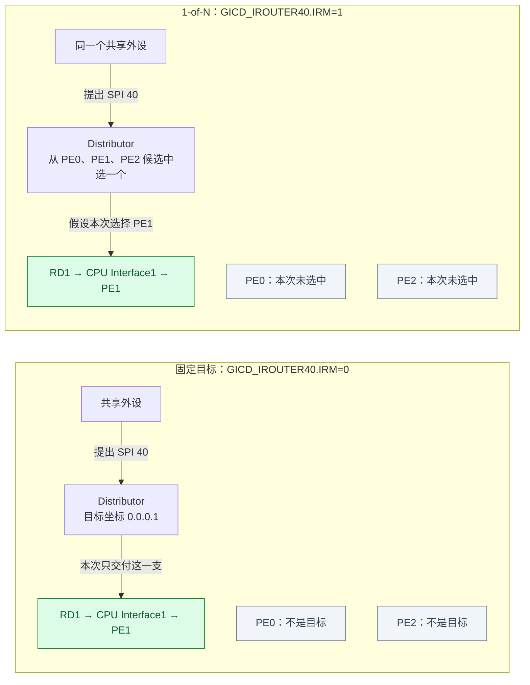
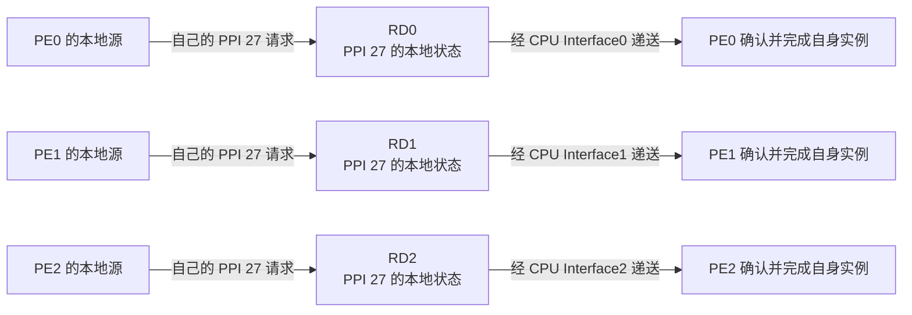
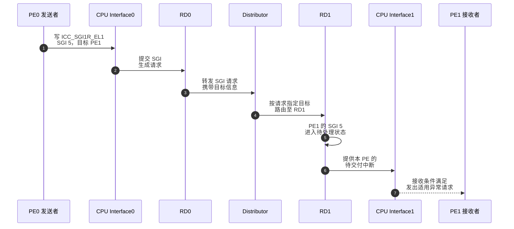
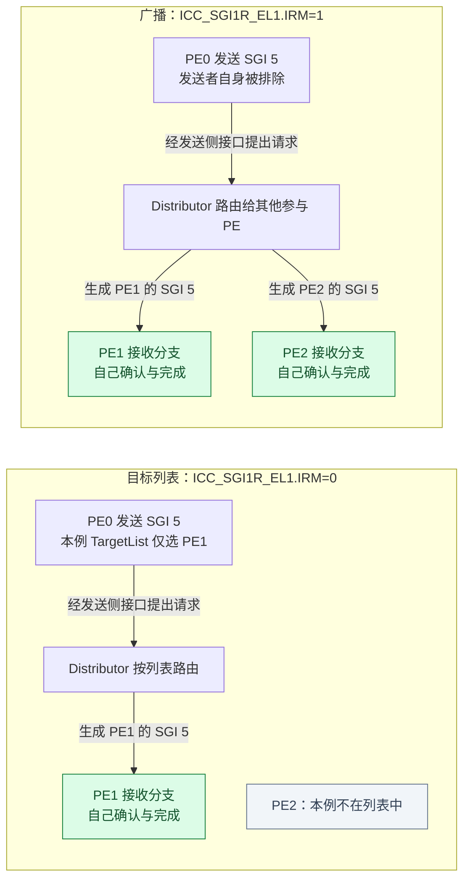
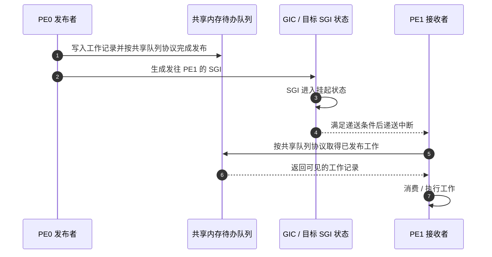
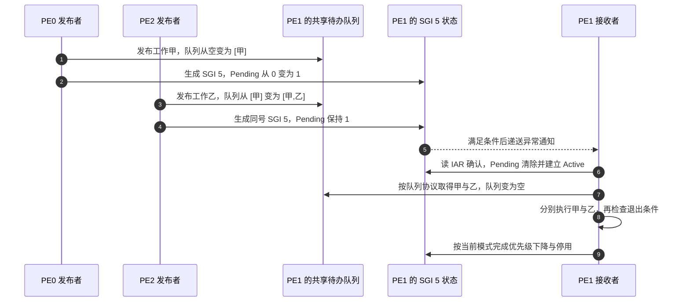

# 第7章\_目标选择\_核间通知与电源交接

## 7.1\_把请求交给另一个处理器\_改变了什么

前面已经准备好一个接收者，并能走完 **通用中断控制器（Generic Interrupt Controller，GIC）** 的确认与完成协议。现在增加第二个 **处理单元（Processing Element，PE）**：请求应当交给谁？原目标准备断电时，已经到来的请求又归谁处理？

这些问题放大 [S0 的目标准备、S2 的选择和 S5 的交接完成](P04_一次中断的状态转换与完成协议.md#4.4_用同一组阶段闭合正常周期)。不能只说“改亲和性”或“换一个核”，必须说明修改的是未来路由、已有挂起状态，还是正在执行的软件工作。

## 7.2\_硬件目标坐标不是Linux逻辑编号

GICv3 用 **亲和性（Affinity）** 标识处理器在硬件层次中的位置。它由 Aff3、Aff2、Aff1、Aff0 四个字段组成；这些是规范中的字段名，不是四种不同的中断。具体层次怎样对应核、线程或核簇，由处理器与芯片集成定义。

处理器的 `MPIDR_EL1` 是 **Multiprocessor Affinity Register（多处理器亲和性寄存器）**，包含硬件亲和性字段。Linux 显示的 CPU0、CPU1 是软件组织的逻辑编号；CPU 是 **Central Processing Unit（中央处理器）** 的缩写。不能把逻辑编号直接塞进亲和性字段，也不能默认 Aff0 一定等于板上看到的 CPU 编号。

例如，某个平台的软件把硬件坐标 `0.0.1.2` 对应的 PE 称为 CPU1。启动时，软件取得该 PE 的硬件身份并建立逻辑编号与亲和性的对应关系；以后要把请求交给 CPU1，就取出 `0.0.1.2` 作为目标，而不是把整数 1 直接写进 Aff0。读取身份与写入路由是前后两个动作，下面先定位前一个动作的接口。

本章表格中的 MRS、MSR 是 AArch64 读取、写入系统寄存器的指令名，沿用第三章的访问路径，不另造缩写全称；它们与通过内存地址访问设备寄存器不同。

| 寄存器与作用范围 | 访问方式与属性 | 本章使用的字段与读写效果 |
| --- | --- | --- |
| `MPIDR_EL1`，当前 PE 的硬件身份 | AArch64 系统寄存器；64 位，只读；获准访问时用 MRS 读取 | Aff3[39:32]、Aff2[23:16]、Aff1[15:8]、Aff0[7:0]。读取取得身份，不改变中断路由；其他处理器属性位不在这里展开 |

这四个字段与 GIC 目标亲和性的对应关系见 IHI0069 H.b 2.3.1（2-39）；读取权限仍受当前异常级与虚拟化控制约束。后文所有 **内存映射输入输出（Memory-mapped I/O，MMIO）** 地址都写成“已发现的组件基址 + 偏移”，不是可以跨芯片照抄的绝对地址；RW（Read/Write）、RO（Read-only）、WO（Write-only）分别表示读写、只读和只写。

### 7.2.1\_固定目标与1-of-N\_一次选择几个接收者

**共享外设中断（Shared Peripheral Interrupt，SPI）** 的目标由 **分发器（Distributor）** 的 `GICD_IROUTER<n>` **中断路由寄存器（Interrupt Routing Registers）** 控制。编号 n 关联对应的 **中断标识号（Interrupt Identifier，INTID）**，而不是“第 n 个 CPU”。以下继续采用已经开启亲和性路由的 GICv3 物理中断模型。

表内用 GICD 表示 GIC Distributor（GIC 分发器），因此“GICD + 偏移”指分发器基址加该偏移。

固定一组教学对象：PE0、PE1、PE2 的硬件坐标依次为 `0.0.0.0`、`0.0.0.1`、`0.0.0.2`，共享外设提出 SPI 40，它对应的路由寄存器记为 `GICD_IROUTER40`。这里特意让 PE 名称与 Aff0 对齐，只为方便读图，不能把这种对应当作真实 Linux 编号规则。该寄存器的 **中断路由模式（Interrupt Routing Mode，IRM）** 决定怎样选择目标：

- **IRM=0，固定目标：** 软件写入 PE1 的完整亲和性坐标，本次 SPI 被路由给 PE1。
- **IRM=1，1-of-N：** 在实现支持这一模式时，由硬件从符合条件的候选 PE 中选出一个。假设本次选中 PE1，另外两个 PE 不会因这一次请求各得到一份需要独立确认的 SPI 40。

下面是依据架构语义绘制的两种路由结果，不是芯片物理版图。为突出目标数量，接收侧把 **再分发器（Redistributor，图中简称 RD）**、**处理器接口（CPU Interface）** 和关联 PE 合并为一个接收分支；完整组件路径已在第三章建立。

两幅图的差别在于 **谁决定这个目标**：固定目标由软件给定，1-of-N 由硬件选择；它们都没有把本次 SPI 复制为三个 PE 的私有实例。1-of-N 也不保证轮转或平均负载，更不表示等三个 PE 都完成后才结束一次 SPI。目标可能在以后发生变化，但“目标可变”与“一次广播给多个目标”是两回事。

把这两个选择放回 64 位寄存器，字段位置如下。这是 IHI0069 H.b 12.9.22 字段图的中文重排；位号从最低位 0 开始，`RES0` 表示保留且必须写 0。

| 寄存器组与作用范围 | 访问位置、宽度与属性 | 数组范围与写入效果 |
| --- | --- | --- |
| `GICD_IROUTER<n>`，Distributor 中每个 SPI 的路由 | GICD 基址 + `0x6000 + 8 × n`；64 位 RW，访问还受中断安全归属限制 | n 就是 INTID；本卷普通 SPI 范围为 32～1019，且只访问实现支持的编号；步长 8 字节。写入改变该 SPI 的目标选择规则，不迁移软件工作，也不为各 PE 复制 SPI 状态 |

| 位段 | 字段 | 当前读法 |
| --- | --- | --- |
| 63:40 | RES0 | 不承载目标信息 |
| 39:32 | Aff3 | 目标亲和性第 3 层 |
| 31 | IRM | 0 为完整亲和性指定目标；1 为受支持的 1-of-N |
| 30:24 | RES0 | 必须写 0 |
| 23:16 | Aff2 | 目标亲和性第 2 层 |
| 15:8 | Aff1 | 目标亲和性第 1 层 |
| 7:0 | Aff0 | 目标亲和性第 0 层 |

本例固定 PE1 时，四个 Aff 字段为 `0、0、0、1`，IRM 为 0。IRM 为 1 时，架构不再把这些 Aff 字段解释成候选列表，其值为 UNKNOWN，不能读取它们来推算“本次硬件选中了谁”。来源身份由寄存器编号 40 确定，寄存器里面没有再放一份 SPI 40 编号。

> 官方对照：[规范 IHI0069 H.b](https://developer.arm.com/documentation/ihi0069/hb)，1.2.3 Models for handling interrupts（1-24～1-25）、2.3.1 Routing SPIs and SGIs by PE affinity（2-39～2-40），以及 12.9.22 GICD_IROUTER<n>, Interrupt Routing Registers（12-584）。核对两种模式都只选择一个 SPI 接收者；MPIDR 与亲和性关系也可在[概览 198123，3.2-01](https://developer.arm.com/documentation/198123/0302) 第 5、7 章检索 Affinity。

### 7.2.2\_候选资格是PE的状态\_路由属性仍属于SPI

上图把三个 PE 都画成候选，只是固定了比较前提。实际使用 1-of-N 时，软件先读 `GICD_TYPER.No1N`；这是 **分发器类型寄存器** 中报告是否缺少 1-of-N 支持的字段。`No1N=1` 表示不支持，不能仍把 IRM 写成 1 并期待获得上述结果。

即使实现支持，也不是每个 PE 随时都能被选中。为看清正常情况，先限定本 PE 已退出休眠交接。对应 **再分发器控制寄存器** `GICR_CTLR` 中，`DPG1S`、`DPG1NS`、`DPG0` 分别用于禁止本 PE 参与安全第 1 组、非安全第 1 组、第 0 组 SPI 的 1-of-N 选择；它们是 **禁止处理器选择（Disable Processor selection）** 字段。能否使用这些字段，由 **再分发器类型寄存器** `GICR_TYPER.DPGS` 报告。

| 本 PE 的状态 | 对相应组 SPI 的 1-of-N 选择意味着什么 |
| --- | --- |
| 未休眠、该组在本 PE 已使能，且受支持的对应 DPG 位为 0 | 本 PE 可以成为候选；不保证本次一定选中它 |
| 未休眠，但该组在本 PE 未使能 | 本 PE 不能被选中 |
| 未休眠，且受支持的对应 DPG 位为 1 | 本 PE 不能被选中；这不等于改写了 SPI 的目标坐标 |

当 `DPGS=0` 时，DPG 位读为零、写入被忽略，软件不能据此声称已经主动移除了该候选。休眠状态另有分支：`GICR_WAKER.ProcessorSleep` 是本 PE 的休眠交接状态；它为 1 且 `GICD_CTLR.E1NWF=0` 时，该 PE 不参与选择。`E1NWF` 是 **允许 1-of-N 唤醒（Enable 1 of N Wakeup Functionality）** 字段；在实现支持并将它置 1 的情况下，休眠 PE 如何被选择由实现定义，不能把上表外推成所有低功耗情形的固定算法。完整休眠交接在[本章 7.5 节](#7.5_目标准备下线时_要交接的不只是路由)继续说明。

把“先读能力，再改参与状态”所需接口放在一张表中。RD_base 是当前 PE 的再分发器控制页基址；下表只展开本章使用的字段，组接收许可沿用[第六章的控制范围](P06_权限_安全分组与初始化闭环.md#6.3_安全组不是优先级分组)。

| 寄存器与范围 | 访问方式、宽度与属性 | 本章字段、效果与限制 |
| --- | --- | --- |
| `GICD_TYPER`，整个 Distributor 的能力 | GICD + 0x0004；32 位 RO | No1N[25]=1 表示不支持 1-of-N；RSS[26] 报告 SGI 范围选择能力；ITLinesNumber[4:0] 给普通中断编号空间的 32 项分组数减一，实际普通 SPI 不含 1020～1023 |
| `GICD_CTLR`，Distributor 全局控制 | GICD + 0x0000；32 位，控制字段 RW，状态字段 RO | E1NWF[7] 控制实现支持的 1-of-N 唤醒；不支持时读为 0、写忽略。它不是某个 SPI 的目标位；写访问取决于安全状态与权限 |
| `GICR_TYPER`，当前 RD 的能力 | RD_base + 0x0008；64 位 RO | DPGS[5]=1 才支持通过以下 DPG 字段移除候选 |
| `GICR_CTLR`，当前 PE 的参与状态 | RD_base + 0x0000；32 位，DPG 字段 RW、RWP RO | DPG1S[26]、DPG1NS[25]、DPG0[24] 为对应组禁止选择；DPGS=0 时读零写忽略。RWP[3] 反映这些受跟踪写入是否尚未完成，依赖修改结果前应等它为 0；权限受安全状态控制 |

本表依据 IHI0069 H.b 12.9.4、12.9.38、12.11.2、12.11.37（GICD_CTLR、GICD_TYPER、GICR_CTLR、GICR_TYPER）。`GICR_WAKER` 的请求位与完成位在 7.5 节单独展开，不能只读 DPG 就判定电源交接完成。

规范 12.11.2 的参与表把上述正常与休眠分支合在一起。下表中的 PS 是 ProcessorSleep，Enable 是本 PE 对应组的接收使能，`*` 表示该行不依赖此项取值；DPG 采用受支持的对应组字段，不是全局组使能。

| PS | 对应 DPG | Enable | 该 PE 是否可被 1-of-N 选中 |
| --- | --- | --- | --- |
| 0 | 0 | 0 | 不可 |
| 0 | 0 | 1 | 可以，但不保证当选 |
| 0 | 1 | * | 不可 |
| 1 | * | * | E1NWF=0 时不可；E1NWF=1 时选择机制由实现定义 |

读最后一行时要先进入休眠分支，不能把第一部分的 DPG、Enable 条件机械叠加过去。该表重排自 IHI0069 H.b 12.11.2 的 PE participation 表（印刷页 12-644，无单独表号）。

因此，RD 的本地状态确实能改变 SPI 的候选集合；但 **SPI 40 的路由模式仍保存在 Distributor，PE1 的参与状态保存在 RD1**。这不是 RD1 又持有一套 SPI 40 的独立路由属性，也不能用 DPG 把 PE1 的私有事件改派给 PE2。

> 官方对照：[规范 IHI0069 H.b](https://developer.arm.com/documentation/ihi0069/hb)，2.3.2 Participating nodes（2-40）、12.9.22 的 No1N 条件，以及 12.11.2 GICR_CTLR（12-641～12-644）的 DPG 字段和 PE participation 表。表中的休眠、组使能与 DPG 必须结合分支阅读，不能把候选条件压成“只要在线即可”。

### 7.2.3\_多个PE上的同号PPI\_为什么不是广播

**私有外设中断（Private Peripheral Interrupt，PPI）** 本来就属于特定 PE，不能靠 SPI 路由寄存器把它改成另一个 PE 的私有定时事件。假设三个 PE 的本地中断源恰好都使用 PPI 27，它们可以各自触发，但状态身份分别是“PE0 的 PPI 27”“PE1 的 PPI 27”和“PE2 的 PPI 27”。这个编号只用于教学，不声明某颗芯片的具体接线。

图中的 RD0、RD1、RD2 分别是三个 PE 对应的 Redistributor 逻辑接口，各自保存本 PE 的私有中断状态。

图中是三条私有路径：即使三个事件同时发生，也不是 Distributor 把一个请求广播了三份。PE1 完成自己的实例，不会代替 PE0 清除它的本地事件或完成义务。由此也能看出，只观察到“几个核都报告同一个编号”，还不足以判定是广播；必须同时核对来源类型与状态归属。

> 官方对照：[规范 IHI0069 H.b](https://developer.arm.com/documentation/ihi0069/hb)，1.2.1 的 Private Peripheral Interrupt 定义、3.1 The GIC logical components（3-42）及 4.3 Private Peripheral Interrupts（4-59）。图为本专题按“每 PE 私有实例”规则绘制的示意图。

## 7.3\_核间中断传的是提醒\_工作内容存在哪里

**软件产生中断（Software Generated Interrupt，SGI）** 是软件通过 GIC 生成的请求，常用于 **处理器间中断（Inter-Processor Interrupt，IPI）**。前者是控制器来源类型，后者描述软件的核间通知用途；两者不能无条件看成同一层 API。

### 7.3.1\_先沿硬件接口送出一次SGI

前面比较的是外设请求交给谁，现在由 PE0 主动请求通知 PE1。普通 **非安全第 1 组（Non-secure Group 1，中断安全归属名称）** 的生成入口为发送侧 CPU Interface 的 `ICC_SGI1R_EL1`，即 **Interrupt Controller Software Generated Interrupt Group 1 Register（中断控制器 Group 1 软件产生中断寄存器）**。这里假定软件在非安全状态下使用该寄存器生成非安全第 1 组 SGI；其他安全状态的生成与权限关系不能照搬这一前提。

将“生成一条通知”放大成组件间的请求路径，会得到下面这条链。图只画 SGI 请求的去向，确认与完成仍遵循第四章的协议。

步骤 3～4 说明 SGI 请求经过 Distributor 路由；步骤 5 的 SGI 5 状态却属于目标 PE1 的 RD。**经过某个组件转发，不等于该中断的所有配置与状态都归那个组件所有。** 发送者也没有把普通软件工作对象塞进这条硬件链，工作数据放在哪里要到本节后半段单独解决。

> 官方对照：[规范 IHI0069 H.b](https://developer.arm.com/documentation/ihi0069/hb)，3.1 The GIC logical components（3-42）的 SGI 路径，以及 4.4 Software Generated Interrupts（4-60）。图是架构逻辑请求时序，不声明某款芯片各模块间的线宽、时钟、传播周期或物理摆放位置。

### 7.3.2\_目标列表与广播\_同名IRM为什么有不同含义

沿用 PE0、PE1、PE2 及前面的亲和性坐标，这次让 PE0 通知一个或多个接收者。`ICC_SGI1R_EL1` 写入值中的来源编号、亲和性字段和 **目标列表（TargetList）** 共同指定 SGI。它的 IRM 是“这一条 SGI 怎样选目标”的字段，不能直接套用 SPI 路由寄存器的解释。

- **IRM=0，目标列表：** `Aff3.Aff2.Aff1` 指定相应亲和性范围，TargetList 的位指定其中的目标 PE。按本例坐标，仅设置 bit 1 会通知 PE1；同时设置 bit 1、bit 2 会分别通知 PE1 和 PE2。合法目标也可以包含发送者自己。
- **IRM=1，广播形式：** 向本 GIC 系统范围内除发送者以外的其他参与 PE 生成 SGI，不再按上面的目标列表挑选。按本例三 PE 的前提，就是 PE1 和 PE2；**排除 PE0**。这种模式下亲和性与 TargetList 等相应字段按规范要求写零。

下图仍使用同一组三个 PE。绿色接收分支包含其 RD、CPU Interface 与 PE，箭头表示通知的目标；前一图已经展开这些分支内部的路径。

SGI 多目标发送在各目标处形成各自的本地中断状态：PE1 已确认，不表示 PE2 也已确认；PE1 已完成，也不替 PE2 完成。由此回看 SPI 的 1-of-N，差别就在 **从候选中选择一个接收者** 与 **让选中的多个接收者各自取得通知**，不能只凭两个字段都叫 IRM 判断相同。

这里的目标列表也不是任意长度的 Linux CPU 掩码。TargetList 只有 16 位；扩展亲和性范围时，还涉及 **范围选择字段（RangeSelector，RS）** 及相应支持能力。广播范围则是当前 GIC 的架构范围，不是机器中一切处理器或设备。无论采用列表还是广播，目标选择都不豁免安全状态与中断组匹配规则，也不绕过第六章已经建立的组接收许可、优先级门限和 PE 异常控制；选为目标与立刻执行处理程序仍是两件事。SPI 的 DPG 候选控制也不能直接套成 SGI 广播接收开关。

下表把 `ICC_SGI1R_EL1` 的 64 位字段图展开为可直接阅读的位段。它依据 IHI0069 H.b 12.2.22（12-276～12-277）；与前面的 IROUTER 对照，连 IRM 的位号都不同。

| 寄存器与作用范围 | 访问方式与属性 | 操作含义 |
| --- | --- | --- |
| `ICC_SGI1R_EL1`，发送 PE 的 CPU Interface | AArch64 系统寄存器；64 位 WO，用 MSR 写入完整生成请求；需系统寄存器访问获准 | 每次写入提出一次 SGI 生成请求；不是保存以后所有 SGI 路由的配置寄存器，也不能用读回来判断目标处理完成 |
| `ICC_CTLR_EL1`，当前 CPU Interface | AArch64 系统寄存器；64 位，含 RW 控制位与 RO 能力位 | 本节读取 RO 的 RSS[18]；只有它与 GICD_TYPER.RSS 都为 1，才使用非零 RS。其他控制位沿用[完成协议](P04_一次中断的状态转换与完成协议.md#4.3.1_同一来源还没收尾_为什么接收侧可以先释放优先级) |

| 位段 | 字段 | 目标列表方式下保存什么 |
| --- | --- | --- |
| 63:56 | RES0 | 保留为 0 |
| 55:48 | Aff3 | 目标范围的亲和性第 3 层 |
| 47:44 | RS | TargetList 对应哪一组 16 个 Aff0 值 |
| 43:41 | RES0 | 保留为 0 |
| 40 | IRM | 0 按目标列表；1 向除自身外的其他 PE 广播 |
| 39:32 | Aff2 | 目标范围的亲和性第 2 层 |
| 31:28 | RES0 | 保留为 0 |
| 27:24 | INTID | 要生成的 SGI 编号，范围 0～15 |
| 23:16 | Aff1 | 目标范围的亲和性第 1 层 |
| 15:0 | TargetList | 每个置位位选择一个目标；目标 Aff0 为 `16 × RS + 位号` |

本例使用 RS=0，所以 TargetList=`0x0002` 选 PE1，`0x0006` 选 PE1、PE2。使用非零 RS 需要 CPU Interface 与 Distributor 都报告相应的 **范围选择支持（Range Selector Support，RSS）**；不能仅因字段宽度有 4 位就假定支持。广播时 Aff3、Aff2、Aff1 和 TargetList 写 0，本例 RS 也保持 0。

再把本节实际采用的安全条件摊开：以下只摘取规范表 12-14 中“非安全 EL1/EL2 写 ICC_SGI1R_EL1”的分支，限定两安全状态有效、两侧亲和性路由开启且系统寄存器访问已获准。**非安全访问控制寄存器（Non-secure Access Control Register）** `GICR_NSACR` 是目标 PE 侧逐 SGI 的跨安全域授权控制，不是发送者能随意绕过的许可。

| 目标 PE 上这个 SGI 的安全归属 | 是否允许本次生成请求转发 |
| --- | --- |
| Non-secure Group 1 | 允许；这是本节主线 |
| Secure Group 1 | 只有目标对应 GICR_NSACR 字段允许时才转发 |
| Secure Group 0 | 只有目标对应 GICR_NSACR 字段允许时才转发；本表限定 DS=0，不采用单安全状态例外 |

这张表判断生成请求能否转发，不保证目标立刻进入处理程序。本节没有配置跨安全域授权，因此教学 SGI 保持 Non-secure Group 1；换用其他生成寄存器或安全状态时，必须换用它们各自的规则，不能只换一个组名。

| 跨安全域授权接口 | 访问位置与属性 | 字段编码及效果 |
| --- | --- | --- |
| `GICR_NSACR`，目标 PE 的 SGI 授权 | SGI_base + 0x0E00；32 位。DS=0 时安全访问 RW、非安全访问读零写忽略；DS=1 时读零写忽略。SGI_base 是该 PE 的 SGI/PPI 页基址 | SGI x 使用 `NS_access<x>`[2x+1:2x]，x=0～15；00 不准许非安全侧生成安全 SGI，01 允许安全 Group 0，10 再允许安全 Group 1，11 保留。修改授权不等于生成中断，也不作用于 PPI |

这是 IHI0069 H.b 12.11.30（12-697～12-698）的本章所需布局。它的“每 SGI 两位”与 TargetList 的“每目标 PE 一位”索引对象不同，不能互相套用。

> 官方对照：[规范 IHI0069 H.b](https://developer.arm.com/documentation/ihi0069/hb)，2.3.1（2-39～2-40）、4.4（4-60）、12.2.22 ICC_SGI1R_EL1（12-276～12-277）；安全状态与组生成关系见 Table 12-14（12-207）。核对 IRM、RS、TargetList、排除发送者及不同生成寄存器的权限边界。

### 7.3.3\_通知之外\_把工作保存在共享内存

固定一个场景：PE0 为 PE1 准备了一项工作。工作内容保存在共享内存中的待办队列，包含要处理的对象；SGI 只提醒 PE1 去查看该队列，不把整个工作对象放入中断信号。

先给这个教学队列一个具体落点：普通共享内存中的 `work_queue` 对象，内含有限容量的记录数组 `records`、未领取数量 `count` 和保护它们的锁 `lock`。这些名字是本例自定的软件字段，不是 GIC 寄存器，也不是 Linux 的现成结构体。记录按值保存本例全部工作参数；若换成指向外部对象的指针，还必须另行保证被指对象的生命周期。这里只允许 PE0（下一节再加入 PE2）发布，PE1 的接收路径是唯一消费者。

发布者先取得锁，检查容量，写入完整记录并更新数量，随后释放锁；空间不足就报告发布失败，不能覆盖未消费记录后仍声称发布成功。接收者取得同一把锁，把当前记录复制到自己独占的本地批次，再清空共享队列并释放锁。**清空的是“尚未领取”的集合，实际工作此时只是转交给本地批次，还没有执行完成。** 接收者在锁外执行批次，随后重新检查队列；发送者因此不必等待一整批工作执行结束才能追加下一批。

| 本例的状态位置 | 谁写入 | 谁读取，以及何时改变归属 |
| --- | --- | --- |
| 共享 `work_queue.records/count` | PE0、PE2 持锁追加；PE1 持锁取走并清空 | PE1 在 S4 领取；发布者在 S1 检查容量。锁串行化数组与数量的组合修改 |
| PE1 的本地批次 | PE1 在锁内从共享数组复制，在锁外消费 | 只有 PE1 使用；领取后即使共享队列已经为空，批次里仍可能有未执行工作 |
| PE1 的 SGI Pending/Active | GIC 按生成、确认和停用协议更新 | S2～S5 的通知与交接状态；不存储数组内容，也不根据 `count` 自动更新 |

这里要求锁本身提供目标系统规定的互斥和内存可见性，使接收者在成功取得锁后能够读取完整记录，而不是只看到新数量、却仍读到旧内容。所有参与者必须遵守同一规则。锁临界区只搬运有界记录，不执行工作函数；当前角色安排也不允许消费者在同一 PE 上打断一个持有这把锁的发布者后再忙等它。若改变角色或加入其他调用上下文，就必须重新检查抢占、锁和生命周期条件，不能只复制这些字段名。

下面两图切换到软件协议视角，把上面已经展开的 SGI 硬件路径折叠为一个通知对象，专门追踪“工作在哪里、谁发布、谁消费”。它们不是另一种绕过 Distributor 的硬件连线。

队列是数据通信，SGI 是通知通信。两条路径要配套：如果先发送 SGI，后发布队列内容，PE1 可能先进入处理入口却看不到工作。只写队列而没有对应通知或接收侧轮询协议，则工作可能一直留在那里。

锁解决了记录的一致读写，还要把发布与通知的先后落实到目标系统：成功发布、释放锁后，发送者通过满足所需内存顺序的接口生成 SGI。原始“写一个 SGI 系统寄存器”不能自动替所有先前普通内存写入建立所需的软件同步契约；仅在源码中把两行前后排列，也不等于完成这份可见性保证。具体实现应使用目标系统已经封装好的核间调用接口；本节没有给出可在任意机器上照抄的屏障指令组合。

> 官方对照：[概览 198123，3.2-01](https://developer.arm.com/documentation/198123/0302)，第 7 章 Sending and receiving Software Generated Interrupts（PDF 第 38～40 页），以及[规范 IHI0069 H.b](https://developer.arm.com/documentation/ihi0069/hb) 4.4 Software Generated Interrupts。共享队列是本专题为解释“数据与通知”添加的教学对象，GIC 规范不替某个软件队列提供锁或发布协议。

## 7.4\_两个发送者会不会得到两次计数

本节沿用三个 PE，改为 PE0 和 PE2 共同发送、PE1 接收。两名发送者各有一项工作要交给 PE1。首先必须分开两次写入：**发送者写共享内存队列，增加工作记录；发送者生成 SGI，要求 GIC 通知 PE1。** GIC 不读取队列，也不会替发送者追加工作、增加队列长度或创建一个软件回调。

在 GICv3 亲和性路由模型下，同一目标 PE 的同一个 SGI INTID 只有一个挂起状态，不按发送者另存挂起计数。若 PE0 和 PE2 在 PE1 确认以前都发出 SGI 5，第二次通知可以并入已经置位的 Pending。**减少的是可区分的通知次数，已经发布的两份工作记录仍然存在。**

下面固定队列支持多发送者安全发布，且空间足够、没有并发消费者；两个通知都在首次确认以前到达。接收者通过 **中断确认寄存器（Interrupt Acknowledge Register，IAR）** 领取来源。不满足这些前提时，先分析队列竞争与容量，不能从 GIC 状态推断工作一定安全。

步骤 3 已经把第二项工作放入队列；步骤 4 只负责通知，不应该再把同一工作追加一遍。用两列独立状态观察就不会把它们混成一个计数器：

| 时刻 | 共享内存中的未领取工作 | PE1 的 SGI 5：Pending / Active |
| --- | --- | --- |
| 初始 | `[]`，0 项 | 0 / 0 |
| PE0 发布甲并生成通知后 | `[甲]`，1 项 | 1 / 0 |
| PE2 发布乙并生成通知后 | `[甲,乙]`，2 项 | 1 / 0；没有 Pending=2 |
| PE1 确认后，尚未领取队列 | `[甲,乙]`，2 项 | 0 / 1 |
| PE1 取得甲乙并执行后 | `[]`，0 项 | 0 / 1；控制器仍待完成 |
| 本轮停用后且无新通知 | `[]`，0 项 | 0 / 0 |

按[本专题阶段](P04_一次中断的状态转换与完成协议.md#4.4_用同一组阶段闭合正常周期)看，发布工作属于 S1 的真实工作产生，Pending 属于 S2，读 IAR 属于 S3，队列消费属于 S4，控制器收尾属于 S5。SGI 合并发生在通知层，不把甲乙合成同一项任务；软件若另外维护工作数量，那也是软件在队列协议中更新的计数，不是 GIC 的隐藏功能。

如果 PE2 的通知晚于 PE1 的确认，SGI 可以变为 Active and Pending，停用后仍有一次请求等待确认。即使 PE1 本次已经从队列取走乙，之后也可能多进入一次并发现队列为空。正确处理应以队列里的实际工作为准，既不能假定每次入口只执行一项，也不能假定每次入口一定有新工作。

退出时仍有一个边界要处理：PE1 刚检查到空，发送者就发布新工作。最直观的协议要求 **每次成功发布后都生成通知**，并使用目标系统规定的发布与通知顺序；新通知可能在当前处理中被消费，也可能保留到后续，但接收者必须重新检查队列。若为了减少通知，只在“空变非空”时发 SGI，就需要共享的待处理标志、锁或原子交接协议，以及退出前的复查，保证发送者不会误以为接收者还在工作而省掉最后一次唤醒。这个协议必须由队列与通知接口实现，单写 SGI 寄存器不能提供它。

> 官方对照：[规范 IHI0069 H.b](https://developer.arm.com/documentation/ihi0069/hb)，4.4 Software Generated Interrupts、12.2.22 ICC_SGI1R_EL1。查 v3 亲和性路由下的状态归属、目标列表和 IRM 语义；不要把 GICv2 的按发送者状态或 SPI 的 1-of-N 选择带进这条路径。

## 7.5\_目标准备下线时\_要交接的不只是路由

目标变化至少涉及三件事：

1. 未来请求往哪里走？
2. 旧目标上已经挂起的请求如何处理？
3. 已经确认的处理过程怎样收尾？

改变一个路由寄存器，不会自动迁移设备驱动的栈或正在执行的代码。

从软件角度，需要先阻止新的工作被分配给即将下线的接收者，再依照来源类型和控制器规则处理已有状态，最后完成接收侧电源交接。普通 SPI、私有 PPI 与后文消息中断的迁移规则不同，不能复用一个“改目标即可”的算法。

再分发器的 `GICR_WAKER`，即 **再分发器唤醒寄存器（Redistributor Wake Register）**，用于电源握手；**ProcessorSleep（处理器休眠）** 表达软件交接请求，**ChildrenAsleep（下属接口已休眠）** 报告硬件交接状态。这里延续上一章的过程：有权软件在适当关闭接收条件后设置 ProcessorSleep，并等待 ChildrenAsleep 表示相关接口完成休眠交接，随后才由平台电源协议关闭相应资源。接收侧仍在使用，不能仅凭软件已发出请求就切断时钟或电源。

| 寄存器、位置与宽度 | 相关位与访问属性 | 使用条件与读写效果 |
| --- | --- | --- |
| `GICR_WAKER`，当前 PE 的 RD_base + 0x0014，32 位 | ProcessorSleep[1] RW；ChildrenAsleep[2] RO | 0→1 请求休眠前，须先关闭该 CPU Interface 的组使能；随后等 ChildrenAsleep=1。恢复时，仅在 ChildrenAsleep=1 时清 ProcessorSleep，再等 ChildrenAsleep=0 才恢复正常接收 |

两安全状态下，此架构接口只允许安全访问读写，非安全访问读零写忽略；单安全状态按 RW 访问，芯片还可能另有产品约束。表中的两个位是架构握手，不是电源控制器的实际断电位。依据 IHI0069 H.b 12.11.42（12-728～12-729）；GIC-600 另外定义的整体 LPI 缓存休眠字段留到[下一章](P08_从消息请求到内存中的中断状态.md#8.6_整体关闭与禁止一个来源不是同一保证)。

GIC-600 对一个已按协议休眠的专门目标收到请求时，可以通过唤醒请求与平台电源控制器交互。这个信号必须实际连接且相关电源路径可用；它不是对任意开发板“必然能唤醒”的承诺。

还要区分普通等待与真正电源交接：**WFI（Wait For Interrupt，等待中断）** 是处理器指令名称，不等于设置 ProcessorSleep。哪些低功耗状态需要电源控制器唤醒、哪些仍由正常接口接收，必须联合核对处理器与 GIC-600 手册。

下表将 GIC-600 r1p6 3.6.2 的关核动作整理到各自的完成边界，补出“适当关闭接收条件”所包含的内容。它仍须与具体处理器的关核协议配套，不能取代前面的工作迁移和来源收尾。

| 顺序与执行者 | 动作 | 能依赖的结果 |
| --- | --- | --- |
| 软件先控制当前核 | 屏蔽该核中断，关闭 CPU Interface 的组使能，并按核接口要求禁止中断旁路 | 关核过程中不再把正常中断递送当作可继续使用的路径 |
| 有权软件请求交接 | 置对应 GICR_WAKER.ProcessorSleep=1 | 仅提出休眠交接请求，尚不能断电 |
| 软件观察硬件 | 轮询 ChildrenAsleep，直到其为 1；超时按失败处理 | 核侧 GIC Stream 接口已完成交接，没有未完成事务 |
| 平台电源路径 | 按处理器及芯片协议关闭相应资源 | 之后的专门目标请求需通过实际连接的 wake_request 唤醒路径恢复 |

这里的 **中断旁路（interrupt bypass）** 指绕过正常 CPU Interface 递送控制的接口功能，是否存在及怎样禁止由处理器实现决定，不能由这张表虚构一个所有核通用的寄存器位。表依据 GIC-600 r1p6 TRM 3.6.2（3-57～3-58）的顺序说明重排；它解释正常接口关闭与平台唤醒为何必须同时成立。

## 7.6\_接收者刚检查到空\_新工作会不会遗失

把 7.4 的场景推进到退出前。PE1 已确认 SGI 5 并消费旧工作，检查队列为空；恰在它准备停用之前，PE0 发布工作丙，并按“每次发布都通知”的协议生成同号 SGI。请同时记录队列、Pending 与 Active，而不是只数入口次数。

在工作发布与通知顺序成立、硬件正常接收且没有其他消费者的前提下，新通知到达时旧 SGI 仍 Active，因此可以形成 Active and Pending。旧实例停用后留下 Pending；后续确认时读取队列，就能取得丙。若 PE1 在退出前再次查队列并提前消费丙，后续入口可能看见空队列，但不能据此把它当作“伪造了一项工作”。

如果新通知在停用之后才到达，则它从非活动建立 Pending，结论仍是后续存在服务机会。两条交错之所以都成立，是因为工作先被可靠保存，通知随后产生，而不是因为停用动作替发送者扫描了队列。

现在去掉 PE0 的这次通知，理由是“我觉得 PE1 还在处理中”。若 PE1 已做完最后一次空队列检查，就可能退出且再无通知，丙留在内存无人消费。减少 SGI 次数的优化必须增加可证明的退出交接，例如由锁保护的工作/唤醒状态和复查；这部分复杂度是优化的成本，不能凭猜测省去。

最后区分安全性与推进：上述协议说明在给定前提下工作不会因通知合并而从队列消失；若 PE1 永久屏蔽接收、掉电或不再调度处理路径，并不能证明工作最终一定执行。队列保存、通知可达和消费者持续推进是三个独立条件。

### 7.6.1\_同名IRM与同号中断\_分别需要几份完成记录

再用同一组三个 PE 检查目标模型。假设相应能力受支持，来源配置与接收条件都成立，且没有重复触发或其他发送者加入；每个例子只观察本题所说的这一次请求。

1. SPI 40 的 `GICD_IROUTER40.IRM=1`，三个 PE 都是候选。本轮是否必须等三个 PE 都确认并完成？
2. PE0 以 `ICC_SGI1R_EL1.IRM=0` 发送 SGI 5，目标列表同时选中 PE1、PE2。PE1 完成以后，能否宣布 PE2 也已经完成？
3. PE0 将同一 SGI 生成寄存器的 IRM 改成 1。PE0 是否也因这次广播取得一份 SGI？
4. 三个本地源同时触发各自的 PPI 27。三个 PE 都记录到 INTID 27，是否证明 GIC 广播了一个 PPI？

**参考答案：**

1. 不需要。1-of-N 为本次 SPI 选择一个 PE，另外两个候选没有因此各取得一份相同 SPI；若测试要求三个核都报告完成，需要另外建立软件工作与应答协议，不能从 IRM=1 推出。
2. 不能。两个目标各有 SGI 5 的本地状态，分别确认并完成。若发送者需要等两项软件工作都做完，还必须由软件记录各自的完成结果；GIC 的中断完成不替代这份工作记录。
3. 不会。广播排除发送者 PE0，本例目标为 PE1、PE2；如果需要通知自己，应使用允许包含自身的目标列表方式或适当的软件路径。
4. 不能。三个 PE 观察到的是各自的私有实例；编号相同不等于来源、状态和完成义务相同。

现在已能把多核通知拆成“工作状态、通知状态、接收能力”三件事。下一章面对大量消息设备时继续问：若每个事件都需要一个可编程来源，状态应该继续全部挤在寄存器中吗？

官方对照：[GIC-600 r1p6 技术参考手册（Technical Reference Manual，TRM）](https://developer.arm.com/documentation/100336/0106)，3.6.2 Processor core power management（3-57～3-58），核对关核前置条件、握手与唤醒请求。真实 Linux 亲和性使用另见 [Linux 中断管理第 10 章](../../../../knowledge/linux/synchronization_and_asynchrony/asynchrony/interrupts/P10_SMP_与中断亲和性_IPI_机制.md#10.2_允许集合与实际目标是两份不同状态)，本章不替它声明版本化调用链。

上一篇：[上一章](P06_权限_安全分组与初始化闭环.md#6.1_为什么照着寄存器名写值还不够)

[专题大纲](大纲.md#1.2_因果阅读地图)

下一篇：[消息与内存状态](P08_从消息请求到内存中的中断状态.md#8.1_来源越来越多_为什么让设备发送一条消息)
