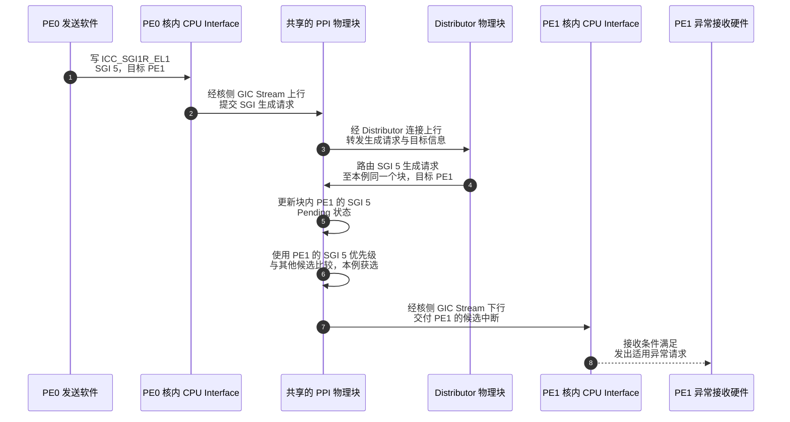
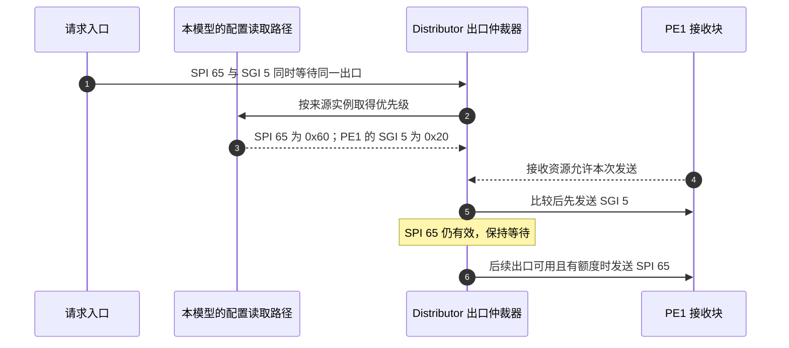
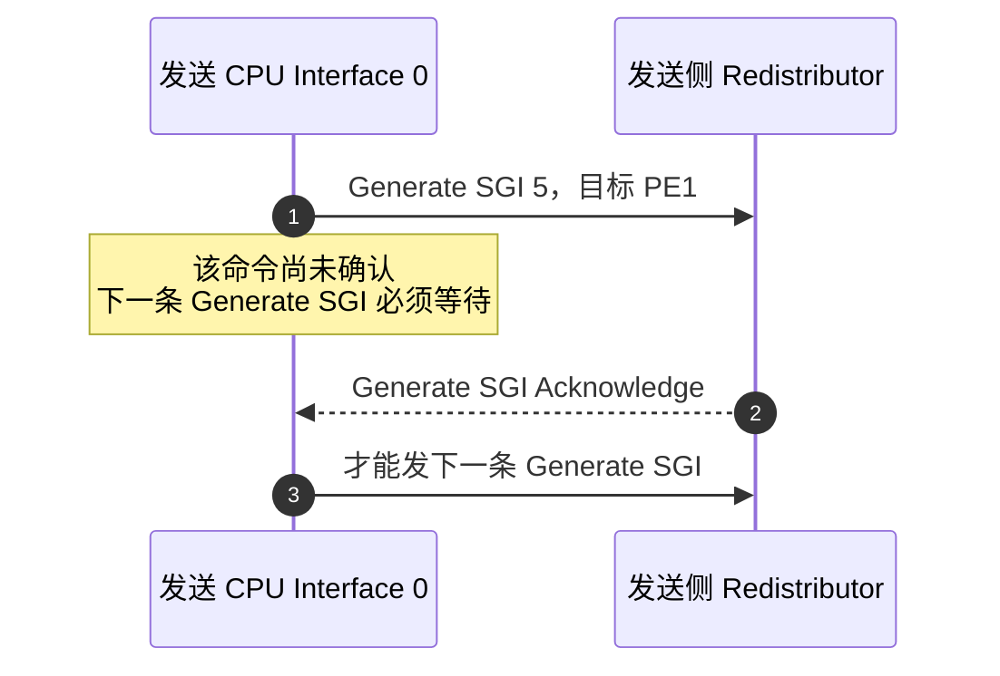

# 第8章\_中断候选的传递与拥挤仲裁

## 8.1\_同一个优先级规则为什么仍有多段传递

上一章已经能够比较同一目标 PE 的 SPI、SGI、PPI，并判断候选能否通过当前接收门槛。但这些推理假定候选信息已经可见：若两个发送者同时提出 SGI，Distributor 又有 SPI 等待交付，有限的通道、缓冲和比较位置怎样把请求推进到目标？本章放大第六章 S2 到 S3 之间的传递过程，区分中断候选选择、消息发送机会与处理器实际确认。

共同优先级没有消除路径差异。SPI 从 Distributor 的共享来源路径进入；SGI 是从发送 CPU Interface 发出的生成请求，经发送侧和 Distributor 到达目标；PPI 则直接进入关联 PE 的接收侧。PPI 不需要先占用 Distributor 的这条发送出口，却会在本地候选选择时与已经送来的 SPI、SGI 比较。因此，不能把三类来源虚构成全都经过一条全局消息队列。

发送软件通过 Group 1 软件产生中断寄存器 `ICC_SGI1R_EL1` 发出生成请求，这是第三章已经定位的 CPU Interface 编程入口。先沿 PE0 向 PE1 生成 SGI 5 的实际路径辨认接口；串口 SPI 65 与本地 PPI 27 继续作为同一目标的其他候选。随后再选择中间的一条发送资源，推演它同时面对 SPI、SGI 时怎样仲裁。真实接口规则依据规范，尚未公开的内部实现会明确保留边界。

**实现层——GIC-600 r1p6，固定 PE0、PE1 共用一个 PPI 块的集成例子。** 两个 CPU Interface 分别在各自处理器核内，图中的 PPI 块则只有一个：它既承接发送侧上行请求，又维护目标 PE1 的 SGI 状态。该分组在硬件集成时确定，软件发送 SGI 不会临时把 PE 移入另一 PPI 块。

下图先展开一次成功推进的功能路径；随后再把核侧报文、生成确认与传输等待放回这些连接。这里不规定各步骤耗费的周期，也没有把两次 Redistributor 逻辑角色出现画成两个必然独立的物理块。

步骤 3～4 仍经过 Distributor 路由；步骤 5 改的是同一 PPI 块中 PE1 的实际 SGI 状态，步骤 6 使用该块内 PE1 的 SGI 5 配置参加优先级选择。**经过某个组件转发，不等于该中断的所有配置与状态都归那个组件所有。** 若两个 PE 属于不同 PPI 块，第 4 步才交到另一物理块，目标配置与完成规则仍相同。发送者也没有把普通软件工作对象塞进这条硬件链，工作数据与软件回执由第十三章单独展开。

> 官方对照：[规范 IHI0069 H.b](https://developer.arm.com/documentation/ihi0069/hb)，3.1（3-42）、4.4（4-60）确定逻辑路径；[GIC-600 r1p6](https://developer.arm.com/documentation/100336/0106)，1.2（1-13）、2.2～2.2.2（2-29～2-30）确定 PPI 块、Distributor 连接与核内 CPU Interface 的物理端点。图不展开内部事务编码、缓冲队列或传播周期。

## 8.2\_生成消息与候选交付分别携带什么

**讲解层次：接口协议层。** GIC Stream 是 Redistributor 与 CPU Interface 之间的核侧协议。Arm 的 [GIC Stream Protocol interface 应用笔记，Version B](https://documentation-service.arm.com/static/5f2aceb660a93e65927bbf01) 3.1、4.4～4.5 说明这些端点及典型过程；字段编码以 IHI0069 H.b 附录 A 为准。前图中步骤 2 和步骤 7 位于核侧接口，步骤 3～4 则属于产品内部块间接口，不能套用同一份格式表。

| 前图中的连接 | 消息及其当前作用 | 优先级信息的证据 |
| --- | --- | --- |
| 步骤 2：发送 CPU Interface → 发送侧 Redistributor | `Generate SGI`（生成 SGI 命令）：携带 SGI 编号、目标列表与亲和性、生成类型及安全状态等 | 规范 A.4.9、图 A-10（A-903～A-904）的完整格式没有 Priority 字段 |
| 步骤 3～4：Redistributor ↔ Distributor | 完成生成请求的内部传递与目标分发 | 所核对的 GIC-600 公开 TRM 没有给出完整报文编码；无法据此确认 SPI 与 SGI 是相同还是不同帧格式，也不能确认其中 SGI 报文有无优先级字段 |
| 步骤 7：目标 Redistributor → 目标 CPU Interface | `Set`（设置候选命令）：交付当前获选的物理中断 | 规范 A.4.14、图 A-15（A-906）明确包含 INTID、Priority 与组信息；SGI、PPI、SPI 的物理中断交付采用这个格式 |

所以，“中断有预先配置的优先级”和“某一段报文携带优先级字段”必须分别核对。目标 PE 与 INTID 已经标识了配置对象；按统一优先级比较，并不要求软件在生成命令中重复提供该值。至于产品内部在哪一级取出、保存或转交目标配置，需要该级接口与实现证据，不能根据生成包的字段缺省反推。

优先级字段在目标交付时有直接用途。假设 CPU Interface 1 还没有确认先前交付的 SPI 65，此时更高优先级的 SGI 5 成为新候选，Redistributor 可以再发送 `Set(SGI 5)`。CPU Interface 用新候选替换尚未确认的旧候选，并通过 `Release(SPI 65)` 把旧候选交回；它没有把 SPI 65 当成已经处理完。应用笔记 4.4（第 20 页）给出了这个过程。若 SPI 已先被确认，则要进入第七章的运行优先级与抢占规则，不能再按“替换未确认候选”处理。

## 8.3\_同一发送出口拥挤时怎样使用优先级

已经知道核侧两端的消息格式，仍不能直接回答中间出口的竞争。现在固定 Distributor 到 PE1 接收块的一条发送资源：同一时刻 SPI 65 与发往 PE1 的 SGI 5 都需要使用它，一次只能服务一个请求。**仲裁（Arbitration）** 就是从当前竞争这项资源的请求中，决定本次允许谁继续。目标选择已经回答“送往 PE1”，仲裁接着回答“多个要送的请求谁先使用出口”。

### 8.3.1\_先形成可比较的请求描述

**以下是可实现的教学设计，不是 GIC-600 已公开的内部结构。** 固定 SPI 65 的优先级为 0x60，PE1 的 SGI 5 为 0x20；配置已经稳定，两者满足相同安全组的接收条件。为把方法讲完整，本模型选择一个明确假设：Distributor 有一份与目标 SGI 配置同步的内部副本。软件可见的配置归属仍在目标 `GICR_IPRIORITYR`，这个内部副本不是软件能够独立另配优先级的第二个接口。

SGI 请求带有“目标 PE1、INTID 5”，查这份副本就能取得 0x20；SPI 65 则使用其共享配置中的 0x60。仲裁逻辑为两项请求保留下列信息。这里的 **请求描述** 是教学模型中的硬件记录，不是 Arm 公布的报文位布局，也不规定这些信息必须放在同一个物理存储器中。

| 等待发送的记录 | 目标 | 来源编号 | 用于比较的优先级 | 当前出口可用且接收方有容量 |
| --- | --- | --- | --- | --- |
| 串口 SPI 请求 | PE1 | 65 | 0x60 | 是 |
| 软件 SGI 生成请求 | PE1 | 5 | 0x20 | 是 |

两项记录都有了同样含义的比较字段，仲裁器就能统一使用“数值小者优先”。先选 SGI 5，发送资源随后释放时再考虑 SPI 65。不同来源怎样产生、属性原先存在哪里，不妨碍它们在这个位置使用共同规则。硬件可以把优先级放进报文，也可以把它放在旁边的请求记录中；所以统一比较并不要求线上 SPI、SGI 报文每一位都相同。

步骤 2～3 是本模型明确补上的配置取得机制，不能凭软件生成寄存器里没有优先级字段把它排除。步骤 5 和 7 表示两次资源使用，并不要求 PE1 必须先处理完 SGI 软件工作，才允许发送 SPI；传输完成与软件工作完成不是同一个确认事件。

### 8.3.2\_最高优先级请求为什么仍可能等待

把接收条件改掉：PE1 接收块的相应消息缓冲已满，暂时不能再容纳本次请求。即使 SGI 5 最紧急，也不能覆盖缓冲中的旧消息。用 **信用额度（Credit）** 表达可用接收资源时，发送端要先拥有相应额度，才允许继续发送；额度怎样消耗和归还由具体协议定义，不等于目标中断从 Pending 变成非活动状态。

因此，本模型先确定“当前哪些请求具备发送条件”，再在其中比较优先级。若其他目标具有独立资源且实现能从不同目标的请求中选择，它们可以继续前进；若所有请求挤在同一个只能取队首的队列中，一个目标阻塞就可能把后面的可发送请求一起挡住。这就是 **队首阻塞（Head-of-line blocking）**。分目标或分业务队列可以减少这种阻塞，却会增加存储、选择逻辑及队列间协调成本。这里说明设计取舍，不声称 GIC-600 采用哪一种队列划分。

再改变时间顺序：SPI 65 的包已经开始传输后，SGI 5 才进入仲裁观察范围。新请求的高优先级通常只影响下一次可选择机会，不能自动撤回已发出的包。本例不支持在包中间插入另一个包；是否支持更细粒度抢占必须有协议依据。等待一个已经在途的低优先级包，与接收端取得两个稳定候选后错误地选择低优先级来源，是两个不同问题。

还有一个容易遗漏的条件：如果持续到来的高优先级请求一直占满出口，严格按数值选择可能使低优先级请求长时间得不到传输机会。设计者还要决定怎样保证协议必需的进展，例如是否为控制消息保留通路或额度、是否采用有界服务策略。它们不等于修改软件配置的中断优先级，更不能未经资料确认就给 GIC-600 填上“轮询”“永远 SGI 先行”或“先来先服务”。

### 8.3.3\_配置更新与多目标会增加什么约束

本模型把配置取得问题解决为同步副本，因此也必须承担一致性成本。软件修改目标 SGI 优先级后，副本什么时候更新、旧请求使用哪个已生效配置、需要何种同步，必须由实现和架构要求共同约束。仅仅知道 GIC-600 的编程入口经过 Distributor，并不能证明它已经维护了这样的副本；本例固定配置不变，避免把未确认的动态更新规则写成事实。

若同一次 SGI 通知 PE1 和 PE2，而两者的 SGI 5 分别配置为 0x20、0x80，本模型不能再给整条多目标生成动作硬塞一个共同优先级。可以先形成按目标区分的内部记录，各自取得目标属性后参与对应资源的竞争；也可以设计其他分层传播方法。额外的目标展开、记录存储和同步，就是统一内部仲裁方案需要付出的成本。

还有另一类可实现选择：生成消息先按独立传输规则推进，到能取得目标属性的位置后再加入中断优先级选择。如果某一仲裁点尚未取得目标优先级，它就不能在那个位置按该值比较 SPI 与 SGI。**共同的中断优先级规则，并不要求每一条内部控制消息在每一处互连上都按该值传输。** 哪个位置取得属性、哪个位置共同比较，是需要产品证据回答的具体问题。

本模型至此能解释优先级如何参与拥挤选择，以及为什么还需要容量、保序和进展条件。接下来回到已经公开的协议：从发送核发起 SGI 时，哪些等待和确认能够直接从规范核对？

## 8.4\_生成确认怎样限制在途请求

即使来源之间可以比较优先级，传输端仍需保证接收方有能力保存和推进请求。**在途命令（Outstanding command）** 是已经发出、还未取得所需确认的命令。标准 GIC Stream 对同一个 CPU Interface 有一条明确限制：最多只能有一条在途 `Generate SGI`；收到 `Generate SGI Acknowledge`（生成确认）后才能发下一条。等待期间仍允许发送其他符合协议规则的命令。以下只放大 8.1 节完整路径中步骤 2 对应的核侧端点，内部转发合并进接收侧，不指定两者的逐拍先后。

步骤 1～2 之间的等待是协议限制，不由后来那条 SGI 的优先级取消；它也不表示全系统只能有一条在途 SGI。步骤 2 确认生成命令已被接收、其效果保证会变得可见，**不保证目标此刻已经 Pending，更不表示 PE1 已执行处理程序**。本例仍假定目标和权限有效。依据：[IHI0069 H.b](https://developer.arm.com/documentation/ihi0069/hb)，A.3.2（A-893）、A.4.10（A-904）。

**实现层——回到 GIC-600 r1p6。** TRM 3.16 的 PPI RAM 说明（3-85）确认存在缓冲区，用来在 **背压（Backpressure，路径暂时不能继续接纳数据而限制上游推进）** 时保存已生成 SGI。其 1.1（1-12）还说明块间使用带 **信用额度（Credit）** 的传输：额度约束可以在途的消息，配合接收存储与协议推进，而不是重新定义中断紧急程度。

因此，生成消息缓冲和目标 SGI 的 Pending 状态是两种不同资源。生成确认可以早于目标 Pending，不能把额度归还一律解释成等待目标软件处理完中断；多个同号 SGI 如何合并，见[第十三章](P13_SGI核间通知与电源交接.md#13.4_两个发送者会不会得到两次计数)。Credit 本身也不是完整的防死锁证明，GIC-600 还要求承载通道能自由推进，避免对其他事务形成非瞬时依赖。

## 8.5\_公开产品规则能够确认到哪一步

回到 8.1 节完整 SGI 路径中的步骤 3～4。若多个发送侧同时提出 SGI，Distributor 又有 SPI 待交付，核侧的一条在途限制不能回答这些入口争用内部资源时谁先获准推进。需要继续核对的是内部消息形成时怎样取得优先级，以及哪些资源按哪种策略仲裁。

GIC-600 TRM 2.1.2（2-24）说明，Distributor 的 ACE-Lite 编程入口承接包括 GICR 在内的寄存器访问。因此，配置在 GICR 地址视图中，并不意味着 Distributor 与这些配置完全隔绝。但仅仅经过编程入口，也不能证明 Distributor 缓存了每一份 SGI 优先级，或每次发送都回读目标块。把生成请求转换为携带目标优先级的内部消息、再统一仲裁，是需要实现证据检验的设计方案；发送侧 `Generate SGI` 没有 Priority 字段，并不能否定这个方案。

同一手册 2.1.1（2-24）已经规定一项块间传输规则：在同一对端点之间，包不能被互连重排或交织。这约束发出后的顺序，没有公布多入口发出之前的选择算法。要继续查 GIC-600 的具体设计，TRM 前言第 9 页指向 **配置与集成手册（Configuration and Integration Manual，文档 100337）**，并明确将它列为需要许可或 Arm 注册访问的保密资料。本次未取得该手册，不能宣称已经确认它是否公开完整的 SPI/SGI 仲裁算法。

**实现层对照——GIC-700 r4p0，不作为 RK3588 的实现说明。** GIC-700 的 **GIC 簇接口（GIC Cluster Interface，GCI）** 是维护一组 PE 的 SGI/PPI 配置、处理核侧通信的产品功能块。它的 TRM 3.2（第 39～40 页）明确说明：在支持实时中断的配置下，GCI 会与 Distributor 协同仲裁，以满足 PPI、SGI 的实时要求；4.8（第 72～73 页）又描述最高优先级挂起中断的专用快速路径及适用条件。这提供了真实的协作证据，但仍不能据此填写 GIC-600 内部报文的未知字段或选择算法。

> 产品对照来源：[GIC-600 r1p6 TRM](https://developer.arm.com/documentation/100336/0106)，前言第 9 页、2.1.1～2.1.2；[GIC-700 r4p0 TRM，101516_0400_11_en](https://documentation-service.arm.com/static/6686941f9082ad344b14c154)，3.2、4.8。这里只引用已明确的机制，不声称所有 SGI 生成都有固定低延迟；处理器响应、核侧背压和具体集成条件仍会影响交付。

## 8.6\_沿一次竞争预测等待发生在哪里

沿用本章的固定目标与数值，先判断下列变化影响哪一段，再对照解释。所有答案都以表中前提为限，不能当成芯片延迟测量结果。

| 改变的条件 | 可以推出什么 | 仍不能推出什么 |
| --- | --- | --- |
| 两条请求都已形成可比较记录、出口空闲且目标有额度，本模型按优先级选择 | 0x20 的 SGI 5 先于 0x60 的 SPI 65 获准发送 | GIC-600 必然使用本模型的配置副本或队列 |
| SPI 的包已开始发送，SGI 随后到达 | 高优先级不能自动撤回已有传输；先检查协议是否允许抢占 | 软件处理次序必然等于包开始发送次序 |
| PE1 无接收额度，PE2 有独立可用资源 | PE1 请求需要等待；能否推进 PE2 取决于队列与选择设计 | 仅凭中断优先级就保证所有目标都不会互相阻塞 |
| PE1 的 PPI 27 已成为更高优先级的本地候选 | 它参加 PE1 接收侧的共同优先级比较 | 它也必然在 Distributor 出口排过同一条队 |
| 发送者收到了 Generate SGI Acknowledge | 核侧允许按协议继续发送下一条生成命令 | PE1 已完成软件工作，或内部所有资源都已释放 |

检查自己的解释时，先指出等待的是哪一个对象：生成命令、待发送记录、目标挂起中断，还是软件任务。再指出阻止它继续的是哪项条件：未获仲裁、没有接收容量、等待协议确认，还是 PE 的接收门槛。若只说“优先级低所以排队”，就无法区分这些原因，也无法选择正确的观察点。

我们现在能说明共同优先级如何贯穿来源选择，也能确定哪些传输规则已经公开、哪些属于实现推演。候选最终送到 CPU Interface 后，仍需由处理器接收异常；下一章转向 PE 的屏蔽位、入口保存与嵌套恢复，继续追踪 S3 之后的执行过程。

上一篇：[优先级数值_门槛与分组](P07_优先级数值_门槛与分组.md#7.1_三类来源怎样共用一套优先级规则)

[专题大纲](大纲.md#1.2_因果阅读地图)

下一篇：[处理器屏蔽与嵌套恢复](P09_处理器屏蔽与嵌套恢复.md#9.1_控制器屏蔽与处理器屏蔽不能互相替代)
