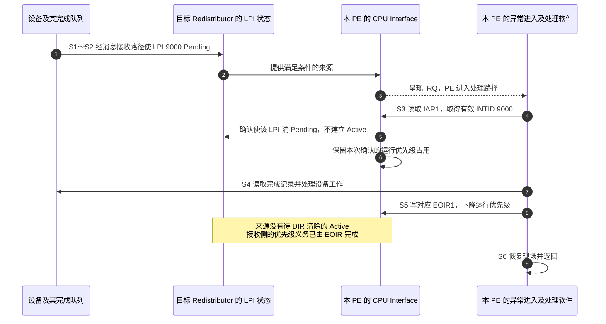
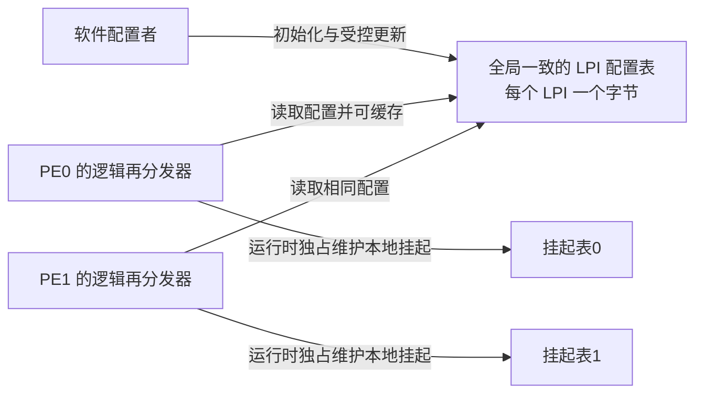

# 第8章\_从消息请求到内存中的中断状态

## 8.1\_来源越来越多\_为什么让设备发送一条消息

前面用 **通用中断控制器（Generic Interrupt Controller，GIC）** 处理普通来源，并把多核通知的数据与信号分开。现在换成一个有许多工作队列的设备：每个队列都可能产生完成事件。若每个事件来源都要求一根专用信号线，连接与收敛的规模就随来源数量增长。

**消息中断（Message-Signaled Interrupt，MSI）** 让设备用一次约定的写事务表达请求。写事务到达控制器的接收接口，控制器再按配置识别和递送；这不是设备直接跳进处理器代码，也不是把完整工作数据都写进一个中断寄存器。

GICv3 引入 **局部性专属外设中断（Locality-specific Peripheral Interrupt，LPI）** 来支持大量消息来源。译名用于辨认术语，关键是职责：它有自己的编号空间、内存配置和挂起状态模型。LPI 总是消息型，但消息型不必然就是 LPI，因为 **共享外设中断（Shared Peripheral Interrupt，SPI）** 也可以由实现提供的消息接口触发。

本章只建立 LPI 的配置与状态。消息中的设备身份怎样翻译成 LPI，下一章再解释，不提前把所有翻译表塞进来。

> 官方对照：[消息指南 102923，1.0-01](https://developer.arm.com/documentation/102923/0100)，第 1 章 Introduction 与第 2 章 LPIs（PDF 第 6～7 页）；[规范 IHI0069 H.b](https://developer.arm.com/documentation/ihi0069/hb)，4.2 Locality-specific Peripheral Interrupts。先确认消息通知方式与 LPI 来源类型不是同一分类轴。

## 8.2\_确认LPI后\_为什么仍要结束优先级

普通来源在确认以后保留 **活动（Active）** 状态，直到 **停用（Deactivation）**；LPI 只有 **Inactive（非挂起）** 与 **Pending（挂起）** 两种状态。确认一个 LPI 就使其从 Pending 转到 Inactive，不会为该 LPI 建立普通来源那样的 Active 状态。

这不表示软件已经处理完设备，也不表示接收侧运行优先级自动恢复。仍然要区分：LPI 来源自身的状态、处理器接口的优先级状态、软件正在处理的数据。**确认清挂起，结束寄存器负责优先级下降；LPI 不需要普通来源的 DIR 停用动作。**

若软件处理期间又来同号消息，它可以再次挂起；是否立即递送还受当前优先级与接收条件限制。同样，挂起位不是无限计数器，工作量仍应保存在设备完成队列等位置。

例如，一条消息让 LPI 9000 在目标接收侧挂起；处理器确认 9000 时，硬件清除这次挂起并建立运行优先级占用。设备完成队列中的数据仍等软件读取。软件处理后写匹配的 EOIR 释放优先级，既没有新增普通来源的 Active，也没有一项等待 DIR 才能清除的 Active。这就是下面接口表要兑现的一次最小周期。

这里的 DIR 是停用寄存器的简称，对应 **`ICC_DIR_EL1`（Interrupt Controller Deactivate Interrupt Register，中断控制器停用寄存器）**，不是“软件处理结束”的通用命令。**再分发器（Redistributor）** 是与目标处理单元关联的接收侧配置和状态接口。

下表沿用 **中断标识符（Interrupt Identifier，INTID）** 记录来源，沿用 **中断结束寄存器（End Of Interrupt Register，EOIR）** 下降优先级。访问属性记号 RO（Read-only，只读）、WO（Write-only，只写）、RW（Read/Write，读写）只说明软件访问方向，不承诺读取无副作用。

| 复用的处理器接口 | 访问属性与相关字段 | LPI 路径中的含义 |
| --- | --- | --- |
| `ICC_IAR1_EL1` / `ICC_EOIR1_EL1` | AArch64 系统寄存器，64 位；前者 RO 但读取有确认副作用，后者 WO；INTID[23:0] 标识本次来源 | 对真实 LPI 的确认清 Pending；匹配的 EOIR 写入仍须下降运行优先级 |
| `ICC_DIR_EL1` | AArch64 系统寄存器，64 位 WO；INTID[23:0] 指定需停用的普通来源 | LPI 没有 Active，不给它增加一次 DIR 停用步骤；普通来源的分离模式契约见[第四章](P04_一次中断的状态转换与完成协议.md#4.3_确认_清源_优先级下降与停用) |

这里复用 IHI0069 H.b 12.2 的确认、结束与停用接口；访问权限和特殊 INTID 的排除规则不因来源换成 LPI 而取消。

相对 [S0～S6 普通周期](P04_一次中断的状态转换与完成协议.md#4.4_用同一组阶段闭合正常周期)，LPI 的关键差量是：

| 既有阶段 | LPI 改变了哪一处 |
| --- | --- |
| S0 | 配置和挂起存储需要准备内存表及访问属性 |
| S1～S2 | 设备消息经实现采用的接收路径，使目标再分发器中的 LPI 挂起；本卷下一章继续展开消息翻译过程 |
| S3 | 确认清除该挂起实例，没有普通来源的 Active 状态 |
| S4 | 仍然由软件处理设备数据，不由 GIC 代劳 |
| S5 | 仍需结束优先级占用，但不对 LPI 做普通中断停用 |
| S6 | 返回或继续处理满足条件的请求 |

把来源状态和接收侧状态分成两列角色，就能看清为什么少了 Active 仍然不能少写 EOIR。下图固定一次有效的 LPI 9000 确认，期间没有新消息，接口访问与来源配置都已准备好；消息怎样选中这个编号和目标，留在下一章展开。图中将确认带来的两个状态效果分别画出，是为区分状态归属，不规定硬件内部先更新哪一份存储。



步骤 5 只改变来源的待处理状态，步骤 7 才处理真实工作，步骤 8 才释放接收侧优先级。若漏掉步骤 8，即便 LPI 已不再 Pending，接收侧仍可能挡住其他优先级较低的请求；再写一个 DIR 不能补做欠下的优先级下降。

> 官方对照：[规范 IHI0069 H.b](https://developer.arm.com/documentation/ihi0069/hb)，4.2 Locality-specific Peripheral Interrupts 与 5.1 LPIs（5-86 起）；[消息指南 102923，1.0-01](https://developer.arm.com/documentation/102923/0100) 第 2 章 LPIs。重点查“没有 Active 状态”，同时保留处理器接口优先级下降义务。

## 8.3\_两张表分别归谁维护

消息替代了大量专用请求线，控制器却仍须记住每个来源是否使能、使用什么优先级，以及哪个接收者还有请求。若把这些信息继续全部对应到固定的寄存器窗口，来源数量一扩大，固定存储与访问窗口也要跟着扩展。GICv3 让软件按所支持的编号范围准备内存表，并允许控制器在内部缓存相关状态；这把大规模来源的状态存储引到了内存，却增加了地址、容量、可见性和维护权的约束。

其中，属性是同一个 LPI 的配置策略，挂起则是目标接收侧当前有没有待办。两者的更新者和生命周期不同，因此需要分别安排存储，而不是让软件和硬件随意共同改一张数组。

**LPI 配置表（LPI Configuration table）** 为每个 LPI 保存属性，由软件初始化和更新，控制器读取。物理 LPI 配置具有全局一致性要求；多个再分发器可以指向同一份配置表。是否允许使用不同副本由实现决定；即使允许，各副本也必须按规范在启用和配置失效等操作时保持内容一致并对控制器可见，不能把同一个编号在不同接收者上偷偷配置成不同语义。

**LPI 挂起表（LPI Pending table）** 为每个再分发器保存自己的挂起状态，运行时由该再分发器维护。这些表不能当作多个接收者共用的一张全局挂起表。



软件在初始化时分配并清零挂起表，然后将运行时维护权交给硬件。LPI 启用期间，软件写挂起表会违反架构契约；而且内存中的位不一定实时反映控制器内部缓存，不能把一次内存查看当作完整实时状态。

先走一次准备与接收过程。软件为 LPI 9000 写好使能和优先级，为各接收者分配并清零自己的挂起表；在满足初始化条件后，把表的位置交给控制器。随后一条消息选择 PE0 的 LPI 9000，硬件维护的是 PE0 的挂起状态，PE1 的挂起表不会因此一起置位。PE0 确认后，硬件清除该挂起实例；软件继续消费设备数据。这里描述的是逻辑状态变化，不承诺每次置位、清位都立即写回外部内存。

这些内存由软件分配，硬件不会自动知道它们放在哪里；还需要一组寄存器发布表的物理地址、覆盖范围和访问约定。`GICR_PROPBASER` 是 **Redistributor Properties Base Address Register（再分发器属性基地址寄存器）**，本节属性就是 LPI 配置；`GICR_PENDBASER` 是 **Redistributor LPI Pending Table Base Address Register（再分发器 LPI 挂起表基地址寄存器）**。它们是寄存器名称，告诉控制器到哪个物理内存位置访问表，以及采用怎样的属性。

下表把再分发器简称为 RD，把 **GIC 分发器（GIC Distributor）** 简称为 GICD；RD_base 是当前 PE 的再分发器控制页基址。**挂起表已为零（Pending Table Zero，PTZ）** 是软件对内存现状的声明，其与硬件清零动作的区别直接列在表中。地址表仍采用内存映射输入输出（Memory-mapped I/O，MMIO）访问。

| 寄存器与逻辑范围 | MMIO 位置、宽度与属性 | 地址和容量字段 |
| --- | --- | --- |
| `GICR_PROPBASER`，LPI 配置表描述 | 当前 RD_base + 0x0070；64 位 RW，实现可将它固定为 RO | Physical_Address[51:12] 保存表物理地址高位，低 12 位为 0，即 4 KiB 对齐；IDbits[4:0] 为覆盖的 INTID 位数减一，受 GICD_TYPER.IDbits[23:19] 报告的能力限制 |
| `GICR_PENDBASER`，本 RD 的挂起表描述 | 当前 RD_base + 0x0078；64 位 RW，其中 PTZ 为 WO、读回 0 | Physical_Address[51:16] 保存表物理地址高位，低 16 位为 0，即 64 KiB 对齐；PTZ[62]=1 声明软件已经把表清零，不会命令硬件替软件清零 |
| `GICD_TYPER`，Distributor 的能力报告 | GICD + 0x0004；32 位 RO | LPIS[17] 报告 LPI 支持，IDbits[23:19] 报告 INTID 位数减一。读取能力不分配表，也不启用 LPI |

地址正确还不够。软件可能刚在处理器缓存中写好 LPI 9000 的属性，控制器却通过另一条内存访问路径读取它；这条路径是否参与共享、是否缓存，决定软件该怎样让新内容可见。因此基址寄存器除了指明“读哪里”，还描述“怎样访问”。下面细化这组访问约定；“共享”和“可缓存”都不是替软件完成更新同步的命令。

两个基址寄存器的共同访问属性字段如下。表内地址是控制器使用的物理地址，不能写入处理器的虚拟指针；未实现的高地址位须写 0。

| 位段 | 字段 | 编码与用途 |
| --- | --- | --- |
| 58:56 | OuterCache | 000 采用 InnerCache 指定的类型；对普通内存同时采用相同外层缓存属性。其余值使用下表相同缓存编码 |
| 11:10 | Shareability | 00 非共享；01 内部共享；10 外部共享；11 保留，按 00 处理。实际允许值由平台与实现约束 |
| 9:7 | InnerCache | 指定控制器访问表所用的内层缓存属性；编码见下表 |

缓存策略中的“读分配／写分配”回答未命中时，是否因相应读／写访问把数据填入缓存；“直写／回写”回答缓存中的写入是同时向下级推进，还是可以先留在缓存、随后再写出。这些选择改变访问方式和维护要求，并不改变哪一方拥有配置表或挂起表。

| 3 位缓存编码 | InnerCache 的含义 | OuterCache 使用该值时的含义 |
| --- | --- | --- |
| 000 | Device-nGnRnE 设备内存 | 使用 InnerCache，不能独立解释为设备内存 |
| 001 | 普通、不可缓存 | 普通、外层不可缓存 |
| 010 / 011 | 普通、读分配，分别为直写 / 回写 | 相同策略用于外层缓存 |
| 100 / 101 | 普通、写分配，分别为直写 / 回写 | 相同策略用于外层缓存 |
| 110 / 111 | 普通、读写分配，分别为直写 / 回写 | 相同策略用于外层缓存 |

“共享”和“可缓存”描述控制器怎样访问内存，不自动替软件建立缓存可见性。实现可以固定部分属性，软件须按实际支持值配置；多个已启用 RD 的 PENDBASER 访问属性也必须一致。EnableLPIs=1 时不能改 PENDBASER，也不能把 PROPBASER 当作可随意切换表的指针；受控关闭与再次配置的条件见 [8.6 节](#8.6_整体关闭与禁止一个来源不是同一保证)。本表重排自 IHI0069 H.b 12.11.32～12.11.33（12-700～12-705）；其中未列出的位均按该 GICv3.0 布局保留为 0。

图中的再分发器表示每个 PE 的 **架构逻辑职责**。在 GIC-600 r1p6 中，同一芯片的核共用一份 GICR_PROPBASER 状态，指向同一配置表；LPI 缓存又集中在 Distributor 物理块中。它仍分别维护各 PE 的挂起状态，不能把缓存集中理解为所有 PE 共用一个挂起位。逻辑接口与产品块的落点见[第三章对应关系](P03_多核控制器的角色_寄存器与编号.md#3.4.1_PPI块为什么这样设计_从布线与电源约束到每核状态归属)。

> 官方对照：[规范 IHI0069 H.b](https://developer.arm.com/documentation/ihi0069/hb)，5.1.1 LPI Configuration tables、5.1.2 LPI Pending tables；寄存器在 12.11.33 GICR_PROPBASER 与 12.11.32 GICR_PENDBASER。GIC-600 的实际共享范围与缓存落点见 [100336 r1p6](https://developer.arm.com/documentation/100336/0106) 1.2 Components（1-13）及附录 B 表 B-1（Appx-B-204）。查每类表是谁写、谁可以缓存、何时允许软件访问，不把 CPU 能读写某块内存等同于协议允许。

## 8.4\_用一个编号实际计算表项位置

**中断标识符（Interrupt Identifier，INTID）** 是控制器编号。LPI 从 8192 开始。对于编号 N，配置表条目的字节偏移为 N−8192；挂起表中则按 N/8 的整数商找字节，按 N 对 8 的余数找位。两张表的下标起点不同。

```text
教学编号 N = 9000
配置表：字节偏移 808（从 0 计），因为 9000 - 8192 = 808
挂起表：字节偏移 1125（从 0 计）的 bit 0，因为 9000 / 8 = 1125
```

配置条目中的 bit 0 是使能，bit 1 是保留为 1 的位置，bits 7:2 表示优先级高位；优先级低两位按 0 处理，具体实现还可能减少有效位。**RES1（Reserved, must be one，保留且必须为 1）** 是规范对保留位取值的标记，不是软件自定义状态。两安全状态下还要遵循优先级访问视图规则，不能把表内编码不经区分地与安全侧优先级比较。

把这一个字节从高位到低位展开，便是规范图 5-3 和表 5-1 的最小完整布局：

| 位段 | 名称 | 读写含义 |
| --- | --- | --- |
| 7:2 | Priority，优先级 | 保存优先级高 6 位；未实现的低有效位按架构要求处理，优先级数值还须使用正确安全视图 |
| 1 | RES1 | 保留且必须为 1，不是第二个使能位 |
| 0 | Enable，使能 | 1 允许该 LPI，0 禁止该 LPI；不是整个接收侧的 EnableLPIs |

例如只改变某个 LPI 的使能，就是受控修改这个字节的 bit 0，同时保留它的优先级和 bit 1；并不是去普通 SPI 的 ISENABLER 寄存器找同号位。表重排自 IHI0069 H.b 5.1.1，图 5-3、表 5-1（5-90）。

物理 LPI 在本专题的两安全状态配置中属于 **非安全第 1 组（Non-secure Group 1）**，没有在每个条目里任选安全组的字段。

假设配置支持 B 位编号，编号空间上界为 2 的 B 次方：配置表逻辑数据量为 2 的 B 次方减 8192 字节；每个挂起表逻辑数据量为 2 的 B 次方除以 8 字节。若 B 为 16，分别为 56 KiB 与 8 KiB，KiB 表示 1024 字节。实际分配还要满足寄存器规定的基地址对齐、实现限制与内存属性，不能把逻辑大小直接当成分配器参数。

挂起表前 1 KiB 对应的区域不能被解释为普通中断的挂起位；规范允许它保存实现定义的信息，初次分配时也必须清零。不要因为 LPI 从 8192 开始，就擅自删掉这 1 KiB。

把 B=16 时的两个内存区并排看，偏移为什么不同就更直观了。下表中的“末尾”都是逻辑数据范围，基地址仍须另行满足对齐。

| 内存区 | 表内字节范围 | 内容 | 基地址对齐 |
| --- | --- | --- | --- |
| 配置表 | 0～57343 | 依次为 INTID 8192～65535 的 57344 个属性字节 | 4 KiB；由 GICR_PROPBASER 的地址字段表达 |
| 每个接收者的挂起表前部 | 0～1023 | 实现定义区域；不是 INTID 0～8191 的普通中断挂起表 | 整张挂起表为 64 KiB 对齐 |
| 同一挂起表的 LPI 区 | 1024～8191 | 每字节 8 位，依次对应 INTID 8192～65535 | 沿用 GICR_PENDBASER 的整表基地址 |

`GICR_PROPBASER.IDbits` 编码的是编号位数减一，所以本例 B=16 对应字段值 15，并且不得超出实现报告的能力。4 KiB 与 64 KiB 是基地址对齐要求，不是这两张表恰好只占这些大小；例如 56 KiB 的配置数据依然可以从 4 KiB 对齐的地址开始。布局与对齐依据 IHI0069 H.b 5.1.1～5.1.2（5-89～5-91）、12.11.32～12.11.33（12-700～12-704），没有假定 RK3588 已按本例分配内存。

> 官方对照：[规范 IHI0069 H.b](https://developer.arm.com/documentation/ihi0069/hb)，5.1.1 LPI Configuration tables（5-88～5-89）、5.1.2 LPI Pending tables（5-90～5-91）。以规范核对起始下标、配置字节位域和挂起表前 1 KiB；本节 9000 与 16 位空间是按这些规则推导的教学算例。

## 8.5\_软件改了属性\_硬件为什么还在使用旧值

固定一个失败过程：软件把某 LPI 的使能位置 1，写入停留在处理器缓存中；控制器读取内存时可能仍看到旧值。即使更新已经对控制器可见，再分发器还可能持有此前缓存的配置条目。两种旧值来源不同，需要分别处理。

因此受控更新至少包括三件事：修改配置条目；按平台内存访问规则让更新对控制器可见；使控制器的旧配置缓存失效，并等待规定的完成条件。后文的中断翻译服务可以通过命令发起这种失效；这与处理器自身的缓存维护不是同一个动作。

内存屏障约束访问关系，不会凭空让一个不参与缓存一致性的设备取得处理器私有的脏数据。RK3588 对 LPI 表访问的共享属性有具体限制，必须在[平台记录](../../rockchip/rk3588/P01_RK3588的GIC-600集成与手册核对.md#1.3_内存地址与访问属性怎样影响实现)中核对，不能套用其他系统的可缓存共享内存配置。

> 官方对照：[消息指南 102923，1.0-01](https://developer.arm.com/documentation/102923/0100)，3.2 Reconfiguring LPIs（PDF 第 10 页）；[规范 IHI0069 H.b](https://developer.arm.com/documentation/ihi0069/hb)，5.1.1 LPI Configuration tables。分别追踪软件内存更新、控制器配置缓存失效和完成同步，不能用其中一个动作替代另外两个。

## 8.6\_整体关闭与禁止一个来源不是同一保证

单个 LPI 的属性使能位与再分发器 `GICR_CTLR.EnableLPIs` 不同。`GICR_CTLR` 是 **再分发器控制寄存器（Redistributor Control Register）**，EnableLPIs（启用 LPI）是该接收侧物理 LPI 支持的整体启用字段。

当 EnableLPIs 为 0，试图让该再分发器上的 LPI 挂起不会像普通被禁止的 SPI 那样保留请求，而可能被丢弃。不能用“先全局关 LPI，事件都在里面等着”作为无丢失协议。

下面还会使用 **寄存器写入待完成（Register Write Pending，RWP）** 状态判断受跟踪写入是否完成；它与某个 LPI 的 Pending 不是同一种状态。

同样，不能在 EnableLPIs 为 1 时随意换配置表或挂起表基地址。还必须先核对目标实现是否允许将已置位的 EnableLPIs 清零，不能把“写入了 0”当作关闭成功；允许清零时，也要读回确认，并等待 `GICR_CTLR.RWP` 报告写入完成，才能继续依赖规范对挂起表停止访问的保证。释放内存还需要同时处理消息生产者、翻译映射、在途请求和软件处理，仅把一个位清零不足以证明全部内存都可以归还。

| 接口与范围 | 地址、宽度与属性 | 本章使用的位与完成条件 |
| --- | --- | --- |
| `GICR_CTLR`，当前 RD 的 LPI 接收控制 | RD_base + 0x0000，32 位；控制位 RW、状态位 RO | EnableLPIs[0]=1 启用物理 LPI；RWP[3] RO 跟踪规定写入，包括 EnableLPIs 从 1 清为 0。能否清零取决于实现，先读回 EnableLPIs，再等 RWP=0；不能把 RWP=0 单独当作关闭成功 |

表依据 IHI0069 H.b 12.11.2（12-641～12-644），不要求读者先使用后续架构扩展的能力字段。该寄存器里用于 SPI 候选资格的 DPG 位另见[上一章](P07_目标选择_核间通知与电源交接.md#7.2.2_候选资格是PE的状态_路由属性仍属于SPI)。

GIC-600 r1p6 对这个操作还有具体要求：手册建议通过中断翻译服务解除中断映射；若必须清除 EnableLPIs，应先完成其 `GICR_WAKER.Sleep` 握手来刷新 LPI 缓存。这里的 Sleep 是产品定义的整体休眠握手字段，与上一章每 PE 的 ProcessorSleep 不同，不能用单核休眠请求替代。实施时必须遵循整个产品电源与状态保存流程。

把这个产品握手放回一次状态保存：先按上一章完成所有 PE 的休眠交接，再由有权软件请求整体 Sleep；硬件保存相应 LPI 挂起状态并报告 Quiescent 后，平台才继续后续电源流程。它多出的环节正是把控制器内部状态交给可保存的内存，不能只发出 Sleep 请求就认定已经完成。

| GIC-600 r1p6 的整体握手字段 | 访问位置、宽度与属性 | 前置条件与效果 |
| --- | --- | --- |
| `GICR_WAKER`.Sleep[0] | 任一 RD_base + 0x0014 的 32 位 WAKER 中，RW；全芯片共享一个 Sleep | 所有 PE 的 ProcessorSleep、ChildrenAsleep 均为 1 后才能置 1，发起整体状态保存；Sleep=1 期间到达的消息可能被忽略，必须先处理生产者 |
| `GICR_WAKER`.Quiescent[31] | 同一寄存器，RO；全芯片共享一个 Quiescent | 等其为 1，表示相应 LPI 挂起状态已保存，可按产品协议继续掉电；恢复正常 PE 接口前，Sleep、Quiescent 都须为 0 |

本表是 **产品字段**，不把规范中实现定义的位扩写成所有 GIC 的通用接口；依据 GIC-600 r1p6 3.6.3（3-58～3-59）与 4.4.3 表 4-24（4-130～4-131）。普通每 PE 的 ProcessorSleep[1]、ChildrenAsleep[2] 仍按[上一章的局部握手表](P07_目标选择_核间通知与电源交接.md#7.5_目标准备下线时_要交接的不只是路由)解释。

还要注意：关闭 LPI 支持不保证控制器把全部缓存挂起状态写回内存；如果任务要求保存并恢复已有请求，应采用对应电源与状态保存协议，而不是把“禁止”当作“刷新快照”。

## 8.7\_从边界编号检查两张表

做一次不用硬件的索引验算。仍采用 B=16 的编号空间，先为 8192、8199、8200 和 65535 计算配置表字节偏移、挂起表字节与位，再对照下表。整数除法与余数的用途已经在第三章建立，这次变化在于两张表的起点不同。

| INTID | 配置表字节偏移 | 挂起表字节偏移 | 挂起位 |
| --- | --- | --- | --- |
| 8192 | 0 | 1024 | 0 |
| 8199 | 7 | 1024 | 7 |
| 8200 | 8 | 1025 | 0 |
| 65535 | 57343 | 8191 | 7 |

最后一行恰好落在 57344 字节配置数据与 8192 字节挂起存储的末尾。若把挂起表也减去 8192 再寻址，第一个 LPI 就会误落到前 1 KiB 的实现保留区域；算出的内存地址也许仍在分配块内，却不属于正确协议位置。编号 65536 已超出这次配置空间，不能因为整数运算还能算出偏移就认为硬件支持。

再做属性更新的故障推演：软件已经将一个 LPI 的使能置 1，并让处理器缓存中的更新对控制器可见，但仍观察不到新请求。能否排除“旧配置”原因？不能，再分发器可能仍缓存旧条目；还需要对应失效与完成协议。反过来，只完成配置失效却没有建立新内存内容的可见性，也可能重新取到旧值。

本节只通过算术验证表布局，通过协议推演区分两层缓存，没有读取运行时挂起表。禁止整个接收侧 LPI、停止一个来源以及停止设备生产也不同；需要无丢失交接时，应先回答在途消息保存在哪里，而不是在这些开关之间猜一种等效替换。

现在能回答 LPI 的状态在哪里、由谁维护、为什么写内存不等于立即生效。剩下的问题是：来自两个设备的相同事件号，怎样找到正确的全局 LPI 与目标再分发器？

官方对照：[规范 IHI0069 H.b](https://developer.arm.com/documentation/ihi0069/hb)，5.1 LPIs、5.1.2 LPI Pending tables 和 12.11.2 GICR_CTLR 中的 EnableLPIs；[GIC-600 r1p6](https://developer.arm.com/documentation/100336/0106) 3.6.3 Other power management（3-58～3-59）及表 3-8 的 SYN_LPI_CLR 错误标识符项（3-78）。核对整体关闭时消息处理与缓存写回保证的边界；大小计算与状态推演是静态说明，不是本机运行寄存器值。

上一篇：[上一章](P07_目标选择_核间通知与电源交接.md#7.1_把请求交给另一个处理器_改变了什么)

[专题大纲](大纲.md#1.2_因果阅读地图)

下一篇：[事件翻译](P09_设备事件翻译与命令完成.md#9.1_两个设备都发事件0_怎样区分)
