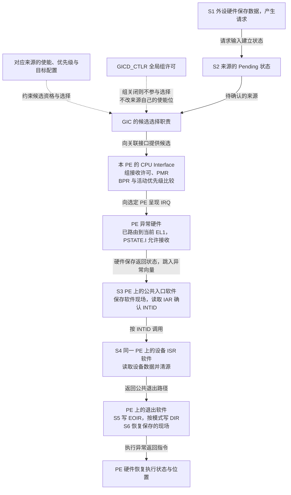
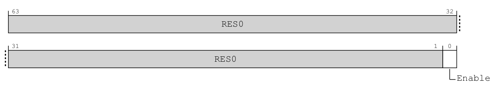
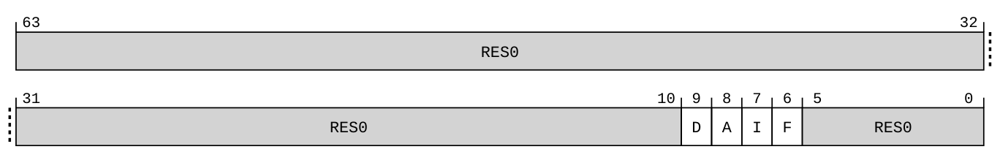
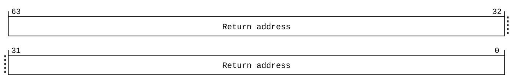
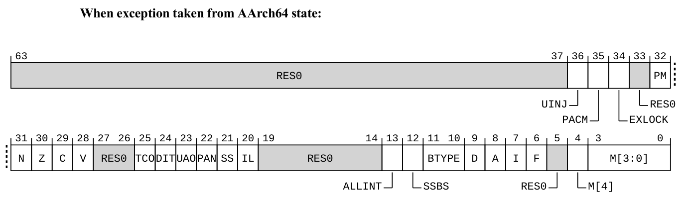
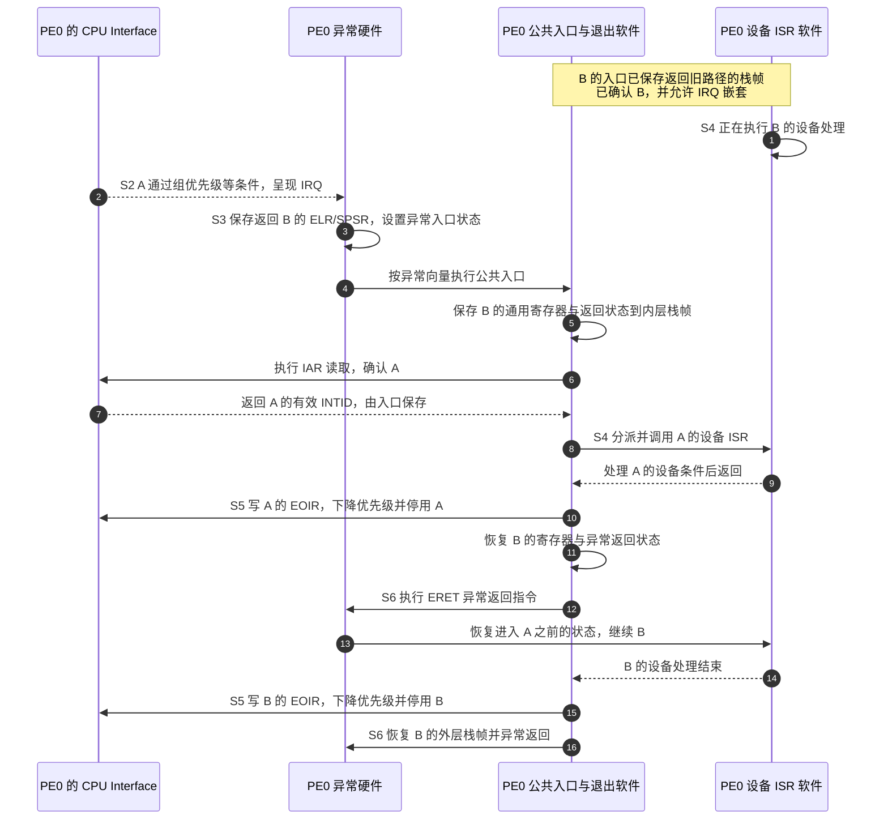

# 第8章\_处理器屏蔽与嵌套恢复

## 8.1\_控制器屏蔽与处理器屏蔽不能互相替代

**讲解层次：概念层。** 将 IHI0069 H.b 的递送条件与 DDI0487 M.c 的 PE 异常接收条件对照；以下首先画职责和判断关系。

上一章已经建立来源优先级、PMR 门槛与组优先级的比较规则。但一个来源具备抢占资格，仍不等于处理器已经接受异常，更不等于入口软件能安全保存两层现场。本章只把这段缺口接起来：先区分 GIC 与处理器各自的屏蔽，再走完嵌套进入、确认、完成和恢复。

现在把“能不能送达”放回硬件路径。**来源使能** 是一个 INTID 的开关；**中断安全组使能** 是 Group 0、Secure Group 1 或 Non-secure Group 1 对应的递送开关；PMR 是当前 PE 的优先级门槛。中断安全组使能与上一章的组优先级不是同一件事：关闭 Non-secure Group 1，会挡住这个安全分组中不同优先级的来源，不是只挡住高位相等的一档优先级。

对共享来源，来源使能保存在 **分发器（Distributor）** 的 `GICD_ISENABLER<n>` 等寄存器接口中；私有来源由对应 **再分发器（Redistributor）** 的 `GICR_ISENABLER0` 等接口管理。全局安全组递送由 `GICD_CTLR` 控制，而每 PE 的 `ICC_IGRPEN1_EL1`，即 **Interrupt Controller Interrupt Group 1 Enable register（中断控制器第 1 组使能寄存器）**，控制该 PE 对相应安全状态 Group 1 的接收。本例需要 Non-secure Group 1 的全局与本 PE 接收条件都成立。

处理器另外维护 **处理器状态（Processor State，PSTATE）**。在本专题的 AArch64（64 位执行状态的架构专名）模型中，**中断请求（Interrupt Request，IRQ）** 是一种异步异常类别。先固定 IRQ 路由到当前执行的 EL1、没有更高异常级接管：此时 **PE0 的 PSTATE.I 为 1，只屏蔽 PE0 对这类 IRQ 的接收**；PE1 的 PSTATE.I 不会随它改变。设备仍可接收数据，GIC 仍可保留请求，已在其他 PE 上运行的处理代码也不会因此停止。

图中的 **中断确认寄存器（Interrupt Acknowledge Register，IAR）** 用于领取具体来源；**中断结束寄存器（End Of Interrupt Register，EOIR）** 与 **中断停用寄存器（Deactivate Interrupt Register，DIR）** 执行第六章的完成协议。下文合写 EOIR/DIR 时只是并列这两类接口，不表示必须无条件写两次。设备处理代码也称 **中断服务程序（Interrupt Service Routine，ISR）**，由公共入口识别来源后调用。

下图先画 GIC 的 **架构职责与判断依赖**，再跨入 PE 异常硬件和在它上面执行的软件。虚线表示某份配置约束哪项判断；实线表示请求或处理推进。配置框并不是独立物理模块，“候选选择”也不是在来源与 CPU Interface 之外新加的一颗器件。每 PE 组许可如何影响候选还存在实现分支，下一章会逐项展开。

沿这条链看一次串口请求：来源尚未开放时，它不能仅凭高优先级进入；来源和组已开放后，当前 PE 的组接收与优先级条件仍要允许它；GIC 已经呈现 IRQ，PE 的异常屏蔽又可能暂缓进入。关闭其中一道许可并没有把外设数据或此前的 Pending 一并删掉。下面把这几处已经分清的 GIC 开关对应到编程接口。

来源使能的原图已经在[第五章](P05_寄存器位图与编号索引.md#5.1_一个编号怎样找到对应状态位)展开；这里新增的是每 PE 的组接收接口。先读它的完整布局，随后再归纳整条链上的开关。

> 原图来源：[IHI0069 H.b](https://developer.arm.com/documentation/ihi0069/hb)，12.2.16，印刷页 12-260。64 位系统寄存器，按权限 `MRS/MSR`；以下为中文字段对照。

| 位段 | 原文字段 | 中文对照 |
| --- | --- | --- |
| `[63:1]` | `RES0` | 保留为零 |
| `[0]` | `Enable` | 当前安全状态 Group 1 的每 PE 接收使能；0 禁止，1 允许，不改变另一 PE 的副本或来源的安全归属 |

以下是本节递送链的 **控制位置归纳**。`GICD_CTLR` 的不同访问视图将在第九章并列显示，不能从这一行反推整张初始化位图。

| 当前使用的开关 | 地址或系统寄存器、宽度 | 本节使用的读写语义 |
| --- | --- | --- |
| SPI 来源使能 `GICD_ISENABLER<n>` | MMIO `GICD_base + 0x0100 + 4n`，32 位；n 为 `INTID DIV 32` | 读出当前使能；向 `INTID MOD 32` 对应位写 1 使能，写 0 无效；它不会清除 Pending，也不会确认来源 |
| 本 PE 的 SGI/PPI 使能 `GICR_ISENABLER0` | MMIO `SGI_base + 0x0100`，32 位 | 位号等于本地 INTID，读及写 1 置使能规则同上；SGI 是否允许禁止由实现选择 |
| 实例级组使能 `GICD_CTLR` | MMIO `GICD_base + 0x0000`，32 位，按字段读写 | 在两安全状态有效、亲和性路由开启的安全视图，`EnableGrp1NS` 为 bit 1；对应非安全视图用 bit 1 的 `EnableGrp1A` 别名。0 禁止、1 允许该组，不改变其安全归属 |
| 本 PE 的 Group 1 接收 `ICC_IGRPEN1_EL1` | 64 位系统寄存器，`MRS/MSR` | 当前安全状态副本的 Enable bit 0；0 禁止、1 允许该组接收，不改变另一 PE 的开关 |

以上访问都需要相应权限，普通非安全软件不能借表格修改安全来源。来源使能的清除接口、三种组使能及实现定义边界，在下一章的[硬件结构与配置归属](P09_权限_安全分组与异常路由.md#9.3.2_硬件结构与配置归属先对齐)集中列出；本表只保留本节递送链使用的操作。依据为 IHI0069 H.b 的 12.9.26（12-593～12-594）、12.11.25（12-688～12-689）、12.9.4（12-544～12-549）和 12.2.16（12-260～12-262）。

若任一递送条件不成立，Pending 不会因为“尚未送达”就自动变为 Active；在本章普通递送协议中，真实确认才建立对应的活动交接。处理器接收异常与入口读 IAR 也必须分开观察。图中的软件动作都由同一个 PE 执行，读取 IAR 或写入结束寄存器后，再由相应 GIC 硬件推进状态。

### 8.1.1\_哪些异常受哪个屏蔽位约束

**讲解层次：概念层（处理器架构）。** 依据 DDI0487 M.c 与 Exception model 1.0 解释 AArch64 的异常类别和 DAIF，不把这些状态归入 GIC。

“普通异常”不是本章采用的正式分类。AArch64 的异常向量区分以下四类；本章主线只处理其中的 IRQ：

| 异常类别 | 从哪里来 | 与本章屏蔽位的关系 |
| --- | --- | --- |
| 同步异常（Synchronous exception） | 执行指令时触发，例如系统调用、地址访问异常 | 不因 PSTATE.I 为 1 就禁止发生 |
| IRQ | 外设或核间通知经中断路径递送 | 在本章当前 EL1 接收模型下，由 I 位屏蔽 |
| FIQ（Fast Interrupt Request，快速中断请求） | 另一类中断异常输入，其呈现与安全分组有关 | 在对应的当前异常级接收模型下，由 F 位屏蔽；Fast 不保证设备更快 |
| SError（System Error，系统错误） | 异步系统错误，例如某些内存系统错误报告 | 由相应错误路由规则及 A 位等控制，不由 I 位统一控制 |

PSTATE 的 D 位还屏蔽适用的调试异常，它不是第五个与上表同级的向量类别。这些位不是“关闭整个 PE”的总开关。尤其是路由到更高异常级的中断，要按目标异常级与架构路由规则判断，不能用低异常级当前的 I/F 位一概推断能否屏蔽。具体路由在下一章建立。

若软件需要观察或调整这些屏蔽位，AArch64 用下面的接口访问当前 PE 的相应状态。

> 原图来源：[DDI0487 M.c](https://developer.arm.com/documentation/ddi0487/mc)，C5.2.3 DAIF，印刷页 C5-942；字段及访问规则续至 C5-945。它是 64 位处理器系统寄存器接口，当前前提下 EL1 用 `MRS Xt, DAIF`／`MSR DAIF, Xt`，不是 GIC MMIO 接口。

| 位段 | 原文字段 | 中文字段对照 |
| --- | --- | --- |
| `[63:10]`、`[5:0]` | `RES0` | 保留为零 |
| `[9]` | `D` | 适用的观察点、断点和软件单步异常屏蔽；针对当前异常级，目标更高时不由此位屏蔽 |
| `[8]` | `A` | SError 异常屏蔽位 |
| `[7]` | `I` | IRQ 异常屏蔽位 |
| `[6]` | `F` | FIQ 异常屏蔽位 |

这些屏蔽位的基本编码都是 0 不屏蔽、1 屏蔽，实际效果还要与目标异常级及相应路由规则合看。原图中没有 GIC INTID 或 Pending 字段，因此写 I/F 不会清除 GIC 的 Pending/Active，也不替换目标 EL。PSTATE 并非一个可以整体映射成设备寄存器的对象；DAIF 只提供这四个屏蔽位的访问视图。

本卷固定 GICv3.0，不把后续 GICv3.3 引入的 **不可屏蔽中断（Non-maskable Interrupt，NMI）** 支持混入当前模型，也不把 FIQ 简称为 NMI。

| 观察 | 能说明什么 | 不能据此断言什么 |
| --- | --- | --- |
| 来源 Pending，但尚未进入 | 控制器有待确认状态 | 路由、优先级和 PE 接收条件都正确 |
| 来源使能为 0 | 该来源不能按此使能条件递送 | 数据停止产生、Pending 已清空、旧处理已结束 |
| 当前 EL1 的 IRQ 被本 PE 的 I 位屏蔽 | 本 PE 暂不接收这一模型中的 IRQ | 其他 PE 被屏蔽，或共享数据已经免于并发访问 |
| 设备 ISR 已返回 | 设备处理函数本次调用结束 | 已按当前模式完成 EOIR/DIR，或已经执行异常返回 |

> 官方对照：[概览 198123，3.2-01](https://developer.arm.com/documentation/198123/0302)，第 5～6 章的使能和递送条件；[Exception model，Version 1.0](https://developer.arm.com/-/media/Arm%20Developer%20Community/PDF/Learn%20the%20Architecture/Exception%20model.pdf?revision=a62f2bf2-b08a-4a4f-8cbe-38c67ddf4434)，第 4 章 Exception types、第 5 章 Handling exceptions、第 6 章 The vector tables。GIC 的 NMI 版本边界见概览第 5 章来源配置中的 Non-maskable 项。

## 8.2\_嵌套需要成对恢复\_不能乱序结束

**讲解层次：概念层。** 依据 IHI0069 H.b 的优先级配对和 Arm AArch64 异常契约推演嵌套，是否采用这种策略还取决于实际系统的入口代码。

这里的 A、B 是两个中断来源及其处理过程，不是两个线程。假设外层 B 正在 PE0 的 EL1 执行，高优先级 A 随后满足 GIC 抢占条件，而且入口软件已经允许同 EL 的 IRQ 嵌套。A 不需要知道 B 正在执行哪行代码；B 也不会预知 A 何时到来。**中断接收由硬件触发，现场的保存与恢复由 PE 硬件和公共异常入口软件分担，设备 ISR 只承担该框架交给它的设备工作。**

### 8.2.1\_硬件先保存什么\_公共入口还必须保存什么

**讲解层次：概念层（处理器架构）。** 依据 DDI0487 M.c 的 ELR_EL1、SPSR_EL1 与 Exception model 1.0，区分硬件返回状态和软件栈帧。

**异常链接寄存器（Exception Link Register，ELR）** 保存异常返回地址，**保存的程序状态寄存器（Saved Program Status Register，SPSR）** 保存进入前的处理器状态。A 被接收时，PE 硬件把返回 B 所需的地址写入 `ELR_EL1`，把进入前的 PSTATE 写入 `SPSR_EL1`，更新屏蔽等执行状态，再转向异常向量。

硬件没有因此把所有通用寄存器自动压栈。公共入口代码必须把需要保留的寄存器、返回地址和状态保存到软件栈帧，再调用 A 的 **中断服务程序（Interrupt Service Routine，ISR）**。这里要保留的不只是普通函数调用约定中的部分寄存器，因为异步打断可能发生在 B 使用任意寄存器保存临时值的时候。

而且同一个 EL 的 ELR/SPSR 不是硬件无限深栈。B 首次进入时，这两个寄存器保存的是返回 B 之前执行路径的信息；如果 B 的公共入口没有先把这份信息保存到软件栈，A 再进入就会覆盖它。因此 **B 的入口在允许嵌套之前要先建立完整栈帧**；这是公共入口保护异常返回链的责任，不是要求 B 的设备函数替未来 A 的代码做备份。

表中的 `ADDR` 是地址（Address）字段名；`NZCV` 指运算结果的负数、零、进位、溢出四个条件标志，M 是返回执行模式字段。它们与前面已经解释的 DAIF 一起，说明要保护的是哪些返回状态。**异常返回指令（Exception Return，ERET）** 根据恢复后的返回地址与状态继续旧路径。

> 原图来源：[DDI0487 M.c](https://developer.arm.com/documentation/ddi0487/mc)，C5.2.5（C5-953）与 C5.2.21 的 AArch64 来源状态布局（C5-1013）。这里刻意选后者的 AArch64 图，不能用同条目前面的 AArch32 图解释当前现场。两者均为 64 位，当前无截获／重定向前提下 EL1 可 `MRS/MSR`。

下表按原字段逐项中文整理。较新扩展的字段仍保留在原图中；它们不是本例必须启用的功能，不能依据新版手册的图形断言当前处理器实现了全部扩展。

| 寄存器与位段 | 原文字段 | 保存的内容与条件 |
| --- | --- | --- |
| ELR `[63:0]` | `ADDR`，图中标作 Return address | 返回地址；进入异常时硬件写入，软件保存／恢复当前嵌套层的副本 |
| SPSR `[63:37]`、`[33]`、`[27:26]`、`[19:14]`、`[5]` | `RES0` | 当前 AArch64 布局的保留零位 |
| SPSR `[36]`、`[35]`、`[34]`、`[32]` | `UINJ`、`PACM`、`EXLOCK`、`PM` | 分别属于未定义指令注入、指针认证返回、受保护控制栈的返回状态锁、分析异常屏蔽扩展；各自未实现时为 `RES0`，本例不启用 |
| SPSR `[31]`、`[30]`、`[29]`、`[28]` | `N`、`Z`、`C`、`V` | 负数、零、进位、溢出条件标志 |
| SPSR `[25]`、`[24]`、`[23]`、`[22]` | `TCO`、`DIT`、`UAO`、`PAN` | 分别保存标签检查覆盖、数据无关时序、用户访问覆盖、特权访问限制状态；有效性依对应架构扩展，未实现为 `RES0` |
| SPSR `[21]`、`[20]` | `SS`、`IL` | 软件单步与非法执行状态；SS 的恢复另受单步规则约束 |
| SPSR `[13]`、`[12]`、`[11:10]` | `ALLINT`、`SSBS`、`BTYPE` | 分别是 NMI 扩展的全中断屏蔽、推测存储旁路状态、分支类型状态；未实现相应扩展时为 `RES0`，本例不使用 ALLINT |
| SPSR `[9]`、`[8]`、`[7]`、`[6]` | `D`、`A`、`I`、`F` | 被打断现场的四项屏蔽状态，区别于入口已经更新的当前 DAIF |
| SPSR `[4]` | `M[4]` | 本例从 AArch64 进入时为 0，表达返回执行状态 |
| SPSR `[3:0]` | `M[3:0]` | 返回异常级与栈指针选择；普通无嵌套虚拟化分支中，`0000` 为 EL0，`0100` 为 EL1t，`0101` 为 EL1h；其余编码须按条目条件判断，不任意填写 |

由原图可以独立检查嵌套保存的必要性：ELR 只有一份地址，SPSR 只有一份状态，图中没有“上一层”和“上上层”槽位。软件栈帧保存的是这两份寄存器当时的完整有效内容；退出时先恢复该层，再由 `ERET` 使用它们返回。不能只保存 I 位便声称保护了返回现场。

读这些寄存器不会确认 GIC 来源，写它们也不会完成 EOI。表中的 EL1 访问仍以前述无虚拟化重定向或上层截获为前提；不能从“可读写”推导出任意返回地址或状态编码都合法。依据为 [DDI0487 M.c](https://developer.arm.com/documentation/ddi0487/mc)，C5.2.5（C5-953～C5-954）、C5.2.21，特别是 AArch64 返回状态字段（C5-1013～C5-1017）。

### 8.2.2\_从打断到恢复B的完整时间线

**讲解层次：概念层。** 以下时序组合前述 GIC 和 AArch64 契约；软件阶段均由同一 PE 执行。

下面固定 EOImode 为 0，且 B 尚未优先级下降，最后通过已经解释的 ERET 恢复旧路径。图中的“硬件”“公共入口”和“设备 ISR”是同一 PE 上不同职责的阶段，不是三颗处理器。

步骤 3 是硬件建立最小异常返回状态，步骤 5 是公共入口保存软件现场；步骤 6～7 是核内确认接口的读取与返回，步骤 9 的 ISR 函数返回还不是步骤 12 的 **异常返回指令（Exception Return，ERET）**。ERET 根据恢复后的 SPSR/ELR 原子恢复执行状态和返回位置，才使 B 继续。图聚焦核侧接口与软件，来源 Active 的更新仍由第六章所述完成协议交接到来源状态所在功能。

步骤 10 先结束 A 的优先级占用，步骤 15 再结束 B，顺序与确认相反。若在内层 A 尚未完成优先级下降时先写 B 的结束信息，就破坏接收侧维护的嵌套优先级关系。分离模式还要另外追踪各来源的停用责任，不能只按 C 函数返回顺序猜测全部动作都完成。

即使现场保存正确，设备处理代码也可能因重入、锁或共享数据不允许嵌套。例如 B 持有一个只能由它释放的锁，A 打断 B 后在同一 PE 忙等该锁，B 就没有机会继续释放。因此允许嵌套是整个入口框架与处理代码共同满足的策略条件，不能仅凭架构支持这种协议就认定入口已经允许嵌套。

> 官方对照：[Exception model，Version 1.0](https://developer.arm.com/-/media/Arm%20Developer%20Community/PDF/Learn%20the%20Architecture/Exception%20model.pdf?revision=a62f2bf2-b08a-4a4f-8cbe-38c67ddf4434)，5.2 Taking an exception、5.5 Returning from an exception；[IHI0069 H.b](https://developer.arm.com/documentation/ihi0069/hb)，4.1.1 的确认与优先级下降配对规则、4.8.5 Preemption。

## 8.3\_改变一个条件\_预测谁能继续

**讲解层次：概念层。** 按 IHI0069 H.b 的规则独立重置每个教学现场，不把假设的优先级精度当作产品能力。

沿用[第 7.4 节](P07_优先级数值_门槛与分组.md#7.4_为什么还要区分组优先级与子优先级)的完整优先级值，A=0xA0、B=0xB0、C=0xB4，高四位为组优先级；所需位已实现，所有来源、组和目标条件满足。这里暂不填写 PMR 的非安全寄存器读数，而是明确假定门槛足以放行三者，避免把两种数值视图混用。

先按以下三种现场分别作答，不要把上一行发生的确认带入下一行。排队问题固定候选与配置已经稳定，判断的是选择优先级，不预测真实板上异步到达的先后次序：

| 独立现场 | 要预测的问题 |
| --- | --- |
| B、C 均 Pending 且已进入同一稳定候选集合，当前无优先级占用 | 谁是最高优先级候选？ |
| C 已确认且尚未下降优先级，B 后来 Pending | B 能否因数值更小立即抢占？ |
| B 已确认且尚未下降优先级，A 后来 Pending | 即使满足 GIC 抢占条件，为何仍可能不进入？ |

第一行的最高优先级候选是 B，因为完整优先级较高；第二行 B 的组优先级与 C 相同，子优先级差异不能触发抢占。第三行 A 的高位更高，可以成为抢占候选，但同级 IRQ 的 PSTATE.I、入口现场是否允许嵌套、软件策略仍须满足。硬件的仲裁资格不能代替软件的可重入性。

接着只改 PMR。使用[第 7.3 节](P07_优先级数值_门槛与分组.md#7.3_先过固定门槛_再过当前处理的门槛)已对齐的同一非安全数值视图，来源优先级 0x60、PMR 也为 0x60，其他条件不变。它会被挡住，因为门槛要求严格小于；把门槛改到 0x80 才满足这一项。若结果仍不进入，应继续检查其他条件，不应反过来宣布“数值越大优先级越高”。

最后把嵌套例子中的 B 改为“确认后已在分离模式下完成优先级下降，但尚未停用”。此时不能继续用 B 的原优先级代表接收侧当前约束，必须检查恢复后的运行优先级；B 自己的 Active 却还存在。这个变体检验的是第六章建立的两个状态维度，而不是又多背一个寄存器。

本章把控制器递送、处理器屏蔽和嵌套现场恢复接成了完整过程：满足优先级条件只是其中一环，ISR 返回也不能代替控制器完成和异常返回。下一章回到 S0，先问谁有权配置来源、来源归哪个安全组，以及请求最终进入哪个异常级；配置与握手的执行顺序再由第十章建立。

资料定位：[IHI0069 H.b，第 4 章及 ICC_PMR_EL1、ICC_BPR1_EL1、ICC_RPR_EL1 条目](https://developer.arm.com/documentation/ihi0069/hb)；[198123 第 6 章](https://developer.arm.com/documentation/198123/0302)。

上一篇：[优先级数值_门槛与分组](P07_优先级数值_门槛与分组.md#7.1_已经挂起的请求_为什么仍然不能进入)

[专题大纲](大纲.md#1.2_因果阅读地图)

下一篇：[权限_安全分组与异常路由](P09_权限_安全分组与异常路由.md#9.1_为什么照着寄存器名写值还不够)
