# 第9章\_权限\_安全分组与异常路由

## 9.1\_为什么照着寄存器名写值还不够

**讲解层次：概念层。** 本章先按 IHI0069 H.b 与 Arm 异常模型建立权限、安全归属和异常路由的契约；转入 GIC-600 r1p6 的具体实现时另行标明。

第六至八章已经接通 **通用中断控制器（Generic Interrupt Controller，GIC）** 的状态周期、优先级选择与处理器异常恢复。但这些过程默认初始化成立。现在把机器放回启动时刻：处理入口还没建立，软件权限可能尚未开放，接收侧也未必处于可接收状态。此时先使能外设，可能让请求进入尚未准备好的路径。

本章放大 [S0 准备阶段](P06_一次中断的状态转换与完成协议.md#6.4_用同一组阶段闭合正常周期)，只解决三项前置问题：谁有权配置，来源属于哪个安全组，以及 GIC 呈现的 IRQ/FIQ 怎样进入对应异常级。下一章再据此安排初始化动作、等待硬件完成并处理失败；这里不提供任意开发板都能照抄的寄存器写值表。默认讨论 AArch64 这个 64 位执行状态、GICv3.0 的亲和性路由，以及普通非安全操作系统使用的物理中断路径。

## 9.2\_先区分权限层次与安全状态

**讲解层次：概念层——处理器架构。** 依据 Arm Exception model 1.0，区分执行权限、安全状态与 GIC 来源归属；这些分类不表示芯片上有对应数量的硬件模块。

设想串口请求已经送到一个 **处理单元（Processing Element，PE）**，这时 PE 正在执行应用。处理代码在哪里运行？应用是否能随意把串口改交给另一个系统？这两个问题需要处理器的权限与安全模型来回答。

**异常级（Exception Level，EL）** 是 Arm 处理器组织软件权限和异常目标的层次。编号 EL0、EL1、EL2、EL3 分别表示第 0～3 异常级。同一个 PE 会随执行过程进入不同 EL，不是每个 EL 各有一颗处理器，也不是把所有来源分成四种中断。

| 异常级 | 常见的软件职责 | 与当前中断路径的关系 |
| --- | --- | --- |
| EL0 | 应用程序 | 可以被中断打断，但不能直接作为物理中断的异常接收目标 |
| EL1 | 操作系统内核 | 运行内存管理、系统调用、驱动等；处理中断是其中一种工作 |
| EL2 | 管理虚拟机的软件 | 可以按配置接管某些物理异常或截获下层访问 |
| EL3 | 安全固件 | 可以配置安全交接与高权限异常路由 |

这些是机制允许的软件安排，不断言所有系统都实际运行四层软件。如果应用能任意改所有中断配置，内核就无法保证隔离；因此访问某个寄存器需要满足当前权限与上层许可。寄存器名带有 EL1，也不等于“只有 EL1 能访问”或“这个寄存器决定去 EL1”。

**安全状态（Security state）** 则描述 PE 当前处在哪个安全访问域。本章采用传统的 **Secure（安全）** 与 **Non-secure（非安全）** 两状态模型；Non-secure 是域名，不表示系统已经遭到攻击。Secure EL1 与 Non-secure EL1 都是 EL1，但属于不同安全环境中的软件上下文。EL 说明权限层次，安全状态说明访问域，两者组合描述 PE 当前的执行位置；传统模型中的 EL3 承担安全切换控制，不能把它们当作任意自由组合的两张标签表。

这时可以定位第三种对象了：**中断安全组描述 GIC 中某个来源的归属；安全状态和 EL 描述处理器及软件当前的执行位置。** 两者通过“GIC 呈现哪种异常输入，处理器把该输入路由到哪层”连接。它们有关联，但来源上的一个分组位不会自行改变 PE 的 EL，也不直接选择某个设备函数。

> 官方对照：[Exception model，Version 1.0，ARM062-1010708621-27](https://developer.arm.com/-/media/Arm%20Developer%20Community/PDF/Learn%20the%20Architecture/Exception%20model.pdf?revision=a62f2bf2-b08a-4a4f-8cbe-38c67ddf4434)，第 2 章 Privilege and Exception levels、3.1 Execution states、3.2 Security state、5.3 Routing asynchronous exceptions。这里不引入后续架构增加的安全状态。

## 9.3\_安全组不是优先级分组

本节沿一条物理来源路径，把“来源归哪个安全域”“先交给哪个 PE”“最后由哪个 EL 接收”分别落到具体硬件状态，再把它们连成一次过程。

### 9.3.1\_来源分组位放在哪里\_与其他组有什么区别

**讲解层次：概念层——GIC 架构状态与编程接口。** 以下依据 IHI0069 H.b；“每 PE 的 Redistributor”表示逻辑状态作用域，具体电路映射在下一节说明。

先把启动中的所有权问题说具体：串口准备交给普通非安全操作系统使用，另一个来源则保留给安全软件。即使两者碰巧使用相同优先级，也不能让非安全内核随意改写、确认安全软件的来源。优先级只回答紧急程度，不能承担这份隔离责任；GIC 还必须为来源保存安全归属，并在后续访问与递送时使用它。

因此，准备阶段先由有权软件标明来源归属，普通内核随后只能在获准的范围内配置和处理。请求到来时，GIC 按已经保存的归属判断访问与呈现规则，不是由设备处理函数临时声明自己属于哪个安全域。下面的三种安全组，是这份归属及递送规则的架构编码；它们不是优先级高低，也不是三个固定的异常级。

**中断标识符（Interrupt Identifier，INTID）** 标识 GIC 的一个来源。在启用两安全状态的 GICv3 配置中，每个来源可以分配到 **安全第 0 组（Secure Group 0）**、**安全第 1 组（Secure Group 1）** 或 **非安全第 1 组（Non-secure Group 1）**。这些是访问与安全归属类别，影响谁能配置、确认和接收它。

**共享外设中断（Shared Peripheral Interrupt，SPI）** 的这些配置保存在 **分发器（Distributor）** 一侧，通过 `GICD_IGROUPR<n>`，即 **Interrupt Group Registers（中断分组寄存器）**，与 `GICD_IGRPMODR<n>`，即 **Interrupt Group Modifier Registers（中断分组修饰寄存器）** 的对应位表达。先对照手册的两张位布局，观察两个位怎样配对。

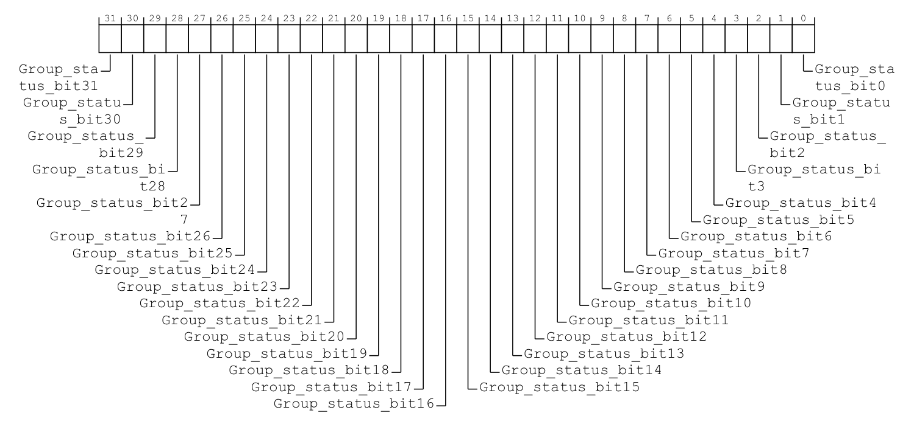

> 原图来源：[IHI0069 H.b](https://developer.arm.com/documentation/ihi0069/hb)，12.9.13（12-566）与 12.9.15（12-570）。两者都是 32 位 MMIO 寄存器；前图逐位为 `Group_status_bit<x>`，后图逐位为 `Group_modifier_bit<x>`。**同一个来源的两个位在两张图的同一列，不是相邻两列。**

在两安全状态且亲和性路由开启的边界中，`Group_status_bit<x>=1` 使来源成为 Non-secure Group 1；为 0 时，再由 `Group_modifier_bit<x>` 区分安全 Group 0 或 Group 1。手册把这两个位组合成如下编码表，先看列名：**原表先列修饰位，再列组属性位**。

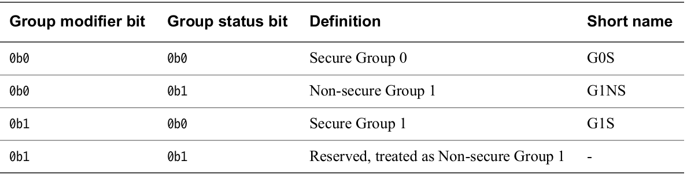

> 原表来源：[IHI0069 H.b](https://developer.arm.com/documentation/ihi0069/hb)，12.9.15，印刷页 12-571，未单独编号的分组编码表。下面中文对照沿用原表列序；列值都是同一来源的单个位，不是整个寄存器数值。

| IGRPMODR 修饰位 | IGROUPR 组属性位 | 来源安全归属 |
| --- | --- | --- |
| 0 | 0 | Secure Group 0 |
| 0 | 1 | Non-secure Group 1 |
| 1 | 0 | Secure Group 1 |
| 1 | 1 | 保留编码，硬件按 Non-secure Group 1 处理；不把它当作初始化时的有效配置选择 |

有权安全软件在 S0 初始化或受控重新配置时写这些位；GIC 在后续递送与访问检查中使用它们。**私有外设中断（Private Peripheral Interrupt，PPI）** 与 **软件产生中断（Software Generated Interrupt，SGI）** 的分组由目标 PE 对应的 **再分发器（Redistributor）** 保存，接口为 `GICR_IGROUPR0`、`GICR_IGRPMODR0`。普通非安全内核不能因为需要一个来源，就擅自把安全固件保留的来源改组。

将上面的两位编码落实到地址时，先区分三个 MMIO 窗口：`GICD_base` 是 Distributor 基址，`RD_base` 是所选 PE 的 Redistributor 控制页基址，`SGI_base` 是同一 PE 的 SGI/PPI 页基址。它们是窗口名称，芯片的实际基址需由平台资料提供；不能拿一个 PE 的窗口偏移去控制另一 PE。

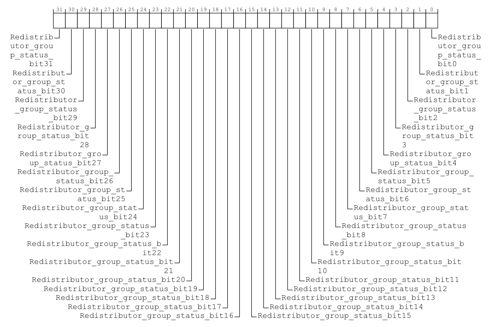

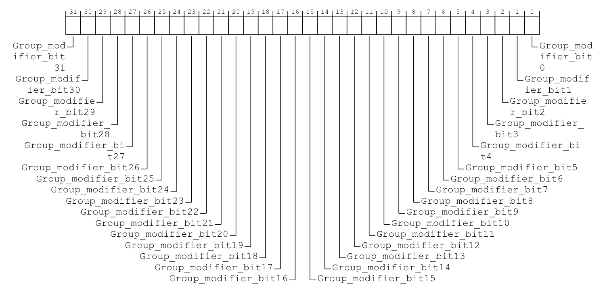

> 原图来源：同规范 12.11.12（12-662）与 12.11.14（12-666）。私有来源同样用两个寄存器的同号位组合，不能把一张图中的 32 位误读成“16 个两位字段”。下表将四张原图的字段与访问位置中文整理在一起。

| 寄存器与原文字段 | 位号对应什么 | 32 位 MMIO 访问位置 |
| --- | --- | --- |
| `GICD_IGROUPR<n>.Group_status_bit<x>` | `[x]` 对应 INTID `32n+x` 的组属性 | `GICD_base + 0x0080 + 4n` |
| `GICD_IGRPMODR<n>.Group_modifier_bit<x>` | `[x]` 对应同一 SPI 的修饰位 | `GICD_base + 0x0D00 + 4n` |
| `GICR_IGROUPR0.Group_status_bit<x>` | `[x]` 对应选定 PE 的 INTID x | `SGI_base + 0x0080` |
| `GICR_IGRPMODR0.Group_modifier_bit<x>` | `[x]` 对应同一 PE、同一 INTID 的修饰位 | `SGI_base + 0x0D00` |

例如 SPI 65 在两个 GICD 寄存器中都使用 n=2、bit 1；PPI 27 则在目标 PE 的两个 GICR 寄存器中都用 bit 27。私有来源 `[15:0]` 是 SGI，`[31:16]` 是 PPI，组修饰不改变另一 PE 的同号来源。

> 读原手册时还会遇到一处文本不一致：H.b 的 12-571 在索引说明中将 IGRPMODR 偏移写成 `0x080 + 4n`，但同页 MMIO 访问表以及 12.8 Distributor register map 都给出 `0x0D00 + 4n`。本节采用两处访问映射一致的 `0x0D00`，不把前一条公式原样抄成访问地址。

本表继续限定亲和性路由开启、两安全状态有效。在这个边界下，上述分组寄存器对非安全访问读作 0、写入无效；有权安全软件写入的是来源的归属，读取不会确认它。SPI 的 n、x 分别为 `INTID DIV 32`、`INTID MOD 32`。依据为 IHI0069 H.b 的 12.9.13、12.9.15（12-566～12-571）以及 12.11.12（12-662～12-663）、12.11.14（12-666～12-667）。

上表限定两安全状态有效，亦即 `GICD_CTLR` 中 **禁用安全状态（Disable Security，DS）** 字段为 0；单安全状态配置应查它自己的编码语义，不能直接套用三类来源表。

后面的 GICD/GICR 是 Distributor 与 Redistributor 寄存器前缀的合写，分别指分发器和再分发器接口。**二进制分割点寄存器（Binary Point Register，BPR）** 把优先级分为用于抢占的高位与用于排队细分的低位；**优先级屏蔽寄存器（Priority Mask Register，PMR）** 保存接收门槛。它们延续第七章的优先级规则，作用与安全归属不同。现在可以把易混名称放在同一张表里：

| 名称 | 分类或控制什么 | 状态位置与作用时刻 | 不会直接决定什么 |
| --- | --- | --- | --- |
| 中断安全组 | 某 INTID 的安全归属 | GICD/GICR 分组位；S0 配置，S2～S3 递送与访问时使用 | 组优先级数值、最终处理函数 |
| 中断安全组使能 | 是否放开指定安全组的递送 | `GICD_CTLR` 的全局使能与每 PE 的 `ICC_IGRPEN*` 接收使能 | 不修改来源归属，也不修改 EL |
| 组优先级 | 优先级高位部分；高位相等的来源互不因子优先级抢占 | 来源优先级与接收侧 BPR；S2 比较抢占条件 | Secure/Non-secure 归属 |
| 安全状态 | PE 当前所在的安全访问域 | 处理器执行状态；影响访问和 IRQ/FIQ 呈现 | 某个设备 INTID 的分组位 |
| 异常级 EL | PE 当前软件权限层次及异常接收层次 | 处理器执行状态与异常路由；S3 建立异常入口 | 外设数据或工作队列长度 |

### 9.3.2\_硬件结构与配置归属先对齐

**讲解层次：概念层——架构角色及其交互。** 依据 IHI0069 H.b 3.1、4.7；先区分递送路径与控制依赖，再映射到 GIC-600 的实际配置落点。

**处理器接口（CPU Interface）** 是每 PE 的 GIC 架构接口；CPU 是 **Central Processing Unit（中央处理器）**。该接口以 `ICC_*` 系统寄存器提供确认、优先级和结束协议，其中 **中断确认寄存器（Interrupt Acknowledge Register，IAR）** 用于领取具体 INTID。它属于 GIC 的功能模型，但可以集成在处理器核内；下图画的是 **功能边界与状态所有权**，不是声称所有 GIC 电路都物理独立于 CPU 核。

**IRQ（Interrupt Request，中断请求）** 与 **FIQ（Fast Interrupt Request，快速中断请求）** 是呈现给 PE 的两类中断异常输入。设备到 GIC 的请求线，与 GIC 向 PE 呈现的 IRQ/FIQ，不是同一层的“设备原样直连”。

图中的 `GICD`、`GICR` 分别表示 Distributor 与 Redistributor 的寄存器接口，`ICC` 表示处理器接口系统寄存器族；接口前缀不是另一个实体。SPI、PPI 和 SGI 沿用前文已经建立的三类来源；图中的逻辑 Redistributor 数量也不能直接用来数产品物理模块。

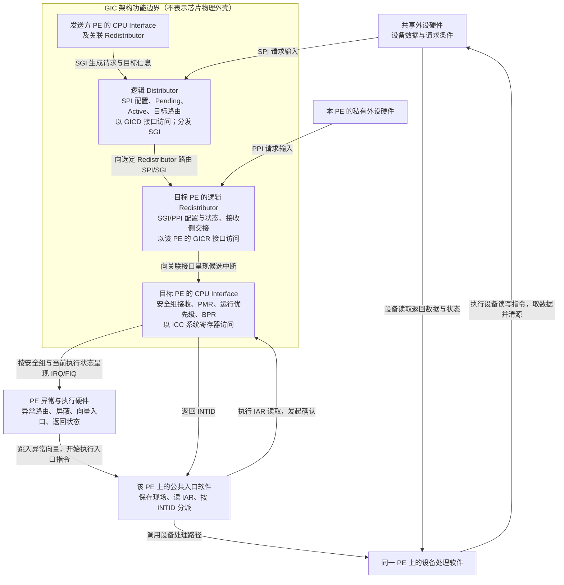

图中实线表示架构规定的请求递送与处理动作，未展开芯片内部总线。SPI 经 Distributor 到目标 Redistributor，再到关联 CPU Interface；PPI 直接进入本地 Redistributor；SGI 由发送侧接口产生，经 Distributor 分发给一个或多个目标 Redistributor。**经过哪个模块，与来源配置保存在哪个接口，是两个问题：SPI 的配置与状态不会因为经过目标 Redistributor，就变成该 PE 的 SGI/PPI 状态。** SGI 入口是发送方发出的生成命令，也不能画成某根外设引脚。消息中断的内存状态与翻译服务在后文单独建立。

#### (1)\_全局组使能怎样约束本地请求

只看上图，容易产生一个新疑问：PPI 没有走 Distributor 的 SPI 路由路径，为什么关掉 `GICD_CTLR` 的组使能，它仍然不能送达？原因是 **请求流向** 与 **配置作用范围** 不同。Distributor 既管理共享来源，又提供 GIC 实例级的控制接口；后者的影响不以“请求是否穿过 SPI 路由逻辑”为边界。

再看三种准备进度：某个串口处理路径尚未准备好，只应暂缓这一个来源；PE1 的入口尚未准备好，应暂缓 PE1 接收这一组，但让已经就绪的 PE0 继续工作；如果整个非安全组尚未完成交接，则需要实例范围的组控制。一个开关不能同时表达这三种范围，否则局部准备会不必要地挡住其他接收者。下文分别用来源使能、本 PE 组接收和全局组使能表达它们。

这里把范围限制为当前 GICv3.0 亲和性路由下的 SGI、PPI、SPI。`GICD_CTLR` 是 **分发器控制寄存器（Distributor Control Register）**，其中三类安全组的全局使能约束整个 GIC 实例。以两安全状态有效时的安全访问视图为例，`EnableGrp0`、`EnableGrp1S`、`EnableGrp1NS` 分别允许 Group 0、Secure Group 1、Non-secure Group 1 参与递送；非安全访问视图及单安全状态模式的字段语义应另查对应寄存器定义。

再看来源自己的开关。`GICR_ISENABLER0` 是 **中断置使能寄存器（Interrupt Set-Enable Register）**，`GICR_ICENABLER0` 是对应的 **中断清使能寄存器（Interrupt Clear-Enable Register）**。在一个 PE 的 Redistributor 中操作它们，只改变该 PE 的 SGI/PPI 单中断使能，不会改变另一 PE 的同号私有来源，也不会为到来的 SPI 创建第二套私有使能位。SPI 的单中断使能仍由 `GICD_ISENABLER<n>`、`GICD_ICENABLER<n>` 这组 GICD 接口按 INTID 管理。

接收端还有自己的选择。`ICC_IGRPEN0_EL1`、`ICC_IGRPEN1_EL1` 是 **中断组使能寄存器（Interrupt Group Enable Registers）**，控制本 PE 的 CPU Interface 是否接收相应组；Group 1 还须分清安全与非安全副本，上层可以通过 `ICC_IGRPEN1_EL3` 控制对应使能。PMR 与运行优先级继续决定本 PE 的优先级条件。即使这些 GIC 条件都满足，PE 自身仍要依据异常路由和屏蔽状态决定是否进入异常。

下面只画 **配置作用范围与判断依赖**。虚线表示控制状态或前一项判断结果影响哪项判断，没有一条表示 PPI 请求需要绕行的硬件连线；判断框是规范语义的分界，也不是额外的硬件模块。

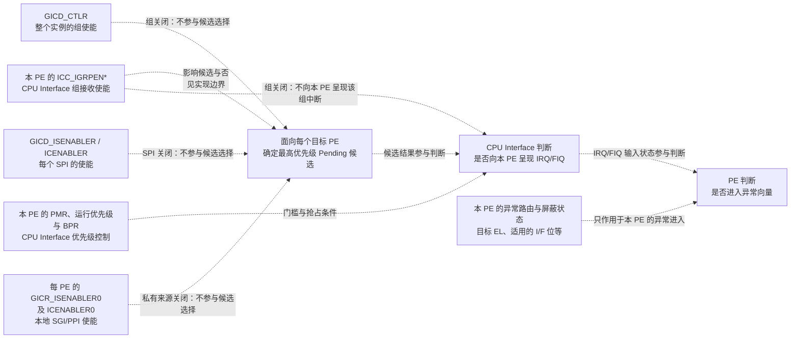

规范 4.7.2 把两个时刻分开：先由 GICD/GICR 所控制的状态确定各目标 PE 的 **最高优先级挂起中断（highest priority pending interrupt）**，再由 CPU Interface 判断是否向 PE 发出信号。对 Pending 来源，单中断未使能，或所属组在 `GICD_CTLR` 中关闭，都会使它退出前一项候选选择。PPI/SGI 的本地来源开关即使已经打开，也不能越过全局组开关。**这是配置控制状态的作用范围，不表示 PPI 请求进入了 Distributor 的 SPI 路由路径。**

只关闭 CPU Interface 的组使能，则不能简单理解成同样的“从候选集合删除”。对于 PPI 这样固定接收 PE 的 **直接中断（direct interrupt）**，如果单中断和全局组均已使能，该来源是否继续参与最高优先级候选选择，由实现定义。若它仍被选为最高优先级来源，硬件不会向 PE 呈现它，却可能因此挡住另一个已开放组中的较低优先级 Pending 来源。因此，“关闭一组以后，其他组必然立刻获得递送机会”不是可移植保证。第十一章讨论的 **1-of-N（从多个候选 PE 中选一个）** SPI 路由另有明确规则：关闭某 PE 的相应 CPU Interface 组使能，会使该 PE 不能被选为这个请求的接收者。

SGI 的来源开关还需保留一个实现边界：规范 4.7.1 允许实现将 SGI 永久使能，也允许通过 `GICR_ISENABLER0`、`GICR_ICENABLER0` 使能和禁用它们，具体选择属于 **实现定义（IMPLEMENTATION DEFINED）**。不能仅凭存在这两个寄存器名，就承诺任意芯片都能关闭每个 SGI；“SGI 单中断永久使能”也不等于它不受组使能、优先级及 PE 接收条件约束。

还要区分“暂停递送”与“是否记录后来发生的事件”。单独禁止某个来源，不阻止它改变 Pending 等状态；但规范 4.7.3 对 **三个全局组使能都为 0** 的情况另留边界：新的边沿请求是否置 Pending，以及 SGI 生成操作是否能置 Pending，均由实现定义。因此，不能把“关闭来源后仍能积累请求”推广成“任意实现关闭全部全局组以后，仍一定记录所有新通知”。

至此，三个开关各自挡住什么、相互怎样约束已经分清。初始化时再把对应范围落实为以下读写；字段中的“使能”只改变许可，不代替确认或结束协议。

`GICD_CTLR` 位于 `GICD_base + 0x0000`，是 32 位 MMIO 寄存器，访问属性必须按字段区分。**同一个偏移并不保证同一张位图**：手册根据访问安全状态及 DS 值给出三种布局，先看三张原图再决定从哪一列读组使能。

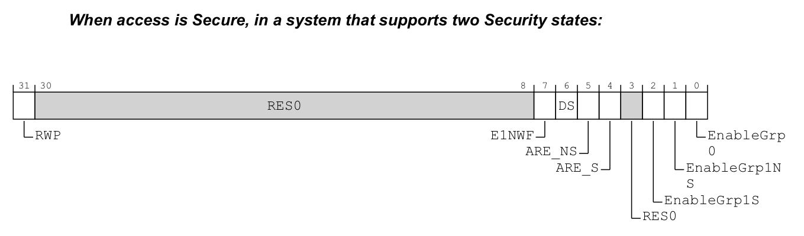

> 原图来源：[IHI0069 H.b](https://developer.arm.com/documentation/ihi0069/hb)，12.9.4，印刷页 12-544；此图用于两安全状态有效时的安全访问。

| 位段 | 原文字段 | 中文对照 |
| --- | --- | --- |
| `[31]` | `RWP` | 只读，受跟踪的写入是否仍在传播；第 10.3 节明确跟踪范围 |
| `[30:8]`、`[3]` | `RES0` | 保留为零 |
| `[7]` | `E1NWF` | 允许实现定义的 1-of-N 休眠 PE 选择；是否可编程由实现决定，第十一章再使用 |
| `[6]` | `DS` | 禁用安全隔离、切到单安全状态视图；并非普通来源使能，变更条件见第 10.1 节 |
| `[5]`、`[4]` | `ARE_NS`、`ARE_S` | 非安全／安全亲和性路由使能；是否固定为 1 及切换约束见第 10.1 节 |
| `[2]` | `EnableGrp1S` | 0 禁止、1 允许 Secure Group 1；`ARE_S=0` 时此位为 `RES0` |
| `[1]` | `EnableGrp1NS` | 0 禁止、1 允许 Non-secure Group 1 |
| `[0]` | `EnableGrp0` | 0 禁止、1 允许 Group 0 |

> 原图来源：同条目印刷页 12-546；字段解释续至 12-547。下表是中文对照，明确保留模式条件。

| 位段 | 原文字段 | 中文对照 |
| --- | --- | --- |
| `[31]` | `RWP` | 安全视图 RWP 的只读别名 |
| `[30:5]`、`[3:2]` | `RES0` | 保留为零；安全视图的 DS、E1NWF 等在这里不是可写控制位 |
| `[4]` | `ARE_NS` | 安全视图 ARE_NS 的别名，位号由 5 变为 4；无旧式兼容时读一写忽略 |
| `[1]` | `EnableGrp1A` | `ARE_NS=1` 时是安全视图 EnableGrp1NS 的读写别名；`ARE_NS=0` 时保留零 |
| `[0]` | `EnableGrp1` | `ARE_NS=0` 时才是上述使能别名；`ARE_NS=1` 时保留零 |

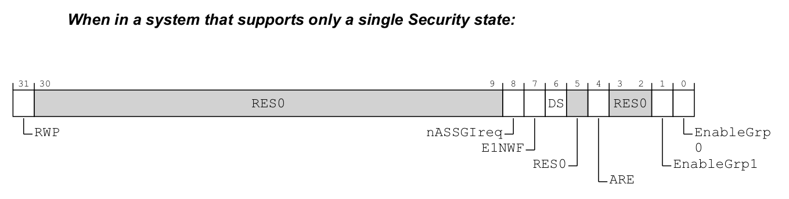

> 原图来源：同条目印刷页 12-547；字段解释续至 12-548。图保留 H.b 的后续扩展位，本卷 GICv3.0 按无该扩展分支阅读。

| 位段 | 原文字段 | 中文对照 |
| --- | --- | --- |
| `[31]` | `RWP` | 只读的受跟踪写入传播状态 |
| `[30:9]`、`[5]`、`[3:2]` | `RES0` | 保留为零 |
| `[8]` | `nASSGIreq` | GICv4.1 的无 Active SGI 请求功能；本卷 GICv3.0 为保留零，不改变第六章完成协议 |
| `[7]` | `E1NWF` | 1-of-N 唤醒选择控制，实现可将其读零写忽略 |
| `[6]` | `DS` | 本视图固定读一、写忽略，不能写 0 返回两安全状态 |
| `[4]` | `ARE` | 单安全状态的亲和性路由使能；不再分 S／NS |
| `[1]`、`[0]` | `EnableGrp1`、`EnableGrp0` | 分别允许 Group 1、Group 0，0 禁止、1 允许 |

现在可以检查一个常见的照抄错误：在本章 `DS=0`、`ARE_NS=1` 的非安全软件中，应读第二张图的 bit 1；把第三张图 bit 0 的 Group 0 解释搬来，或者沿旧式模式向 bit 0 写 1，都不能得到想要的 Non-secure Group 1 使能。三种视图的地址相同，解释前提不同；模式字段的修改条件还须满足第 10.1 节，不能把这些图当作三套可任意轮换的初始化模板。

以下来源使能表为已在[第五章原图与位索引](P05_寄存器位图与编号索引.md#5.1_一个编号怎样找到对应状态位)建立的接口归纳，用于和全局组使能比较。

| 来源使能接口 | MMIO 地址、宽度与范围 | 读写对应位的效果 |
| --- | --- | --- |
| `GICD_ISENABLER<n>` | `GICD_base + 0x0100 + 4n`；32 位；共享 SPI | 读出当前使能；写 1 置使能，写 0 无效 |
| `GICD_ICENABLER<n>` | `GICD_base + 0x0180 + 4n`；32 位；同一组共享 SPI | 读出当前使能；写 1 清使能，写 0 无效 |
| `GICR_ISENABLER0` | `SGI_base + 0x0100`；32 位；所选 PE 的 SGI/PPI | 读出当前使能；写 1 置使能，写 0 无效 |
| `GICR_ICENABLER0` | `SGI_base + 0x0180`；32 位；所选 PE 的 SGI/PPI | 读出当前使能；对可禁止的来源，写 1 清使能，写 0 无效 |

SPI 的位号仍为 `INTID MOD 32`，寄存器序号 n 为 `INTID DIV 32`；私有来源直接以 INTID 作为位号。置位与清位接口读取的是同一份使能状态，不能用“向置使能接口写 0”来禁止来源。访问受来源安全权限与实现能力限制，写入不会自动清 Pending 或完成 Active。上述偏移和语义来自 IHI0069 H.b 的 12.9.7（12-554～12-555）、12.9.26（12-593～12-594）、12.11.5（12-649～12-650）、12.11.25（12-688～12-689）；禁止动作的传播完成另见第 10.3 节。

最后查看本 PE 的组接收位。第八章已经展示 [IGRPEN1_EL1 的原图](P08_处理器屏蔽与嵌套恢复.md#8.1_控制器屏蔽与处理器屏蔽不能互相替代)；这里增加 Group 0 和 EL3 的视图，才能核对“EL3 多出的两位是不是又多了两道门”。

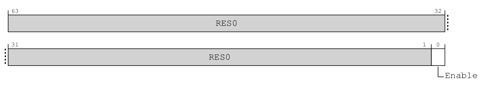

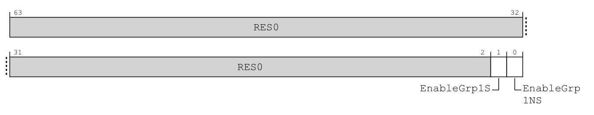

> 原图来源：[IHI0069 H.b](https://developer.arm.com/documentation/ihi0069/hb)，12.2.15（12-257）、12.2.17（12-263）。均为 64 位系统寄存器，以相应权限 `MRS/MSR`；下面为字段中文对照。

| 寄存器、位段 | 原文字段 | 中文对照与别名关系 |
| --- | --- | --- |
| IGRPEN0_EL1 `[63:1]` | `RES0` | 保留为零 |
| IGRPEN0_EL1 `[0]` | `Enable` | 当前 PE 的 Group 0 接收，0 禁止、1 允许 |
| IGRPEN1_EL1 `[63:1]`、`[0]` | `RES0`、`Enable` | 高位保留零；bit 0 控制当前安全状态的 Group 1 副本 |
| IGRPEN1_EL3 `[63:2]` | `RES0` | 保留为零 |
| IGRPEN1_EL3 `[1]` | `EnableGrp1S` | 安全 IGRPEN1_EL1.Enable 的别名 |
| IGRPEN1_EL3 `[0]` | `EnableGrp1NS` | 非安全 IGRPEN1_EL1.Enable 的别名 |

两张图的有效位数量不同，但 EL3 的两位分别访问已经存在的两份 Group 1 接收状态。它们不在 EL1 的 Enable 后再串联一道开关，也不改变其他 PE 的寄存器副本。

这里仍讨论物理接口，假设系统寄存器访问已获许可、未被截获或重定向。关闭组接收不代替确认、优先级下降或停用；优先级门槛与状态接口的本章作用，继续使用第七章的 [PMR、RPR 与 APR 表](P07_优先级数值_门槛与分组.md#7.3_先过固定门槛_再过当前处理的门槛)。组接收位依据为 IHI0069 H.b 的 12.2.15～12.2.17（12-257～12-264）。

**讲解层次切换：实现层——GIC-600 r1p6。** 产品手册附录 B 表 B-1（Appx-B-203）为上述三个问题给出了具体选择。下面按本节的问题重排相关行，其他实现定义项不在这里展开。

| 表 B-1 的项目 | GIC-600 r1p6 的选择 | 对前面推理的影响 |
| --- | --- | --- |
| Interrupt enables | 全部 SGI 都有可编程使能 | 在这个产品上，可以用对应的 GICR 来源使能接口开关 SGI，不必把它们当作永久使能 |
| Interrupt prioritization 中的组使能条目 | 被 CPU Interface 禁止的中断不参加最高优先级挂起中断选择，也不阻塞已完全使能的较低优先级中断 | 这个产品没有采用前述“被禁止的组仍占据最高候选位置”的实现选择 |
| Effects of disabling interrupts | 请求进入 Pending 不受 `GICD_CTLR.EnableGrp*` 取值影响 | 即使全局组都被关闭，产品仍可记录新请求；记录请求与允许递送仍是两个动作 |

表格分别回答“这个产品怎样实现”与“所有架构合规产品必须保证什么”。不能把右侧的产品结论扩大成任意 GICv3 实现都必须采用的规则。

**概念到实现的映射：配置究竟改到哪里。** 按 GIC-600 r1p6 1.2、2.2 的产品划分，Distributor 提供 GICD/GICR MMIO 访问入口，并保存 GICR 控制页；各 PE 的 SGI/PPI 页所对应的配置与来源状态，由服务这些 PE 的物理 PPI 块维护。PPI 块是该产品对 Redistributor 物理块的另一称呼；每 PE 的 CPU Interface 则在对应处理器核内。以下假定 PE0、PE1 共用一个 PPI 块，且有权软件在 PE0 执行。图分段展示几次独立的正常配置访问，不是一套必须按该顺序执行的初始化程序；写入目标与读取返回分别展开。

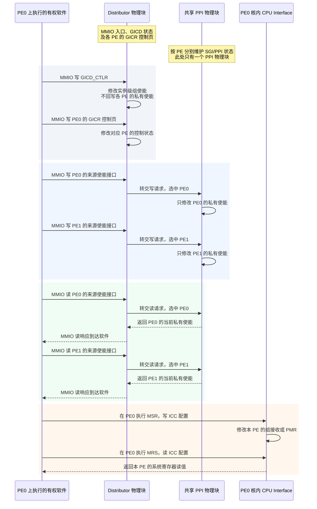

图中读写请求从入口到指定状态，读取结果沿反方向返回；读取与写入访问的是同一份状态。**写 PE0 的 GICR 来源使能接口，改的就是 PPI 块中 PE0 那份私有使能状态**，不是先改一份外置逻辑 Redistributor 设置，再复制到 PPI 块。设置全局组使能则改 Distributor 自己的全局规则；规则可以约束两个 PE 的递送，却不把两份私有来源使能改成 0。产品如何在内部传递这些控制效果，由实现保证，公开的功能说明不足以推出具体门电路或内部广播线。

> 产品映射依据：[GIC-600 r1p6](https://developer.arm.com/documentation/100336/0106)，1.2（1-13）、2.2（2-29）、2.2.2（2-30）。图中软件是 PE0 执行的代码，核内 CPU Interface 是其硬件接口；两个 PE 共用一个 PPI 块是本例选定的集成配置。背景色只区分访问场景，不表示额外硬件块或电源域。

#### (2)\_用一个PPI检查四种开关的边界

**讲解层次：概念层——按架构契约推演，必要处分出产品选择。** 本例不再把配置依赖画成硬件串联路径。

固定一个纸面例子：PE0、PE1 各有一个本地定时来源，均使用教学编号 INTID 29。这个编号在 PPI 范围内，但这里不声称它就是某块板的定时器连接。两个来源都属于 Non-secure Group 1，各自的来源使能、全局组使能及 CPU Interface 组使能均已开放；两颗 PE 都在 Non-secure EL1 执行，IRQ 路由到各自当前 EL1，两者的 `PSTATE.I` 均为 0，优先级条件也允许接收。再假定 PE0 的来源已 Pending、尚未被确认，设备请求条件持续有效。

每一行都从这个起点独立推演，不把上一行的修改带入下一行；观察期间没有复位，也没有其他软件并发改写这些配置。比较时点是该行写入按自身规则已经生效以后：来源或全局组使能的禁止传播，用[第 10.3 节的 RWP 完成条件](P10_初始化顺序与硬件完成握手.md#10.3_写入顺序_内存可见与硬件完成是三个问题)判断，不能只看 PE 已经发出写入。先预测是否还能递送给 PE0，再判断影响会不会扩展到 PE1；最终使能值本身不证明传播期间从未发出过异常通知。

| 只改变这一项 | 需要判断的边界 |
| --- | --- |
| 清除 PE0 对应 GICR 中 INTID 29 的单中断使能 | PE1 的同号 PPI 是否也被关闭？ |
| 清除安全视图 `GICD_CTLR.EnableGrp1NS` | 为什么 PE0、PE1 的这组 PPI 都受影响？ |
| 只关闭 PE0 的 Non-secure `ICC_IGRPEN1_EL1.Enable` | PE1 的组接收是否改变？是否能保证 PE0 另一组的低优先级来源立刻递送？ |
| 只把 PE0 的 PSTATE.I 设为 1 | GIC 的来源使能或 Pending 是否因此被清除？ |

**参考答案：** 把具体字段的前后值与它约束的路径并排看；“没有改写的配置”列只对本行操作及上述无并发改写、无复位的条件成立。

| 本行操作 | 被修改字段的前后值 | 没有被本行操作改写的配置 | 生效后的接收结果 |
| --- | --- | --- | --- |
| 关闭 PE0 的 INTID 29 | PE0 的该来源使能：1 → 0 | PE1 的同号来源使能仍为 1；全局组及两 PE 的组接收使能仍为 1 | PE0 的这项 PPI 退出候选；PE1 的同号来源没有因此被禁止 |
| 关闭全局 Non-secure Group 1 | 全局组字段 `EnableGrp1NS`：1 → 0 | 两份 GICR 的 INTID 29 使能仍为 1；两 PE 的组接收使能仍为 1 | 两个 PE 的该组来源都退出最高优先级候选选择，作用范围来自同一全局组字段 |
| 关闭 PE0 的 Non-secure Group 1 接收 | PE0 的组接收字段 `Enable`：1 → 0 | PE1 的该接收位仍为 1；全局组和两份来源使能仍为 1 | PE0 不再收到该组的异常信号；PE1 仍保有原来的组接收许可 |
| 屏蔽 PE0 的同级 IRQ | PE0 的 `PSTATE.I`：0 → 1 | GICD/GICR 来源配置及两 PE 的组使能均保持原值；PE1 的 `PSTATE.I` 未被修改 | 按本例路由，PE0 的同级 IRQ 暂不进入；PE1 的 IRQ 接收不因这次本地屏蔽而关闭 |

第三行还不能推出“PE0 另一组的低优先级来源立刻递送”。未固定实现时，仍须按前面的直接中断规则判断；若采用 GIC-600 r1p6 的选择，该禁用组来源就不会占住最高优先级候选。另一个 PE 的使能字段没有被本行操作改写，也不表示它的 Pending、Active 停止变化：PE1 的本地事件、确认与停用仍可推进各自状态。

四行都没有执行来源确认，所以不能把 **使能（Enable）** 写成“将中断激活”；**活动（Active）** 是确认后产生的处理交接状态。关闭组或来源使能也不等于执行清 Pending，更不能代替已经 Active 的来源完成结束与停用协议。对本例仍持续有效、尚未确认的 PPI，相关开关重新开放且其余条件满足后，可以继续递送；不需要靠“再来一次新事件”重新获得那个仍然存在的请求。至于把 IRQ 改路由到更高 EL 后怎样解释 PSTATE 屏蔽，要继续进入下一节的异常路由模型，不能把本例条件外推。

> 官方对照：[IHI0069 H.b](https://developer.arm.com/documentation/ihi0069/hb)，3.1 The GIC logical components（3-42）核对 SPI/PPI/SGI 请求路径；4.7.1 Enabling individual interrupts、4.7.2 Interaction of group and individual interrupt enables、4.7.3 Effect of disabling interrupts（4-69～4-70）核对来源使能、全局组使能、CPU Interface 组使能及实现定义边界。[GIC-600 r1p6 手册](https://developer.arm.com/documentation/100336/0106)，附录 B 表 B-1（Appx-B-203）的 Interrupt enables、Interrupt prioritization、Effects of disabling interrupts 三行给出产品选择；表内历史寄存器泛称不代替当前 IHI0069 的 `ICC_IGRPEN*` 编程接口定义。图与 PPI 例子是依据这些规则绘制的原创教学材料，不是芯片布局或板上实测。

### 9.3.3\_安全组怎样影响IRQ与FIQ\_又怎样到达EL

**讲解层次：概念层——连接 GIC 契约与处理器异常契约。** 以下依据 GICv3 概览 198123 3.2-01、Exception model 1.0 与 DDI0487 M.c；寄存器分别属于哪个架构对象会逐项注明。

来源已经归组、目标 PE 也已选定，仍有一个交接问题：同一 PE 正在运行非安全应用时，普通串口请求与安全软件拥有的请求不能都直接交给当前内核。GIC 先按来源组别和 PE 当前执行状态呈现 IRQ 或 FIQ；随后 PE 再依据异常路由决定交给哪层软件。前一步只决定输入类别，不能完成后一步的安全切换或函数分派。

第一步由 GIC 选择向目标 PE 呈现哪一种输入。例如，在 Non-secure EL0/EL1 执行时，Non-secure Group 1 呈现 IRQ，Secure Group 1 则呈现 FIQ，使后续处理器路由能够区分这两条交接路径。本章使用 GICv3 两安全状态、AArch64 的基础组合：

| 目标 PE 当前执行位置 | Secure Group 0 | Secure Group 1 | Non-secure Group 1 |
| --- | --- | --- | --- |
| Secure EL0/EL1 | FIQ | IRQ | FIQ |
| Non-secure EL0/EL1/EL2 | FIQ | FIQ | IRQ |
| EL3 | FIQ | FIQ | FIQ |

因此，在非安全系统执行时，同为 Group 1 的两个安全归属可以呈现不同输入。GICv3 本章边界内 **Group 0 呈现为 FIQ**；Group 1 则要看当前安全状态与 EL，不能把它永远画成 IRQ。该表不涵盖 Secure EL2 等扩展组合。

第二步由 PE 决定输入进入哪一异常级。`SCR_EL3` 是 **Secure Configuration Register（安全配置寄存器）**，其 IRQ/FIQ 路由字段可以把相应物理异常送往 EL3。`HCR_EL2` 是 **Hypervisor Configuration Register（虚拟机管理程序配置寄存器）**，其中 IMO/FMO 是针对物理 IRQ/FIQ 路由至 EL2 的控制字段。本节只使用不重定向到 EL2 的主线；涉及虚拟化时需联合核对完整路由条件。EL3 路由配置优先于 EL2 路由配置，未被高层接管且符合当前执行条件的请求才按低层路径处理。

固定一个完整例子：串口是 Non-secure Group 1 SPI，目标 PE 正在 Non-secure EL0/EL1；`SCR_EL3.IRQ=0`，EL2 存在时未通过 `HCR_EL2.IMO` 等适用控制接管这条 IRQ；来源、接收侧与屏蔽条件均已准备好。GIC 呈现 IRQ，PE 接收到 EL1，再由 EL1 公共入口读 IAR1 识别来源。若同一时刻到来的是 Secure Group 1，则在这个非安全执行环境中呈现 FIQ；当 `SCR_EL3.FIQ=1` 时先进入 EL3，由安全固件决定安全上下文交接，不能直接画成“GIC 跳到 Secure EL1 的驱动”。

下面保留两份处理器寄存器的 **完整原始位布局**，使读者能在手册中定位本节的控制。中文对照只展开当前物理 IRQ/FIQ 推理用到的字段；原图中其余已命名字段服务安全状态、虚拟化、访问截获等其他功能，不能当作保留零位处理。这也不是一份完整写入模板。

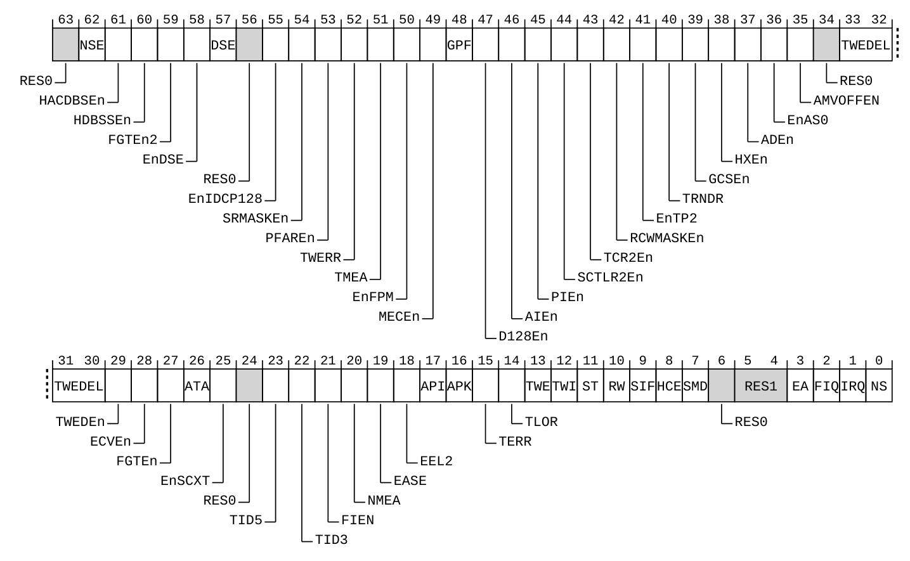

> 原图来源：[DDI0487 M.c](https://developer.arm.com/documentation/ddi0487/mc)，D24.2.168，印刷页 D24-9616；本节 IRQ/FIQ 字段定义见 D24-9641～D24-9642。SCR_EL3 为 64 位，EL3 用 `MRS/MSR` 访问，普通 EL1 不可自行配置。

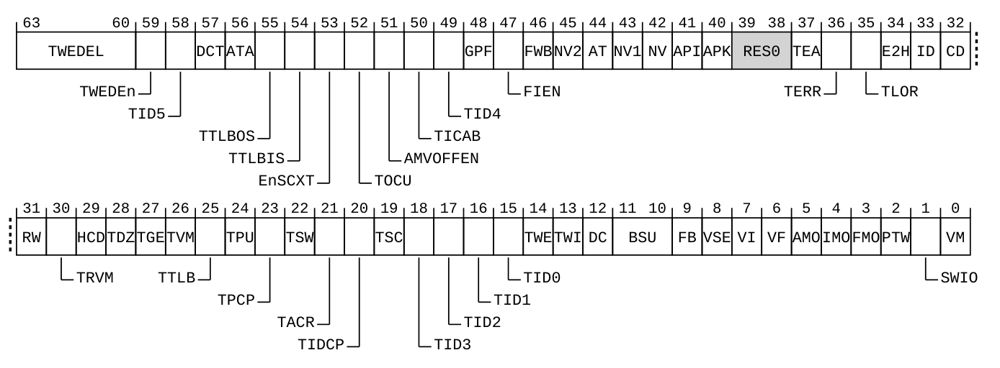

> 原图来源：同手册 D24.2.61，印刷页 D24-8917；IMO/FMO 定义见 D24-8949～D24-8950。HCR_EL2 为 64 位，由有权的 EL2／EL3 软件访问；EL2 未在当前安全状态启用时不能按通常启用分支解释效果。

| 原图位置 | 原文字段 | 当前路径的中文对照 |
| --- | --- | --- |
| SCR `[2]` | `FIQ` | 1 将物理 FIQ 路由到 EL3；0 表示不由此项接管到 EL3，不直接指定 EL1 |
| SCR `[1]` | `IRQ` | 1 将物理 IRQ 路由到 EL3；0 同样只取消这一项 EL3 接管 |
| HCR `[34]` | `E2H` | EL2 宿主模式控制，本例固定为 0；不能将本例推导外推到改变宿主规则的组合 |
| HCR `[27]` | `TGE` | 通用异常截获控制，本例固定为 0；改变它会影响物理异常路由等有效控制值 |
| HCR `[4]` | `IMO` | 当前安全状态启用 EL2 且上述普通分支成立时，1 将物理 IRQ 路由到 EL2，除非 EL3 已接管；0 不由此项接管 |
| HCR `[3]` | `FMO` | 对物理 FIQ 起相应的 EL2 路由作用，仍服从 EL3 的优先接管 |

读图时先在 SCR 找 bit 1，再在 HCR 找 bit 4，最后回到当前执行状态：**不存在一个低位字段直接写入数值“1”就表示目标 EL1。** 当前串口例子能到 EL1，是更高层未接管且其他路由条件成立的结果。这个推导也说明为何必须同时给出寄存器字段和当前配置边界。

两者都属于处理器的异常路由配置，不是 GIC 寄存器；读取不确认中断，修改也不执行 EOI。TGE、E2H 会改变路由或宿主执行规则，所以本节明确固定它们，不能把表中 IMO/FMO 的两种取值推广到所有虚拟化模式。字段依据为 [DDI0487 M.c](https://developer.arm.com/documentation/ddi0487/mc)，D24.2.168 的 IRQ/FIQ（D24-9641～D24-9642）、D24.2.61 的 IMO/FMO（D24-8949～D24-8950）。

**GIC 的目标路由选择“哪个 PE”，处理器的异常路由选择“这个 PE 的哪个 EL”。** `GICD_IROUTER<n>` 是前者的 SPI 路由寄存器；SCR/HCR 是后者的处理器控制。改 SPI 目标不能自动改成 EL2 处理，改来源安全组也不是直接把一个 EL 数字写进 GIC。

| GIC 目标接口 | 地址、宽度与相关字段 | 与上表的区别 |
| --- | --- | --- |
| `GICD_IROUTER<n>`，一个 SPI 对应一项，n 直接等于 INTID | MMIO `GICD_base + 0x6000 + 8n`，64 位、按权限可读写；Aff0 `[7:0]`、Aff1 `[15:8]`、Aff2 `[23:16]`、Aff3 `[39:32]`，IRM bit 31 | IRM 为 0 时按亲和性坐标选择 PE；没有“目标 EL”字段，写入不确认来源。IRM 为 1 的候选选择条件到第十一章建立 |

这里假设亲和性路由已经开启、写入有效的目标，后文再说明来源活动期间改目标的边界。地址与位域来自 IHI0069 H.b 的 12.9.22（12-584～12-585）；完整的目标选择见[硬件目标坐标](P11_SPI目标选择与每PE状态.md#11.2_怎样取得目标PE的硬件亲和坐标)。PSTATE.I/F 的系统寄存器入口、位号及本章使用的屏蔽含义，见第八章的 [DAIF 表](P08_处理器屏蔽与嵌套恢复.md#8.1.1_哪些异常受哪个屏蔽位约束)。

**处理器状态（Processor State，PSTATE）** 的 I/F 位是本 PE 的接收控制之一。目标 EL 高于当前 EL 时不能套用“当前 I 位为 1 就挡住一切”的模型；目标低于当前 EL 时也不会强行降级进入。组归属、输入呈现、异常路由和当前执行状态要顺着同一条请求联合判断。

> 官方对照：[概览 198123，3.2-01](https://developer.arm.com/documentation/198123/0302)，第 4 章 Security model，PDF 第 16～17 页的输入呈现表与路由例子；第 6 章 Handling interrupts 的安全切换例子。[IHI0069 H.b](https://developer.arm.com/documentation/ihi0069/hb)，4.6 Interrupt grouping、12.9.13 GICD_IGROUPR、12.9.15 GICD_IGRPMODR。[Exception model 1.0](https://developer.arm.com/-/media/Arm%20Developer%20Community/PDF/Learn%20the%20Architecture/Exception%20model.pdf?revision=a62f2bf2-b08a-4a4f-8cbe-38c67ddf4434)，5.3 Routing asynchronous exceptions。

### 9.3.4\_把安全归属与异常进入放回S0到S6

**讲解层次：概念层——端到端状态与执行过程。** 表中状态落点是架构可见归属；物理电路映射沿用第 9.3.2 节，不再增加一套硬件实体。

下面仍使用[第六章的 S0～S6](P06_一次中断的状态转换与完成协议.md#6.4_用同一组阶段闭合正常周期)，放大刚才的非安全串口主线。**向量基地址寄存器（Vector Base Address Register，VBAR）** 保存异常入口集合的位置；**异常链接寄存器（Exception Link Register，ELR）** 保存返回地址；**保存的程序状态寄存器（Saved Program Status Register，SPSR）** 保存进入前的执行状态。它们由 PE 使用，不能当作 GIC 寄存器。

相对地，`ICC_IAR1_EL1` 是本例的中断确认接口；`ICC_EOIR1_EL1` 是 **中断结束寄存器（End Of Interrupt Register，EOIR）** 接口，`ICC_DIR_EL1` 是 **中断停用寄存器（Deactivate Interrupt Register，DIR）** 接口。它们推进 GIC 状态；**异常返回指令（Exception Return，ERET）** 则恢复 PE 的执行状态与位置。

| 阶段 | 谁执行或改变硬件状态 | 本例的状态落点 | 这一阶段解决的问题 |
| --- | --- | --- | --- |
| S0 准备 | 有权固件、控制器启动代码、设备驱动各自配置所属状态 | GIC 来源分组/优先级/目标；PE 的 SCR/HCR、VBAR 与接收状态；软件分派表 | 谁拥有来源，谁能够安全接收 |
| S1 事件 | 外设硬件保存数据并产生请求 | 外设缓冲与状态寄存器 | 真实工作在哪里 |
| S2 保留与选择 | GIC 保存 Pending，按使能、目标、优先级和安全组选择 | SPI 的 GICD 状态、目标 CPU Interface 的接收状态 | 哪个 PE 现在有资格收到哪个输入 |
| S3 异常进入与确认 | PE 先路由 IRQ 到 EL1，保存 ELR/SPSR 并跳向 VBAR；公共入口保存软件现场，再读 `ICC_IAR1_EL1` | PE 的返回状态、软件栈、GIC 的 Active 与运行优先级 | 先知道从哪里执行，再确认具体 INTID |
| S4 处理设备 | PE 执行来源对应的设备处理代码 | 外设数据/状态与软件队列 | 取走工作并消除设备请求条件 |
| S5 完成协议 | PE 执行结束寄存器写入，GIC 更新交接状态 | `ICC_EOIR1_EL1`，分离模式另用 `ICC_DIR_EL1` | 结束优先级占用，并完成来源停用 |
| S6 返回 | 公共退出代码恢复现场，PE 执行异常返回 | 软件栈、ELR/SPSR 与恢复后的 PSTATE | 返回之前的执行位置 |

S3 先进入架构向量再读 IAR；S5 的控制器结束也不是 S6 的处理器返回。把这两处分开，才能判断故障发生在来源识别、设备处理、控制器交接还是执行现场恢复。

这条时间线使用的确认与完成接口已在第六章建立，处理器返回现场已在第八章建立。下面只收拢本次交接所需的读写含义，再据此检查初始化。

| 本章复用的接口 | 本次使用的访问与效果 | 已建立的具体定义 |
| --- | --- | --- |
| `ICC_IAR1_EL1` | 当前 PE 的 64 位系统寄存器；读 INTID `[23:0]`，普通有效返回即确认 | [第六章确认与完成接口表](P06_一次中断的状态转换与完成协议.md#6.3_确认_清源_优先级下降与停用) |
| `ICC_EOIR1_EL1` / `ICC_DIR_EL1` | 当前 PE 的 64 位只写系统寄存器；按保存的 INTID 完成优先级下降／停用，效果由 EOImode 决定 | [第六章模式、配对与顺序](P06_一次中断的状态转换与完成协议.md#6.3_确认_清源_优先级下降与停用) |
| `ELR_EL1` / `SPSR_EL1` | 当前 PE 的 64 位处理器系统寄存器；保存返回地址／返回状态，公共入口须保护嵌套现场 | [第八章异常现场表](P08_处理器屏蔽与嵌套恢复.md#8.2.1_硬件先保存什么_公共入口还必须保存什么) |

有了这条链，已经能够分清来源归属、实例级许可、本 PE 接收状态与异常目标，初始化要求就不再是一串孤立寄存器名。还剩一个执行问题：谁先准备哪份状态，写入之后用什么证据确认它已生效？下一章沿这条串口路径倒推准备顺序，区分访问许可、唤醒握手与写入完成，然后检查失败时能否继续。

上一篇：[处理器屏蔽与嵌套恢复](P08_处理器屏蔽与嵌套恢复.md#8.1_控制器屏蔽与处理器屏蔽不能互相替代)

[专题大纲](大纲.md#1.2_因果阅读地图)

下一篇：[初始化顺序与硬件完成握手](P10_初始化顺序与硬件完成握手.md#10.1_全局_每核与每个来源分别准备什么)
