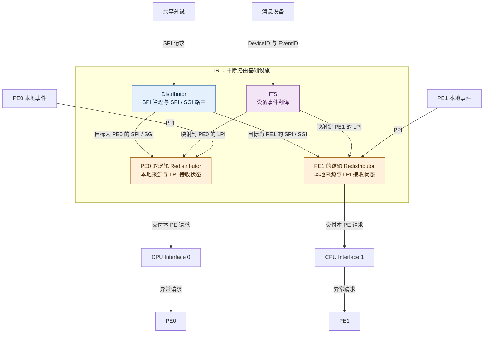
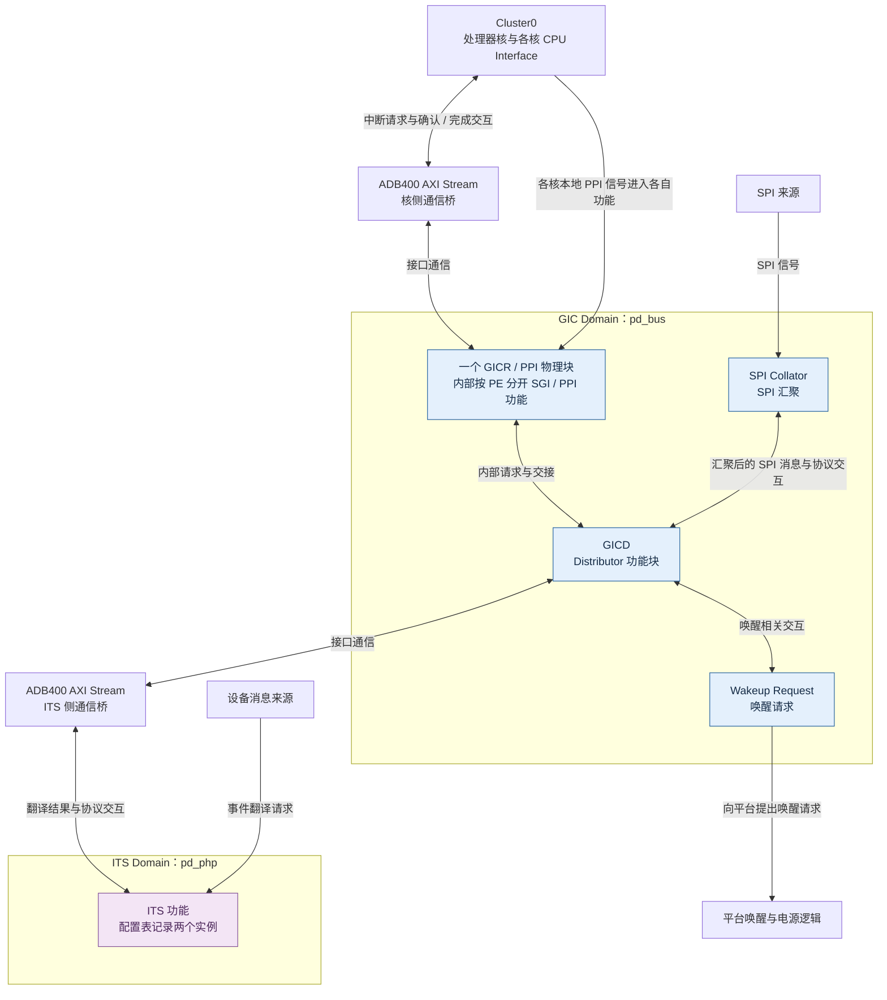
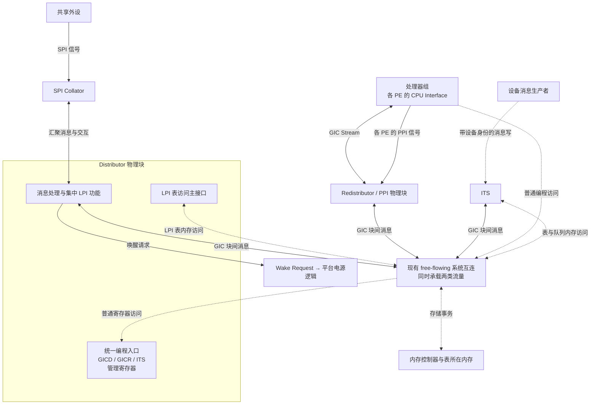
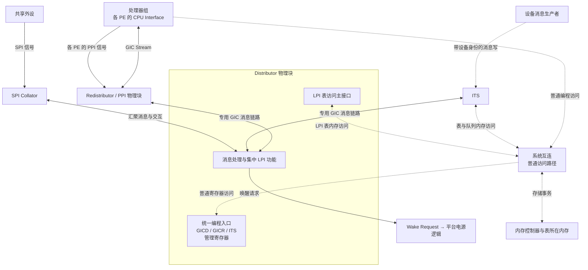
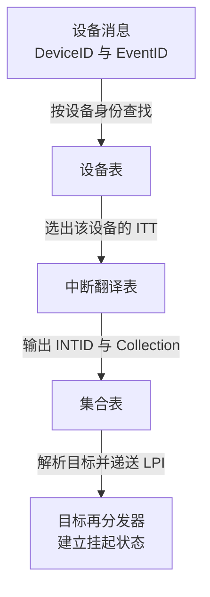
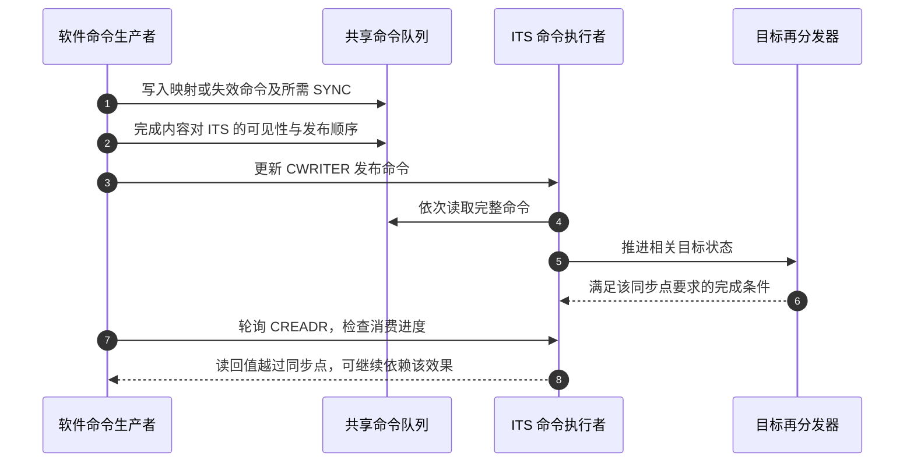

# 第9章\_设备事件翻译与命令完成

## 9.1\_两个设备都发事件0\_怎样区分

上一章建立了 **通用中断控制器（Generic Interrupt Controller，GIC）** 中 **局部性专属外设中断（Locality-specific Peripheral Interrupt，LPI）** 的内存配置和挂起状态。现在有两个设备都发送“事件 0”：如果只看这个数，就无法知道该使用哪条中断和哪个接收者。

于是需要 **中断翻译服务（Interrupt Translation Service，ITS）**。它接收设备消息，把“哪个设备的哪个事件”对应到全局中断编号和目标再分发器。这里的服务是控制器硬件提供的功能，不是 Linux 中一个叫 ITS 的后台进程。

本章先建立一次消息翻译，再说明软件怎样配置和更新这些映射。只有把命令与完成过程讲清，才能理解“表已经写好，消息却仍走旧目标”这类问题。

## 9.2\_设备消息怎样进入ITS\_翻译功能怎样接入GIC

**设备标识（Device Identifier，DeviceID）** 用于区分消息生产者；**事件标识（Event Identifier，EventID）** 用于区分同一设备的不同事件。这两个名字是协议中的标识字段，不是操作系统分配的中断编号。

设备向 `GITS_TRANSLATER` 写入事件值。其官方名称是 ITS Translation Register（ITS 翻译寄存器），承担消息翻译接收接口；EventID 来自约定的写入内容，而 DeviceID 怎样随事务被识别，由芯片互连与设备集成定义。软件不能默认“向某个地址随便写一个数”就能冒充任意设备。

**中断标识符（Interrupt Identifier，INTID）** 则标识 GIC 中的目标中断。EventID 可以和 INTID 相同，也可以不同；这是映射选择，不是必须靠相等建立联系。

目标管理再增加一个角色：**Collection（集合）** 是把若干物理 LPI 关联到同一个目标再分发器的逻辑分组。集合号不是处理器编号，也不是 LPI 编号；它让软件可以共同管理一组中断的递送位置。

先只看一次已有映射的递送：设备 5 产生事件 3，向消息入口写入 3，事务同时提供设备身份 5。ITS 用这一对身份查出 LPI 9000 和集合 2，再由集合 2 找到接收者甲，将请求交给甲的再分发器。设备没有在这次写入中同时提交“9000、集合 2、甲”三个参数；这些关系由软件预先建立。下面先定位设备真正写入的入口，9.3 节再拆开其后的查找过程。

本章地址表沿用 **内存映射输入输出（Memory-mapped I/O，MMIO）** 访问；WO（Write-only，只写）、RO（Read-only，只读）、RW（Read/Write，读写）表示软件访问属性。设备发起写事务不意味着它拥有软件配置整个 ITS 的权限。

| 消息入口与作用范围 | MMIO 位置、宽度与属性 | 字段与写入效果 |
| --- | --- | --- |
| `GITS_TRANSLATER`，选定 ITS 的翻译入口 | ITS 翻译页 + 0x0040；翻译页位于 ITS 基址 + 0x10000；32 位 WO | EventID[31:0] 是写入值；DeviceID 来自事务身份。写入提出翻译请求，不保存一个可读回的“当前事件”；ITS 未启用或设备、事件未有效映射时不能生成所期望的 LPI |

这是 IHI0069 H.b 12.18 的 ITS 页布局与 12.19.12（12-846～12-847）的本章用法。后文管理寄存器使用 **ITS 控制页**，即 ITS 基址所在页；不能将控制页偏移与翻译页偏移混在一起。真实设备能写到哪个入口，还受芯片地址路由与访问控制约束。

> 官方对照：[规范 IHI0069 H.b](https://developer.arm.com/documentation/ihi0069/hb)，5.2 The Interrupt Translation Service、5.2.2 Interrupt collections，以及 12.19.12 GITS_TRANSLATER, ITS Translation Register；[消息指南 102923，1.0-01](https://developer.arm.com/documentation/102923/0100) 第 4 章 ITS（PDF 第 11～12 页）。核对设备身份与写入事件值的不同来源。

### 9.2.1\_把消息翻译放回完整硬件关系

现在已经知道 ITS 接收什么、翻译成什么，可以补上第三章暂时省略的支路。**中断路由基础设施（Interrupt Routing Infrastructure，IRI）** 是规范对 Distributor、各 Redistributor 及可选 ITS 的合称；它不包含 CPU Interface。这里的“基础设施”是硬件逻辑组件的组合名称，不是另一个位于它们上级的路由器。

以下画一个带 ITS 的 GICv3 物理中断逻辑组织，PE0、PE1 仍是教学标签。图中保留三类已经建立的来源：共享外设中断（Shared Peripheral Interrupt，SPI）、私有外设中断（Private Peripheral Interrupt，PPI）与软件产生中断（Software Generated Interrupt，SGI）。实线表示请求交付，省略确认返回和 SGI 的发送半程；后者沿[第三章的发送路径](P03_多核控制器的角色_寄存器与编号.md#3.3.4_SGI的发送侧和接收侧都要画出来)进入 Distributor。



ITS 让设备事件进入 LPI 路径，不会把已有 SPI、PPI 或 SGI 都变成必须先翻译的请求。图中一个 ITS 方框表示翻译职责，一次事件按映射选择目标，并不表示每个 LPI 都要同时发给两个 PE；一个 GIC 实例可以有多个 ITS。

还存在 **直接 LPI（Direct LPI）** 的实现选择：设备使用 Redistributor 的直接 LPI 接口，不经过 ITS 翻译。在本专题的 GICv3 范围内，实现若支持 LPI，应在直接接口与 ITS 翻译这两种机制中选择一种，不能把它们随意叠成两个同时必需的步骤。RK3588 的本章主线采用 ITS，直接接口只用于理解规范为什么还画了“没有 ITS”的另一幅逻辑图。

> 图与正文依据：[规范 IHI0069 H.b](https://developer.arm.com/documentation/ihi0069/hb)，3.1，图 3-1、图 3-2 GIC logical partitioning with an ITS、图 3-3 GIC logical partitioning without an ITS（3-42～3-44）。本图重绘逻辑分工；ITS 与 Redistributor 的实际通信机制由实现决定，不能把图上的相邻位置或一根箭头解释为具体芯片布线。

### 9.2.2\_RK3588框图中的功能块与电源域

把上述逻辑关系落到芯片，必须换用芯片手册。RK3588 TRM V1.0 Part1 的 11.2 Block Diagram 给出了其 GIC-600 的连接框图，并区分 **电源域（Power domain）**：能够按平台电源管理边界控制供电的一组电路。文中的 `pd_bus` 与 `pd_php` 是芯片手册定义的电源域名称；前者对应图中的 GIC Domain，后者对应 ITS Domain，名字本身不代表 Linux 当前已经把它们打开。

先认出图中多出的三个功能块：**SPI 汇聚器（SPI Collator）** 接收分散的 SPI 信号并用内部消息送往 Distributor；**唤醒请求块（Wake Request）** 将需要唤醒核的请求提供给平台；**ADB400** 是 Arm 的接口桥产品名，原图用它承载两处 AXI Stream 连接。AXI Stream 是流式事务接口协议名称，这里只需理解桥承载控制器块之间或控制器与核之间的通信，不把它看作新增的中断类型。

下图依据原件图 11-1 重绘功能连接，保留其 Cluster0、GICR、GICD、两个桥位置和域划分。双向箭头表示块间通信链路，单向箭头表示本节关心的来源或唤醒方向。框的大小和位置不代表芯片版图尺寸，桥处于连接边界，不能仅凭绘图位置推出它自己的电源控制归属。



这里最值得对照的不是框的位置，而是 **同一个名字在两张图中的粒度不同**。架构图的 Redistributor 包括该 PE 的本地中断与 LPI 职责；GIC-600 产品图的 GICR/PPI 物理块只承载其中一部分，LPI 功能及其缓存集中在 Distributor 物理块中。因此，RK3588 图上 ITS 通过桥连到 GICD，并不推翻前一图中“ITS 把 LPI 交给目标逻辑 Redistributor”的架构契约。第三章的[逻辑接口到产品块映射](P03_多核控制器的角色_寄存器与编号.md#3.4.1_PPI块为什么这样设计_从布线与电源约束到每核状态归属)解释了另一半：每 PE 的 GICR 控制页与保存 SGI、PPI 配置的页也没有全部放在同一物理块里。

原图用一个 ITS 方框概括该功能，而 11.1 的表 11-1 明确给出 `its_count=2`。**功能框图用于查连接，配置表用于查实例数量**，不能数图里的矩形来推翻配置表。类似地，Cluster0 是这张 GIC 集成图的标签，不足以独立说明处理器微架构、缓存层次或核的亲和性编码。

同一配置表中的 `ppi_count=1` 表示一个 GIC-600 PPI 物理块，而 `cpus_per_clsuter_0=8` 表示该配置支持八个核。合在一起看，是 **一个物理块为八个 PE 分别维护 SGI 与 PPI 功能**；不是八个 PE 共用同一套私有中断状态，也不是只有一个 PE 拥有逻辑 Redistributor。图中汇入一个矩形的 PPI 箭头只是省略了这些内部独立路径。

这也解释了为什么“普通 SPI 已能工作”不能自动证明 ITS/LPI 路径可用：后者还依赖自身电源域、桥、消息接入、翻译配置和内存表。该判断来自硬件分工，尚不是某块开发板的运行测试结论。

> 图与正文依据：RK3588 TRM V1.0 Part1（2022-03-09），11.1 表 11-1（PDF 第 1312 页）、11.2 Block Diagram 的图 11-1（PDF 第 1313 页），原件入口见[资料证据表](../../../../reference/external_resources/arm/README.md#1.4.2_型号判断的证据与适用边界)；GIC-600 的功能落点另核对 [100336 r1p6](https://developer.arm.com/documentation/100336/0106) 1.2 Components（1-13）与 2.2 Redistributor（2-29）。这是按原件事实绘制的教学连接图，省略未参与本节推理的端口与存储访问支路。

### 9.2.3\_同一组功能块可以怎样互连

再退回 GIC-600 产品层，就能回答第三章留下的问题：图里分开的物理块一定要通过同一种总线通信吗？r1p6 TRM 的图 1-1、图 1-2 给出两种组织。第一种借助现有的 **自由流动互连（free-flowing interconnect）** 运输块间 GIC 消息；这里的自由流动要求事务能前进到目的地，不依赖其他事务形成非暂态的阻塞关系，不表示传播没有延迟。

下图重绘图 1-1 中参与本节比较的路径。实线为 GIC 协议或中断信号，虚线为普通编程、消息入口或内存访问；两类流量共享中间互连。每个 PPI 物理块可以服务一组 PE，块内仍按 PE 维护独立私有状态。



第二种把 GIC 块间消息放到专用互连，普通编程和内存访问仍走系统互连。下图重绘图 1-2 的这个区别：PPI 块和 ITS 各自直接连到 Distributor 的 GIC 消息链路，不再把这部分通信画成必须绕行普通系统互连。



| 对照项目 | 图 1-1 对应方案 | 图 1-2 对应方案 |
| --- | --- | --- |
| PPI 块、ITS 与 Distributor 的 GIC 消息 | 通过现有 free-flowing 互连 | 通过分开的 GIC 消息链路 |
| 处理器编程与 GIC 表访问 | 系统互连向 Distributor 的统一编程入口发起访问；D/ITS 也经互连访问表 | 同样保留这两种方向；专用消息链路不取代它们 |
| 中断状态的逻辑归属 | 不变 | 不变；换互连不会把 SPI 变成私有状态 |

两图都特意区分 **处理器经系统互连访问 Distributor 的统一编程入口** 与 **Distributor/ITS 主动访问表内存**。GIC-600 的 GICD、GICR 和 ITS 管理寄存器访问均由前一入口接收；设备写入 GITS_TRANSLATER 的消息入口另列在 ITS 一侧，不能把所有 ITS 配置都画成直接访问这个消息端口。

原图还画有具体设备接入、内存控制器和跨芯片支路；这里归并外围访问，仅保留比较所需的块与连接。图 1-2 的产品组织使用所提供的 16 位 AXI4-Stream GIC 互连，但芯片如何选型、桥接和分电源域仍应由 RK3588 图 11-1 证明，不能仅因“长得相似”就给芯片补出未记录的互连属性。来源：[GIC-600 r1p6 TRM](https://developer.arm.com/documentation/100336/0106) 1.2，图 1-1（1-14）与图 1-2（1-15）；编程入口按 1.4 Registers and programming（1-18）、2.1.2（2-24～2-25）与 2.3.4 核对。

## 9.3\_三个查找层次怎样闭合一次翻译

为什么不直接把事件号当成数组下标，取出一个处理器编号？因为不同设备可以使用相同事件号，而同一设备的一组事件又可能一起改变接收位置。前一步需要保留设备自己的编号空间，后一步需要把事件身份与目标位置分开。

**设备表（Device table）** 先按设备身份选择该设备的 **中断翻译表（Interrupt Translation Table，ITT）**。ITT 再按事件号给出全局 INTID 与集合；**集合表（Collection table）** 负责把集合解析为目标。这样，事件 3 在哪张 ITT 中解释，由设备身份决定；这一组中断送到哪里，则由集合映射决定。

继续手算刚才的教学值：先以 DeviceID 5 找到它的 ITT，在其中以 EventID 3 找到 INTID 9000 与集合 2，最后由集合 2 找到甲。三个查找职责依次闭合，目标再分发器才知道应为哪个 LPI 建立挂起状态。



图中的映射结构是由内存支持或实现内部保存的硬件表结构，不是三份普通驱动数组。下表把已经走过的输入、输出逐项对齐：

| 结构 | 索引与输出 | 解决的问题 |
| --- | --- | --- |
| Device table，设备表 | DeviceID → 该设备的翻译表 | 相同事件号如何按设备区分 |
| Interrupt Translation Table，ITT，中断翻译表 | EventID → INTID 与 Collection | 设备自己的事件如何进入全局编号空间 |
| Collection table，集合表 | Collection → 目标再分发器 | 一组事件应交给哪个接收者 |

软件为这些结构分配和准备内存，再通过命令让 ITS 建立映射；不能猜测硬件内部表项格式后直接改写。某些集合可以由实现内部保存，概念上的查找职责仍存在。

另一个设备的事件 3 不会因为事件号相同而天然冲突，但软件必须为它分配不同的物理 LPI INTID：规范禁止把多个 DeviceID/EventID 组合映射到同一个物理 LPI INTID。即使选择不同的目标 PE，也不能把这种重复映射当作合法隔离方式。

这放大了 [S1～S2 的请求形成与目标选择](P04_一次中断的状态转换与完成协议.md#4.4_用同一组阶段闭合正常周期)；到达再分发器后，继续使用上一章的 LPI 状态，而不是再发明第三套确认协议。

> 官方对照：[规范 IHI0069 H.b](https://developer.arm.com/documentation/ihi0069/hb)，5.2.1 The ITS tables、5.2.3 The Device table、5.2.4 The Interrupt translation table、5.2.5 The Collection table，以及 5.2.10 Restrictions for INTID mapping rules（5-100）；[消息指南 102923，1.0-01](https://developer.arm.com/documentation/102923/0100) 4.3 The sizes and layout of Collection and Device tables（第 14～15 页）。图中箭头是逻辑查找关系，不承诺每次请求都发生三次外部内存读取。

## 9.4\_为什么用命令队列管理映射

刚才假定“设备 5、事件 3”已经能找到甲。现在软件要建立或改变这条关系，却不能只向某块内存写入“甲”：硬件表的内部格式由实现定义，ITS 可能缓存映射，接收侧还可能持有已经产生的挂起状态。软件需要告诉控制器改的是哪个对象、执行什么动作，并取得对应的完成保证。命令接口就把这些更新表达成控制器能够执行和确认的协议操作。

一条更新又包含对象身份、动作和参数；软件与 ITS 的推进速度也不相同，需要明确“哪些完整命令已经交付”“哪些位置还在被读取”。**命令队列（Command queue）** 为此提供一段双方共享的环形内存：软件生产命令并发布边界，ITS 按顺序读取并报告消费进度。存储可以绕回使用，但软件必须保留尚未消费的内容，不能把它当作无穷容量的寄存器。

每条命令占 32 字节；队列基地址需要满足 64 KiB 对齐，大小按 4 KiB 的倍数配置，KiB 表示 1024 字节。

三个寄存器分别承载不同的通信状态：**`GITS_CBASER`（ITS Command Queue Descriptor，ITS 命令队列描述符）** 提供基址、大小及访问属性；**`GITS_CWRITER`（ITS Write Register，ITS 写入寄存器）** 由软件发布生产进度；**`GITS_CREADR`（ITS Read Register，ITS 读取寄存器）** 反映 ITS 消费进度。后两者的 Offset 字段是队列偏移，不是指向任意内存的裸指针。

假设队列已经初始化并启用，读写偏移都为 0，当前为空。软件先把一条完整的 32 字节命令写入队首，使内容对 ITS 可见，再把 CWRITER 的偏移发布为 32。ITS 于是可以从偏移 0 读取命令，消费进度随后向前推进；读取进度不等于命令的全部外部效果已完成，这个差别下一节单独展开。

生产一个命令需要先检查空位，再写完整内容，使内容对 ITS 可见，最后更新写入进度。如果先更新 CWRITER，ITS 可能读取尚未准备好的内容。若多个软件执行者共同生产，还需要队列锁或等效串行化；硬件提供两个进度寄存器，不会自动保护软件生产者之间的竞争。

队列要保留区分满与空的空间。当新的写入位置会追上尚未消费的位置时，不能覆盖旧命令；等待必须处理超时和硬件停滞，而不是无限覆盖或假装成功。

这次交接需要一个存储描述和两个进度位置，下面才把它们落实到寄存器字段：

| 寄存器与所有权 | 控制页偏移、宽度与属性 | 本节字段与副作用 |
| --- | --- | --- |
| `GITS_CBASER`，软件配置队列存储 | +0x0080，64 位 RW | Valid[63]；Physical_Address[51:12]，其中 [15:12] 必须为 0，使基址 64 KiB 对齐；Size[7:0] 为 4 KiB 页数减一，范围 4 KiB～1 MiB。成功写入会将 CREADR 复位到 0，不能在运行中随便重写 |
| `GITS_CWRITER`，软件发布生产位置 | +0x0088，64 位 RW；Retry 位写后读 0 | Offset[19:5] 给下一个将写入位置的字节偏移，低 5 位按 0 对齐 32 字节；Retry[0] 写 1 可按错误恢复协议请求重新尝试停滞命令，不能用它跳过坏命令 |
| `GITS_CREADR`，硬件报告消费位置 | +0x0090，64 位 RO | Offset[19:5] 给下一条待处理命令的字节偏移；Stalled[0]=1 表示遇错停滞。读取无出队副作用，也不替代后文的 SYNC 完成条件 |

`GITS_CBASER` 还含 InnerCache[61:59]、OuterCache[55:53]、Shareability[11:10]，编码含义与[上一章的内存访问属性表](P08_从消息请求到内存中的中断状态.md#8.3_两张表分别归谁维护)相同，但位号不同，不能直接复制寄存器值。配置它之前须满足后文控制表中的 Enabled=0、Quiescent=1；所有偏移须落在已配置环内。以上依据 IHI0069 H.b 12.19.2～12.19.5（12-830～12-837）。

> 官方对照：[消息指南 102923，1.0-01](https://developer.arm.com/documentation/102923/0100)，4.1 The command queue、4.4 Adding a new command to the command queue；[规范 IHI0069 H.b](https://developer.arm.com/documentation/ihi0069/hb)，5.2.8 The ITS command interface 与 12.19.2/12.19.3/12.19.5 的队列寄存器条目。核对内存发布与读写偏移的先后、环形空间及停滞条件。

## 9.5\_命令读走了\_不等于全部副作用完成

ITS 按顺序读取命令，但命令对再分发器的副作用可能异步完成。以下简写 CREADR 与 CWRITER 分别指刚才的 ITS Read Register（ITS 读取寄存器）和 ITS Write Register（ITS 写入寄存器）。因此，观察到 CREADR 追上 CWRITER，并不能对任意先前操作宣布“所有目标都已经同步”。

**SYNC** 是协议定义的同步命令名称（Synchronize，同步；保留规范命令拼写，不另造全称），用于等待相关先前命令对指定目标再分发器的效果完成。它不是对所有硬件和所有设备的全局屏障，也不表示设备工作已经完成。需要相应完成保证时，软件提交 SYNC，并等待消费进度越过该同步点。



步骤 2 解决内存内容发布，步骤 6～8 解决协议副作用完成与软件观察。步骤 7～8 是软件主动读取进度，不是 ITS 自动回调通知软件。两类完成不是同一个屏障。多目标更新要依据命令契约选择对应的同步目标，不能把“执行过一次 SYNC”当作万能证明。

> 官方对照：[规范 IHI0069 H.b](https://developer.arm.com/documentation/ihi0069/hb)，5.3.15 SYNC（5-119～5-120）及 5.2.8 The ITS command interface。SYNC 约束指定再分发器相关的先前操作，原文也说明后续翻译必须受这些效果影响；不能从 CREADR 一次追平推出没有相应同步命令保证的结论。

## 9.6\_初始化与创建一个映射的完整职责

先发现 ITS 支持的表类型与条目大小，再准备内存。`GITS_BASER<n>` 是 **ITS Table Descriptors（ITS 表描述符）**，其类型、条目大小和页配置字段用于发现及配置硬件表；不能假定每个实现的第 0、1 个寄存器都固定代表同一种表，也不能自己定义任意 C 结构作为表项。

在 ITS 尚未启用时，软件准备设备表、集合表和命令队列，按规则初始化内存并建立控制器可见性，然后通过 **`GITS_CTLR`（ITS Control Register，ITS 控制寄存器）** 启用。表和队列基址不是运行中可以随意替换的配置。

沿设备 5 的例子，初始化要先闭合存储，再闭合身份映射。第一层让 ITS 能找到保存设备关系的表以及软件投递命令的队列；第二层才告诉它“设备 5 用哪张 ITT、集合 2 对应谁、事件 3 对应哪个 LPI”。缺少第一层，命令没有可用的存储与传递通路；只完成第一层，硬件也仍不知道设备事件的含义。

下面是 **命令语义伪代码**，不是二进制命令编码，也不是可调用的函数清单。MAPD、MAPC、MAPTI 等是规范中的命令名称：分别表示 **设备映射（Map device）**、**集合映射（Map collection）** 和 **翻译后中断映射（Map translated interrupt）**。这些英文短语解释动作，精确命令名以规范标题为准。INV 表示失效（Invalidate）命令；Valid（有效）与 Size（大小）是参数名，取值及目标编码在下表结合能力解释。

```text
设备消息输出保持停止，目标 LPI 表和接收侧已经准备好
ITS 禁用且完成静止交接后，配置已准备好的设备表、集合表和命令队列
确认内存内容与描述均满足约定，再启用 ITS 处理后续命令
为设备分配符合其事件范围与实现格式的 ITT
MAPD：把 DeviceID 5 关联到这张 ITT
MAPC：把 Collection 2 关联到接收者甲的再分发器
MAPTI：把设备5的事件3关联到 INTID 9000 与 Collection 2
按需要提交针对甲的 SYNC，并确认完成
设置 LPI 9000 的属性，使内存更新对控制器可见
INV：使相应配置缓存失效；SYNC 后确认所需更新完成
最后允许设备开始向正确的消息接收接口发送事件
```

现在回看这条流程的第一层：表项到底多大、设备号能覆盖多宽、目标使用哪种身份，不能由教学值推断；运行中更换描述又会让硬件失去原先的存储。因此先用下面的能力与控制字段细化“准备多少内存”和“何时可以交接”。以下地址均相对于选定 ITS 的控制页；每个 ITS 有自己的这组接口。**`GITS_TYPER`（ITS Type Register，ITS 类型寄存器）** 报告能力，其中 PTA（Physical Target Addresses，物理目标地址）选择目标编码，HCC（Hardware Collection Count，硬件集合数量）报告内部集合容量；读取这些字段不会替软件创建集合映射。

| 寄存器 | 偏移、宽度与属性 | 本章所需字段及其含义 |
| --- | --- | --- |
| `GITS_CTLR` | +0x0000，32 位；Enabled RW、Quiescent RO | Enabled[0]=1 开始翻译消息和处理命令；清 0 后停止继续取命令并令映射缓存与外部内存一致。Quiescent[31]=1 表示禁用后的事务与相应一致性工作已完成；只有 Enabled=0、Quiescent=1 才能改表/队列描述或重新启用。本卷 GICv3.0 中，Enabled=1 时不能解释 Quiescent 的值 |
| `GITS_TYPER` | +0x0008，64 位 RO | Devbits[17:13]、ID_bits[12:8] 分别为 DeviceID、EventID 位数减一；ITT_entry_size[7:4] 为每个 ITT 条目的字节数减一。PTA[19] 决定命令目标编码；HCC[31:24] 报告无需外部集合表存储即可支持的集合数，不代表那些集合已建立映射 |
| `GICR_TYPER`，目标 RD 的身份 | 目标 RD_base +0x0008，64 位 RO；它不属于 ITS 控制页 | 当 PTA=0，使用其 Processor_Number[23:8] 编码目标；PTA=1 则使用目标 RD 的物理基地址。两种方式都不能代入 Linux CPU 编号 |
| `GITS_BASER<n>` | +`0x0100 + 8 × n`，n=0～7，步长 8 字节，64 位，配置 RW、能力字段 RO；未实现项为 RES0 | 先读 Type、Entry_Size，再按实际支持的表类型设置内存描述，不能把数组项 n 当作 DeviceID 或 Collection ID |

`GITS_BASER<n>` 的每个已实现项描述一种硬件表。软件先读出该项对应设备表还是集合表、每条需要多少字节，再准备相应存储，最后发布地址、大小和有效状态；n 只选择描述符，不选择表中的某个设备。

存储组织还有一个选择：平坦表直接在表内排列条目；间接表让第一级保存指向下一级表页的描述符。后者用于大范围表按页安排存储，代价是多一层寻址关系，而且只在实现支持时采用。这个区别说明下面 Indirect、Page_Size 和 Size 为什么必须一起解释，不能只复制另一个平台的基址值。以下字段仍只覆盖物理 LPI 主线的表类型，不引入虚拟化表。

| 位段与字段 | 属性 | 如何解释 |
| --- | --- | --- |
| Valid[63] | RW | 1 表示软件已为该表准备内存；置位本身不替软件初始化表 |
| Indirect[62] | RW，可能读零写忽略 | 0 为平坦表；实现支持时 1 表示第一级存放指向下一级页的描述符。Size 此时度量第一级页数，不能照平坦表计算最终条目数 |
| Type[58:56] | RO | 000 未实现，001 设备表，100 集合表；ITT 通过 MAPD 关联，不能凭空给 BASER 增加一种 ITT 表类型 |
| Entry_Size[52:48] | RO | 单个表项所需字节数减一；条目内部格式由实现定义 |
| Physical_Address[47:12] | RW | 表基址编码，必须按 Page_Size 对齐；64 KiB 页时有下述高地址位重排，不能统一当作原地址直接掩码 |
| Page_Size[9:8]、Size[7:0] | RW，实现可固定页大小 | Page_Size 为 00/01/10 时分别是 4/16/64 KiB；11 保留。Size 是分配页数减一，因此描述 1～256 页；它不同于 MAPD 的事件范围 Size |
| InnerCache[61:59]、OuterCache[55:53]、Shareability[11:10] | RW，部分值可由实现固定 | 采用[第八章的属性编码](P08_从消息请求到内存中的中断状态.md#8.3_两张表分别归谁维护)，实际值需满足芯片与内存可见性约束 |

地址重排也值得在这里说清：4/16 KiB 页时，寄存器 [47:12] 承载物理地址相同位段，物理地址 [51:48] 为 0；16 KiB 对齐还要求低 14 位为 0。64 KiB 页时，寄存器 [47:16] 承载物理地址 [47:16]，寄存器 [15:12] 改为承载物理地址 [51:48]，物理地址低 16 位为 0；实际未实现的高地址位仍不能使用。

这些表依据 IHI0069 H.b 12.19.1（12-826～12-829）、12.19.4（12-834～12-835）、12.19.13（12-848～12-852）及 12.11.37。它们给出的是接口布局，设备表、集合表与 ITT 的内部条目格式仍由 ITS 实现管理。

`INV` 是针对有关映射所对应中断的失效命令，`INVALL`（Invalidate all，整体失效）用于一个集合相关的配置失效；两者都不替软件处理器执行普通缓存清理。目标再分发器在命令中使用地址还是处理器编号，按前表 `GITS_TYPER.PTA` 的选择解释，不能把 Linux CPU 编号直接塞入。

现在可以把用到的命令参数摊开。每条命令都是队列中的 32 字节包，不是同名寄存器；DeviceID、EventID、INTID 和集合号在不同字段中出现，不能因为教学值都较小就混用。ICID 是规范用来标记中断集合号的参数名，pINTID 是物理中断编号的参数名；下面保留这些原名以便与包字段对应。

| 命令与操作码 | 参数及必要约束 | 产生的改变 |
| --- | --- | --- |
| MAPD，0x08 | DeviceID、ITT_addr、Size、V；ITT_addr 按 256 字节对齐；Size 为支持的事件编号位数减一，须在实现能力内；V 是有效位 | V=1 关联设备与已初始化为零的新 ITT；不能用它无条件覆盖仍有有效事件的旧映射。V=0 撤销设备映射，先满足事件拆除条件 |
| MAPC，0x09 | ICID（集合号）、RDbase（目标编码）、V | V=1 关联集合与目标，V=0 撤销集合；撤销时 RDbase 写 0，并先清理集合中的映射。已有中断的集合改目标还要满足 9.7 节的迁移约束 |
| MAPTI，0x0A | DeviceID、EventID、pINTID、ICID；pINTID 是物理 LPI 的 INTID，且在接收侧覆盖范围内 | 把设备事件关联到指定 LPI 与集合；设备和集合须先映射，同一 DeviceID/EventID 的既有事件映射不能直接用 MAPTI 覆盖，也不能复用其他事件已占用的物理 INTID |
| INV，0x0C | DeviceID、EventID，且其映射有效 | 使这条事件对应 LPI 的配置缓存与内存配置一致；不替 CPU 清理脏缓存 |
| INVALL，0x0D | 已映射的 ICID | 使集合相关 LPI 的配置缓存失效；作用对象不等于全系统所有内存缓存 |
| SYNC，0x05 | RDbase；PTA=1 用 64 KiB 对齐的 RD 物理地址编码，PTA=0 用目标 Processor_Number | 等待有关先前操作对指定目标全局可见；软件还要观察队列消费越过该同步点 |

下表将规范图 5-15 的 MAPTI 包完整重排，展示表中的参数怎样进入一个具体命令。DW（Doubleword）是 64 位双字；DW0、DW1、DW2、DW3 是四个双字的序号，依次位于命令起点的 +0、+8、+16、+24 字节。每个双字内的位号独立从 0 开始，保留位写 0。

| 双字 | 位段布局 | 代入设备 5、事件 3、INTID 9000、集合 2 |
| --- | --- | --- |
| DW0 | [63:32] DeviceID；[31:8] RES0；[7:0] 操作码 | DeviceID=5，操作码=0x0A |
| DW1 | [63:32] pINTID；[31:0] EventID | pINTID=9000，EventID=3 |
| DW2 | [63:16] RES0；[15:0] ICID | ICID=2 |
| DW3 | [63:0] RES0 | 全部为 0 |

因此，一次 MAPTI 写入的是 **命令内存槽**，发布的是 CWRITER；设备随后触发消息时，写入的才是 TRANSLATER，两个写动作不能替代。命令表摘取并重排自 IHI0069 H.b 表 5-6（5-101～5-102）、5.3.6～5.3.15 的对应条目；MAPTI 布局见图 5-15（5-115）。

失败路径也有顺序：设备尚未放开时，可按已建立资源逐项撤销；设备已经能够发消息后，应先停止生产并处理在途事务，再撤销映射与接收侧状态。任何硬件仍可能访问的 ITT、队列或挂起表，都不能先释放给其他对象。

> 官方对照：[消息指南 102923，1.0-01](https://developer.arm.com/documentation/102923/0100)，4.2 Initial configuration of an ITS、4.5 Mapping an interrupt to a Redistributor；[规范 IHI0069 H.b](https://developer.arm.com/documentation/ihi0069/hb)，5.3.9 MAPC、5.3.10 MAPD、5.3.12 MAPTI、5.3.6 INV、5.3.7 INVALL，以及 12.19.13 GITS_TYPER 的 PTA。指南给顺序，规范给命令字段和前置条件，两者都不是可以跳过平台内存约束的可运行驱动。

## 9.7\_迁移和删除为什么不能只改一个目标

更改集合映射主要影响后续消息选择；旧目标已经挂起的请求属于另一项状态。把“未来路由”与“既有挂起”混为一体，可能让旧目标下线以后仍留下待办。

ITS 提供 `MOVI`（Move interrupt，移动中断）这类按设备事件迁移的命令：它把该事件改映射到新集合，并将已存在的挂起状态移到新集合对应的再分发器。`MOVALL`（Move all，整体移动）则将旧再分发器的全部挂起 LPI 移到指定新再分发器，通常不替软件修改事件到集合、集合到目标的映射。软件必须保证所有可能受影响的 LPI 都已指向该新目标，不能为了移动一个设备，就搬走旧目标上其他设备仍应留在原处的请求。

对已经包含中断且已映射到旧目标的集合，使用 MAPC 重映射时，后续配套 MOVALL 是规范条件；不能只改 MAPC 后继续当作普通路由更新。按本专题采用的 H.b 规范，MOVALL 之前必须先对 **旧目标** 执行 SYNC；若有多个集合一起从同一旧目标迁往同一新目标，所有相关 MAPC 都必须先全局可见。在 MAPC 之后、MOVALL 全局可见之前，也不能穿插其他影响这些集合中断的 ITS 命令。MOVALL 之后还要确认相应迁移效果完成，才可继续依赖新状态。目标必须有效且支持接收 LPI，禁止 LPI 的接收侧不是安全的迁移暂存处。

> 迁移依据：[规范 IHI0069 H.b](https://developer.arm.com/documentation/ihi0069/hb)，5.3.9 MAPC（5-112）的既有集合重映射条件、5.3.13 MOVALL（5-117～5-118）与 5.3.14 MOVI（5-118～5-119）。[消息指南 102923，1.0-01](https://developer.arm.com/documentation/102923/0100) 4.6 的集合迁移示例在 MOVALL 前列出新目标 SYNC；H.b 明确要求旧目标 SYNC，不能用该示例省略本规范要求。

撤销一个事件映射时，通常需要先禁止相应 LPI 并完成配置可见与失效，再发出 `DISCARD`（丢弃映射及相应挂起状态的命令），通过针对相关目标的同步确认效果。删除整个设备映射还需处理它的各个事件，并用无效化的 MAPD 完成设备级撤销。

| 本节命令与操作码 | 参数 | 与前面映射命令不同的状态效果 |
| --- | --- | --- |
| MOVI，0x01 | DeviceID、EventID、新 ICID | 修改该事件的集合映射，并移动已有挂起状态；两侧映射与目标须合法 |
| MOVALL，0x0E | RDbase1（旧目标）、RDbase2（新目标） | 移动旧目标全部挂起 LPI；本表不赋予它代替 MAPC 或 MOVI 更新映射的含义，须满足前段的集合与同步前提 |
| DISCARD，0x0F | DeviceID、EventID | 移除该事件映射、清相应挂起，并使相关配置缓存与内存一致；不等待设备停止或软件处理退出 |

这些参数仍按 9.6 节的身份与目标编码解释；依据 IHI0069 H.b 图 5-7（5-106）、图 5-16（5-117）、图 5-17（5-118）。它们都是共享命令队列中的 32 字节命令，不能通过向某个同名 MMIO 地址写参数来执行。

这些动作不会自动证明设备不会再发消息，也不会等待所有正在执行的软件处理退出。完整拆除还需生产者停止、在途消息收敛、软件处理同步和内存生命周期交接。一次寄存器读数不是所有层次的完成证明。

## 9.8\_绕回队首之后\_怎样知道还有空位

命令队列的公式也值得亲手推一遍。采用最小教学配置：4096 字节环，每命令 32 字节；读写偏移都按命令对齐。规范定义读写偏移相等为空、写偏移在环上位于读偏移之前 32 字节时为满，因此软件必须保留一个空槽。这个环共有 128 个位置，最多同时保留 127 条尚未消费的命令；这来自 ITS 队列协议，不能当作可以自行取消的留空优化。

设读偏移为 r，写偏移为 w，下一个写入位置为 `(w + 32) % 4096`。只有它不等于 r，软件才可使用当前位置写入新命令，然后完成内容可见性并发布新的 CWRITER。分别预测：

| 当前偏移 | 下一写位置 | 是否可以提交一条 |
| --- | --- | --- |
| r=0，w=4064 | 0 | 不可，下一位置会追上读位置 |
| r=32，w=4064 | 0 | 可以，旧队首已经消费 |
| r=0，w=0 | 32 | 按上述队列满空规则，当前为空 |

第二行发布后 w 变成 0，并不表示生产进度倒退。环上的位置要按模数解释，不能用“读指针数值更大”证明某一同步点已经经过。如果并发生产者继续绕环，甚至可能再次看见相同数值；工程实现需要在串行化与在途命令范围内跟踪自己的完成目标，不用一次裸整数大小比较替代协议。

再将一次 LPI 配置失效和针对目标甲的 SYNC 接在队列中。看到读取进度经过这个同步点，只能依赖它保证的甲的相关效果；不能据此证明目标乙也已经完成，更不能释放仍被设备、ITS 或其他接收者引用的内存。

如果队列没有前进，先停止覆盖未消费槽位，记录对应命令、读写位置与停滞状态，按目标实现处理超时。将 CWRITER 强行推进不会修好一个无效命令，只会让命令所有权与错误现场更难追踪。这里的算例、前面的内存发布顺序与指定目标同步，必须一起成立。

本章闭合了消息身份、硬件表、命令发布和完成四条关系。下一章把物理中断主线交回实际软件职责，并按故障所在层选择证据。

官方对照：[消息指南 102923，1.0-01](https://developer.arm.com/documentation/102923/0100)，4.6 Migrating interrupts between Redistributors、4.7 Removing interrupt mappings、4.8 Remapping or removing the mapping of devices；精确命令再查 [IHI0069 H.b](https://developer.arm.com/documentation/ihi0069/hb) 的 5.3.13 MOVALL、5.3.14 MOVI、5.3.4 DISCARD 与 5.3.10 MAPD，队列满空定义查 5.2.8（5-100）。本文是机制讲解，不是完整 ITS 驱动；命令伪代码不包含全部二进制编码。

上一篇：[上一章](P08_从消息请求到内存中的中断状态.md#8.1_来源越来越多_为什么让设备发送一条消息)

[专题大纲](大纲.md#1.2_因果阅读地图)

下一篇：[软件与排障](P10_软件交接_部署与分层排障.md#10.1_硬件模型闭合后_软件该接管哪一段)
